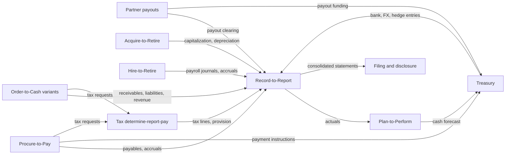
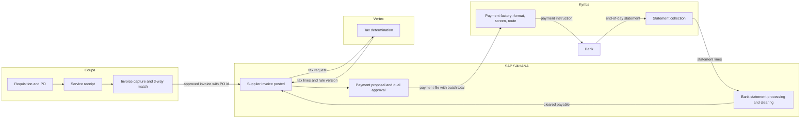
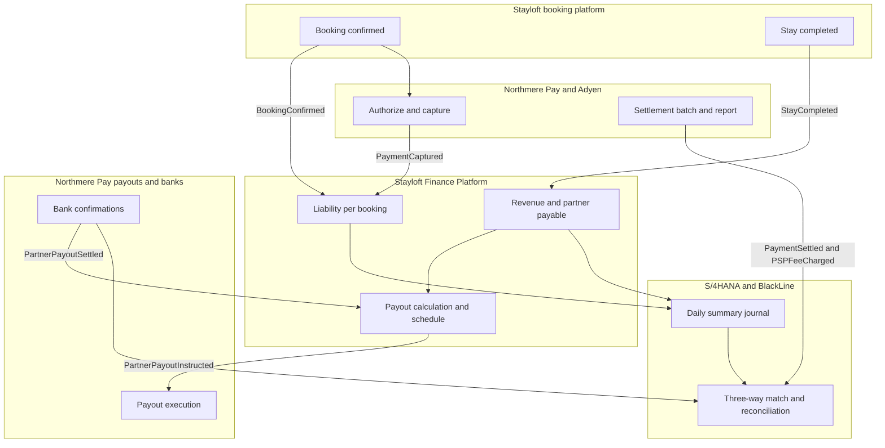

{id: finance-processes}
# 9. Order to Cash, Procure to Pay, Record to Report

> **IN THIS CHAPTER, YOU WILL:** Walk through the end-to-end finance processes an enterprise estate serves (Record-to-Report, Procure-to-Pay, Order-to-Cash and its marketplace variants, partner payouts, treasury, tax, Plan-to-Perform, Acquire-to-Retire and the finance side of Hire-to-Retire) and learn to read each one as a chain of hand-offs, with the controls, failure points and metrics that belong to each hand-off.

> **WHY FINANCE CARES:** The controller's close, the treasurer's cash position and the tax director's filing all depend on documents that crossed five or six systems before they arrived. When a number is wrong, it was almost always lost, duplicated, mis-timed or mis-identified at one of those crossings.

> **WHY ARCHITECTS SHOULD CARE:** Systems are bought and built one at a time, but finance runs end to end. The hand-offs between systems carry the cut-offs, identifiers and reconciliations that auditors test and that the close waits on, and nobody owns them unless the architecture assigns them.

> **KEY POINTS:**
>
> * **A finance process is a chain of hand-offs, and the architecture lives at the links.** Each hand-off changes at least one of system, owner, identifier or timing; each must declare its trigger and cut-off, the identifier it carries forward, who owns the item on each side, the control total that proves completeness, and where failures go.
> * **The marketplace variants of Order-to-Cash are different processes, not configurations of one.** Book-to-Settle (merchant model), Commission-to-Cash (agency model) and Subscribe/Usage-to-Cash (SaaS) differ in who holds the money, when revenue is earned and which party is paid, so they need different subledgers, controls and metrics.
> * **Every process ends in Record-to-Report, so the close inherits every upstream weakness.** Days to close is a lagging measure of hand-off quality; the leading measures are first-pass match rates, touchless rates and aging at each crossing, owned by a named process owner rather than by whichever system happens to hold the item.

> **[FAILURE PATTERNS THIS CHAPTER ADDRESSES](#where-finance-architecture-goes-wrong):**
>
> * **The Suspense Swamp** — Unmatched items collect wherever a hand-off has no identifier, no control total or no owner for its exceptions.
> * **The Doppelgänger Record** — Supplier, partner and bank details are created at more than one point in the process, and the fraud and the mismatches enter there.
> * **Spreadsheet Glue** — Accruals, cut-off lists and mapping tables that bridge two systems at month-end live outside any system and any control.

Finance teams describe their work in processes: **Record-to-Report** (R2R), **Procure-to-Pay** (P2P), **Order-to-Cash** (O2C). Architects describe the estate in systems and capabilities. The two views meet at the **hand-off**, where a financial document leaves one system, owner or identifier and continues under another. A supplier invoice approved in a procurement suite, posted in the ERP, paid through a treasury platform and confirmed by a bank statement crosses four systems and three owners, and can be lost, duplicated, mis-dated or misdirected at each crossing.

This chapter reads each end-to-end process the way an architect should: purpose, steps, systems, hand-offs, **key controls** (the checks auditors rely on to prevent or detect a material misstatement), typical failure points and a few metrics. The argument is simple: **the architecture of a finance estate is mostly the architecture of its hand-offs.** Platforms do their internal work well; the money and the audit findings are lost between them.

Two documents run through the chapter: a supplier invoice that enters through Coupa and leaves through a bank, and the Lisbon booking, a €600 merchant-model stay that touches seven processes before it becomes €90 of revenue. Following both is the fastest way I know to find where an estate's design is weak.

{id: finance-processes--setting-the-scene-two-documents-dana-asked-to-follow}
## Setting the Scene: Two Documents Dana Asked to Follow

Northmere, the fictional multi-brand digital commerce group this book follows, closes its books in nine working days in early 2027; Program Keystone, its finance transformation, targets five by the end of 2028. In February 2027 Dana Whitlock, the Chief Architect for Enterprise Applications and Financial Systems, asked Leila Haddad, the Chief Accounting Officer: "Where do the nine days go?" Leila answered with a close calendar. Dana asked instead for two documents to be followed from origin to the consolidated statements, with every change of system, owner and identifier recorded on one sheet.

The first was a March 2027 invoice from Kestrel Media GmbH, a German agency running a campaign for Stayloft B.V., Stayloft's Dutch contracting entity: €40,000 for March services, on a purchase order raised in Coupa. The second was the Lisbon booking: a German traveler's €600 three-night stay in a Lisbon apartment, paid by card through Adyen on 12 March 2027, stayed 18–21 April, with €90 commission and a €510 payout to the host.

The sheet for the invoice had 11 hand-offs across five systems. The sheet for the booking had 19 hand-offs across eight systems and three month-ends. Six of the 30 hand-offs had no agreed owner for their exceptions, four changed the identifier without keeping the old one, and three depended on a spreadsheet maintained by one person. None of the nine close days was spent in the systems themselves. Almost all were spent proving that the hand-offs had worked.

{id: finance-processes--processes-capabilities-and-hand-offs}
## Processes, Capabilities and Hand-offs

{id: finance-processes--process-versus-capability}
### Process versus capability

A **business capability** is what the organization must be able to do, stable over time and independent of how it is done: *account for partner liabilities*, *determine indirect tax*, *execute payments*. [Map What Finance Does Before What Runs It](#capability-mapping) owns the capability map and explains why architects should map capabilities before systems. A **process** is how work flows across capabilities, in sequence, to produce an outcome a stakeholder cares about: a supplier paid correctly, a period closed, a partner paid on time. The capability map tells you what must exist; the process map tells you the order in which those capabilities are exercised and where responsibility passes from one to the next.

The two views fail differently. A capability map with no process view hides hand-offs: "execute payments" is one box, but P2P, payouts, payroll and tax each invoke it with different cut-offs and approvals. A process map with no capability view hides duplication: Northmere's "pay partner" step is implemented by two payout engines, which nobody notices until both are drawn against the same capability.

{id: finance-processes--naming-conventions}
### Naming conventions

End-to-end processes are named as *start-to-finish* pairs. The names are conventions, not standards; reference models such as the APQC Process Classification Framework offer one taxonomy, and ERP vendors publish their own. I use the following, matching how Northmere's finance organization is structured:

| Process | Starts with | Ends with | Northmere process owner (2027) |
| --- | --- | --- | --- |
| **Record-to-Report (R2R)** | A posting to any ledger | Filed and published financial statements | Leila Haddad, CAO |
| **Procure-to-Pay (P2P)** | A purchase need | A cleared supplier payable | Group Head of Procurement, with Leila for the payables ledger |
| **Order-to-Cash (O2C)**, and its variants | A customer commitment | Cash applied and revenue recognized | Brand finance directors, with Ingrid Solberg for the payment leg |
| **Partner payouts** | A liability to a partner | A confirmed, reconciled payout | Ingrid Solberg (Northmere Pay) |
| **Treasury** | A bank balance or exposure | A funded, hedged, reconciled cash position | Kofi Asante |
| **Tax: determine–report–pay** | A taxable transaction | A filed and paid return | Kofi Asante |
| **Plan-to-Perform** | A strategy and a set of drivers | A plan, a forecast and a variance explained | Group FP&A director |
| **Acquire-to-Retire (A2R)** | A capital need | A disposed or fully depreciated asset | Leila Haddad |
| **Hire-to-Retire (H2R), finance touchpoints** | A position approved | A final payroll and closed obligations | Chief People Officer, with Leila for payroll accounting |

In this book "P2P" means Procure-to-Pay; Plan-to-Perform is always written out. The last column carries the table's most important design decision: a **process owner** is the executive accountable for the outcome end to end, across systems and organizational lines. Without one, each system owner optimizes their own segment and the hand-offs become nobody's job.

{id: finance-processes--anatomy-of-a-hand-off}
### Anatomy of a hand-off

A **hand-off** is any point where a financial item changes system, owner, identifier or time basis. I ask the same five questions of every one:

| Property | The question | Example of getting it wrong |
| --- | --- | --- |
| **Trigger and cut-off** | What event releases the item, and which period does it belong to when it arrives late? | A March service receipted on 4 April is missing from the March accrual. |
| **Ownership transfer** | Who owns the item, and its exceptions, before and after the crossing? | A rejected payment file sits between Accounts Payable and Treasury, each assuming the other will act. |
| **Identifier** | Which key is carried forward, and is the upstream key preserved? | A PSP settlement line carries the payment reference but not the booking id, so matching falls back to amount and date. |
| **Completeness proof** | What control total, count or reconciliation proves nothing was lost or duplicated? | SFP's daily summary posts to S/4 without a record count; a re-sent file doubles a day's revenue. |
| **Failure path** | Where do rejected or unmatched items go, who sees them, and how do they age? | Unmatched items land in a suspense account with no owner and no aging report. |

These five properties are the unit of design in this chapter. [Files, Events and APIs: How Finance Systems Talk](#integration-architecture) covers the mechanics behind them (idempotency, control totals, the transactional outbox), and [Reconciled by Design: Traceability and Audit Across Boundaries](#traceability-and-reconciliation) turns them into a reconciliation catalog. Here the job is to find them.

**Figure 1:** *A hand-off is designed when its cut-off, ownership transfer, identifier, completeness proof and failure path are all agreed; platforms work well internally, and items are lost between them.*

{id: finance-processes--the-process-map-of-a-finance-estate}
## The Process Map of a Finance Estate

Every process eventually feeds Record-to-Report. That is the structural fact that makes the close the place where every upstream weakness surfaces.

**Figure 2:** *Every finance process converges on Record-to-Report, and treasury and tax are shared services that the operational processes call; a weak hand-off anywhere on the left shows up as a late or wrong number on the right.*

Two points follow. Treasury and tax behave as **shared services** called from inside other processes, so their hand-offs are numerous and repetitive and are the first candidates for standard interfaces. And Plan-to-Perform consumes R2R's output and feeds treasury's forecast, so a late close degrades the cash forecast, a cost the controller rarely sees.

In the sections that follow, metrics are **Northmere illustrations**: fictional baselines and targets that show what to measure, not industry benchmarks.

{id: finance-processes--record-to-report-where-every-process-lands}
## Record-to-Report: Where Every Process Lands

**Purpose.** R2R turns postings from every ledger and subledger into closed, reconciled, consolidated and published financial statements. It is the process the auditor walks through first and the one the CFO is measured on.

**Steps at Northmere.**

1. **Subledger cut-off and summarization.** SFP, the Stayloft Finance Platform, posts daily summarized journals to S/4HANA (about 38,000 GL lines a day from about 3 million subledger lines). FI-CA, SAP's contract-accounting subledger, holds agency partner accounts. Wayfare closes in Oracle Fusion; Tablekin closes in Workday Financials.
2. **Accruals and adjustments.** Uninvoiced services, unbilled usage, bonuses, PSP fees not yet settled. The digest's process research records a sentence I hear in every close review: manual journals are the largest error source.
3. **Reconciliation.** About 6,800 balance-sheet accounts are reconciled monthly in BlackLine, risk-rated, with subledger-to-GL proofs for SFP and FI-CA and transaction matching for PSP settlements.
4. **Intercompany matching and FX revaluation.** Each entity books its side; the two sides must agree in amount, currency and period before elimination.
5. **Trial balance load and consolidation.** OneStream loads trial balances from S/4, Fusion and Workday, maps three charts of accounts to the group chart, translates to US dollars, eliminates intercompany and produces group results.
6. **Review, disclosure and filing.** Flux review by brand, then Workiva for the 10-Q or 10-K.

**Hand-offs that matter.** Subledger-to-GL (summary with drill-back key), ERP-to-consolidation (trial balance plus mapping) and consolidation-to-disclosure (linked figures). The second is Northmere's weakest: mappings live in spreadsheets, so a new Fusion account can reach consolidation unmapped. [Finance Data Architecture: Who Owns the Truth](#finance-data-architecture) takes up the group chart of accounts program.

| Aspect | At Northmere |
| --- | --- |
| **Key controls** | Period locks per ledger; journal approval with preparer–approver segregation; subledger-to-GL reconciliation per subledger; risk-rated reconciliations with reviewer sign-off; intercompany match before elimination; consolidation only after entity certifications. |
| **Typical failure points** | Summaries posted twice or not at all (no record count); late changes pushed to the next period without a flag; top-side adjustments that never flow back to entity ledgers; stale mapping spreadsheets. |
| **Metrics (illustrative)** | **Days to close:** 9 (2027), target 5 by end-2028. **Reconciliations auto-certified** (closed by rule): 22%, target 50%. **Post-close adjustments:** target zero material. |

Days to close is a lagging indicator: **it measures how long it takes to prove that every upstream hand-off worked.** The levers sit in the other processes; if settlements matched first time and accruals came from systems rather than spreadsheets, the close would shrink without anyone working faster. [Controls by Design, Not by Audit Season](#controls-and-auditability) covers the controls; [BlackLine: Matching, Certifying and Closing](#blackline) and [OneStream: Consolidating Actuals, Planning the Future](#onestream) the platforms.

{id: finance-processes--procure-to-pay-the-supplier-invoice-across-four-systems}
## Procure-to-Pay: The Supplier Invoice Across Four Systems

**Purpose.** P2P turns a purchase need into a cleared supplier payable: buy from an approved supplier, under contract, at the agreed price, pay exactly once, to the right account, on time. Its three outcomes are **spend on contract**, **touchless invoices** and **no duplicate or fraudulent payments**.

**Steps.** Requisition; supplier onboarding (tax ID, bank details, sanctions checks); purchase order; receipt; invoice capture; two-way (invoice against PO) or three-way (against PO and receipt) match; exception approval; posting; payment proposal and approval; payment execution; bank confirmation and clearing.

**Systems at Northmere.** Coupa handles requisitions, POs, receipts and supplier invoices for indirect spend. S/4HANA holds the payable, the GL posting and the payment run. Vertex determines tax. Kyriba is the **payment factory**, the central hub that formats, screens and routes payment files to the banks, and returns statements to S/4 for clearing. Employee expenses run in parallel through SAP Concur into S/4.

**Figure 3:** *Procure-to-Pay at Northmere crosses four systems and a bank; the five arrows between subgraphs are the hand-offs that need identifiers, control totals and an exception owner.*

{id: finance-processes--tracing-the-kestrel-invoice}
### Tracing the Kestrel invoice

Kestrel Media GmbH is onboarded in Coupa in January 2027: VAT ID validated, bank account verified by call-back to a known contact, sanctions screening clear. Coupa is the system of record for the supplier master, which replicates to S/4 as a business partner. On 3 February a first-quarter campaign PO is approved: €120,000 in three monthly service lines of €40,000, coded to Stayloft's marketing cost center. Kestrel issues structured e-invoices to all customers, because German domestic issuing obligations begin in 2027.

| Date (2027) | Step | System | Hand-off and what must hold |
| --- | --- | --- | --- |
| 31 Mar | March invoice, €40,000 net, as a structured e-invoice | Kestrel → Coupa | The structured file is the legal original and is stored as received. |
| 31 Mar | No service receipt yet | Coupa | **Cut-off.** No goods-received/invoice-received (GR/IR) entry exists in S/4, so March cost is missing unless accrued. |
| WD1 April | €40,000 accrued for March from open PO lines past their service date | Coupa extract → S/4 | The extract is **information produced by the entity** (IPE): a control depends on it, so its completeness must be provable. In 2027 it is a spreadsheet. |
| 4 Apr | Service confirmed by the marketing manager | Coupa | Receipt date and service period must both be kept. |
| 6 Apr | Three-way match within tolerance; invoice approved | Coupa | An **application control**: no payment for services not ordered or received. |
| 6 Apr | Posted in S/4 with April posting date; the March accrual reversed on 1 April | Coupa → S/4 | Coupa invoice id and PO id carried into the S/4 document; duplicate check in both systems. |
| 6 Apr | Reverse charge: Dutch input and output VAT of €8,400 each (21%) | S/4 → Vertex → S/4 | Determination, inputs and rule version stored; S/4 tax lines reconcile to Vertex before the return. |
| 4 May | Payment proposal, two approvers | S/4 | Neither approver can maintain supplier bank details. |
| 5 May | Payment file (ISO 20022 pain.001) with count and batch total | S/4 → Kyriba → bank | Kyriba checks the total, screens and routes; a rejected file belongs to Treasury Operations, not AP. |
| 7 May | End-of-day statement (camt.053); payable cleared (value date 6 May) | Bank → Kyriba → S/4 | Matching key is S/4's payment reference; if the bank truncates it, clearing falls back to amount and date. |
| May close | Bank and GR/IR accounts reconciled | S/4 → BlackLine | GR/IR aging, where receipts and invoices that never met accumulate, is the P2P health check. |

Three things in that table are architecture, not operations. The **cut-off**: a March service receipted in April can only be accrued from PO data, so the PO must carry a service period. The **identifier chain**: PO id, invoice id, S/4 document, payment reference and statement reference must each carry the previous one, or the bank line cannot be traced to the PO. The **ownership transfer at the payment file**: once Kyriba has it, an error is Treasury's, and the status must flow back so AP does not pay twice. The reverse charge nets to zero but must still appear in the VAT return, so the tax hand-off is mandatory even when no cash tax is paid; [Accounting for Architects: Ledgers, Journals and Revenue](#accounting-for-architects) covers the accruals and reversals.

**Figure 4:** *Each document on the Kestrel invoice's path must carry the previous one's identifier; if any link drops its key, the bank line can no longer be traced back to the purchase order.*

| Aspect | At Northmere |
| --- | --- |
| **Key controls** | One front door for supplier creation and bank-detail changes (Coupa onboarding), with independent verification; three-way match with tolerances; duplicate-invoice check in Coupa and S/4; two payment approvers without supplier-master rights; count and total checked between S/4 and Kyriba. |
| **Typical failure points** | Changed supplier bank details, **a classic fraud vector** when updated from a convincing email outside the workflow; services never receipted; duplicate suppliers across brands; unreadable e-invoice formats; bank rejections nobody owns. |
| **Metrics (illustrative)** | **Touchless invoice rate:** 58%, target 80%. **First-pass match rate:** 81%. **On-time supplier payment:** 93% within terms. |

{id: finance-processes--order-to-cash-and-its-marketplace-variants}
## Order-to-Cash and Its Marketplace Variants

Classic O2C (customer setup, order, fulfillment, invoice, receivable, collection, cash application, revenue) fits Northmere Ads, whose advertiser receivables sit in S/4. It does not fit most of Northmere, because in a marketplace "who holds the money", "when is revenue earned" and "who gets paid" have different answers per business model. **I treat the three marketplace variants as different processes** with different subledgers, controls and metrics; treating them as one O2C with options produces one design that is wrong for two of them.

| Variant | Northmere brand and model | Who holds the customer's money | Revenue | Who is paid onward | Subledger |
| --- | --- | --- | --- | --- | --- |
| **Book-to-Settle** | Stayloft merchant; Wayfare rail and transfers | Northmere, from booking until payout | Net commission or margin (agent), when Northmere's own promise is met | The partner, net of commission | SFP (Stayloft); Oracle Fusion (Wayfare) |
| **Commission-to-Cash** | Stayloft agency; Wayfare flights | The partner (property, airline) | Commission, when earned | Nobody: Northmere collects from the partner | FI-CA (Stayloft); Oracle Fusion (Wayfare) |
| **Subscribe/Usage-to-Cash** | Tablekin | Stripe, then Tablekin | Subscription ratably; usage as consumed | Venues, for payments facilitated through Stripe Connect | Stripe Billing; Workday Financials |

The principal-versus-agent judgment and revenue timing belong to [Accounting for Architects: Ledgers, Journals and Revenue](#accounting-for-architects).

{id: finance-processes--book-to-settle-the-merchant-model}
### Book-to-Settle: the merchant model

**Purpose.** Collect the traveler's payment, hold it as a liability until the partner delivers, recognize the commission when earned, pay the partner the rest, and prove at every month-end that the money held matches the bookings outstanding. It is Northmere's dominant flow: 64% of Stayloft's 2026 gross transaction value.

**Steps.** Booking published as a financial event; payment captured; PSP settlement received net of fees; liability recorded in the subledger (**deferred merchant bookings**, cash held for trips not yet taken); changes and cancellations adjust it; stay completed and revenue recognized; partner payable created; payout instructed and settled; three-way reconciliation of booking, PSP and bank; summary to the GL.

**Figure 5:** *Book-to-Settle as swimlanes: the booking, the money and the accounting run in different systems on different clocks, and BlackLine's three-way match is where they are proven to agree.*

**Tracing the Lisbon booking.** On 12 March the booking platform emits `BookingConfirmed` with the booking id as correlation id; Northmere Pay captures €600 through Adyen and emits `PaymentCaptured` with the same correlation id plus Adyen's payment reference; SFP records a €600 liability. On 14 March Adyen books the capture into settlement batch 1047, and on 16 March the batch payout credits Northmere Payments B.V., the group's licensed e-money institution, with €598.26 for this booking (€600 less the €1.74 fee), one line among thousands. Adyen documents [settlement reconciliation](https://docs.adyen.com/reporting/settlement-reconciliation) at transaction level ("each payment, refund, and chargeback included in a single payout batch and the costs for each transaction") and at batch level, matched to the bank statement. Northmere needs both: one ties the €598.26 to the booking, the other ties the batch to the bank.

At the **March close** the €600 is a liability, not revenue, the €1.74 is an expense, and the €600 is traveler funds that Northmere Payments B.V. must safeguard. On 21 April the stay completes; under the policy this book uses, SFP recognizes €90 of commission and turns €510 into a payable to the host (the commission's VAT is simplified away here; the tax section explains why it cannot be in practice). The payout is instructed on 22 April and settles on 26 April. At the **April close** the liability is gone, the revenue sits in April, and the payout must match the bank.

| Aspect | At Northmere |
| --- | --- |
| **Key controls** | Booking-event completeness by brand and day; settlement-report completeness per PSP and batch; three-way match with tolerance rules; daily SFP-to-GL proof; daily safeguarding reconciliation; payout release only after the safeguarding check. |
| **Typical failure points** | Modified bookings that lose the link to their payment; each PSP and alternative payment method (APM) reporting fees, FX and timing differently; settlement straddling month-end; refunds reaching payments before SFP; chargebacks after the partner is paid. |
| **Metrics (illustrative)** | **First-pass settlement match at working day 3:** 98.1% by count for Stayloft APMs (2026), target 99.7%. **Suspense:** €14 million average month-end, €2.1 million older than 90 days. **Deferred merchant bookings roll-forward explained:** 100%. |

The €14 million is Northmere's clearest case of The Suspense Swamp, and its root cause is a hand-off property: in an April 2027 analysis of about 40,000 unmatched APM lines, 48% lacked the booking reference. [Payments-to-Ledger: Draining the Suspense Swamp](#payments-to-ledger) fixes it; [Payments for Finance Architects: Eleven Reasons the Numbers Disagree](#payments-fundamentals) explains why settlement is hard. Wayfare runs the same process in a different estate: the €84 Paris–Lyon rail ticket is paid through Stripe, with Wayfare as merchant of record but, under Northmere's policy, agent for the rail operator. Oracle Fusion recognizes the €6.72 margin at ticket issue and holds the €77.28 fare as a payable to the operator, who is paid monthly by Wayfare's own payout engine. **Same process, second implementation.**

{id: finance-processes--commission-to-cash-the-agency-model}
### Commission-to-Cash: the agency model

**Purpose.** Invoice the commission earned on stays the partner collected for, with the right tax, collect it, and keep partner receivables clean.

**Steps.** Accrue commission on stayed bookings (partners mark no-shows late); determine VAT from the partner's location and status; issue the monthly invoice with booking-level detail in the partner extranet; collect, dun, and **net against merchant payouts** where a partner has both; clear receivables; feed the bad-debt reserve from aging.

**Systems.** SFP's commission billing calculates; FI-CA (since 2025, about 850,000 partner contract accounts) holds the open item, dunning and clearing; Vertex determines VAT; S/4 receives summaries. Netting is a hand-off between two variants, an FI-CA receivable against an SFP payable for the same property, and **netting across two subledgers requires one partner identity**: a master-data requirement, not a payments feature.

| Aspect | At Northmere |
| --- | --- |
| **Key controls** | Commission base reconciled to stayed bookings; invoice numbering per entity and jurisdiction; logged tax determination; write-off thresholds; FI-CA-to-GL reconciliation. |
| **Typical failure points** | Stay-data disputes; invalid VAT IDs; payments without invoice reference, so cash sits unapplied; small balances costlier to chase than to write off. |
| **Metrics (illustrative)** | **Days sales outstanding (DSO):** 41 days, target 32. **Unapplied cash** older than 30 days. **Disputes** per thousand invoices. |

{id: finance-processes--subscribe-usage-to-cash-the-saas-model}
### Subscribe/Usage-to-Cash: the SaaS model

**Purpose.** Bill a subscription plus metered usage, collect it, and recognize revenue on the right schedule. Tablekin's Austin venue on the Pro plan pays $249 a month plus $0.25 per seated cover; in March 2027 it seats 3,120 covers, so usage is $780 and the invoice $1,029 before sales tax.

**Steps.** Usage events rated (each seated cover is one event from Tablekin's product); invoice finalized on the first of the month, with the subscription billed in advance and usage in arrears; sales tax added; payment collected and paid out by Stripe; revenue recognized (subscription over its month, usage as consumed); daily summarized journals posted to Workday Financials.

**The cut-off hand-off.** The $1,029 invoice is dated 1 April and mixes two periods: the **April** subscription ($249, a contract liability until April is served) and **March** usage ($780). At the March close Workday Financials must therefore already hold the $780 as accrued revenue, estimated from usage Stripe has rated but not yet invoiced, and must defer the $249 when the invoice posts. An integration that books invoices as revenue on their date gets both months wrong. On the cash side, Stripe's [payout reconciliation report](https://docs.stripe.com/reports/payout-reconciliation) matches "the payouts you receive in your bank account with the batches of payments and other transactions that they relate to", and its itemized view carries `invoice_id` and `subscription_id`: the identifiers that trace a bank credit back to the venue's invoice. Vendor change reaches hand-offs too: Stripe now recommends Metronome over its Meters API for new [usage-based billing](https://docs.stripe.com/billing/subscriptions/usage-based) integrations.

| Aspect | At Northmere |
| --- | --- |
| **Key controls** | Usage completeness (seated covers against rated usage); Stripe AR reconciled to the Workday AR control account; revenue schedule review; payout-to-bank match. |
| **Typical failure points** | Usage events lost or duplicated; unexplained mid-period proration; revenue posted only at finalization; fees and disputes netted inside payouts. |
| **Metrics (illustrative)** | **Usage completeness:** rated ÷ seated covers, 100.0% within a day. **Billing-to-revenue variance** at close. |

{id: finance-processes--partner-payouts}
## Partner Payouts

Payouts sit inside Book-to-Settle but deserve their own view. They are Northmere's largest outbound flow by count, about 9 million a month across Stayloft and Tablekin. They depend on **the most fraud-sensitive master data in the estate**, partner bank details. And they produced the FY2026 significant deficiency: developers had production access to the SFP payout engine, and rule changes lacked documented approval.

**Steps.** Calculate the net payout, usually tied to check-in or check-out; apply holds (fraud, disputes, missing tax data); fund the run from the right entity and currency, with the safeguarding check passed before client funds are released; release in batches by currency, method and bank cut-off; confirm settlement; re-queue returns; clear partner payables.

**Systems.** SFP calculates and schedules Stayloft payouts and hands payout instructions to Northmere Pay, which executes them; Kyriba funds the accounts they are paid from. Tablekin venue payouts run inside Stripe Connect; Wayfare's ground-transport suppliers are paid by Wayfare's own engine. Three routes for one capability.

**The Lisbon payout.** On 22 April SFP emits `PartnerPayoutInstructed` for €510, carrying the booking id and its own payout id, in a euro batch whose count and total Northmere Pay checks before execution. On 26 April the bank confirms; SFP emits `PartnerPayoutSettled` and clears the payable. If the host's bank returns the payment, it must come back to SFP as a payout status, not as an unexplained credit on a Northmere bank account.

| Aspect | At Northmere |
| --- | --- |
| **Key controls** | Bank-detail changes independently verified, second-approved and logged; payout rule changes under change management (the FY2026 remediation); safeguarding check before release; SFP-to-Northmere Pay batch totals; returns routed to a named owner. |
| **Typical failure points** | Bank details changed in a support tool without the second approval; adjustments after payout (the €420 chargeback arrived 40 days after the stay); returns aging without owners; missed country cut-offs. |
| **Metrics (illustrative)** | **On-time partner payout:** 98.6% (2027), target 99.5%. **Returned payouts** and their age. **Payouts with no post-payment adjustment.** |

{id: finance-processes--treasury-cash-fx-and-bank}
## Treasury: Cash, FX and Bank

**Purpose.** Know where the group's cash is, every day; fund every outbound flow from the right account in the right currency; manage FX exposure within policy; keep bank connectivity secure; and, for Northmere's e-money institutions, keep safeguarded funds separate and reconciled.

**Steps.** Collect prior-day statements (camt.053 or MT940) and intraday reports (camt.052 or bank APIs) from about 410 accounts at 27 banks; separate safeguarded from operating cash; position cash by entity and currency; forecast from payouts, receipts, AP runs and payroll, with deferred merchant bookings as the leading indicator of payouts; capture FX exposures (partners are paid in 31 currencies) and hedge within policy; post hedge and revaluation entries to the GL; execute every other process's payments through the payment factory.

**Systems.** Kyriba is the treasury management system and payment factory; Kyriba [describes its platform](https://www.kyriba.com/) as connecting to banks out of the box through open APIs. S/4 receives statement postings and hedge entries; SFP supplies the payout forecast and the traveler-funds liability; the daily safeguarding calculation compares the subledger's relevant funds with the safeguarding account balances.

Bank formats are often stated wrongly: SWIFT's MT/ISO 20022 coexistence ended in November 2025 for **cross-border interbank payment instructions**, not for corporate statements, and MT940 remains in wide use while banks migrate to camt.053. Treasury's hand-offs must handle both for years.

| Aspect | At Northmere |
| --- | --- |
| **Key controls** | Central approval of bank accounts and signatories; dual approval of manual payments; file integrity between source systems and Kyriba; daily bank and safeguarding reconciliations; hedge designation documented at inception. |
| **Typical failure points** | Unconnected banks leaving manual lines in the position; late statements; exposures assembled in spreadsheets; safeguarded and operating cash commingled; returns without the originating reference. |
| **Metrics (illustrative)** | **Cash visibility:** share of group cash reported automatically by 09:00 Amsterdam, 94%, target 99%. **13-week forecast accuracy** by entity. **Safeguarding breaks** open at day end: zero. |

{id: finance-processes--tax-determine-report-pay}
## Tax: Determine, Report, Pay

**Purpose.** Determine the right tax on each transaction when it happens, record it with evidence, report and pay it on time, and supply data for the income-tax provision and the global minimum tax.

**Steps.**

1. **Determine** at the transaction: VAT on Stayloft's commission and on merchant sales, reverse charge on Kestrel's invoice, US sales tax on Tablekin's invoices. The determination must record jurisdiction, rate, the rule version and the inputs used.
2. **Record** the tax lines in the ledger with jurisdiction and entity.
3. **Reconcile** the tax engine's committed transactions to the GL tax accounts before filing.
4. **Report**: VAT returns per entity and country; platform reporting under DAC7, which requires EU platform operators to report seller information annually by 31 January; digital services taxes; e-invoices and, increasingly, **clearance**, where the authority or an accredited platform validates an invoice before it is legally issued.
5. **Pay** through the payment factory, from the right entity and account.
6. **Provide** jurisdiction-level data to the income-tax provision and to Pillar Two, the OECD's 15% global minimum tax, which needs consolidation-grade, entity-level data.

**Systems.** Vertex determines indirect tax for S/4 and for SFP's commission invoicing; Wayfare uses Oracle's tax engine in nine markets. In May 2027 the design authority made Vertex the group standard, called only through a Northmere-owned tax service adapter, which turns tax determination into one standard hand-off instead of one per calling system ([Around the Core: Where Specialist Platforms Earn Their Place](#satellite-platforms)). OneStream and the Snowflake finance data platform supply provision and Pillar Two data; Kyriba pays.

**The Lisbon booking's tax.** The €90 commission is a service to a Portuguese host. If the host is a VAT-registered business, the general B2B rule places the supply where the customer is established and the host self-assesses under reverse charge; if the host is a private individual, the answer changes. **The same booking can produce different tax outcomes depending on master data that lives in another process**, which is why each determination is logged with its inputs. The host reappears in January 2028 in Northmere's DAC7 report, with €510 paid and €90 in fees. DAC7 and VAT data must come from the same partner master and transaction record, or they will disagree in front of a tax authority.

**The horizon.** The EU's [VAT in the Digital Age package](https://taxation-customs.ec.europa.eu/news/adoption-vat-digital-age-package-2025-03-11_en), adopted in March 2025, makes e-invoicing the default for intra-EU cross-border B2B supplies from 1 July 2030 and lets member states mandate domestic e-invoicing without derogation; as of 2026 Belgium, Poland, France and Germany are already phasing in mandates. Under clearance, **invoice issuance moves into the critical path of Commission-to-Cash and P2P**: an outage at an accredited platform stops invoicing. That is an architecture decision, not only a tax one; [Global by Design: Entities, Currencies, Jurisdictions and Brands](#global-scale) goes further.

| Aspect | At Northmere |
| --- | --- |
| **Key controls** | Engine rule updates under change control; determination log retained for the statute period; engine-to-GL reconciliation before filing; return approval; archive of the legally valid e-invoice. |
| **Typical failure points** | Missing VAT IDs and location evidence; entity–registration mismatches; fallback rates never recalculated after an outage; DAC7 data from a different master than payouts; disputes that outlast the systems that produced the data. |
| **Metrics (illustrative)** | **Returns filed on time:** 100%. **Unexplained engine-to-GL difference** at filing: zero above threshold. **Determination exceptions** per million transactions. |

{id: finance-processes--plan-to-perform}
## Plan-to-Perform

**Purpose.** Set targets, forecast against them and explain variances: the process where finance meets the brands' operating data.

**Steps and systems.** Load closed actuals into OneStream; build driver-based plans (for Stayloft: room nights, average daily rate, take rate, merchant mix, marketing) from drivers in Snowflake's FinDB and headcount from Workday HCM; reforecast monthly with FX and demand scenarios; review performance; feed treasury's cash forecast.

**The Lisbon booking in the plan.** It is one of millions in the drivers: 3 room nights at €200, a 15% take rate, merchant model. The plan needs the **definitions** behind the drivers to match the ledger. If FinDB counts room nights at booking and the ledger recognizes revenue at stay, the take rate computed from the two drifts whenever the booking curve shifts, and the review becomes a debate about whose number is right. [One Number, Many Views: Finance Data from Operations to Analytics](#finance-data-flows) resolves it with governed metrics.

| Aspect | At Northmere |
| --- | --- |
| **Key controls** | Planning actuals tied out to consolidated results; governed driver definitions; locked plan versions. Mostly outside internal control over financial reporting (ICFR), but numbers derived from it (impairment tests, guidance) are not. |
| **Typical failure points** | Shadow reforecast spreadsheets; brand-specific driver definitions; actuals restated after load. |
| **Metrics (illustrative)** | **Revenue forecast at month −3** within ±3%. **Close-to-forecast cycle:** 8 working days, target 4. |

{id: finance-processes--acquire-to-retire}
## Acquire-to-Retire

**Purpose.** Account for long-lived assets from acquisition to disposal: capitalize the right costs, depreciate correctly, track leases, test for impairment, retire correctly.

**Steps and systems.** Capital request; purchase through Coupa with an asset flag; costs on an asset under construction in S/4 asset accounting; capitalization when in service; monthly depreciation; impairment review; disposal. Two categories dominate at Northmere: **leases** (offices, data center capacity) in a lease subledger, and **capitalized internal-use software**, which under US GAAP (ASC 350-40) requires engineering time on qualifying development to be captured and capitalized.

**Hand-offs that matter.** P2P-to-asset (an invoice expensed that should have been capitalized, or the reverse) and engineering-time-to-capitalization, which draws on brand engineering tools never designed as financial inputs. If a key control relies on a time-tracking export, that export becomes IPE and its pipeline enters audit scope.

| Aspect | At Northmere |
| --- | --- |
| **Key controls** | Capitalization rules on asset-flagged POs; register-to-GL reconciliation; depreciation run completeness; lease completeness; capitalized software reviewed by project stage. |
| **Typical failure points** | Assets under construction never capitalized; unrecorded disposals; leases embedded in service contracts; capitalization from a spreadsheet of engineers' time. |
| **Metrics (illustrative)** | **Assets under construction older than 12 months.** **Register-to-GL difference:** zero. |

{id: finance-processes--hire-to-retire-the-finance-touchpoints}
## Hire-to-Retire: The Finance Touchpoints

Hire-to-Retire belongs to HR, but finance touches it at five points:

1. **Cost center.** Workday HCM (group-wide since 2019, about 24,000 workers) assigns each worker to a cost center, and every payroll journal inherits it.
2. **Payroll accounting.** Workday Payroll (US, UK, Canada) and third-party providers elsewhere each post payroll journals to S/4 that must reconcile to the payroll register.
3. **Funding and statutory payments** through Kyriba, on dates that cannot slip.
4. **Accruals** for bonuses, leave and equity compensation at each close.
5. **Approvers and access.** Workday's manager hierarchy drives approval chains in Coupa and Concur, and its leaver events drive access removal. **A leaver who keeps an approval right in Coupa is an access-control failure that starts in HR data.**

| Aspect | At Northmere |
| --- | --- |
| **Key controls** | Payroll journal reconciled to the payroll register by entity; net pay matched to the bank; approval hierarchy synchronized daily from Workday; leaver access removed within a defined window. |
| **Typical failure points** | Cost-center changes not reflected in open approvals; third-party payroll journals mapped by hand; provider reports used as evidence without IPE testing; leavers keeping approval rights in satellites. |
| **Metrics (illustrative)** | **Payroll journals posted without manual mapping**, by country. **Leaver access removed within 24 hours.** |

{id: finance-processes--the-hand-off-matrix}
## The Hand-off Matrix

The matrix below, the most useful artifact from Dana's exercise, puts each process against Northmere's systems by role and names its weakest hand-off.

| Process | Originating system | Subledger or operational ledger | General ledger | Money movement | Satellites | Close and reporting | Weakest hand-off in 2027 |
| --- | --- | --- | --- | --- | --- | --- | --- |
| **Record-to-Report** | All ledgers | SFP, FI-CA | S/4, Fusion, Workday Fin | — | Vertex (tax accounts) | BlackLine, OneStream, Workiva | Three charts of accounts mapped in spreadsheets |
| **Procure-to-Pay** | Coupa, Concur | S/4 AP | S/4 | Kyriba, banks | Vertex | BlackLine (GR/IR, bank) | Coupa open-PO accrual extract |
| **Book-to-Settle** | Stayloft and Wayfare platforms | SFP; Fusion (Wayfare) | S/4; Fusion | Northmere Pay, Adyen, Stripe, APMs | Vertex | BlackLine Transaction Matching | APM settlement lines without booking id |
| **Commission-to-Cash** | Stayloft platform | SFP billing, FI-CA | S/4 | Direct debit, bank | Vertex, e-invoicing | BlackLine | Incoming payments without invoice reference |
| **Subscribe/Usage-to-Cash** | Tablekin product | Stripe Billing | Workday Fin | Stripe | Sales tax | OneStream (via Workday TB) | Unbilled usage at month-end |
| **Partner payouts** | SFP; Wayfare engine; Stripe Connect | SFP, Fusion | S/4, Fusion | Northmere Pay, banks, Stripe; funded by Kyriba | — | BlackLine | Returned payouts without payout id |
| **Treasury** | Banks | Kyriba | S/4 | Kyriba | Safeguarding calculation | BlackLine (bank recs) | Banks without automated statements |
| **Tax** | All transacting systems | Vertex, Oracle tax | S/4, Fusion, Workday Fin | Kyriba | Snowflake (DAC7, DST) | OneStream (provision, Pillar Two) | Two engines for one capability |
| **Plan-to-Perform** | OneStream, FinDB | — | Actuals from OneStream | — | Workday HCM | OneStream | Driver definitions differing by brand |
| **Acquire-to-Retire** | Coupa, engineering tools | S/4 asset accounting, lease subledger | S/4 | via P2P | — | BlackLine | Engineering time to capitalization |
| **Hire-to-Retire (finance)** | Workday HCM | Workday Payroll, third-party payroll | S/4 | Kyriba | — | BlackLine | Third-party payroll mapping |

Read down a column and the platform's blast radius appears: Kyriba is in the money path of five processes, so its outage stops supplier, payroll and tax payments at once and leaves payouts unfunded; Vertex sits in five. Read across a row and the process's dependency chain appears: Book-to-Settle needs eight systems to agree before one booking is proven.

{id: finance-processes--both-documents-across-every-process}
## Both Documents, Across Every Process

| Date (2027) | Kestrel invoice (€40,000 net) | Lisbon booking (€600) | Process |
| --- | --- | --- | --- |
| 12 Mar | — | Captured; liability €600 in SFP; safeguarded | Book-to-Settle; Treasury |
| 14–16 Mar | — | Adyen batch 1047 booked 14 Mar (this booking €598.26 net of the €1.74 fee); the batch payout of €1,380.52 credited to the bank 16 Mar | Book-to-Settle; R2R |
| 31 Mar | Invoice issued; service not receipted | — | P2P |
| March close | €40,000 accrued from open PO | €600 in deferred merchant bookings; matched three ways | R2R |
| 6 Apr | Matched, posted, reverse charge €8,400 / €8,400 | — | P2P; Tax |
| 21 Apr | — | Stay completed; €90 revenue; €510 payable | Book-to-Settle; R2R |
| 22–26 Apr | — | €510 payout instructed and settled | Partner payouts; Treasury |
| April close | Accrual reversed against invoice | Liability cleared; revenue in April | R2R |
| 5–7 May | Paid via Kyriba; cleared from camt.053 | — | P2P; Treasury |
| Q1, Q2 VAT returns | Reverse charge reported in NL | Commission VAT reported per host status | Tax |
| Jan 2028 | — | Host reported in DAC7 | Tax |

Every row in the right-hand column is a different process owner. **No single system sees either document whole**, and only a deliberately designed chain of identifiers lets anyone reconstruct it. [The Life of a Booking: From €600 Payment to $97.38 of Revenue](#transaction-to-report) traces the booking in full depth, hop by hop, with the invariants that must hold at each one.

{id: finance-processes--trade-offs-where-process-logic-lives-and-who-owns-it}
## Trade-offs: Where Process Logic Lives and Who Owns It

Two design questions recur in every process: where the logic that moves an item across a hand-off should live, and how the process is owned.

| Option for hand-off logic | When it is right | What it costs | Northmere example |
| --- | --- | --- | --- |
| **Inside the ERP's native workflow** | The process runs mostly in one platform and the vendor's standard fits | Couples the process to the ERP's release cycle; tempting to customize | Payment proposal and approval in S/4 |
| **Inside the satellite** | The satellite owns the domain and its network (suppliers, banks, tax authorities) | Satellite's data model becomes a dependency; logic duplicates across satellites | Three-way match in Coupa; bank formats in Kyriba |
| **In the integration layer** | Mapping and routing between platforms with no business judgment | Business rules creep into mappings, invisible to process owners | Today's MuleSoft flows for Wayfare and Tablekin |
| **In a custom orchestration service** | Volume, business-model novelty or cross-brand logic no vendor supports | You own controls, audit evidence and run cost | SFP's payout scheduler |

The rule I use: **put judgment in the system that owns the domain, put translation in the integration layer, and never put judgment in the integration layer.** A mapping that decides whether a cost is capital or expense is a business rule wearing integration clothes, and it will not be found by an auditor or a process owner until it fails.

On ownership, the choice is between system-aligned ownership (clear technical accountability, orphaned hand-offs), process-aligned ownership (one owner for end-to-end metrics and exceptions, but it needs authority over brand teams) and capability-aligned ownership (prevents duplicates, but nobody owns the outcome). I recommend the second paired with the third: **the process owner signs the hand-off contract; the capability owner implements it.** Where a process owner cannot be given authority over brand engineering, the hand-off contract should at least be an architecture standard the review board enforces.

{id: finance-processes--integration-with-the-rest-of-the-estate}
## Integration With the Rest of the Estate

This chapter owns the process view; other chapters own the layers it crosses. [Anatomy of a Finance Estate: Layers, Planes and Boundaries](#finance-landscape) places each system of the matrix in the reference model. [Accounting for Architects: Ledgers, Journals and Revenue](#accounting-for-architects) owns the journal entries behind each step. [Finance Data Architecture: Who Owns the Truth](#finance-data-architecture) owns the master data every hand-off depends on. [Controls by Design, Not by Audit Season](#controls-and-auditability) turns the key controls here into a control framework. [Files, Events and APIs: How Finance Systems Talk](#integration-architecture) supplies the idempotency and control-total mechanics, [Canonical Events: A Common Language for Money](#loosely-coupled-domains) the canonical events the Lisbon trace used, and [Systems of Record: Ending the Doppelgänger Record](#systems-of-record) formalizes how authority over an item moves from booking platform to subledger to GL.

{id: finance-processes--failure-modes}
## Failure Modes

**The orphaned exception queue.** Rejected items land in a queue neither side owns. In one week of 2026 a bank format change caused 312 payout instructions to be rejected downstream of SFP; SFP still showed them as instructed, and partners called before finance noticed. The fix is a failure path with an owner and a status that flows back to the originator.

**Identifier amnesia.** A system mints its own key and drops the upstream one: APM settlement lines without booking ids, bank-truncated payment references, Coupa invoice ids lost in S/4. Every hand-off contract should require the upstream key to be preserved, and tests should prove it.

**Cut-off by convention.** Periods assigned by when the file arrived rather than by the event's date, so late items slide into the next period unflagged and the controller spends a day explaining the flux. Carry event date, posting date and period separately.

**The accrual spreadsheet.** Accruals built from extracts and finished by hand are IPE, key to the close, and owned by one person: Spreadsheet Glue in its purest form, and usually the first thing to automate because the source data already exists.

**Two front doors for master data.** Supplier bank details editable in Coupa *and* in S/4; partner bank details editable in SFP's console *and* a support tool. Every second door is a fraud path and a reconciliation break. The fix is one front door per master object with replication outward, which [Finance Data Architecture: Who Owns the Truth](#finance-data-architecture) develops.

**Duplicate process implementations.** Two payout engines, three billing approaches and two tax engines run "the same" process differently, so metrics are not comparable and controls are tested twice. The process view exposes them; the capability view decides which survives.

{id: finance-processes--the-chief-architect-s-view}
## The Chief Architect's View

**Decide that processes have owners, and that hand-offs are architecture.** At Northmere, Dana proposed and Tomás Ferreira, the CFO, approved that every process in the table above has a named owner, and that every hand-off between systems has a contract (the five properties) approved by the process owner and registered in the architecture repository. That turns the hand-off from tribal knowledge into a governed artifact the review board can check. A process owner without influence on brand roadmaps will write good contracts nobody implements; the review board described in [Architecture Governance That Speeds Decisions](#architecture-governance) is what gives the contracts teeth.

**Standardize the hand-offs that repeat.** Payment instructions to the payment factory, tax determination requests, summary postings to the GL and bank statement returns each recur across several processes. One contract for each, with one identifier convention and one control-total rule, removes more risk than any single platform project. Keystone's canonical events are the O2C half of this; payment-factory and tax-request standards are the other half.

**Measure the leading indicators, not only the close.** The close metric tells the CFO how long proof took. First-pass match rates, touchless rates, unapplied cash, suspense aging and returned-payment aging tell the architect which hand-off to fix next. I would put five of them on the Keystone dashboard next to days to close.

**Treat regulation as a process-change trigger.** Clearance e-invoicing puts tax authorities inside P2P and Commission-to-Cash; DAC7 and ViDA put partner master data inside tax; safeguarding puts the subledger inside treasury. Each changes a hand-off. The architecture function should review every regulatory change against the hand-off matrix, not leave it to the tax or legal team to discover the systems impact.

{id: finance-processes--questions-to-ask}
## Questions to Ask

- Who is the named owner of each end-to-end process, and do they have authority over the hand-offs, or only over their own system?
- For the three hand-offs that feed the most close days, what are the trigger, cut-off, identifier, control total and failure path?
- Can we trace one supplier invoice and one customer transaction from origin to the consolidated statements today, and how long does it take?
- Which hand-offs depend on spreadsheets or manual extracts that a key control relies on?
- Where can supplier and partner bank details be changed, and how many front doors exist for each?
- Which processes are implemented more than once across brands, and which implementation is the target?
- How do late-arriving events (refunds, chargebacks, late receipts, restated usage) find their period, and are they visible when they do?
- Which upcoming regulatory changes alter a hand-off, and who is redesigning it?

Processes describe how items flow; they cannot work unless the items flowing through them are described consistently in every system they touch. The Kestrel invoice depended on one supplier record and one chart of accounts; the Lisbon booking depended on one partner identity across SFP, Kyriba, Vertex and the DAC7 report. The next chapter, [Finance Data Architecture: Who Owns the Truth](#finance-data-architecture), takes up the master data, systems of record and governance that every hand-off in this chapter quietly assumes.

{id: finance-processes--sources-and-evidence}
## Sources and Evidence

*Vendor documentation*

- [Settlement reconciliation](https://docs.adyen.com/reporting/settlement-reconciliation), Adyen documentation, accessed 2026 — transaction-level and batch-level settlement reconciliation used in the Book-to-Settle trace.
- [Payout reconciliation report](https://docs.stripe.com/reports/payout-reconciliation), Stripe documentation, accessed 2026 — matching payouts to the transactions they settle; `invoice_id` and `subscription_id` columns used in the Subscribe/Usage-to-Cash trace.
- [Usage-based billing](https://docs.stripe.com/billing/subscriptions/usage-based), Stripe documentation, accessed 2026 — Metronome as Stripe's primary usage-based billing platform; Meters API remains supported.
- [Kyriba platform overview](https://www.kyriba.com/), Kyriba, accessed 2026 — bank connectivity and open APIs, as the vendor describes them.
- [Vertex Indirect Tax O Series](https://www.vertexinc.com/solutions/products/vertex-indirect-tax-o-series), Vertex — indirect tax determination for sales and purchase transactions.

*Standards and regulation*

- [Adoption of the VAT in the Digital Age package](https://taxation-customs.ec.europa.eu/news/adoption-vat-digital-age-package-2025-03-11_en), European Commission, 2025 — ViDA adoption and the 1 July 2030 e-invoicing default for intra-EU B2B.
- [Peppol: about](https://peppol.org/about/), OpenPeppol — the four-corner model behind network e-invoicing referred to in the tax section.
- [Deadline for first DAC7 reporting](https://news.pwc.be/deadline-for-first-dac7-reporting-now-imminent), PwC Belgium, 2024 — DAC7 scope and the 31 January annual reporting deadline (secondary source).
- [Germany e-invoicing timeline](https://www.avalara.com/us/en/blog/germany-e-invoicing.html), Avalara — German receive (2025) and issue (2027/2028) obligations (vendor source; verify against the German Federal Ministry of Finance before relying on dates).
- [IFRS 15 Revenue from Contracts with Customers](https://www.ifrs.org/issued-standards/list-of-standards/ifrs-15-revenue-from-contracts-with-customers/), IFRS Foundation — revenue timing behind Book-to-Settle and Subscribe/Usage-to-Cash.
- [IFRS 16 Leases](https://www.ifrs.org/issued-standards/list-of-standards/ifrs-16-leases/), IFRS Foundation — lease accounting in Acquire-to-Retire.
- [ISO 20022 and Swift MT/MX coexistence FAQ](https://www.pcbb.com/products/international-banking/international-payments/iso20022-faq), PCBB — end of MT/MX coexistence for cross-border interbank payment instructions in November 2025 (secondary source).

*Practitioner and research sources*

- Book research digest (this book's `_research/productscape-digest.md`), 2026 — the twelve end-to-end finance streams, their steps and pain points, generalized from a public-source domain model of a multi-brand travel group.
- Book research brief on accounting, controls and regulation (`_research/brief-accounting-controls-regulation.md`), 2026 — accruals, revenue models, ITGCs, application controls, IPE, DAC7, safeguarding.
- Book research brief on satellite platforms (`_research/brief-satellites-ai.md`), 2026 — tax determination patterns, treasury patterns, payment factory, AP intake channels.
- APQC Process Classification Framework, APQC — a widely used cross-industry process taxonomy; named here as an example of process reference models (not re-verified in this session).

Northmere Group, its people, systems, figures and metrics are fictional; the architectural recommendations are the author's judgment.
