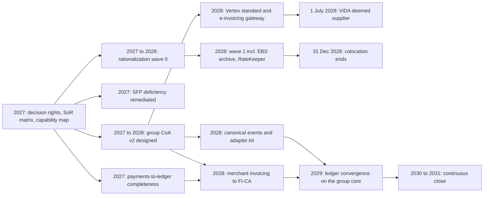
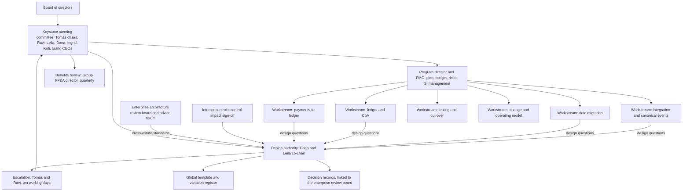
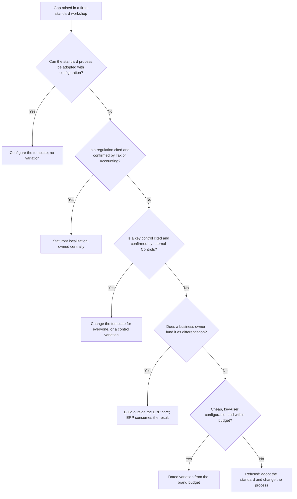

{id: finance-transformation}
# 41. Leading an ERP Modernization and Finance Transformation

> **IN THIS CHAPTER, YOU WILL:** Learn what a Chief Architect owns in a multi-year ERP modernization and finance transformation: the business case and how its benefits are tracked, the logic that sequences scope, the design authority and its global template, fit-to-standard and how to refuse a customization, the system integrator model, data migration, finance testing, operating-model change, cut-over and hypercare. You will follow the first year of Northmere's Program Keystone, including one hard trade-off between Stayloft's commission rules and the global template.

> **WHY FINANCE CARES:** The CFO signs a business case with savings in it, and the controller signs every balance the new system produces. A transformation that ships software but leaves the savings unbanked, the close longer or the auditor with a material weakness has failed Finance, whatever the program dashboard says.

> **WHY ARCHITECTS SHOULD CARE:** Finance programs run for years, change integrators, sponsors and scope, and end up judged by what they leave behind: a data model, a template, a set of boundaries and a body of custom code. The architect is the one role whose job is the state of the estate after the program closes.

> **KEY POINTS:**
>
> * **Benefits belong to Finance and land in budgets.** Write the business case as a register of benefit lines, each with a Finance owner, a baseline, a measuring source and a budget line that falls when the benefit is real. Close days and match rates are lead indicators, not savings; risk reduction is tracked in its own units and never converted into dollars to fill a gap.
> * **A design authority guards one global template and budgets the exceptions.** It decides the data model, the boundaries, the template and every variation from it; the program decides scope, timing and resources. Every requested variation passes the "show me the control or the regulation" test, commercial differentiation moves out of the ERP, and each brand gets a small variation budget with expiry dates.
> * **Outsource delivery, never the architecture, the data or the proof.** The integrator configures and builds; the enterprise keeps architecture ownership, data-migration acceptance and the testing strategy. Finance testing is reconciliation testing, with mock period-ends, parallel closes and month-end volumes, and go-live is gated by reconciliations and the close calendar, not by the plan date.

> **[FAILURE PATTERNS THIS CHAPTER ADDRESSES](#where-finance-architecture-goes-wrong):**
>
> * **Customization Concrete** — a transformation is the moment a new core is either kept clean by a design authority that can say no, or filled with the old system's habits for another decade.
> * **The Permanent Exception** — a global template survives only if every brand's "we are different" claim is tested, priced and budgeted, not granted by default.
> * **Big-Bang Bravado** — publicly documented program failures cluster around go-lives that were timed by the plan, not by evidence and the business calendar.

A **finance transformation** is a multi-year program that changes Finance's systems, processes, data and organization together: typically a new or converged ERP core, a new chart of accounts, a faster close, shared services and new controls. An **ERP modernization** is the technology half of it. The two are sold as one investment, and they fail together, because a new ledger that Finance cannot close on, or a new close process with no system to run it, delivers none of the business case.

Large finance programs have a reputation they have earned. Public cases, some collected in [CIO's compilation of ERP disasters](https://www.cio.com/article/278677/enterprise-resource-planning-10-famous-erp-disasters-dustups-and-disappointments.html), describe programs that stopped plants shipping, broke financial reporting, or ran several times over budget before being reimplemented. Reading them closely, the causes are rarely the software. They are **governance, data, process mapping, testing and go-live timing**, which is to say the parts of a program the architect is supposed to protect.

This chapter is about that protection. It is not a program-management manual, and it does not re-teach what other chapters own: the choice of migration pattern belongs to [Modernization Patterns for Legacy Finance Systems](#modernization-patterns) and, for SAP, to [SAP S/4HANA: The Enterprise Finance Core](#sap-s4hana); stage gates, parallel runs and rollback design for a live migration belong to [Modernizing Without Stopping the Close: An Incremental Migration](#incremental-modernization); decision records and the review board belong to [Architecture Governance That Speeds Decisions](#architecture-governance); the roadmap and its plateaus belong to [Target State, Transition States and the Roadmap](#target-and-transition-states). Here the question is narrower and harder: **what does the Chief Architect do, year after year, so that the program succeeds and the estate it leaves behind is better than the one it found?**

{id: finance-transformation--setting-the-scene-at-northmere-the-second-steering-committee}
## Setting the Scene at Northmere: The Second Steering Committee

Northmere Group, the fictional multinational this book follows, approved **Program Keystone** in December 2026: about **$310 million** over five years, with a target of **$95 million a year of run-rate savings by 2030** from retired systems, reduced manual effort and lower payment service provider (PSP) and bank costs. Tomás Ferreira, the Group CFO, sponsors it. The design authority is chaired by Dana Whitlock, Chief Architect for Enterprise Applications and Financial Systems, together with Leila Haddad, Chief Accounting Officer and Group Controller.

At the second steering committee, in February 2027, three things happened in one hour.

The program director presented a green dashboard: workstreams mobilized, the system integrator on site, the plan on track. Tomás asked which of the $95 million he could see in the 2028 budget. Nobody could answer, because the business case had been written as five totals by category, with no owner below the CFO and no line in any budget.

Jonas Berg, who runs Stayloft Finance Engineering, asked whether Stayloft's commission rules would "come across" when merchant invoicing moved to SAP FI-CA, the high-volume contract-accounting subledger. The integrator's lead said yes, and estimated the custom development. Leila asked who had decided that the global template would carry Stayloft-specific invoicing logic. Nobody had.

Mei Tanaka, Head of Internal Controls, reminded the room that the FY2026 audit had found a significant deficiency in change management on Stayloft's payout engine, and asked which workstream owned the evidence that a converged ledger would close correctly. The integrator's statement of work covered testing "per the integrator's methodology"; Northmere had no testing strategy of its own.

None of these was a delivery failure. All three were **ownership gaps that only an architect is positioned to see**: benefits without owners, a template without a guardian, and proof without a strategy. The rest of the chapter closes them, in the order Dana did in 2027.

{id: finance-transformation--what-the-architect-owns-and-what-the-program-owns}
## What the Architect Owns, and What the Program Owns

A large finance program has three centers of authority, and most of its conflicts come from blurring them.

- **The sponsor and Finance leadership** own the *why*: the business case, the benefits, the operating model and the accounting policy.
- **The program director and the program management office (PMO)** own the *when and how much*: plan, budget, resources, risks, vendor management and status.
- **The Chief Architect and the design authority** own the *what*: the target data model, the boundaries between systems, the global template, the variations from it, and the technical conditions under which a step is safe to take.

The **system integrator (SI)**, the consulting firm contracted to configure, build and often run the implementation, sits inside the program's delivery and should own none of the three. The table below is the responsibility assignment, using **RACI** (Responsible does the work, Accountable answers for it and is the only one, Consulted is heard before, Informed is told after), that Dana and the program director agreed in March 2027.

| Activity | Chief Architect | Program director | CAO and Group Controller | Group CFO | Internal controls | System integrator |
| --- | --- | --- | --- | --- | --- | --- |
| Business case and benefits register | C | R | R for Finance benefits | **A** | C | I |
| Target state and global template | **A**, R | C | C (accounting meaning) | I | C | C |
| Variations from the template | **A** with CAO in the design authority | C (cost, time) | **A** for accounting content | I | C | R (estimates) |
| Plan, budget, sequencing of releases | C (dependencies, gates) | **A**, R | C | I | I | C |
| SI selection and contract | R (technical evaluation) | **A** | C | I | C | — |
| Data migration strategy and acceptance | R (design, reconciliations) | C | **A** (balances are hers) | I | C | R (execution) |
| Testing strategy | **A**, R | C | R (business acceptance) | I | C (control testing) | R (execution) |
| Change management and operating model | C | R | **A** | I | C | C |
| Go/no-go recommendation | R (technical readiness) | **A** for the recommendation | R (business readiness) | Decides | R (control readiness) | R (build readiness) |
| Hypercare exit | R | **A** | R | I | R | R |

Two lines need comment. **Testing strategy is the architect's**, not the integrator's and not the PMO's, because in finance the test is whether the new estate reconciles, and reconciliation design is architecture (see [Designing for Traceability, Reconciliation and Audit Across Boundaries](#traceability-and-reconciliation)). **Data migration acceptance is the controller's**, because a migrated balance becomes the opening balance of an audited ledger; the architect designs the proof, but the person who signs the balance sheet accepts it.

The two distortions I see most are opposites: the architect absorbed into delivery, running a workstream and chasing integrator tasks, and the architecture group that publishes a target state in year one and is not heard from again until someone asks why the core is full of custom code. **The architect's work in a transformation is continuous but narrow**: hold the template, decide the variations, design the proof, and say when a step is not safe.

{id: finance-transformation--the-business-case-benefits-finance-can-bank}
## The Business Case: Benefits Finance Can Bank

{id: finance-transformation--benefit-types-and-how-each-one-becomes-measurable}
### Benefit types and how each one becomes measurable

A finance-transformation business case commonly claims five kinds of benefit. They differ in how they are measured, who can bank them and how easily they are counted twice.

| Benefit type | What it really is | How to measure it | Who can bank it | Common trap |
| --- | --- | --- | --- | --- |
| **Close days** | A shorter period-end close, measured in working days from period end to locked consolidation | Close calendar and consolidation lock timestamps, per entity and group | Nobody directly: it is a lead indicator | Booking a dollar value per close day saved |
| **Finance effort** | Hours of manual work removed: reconciliations, journals, mapping, matching, spreadsheet controls | Time studies before and after; volume of manual journals; auto-certified reconciliations | The finance leader whose headcount or contractor budget falls | Counting capacity freed as cash when the people are redeployed |
| **Retired licenses and systems** | Subscriptions, hosting, support and run teams of applications switched off | Contract, invoice and allocation data per retired application | The budget holder whose cost line carries the application | Counting the saving before the contract's notice date has passed |
| **PSP and bank cost** | Lower processing fees, fewer bank accounts, fewer failed or manual payments | PSP invoices, bank fee analysis, effective rate per transaction | Payments and treasury leaders | Attributing a commercial renegotiation to the system program |
| **Risk reduction** | Fewer control deficiencies, smaller unreconciled balances, lower misstatement and regulatory risk | Audit findings, suspense balances and aging, key controls automated | The controller and the audit committee, in non-financial terms | Converting risk into an expected-loss dollar number to close a funding gap |

Three rules turn this table into a business case that survives contact with the CFO.

**Every benefit line has a Finance owner, not an IT owner.** The person who owns a benefit is the person whose budget falls when it is realized. A Chief Architect who owns the savings has made them unbankable, because the architect controls no headcount and few contracts.

**Lead indicators and banked benefits are tracked separately.** Close days, auto-certified reconciliations and the settlement match rate are the program's lead indicators. They are necessary, but they are not money. Money appears only when a budget line falls in the plan of record.

**Risk reduction keeps its own units.** A suspense balance, an audit deficiency and a manual control are tracked as what they are, in euros outstanding, findings and controls. Converting them into an expected-loss figure invites argument about probabilities, and it tends to happen precisely when the cash benefits are falling short.

**Figure 1:** *Close days and match rates are lead indicators, not money; a benefit is banked only when a Finance owner's budget line falls in the plan of record, and risk reduction is tracked in its own units rather than converted into dollars.*

{id: finance-transformation--northmere-s-benefits-register}
### Northmere's benefits register

Dana and the program director rebuilt Keystone's business case in March 2027 from five category totals into **31 benefit lines**, each with an owner, a baseline, a measuring source and the budget line it changes. The summary below rolls them up (figures illustrative). The first two lines together are the roughly $31M from retired systems and infrastructure in the plateau plan of [Target State, Transition States and the Roadmap](#target-and-transition-states); the other two match its $38M of reduced manual effort and $26M of lower PSP and bank costs.

| Benefit category | 2030 run-rate target | Owners (examples) | Measured from | Banked when |
| --- | --- | --- | --- | --- |
| Retired systems: licenses, hosting, support | $22M | Budget holders of each retired application; Leila for finance-owned tools | Contracts and invoices; LeanIX cost allocation | Contract ended and the budget line removed from the OneStream plan |
| Retired systems: engineering run capacity | $9M | Brand CTOs and Jonas, Hana and Arjun for their teams | Team capacity plans | Team size or contractor spend reduced, or capacity formally re-allocated to a funded item |
| Finance manual effort | $38M | Leila (record-to-report and close), the Group Head of Procurement (payables), brand finance directors | Time studies; manual-journal volumes; reconciliation auto-certification | Finance headcount or contractor plan reduced in the next budget |
| PSP and bank cost | $26M | Ingrid Solberg (PSP), Kofi Asante (banks) | PSP invoices; Kyriba bank fee analysis | Effective rate below baseline for two consecutive quarters |
| **Total** | **$95M** | | | |
| Risk reduction (not in the $95M) | — | Leila and Mei | €14M average month-end PSP suspense; one significant deficiency; 38% of about 610 key controls automated | Tracked as findings, euros and controls |

The lead indicators sit beside it: the group close at **9 working days**, targeted at 5 by end of 2028 and 3 by 2030; about **1.9%** of Stayloft local-payment-method settlement lines unmatched at working day 3; reconciliations auto-certified at 22% against a 50% target.

The first honest report, at the end of 2027, was uncomfortable and useful. The close had moved from 9 to about **8 working days**, and reconciliation work had fallen measurably. **None of that was banked**, because Leila had redeployed the freed capacity to clear the backlog of aged items in the PSP clearing accounts. That was the right call, and the register made it a recorded decision instead of a silent leak: the effort benefit moved one year to the right, and the risk line showed what it had bought. The banked benefit at the end of 2027 was **$4.6M of run-rate**, all from the first rationalization wave in [Manage the Application Portfolio as an Investment](#application-portfolio). A dashboard showing "close days: green" would have hidden both facts.

The budget side gets the same discipline. Keystone's $310M is planned roughly as follows (illustrative): SI and partner services $118M, Northmere staff $86M, incremental subscriptions $41M, migration and test tooling $19M, change management and training $14M, and a contingency of $32M held by Tomás rather than spread across workstreams. By plateau, the same $310M is released in tranches of about $54M, $171M and $85M ([Target State, Transition States and the Roadmap](#target-and-transition-states)). A contingency held centrally is visible when it is spent; one buried in every estimate is spent without anyone deciding to.

{id: finance-transformation--scope-and-sequencing}
## Scope and Sequencing

{id: finance-transformation--five-criteria-for-ordering-the-work}
### Five criteria for ordering the work

A multi-year program cannot do everything first. The order is a design decision, and I sequence by five criteria, applied in roughly this priority:

1. **Dependency.** Some things must exist before others make sense: decision rights before decisions, the system-of-record matrix before integration contracts, the group chart of accounts before ledger convergence, canonical events before brand adapters. Dependencies are the only hard constraint; everything else is a trade-off.
2. **Regulatory dates.** A regulation's application date does not move for a program. Under EU VAT in the Digital Age (ViDA), the **platform deemed-supplier rules for short-term accommodation apply from 1 July 2028**, with member states allowed to delay to 1 January 2030, and digital reporting with intra-EU B2B e-invoicing follows on 1 July 2030 ([European Commission](https://taxation-customs.ec.europa.eu/taxation/vat/vat-digital-age-vida_en)). Work these rules need must be live, tested and controlled before the date in the earliest member state that applies it.
3. **Contract dates.** Notice periods and renewal dates decide when a retirement can be banked. Missing a notice date usually means another year of subscription.
4. **Value and risk.** Early releases should deliver visible value with contained risk, both to fund the program's credibility and to teach the organization how to cut over safely before it attempts something larger.
5. **Business calendar.** Finance has seasons. No finance cut-over in the last month of a quarter, never in the year-end window that runs from 1 December to the 10-K filing at the end of February, and not during the business's peak trading period ([Modernization Patterns for Legacy Finance Systems](#modernization-patterns) sets the rule).

The criterion I see violated most is the fifth, and it is the one public failures punish most visibly (see the failure modes below). The second most violated is the first: programs that start the ledger build before the chart of accounts is agreed spend the following year re-mapping it.

{id: finance-transformation--keystone-s-sequence}
### Keystone's sequence

**Figure 2:** *Keystone's sequence follows dependencies first and dated constraints second. Regulatory and contract dates (ViDA, the colocation end) pull specific items forward; ledger convergence comes last because almost everything else is its prerequisite.*

Three sequencing decisions in Keystone illustrate the criteria. **Payments-to-ledger completeness went first** because the €14M average suspense balance was the most visible risk, the work depended only on decisions already taken, and BlackLine Transaction Matching was already in place to extend. **The OneStream reconciliation module was retired in wave 0** because the OneStream master subscription renews on 31 December 2027 with notice due on 30 September 2027; missing that date would have carried the module's roughly $448k a year into 2028. **Tax determination and e-invoicing were scheduled for 2028**, ahead of ledger convergence, because the ViDA date does not wait for the group core.

The roadmap itself, with its one-, three- and five-year plateaus, is owned by [Target State, Transition States and the Roadmap](#target-and-transition-states). The architect's specific contribution to the program plan is the **dependency map and the gates**: which items cannot start until which decisions exist, and what evidence each release must produce before the next can rely on it.

{id: finance-transformation--the-global-design-authority}
## The Global Design Authority

{id: finance-transformation--what-it-is-and-who-sits-on-it}
### What it is and who sits on it

A **design authority** is the standing body that holds decision rights over a program's design: the target data model, the boundaries between systems, the global template and every deviation from it. It differs from an enterprise architecture review board in scope and tempo. The review board governs the whole estate against standards and meets on a cadence; the design authority governs one transformation's design and must decide at the speed of delivery, often weekly. [Architecture Governance That Speeds Decisions](#architecture-governance) owns the general mechanics of decision records, review boards and waivers; this section covers what is specific to a transformation.

A **global template** is the single, documented design that every entity, brand and market implements: processes, configuration, chart of accounts, organizational structures, master-data rules, integration contracts, controls and reports. A **local variation** is any documented, approved deviation from the template for one entity, brand or market. The template is the program's main asset. A template that every rollout modifies becomes a family of forks with a shared name.

Keystone's governance, as chartered in December 2026 and adjusted in March 2027, is below.

**Figure 3:** *Keystone separates three authorities under one steering committee: the PMO owns plan and cost, the design authority owns the template and its variations, and a Finance-led benefits review owns the money. Workstreams bring design questions to the design authority, not to the integrator.*

Membership is deliberately small. The voting members are the two co-chairs, Dana and Leila. The standing members who must be heard are Lucía Romero (integration), Sven Aalto (SAP platform), Owen Mbeki (finance data), Kofi Asante or a delegate (tax and treasury), Ingrid Solberg or a delegate (payments), Mei Tanaka (control impact, with a sign-off right on it) and the three brand finance-systems leads, Jonas Berg, Hana Kowalski and Arjun Rao. The integrator's lead architect attends without a vote. A design authority on which the integrator votes is marking its own work.

{id: finance-transformation--what-the-design-authority-decides-and-what-it-does-not}
### What the design authority decides, and what it does not

| The design authority decides | The program decides | Finance policy decides |
| --- | --- | --- |
| Target data model: entities, ledgers, chart-of-accounts structure, dimensions | When each release goes, and with which scope | What a posting means: accounting policy, principal or agent, revenue timing |
| System boundaries and systems of record for each data object | Resourcing, SI task allocation, budget transfers between workstreams | Close calendar and materiality thresholds |
| The global template and every variation from it | Which risks to accept on schedule and cost | Approval of migrated opening balances |
| Integration contracts and the canonical events used | Vendor management and contract changes | Operating-model and role changes in Finance |
| Technical readiness criteria for every gate | The go/no-go recommendation, with inputs from all parties | Business readiness at go/no-go |

The border that matters most is the middle one. When a schedule is in trouble, the program will ask the design authority to accept a design shortcut, typically a custom interface, an extra variation or a deferred reconciliation. The design authority may agree, but **the shortcut becomes a recorded variation with an owner, a cost and an expiry**, and it is reported to the steering committee as a debt the program took on, not as a delivery success.

{id: finance-transformation--the-variation-budget}
### The variation budget

A template is defended one request at a time, and requests arrive faster than any committee can argue them. The device I use is a **variation budget**: each brand, and the corporate entities as a group, has a fixed allowance of open variations from the template, each with an estimated annual carrying cost and an expiry date. Granting a new variation inside the budget is a design-authority decision of a few minutes. Exceeding the budget requires retiring another variation or an explicit steering-committee decision to raise the allowance.

Keystone classifies every requested variation into one of four classes, and only one class counts against the budget.

| Class | Test | Counts against budget? | Typical outcome |
| --- | --- | --- | --- |
| **Statutory** | A regulation or statutory reporting requirement is cited and checked by Tax or Accounting | No | Granted, built as a localization of the template, owned centrally |
| **Control** | A key control in the risk and control matrix is cited, and Mei confirms the template cannot meet it | No | Granted, or the template is changed for everyone |
| **Commercial differentiation** | The variation implements how the business sells, prices or pays, which the business changes often | Yes, and it should usually leave the ERP | Moved to a product-owned service outside the core; the ERP receives the result |
| **Preference** | "We have always done it this way"; a report layout; a familiar screen | Yes | Usually refused; occasionally granted when cheap, key-user configurable and dated |

Keystone's 2027 allowance was twelve open variations and $1.5M of estimated annual carrying cost for Stayloft, eight variations and $1.0M for Wayfare and for Tablekin each, and five variations and $0.5M for Northmere Ads and corporate entities together (illustrative). The carrying cost is estimated from the regression tests and maintenance each variation adds per release, which is how a variation is really paid for in a platform that changes on the vendor's schedule: feature pack stacks every six months and a new release every two years for S/4HANA Private Edition under RISE ([SAP S/4HANA: The Enterprise Finance Core](#sap-s4hana)), or quarterly updates in Oracle Fusion ([Oracle Fusion Cloud ERP: Ledgers, Accounting Hub and Coexistence](#oracle-fusion)). Budgets are reviewed each quarter; expired variations are reported by name.

{id: finance-transformation--fit-to-standard-and-how-to-say-no}
## Fit-to-Standard and How to Say No

**Fit-to-standard** is the practice of designing an implementation by demonstrating the vendor's standard processes and asking the business to adopt them, recording only genuine gaps, instead of collecting requirements first and building to them. In SAP's implementation methodology, SAP Activate, fit-to-standard workshops run in the Explore phase, starting from SAP's best-practice content, with gaps and delta configuration captured in a backlog ([SAP Learning: methodology structure](https://learning.sap.com/courses/discovering-sap-activate-implementation-tools-and-methodology/describing-the-methodology-structure)). Workday's deployment approach is similar in shape: the Workday Methodology and Launch Flex stages run from planning through iterative architect-and-configure tenant builds to test and deploy, typically delivered with a certified partner ([Workday Launch Flex overview](https://community-content.workday.com/en-us/public/learn/resources/customer-deployment/launch-flex-overview.html)). The vendors differ in vocabulary; the discipline is the same.

Fit-to-standard fails in a predictable way. The workshops run, the gaps are logged, and then every gap is treated as a requirement, because the people in the room are the ones who run today's process and the integrator is paid to build what is asked. The cure is not a better workshop; it is a **decision rule for gaps**, applied by the design authority.

The rule I use is the **"show me the control or the regulation" test.** When Finance asks for a customization, the requester shows one of three things:

- **the regulation**: a statute, a tax rule or a statutory reporting requirement, checked by Tax or Accounting, that the standard process cannot meet;
- **the control**: a key control in the risk and control matrix, checked by Internal Controls, that the standard process cannot operate or evidence;
- **the money**: a commercial capability that differentiates the business, with a business owner who will fund it as a product.

If none of the three is shown, the answer is the standard process, and the organization changes instead of the software. If the regulation or the control is shown, the variation is granted and owned centrally. If the money is shown, the capability is real but almost never belongs inside the ERP core: it goes to a product-owned service at the edge, and the ERP receives its result through a released interface. Commission rules, pricing programs and payout logic are the classic examples, as [Why Enterprises Build Their Own Finance Platforms](#custom-finance-platforms) argues.

**Figure 4:** *The design authority's rule for gaps. Regulation and controls earn central localizations; differentiation earns a service outside the core; preference earns, at most, a cheap dated variation. Custom code inside the ERP core is not one of the outcomes.*

Saying no well has a few habits. **Say it early**, in the workshop week, not after the integrator has estimated the build. **Say it with the cost**, in regression hours per release and upgrade months, because a controller who hears that a custom report adds two days of testing every quarter makes a different choice. **Say it with a path**, naming what changes in the process and who will help. And **say it consistently**, because the second brand will ask for whatever the first one was given.

The gap rule matters most in a new implementation, where the template is still open. Northmere learned this the expensive way: its 2021 S/4HANA implementation was a new build that should have reset the core, and it accumulated about 2,300 custom objects anyway, many recreating legacy behavior that fit-to-standard should have challenged. Upgrades now take seven months. **A migration pattern resets the data model; only a design authority with a gap rule keeps the core clean afterwards.**

{id: finance-transformation--the-system-integrator-model}
## The System Integrator Model

{id: finance-transformation--what-to-outsource-and-what-never-to}
### What to outsource and what never to

Large finance programs are almost always delivered with integrators: they bring trained configurators, methodology and the capacity to scale a team to hundreds of people for two years. The question is not whether to use them but what the enterprise keeps.

| Keep in-house, always | Outsource readily | Decide case by case |
| --- | --- | --- |
| Architecture ownership: target state, template, design authority decisions | Configuration and build to an approved design | Data migration execution tooling and runs |
| Data ownership: master-data authority, migration acceptance, reconciliation sign-off | Interface build to approved contracts | Test execution and automation build |
| Testing strategy and acceptance criteria | Training material production | Hypercare first-line support |
| Benefits register and value tracking | Program staffing peaks | Application management after go-live |
| Control design sign-off and evidence | Specialist skills used briefly, such as performance engineering | Organizational change delivery |

The three items in the left column that programs most often give away are **architecture, data and testing**, and each has the same consequence: the integrator marks its own homework. An integrator that owns the testing strategy will test what it built, to its definition of done. An integrator that owns the template will propose the template it knows. An integrator that owns data migration will report load success, which is not the same as reconciled balances. None of this implies bad faith; it is the incentive the contract creates.

**Figure 5:** *Outsource delivery, never the proof: the integrator configures and builds, while the enterprise keeps architecture, data and testing, because a builder that owns them ends up marking its own homework.*

{id: finance-transformation--commercial-models-and-their-incentives}
### Commercial models and their incentives

| Model | How the SI is paid | What it rewards | Watch for |
| --- | --- | --- | --- |
| **Time and materials** | Days worked at agreed rates | Effort; scope growth is revenue | Customization requests welcomed rather than challenged |
| **Fixed price** | A price per scope | Holding the scope line; change requests | Gaps relabeled as change requests; minimal testing within scope |
| **Capped time and materials** | Days worked, up to a ceiling | Effort until the cap, then pressure to declare done | Quality cuts as the cap approaches |
| **Milestone-based with holdbacks** | Payments released when milestones are accepted | Passing acceptance | Acceptance criteria written by the SI |
| **Outcome-based** | A share linked to business outcomes, such as close days or retired systems | Outcomes, in theory | Outcomes the SI does not control; disputes over attribution |

No model removes the incentive problem; each moves it. What makes any of them work is that **acceptance is defined by the enterprise in reconciliation terms**. Keystone contracted a lead integrator for the S/4HANA and FI-CA work on capped time and materials with milestone holdbacks, where a milestone was accepted only when Northmere's own reconciliation criteria passed, and a separate specialist firm for selective data-transition tooling (illustrative). Dana's architects wrote the acceptance criteria; the integrator commented on them before signature.

Integrators also rotate staff over a multi-year program, so **the design memory must live in the enterprise**: in decision records, the template and the variation register, not in the integrator's slide decks.

{id: finance-transformation--data-migration-as-its-own-workstream}
## Data Migration as Its Own Workstream

Data migration is often planned as a task inside the build: extract, transform, load, done. In finance it is a workstream with its own lead, its own owners and its own definition of done, because a migrated balance becomes the opening position of an audited ledger and a migrated master record becomes the authority every downstream system trusts.

The migration workstream answers six questions, each recorded as a design-authority decision for each migration object.

1. **What moves?** Open items, balances, master data, and how much history. Finance commonly migrates open items and balances, with limited history, and keeps the rest in an archive or a data platform that auditors can query.
2. **Who owns each object?** A named Finance or business data owner per object, using the system-of-record matrix from [Systems of Record and Authoritative Data Boundaries](#systems-of-record).
3. **How is it cleansed, and where?** At source, before migration, where possible; otherwise in a governed staging area with every rule recorded.
4. **How is completeness and accuracy proven?** Record counts, control totals and balances per entity, account and currency, from source to target, as a reconciliation that the controller signs.
5. **How many rehearsals?** Mock loads on production-sized data, each followed by the same reconciliation, until two consecutive runs pass.
6. **What happens to the old data?** Read-only archive, retention period, drill-back path for auditors, decommissioning date.

At Northmere, the partner data is the hard part. The 2027 registry match found about **31,000 FI-CA business partners with no live SFP partner**, about **12,400 SFP partners linked to two FI-CA business partners**, and a VAT-number mismatch rate of about 4%, across roughly 850,000 Stayloft partners. The migration of merchant invoicing to FI-CA cannot start from that data. The design authority therefore made the partner hub, with a group partner ID, a **prerequisite** for the FI-CA migration rather than a parallel stream, and named Northmere Pay as the target sole author of bank and know-your-customer attributes, with authority over partner bank details moving from SFP by 30 June 2028 ([Finance Data Architecture: Master Data, Systems of Record and Governance](#finance-data-architecture) and [Systems of Record and Authoritative Data Boundaries](#systems-of-record) tell that story). The cleansing is Finance-owned work with engineering support, and it is on the program plan as a dependency with its own gate.

The definition of done for each migration object is a signed reconciliation, not a load log. **"Loaded successfully" means the tool did not crash; "reconciled" means the balance sheet is right.**

{id: finance-transformation--testing-a-finance-transformation}
## Testing a Finance Transformation

{id: finance-transformation--reconciliation-is-the-test}
### Reconciliation is the test

Most program testing is functional: does the screen work, does the interface deliver, does the invoice print. Finance systems need that, but their decisive test is different: **does the new estate produce the same financial truth as the old one, or a different one for reasons someone can explain?** That is a reconciliation question, and a finance testing strategy is built around it.

| Test type | What it proves | How Keystone ran it |
| --- | --- | --- |
| **Reconciliation-based testing** | Every account, entity and currency in the new system agrees with the expected result from the old one, within zero tolerance or an explained difference | Trial-balance comparison per entity, account and currency; subledger-to-GL comparison; every difference logged with a cause and an owner |
| **Period-end simulation (mock close)** | The close can be run end to end in the new estate: accruals, revaluation, intercompany, reconciliations, consolidation load | Two full mock closes on production-sized data, run by Leila's team, not the integrator |
| **Parallel close** | Old and new produce the same results on live data for real periods | One full quarter-end close in parallel, with the old system as book of record; the variances log reviewed by the external auditor |
| **Month-end volume and performance** | The new estate completes its batch and posting windows at peak, not average, volume | Load tests at month-end and quarter-end peak volumes, with the posting and matching windows timed |
| **Control testing** | Key controls operate and produce evidence in the new design | Mei's team tests design and operation before go-live; evidence stored centrally |
| **Integration contract tests** | Every interface meets its contract: completeness, identifiers, failure path | Consumer-driven contract tests per canonical event; control totals per batch |

Two of these need emphasis. **The parallel close is expensive and worth it.** It doubles part of the close team's work for a real quarter-end, and late programs try to cut it, yet it is the only test that exercises real data, real timing and real people together, and auditors commonly expect evidence of it for a ledger change. Budget it from the start.

**Performance testing must use month-end shape, not month averages.** Northmere's averages are reassuring: about 38,000 summarized GL lines a day from SFP into S/4HANA, and about 1.3 million PSP settlement lines a day through BlackLine Transaction Matching. The month-end shape is not. The FI-CA invoicing and dunning runs for about 850,000 partner contract accounts concentrate in the first working days, exactly when the close's posting, matching and trial-balance loads run. A test that loads an average day passes and proves nothing about working day 1.

{id: finance-transformation--northmere-s-testing-strategy-for-fi-ca-merchant-invoicing}
### Northmere's testing strategy for FI-CA merchant invoicing

For the 2028 move of Stayloft merchant commission invoicing from SFP to FI-CA, the design authority approved a testing strategy with explicit exit criteria (illustrative):

- **Reconciliation:** for three consecutive mock months, every partner's invoiced commission in FI-CA equals SFP's rated commission per booking, and the FI-CA totals posted to the general ledger equal the sum of partner invoices by entity, currency and account, with zero unexplained difference.
- **Mock closes:** two, each completing the Stayloft entities' close steps within the current calendar.
- **Parallel run:** one full quarter (Q2 2028), with SFP invoicing as the book of record and FI-CA in shadow; every partner-statement difference explained.
- **Performance:** the month-end invoicing run for all active merchant partners finishes before 06:00 Amsterdam on working day 1, at 130% of the previous peak month's volume.
- **Controls:** the invoicing and credit-note controls tested in design and operation by Internal Controls, with the evidence in the central store.

These criteria are written by Northmere and attached to the integrator's milestone acceptance. They are also the inputs to the go/no-go decision, which is why the testing strategy belongs to the architect.

{id: finance-transformation--change-management-and-the-finance-operating-model}
## Change Management and the Finance Operating Model

A finance transformation changes what people in Finance do every day, and the program's benefits depend on it. The effort benefit in the register is realized only when work stops being done, and work stops only when roles, procedures and controls change with the system.

The operating-model changes that commonly accompany a finance transformation are concrete: **end-to-end process owners** accountable across systems and entities (Northmere named its owners in 2027, see [The End-to-End Finance Processes](#finance-processes)); **roles** that move accountants from preparing reconciliations to reviewing exceptions; **shared service centers**, which work only if the template is actually global; **automated controls** replacing manual ones, which changes what the auditor tests; and **external parties** who see new invoices, statements and payment timings. At Northmere, 850,000 Stayloft partners will receive FI-CA-produced statements in 2028.

Two practices help the architecture directly. **Finance super-users in the design**, named controllers and accountants who sit in fit-to-standard workshops and own the template's content for their area, turn "IT's new system" into Finance's design. And **a change impact log per release**, listing which roles, procedures, controls and external documents change, makes it visible when a technical decision has an organizational cost. When the design authority considers a variation, the change impact is one of the inputs.

{id: finance-transformation--cut-over-governance-and-hypercare}
## Cut-Over Governance and Hypercare

**Cut-over** is the controlled switch from old to new for a defined scope: final data loads, freezes, reconciliations, switching interfaces and opening the new system for business. **Hypercare** is the period after go-live when the program keeps elevated support, monitoring and decision-making in place until the new estate is stable. The mechanics of stage-gated migration, cut-over calendars, rollback and decommissioning are owned by [Modernizing Without Stopping the Close: An Incremental Migration](#incremental-modernization); what belongs here is the governance around them.

**Go/no-go is a structured decision with named inputs.** At Keystone, each cut-over has four readiness statements, each signed by its owner: technical readiness (Dana: reconciliations passed, performance met, rollback rehearsed), business readiness (Leila: people trained, procedures updated, close calendar adjusted), control readiness (Mei: key controls tested, evidence path working) and build readiness (the integrator: defects within agreed thresholds). The program director makes the recommendation and Tomás decides. A no-go from any of the first three cannot be overridden by the plan date; it can only be overridden by Tomás, in writing, with the risk named.

**The calendar is a constraint, not a preference.** Keystone's cut-over windows follow the rule in [Modernization Patterns for Legacy Finance Systems](#modernization-patterns): they exclude the month-end close days (working day −2 to 9), the last month of each quarter, the year-end window from 1 December to the 10-K filing at the end of February, and Stayloft's July–August peak (illustrative). That leaves two good slots a year, early May and early November, which is why the merchant subledger cohorts in [Modernizing Without Stopping the Close: An Incremental Migration](#incremental-modernization) cut over on 1 May and 1 November 2029. A cut-over that slips past its window waits for the next one. This rule costs schedule; that is its purpose.

**Figure 6:** *Go-live is gated by four signed readiness statements (technical, business, control and build) and by the close calendar, which leaves Keystone two good cut-over windows a year, early May and early November; the plan date alone opens nothing.*

**Rollback is designed before go-live.** For each cut-over, the design authority records the point of no return, the rollback steps before it, and what happens after it (correct forward, never restore over posted financial data).

**Hypercare ends on evidence, not on a date.** The trap is a hypercare period of a fixed number of weeks that ends before the first quarter-end close in the new system and before the auditor's first interim testing. Keystone's exit criteria for each release include the first quarter-end close completed in the calendar, reconciliations certified on time for the affected accounts, interface error rates below their thresholds for four consecutive weeks, and no open priority-1 or priority-2 incidents.

{id: finance-transformation--failure-modes-what-the-public-record-teaches}
## Failure Modes: What the Public Record Teaches

The public record of ERP and finance-program failures is large, uneven and full of retold stories. I use only cases with a documented source, read them for what the source actually says, and draw the architecture lesson without claiming to know the inside story. **None of the cases below is evidence that a particular product does not work.** Several have been reimplemented on the same platform.

| Case | What the source reports | Architecture lesson |
| --- | --- | --- |
| **Revlon** (2018) | Its FY2018 annual report says the February 2018 launch of a new SAP ERP system in the US caused service disruptions at its Oxford, North Carolina plant, and that the company identified a **material weakness in internal control over financial reporting** primarily related to the implementation ([Revlon 10-K for 2018](https://www.sec.gov/Archives/edgar/data/887921/000088792119000004/rev201810-k.htm)) | Controls are part of the design, not a post-go-live audit topic. A SOX registrant needs control readiness as a go/no-go input with its own owner |
| **National Grid** (US, 2012) | Reported to have gone live on SAP days after Superstorm Sandy; reported consequences included incorrect paychecks, about 15,000 vendor invoices that could not be processed, and a breakdown in financial reporting; a later settlement with the integrator was reported at $75M ([CIO](https://www.cio.com/article/278677/enterprise-resource-planning-10-famous-erp-disasters-dustups-and-disappointments.html)) | The business calendar and the organization's capacity to absorb a go-live are hard constraints. Go-live dates are decided on readiness, not defended for their own sake |
| **Hershey's** (1999) | Reported to have compressed its implementation to 30 months against a longer recommended timeline, with testing cut short, and integration failures that left more than $100M of orders unprocessed at go-live ([CIO](https://www.cio.com/article/278677/enterprise-resource-planning-10-famous-erp-disasters-dustups-and-disappointments.html)) | Testing is the first thing a late program cuts and the last thing it can afford to. Exit criteria must be written before the schedule is under pressure |
| **Target Canada** (2013) | Reported supply-chain collapse at launch traced to product master data entered under deadline pressure; an investigation reportedly found only about 30% of the data correct ([CIO](https://www.cio.com/article/278677/enterprise-resource-planning-10-famous-erp-disasters-dustups-and-disappointments.html)) | Data quality is a workstream with owners and acceptance, not a load task. Readiness should be measured on the data, not on the configuration |
| **Lidl** (2011–2018) | An SAP-based replacement of its merchandise system was reported scrapped in 2018 after nearly €500M, with the company valuing inventory at purchase price rather than retail price requiring heavy customization ([CIO](https://www.cio.com/article/278677/enterprise-resource-planning-10-famous-erp-disasters-dustups-and-disappointments.html)). It predates S/4HANA | A fundamental accounting or operating principle that the standard product does not support must be found and decided at selection, not discovered as a stream of gaps during build |
| **Haribo** (from 2018) | An S/4HANA rollout across 16 factories in 10 countries, reported as a process-mapping failure that disrupted raw-material and inventory tracking ([CIO](https://www.cio.com/article/278677/enterprise-resource-planning-10-famous-erp-disasters-dustups-and-disappointments.html)); discussed in [SAP S/4HANA: The Enterprise Finance Core](#sap-s4hana) | Fit-to-standard does not mean skipping process mapping. The template must be checked against how each site actually works before it rolls out |
| **Birmingham City Council** (2022–2026) | An Oracle Fusion finance and HR system intended to be used "out of the box" but customized, including a bank-reconciliation design that did not work; auditors found business case and governance not adequately designed, and the compilation reports their observation that "bad news was not welcome" ([CIO](https://www.cio.com/article/278677/enterprise-resource-planning-10-famous-erp-disasters-dustups-and-disappointments.html)); the costs, their differing definitions and the 2026 reimplementation are covered in [Oracle Fusion Cloud ERP: Ledgers, Accounting Hub and Coexistence](#oracle-fusion) | A design authority must be able to refuse customization, and a program must be able to hear bad news. Both are governance designs, and both are cheaper than a reimplementation |

The pattern across these cases is not subtle. **Programs fail on governance, data, testing, controls and go-live timing**, and each of those has an owner in the RACI earlier in this chapter. When I review a program in trouble, I ask five questions before looking at the plan: who can say no to a customization, who signs the migrated balances, who wrote the test exit criteria, who owns control readiness, and what would make the go-live date move. Vague answers to any of them predict the next failure better than the status report does.

Inside programs, the failure modes are quieter: **the template erodes one reasonable exception at a time**, **the integrator becomes the architect by default** because the enterprise's architects are too few to attend the design workshops, **benefits are re-baselined silently** so the program meets a target that has moved, and **decommissioning is dropped** when the budget tightens, so old and new both run and the retired-systems benefit never arrives.

{id: finance-transformation--northmere-in-practice-keystone-s-first-year}
## Northmere in Practice: Keystone's First Year

{id: finance-transformation--the-decisions-of-2027}
### The decisions of 2027

The design authority's first year was mostly about the conditions for convergence rather than convergence itself. Its recorded decisions, drawn from across this book, show the shape of the work.

| When | Decision | Why it was the design authority's |
| --- | --- | --- |
| December 2026 | Change-approval standard for SFP payout rules; scope of payments-to-ledger matching for local payment methods | First decisions under the new rights; both on problems Finance already felt |
| March 2027 | Finance capability map v1; benefits register rebuilt with Finance owners; RACI with the PMO | Ownership before design |
| April 2027 | Mapping rules live only in OneStream as effective-dated rules ([OneStream: Consolidation, Planning and Performance Management](#onestream)) | Removes a spreadsheet dependency from every close until the group CoA exists |
| May 2027 | SFP components: keep commission rating, traveler funds ledger and payout engine; converge merchant invoicing to FI-CA (2028) and the merchant subledger to the group core (2029) ([Why Enterprises Build Their Own Finance Platforms](#custom-finance-platforms)) | Sets the boundary of the global template for Stayloft |
| May 2027 | Vertex as the group standard for indirect tax, behind a Northmere-owned adapter; one e-invoicing gateway ([Around the Core: Tax, Treasury, Procurement and Reporting Platforms](#satellite-platforms)) | Shared services ahead of the ViDA date |
| June 2027 | Workday Financials as a conditional second-tier ERP for Tablekin, review Q1 2028 ([Workday: Financials, People and the Organizational Backbone](#workday)) | Template scope: which entities the group core will and will not host |
| September 2027 | Rationalization waves 0 to 3 ([Manage the Application Portfolio as an Investment](#application-portfolio)) | Contract dates and dependencies sequence the retired-systems benefit |
| October 2027 | Stayloft commission rules and the FI-CA template (below) | The first contested variation |
| 8 December 2027 | Accounting-hub pattern for brand-ledger convergence, co-approved by Tomás; Central Finance not adopted ([Multiple ERPs, One Finance Core: Coexistence and Convergence](#multiple-erps)) | The largest template decision of the program |

{id: finance-transformation--the-hard-trade-off-stayloft-s-commission-rules-versus-the-global-template}
### The hard trade-off: Stayloft's commission rules versus the global template

The May 2027 decision moved Stayloft's merchant commission invoicing from SFP to FI-CA in 2028, while commission rating, the calculation of Stayloft's take per booking, stayed in SFP as a differentiating capability. In September 2027, during fit-to-standard for FI-CA invoicing, Stayloft Finance and Jonas's team raised a request that tested that boundary.

SFP's invoicing component had grown its own rule set over eight years, about **140 invoice-time rules** (illustrative) that adjusted rated commission when the invoice was produced: quarterly volume rebates for high-performing properties applied by restating previously invoiced lines, campaign discounts netted into the statement, goodwill credits by partner segment, and a netting of commission against payouts on one partner statement. Stayloft asked for the rule set to be rebuilt inside FI-CA invoicing. The integrator estimated about 60 custom objects, several of them enhancements at SAP's clean-core levels C and D (the levels that touch internal objects or modify standard behavior, described in [SAP S/4HANA: The Enterprise Finance Core](#sap-s4hana)).

Stayloft's case was not frivolous. The rules carry real money; partners are used to one net statement; the commercial team changes rebate programs several times a year; and a change in partner-facing documents to 850,000 properties is a commercial risk. Jonas also pointed out that Stayloft's variation budget had room for it.

The design authority applied the test.

- **Regulation:** Stayloft cited Italian and Portuguese invoicing requirements for corrections. Kofi's team checked: the requirements govern *how* a correction is documented, by a credit note referencing the original invoice, not *where* the rebate is calculated. Restating issued invoice lines, which SFP did, is harder to defend under e-invoicing regimes than a credit note, not easier. No regulation required the rules inside FI-CA.
- **Control:** The rebate approval is a key control. Mei confirmed it could operate, with maker-checker approval, in the commission-rating service as well as in invoicing; the template did not need to change for it.
- **Money:** The rules are commercial differentiation, owned by Stayloft's commercial team and changed often. That made them real, and it also placed them **outside** the ERP.

The decision, taken in October 2027 and recorded with its consequences:

| Element | Decision |
| --- | --- |
| Rebates, campaign discounts and goodwill credits | Move from invoice time to **commission rating** in SFP. Rating emits rated commission lines and separate rebate and credit lines, each carrying a rule ID and the original booking reference |
| Corrections to issued invoices | Never restated. FI-CA issues **credit notes** against the original invoice, using standard functionality |
| Net partner statement | Granted as **one variation** from Stayloft's budget: a statement layout built with key-user extensibility, clean-core level A, expiring with the 2030 template review |
| Commission-to-payout netting | Stays in Northmere Pay's payout calculation, where the payout amount is decided; the statement shows it, FI-CA does not compute it |
| Custom FI-CA objects | None for commission logic |

The costs were real and were written down. Jonas's team took on about **14 engineer-weeks** of work in commission rating (illustrative). Stayloft's quarterly rebate run moved about a week later, because rebates now pass through rating and FI-CA's credit-note run rather than being applied inside the invoice print. Partners will see rebates as separate credit notes from 2028, and Stayloft's partner-support team planned for more contacts in the first two quarters. Stayloft's CTO escalated the decision; Tomás and Ravi upheld it within the ten working days the governance promises, on the grounds that the program's integrity mattered more than the statement format.

What it bought is also written down: no commission logic in the ERP core, so no FI-CA regression for each of the commercial team's program changes; one rebate calculation, in the service that owns pricing, instead of two; corrections that follow the documentary rules of e-invoicing; and a template that Wayfare's ground-transport invoicing, scheduled behind Stayloft's, can adopt without inheriting Stayloft's rules. **The global template stayed global, and Stayloft's differentiation stayed Stayloft's**, which is the outcome the test is designed to produce.

{id: finance-transformation--trade-offs-how-much-template-how-much-speed}
## Trade-offs: How Much Template, How Much Speed

The design authority's posture is itself a trade-off, and the right setting depends on the program.

| Posture | What it looks like | Right when | Costs |
| --- | --- | --- | --- |
| **Strict global template** | One template, statutory and control variations only, no brand budgets | One business model, a strong shared-services ambition, a SaaS ERP that enforces standard | Slower adoption; business pushback; differentiation forced into side systems early |
| **Template with variation budgets** | One template; small, priced, expiring brand budgets; differentiation outside the core | Several business models in one group, as at Northmere | Governance effort every week; arguments at budget limits |
| **Federated templates** | One template per brand or region, consolidated at group level | Brands with genuinely different models and no plan to share services | Several cores to upgrade; group harmonization deferred to consolidation |
| **Lift and shift** | Old processes rebuilt on the new platform | A hard deadline (end of support, a separation) dominates every other goal | Customization carried forward; benefits mostly deferred |

I recommend the second posture for most multi-brand groups, and I would move toward the first only where the business models really are the same. Lift and shift is a legitimate choice under a deadline, but only if the program says openly that it is buying time, not transformation, and books no process benefits until a later phase.

{id: finance-transformation--integration-with-the-rest-of-the-estate}
## Integration with the Rest of the Estate

A transformation is where most of this book's design commitments are either implemented or abandoned. The global template is where the group chart of accounts ([Finance Data Architecture: Master Data, Systems of Record and Governance](#finance-data-architecture)), the system-of-record matrix ([Systems of Record and Authoritative Data Boundaries](#systems-of-record)) and the canonical financial events ([Canonical Events and Adapters for Loosely Coupled Financial Domains](#loosely-coupled-domains)) become configuration. The variation budget is a transformation-specific form of the waiver in [Architecture Governance That Speeds Decisions](#architecture-governance), and the "show me the control" test reuses the risk and control matrix from [Controls, Auditability and Security by Design](#controls-and-auditability). The coexistence choice between converging, tiering and federating ERPs ([Multiple ERPs, One Finance Core: Coexistence and Convergence](#multiple-erps)) decides how much template there is to guard. And the program's sequencing is the roadmap's plateaus in [Target State, Transition States and the Roadmap](#target-and-transition-states), given dates, owners and gates. When a transformation ends, its variation register, its decision records and its remaining custom code are the debt the next chapter measures.

{id: finance-transformation--the-chief-architect-s-view}
## The Chief Architect's View

Over a five-year program, the Chief Architect's decisions are few and long-lived.

- **Charter the design authority before the integrator arrives.** Its membership, decision rights, the border with the program and the gap rule should be agreed by the steering committee while nobody yet has a stake in a particular answer.
- **Make the business case Finance's.** Every benefit line needs a Finance owner and a budget line; the architect contributes the dependency map, the lead indicators and the evidence, not the savings.
- **Hold the three things that are never outsourced**: architecture, data acceptance design and testing strategy. Staff them with enough of your own architects that the integrator never fills the gap by default.
- **Make the go-live date conditional.** Agree the readiness criteria and the calendar windows in year one, so that moving a date in year three is the system working, not a failure.
- **Decommission inside the release.** A replaced system that keeps running is a cost, a reconciliation and a control, and its absence from the benefits register will be noticed.
- **Report the template's health** to the steering committee each quarter: variations open, carrying cost against budget, expired variations, custom objects added. These are the program's lasting effects on the estate, and they are invisible on a delivery dashboard.

What to watch, year after year, is drift: of benefits from their baselines, of the template into forks, of the integrator into the architect's role, and of the program's purpose from changing how Finance works to installing software. **A transformation is judged by the estate it leaves behind**, and the architect is the person in the room whose job is that estate.

{id: finance-transformation--questions-to-ask}
## Questions to Ask

1. For each benefit in the business case, who is the Finance owner, and which budget line falls when it is realized?
2. Which of our indicators are lead indicators, and which are banked benefits? Are we reporting them separately?
3. Who decides a variation from the global template, and what test does a request have to pass?
4. What is each brand's variation budget, how much of it is used, and which variations have expired?
5. Which parts of the program has the integrator been asked to own that should be ours: architecture, data acceptance, testing strategy?
6. For each migration object, who signs the reconciliation, and how many rehearsals have passed?
7. What are the test exit criteria for the next release, in reconciliation terms, and who wrote them?
8. Which calendar windows are closed to cut-overs, and what readiness statements does go/no-go require?
9. When does hypercare end, and does that come after the first quarter-end close and the auditor's interim testing?
10. Which replaced systems are still running, and in which release are they decommissioned?

{id: finance-transformation--from-transformation-to-fitness}
## From Transformation to Fitness

A transformation produces a better estate only if somebody keeps measuring it after the program team leaves. The variation register, the custom objects that slipped through, the interfaces still running in parallel and the close days the program promised are all measurements of the estate's health, and they decay as soon as nobody owns them. The next chapter, [Technical Debt, Architectural Fitness and Modernization Priorities](#technical-debt-and-fitness), turns them into fitness functions and a debt register that the Chief Architect reviews every quarter, long after Keystone's last steering committee.

{id: finance-transformation--sources-and-evidence}
## Sources and Evidence

**Vendor documentation**

- [Describing the Methodology Structure (SAP Activate)](https://learning.sap.com/courses/discovering-sap-activate-implementation-tools-and-methodology/describing-the-methodology-structure), SAP Learning — Activate phases and fit-to-standard workshops in Explore, with gaps captured in a backlog.
- [Launch Flex overview](https://community-content.workday.com/en-us/public/learn/resources/customer-deployment/launch-flex-overview.html) and [Workday Methodology overview](https://community-content.workday.com/en-us/public/learn/resources/customer-deployment/workday-methodology-overview-student-customer-deployment-guide.html), Workday — Workday's customer deployment approaches.
- [Extend SAP S/4HANA Cloud the right way](https://news.sap.com/2025/08/extend-sap-s4hana-cloud-right-way-clean-clear/), SAP News, 2025 — clean-core levels A to D referred to in the Stayloft decision.

**Standards and regulation**

- [VAT in the Digital Age](https://taxation-customs.ec.europa.eu/taxation/vat/vat-digital-age-vida_en), European Commission — ViDA adoption and application dates, including the 1 July 2028 platform deemed-supplier rules.
- [Revlon, Inc. Form 10-K for fiscal year 2018](https://www.sec.gov/Archives/edgar/data/887921/000088792119000004/rev201810-k.htm), US SEC EDGAR, 2019 — ERP launch disruption at Oxford, North Carolina, and the related material weakness in internal control over financial reporting.

**Practitioner and research sources**

- [18 famous ERP disasters, dustups and disappointments](https://www.cio.com/article/278677/enterprise-resource-planning-10-famous-erp-disasters-dustups-and-disappointments.html), CIO (Gross, Fruhlinger, Sayer, Wailgum), July 2025 — press compilation used for National Grid, Hershey's, Target Canada, Lidl, Haribo and the Birmingham "bad news" observation; secondary reporting, cited cautiously.
- [Birmingham's Oracle reimplementation](https://www.theregister.com/a/5298824), The Register, September 2026 — Birmingham costs, their definitions and the 2026 reimplementation, as summarized in [Oracle Fusion Cloud ERP: Ledgers, Accounting Hub and Coexistence](#oracle-fusion).
- [Birmingham City Oracle install went live despite red flags](https://computing.co.uk/news/2025/birmingham-city-oracle-install-went-live-despite-red-flags), Computing, 2025 — auditor findings on business case and governance.
- [Patterns of Legacy Displacement](https://martinfowler.com/articles/patterns-legacy-displacement/), Ian Cartwright, Rob Horn and James Lewis, martinfowler.com, 2021 (revised 2024) — the argument that technology is at most half of a legacy problem and that the organization must change with it.
- [Documenting Architecture Decisions](https://cognitect.com/blog/2011/11/15/documenting-architecture-decisions), Michael Nygard, 2011 — the decision-record form used for design-authority decisions.

Northmere Group, its people, figures and decisions are fictional; the architectural recommendations, including the variation budget and the "show me the control or the regulation" test, are the author's judgment.
