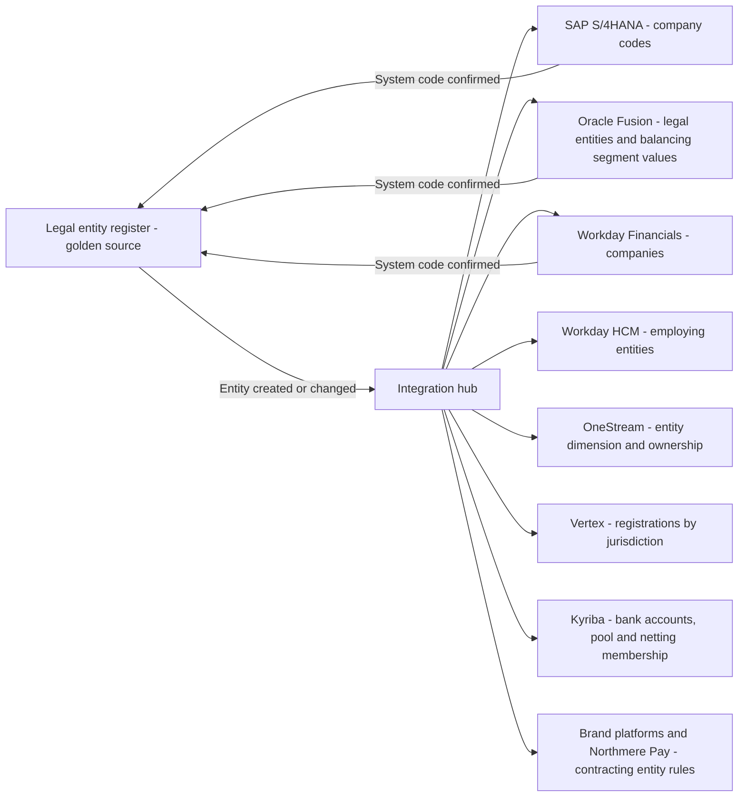
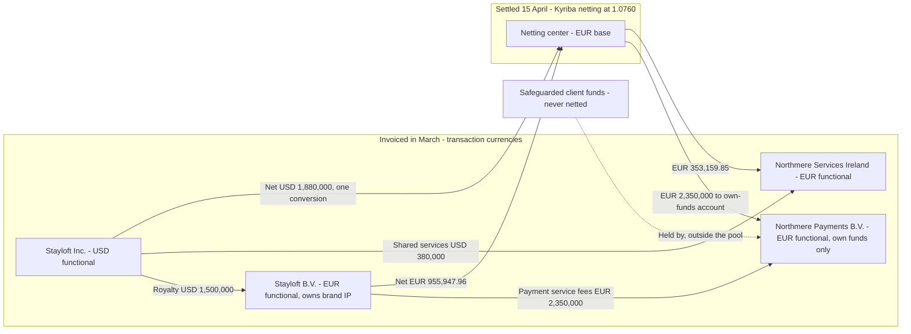
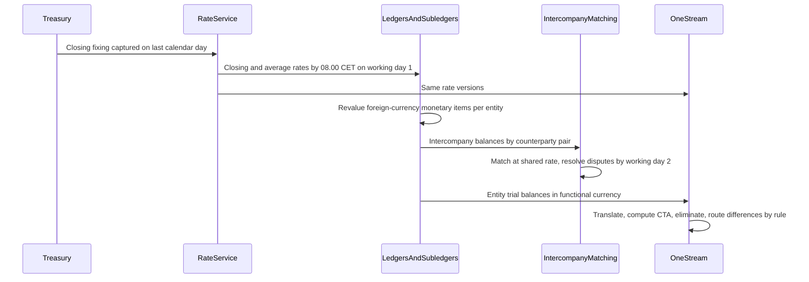
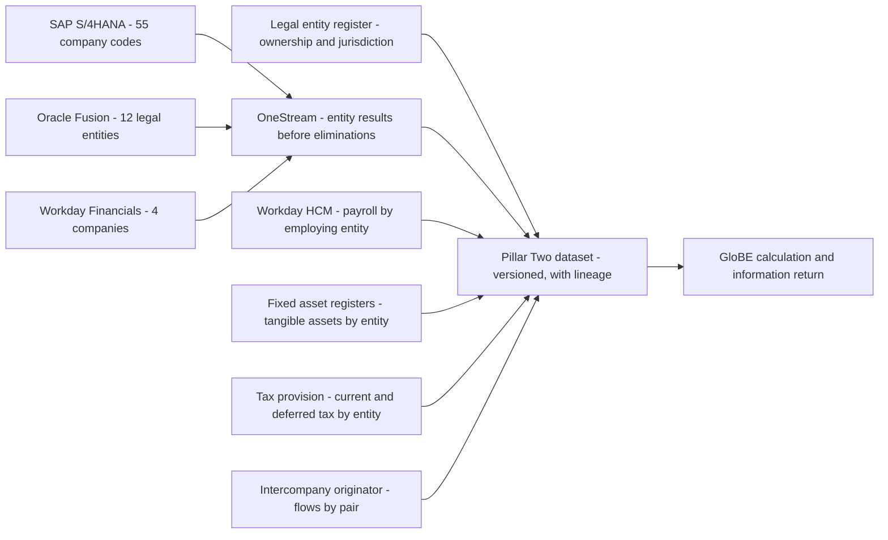

{id: global-scale}
# 13. Global by Design: Entities, Currencies, Jurisdictions and Brands

> **IN THIS CHAPTER, YOU WILL:** Learn how a multinational finance estate represents legal entities, intercompany trade, currencies, accounting standards and local tax and regulatory rules, and how to keep brand, entity, market and business model apart so that each can change without breaking the others.

> **WHY FINANCE CARES:** The controller signs statutory accounts per legal entity, tax files per jurisdiction, and the group reports one consolidated number in one currency. When entity, currency and jurisdiction data are wrong at the source, each of those outputs becomes a reconciliation project at period end.

> **WHY ARCHITECTS SHOULD CARE:** Entity structures, functional currencies and ledger designs are among the hardest ERP decisions to reverse. Intercompany, exchange rates and tax attributes cross every system boundary, so each needs one owner, one source and one contract, or it becomes the estate's most expensive integration problem.

> **KEY POINTS:**
>
> * **Brand, legal entity, market, business model and currency are five dimensions, not one.** The legal entity is the unit of law, tax and statutory books, not the unit of the business. Model each dimension independently, master legal entities in one register, and derive every system's entity representation from it.
> * **Intercompany is a product to design, not a by-product to clean up.** Every intercompany flow needs an agreement, a pricing rule, a counterparty on both sides, one exchange rate, a settlement route and an elimination rule. Most elimination differences found at close were designed in months earlier.
> * **Currency and jurisdiction are governed data with owners and calendars.** One rate service with named rate types, one month-end currency calendar, and tax and regulatory attributes carried on every event, separate from the accounting treatment, turn mandates such as ViDA, DAC7 and Pillar Two into data work instead of re-platforming.

> **[FAILURE PATTERNS THIS CHAPTER ADDRESSES](#where-finance-architecture-goes-wrong):**
>
> * **The Doppelgänger Record** — legal entities, their currencies and their tax registrations are created separately in each ERP, the consolidation tool, the tax engine and the treasury system, with no agreed register.
> * **Spreadsheet Glue** — transfer-pricing calculations, exchange-rate tables and intercompany mappings live in spreadsheets the close cannot run without.
> * **The Permanent Exception** — each brand or new market gets its own entity conventions, rate sources and tax logic, and each becomes a permanent fork.

In a single-country company, brand, legal entity, market and currency are the same thing, so nothing forces anyone to tell them apart. A group that trades through dozens of entities in dozens of countries cannot. Its brands do not map one-to-one to entities, it earns in currencies other than the one that books the revenue, and it pays tax under rules that change every year. **Every one of those mismatches is represented somewhere in the systems, and where it is represented decides whether the close is a computation or an investigation.**

This chapter covers that representation: the **legal entity model** and how SAP S/4HANA, Oracle Fusion Cloud ERP and Workday encode it; **intercompany** trade, transfer pricing and netting; the **multi-currency model**; **multi-GAAP** and statutory reporting; local requirements such as SAF-T, e-invoicing and fiscal numbering; indirect tax at platform scale; the data Pillar Two demands; and the constraints a licensed payments entity places on everything else. The argument throughout: **treat each of these as a governed dimension or a designed flow**, not as a property each system configures for itself.

{id: global-scale--setting-the-scene-seventy-one-entities-and-three-requests}
## Setting the Scene: Seventy-One Entities and Three Requests

Northmere, the fictional group this book follows, is a New York–listed digital commerce group headquartered in Amsterdam. It reports in US dollars under US GAAP, trades through **71 legal entities in 38 countries**, takes customer payments in **46 currencies**, settles with partners in **31 currencies**, and files local GAAP or IFRS statutory accounts for each entity. [Meet Northmere: Five Brands, One Set of Books](#meet-northmere) introduces its brands and its licensed e-money institution, **Northmere Payments B.V.**

In the first week of April 2027, three requests reach Dana Whitlock, the Chief Architect. Kofi Asante, Group Head of Tax and Treasury, needs a **Pillar Two dataset** per entity and jurisdiction, reconciled to consolidation; last year his team built it from 38 spreadsheet extracts. Leila Haddad, the Chief Accounting Officer, reports that at working day 4 of the March close, intercompany balances in **41 of about 140 active entity pairs** disagreed by a gross **$3.8 million**, mostly because the two sides had been converted at different rates, in different systems, on different days. And the Keystone design authority has put the **2028 Brazil launch** on its agenda. The commercial plan says "configure Stayloft for Brazil". Nobody has written down which entity will contract with Brazilian hosts, which ledger it will live in, or who sets its exchange rates.

The three requests share a root. Northmere has no single register of legal entities, no single source of exchange rates, and no consistent way of carrying entity, jurisdiction and currency from the brand platform to the tax return.

{id: global-scale--five-dimensions-that-must-not-collapse-into-one}
## Five Dimensions That Must Not Collapse Into One

Most estates start from an implicit equation: one brand, one country, one company, one currency. It fails gradually. A brand enters a second country through the first country's company; a second brand borrows the first brand's company; a payments entity holds money for all brands; an acquisition brings an entity serving three markets. Each step is reasonable; together they leave systems keyed on a dimension that no longer means what the key assumes. The fix is to define five dimensions separately, each with an owner and a code list:

- **Legal entity** — a company with its own legal personality, statutory accounts, tax registrations and contracts. The unit of law and of the books.
- **Brand** — a commercial identity customers and partners recognize. The unit of product and, often, management reporting.
- **Market** — where the customer or the supplied service is located. The unit of tax jurisdiction, consumer law and local payment methods.
- **Business model** — agency, merchant, subscription, usage, advertising, payments facilitation. The unit that decides posting rules (see [Accounting for Architects: Ledgers, Journals and Revenue](#accounting-for-architects)).
- **Currency** — the denomination of an amount. One transaction can carry four currencies, as shown below.

| If you treat… | …as the same as… | What breaks |
| --- | --- | --- |
| Brand | Legal entity | A second brand in an existing entity has no home for its P&L; a brand carve-out cannot find its own assets and contracts. |
| Market | Legal entity | Cross-border sales are taxed by the entity's country instead of the customer's; DAC7 and digital services tax reports, which are by user or property location, cannot be produced. |
| Market | Currency | A traveler in Germany paying in dollars breaks the assumption; nobody can say which rate applied to which amount. |
| Business model | Brand | A brand that runs agency and merchant bookings, as Stayloft does, gets one set of posting rules for two accounting patterns. |
| Legal entity | Ledger | One ledger per entity multiplies configuration and close effort; a shared ledger without an entity balancing segment cannot produce a balance sheet per entity. |

At Northmere the matrix is real. Stayloft trades through nine operating entities, but its contracts with European hosts are signed by **Stayloft B.V.**, its US marketplace by **Stayloft Inc.**, and merchant-booking funds are held by Northmere Payments B.V., which serves no brand of its own. Tablekin has four entities but bills venues in 11 countries. "Revenue by country" means three different things depending on whether the entity, the customer or the property is meant.

**Figure 1:** *Brand, legal entity, market, business model and currency are five dimensions, not one: every financial event carries all five explicitly, so each can change without breaking the others.*

**The rule I use: every financial event carries all five dimensions explicitly, and no brand platform derives one from another in code.** The derivation rules (which entity contracts for which brand in which market under which model) belong in governed configuration, managed by the onboarding kit in [The Next Brand Should Be Boring: Onboarding as Configuration](#brands-entities-markets). Northmere's canonical event envelope ([Canonical Events: A Common Language for Money](#loosely-coupled-domains)) already has separate `brand`, `legal_entity`, `business_model` and `tax_jurisdiction` fields, with the currency inside every `amount`. This chapter is about making sure the values are right.

{id: global-scale--the-legal-entity-model}
## The Legal Entity Model

A **legal entity model** is the group's authoritative description of its companies: which exist, what each does, who owns it, where it is resident, which currency and accounting standards apply, which ledgers it books in, and how it is registered for tax and regulation. It is master data in the sense of [Finance Data Architecture: Who Owns the Truth](#finance-data-architecture), and the most cross-cutting master data a finance estate has.

| Attribute group | Examples | Owner |
| --- | --- | --- |
| Identity and ownership | Legal name, registration number, lifecycle status, shareholdings and their effective dates, ultimate parent | Legal |
| Accounting | Functional currency and its evidence, statutory GAAP, fiscal calendar, consolidation method | Group controller |
| Tax and regulatory | Tax residence, VAT and state registrations, Pillar Two classification, licenses and safeguarding duties | Tax; compliance |
| Banking | Bank accounts, cash-pool and netting participation | Treasury |
| System representation | SAP company code, Oracle legal entity and balancing segment value, Workday company, OneStream entity member, tax-engine company | Finance systems |

Two attributes deserve emphasis. **Functional currency**, the currency of the entity's primary economic environment, is determined by economic facts under [IAS 21](https://www.ifrs.org/issued-standards/list-of-standards/ias-21-the-effects-of-changes-in-foreign-exchange-rates/) and its US GAAP counterpart ASC 830; it is not a configuration choice. **System representation** is the attribute most estates never record. Without it, every interface that crosses an ERP boundary carries its own mapping table, the classic home of Spreadsheet Glue.

Northmere's 71 entities fall into five types, and the type decides most of the design: 6 **holding and financing** entities; 24 **brand operating** entities that contract with customers and partners; 36 **local service** entities (marketing support, customer service, engineering hubs, finance shared services) paid cost plus a markup and never selling to third parties; 3 **intellectual property owners**; and 2 **licensed payments** entities. The distinction between service and operating entity matters. São Paulo is already a Northmere hub, through an engineering service entity. "Using the Brazilian company we already have" for the 2028 launch would turn a cost-plus service provider into a company contracting with hosts and travelers, changing its tax profile, transfer-pricing position and regulatory obligations at a stroke. Recording the type makes that a visible decision rather than a configuration shortcut.

In early 2027 Northmere creates entities in SAP S/4HANA, Oracle Fusion, Workday, OneStream, Vertex, Kyriba and Workday HCM, each from a different document. That is **The Doppelgänger Record** in its purest form, and the reason Kofi needed 38 extracts. Keystone's response is a **legal entity register** as golden source, owned by Legal for identity and ownership and stewarded by Leila's team for accounting attributes. The register does not replace ERP configuration; it decides it.

**Figure 2:** *The legal entity register decides how every system represents an entity, and each system confirms its code back, so the register holds the full cross-system mapping that interfaces, consolidation and tax reporting rely on.*

Creating an entity in an ERP is configuration under change management; the hub publishes a change request to the platform team, and the confirmation closes the loop. What matters is not automation but **authority**: no system creates an entity the register does not know, and the cross-system mapping is maintained in one place.

{id: global-scale--how-each-erp-represents-a-legal-entity}
## How Each ERP Represents a Legal Entity

The three ERPs encode the legal entity differently. The detail belongs to [SAP S/4HANA: One Journal, Clean Core](#sap-s4hana), [Oracle Fusion: An Accounting Hub for High-Volume Events](#oracle-fusion) and [Workday: The Org Chart Behind the Ledger](#workday); the comparison below is what an architect needs when designing across them.

| Concern | SAP S/4HANA | Oracle Fusion Cloud ERP | Workday Financial Management |
| --- | --- | --- | --- |
| Entity object | **Company code**, "an independent legal accounting entity… with independent accounts" | **Legal entity**, assigned to a ledger, with **primary balancing segment** values assigned to it | **Company**, the primary balancing worktag |
| Ledgers | All company codes in the **leading ledger (0L)**; further standard ledgers and delta-only **extension ledgers** | A **primary ledger** combines chart of accounts, calendar, currency and accounting method; many legal entities can share one | One structure; **book codes** separate book-specific entries |
| Currencies | Document, company code, global, plus up to eight freely defined currencies per ledger | Entered and ledger currency; **reporting currencies** at balance, journal or subledger level | Transaction and company currency; translation for consolidation |
| Multi-GAAP | Parallel ledgers; extension ledgers for adjustments | **Secondary ledgers** at a chosen data conversion level | Multibook |
| Intercompany | Cross-company-code postings with automatic clearing lines; intercompany billing and reconciliation | Intercompany balancing rules and module (detail to verify per release) | **Intercompany profiles** define which companies may transact; eliminations when both are in the reporting hierarchy |
| Irreversibility | Currency, fiscal-year variant and chart assignments constrain controlling-area design | Chart, calendar and currency are fixed once a ledger is saved | Company hierarchy and worktag design underpin every report |

Sources: SAP Learning on [organizational units](https://learning.sap.com/courses/customizing-core-settings-in-financial-accounting-in-sap-s4hana/managing-organizational-units-in-financial-accounting-fi), [ledgers](https://learning.sap.com/courses/customizing-core-settings-in-financial-accounting-in-sap-s4hana/checking-the-basic-settings-in-general-ledger-g-l-accounting) and [currency types](https://learning.sap.com/courses/customizing-core-settings-in-financial-accounting-in-sap-s4hana/managing-currency-types-1); Oracle's [ledgers, legal entities and balancing segments](https://docs.oracle.com/en/cloud/saas/financials/26c/faigl/ledgers-legal-entities-balancing-segments-and-business-units.html) (26C); Workday's [Financial Management datasheet](https://www.workday.com/content/dam/web/en-us/documents/datasheets/datasheet-workday-financial-management.pdf) and [consolidations and multicurrency guide](https://community-content.workday.com/en-us/public/products/financial-management/consolidations-and-multicurrency-guide.html). Oracle's intercompany functions and SAP's intercompany app names were not verified for this edition and are described at capability level only.

Three consequences follow. **First, "one ledger per entity" is a modeling choice, not a law.** Oracle recommends limiting primary ledgers and distinguishing entities by balancing segment; SAP puts every company code in the same leading ledger; Workday's company is a worktag. Entities that share currency, calendar and chart can share a ledger. **Second, the balancing unit is the legal entity.** Whatever the product, the system must produce a balanced trial balance per entity, because statutory accounts and tax returns are built from it. **Third, each ERP is internally consistent and externally blind.** Northmere's 55 SAP company codes, 12 Oracle legal entities (in three primary ledgers, one per functional currency) and 4 Workday companies meet only in OneStream. That federated design is legitimate for now, and the convergence question belongs to [Converge or Coexist: Living with More Than One ERP](#multiple-erps); but it means no ERP can see a cross-ERP intercompany flow, so those flows must be designed to meet cleanly at consolidation.

{id: global-scale--intercompany-by-design}
## Intercompany by Design

**Intercompany** transactions are trades between entities of the same group: royalties, service fees, cost recharges, loans and interest, dividends. Each side records its half; consolidation **eliminates** the matched balances, income and expense so that the group presents only third-party dealings. [Accounting for Architects: Ledgers, Journals and Revenue](#accounting-for-architects) covers the accounting; this section covers the architecture.

Northmere's flows follow from how it is legally organized and taxed:

| Flow | From → to | Basis |
| --- | --- | --- |
| **Brand IP royalty** | Stayloft's 8 other operating entities → Stayloft B.V., which owns the Stayloft trademarks | Percentage of the payer's net revenue, monthly |
| **Payment service fees** | Brand operating entities → Northmere Payments B.V. and Northmere Payments UK Ltd | Payment-provider costs passed through, plus a service margin |
| **Shared services recharges** | Operating entities → service entities (finance shared services in Dublin, engineering in São Paulo and Singapore) | Cost plus markup; allocation keys from Workday HCM headcount |

Treasury flows (cash pool, intra-group loans, dividends) run in Kyriba on top of these.

**Transfer pricing** decides the prices. Tax authorities require intercompany prices to follow the **arm's length principle**, the price unrelated parties would agree in comparable circumstances, as set out in the OECD Transfer Pricing Guidelines and national law. Setting the rates is a tax and legal judgment; the rates here are illustrative. Where the pricing rules run, what data they read, and how their results reach both ledgers at the same amount, period and rate, is the architecture decision. Every flow needs six things:

1. **An agreement**, referenced on every transaction it generates.
2. **A pricing rule** that runs in one place on governed inputs. At Northmere today, royalty bases are pulled from three ERPs into a spreadsheet, multiplied and keyed back: Spreadsheet Glue on a line that moves tens of millions of dollars a month.
3. **A counterparty dimension on both sides**, set at posting time, or matching becomes a manual exercise.
4. **One transaction currency and one rate**, from the same source on the same date for both sides. Most of Leila's $3.8 million came from violating this.
5. **A settlement route**: invoiced and paid, netted, or booked to an in-house bank account.
6. **An elimination rule**, defined when the flow is designed, not met for the first time at quarter-end.

**Invoice-based** intercompany runs through receivables and payables with a legal invoice, which is required wherever the charge is a taxable supply, as most cross-border services between EU entities are for VAT. **Journal-based** intercompany posts paired journals with due-to and due-from lines, common for allocations. Within one ERP both are well supported. Across ERPs, the estate needs an **intercompany originator**: one component that creates both halves from one calculation with a shared transaction identifier. It can be a close platform (BlackLine markets an Intercompany Create product), an ERP acting as hub, or a small integration service; which one is a question for [Build, Buy or Compose: Choosing What to Own](#build-versus-buy). The requirement is that **exactly one component creates both sides**.

**Matching** pairs the halves by counterparty and transaction identifier and routes differences to a dispute workflow; Northmere matches today in OneStream, in Oracle Fusion for Wayfare and by email, and Keystone's 2027 target is one matcher fed continuously during the month. **Netting** settles many intercompany positions with one net payment per entity per cycle: a netting center collects positions in their transaction currencies, converts them at one cycle rate, and instructs one payment to or from each participant. It cuts payment volume, bank fees and FX conversions, but some countries restrict netting or require central-bank reporting of it, and licensed entities may be excluded. Northmere runs netting monthly in Kyriba; BlackLine also offers intercompany netting, an entry for the overlap register in [Duplicates and Dependencies: The Hidden Costs of a Grown Estate](#redundancy-and-coupling).

**Elimination** happens in the consolidation layer, OneStream at Northmere, using the counterparty dimension to pair the sides ([OneStream: Consolidating Actuals, Planning the Future](#onestream) covers the mechanics). It works cleanly only if both halves arrive with the same counterparty codes and, after translation, the same amounts. **Any difference that survives elimination must go to a defined account under a documented rule**, never to a plug someone clears by hand. The worked example shows where such differences come from.

{id: global-scale--worked-example-a-royalty-crosses-two-currencies}
## Worked Example: A Royalty Crosses Two Currencies

The figures are fictional and rounded to two decimals at each step; rates are US dollars per euro.

**The facts.** Stayloft Inc. (US dollar functional currency) licenses the Stayloft brand and platform from Stayloft B.V. (euro functional currency) for a royalty of **6% of net revenue**, invoiced monthly in US dollars. March 2027 net revenue is **$25,000,000**, so the royalty is **$1,500,000**, invoiced on 31 March. Both entities book in their own S/4HANA company codes. Rates from the group rate service: 31 March closing **1.0900**; March average **1.0860**; 15 April netting cycle **1.0760**.

{id: global-scale--step-1-each-side-books-its-half-31-march}
### Step 1: each side books its half (31 March)

| Entity | Account | Debit | Credit | Note |
| --- | --- | --- | --- | --- |
| Stayloft Inc. (USD) | Royalty expense – intercompany, counterparty Stayloft B.V. | 1,500,000.00 | | Created by the intercompany originator |
| Stayloft Inc. (USD) | Intercompany payable – Stayloft B.V. | | 1,500,000.00 | No FX in this entity |
| Stayloft B.V. (EUR) | Intercompany receivable – Stayloft Inc. | 1,376,146.79 | | USD 1,500,000.00 ÷ 1.0900; USD amount and rate ID stored on the line |
| Stayloft B.V. (EUR) | Royalty income – intercompany, counterparty Stayloft Inc. | | 1,376,146.79 | Same agreement and transaction ID |

The FX exposure sits in exactly one entity, Stayloft B.V., which holds a dollar receivable. The invoice currency decides which entity carries the risk, and that choice belongs in the license agreement, not in whichever system issued the invoice.

{id: global-scale--step-2-consolidation-in-us-dollars-march-close}
### Step 2: consolidation in US dollars (March close)

OneStream translates Stayloft B.V. into dollars: balance sheet at the closing rate, income at the average rate.

| Item | EUR | Rate | USD |
| --- | --- | --- | --- |
| B.V. intercompany receivable | 1,376,146.79 | 1.0900 closing | 1,500,000.00 |
| B.V. royalty income | 1,376,146.79 | 1.0860 average | 1,494,495.41 |
| Inc. payable and expense | — | — | 1,500,000.00 each |

| Entity | Account | Debit | Credit | Note |
| --- | --- | --- | --- | --- |
| Consolidation | Intercompany payable (Inc.) | 1,500,000.00 | | |
| Consolidation | Intercompany receivable (B.V., translated) | | 1,500,000.00 | Balance sheet eliminates exactly |
| Consolidation | Royalty income – intercompany (B.V., translated) | 1,494,495.41 | | |
| Consolidation | Intercompany elimination difference – translation | 5,504.59 | | Routed by rule to a designated account |
| Consolidation | Royalty expense – intercompany (Inc.) | | 1,500,000.00 | |

Neither entity made a mistake: **the $5,504.59 is produced by the translation policy**, because a transaction dated on the last day of the month is translated at a monthly average. There are two clean designs. Translate large discrete intercompany flows at their transaction-date rate, which IAS 21 permits (an average is only a practical approximation of transaction-date rates), so they eliminate exactly; or keep average-rate translation and route the difference by rule to a reviewed translation account. Discovering it at working day 4 and clearing it to suspense is not a design. Leila's team chose the first option for royalties and service fees from Q2 2027 and the second for high-volume recharges.

{id: global-scale--step-3-settlement-through-netting-15-april}
### Step 3: settlement through netting (15 April)

The April cycle includes three March invoices, converted to the euro netting base at 1.0760:

| Invoice | Payer → receiver | Amount | EUR at 1.0760 |
| --- | --- | --- | --- |
| Royalty | Stayloft Inc. → Stayloft B.V. | USD 1,500,000.00 | 1,394,052.04 |
| Finance shared services | Stayloft Inc. → Northmere Services Ireland Ltd | USD 380,000.00 | 353,159.85 |
| Payment service fees | Stayloft B.V. → Northmere Payments B.V. | EUR 2,350,000.00 | 2,350,000.00 |

| Participant | Net position (EUR) | Settlement |
| --- | --- | --- |
| Stayloft Inc. | −1,747,211.89 | Pays USD 1,880,000.00, the only currency conversion |
| Stayloft B.V. | −955,947.96 | Pays EUR 955,947.96 |
| Northmere Payments B.V. | +2,350,000.00 | Receives into its own-funds operating account |
| Northmere Services Ireland Ltd | +353,159.85 | Receives EUR 353,159.85 |

Gross invoices of EUR 4,097,211.89 settle with EUR 2,703,159.85 of net movements and one conversion instead of two. Settlement realizes the exchange difference in the entity that carried it:

| Entity | Account | Debit | Credit | Note |
| --- | --- | --- | --- | --- |
| Stayloft B.V. (EUR) | Netting center clearing | 1,394,052.04 | | USD 1,500,000.00 ÷ 1.0760 |
| Stayloft B.V. (EUR) | Intercompany receivable – Stayloft Inc. | | 1,376,146.79 | Clears the original amount |
| Stayloft B.V. (EUR) | Realized FX gain | | 17,905.25 | The dollar strengthened after invoicing |
| Stayloft Inc. (USD) | Intercompany payable – Stayloft B.V. | 1,500,000.00 | | |
| Stayloft Inc. (USD) | Netting center clearing | | 1,500,000.00 | |

**Figure 3:** *Three intercompany invoices in two currencies settle as four net movements with one currency conversion; the licensed entity takes part only with its own funds, never with safeguarded client money.*

The example works only because one originator created both halves from governed data, both sides used one rate, every line carried a counterparty, the translation rule was decided in advance, and the netting center knew which of Northmere Payments B.V.'s balances it could touch. **Remove any one and the $5,504.59 becomes one of forty-one breaks on Leila's working-day-4 list.**

{id: global-scale--the-multi-currency-model}
## The Multi-Currency Model

A multi-currency estate needs an explicit model of which currency an amount is in, which rate converted it, who decided that rate, and when. Most estates have the first; few have the rest.

| Role | Definition | Northmere example |
| --- | --- | --- |
| **Transaction currency** | The currency a transaction is denominated in | A traveler's payment in Swedish kronor |
| **Settlement currency** | The currency a payment provider or bank settles in | Adyen settles to Northmere Payments B.V. in euros |
| **Functional currency** | The currency of the entity's primary economic environment (IAS 21, ASC 830) | Euro for most EU entities; dollar for Stayloft Inc. |
| **Group currency** | The presentation currency of the consolidated statements | US dollar |

Northmere's 71 entities use **19 functional currencies**. Three families of rates must be kept apart. **Commercial rates** convert customer prices: when an American traveler pays in dollars for the €600.00 Lisbon apartment from the book's recurring example, Stayloft quotes **$654.00**, a rate of 1.0900 against a market rate of 1.0850 (at which €600.00 is $651.00); the **$3.00** margin is a commercial decision owned by the brand and Northmere Pay. **Provider rates** are applied by payment providers and banks when they convert at settlement; they are reconciled from settlement reports, not assumed (see [Payments-to-Ledger: Draining the Suspense Swamp](#payments-to-ledger)). **Accounting rates** are what the ledgers use: **daily spot** for initial recognition, **period closing** for revaluation and balance-sheet translation, **period average** for income translation, and **budget** and **forecast** rates for planning.

**Ownership follows the families.** Treasury owns market-rate sourcing: provider, fixing time, publication schedule and feed controls. The group controller owns **rate policy**: which rate type applies to which process, how averages are calculated, how rates are estimated for currencies that cannot be exchanged (IAS 21's *Lack of Exchangeability* amendments apply from 2025), and how hyperinflationary economies are handled. Brands own commercial rates within a group margin policy. Finance systems own **distribution**. At Northmere in early 2027, S/4HANA, Oracle Fusion, Workday, OneStream and the Stayloft Finance Platform each take rates from a different source, which is the structural cause of Leila's breaks. Keystone's 2027 standard is a **single group rate service**, fed by treasury from one market-data source, publishing each rate type with an identifier, effective date and version to every ledger, subledger and the consolidation engine. Every converted amount stores the rate identifier it used, so a difference can be traced to its cause rather than argued about.

**Figure 4:** *When each ledger takes rates from its own source, the two halves of an intercompany trade are converted differently and break at close; one treasury-sourced rate service, with a rate identifier on every converted amount, lets them meet.*

Two month-end processes are routinely conflated. **Revaluation** restates foreign-currency **monetary items** (cash, receivables, payables, loans) at the closing rate in each entity's books, with the difference in profit or loss; it runs **in each ledger**. **Translation** converts each entity's functional-currency statements into the group currency (assets and liabilities at closing, income and expense at transaction-date or average rates, equity at historical rates), with the balancing difference in other comprehensive income as the **cumulative translation adjustment** (CTA); it runs **once, in consolidation**. The order matters.

**Figure 5:** *The month-end currency calendar: one rate publication feeds every ledger and the consolidation engine, revaluation runs per entity before matching, and translation runs once, centrally, after it.*

One consequence is easy to miss: **a subledger that holds foreign-currency open items must revalue them, or hand them to a ledger that will.** The Stayloft Finance Platform holds partner payables in 31 settlement currencies inside euro entities. If it posts only daily euro summaries to S/4HANA, those payables are never revalued unless the platform does it or posts open items in transaction currency. Revaluation responsibility must be assigned per open-item population, explicitly ([Never Update, Only Append: Designing Custom Ledgers](#designing-financial-ledgers) covers how a custom ledger carries currency).

**Rounding** causes a steady trickle of breaks unless three things are written down. Precision per currency: ISO 4217 minor units differ (two decimals for the euro, none for the yen, three for the Kuwaiti dinar), and money is never stored as binary floating point. Where conversion rounds: converting each line and summing differs from summing and converting once, and the subledger and the ledger receiving its summaries must use the same rule or their reconciliation never ties to the cent. Where residue goes: a designated rounding account with a tolerance, or rounding becomes suspense.

{id: global-scale--many-gaaps-one-set-of-events}
## Many GAAPs, One Set of Events

Northmere reports to the SEC under US GAAP and files statutory accounts under local GAAP or IFRS. **Multi-GAAP** is accounting for the same events under more than one standard at once. The differences touch a minority of transactions but can be material: lease accounting (ASC 842 keeps a lessee distinction between finance and operating leases that IFRS 16 does not), some capitalization policies, and presentation, which diverges further as IFRS 18 replaces IAS 1 for annual periods from 1 January 2027.

| Pattern | How it works | Strength | Cost |
| --- | --- | --- | --- |
| **Parallel ledgers** | Every event posts to a ledger per standard (SAP parallel ledgers, Oracle journal- or subledger-level secondary ledgers, Workday book codes) | Full trail per standard | Volume and configuration multiply; Oracle warns journal- and subledger-level secondary ledgers are much more expensive than balance-level ones |
| **Adjustment layer** | The leading ledger follows one standard; differences post to a delta layer (SAP extension ledgers, Oracle adjustments-only secondary ledgers) | Low volume; explicit list of differences | Works only where differences are few and well understood |
| **Consolidation-level adjustment** | Entities book local GAAP; group adjustments are made in the consolidation tool | Simple for entities | Group-GAAP numbers exist only at consolidation, with weak drill-back: effectively a shadow ledger |

The hardest decision to reverse is **which standard the leading or primary ledger follows**. Northmere's S/4HANA has used US GAAP as its leading ledger since 2021, because the group close is the binding deadline, with local GAAP or IFRS in a parallel ledger for statutory accounts ([SAP S/4HANA: One Journal, Clean Core](#sap-s4hana)). Wayfare's Fusion ledgers are the reverse, inherited from before the acquisition: IFRS primary ledgers, with US GAAP differences in Adjustments Only secondary ledgers added in 2025 ([Oracle Fusion: An Accounting Hub for High-Volume Events](#oracle-fusion)). That inconsistency is tolerable while the ERPs are federated and is a question for [Converge or Coexist: Living with More Than One ERP](#multiple-erps). **The rule I recommend: systematic GAAP differences are posting rules, not people.** A lease or a capitalization policy belongs in the accounting engine as a per-ledger rule, which is what Oracle's per-ledger accounting methods and SAP's ledger-specific postings exist for; manual GAAP adjustments are listed, owned exceptions.

{id: global-scale--local-requirements-that-reach-into-the-ledger}
## Local Requirements That Reach Into the Ledger

Statutory and tax rules increasingly demand **data in a prescribed form, on demand or in near real time**. Each is a country variation on a few patterns.

**Standard audit files.** **SAF-T** (Standard Audit File for Tax), an OECD-originated XML format, is mandated in national variants in several countries (commonly cited: Portugal, Norway, Poland, Romania, Lithuania; check per country). France requires a standard ledger export, the FEC (*fichier des écritures comptables*), on tax audit. These are extracts from the ledger and subledgers mapped to standard account lists, and they fail on missing master data and local mappings kept in spreadsheets.

**E-invoicing and continuous transaction controls.** Invoices are moving from documents audited later (**post-audit**) to structured data a government or accredited platform must accept before the invoice is valid (**clearance**). Italy and Poland run clearance systems; Belgium mandated domestic B2B e-invoicing over Peppol from 1 January 2026; France's receiving obligation and its issuing obligation for large and mid-sized companies began on 1 September 2026; Germany phases in issuing in 2027 and 2028. These dates, reported by law firms and tax-technology vendors, keep moving; [Around the Core: Where Specialist Platforms Earn Their Place](#satellite-platforms) covers the architecture. For this chapter the point is that **invoice issuance joins the critical path of order-to-cash and procure-to-pay in each affected entity**, with rejections, outages and clearance latency to handle. Stayloft's commission invoices to Belgian and Polish hosts are already in scope.

**Fiscal numbering.** EU VAT rules require "a sequential number, based on one or more series, which uniquely identifies the invoice" ([VAT Directive, Article 226](https://eur-lex.europa.eu/legal-content/EN/TXT/?uri=CELEX:02006L0112-20250414)), and several countries add rules on series and gaps. A sequence is a per-entity, per-series property; a brand platform issuing invoices for several entities from one global counter creates findings in every country that checks.

**Retention and residency.** Retention varies by country, record type and sector, usually counted from fiscal year-end; Germany, for example, cut voucher retention to eight years from 2025 while keeping ten for books. GDPR restricts transfers of personal data outside the EU rather than mandating EU storage, but some tax laws require books to be kept in, or accessible from, the country, and supervisors add requirements for licensed entities. The pattern: append-only ledgers with reversal-based correction ([Controls by Design, Not by Audit Season](#controls-and-auditability)), minimal personal data in ledgers, and a per-entity record of where its books may legally live.

{id: global-scale--indirect-tax-at-platform-scale}
## Indirect Tax at Platform Scale

Indirect tax is where the five dimensions meet most visibly: the treatment depends on the supplying entity, the market, the business model and the counterparty's status. A marketplace adds a twist: it is party to supplies it does not itself make. The central idea is that **accounting, tax and regulatory treatments of the same transaction are separate determinations** and must be carried as separate attributes. Take the Lisbon booking: a German traveler pays Stayloft €600.00 for a Lisbon apartment under the merchant model, with a 15% commission.

| Question | Rulebook | Answer (simplified) | Where it lives |
| --- | --- | --- | --- |
| How is revenue presented? | ASC 606 / IFRS 15, principal versus agent | Agent: €90.00 commission, net | Accounting engine posting rules |
| What VAT applies? | EU VAT; from July 2028, ViDA platform rules | Today VAT on the commission (place-of-supply rules for accommodation-related intermediation are a recurring dispute, so the rule belongs in the tax engine). From July 2028, if the host is not VAT-registered, possibly VAT on the full price as deemed supplier | Tax engine, with the determination stored |
| What is reported about the host? | DAC7 | Host identity and tax number, consideration credited and fees withheld, by quarter | Seller master and transaction ledger |
| Are the funds regulated? | E-money safeguarding | €600.00 is client money at Northmere Payments B.V. until paid out or earned | Payments ledger and safeguarding reconciliation |

None of these answers determines another. ViDA's **deemed-supplier** status does not make Stayloft a principal for revenue; holding the cash does not make it the supplier of the room. A billing engine that switches to gross revenue when it starts charging VAT on the full price will misstate the accounts the day the tax rule changes.

**Figure 6:** *One booking, four independent determinations: revenue presentation, VAT, seller reporting and safeguarding are carried as separate attributes, so a change in one rulebook never silently changes another.*

**ViDA.** The EU's VAT in the Digital Age package entered into force on 14 April 2025 ([European Commission](https://taxation-customs.ec.europa.eu/taxation/vat/vat-digital-age-vida_en)). From **1 July 2028**, platforms facilitating **short-term accommodation rental** and **passenger transport by road** become deemed suppliers where the provider does not charge VAT, with member states allowed to delay until **1 January 2030**; the platform is relieved where the provider gives a valid VAT number and declares it will account for the VAT. Single VAT registration measures start the same day, and intra-EU B2B e-invoicing with digital reporting follows on **1 July 2030**. For Stayloft (and possibly Wayfare's road transfers), the host's VAT status and declaration become **tax-determining master data with an effective date**, and the rule must be configured by country and date, because member states may start at different times.

**DAC7 and digital services taxes.** DAC7 (Council Directive (EU) 2021/514) requires platform operators to report seller information, including hosts renting property, annually by 31 January for activity from 2023; similar OECD-model rules apply in the UK. DAC7 and ViDA describe the same hosts and transactions, so **both must come from one seller master and one transaction ledger**, reconciled to the books before filing. **Digital services taxes** are unilateral levies on revenue from services such as online intermediation or advertising, attributed to users in the taxing country; scope and rates differ and move with trade policy (Canada [rescinded its DST](https://www.canada.ca/en/department-finance/news/2025/06/canada-rescinds-digital-services-tax-to-advance-broader-trade-negotiations-with-the-united-states.html) in June 2025). Stayloft and Northmere Ads are both potentially in scope, and the data they need, **in-scope revenue by user location**, cannot be reconstructed from entity or currency.

**US sales tax.** Since *South Dakota v. Wayfair* (2018), states may impose collection duties on economic presence, and states with a sales tax have adopted **marketplace facilitator** laws that make marketplaces collect and remit for third-party sellers. Thresholds and scope differ by state, and lodging and occupancy taxes often follow separate rules, frequently at city or county level. For Stayloft Inc. this means determination at the property's address across thousands of jurisdictions and remittance on behalf of hosts, distinct from revenue recognition.

The response to all of it is Keystone's year-3 target: **tax determination and e-invoicing as shared services**. One engine called at every taxable document event by every brand and ERP; tax master data mastered once; every determination stored with its inputs, rule version and result, because tax disputes routinely outlast the systems that created the data; and tax accounts reconciled to the engine before any return is filed. Northmere's split between Vertex and Oracle's tax engine for some Wayfare markets is Capability Creep that [Around the Core: Where Specialist Platforms Earn Their Place](#satellite-platforms) resolves.

{id: global-scale--pillar-two-the-group-s-data-model-becomes-a-tax-return}
## Pillar Two: The Group's Data Model Becomes a Tax Return

The OECD's **Pillar Two** (GloBE) rules apply to groups with consolidated revenue of at least €750 million in two of the four preceding years. They compute an **effective tax rate per jurisdiction** and collect top-up tax to 15%, through a qualified domestic minimum top-up tax in the source country, an income inclusion rule at the parent, or an undertaxed profits rule as backstop. Northmere, at $8.2 billion of revenue, is in scope. The first GloBE Information Returns for 2024 fell due on **30 June 2026** in many jurisdictions (Ireland's Revenue [confirms the date](https://www.revenue.ie/en/companies-and-charities/pillar-two/dates/index.aspx)). A January 2026 "side-by-side" package, as widely reported, relieves US-parented groups from the parent-level rules from 2026 while leaving domestic top-up taxes in place; it is unlikely to help Northmere, whose ultimate parent, Northmere Group N.V., is Dutch (illustrative), and the data obligations remain either way. All of this is time-sensitive as of October 2026.

For the architect, what matters is the **data shape**: per constituent entity, grouped into 38 jurisdictions, accounting income **as used for consolidation, before intercompany eliminations**; current and deferred taxes; **payroll** and **tangible assets** for the substance-based exclusion; intercompany data; and lineage for every adjustment, retained for years.

**Figure 7:** *Pillar Two turns entity and jurisdiction data into a tax return; the calculation is only as good as the entity register, the pre-elimination entity results, and the payroll, asset and intercompany data behind them.*

Every input depends on something argued earlier: the entity register for keys and jurisdictions, clean intercompany for pre-elimination results, Workday HCM's employing entity agreeing with the register, and reconciliation to consolidation rather than private extracts. Kofi's request therefore lands not as a new tax system but as **jurisdiction and entity dimensions on every finance dataset**, and an entity-tagged tax data mart in the finance data platform that both the provision and the GloBE calculation read (see [One Number, Many Views: Finance Data from Operations to Analytics](#finance-data-flows)).

{id: global-scale--licensed-entities-where-the-group-cannot-simply-move-money}
## Licensed Entities: Where the Group Cannot Simply Move Money

**Northmere Payments B.V.** is an e-money institution supervised by De Nederlandsche Bank; **Northmere Payments UK Ltd** is authorized by the FCA. Together they hold Stayloft travelers' money between payment and payout. **Safeguarding** protects those funds from the institution's creditors. Under PSD2 Article 10, applied to e-money institutions through the E-Money Directive, funds still held at the end of the business day after receipt are segregated in a separate account at a credit institution or in secure low-risk assets, or covered by insurance or a comparable guarantee ([PSD2](https://eur-lex.europa.eu/eli/dir/2015/2366/oj)). The FCA's new UK safeguarding regime, widely reported to apply from 7 May 2026, requires daily reconciliations, monthly returns and, above a threshold, an annual audit. PSD3 and the Payment Services Regulation, politically agreed in November 2025 and not yet in force as of October 2026, are expected to tighten safeguarding ([Payments for Finance Architects: Eleven Reasons the Numbers Disagree](#payments-fundamentals)). Five architectural constraints follow:

1. **Client money and own money are separate in the chart of accounts and the bank.** The commission that becomes revenue is released from client funds through a defined event, under the safeguarding policy agreed with the regulator, before it can move.
2. **Safeguarded funds stay out of group cash management**: no cash pool, no netting, no intra-group lending. Figure 3's dotted line is enforced by account in the netting configuration, not by a note in a procedure.
3. **Reconciliation becomes a regulatory control**: owed versus held, daily, with SOX-grade completeness and evidence.
4. **Intercompany pricing is scrutinized twice**: by tax authorities for transfer pricing, and by the supervisor for whether the entity is adequately funded by its group.
5. **Resilience obligations attach to its systems.** As a financial entity, Northmere Payments B.V. is subject to DORA, so the ICT services supporting its critical functions fall under DORA's contract, register and testing requirements.

The modeling rule: **regulatory status is an entity attribute, and every flow touching a licensed entity carries it.** Netting exclusions, reconciliation scope and resilience scope derive from the register, so a third licensed entity, which Brazil may require, extends them by configuration.

{id: global-scale--opening-brazil-a-preview-of-the-launch-checklist}
## Opening Brazil: A Preview of the Launch Checklist

The 2028 Brazil launch tests everything above. Treated as "configure Stayloft for Brazil", it produces exactly the forks this chapter warns against. Treated as a change to the entity, currency, tax and regulatory model, it becomes a checklist that [The Next Brand Should Be Boring: Onboarding as Configuration](#brands-entities-markets) turns into a reusable market-launch kit:

| Dimension | Decision required | Owner |
| --- | --- | --- |
| Legal entity | A new operating entity, not the São Paulo engineering service entity; recorded in the register before any system is configured | Legal, group controller |
| Ledger and GAAP | S/4HANA company code in the group core, mapped to the group chart from day one; local statutory GAAP in a parallel or extension ledger | Group controller, SAP platform lead |
| Currency | Brazilian real as evidenced functional currency; added to the rate service; real-denominated pricing rules | Controller, treasury, Stayloft |
| Indirect tax | Brazilian consumption taxes and electronic fiscal documents in the shared tax engine, including the transition rules of Brazil's ongoing indirect-tax reform, verified against current law at design time | Group tax |
| Payments | Pix and other local methods via a local provider; Adyen's [documentation](https://docs.adyen.com/account/getting-paid) states its pass-through payout model is the only one available in Brazil, which changes settlement timing and reconciliation | Northmere Pay |
| Regulatory | Whether holding Brazilian travelers' funds needs local authorization, or whether the merchant model launches later; local FX and cross-border payment rules | Compliance, Northmere Pay |
| Intercompany | Royalty to Stayloft B.V., payment and shared-service fees; whether local rules allow netting | Group tax, treasury |
| Pillar Two and data | Brazil as a 39th jurisdiction; where books may legally be kept; local data-protection law | Tax, finance systems |

None of this is a Brazil-specific build. Each item is a register entry, a code-list value or a shared-service rule. **If launching a market requires code changes in a brand platform, the dimensions were not separated well enough.**

{id: global-scale--trade-offs}
## Trade-Offs

Entity granularity in the ledger was settled above: share a ledger where currency, calendar and chart are shared, and never let a brand ledger stand in for entity books. Rate sourcing has only one answer that scales, the treasury-sourced, versioned group rate service. The open trade-off is where intercompany originates and settles.

| Intercompany origination and settlement | Strengths | Weaknesses | Best fit |
| --- | --- | --- | --- |
| Inside each ERP | Native and well controlled | Blind to flows between ERPs | Single-ERP groups |
| Close platform as originator and matcher | Cross-ERP; dispute workflow; strong evidence | Another critical-path system; overlaps ERP and treasury | Federated estates, as Northmere is until convergence |
| Treasury in-house bank and netting | Fewest payments and conversions; cash visibility | Tight reconciliation with every ERP; country and licensed-entity limits | Many entity pairs and currencies |
| Consolidation-only matching | Cheap to start | Breaks found at period end; no prevention | Small groups, or a temporary state |

For Northmere I would combine a continuously fed intercompany originator and matcher with Kyriba netting, keeping consolidation matching as the final check. Whether the originator is BlackLine, SAP's own capability or a small service is a portfolio decision for [Build, Buy or Compose: Choosing What to Own](#build-versus-buy).

{id: global-scale--integration-with-the-rest-of-the-estate}
## Integration With the Rest of the Estate

These models belong to no single platform, so they need explicit owners. The entity register, rate service and tax master data are master-data domains under [Finance Data Architecture: Who Owns the Truth](#finance-data-architecture), with authority recorded in [Systems of Record: Ending the Doppelgänger Record](#systems-of-record); the event envelope that carries the five dimensions belongs to [Canonical Events: A Common Language for Money](#loosely-coupled-domains); translation and elimination run in [OneStream: Consolidating Actuals, Planning the Future](#onestream), intercompany and FX account reconciliation in [BlackLine: Matching, Certifying and Closing](#blackline), tax, e-invoicing and netting in [Around the Core: Where Specialist Platforms Earn Their Place](#satellite-platforms); and intercompany, rate and safeguarding reconciliations join the catalog in [Reconciled by Design: Traceability and Audit Across Boundaries](#traceability-and-reconciliation), to the evidence standards of [Controls by Design, Not by Audit Season](#controls-and-auditability).

{id: global-scale--failure-modes}
## Failure Modes

- **The entity created three times.** The ERP, the consolidation tool and the tax engine each set up a new entity from a different document; two disagree on functional currency. The first sign is an unexplained translation difference at quarter-end.
- **Intercompany keyed from a spreadsheet.** Two teams key their halves into two ERPs on different days; matching fails, and the auditor asks for a calculation that lives on a laptop.
- **The missing counterparty.** Intercompany lines post without a counterparty because an interface never carried one; elimination depends on a person's memory.
- **The subledger that never revalues.** Foreign-currency payables live in a subledger that posts functional-currency summaries; month-end revaluation misses them until a currency moves sharply.
- **Tax logic in brand code.** Each mandate, from ViDA to a national e-invoicing phase, becomes a development project per brand, on dates the tax authority sets and the brand roadmap ignores.
- **The licensed entity in the cash pool.** Pooling or netting includes the payments entity's accounts without separating client funds; the first sign may be a supervisor's question.

{id: global-scale--the-chief-architect-s-view}
## The Chief Architect's View

Functional currencies, ledger structures and entity representations outlive several generations of applications; tax and regulatory rules change every year. The architecture must get the slow-changing structures right and make the fast-changing rules configurable.

| Decision | Decides | Architect's role |
| --- | --- | --- |
| Legal entity register, attributes and workflow | Group controller and Legal | Define the register and its publication contract; standard: no entity outside the register |
| Entity representation and ledger granularity | Group controller, platform owners | Set the modeling standard; review each new entity |
| Rate service and rate policy | Treasury (sourcing), controller (policy) | Make the single rate service mandatory; require rate IDs on converted amounts |
| Intercompany originator, matcher, settlement | Controller and treasury | Name one capability owner; stop overlapping tools acquiring it |
| Multi-GAAP pattern and leading ledger | Chief Accounting Officer | Ensure GAAP differences are posting rules |
| Tax determination and e-invoicing as shared services | Head of tax | Make them mandatory for new brands and markets; plan migration |
| Licensed-entity constraints | Licensed-entity management, compliance | Enforce regulatory status as an entity attribute in netting, pooling and reconciliation scope |

**What to watch:** systems creating entities outside the register; the share of intercompany created by the originator rather than keyed; intercompany differences at the matching cut-off, by cause; the number of rate sources in use; manual GAAP adjustments per period; and the lead time to make a new market or tax rule live as configuration. That last one is the measure I would show the CFO: the cost of global scale, in weeks.

**What to resist:** "just use the entity we already have", which changes an entity's tax and regulatory profile without a decision; and the brand that wants its own tax logic, rate source or entity conventions because the shared service is not ready. The answer to both is a time-boxed, recorded exception with a retirement date, which is how an exception is kept from becoming **The Permanent Exception**.

{id: global-scale--questions-to-ask}
## Questions to Ask

1. Where is our legal entity register, who owns it, and how many systems create entities without it?
2. For each entity, can we name its functional currency, statutory GAAP, representation in each system and tax registrations from one place?
3. Which component creates both halves of a cross-ERP intercompany transaction, with a shared identifier?
4. How many exchange-rate sources do our ledgers, subledgers and consolidation use, and does every converted amount record its rate?
5. Which foreign-currency open-item populations are revalued at month-end, by which system, and which are not?
6. Are GAAP differences produced by posting rules or by manual adjustments, and how many manual ones did we post last quarter?
7. Does one engine determine tax for every brand and ERP, storing each determination with its inputs and rule version?
8. Can we produce DAC7, digital services tax and Pillar Two data from entity- and jurisdiction-tagged datasets reconciled to the books?
9. Where is the exclusion of safeguarded funds from pooling and netting enforced?
10. What would it take, in weeks and in code changes, to launch our next market?

Each of these questions ends in the same decision: which capabilities the group builds, which it buys and which it composes, from the intercompany originator to the rate service to the tax engine. That decision, with its tests for differentiation, volume and regulation, is the subject of [Build, Buy or Compose: Choosing What to Own](#build-versus-buy).

{id: global-scale--sources-and-evidence}
## Sources and Evidence

{id: global-scale--vendor-documentation}
### Vendor documentation

- [Managing Organizational Units in Financial Accounting](https://learning.sap.com/courses/customizing-core-settings-in-financial-accounting-in-sap-s4hana/managing-organizational-units-in-financial-accounting-fi), SAP Learning — company code as an independent legal accounting entity; controlling-area constraints.
- [Checking the Basic Settings in General Ledger Accounting](https://learning.sap.com/courses/customizing-core-settings-in-financial-accounting-in-sap-s4hana/checking-the-basic-settings-in-general-ledger-g-l-accounting), SAP Learning — leading ledger 0L, standard and extension ledgers, ledger groups.
- [Managing Currency Types](https://learning.sap.com/courses/customizing-core-settings-in-financial-accounting-in-sap-s4hana/managing-currency-types-1), SAP Learning — company code, global and freely defined currencies in the Universal Journal.
- [Ledgers, Legal Entities, Balancing Segments, and Business Units](https://docs.oracle.com/en/cloud/saas/financials/26c/faigl/ledgers-legal-entities-balancing-segments-and-business-units.html), Oracle, 26C — primary and secondary ledgers, entity and balancing-segment assignment, guidance to limit primary ledgers.
- [Primary Ledgers, Secondary Ledgers, and Reporting Currencies](https://docs.oracle.com/en/cloud/saas/procurement/23d/oapro/primary-ledgers-secondary-ledgers-and-reporting-currencies.html), Oracle — data conversion levels and their relative cost.
- [Workday Financial Management datasheet](https://www.workday.com/content/dam/web/en-us/documents/datasheets/datasheet-workday-financial-management.pdf), Workday, 2024 — multibook; accounting generated with intercompany and translation.
- [Consolidations and Multicurrency Guide](https://community-content.workday.com/en-us/public/products/financial-management/consolidations-and-multicurrency-guide.html), Workday — intercompany profiles, hierarchies, eliminations, translation and revaluation rules.
- [Getting paid](https://docs.adyen.com/account/getting-paid), Adyen — pass-through payout as the only model in Brazil.
- [BlackLine acquires FourQ](https://www.blackline.com/about/press-releases/2022/blackline-acquires-fourq-redefining-intercompany-financial-management/), BlackLine, 2022 — origin of BlackLine's intercompany products.

{id: global-scale--standards-and-regulation}
### Standards and regulation

- [IAS 21 The Effects of Changes in Foreign Exchange Rates](https://www.ifrs.org/issued-standards/list-of-standards/ias-21-the-effects-of-changes-in-foreign-exchange-rates/), IFRS Foundation — functional and presentation currency; Lack of Exchangeability amendments.
- [VAT Directive 2006/112/EC, consolidated text](https://eur-lex.europa.eu/legal-content/EN/TXT/?uri=CELEX:02006L0112-20250414), EUR-Lex — Article 226 sequential invoice numbering.
- [VAT in the Digital Age](https://taxation-customs.ec.europa.eu/taxation/vat/vat-digital-age-vida_en), European Commission — ViDA dates, including the platform deemed-supplier rule from 1 July 2028 with optional delay to 2030.
- [Directive (EU) 2015/2366 (PSD2)](https://eur-lex.europa.eu/eli/dir/2015/2366/oj), EUR-Lex — Article 10 safeguarding.
- [Pillar Two key dates](https://www.revenue.ie/en/companies-and-charities/pillar-two/dates/index.aspx), Irish Revenue — 30 June 2026 first filing date; side-by-side package dates.
- [Canada rescinds digital services tax](https://www.canada.ca/en/department-finance/news/2025/06/canada-rescinds-digital-services-tax-to-advance-broader-trade-negotiations-with-the-united-states.html), Department of Finance Canada, 2025 — DST rescission.
- [South Dakota v. Wayfair, Inc.](https://www.supremecourt.gov/opinions/17pdf/17-494_j4el.pdf), US Supreme Court, 2018 — economic nexus.
- [Digital Operational Resilience Act](https://www.eiopa.europa.eu/digital-operational-resilience-act-dora_en), EIOPA — DORA scope and application from January 2025.
- [About Peppol](https://peppol.org/about/), OpenPeppol — the four-corner model behind Belgian and other mandates.

{id: global-scale--practitioner-and-research-sources}
### Practitioner and research sources

- [OECD releases guidance on side-by-side system](https://bdo.com/insights/tax/oecd-releases-guidance-on-side-by-side-system), BDO, 2026 — side-by-side content and safe harbors (secondary).
- [Pillar Two filings due 30 June 2026](https://globaltaxnews.ey.com/news/2026-0244), EY Global Tax News, 2026 — first GloBE return deadlines (secondary).
- [VAT in the Digital Age](https://www.pwc.lu/en/newsletter/2025/vat-in-the-digital-age-vida.html), PwC Luxembourg, 2025 — deemed-supplier mechanics and relief (secondary).
- [Deadline for first DAC7 reporting](https://news.pwc.be/deadline-for-first-dac7-reporting-now-imminent), PwC Belgium — DAC7 scope and 31 January deadline (secondary).
- [Electronic invoicing: what does the reform entail?](https://cms.law/en/fra/news-information/electronic-invoicing-what-does-the-reform-entail), CMS France — French phases from September 2026 (secondary).
- [Belgium's 2026 e-invoicing regulations](https://www.vertexinc.com/resources/resource-library/belgiums-2026-e-invoicing-regulations-explained-scope-deadlines-and-penalties), Vertex — Belgian Peppol mandate (vendor source).
- [Germany e-invoicing](https://www.avalara.com/us/en/blog/germany-e-invoicing.html), Avalara — German phases 2025–2028 (vendor source).
- [Marketplace facilitator sales tax laws](https://www.avalara.com/us/en/blog/how-marketplace-facilitator-sales-tax-laws-in-different-states-affect-marketplace-sellers.html), Avalara — state variation (vendor source).
- [CASS 15 safeguarding](https://www.swgroup.com/insights-events/insights/cass-15-safeguarding-for-payments-and-e-money-firms/), SW Group, 2026 — UK regime from 7 May 2026 (secondary).
- [Impact of PSD3: are you ready?](https://www.cliffordchance.com/content/dam/cliffordchance/briefings/2026/04/impact-of-psd3-are-you-ready.pdf), Clifford Chance, 2026 — PSD3/PSR status and safeguarding (secondary).
- [Viertes Bürokratieentlastungsgesetz](https://www.haufe.de/steuern/gesetzgebung-politik/viertes-buerokratieentlastungsgesetz_168_613390.html), Haufe — German voucher retention from 2025 (secondary).
- [Money](https://martinfowler.com/eaaCatalog/money.html), Martin Fowler, *Patterns of Enterprise Application Architecture*, 2003 — currency-aware money and rounding.

Northmere Group, its entities, figures and decisions are fictional; transfer-pricing and exchange rates in the examples are illustrative, not tax or accounting advice. Architectural recommendations are the author's judgment.
