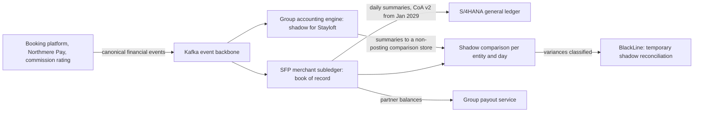
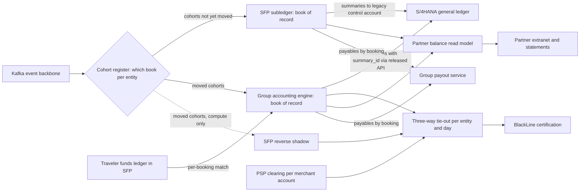
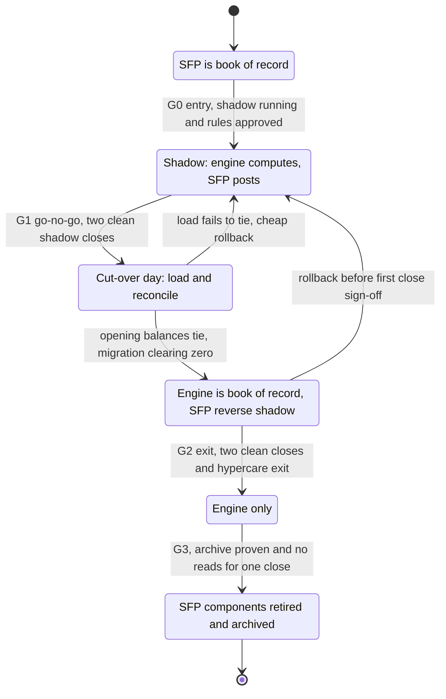
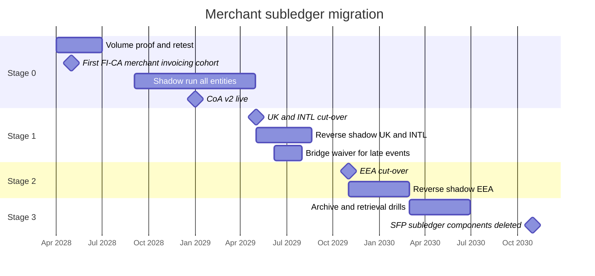

{id: incremental-modernization}
# 36. Modernizing Without Stopping the Close: An Incremental Migration

> **IN THIS CHAPTER, YOU WILL:** Follow Northmere's migration of Stayloft's merchant subledger from the Stayloft Finance Platform onto the group accounting engine and the S/4HANA core, from the 2028 shadow stage through two cut-over stages in 2029 to decommissioning in 2030. Each stage is described by scope, transitional architecture, dual running and reconciliation gates, cut-over calendar, rollback, controls and audit, people, and measured outcome. You will also get a stage-gate table, a cut-over runbook and an honest account of what went wrong in the first stage.

> **WHY FINANCE CARES:** The merchant subledger holds billions in partner payables and pays about 7.6 million partner payouts a month. A migration that loses one open item, pays one partner twice or delays a quarter-end sign-off is an accounting problem, a partner problem and, for a SOX registrant, a controls problem.

> **WHY ARCHITECTS SHOULD CARE:** The hard part of a finance migration is not the target design but the eighteen months in between. During that time two systems are capable of being the book of record and both must be reconciled. The cut-over has to fit a calendar that finance controls, and every temporary component built for it must eventually be removed.

> **KEY POINTS:**
>
> * **Slice along reconciliation boundaries, not modules.** A good migration slice keeps every reconciliation (entity, currency, payment-provider account, safeguarding entity) whole on one side of the line. Northmere sliced by contracting legal entity, aligned with its payment-provider merchant accounts, and never split one booking's accounting across two books.
> * **Gates are reconciliations with owners, tolerances and durations.** Each stage enters on shadow results from two non-quarter-end closes and exits after the reverse shadow has tied out over two clean closes. Each has a rehearsed rollback and a stated last point of return. The calendar, not the plan, decides when a gate can be passed.
> * **The first stage exists to fail cheaply.** Stage 1 exposed late chargebacks on bookings settled before cut-over, a foreign-exchange rounding policy difference and a payout reference that partners could not match. Each fix became a gate criterion for stage 2. The migration was finished when SFP's subledger components were switched off and their history could be retrieved without them, not at the last cut-over.

> **[FAILURE PATTERNS THIS CHAPTER ADDRESSES](#where-finance-architecture-goes-wrong):**
>
> * **Big-Bang Bravado** — the integrator's 1 January 2029 single-step plan is replaced by entity cohorts that each cut over at a quiet period boundary and can each be rolled back.
> * **The Shadow Ledger** — the merchant subledger, a book of record run by a brand engineering team, becomes a governed part of the group finance core, and its legacy control account ends at zero and is blocked.
> * **Audit Archaeology** — migration controls, temporary reconciliations and walkthrough updates are designed with each stage and tested by the auditor before the first close on the new book, not reconstructed after it.

Earlier chapters supplied the parts of this migration. [Modernization Patterns for Legacy Finance Systems](#modernization-patterns) defined the vocabulary (strangler fig, event interception, legacy mimic, transitional architecture, the parallel run, the period-boundary cut-over) and the calendar rule. [Designing Custom Ledgers and Financial Event Processing](#designing-financial-ledgers) rebuilt the merchant subledger as an engine with approved posting rules. [Multiple ERPs, One Finance Core: Coexistence and Convergence](#multiple-erps) chose where it should end up, and [Target State, Transition States and the Roadmap](#target-and-transition-states) placed it on the critical path of Program Keystone, the group's finance transformation. This chapter puts them together into **one worked migration, stage by stage**, with the dates, numbers, setbacks and controls that a real one has.

The question every finance modernization meets once the target is agreed is **how to move the book of record while the books keep closing and the money keeps moving**. My answer: cut the migration into slices that keep reconciliations whole, let each slice pass gates that finance can sign, and plan the switch-off and the archive as carefully as the start.

The chapter owns **migration stage-gate design**. It does not re-teach the pattern catalog ([Modernization Patterns for Legacy Finance Systems](#modernization-patterns)), program leadership and go/no-go governance ([Leading an ERP Modernization and Finance Transformation](#finance-transformation)), or the reconciliation catalog ([Designing for Traceability, Reconciliation and Audit Across Boundaries](#traceability-and-reconciliation)); it uses them.

{id: incremental-modernization--setting-the-scene-at-northmere-one-subledger-no-bad-closes}
## Setting the Scene at Northmere: One Subledger, No Bad Closes

Northmere is the fictional multi-brand digital commerce group this book follows ([Meet Northmere: The Running Example](#meet-northmere)). On 8 December 2027 its Keystone design authority, chaired by Dana Whitlock, the Chief Architect, with Leila Haddad, the Chief Accounting Officer, decided how the group's ledgers converge. Northmere chose an **accounting-hub pattern**: a Northmere-built **group accounting engine**, generalized from the posting engine inside the Stayloft Finance Platform (SFP) and operated outside the SAP S/4HANA core by a new group finance platform team. The engine applies posting rules owned by Leila's accounting policy team and posts summarized journals with drill-back keys into S/4HANA through released APIs. The decision was conditional on a peak-day volume proof in the first half of 2028 ([Multiple ERPs, One Finance Core: Coexistence and Convergence](#multiple-erps)).

In 2027 [Why Enterprises Build Their Own Finance Platforms](#custom-finance-platforms) had recommended SAP FI-CA, the contract-accounting subledger, as the merchant subledger's home, if FI-CA passed a volume proof. The December decision went the other way. FI-CA keeps the receivables-shaped work it already has: agency commission billing since 2025, and **merchant commission invoicing from 2028**: a parallel run in April, the first cohort with the May 2028 invoicing cycle and the remaining cohorts through the rest of the year ([Modernization Patterns for Legacy Finance Systems](#modernization-patterns), [Systems of Record and Authoritative Data Boundaries](#systems-of-record)). The partner payables move to the engine.

SFP's merchant subledger is the largest flow in the group: about **3 million subledger lines a day** from Stayloft's merchant model, in which Stayloft collects the traveler's payment and pays the property net of commission after the stay. It holds every open partner payable, every expected receivable from the payment service providers (PSPs) and the timing of Stayloft's commission revenue, and it feeds about **7.6 million partner payouts a month**. Keystone moves it into the group core during 2029.

An integrator had proposed moving it in one step on 1 January 2029. Leila had already rejected that ([Where Finance Architecture Goes Wrong](#where-finance-architecture-goes-wrong)). Tomás Ferreira, the Group CFO, put the remaining requirement to Dana in January 2028:

*"I want this done in 2029. I do not want one late close, one late payout or one new audit finding because of it. Show me where it can go wrong and what we do when it does."*

Dana asked for one plan with five owners: Jonas Berg (Stayloft Finance Engineering, which builds SFP), Sven Aalto (SAP Platform Lead), Ingrid Solberg (Northmere Pay, which executes payouts), Mei Tanaka (Head of Internal Controls) and the new Head of Partner Settlement in Leila's organization. The rest of this chapter is that plan and what happened when it ran.

{id: incremental-modernization--what-moves-what-stays-and-what-migrated-means}
## What Moves, What Stays, and What "Migrated" Means

First the words. **Book-of-record authority** for a balance is the right to be the system whose numbers the general ledger (GL) and the auditor rely on. In a migration it moves on a date, per slice, and at any moment exactly one system holds it. A **cohort** is a slice of the business that changes authority together. A **stage** is a time-boxed piece of the migration that moves one or more cohorts and ends at a **gate**: a decision point with written criteria, evidence and named approvers. **Dual running** means both systems process the same live events. Before cut-over the new system runs as a shadow; after cut-over the old one runs as a **reverse shadow**, computing but not posting, so that the new book can be reconciled against it and authority can go back if needed. The **point of no return** is the last moment at which authority can return to the old system without restating anything already signed.

Next, the scope. SFP has nine components, and the May 2027 decision record gave each its own future ([Why Enterprises Build Their Own Finance Platforms](#custom-finance-platforms)). Only some of them are in this migration.

| SFP component | Fate | Effect on this migration |
| --- | --- | --- |
| Merchant subledger (partner payables, expected PSP receivables, traveler-side open items) | **Moves** to the group accounting engine; summaries into S/4HANA | The subject of this chapter |
| Revenue-recognition timing rules | **Move** into the engine's rule store | Move with the subledger, cohort by cohort |
| GL summarization and posting interface | **Retired** | Stops for a cohort at its cut-over; removed in 2030 |
| Merchant commission invoicing | Already in FI-CA: first cohort with the May 2028 cycle, all cohorts by 31 December 2028 | A precondition, done in Stage 0 |
| SFP finance reports | Already rebuilt in FinDB, the finance data platform, in 2028 | Repointed from SFP tables to the engine |
| Commission rating | **Stays** in SFP | Keeps publishing rated amounts as events |
| Traveler funds ledger | **Stays** in SFP | Gains a new permanent reconciliation to the engine |
| Payout calculation and orchestration | **Stays**, as the group payout service | Reads partner balances from the engine instead of SFP |
| Payout rules and partner bank details | Rules stay as approved configuration; bank details authored only in Northmere Pay since 2028 | No change during the migration |

So "migrating the merchant subledger" means moving **three balance classes** (partner payables per booking, expected receivables from PSPs, traveler-side open items such as refunds due), the **accounting rules** that create them, and the **posting path** to the GL. Commission rating and payout calculation stay where they are and point at a new book.

The engine's design gave this migration one large advantage. The group engine is a generalization of SFP's 2027 engine, so most rule families arrived with the same meaning, and the producers already published Keystone's canonical financial events (`BookingConfirmed`, `StayCompleted`, `PaymentSettled`, `PartnerPayoutSettled` and the rest, [Canonical Events and Adapters for Loosely Coupled Financial Domains](#loosely-coupled-domains)). **The event contract did not change, so no producer had to change.** What remained was data, authority, operations and the small but real differences that generalizing an engine introduces.

{id: incremental-modernization--choosing-the-slices}
## Choosing the Slices

The first design decision is the slicing dimension. Fowler's account of the strangler fig asks for seams and small replacements delivered early ([Fowler, 2024](https://martinfowler.com/bliki/StranglerFigApplication.html)). In a ledger the seam has to be one that **every reconciliation can respect**. A reconciliation that has to look into two books to prove one boundary is a new manual control that exists only because of the migration.

Dana's team listed the reconciliations that touch the merchant subledger, using the catalog in [Designing for Traceability, Reconciliation and Audit Across Boundaries](#traceability-and-reconciliation): subledger-to-GL per entity and currency; the three-way PSP match per merchant account and currency ([Payments-to-Ledger: Connecting Providers, Brand Platforms and the ERP](#payments-to-ledger)); safeguarding per licensed entity; the traveler funds ledger against partner payables per booking; payouts in transit against bank debits; and intercompany between the contracting entity and the payments entity. Then they tested five slicing options against that list.

| Slicing option | Example | Reconciliations kept whole | Rollback unit | Verdict |
| --- | --- | --- | --- | --- |
| **By module** | Partner payables first, expected PSP receivables later | None: one booking's accounting split across two books | Unclear | Rejected: every booking would need cross-book matching |
| **By booking date (run-off)** | New bookings to the engine; old bookings run off in SFP | Few: every entity in two books for over a year, since stays are booked up to a year ahead | Hard | Rejected: two books of record per entity for 12–14 months |
| **By property market within an entity** | Portugal's properties out of Stayloft B.V. first | Subledger-to-GL only via the market dimension; PSP and safeguarding split | Market | Rejected as the primary slice; kept as a fallback for the largest entity |
| **By business-model variant** | Apartments before hotels | None of the entity-level ones | Variant | Rejected: variants share entities, PSP accounts and partners |
| **By contracting legal entity, aligned with PSP merchant accounts** | Stayloft UK Ltd as one cohort | All of them, once PSP routing is aligned | Entity | **Chosen** |

The legal entity that contracts with the property is the natural boundary. Period states, subledger-to-GL tie-out and access control are already partitioned by entity in the 2027 journal design ([Designing Custom Ledgers and Financial Event Processing](#designing-financial-ledgers)). It is also the unit in which the close calendar, the controller's sign-off and the auditor's testing work.

**Figure 1:** *Slice along reconciliation boundaries: a cohort of contracting entities keeps every reconciliation whole on one side of the line, while a module slice splits one booking's accounting across two books.*

One reconciliation did not line up at first. Northmere Pay routes Stayloft payments through three Adyen merchant accounts: `NMPay_Stayloft_EEA`, `NMPay_Stayloft_UK` and `NMPay_Stayloft_INTL` ([Adyen: Single-Platform Acquiring and Platform Payments](#adyen)). An analysis in March 2028 found that about 2.6% of Stayloft B.V.'s bookings settled through the international account, because routing followed the traveler's region and not the contracting entity (illustrative). That would have split the international account's clearing match across two books for months. Ingrid's team changed the routing rule in September 2028 so that each merchant account settles for exactly one cohort. **The cheapest migration work is often a change to a neighbor's configuration that makes your seam clean.**

That gave three cohorts. The figures are illustrative.

| Cohort | Contracting entities | Adyen merchant account and licensed entity | Share of subledger lines | Partners with open items | Open bookings at cut-over |
| --- | --- | --- | --- | --- | --- |
| **UK** | Stayloft UK Ltd (GBP) | `NMPay_Stayloft_UK`; Northmere Payments UK Ltd | ~7% | ~29,000 | ~530,000 |
| **INTL** | Stayloft Inc. (USD) and three Asia-Pacific and Americas entities | `NMPay_Stayloft_INTL`; Northmere Payments B.V. | ~29% | ~104,000 | ~2.1 million |
| **EEA** | Stayloft B.V. (EUR) and three other EEA entities | `NMPay_Stayloft_EEA`; Northmere Payments B.V. | ~64% | ~231,000 | ~4.9 million |

About 3,900 property managers contract with entities in two cohorts. Their payouts and statements are already issued per contracting entity, so the cohorts do not split them. Their extranet "current balance", which sums across entities, needed a transitional read path, described below.

{id: incremental-modernization--the-calendar-decides-the-shape}
## The Calendar Decides the Shape

The Keystone cut-over rule from [Modernization Patterns for Legacy Finance Systems](#modernization-patterns) is to cut over at the start of the **second month of a fiscal quarter**, never in a quarter-end month. Blackouts cover working day −2 to working day 9 of every close, 1 December to the 10-K filing, and Stayloft's July–August peak. Three dependencies from [Target State, Transition States and the Roadmap](#target-and-transition-states) narrow 2029 further. Chart of accounts (CoA) v2 goes live on 1 January 2029 and must come first. Wayfare's twelve entities move onto S/4HANA through the engine from the 2029 fiscal year ([Multiple ERPs, One Finance Core: Coexistence and Convergence](#multiple-erps)), which takes the group's migration capacity in the first quarter. And the group payout service takes on Wayfare's suppliers in cohorts from April–May 2029 ([Preventing Redundant Capabilities and Unnecessary Coupling](#redundancy-and-coupling)).

That leaves **two good windows in 2029: 1 May and 1 November**. Three cohorts, two windows. Dana put three options to the design authority in March 2028.

| Option | Shape | For | Against |
| --- | --- | --- | --- |
| **A. One cohort per window, finish in 2030** | UK in May 2029, INTL in November 2029, EEA in May 2030 | Smallest steps | Misses the Plateau 2 exit; SFP and the reverse shadow run six more months; contradicts the board's 2029 commitment |
| **B. Use first-month exceptions** | UK in April, INTL in May, EEA in October or November | Three separate steps in 2029 | No stage can pass a gate built on two clean closes of the stage before it; two first closes in consecutive months heading into year-end |
| **C. Two stages, sized by risk** | UK and INTL on 1 May 2029 (~36%); EEA on 1 November 2029 (~64%) | Each stage gated by the previous one's closes; EEA moves with six months of production evidence | The second stage is large; incremental in risk, not evenly in volume |

Dana recommended option C, and Leila and Mei agreed, with two conditions that matter more than the cohort sizes. First, **every entity keeps its own go/no-go decision and its own rollback switch**, even inside a stage, so a stage can go ahead without one of its entities. Second, **the EEA cohort does not cut over until the engine has carried the UK and INTL cohorts through a quarter-end close.** "Incremental" here means each step is reversible and proven by the step before. It does not mean each step is the same size. If the EEA stage had failed its gate, the fallback was the market-within-entity slice for Stayloft B.V. in May 2030, with the Plateau 2 slip reported to the board.

A cut-over at the start of a month falls inside the month-end blackout by definition, since 1 May is working day 1 of the April close. The rule was clarified rather than broken: **the blackout freezes deployments, not effective dates.** Everything is deployed before working day −2, and the switch is an approved, effective-dated configuration change that takes effect at 00:00 on day one.

**Figure 2:** *The calendar decides the shape: close blackouts, year-end, the summer peak and other first-quarter work leave two good windows in 2029, 1 May and 1 November.*

{id: incremental-modernization--the-target-and-the-transitional-architecture}
## The Target and the Transitional Architecture

Three architectures matter: the shadow stage, the transitional state with cohorts on both sides, and the end state. The first two are shown here and the third under decommissioning.

**Figure 3:** *Stage 0. The engine consumes the same events as SFP but posts nothing; its would-be summaries are compared with SFP's real ones per entity and day. This is the Dark Launching pattern applied to a ledger: production inputs, no production effect.*

Five transitional components were built for the cut-over stages. [Modernization Patterns for Legacy Finance Systems](#modernization-patterns) requires each to have an owner and an expiry condition from the day it is designed, so they were entered in Keystone's scaffolding register before any code was written.

| Transitional component | Pattern | What it does | Owner | Expires when |
| --- | --- | --- | --- | --- |
| **Cohort register** | Event interception | Effective-dated table: entity → authoritative book, mode (shadow, authority, reverse shadow, retired). Engine and SFP read it to decide whether to post or only compute | Leila's team (content), group finance platform team (service) | Last cohort's reverse shadow ends |
| **Opening-balance loader** | Transitional architecture | Loads open items per booking from an SFP snapshot as engine entries tagged with their SFP `summary_id`, with control totals per entity, currency and class | Group finance platform team | Last cohort loaded and reconciled |
| **Reverse-shadow comparison** | Transitional architecture | Daily three-way tie-out of SFP (computing), engine (posting) and PSP clearing per entity | Leila's team, certified in BlackLine | Two clean closes per cohort |
| **Partner balance read model** | Legacy mimic | Serves the extranet "current balance" and statements from SFP or the engine per entity, so partners see no change | Stayloft product engineering | Last cohort cut over |
| **Legacy control account** | Transitional architecture | A separate CoA v2 account, "Partner payables – merchant, legacy SFP", so SFP-fed and engine-fed balances are reconciled separately | Group reporting | Balance zero after the last cohort; blocked after the FY2029 audit |

**Figure 4:** *The transitional state during 2029. The cohort register gives every entity exactly one book of record. Moved cohorts are recomputed by SFP as a reverse shadow so the new book can be proven and, until the point of no return, handed back. Partners and the payout service read through paths that hide which book is authoritative.*

Two rules governed these components. **The cohort register is financially significant configuration.** Under the segregation-of-duties standard (STD-FIN-05, [Principles, Standards and Reference Architectures](#principles-standards-reference)), every change is approved by someone other than its author, versioned and logged to the evidence store, and a register change that moves authority needs Leila's approval. **The payout service never decides which book is authoritative.** It asks one endpoint for a booking's payable, and the endpoint consults the register. That kept the payout service's change during 2029 to one interface, which mattered because the same team was absorbing Wayfare's suppliers in the same months.

{id: incremental-modernization--the-stage-gate-design}
## The Stage-Gate Design

Each cohort follows the same lifecycle, and every transition is a gate.

**Figure 5:** *The lifecycle of one cohort. Rollback paths exist until the first close on the new book is signed; after that, problems are fixed forward. Retirement needs its own gate, because a system that is no longer authoritative may still be needed for history.*

The gates, with what must tie out, the tolerance, how long and who signs:

| Gate | Question | What must tie out | Tolerance (set by the controller) | Duration | Approvers |
| --- | --- | --- | --- | --- | --- |
| **G0: enter shadow** | Is the engine ready to be compared? | Event completeness: every event SFP consumes is consumed by the engine (counts per type per day) | Zero missing events | Two weeks of daily runs | Dana; group finance platform lead |
| **G1: go/no-go** | Can this cohort's authority move? | Shadow vs SFP per entity, day, account and booking count; 100% of variances classified as timing, policy, data or defect | Daily unexplained absolute ≤ €5,000 per entity (Stayloft B.V. ≤ €10,000); month-end unexplained absolute ≤ €25,000 per entity (Stayloft B.V. ≤ €50,000); every policy variance decided | Two consecutive non-quarter-end closes in shadow | Four readiness statements (Dana technical, Leila business, Mei controls, Head of Partner Settlement payouts); Tomás decides |
| **Cut-over: load** | Did the opening balances arrive exactly? | SFP closing open items = engine opening entries per entity, currency and class; counts, amounts and hash totals; migration clearing zero | Zero, to the cent | Cut-over day | Leila's team; evidence to Mei |
| **G2: exit dual running** | Is the new book proven? | Three-way tie-out (engine, reverse shadow, PSP clearing) daily; engine-to-GL tie-out certified at working day 1; traveler funds ledger vs engine per booking | Same as G1, applied to engine vs reverse shadow; zero unexplained in the PSP leg | Two clean closes, at least one a quarter-end; hypercare exit criteria met | Leila and Mei |
| **G3: retire** | Can SFP's components go? | Archive balances = SFP closed balances per entity and month = S/4HANA summaries by `summary_id`; retrieval drills passed | Zero differences; 25 of 25 drill samples retrieved per drill | One close with no reads of retired components | Leila, Mei, Kofi Asante for tax retention |

**Counts are compared as well as amounts**, because offsetting errors hide in totals. **Tolerances are absolute and per entity**, so a large positive and a large negative cannot net to a pass. **G2 requires a quarter-end inside dual running**, because hypercare must not end before the first quarter-end close on the new system ([Leading an ERP Modernization and Finance Transformation](#finance-transformation)).

{id: incremental-modernization--stage-0-2028-prove-without-moving-anything}
## Stage 0 (2028): Prove Without Moving Anything

**Scope.** No authority moves. Stage 0 builds and proves everything the cut-overs need: the engine's volume proof, the rules under CoA v2, the shadow run, merchant invoicing in FI-CA, partner identity in coexistence through the partner hub, aligned PSP routing, and the people.

**What happened.** The engine's first peak-day volume test in April 2028 replayed a synthetic peak of about 13 million lines across the brands, the bar set by [Multiple ERPs, One Finance Core: Coexistence and Convergence](#multiple-erps). It posted everything but finished the tie-out at 06:50, fifty minutes after the 06:00 working-day-1 cut-off. The cause was summarization: the engine built one summary per entity, day and account combination before posting any of them. The fix was to summarize per partition as partitions closed. The retest in June 2028 tied out at 04:40 (illustrative). Merchant commission invoicing moved to FI-CA after an April 2028 parallel run, the first cohort with the May 2028 cycle and the rest by the end of 2028, which gave every merchant partner a contract account for invoices, and the 2025 interceptor and statement mimic were retired after the September 2028 close, as planned.

The shadow run started on 3 September 2028 for all nine entities. The first month produced about 41,000 unexplained differences a day (illustrative). Most were policy, not defects: the generalized engine applied group conventions that SFP did not. Leila's team decided each one, and every decision was recorded as a versioned rule change with an owner. Variances fell below the G1 tolerances in the November 2028 shadow close. The Q4 2028 dry-run closes then ran the whole Stayloft close on both books in parallel and found nothing that the shadow comparison had missed. That was reassuring, and it later proved incomplete, for a reason that only a production cut-over would show.

**CoA v2 on 1 January 2029.** Both books switched charts on the same date. SFP's summarizer posted CoA v2 accounts from that date, and the engine's rules were effective-dated to match. The January and February 2029 closes, both non-quarter-end, became the shadow cycles for the stage 1 gate.

**Controls and the auditor.** The engine became a key system in the FY2028 scoping, with source-to-engine completeness as a key control ([Multiple ERPs, One Finance Core: Coexistence and Convergence](#multiple-erps)). In the third quarter of 2028 Mei's team and the external auditor walked through the engine's design: intake, rule store approvals, period states, summarization, the released posting API and the tie-out. They used shadow transactions as samples. The auditor's planning for FY2029 named the two cut-overs as **changes in internal control over financial reporting (ICFR)** to be tested, along with the **data migration controls**: load completeness and accuracy, migration clearing and cut-off. Migration reconciliations are a normal focus of IT general controls over system implementations.

**People.** The work of about 25 Stayloft finance-operations staff ([Why Enterprises Build Their Own Finance Platforms](#custom-finance-platforms)) moved to the Dublin finance shared services center. Training was a "day in the life" on each analyst's own cohort's shadow data: clearing quarantined events, explaining a tie-out break, approving a late posting. Fourteen of Jonas's engineers moved to the group finance platform team, and Sven's team added six people for posting-API operations. **Conway's law applies to ledgers too**: an engine left in Stayloft's engineering organization would have stayed a Stayloft system with a group label.

**Measured outcome.** Volume proof passed on retest. Shadow variance was inside tolerance for three consecutive closes before G1. The PSP routing alignment removed about 2.6% of cross-cohort settlement lines. Stage 0 took about 60% of the migration budget: **in a finance migration, proving is the work, and moving is the event.**

{id: incremental-modernization--stage-1-1-may-2029-the-uk-and-international-cohorts}
## Stage 1 (1 May 2029): The UK and International Cohorts

**Scope.** Stayloft UK Ltd and the four INTL entities, about 36% of subledger lines and about 2.63 million open bookings, move to the engine.

**Calendar.** Cut-over on Tuesday 1 May 2029, working day 1 of the April close. The first close on the new book is May, an ordinary month-end. The first quarter-end, June, comes one month later and falls inside dual running, as G2 requires. The 1 May date is a public holiday in Singapore and much of continental Europe, so the cut-over team and on-call analysts sat in Dublin, London and Amsterdam, where it is a working day.

**The migration journal.** Open items move per booking in the engine, and the GL moves balances through a migration clearing account per entity and currency. For Stayloft UK Ltd's partner payables the pair looks like this (illustrative):

| Account | Debit | Credit | Note |
| --- | --- | --- | --- |
| Partner payables – merchant, legacy SFP | £218.4m | | Closes the SFP-fed balance at 30 April |
| Migration clearing | | £218.4m | Total of SFP open items per snapshot |
| Migration clearing | £218.4m | | Total of engine opening entries |
| Partner payables – merchant (engine control account) | | £218.4m | One opening entry per open booking, each carrying its SFP `summary_id` |

The same pattern ran for expected PSP receivables and traveler-side open items in every entity and currency of the stage, nineteen pairs in all. Each opening entry kept the booking's original dates, so aging and the recognition trigger (the stay-completion date) survive the move. **Migration clearing must be zero by the end of cut-over day. If it is not, the stage does not proceed.**

**Dual running.** From 1 May, SFP ran as reverse shadow for the five entities. The daily three-way tie-out compared engine, reverse shadow and Adyen clearing per merchant account. The G2 plan was two clean closes, May and June.

**Rollback plan.** Cheap rollback ran until the first engine-based payout run on 1 May at 06:30: flip the register back and reverse the opening entries through migration clearing. Rollback with re-posting was possible until the May close sign-off on working day 3 of June. SFP's reverse shadow held a complete, reconciled book until then, so authority could return with the engine's entries reversed. After that, problems were fixed forward. The rollback was rehearsed twice on production-sized copies, and the last rehearsal took 2 hours 10 minutes.

**Controls.** Of SFP's 41 key controls, 17 concerned the merchant subledger. For the moved entities, six SFP controls were placed in suspension (still operated, since SFP was computing, but no longer relied on). The engine's controls took over: rule approval, period state transitions, engine-to-GL tie-out by `summary_id`, and source-to-engine completeness. Three temporary key controls were added: opening-load reconciliation, migration clearing at zero, and the daily three-way tie-out. The auditor attended the load reconciliation on 1 May and re-performed the control totals for two entities. Northmere's disclosure committee judged that a change of this size was reasonably likely to materially affect ICFR. Item 308(c) of Regulation S-K requires a registrant to [disclose such changes that occurred during the last fiscal quarter](https://www.law.cornell.edu/cfr/text/17/229.308), so the change was described in the Q2 2029 quarterly report. That was a judgment by the disclosure committee, not a rule that every migration triggers disclosure.

**People and hypercare.** Hypercare ran with two stand-ups a day, a single incident queue for finance, payments and engineering, and a named decision-maker on duty: the Head of Partner Settlement for payouts and Leila's deputy for accounting. Under the exit criteria in [Leading an ERP Modernization and Finance Transformation](#finance-transformation), hypercare could not end before the June quarter-end close and four weeks without priority-1 or priority-2 incidents.

{id: incremental-modernization--what-we-learned-after-stage-1}
### What we learned after stage 1

Stage 1 did not go cleanly, and that is why it came first.

**Late chargebacks on bookings settled before cut-over.** The opening load moved *open* items. A booking whose stay was completed, whose payout settled and whose commission was recognized before 1 May had no entry in the engine. Chargebacks do not respect cut-over dates. Northmere's €420 dispute in 2027 arrived 40 days after the stay ([Payments for Finance Architects: The Lifecycle of Money Movement](#payments-fundamentals)), and goodwill refunds and late modifications follow the same pattern. From the first week of May, `ChargebackReceived` and `RefundIssued` events arrived for bookings the engine had never seen. They were routed correctly by entity, but no rule could post them. The engine did what [Designing Custom Ledgers and Financial Event Processing](#designing-financial-ledgers) designed it to do: it **quarantined** them, never posting a guess to suspense. By Monday 4 June, working day 2 of the May close, about 8,400 such events sat in quarantine, about $3.1 million in absolute value across the cohorts (illustrative). The June quarter-end close was four weeks away.

The shadow run had not caught it because **the shadow started from history, and production started from a snapshot.** The shadow engine had context for every booking since September 2028, and late events for older bookings were filtered out of the comparison as "outside shadow scope". The production engine started on 1 May with open items only. The dry runs reproduced the shadow, not the cut-over.

The design absorbed it in two moves. The first was a bridge. Leila and Mei approved a dated waiver: until 31 July, late events for bookings settled in SFP before cut-over would be posted by SFP's reverse shadow, which still held the full history, and summarized to the legacy control account. The cohort register gained a rule, "pre-cut-over settled bookings → SFP", with an expiry date. Quarantine was cleared by working day 3 of the May close. The second was the permanent fix: a **booking origin register**. For every booking settled in SFP in the previous 18 months, the engine loaded a reference stub with no balance: the booking ID, partner, entity, amounts, dates, original posting accounts and SFP `summary_id`. A late event for a stubbed booking now posts in the engine in the current period, carrying `original_period` and the SFP reference. If the property must repay, the recovery is netted against its next payout as usual, or, if it has no future payouts, raised as a receivable in FI-CA for collection. The stubs for UK and INTL were loaded by 19 July, and the bridge rule expired on schedule.

**A foreign-exchange rounding policy difference.** In the INTL cohort, many partners are paid in a currency other than the one the traveler paid in. SFP converted each booking's payable to the payout currency and rounded per booking. The generalized engine, built to the group convention, converted the partner's summed payables per payout and rounded once, using the treasury-sourced rate ID from the group rate service ([Many Entities, Currencies, Jurisdictions and Brands](#global-scale)). The difference was at most a cent per booking, but it did not reverse: about $11,600 net and $27,900 absolute in May (illustrative). In the shadow it had been classified as **timing**, because day-level comparisons with slightly different rate snapshots made it look as if it reversed. It was **policy**, the same lesson as the 2025 FI-CA rounding difference in [Modernization Patterns for Legacy Finance Systems](#modernization-patterns), in a new form. Leila ruled for per-booking conversion at the rate ID recorded at stay completion, because the partner statement shows per-booking amounts. The rule change went live in mid-June. The variance-classification procedure gained a test: **a variance is timing only if a later cycle actually reverses it.**

**A missed partner payout reference.** The first engine-based payout run for Stayloft UK Ltd on 1 May built the remittance reference from the engine's posting reference instead of the payout ID. Every payout amount was right and on time. But about 2,600 UK partners received remittance advice they could not match to their bookings, and BlackLine's matching of payout bank debits against payouts in transit failed for that run: £5.9 million unmatched on 2 May (illustrative). Matching was restored manually the same day, and the reference was fixed for the 3 May run. The cause was a test suite that compared amounts and counts but not references. The hand-off contract between payout service and Northmere Pay ([The End-to-End Finance Processes](#finance-processes)) already named the payout ID as the identifier. **Nobody had turned that clause into a test.**

The results went into the stage 2 gate. G1 for the EEA cohort gained three criteria:

1. **Late-event drill.** Replay 90 days of production late events for the cohort's entities against a production-like starting state of open items plus stubs; 100% posted, none quarantined for missing context.
2. **Reversal test for timing variances.** Every variance classed as timing must show its reversal in a later shadow cycle.
3. **Reference-level comparison.** Payout instructions from the dress rehearsal compared with SFP's field by field, including remittance and bank references, not only amounts.

The reverse shadow for UK and INTL ran through the July close instead of stopping after June, because June was not clean. Quarantine was cleared, but the bridge waiver was still open at quarter-end. G2 passed on 13 August, working day 9 of the July close, and the reverse shadow for those entities was switched off on 20 August 2029.

**Measured outcome, stage 1** (illustrative): opening load 2.63 million bookings in 3 hours 10 minutes, reconciled at 05:20, migration clearing zero in all nineteen pairs; engine-to-GL tie-out certified at working day 1 in every close from May; unexplained absolute three-way variance $212,000 at May month-end, $41,000 at June, $9,400 at July; on-time partner payouts 99.2% in May and 99.4% in June, against a 98.6% baseline and a 99.5% target ([The End-to-End Finance Processes](#finance-processes)); about 2,900 additional partner support tickets in May, back to baseline by mid-June.

{id: incremental-modernization--stage-2-1-november-2029-the-eea-cohort}
## Stage 2 (1 November 2029): The EEA Cohort

**Scope.** Stayloft B.V. and three other EEA entities: about 64% of subledger lines, about 4.9 million open bookings, and about 41 million booking-origin stubs covering 18 months of settled bookings. The stubs were loaded in monthly batches from September and topped up on cut-over day, so the cut-over load itself stayed small.

**A booking that straddles the line.** Take a booking with the same shape as the Lisbon booking in [Accounting for Architects: Ledgers, Journals and Revenue](#accounting-for-architects): €600.00 paid by card through Adyen on Monday 15 October 2029, booking ID `SL-BK-1184402`, for a stay from 19 to 22 November 2029, commission 15% (€90.00), payout €510.00. It shows which system holds what on each date.

| Date | Event | Book of record | What happens |
| --- | --- | --- | --- |
| 15 Oct 2029 | `PaymentCaptured`, `BookingConfirmed` | SFP | SFP records the expected PSP receivable, the €510.00 partner payable (not yet due) and the €90.00 commission, not yet recognized; the engine computes the same in shadow |
| 31 Oct 2029, end of day | Snapshot | SFP | The booking's open items are in SFP's October closing balances |
| 1 Nov 2029, 02:00 | Opening load | Engine | One opening entry per open item, carrying `SL-BK-1184402` and SFP's `summary_id`; the traveler funds ledger still holds €600.00 for the traveler, now reconciled to the engine |
| 22 Nov 2029 | `StayCompleted` | Engine | Payable becomes due; €90.00 commission recognized by the engine's rules; summary to S/4HANA with the engine's `summary_id` |
| 23 Nov 2029 | `PartnerPayoutInstructed` | Engine | Group payout service reads the payable from the engine and instructs €510.00 with its payout ID |
| 27 Nov 2029 | `PartnerPayoutSettled` | Engine | Payable cleared; traveler funds released; SFP's reverse shadow has computed every step and agrees |

An auditor who picks this booking in the FY2029 walkthrough follows two drill paths. October's numbers lead into SFP's journal through SFP's `summary_id`, and November's lead into the engine's journal through the engine's. The trace service in [Designing for Traceability, Reconciliation and Audit Across Boundaries](#traceability-and-reconciliation) was extended in Stage 0 to follow both, and later the archive, from one booking ID.

**The cut-over runbook.** T counts working days, with T0 = Thursday 1 November 2029, working day 1 of the October close. An excerpt:

| When | Step | Owner | Evidence |
| --- | --- | --- | --- |
| **T−30** (Thu 20 Sep) | G1 evidence pack opened: July and August shadow closes inside tolerance; late-event drill passed; reversal test passed; last deployment before the Q3 blackout (rule set and an inactive cohort register entry, effective 1 Nov) | Dana, group finance platform lead | Shadow reconciliation certified in BlackLine |
| **T−25 to T−15** (27 Sep–11 Oct) | Q3 quarter-end close blackout: no deployments; shadow continues; September is reviewed but is not a gate cycle | Leila | Blackout calendar |
| **T−12** (Tue 16 Oct) | Dress rehearsal 3 on a production-sized copy from the 30 September snapshot: load, reconcile, first payout run, reference-level comparison, full rollback | Group finance platform team, Northmere Pay | Rehearsal report: load 3 h 50 min, rollback 2 h 10 min |
| **T−10** (Thu 18 Oct) | Finance operations sign-off on day-in-the-life training; partner support briefed; hypercare roster and decision-makers named | Head of Partner Settlement, Dublin service lead | Training records per analyst |
| **T−7** (Tue 23 Oct) | Go/no-go 1: four readiness statements per [Leading an ERP Modernization and Finance Transformation](#finance-transformation); any no-go stops the stage | Tomás decides | Signed statements |
| **T−4** (Fri 26 Oct) | Last deployment window closes; production configuration fingerprinted; bank-detail changes only through the standard approval | Group finance platform lead | Configuration hashes in the evidence store |
| **T−1** (Wed 31 Oct) | Go/no-go 2 at 16:00, per entity; activation of the register entries approved through maker-checker, effective 1 Nov 00:00 CET | Dana, Leila, Mei, Ingrid; Tomás | Register change log |
| **T0** (Thu 1 Nov) | 00:00 authority switches; 02:00 main load from SFP snapshot; 05:30 load reconciled per entity, currency and class, migration clearing zero; **06:30 first engine-based payout run (normally 04:00; same value date): cheap rollback ends**; 20:00 SFP soft-closes October for EEA; 22:00 delta load of late October events | Group finance platform team, Leila's team, Northmere Pay | Load reconciliation; payout control totals |
| **T+1** (Fri 2 Nov) | First daily three-way tie-out; delta load reconciled; hypercare stand-ups at 08:30 and 16:30 | Dublin service lead | Tie-out certification |
| **T+2** (Mon 5 Nov) | Working day 3: SFP's last EEA close signed; legacy control account zero for EEA; migration evidence pack filed | Leila, Mei | Signed close; evidence pack |
| **T+5** (Thu 8 Nov) | First weekly break review with EEA in scope; temporary key controls confirmed operating daily | Mei's team | Break review minutes |
| **T+8** (Tue 13 Nov) | October close locked in OneStream, the consolidation platform, with EEA opening balances in the engine | Group reporting | Lock record |
| **T+10** (Thu 15 Nov) | Hypercare checkpoint: incident trend, quarantine age, partner tickets; hypercare continues to the year-end close by rule | Program director | Checkpoint record |

Two details in the runbook came from stage 1. The delta load exists because October-dated events keep arriving until SFP's soft close at the end of working day 1. In May those had been posted by hand. The payout run is moved two and a half hours later, keeping the same value date, so that no payout reads a balance before the load is reconciled.

**Rollback plan.** As in stage 1, with one addition: **each of the four entities has its own register entry and can be rolled back alone.** Cheap rollback ended at 06:30 on T0. Rollback with re-posting was possible until the November close sign-off on working day 3, Wednesday 5 December 2029. After that, problems were fixed forward.

**Controls and the auditor.** Stage 2's first close was a month before year-end, so the controls the auditor would rely on at 31 December had operated for the EEA population for only two months. Stage 1 mattered here. **The engine's controls had been operating since May on the UK and INTL population**, and the auditor's interim testing in the third quarter covered them. For the year-end, the auditor tested the EEA migration controls and rolled forward the operating-effectiveness evidence. Without a first stage, management's assessment at 31 December would have rested on two months of controls nobody had tested. The change was again described in the annual report under the disclosure committee's judgment.

**People and hypercare.** Hypercare ran through the December year-end close. Year-end is the first quarter-end inside dual running for EEA, so by rule hypercare ended only after the December close locked on Monday 14 January 2030 and the auditor's first year-end procedures on the engine were complete, in late January.

**Measured outcome, stage 2** (illustrative): opening load 4.9 million bookings plus the final stub delta in 3 hours 40 minutes, reconciled at 05:30; no event quarantined for missing booking context; unexplained absolute three-way variance €11,300 at November month-end and €4,800 at December across the four entities; on-time partner payouts 99.5% in November; no additional partner tickets above weekly variation; SFP's last posting through the GL summarization interface was the summary for 31 October 2029. Stayloft's entities closed their subledger at working day 1 of the FY2029 year-end close, and the group met its four-day target for that close.

{id: incremental-modernization--stage-3-2030-decommissioning-the-sfp-subledger-components}
## Stage 3 (2030): Decommissioning the SFP Subledger Components

[Modernization Patterns for Legacy Finance Systems](#modernization-patterns) defines a modernization as finished when the old system is gone, its controls are closed or moved, its contracts are terminated and its records can be retrieved without it. The SFP merchant subledger was not a vendor system with a license to end, but it had everything else: three databases, the summarization service, its custom posting path into S/4HANA, the reverse-shadow jobs, six suspended controls, the legacy control account, and history going back to 2012.

**What must be retained, for how long and in what form.** The system-of-record matrix in [Systems of Record and Authoritative Data Boundaries](#systems-of-record) gives partner payable detail a ten-year retention. The archive therefore holds SFP's merchant journal and its pre-2027 predecessor tables per entity and month. It also holds the agency invoice history that stayed behind in SFP after the 2025 FI-CA move, which closes an obligation nobody had planned for ([Modernization Patterns for Legacy Finance Systems](#modernization-patterns)). Everything is extracted to open formats in Northmere's archive store with a **reconciliation pack**: for every entity and month, archived balances equal SFP's closed balances, which equal the S/4HANA summaries carrying SFP's `summary_id`. Personal data that the law does not require, such as free-text partner notes, was left out of the extract.

**The sequence**, kept out of the year-end window:

1. **After the 10-K filing, early March 2030:** EEA reverse shadow switched off; the cohort register retired, so events flow straight to the engine; SFP subledger set read-only.
2. **March–May 2030:** extraction and reconciliation pack; trace service repointed from SFP tables to the archive.
3. **June 2030:** retrieval drills. Internal audit and the external auditor each retrieved 25 SFP-era items, from booking to GL summary, without SFP. All 25 passed on the first drill.
4. **August 2030:** all human and service access to SFP subledger stores removed, after a full close cycle with no reads.
5. **October 2030:** databases deleted, summarization and posting code removed, the custom posting path in S/4HANA deleted, the legacy control account blocked after the FY2029 audit. The scaffolding register rows for this migration were closed.

**Figure 6:** *The migration on one page. The cut-overs are two days; most of the timeline is proving before them and dual running and decommissioning after them. Every bar ends at a gate, not at a planned date.*

**What SFP is after 2030.** Three components remain: commission rating, the traveler funds ledger and the group payout service. One reconciliation is new and permanent: the traveler funds ledger against the engine's partner payables per booking, part of Northmere Payments B.V.'s safeguarding evidence ([Why Enterprises Build Their Own Finance Platforms](#custom-finance-platforms)).

**Measured outcome of the whole migration** (illustrative, first half of 2030 against 2027): the SFP-to-S/4HANA summarization interface and its custom posting path retired; partner payables and expected PSP receivables drill back from S/4HANA to the booking through one engine for every Stayloft and Wayfare entity; Stayloft finance operations for the subledger reduced from about 25 FTE to about 14 in Dublin; 11 SFP key controls retired and 6 replaced by the engine's group controls; about $2.2 million a year of infrastructure and controls cost removed from SFP; and the Stayloft engineers who built the engine now run it as a group service.

{id: incremental-modernization--trade-offs-how-else-the-subledger-could-have-moved}
## Trade-Offs: How Else the Subledger Could Have Moved

| Approach | How it works | Strength | Weakness | Right when |
| --- | --- | --- | --- | --- |
| **Single step at year-end** | All entities switch on 1 January | One transition; clean annual balances | Migration and annual audit on the same team at once; no way back; every migrated balance audited at its most examined point | Almost never for a high-volume book of record |
| **Entity cohorts with open-item migration** (chosen) | Cohorts cut over at quiet period boundaries; reverse shadow; per-entity rollback | Reconciliations whole; reversible; auditor sees controls operate before year-end | Transitional components to build and remove; calendar limits cohort count; late events need history stubs | High volume, many entities, a calendar with good windows |
| **Run-off** | New bookings to the new book; old bookings complete in the old one | No open-item migration; no opening load | Two books per entity for the longest booking horizon; every reconciliation doubled | Short-lived balances, such as a payments book with days of float |

Northmere's approach cost the most in transitional architecture, and it is the only one where **every intermediate state could be closed, audited and, until a stated point, reversed.**

{id: incremental-modernization--integration-with-the-rest-of-the-estate}
## Integration With the Rest of the Estate

The migration changed little outside the subledger, by design. **Producers did not change**, because the canonical event contract in [Canonical Events and Adapters for Loosely Coupled Financial Domains](#loosely-coupled-domains) was the seam. **Payments-to-ledger did not change**: only the system holding the expected receivables moved, as [Payments-to-Ledger: Connecting Providers, Brand Platforms and the ERP](#payments-to-ledger) intended. **OneStream did not change**, because trial balances still came from S/4HANA under CoA v2 ([OneStream: Consolidation, Planning and Performance Management](#onestream)). **BlackLine** carried the temporary reconciliations as catalog entries with expiry dates, removed when their cohorts exited ([BlackLine: Close Automation, Reconciliation and Continuous Accounting](#blackline)). The **partner hub** became the only path into FI-CA in 2029 ([Finance Data Architecture: Master Data, Systems of Record and Governance](#finance-data-architecture)), so no cohort carried the duplicate partner records of the 2025 load.

{id: incremental-modernization--failure-modes}
## Failure Modes

- **Shadow that is not a dress rehearsal.** The shadow runs from history; the production book starts from a snapshot. *Signal:* comparison filters that exclude records "outside scope" without asking whether production will see them.
- **Cohorts that cut a reconciliation in half.** A PSP account, a safeguarding entity or a partner spans two books for months. *Signal:* a new manual reconciliation in the plan that exists only because of the slicing.
- **Timing variances that never reverse.** *Signal:* "timing" differences with no matching reversal in a later cycle, or a classification written by engineers rather than decided by the controller.
- **Amount-only testing.** References, dates and counts drive partners' and banks' reconciliations. *Signal:* a test suite that compares totals but not identifiers.
- **Transitional components without expiry.** The cohort register, read model and legacy account outlive the migration. *Signal:* a "temporary" component that appears in next year's architecture diagram.

{id: incremental-modernization--the-chief-architect-s-view}
## The Chief Architect's View

Dana did not run this migration; the Keystone program did ([Leading an ERP Modernization and Finance Transformation](#finance-transformation)). She owned five things that decided whether it could succeed.

**The slicing decision.** This is the most consequential architecture decision in a migration and the easiest to leave to the integrator's work breakdown. It belongs in a decision record, tested against the reconciliation catalog, with the neighbor changes it requires named and owned, such as PSP routing in this case.

**The stage-gate standard.** Gates G0 to G3, variance classes, tolerance setting, reverse shadow, per-entity rollback and the disclosure check are a group standard. Every Keystone migration (Wayfare's entities, Tablekin's events, the payout engine's cohorts) produces the same evidence shape, and the auditor can rely on one method instead of learning a new one each time.

**The cohort register as a controlled object.** Authority moves through configuration, so the configuration is a key control. In my experience this is where finance migrations most often lose their audit trail. A routing table changed by an engineer at 01:00 on cut-over night moves billions of balances without an approval anyone can show.

**The calendar.** Published once a year, shared by every program; blackouts freeze deployments, not effective dates.

**The end state.** Dana counted the migration done in October 2030, not in November 2029. Transitional components carried a carrying cost in the debt register ([Technical Debt, Architectural Fitness and Modernization Priorities](#technical-debt-and-fitness)) until they were removed, so "nearly finished" showed up as a cost.

**Who decides what.** Leila decides tolerances, policy variances and authority moves. Mei decides whether evidence is sufficient. The Head of Partner Settlement can hold a payout run. Tomás decides go/no-go on four signed readiness statements. Dana decides the slicing, the gate standard and what counts as done. **No single person can move authority alone.**

**What to watch:** quarantine age and reason after each cut-over; unexplained absolute variance per entity per day, not per cohort per month; the number of live transitional components with passed expiry dates; partner tickets per thousand payouts; and the time to retrieve an archived item, which should not rise once the old system is gone.

{id: incremental-modernization--questions-to-ask}
## Questions to Ask

1. Which reconciliations cross the slice boundary, and what would we have to change elsewhere to keep each one whole?
2. For each cohort, what are the G1 and G2 criteria, who set the tolerances, and were they written before the shadow started?
3. Does the shadow start from the same state as production will on cut-over day, including history that late events will need?
4. Which variances are classed as timing, and where is the cycle in which each one reverses?
5. What is the last point at which authority can go back to the old system, and when did we last rehearse the rollback, on what volume, and how long did it take?
6. Which dates fall inside a blackout, and is anything deployed after working day −2?
7. Do our tests compare identifiers and references as well as amounts and counts?
8. Which controls will the auditor rely on at year-end, and how long will they have operated on the migrated population by then?
9. Does hypercare end after the first quarter-end close on the new book?
10. When will the old components be deleted, who has retrieved an item from the archive without them, and what was the result?

{id: incremental-modernization--closing}
## Closing

This chapter closes Part III. The estate has been treated as one system: events, payments, data, authority, coupling, traceability, onboarding, and now the movement of a book of record from one part of that system to another without a bad close. Every chapter in this part relied on decisions someone had to take, record and enforce: slicing, tolerances, standards, waivers with expiry dates, and the right to say no to a plan date. Part IV ([LEAD: Strategic Architecture and Transformation](#part-4)) turns to that leadership work, starting with how a Chief Architect governs a federated finance estate so that decisions like these are fast, recorded and respected, in [Architecture Governance That Speeds Decisions](#architecture-governance).

{id: incremental-modernization--sources-and-evidence}
## Sources and Evidence

*Vendor documentation*

- [Describing general ledger integration](https://learning.sap.com/courses/implementing-sap-financial-contract-accounting/describing-general-ledger-integration), SAP Learning — FI-CA totals records and reconciliation keys, the posting model behind the merchant invoicing and receivables that remain in FI-CA.
- [Adyen: Getting paid](https://docs.adyen.com/account/getting-paid), Adyen documentation — payout models per merchant account, the background to aligning merchant accounts with cohorts.

*Standards and regulation*

- [17 CFR 229.308, Item 308 of Regulation S-K](https://www.law.cornell.edu/cfr/text/17/229.308), US Securities and Exchange Commission via Cornell LII — paragraph (c): disclosure of changes in ICFR during the last fiscal quarter that materially affected or are reasonably likely to materially affect it.
- [AS 2201, An Audit of Internal Control Over Financial Reporting](https://pcaobus.org/oversight/standards/auditing-standards/details/AS2201), PCAOB — the integrated audit framework within which walkthroughs and tests of changed controls take place (cited for the framework, not for specific paragraphs).

*Practitioner and research sources*

- [Strangler Fig](https://martinfowler.com/bliki/StranglerFigApplication.html), Martin Fowler, 22 August 2024 — seams, small early replacements and temporary coexistence code.
- [Patterns of Legacy Displacement](https://martinfowler.com/articles/patterns-legacy-displacement/), Ian Cartwright, Rob Horn and James Lewis, 2021 (revised 2024) — event interception, legacy mimic, dark launching and canary release as named patterns; parallel running is mentioned only as a cut-over strategy, not as a named pattern.
- [Transitional Architecture](https://martinfowler.com/articles/patterns-legacy-displacement/transitional-architecture.html), Cartwright, Horn and Lewis, 2022 — temporary elements built to be removed, the basis of the scaffolding register.
- [BranchByAbstraction](https://martinfowler.com/bliki/BranchByAbstraction.html), Martin Fowler, 2014 — the payout service's single balance endpoint is a branch-by-abstraction seam.
- [Building Evolutionary Architectures, 2nd edition](https://thoughtworks.com/insights/books/building-evolutionaryarchitectures-second-edition), Neal Ford, Rebecca Parsons, Patrick Kua and Pramod Sadalage, O'Reilly, 2022 — fitness functions, the steady-state form of the gate checks after the migration.

Northmere Group and all its people, systems, dates and figures are fictional; the architectural recommendations are the author's judgment.
