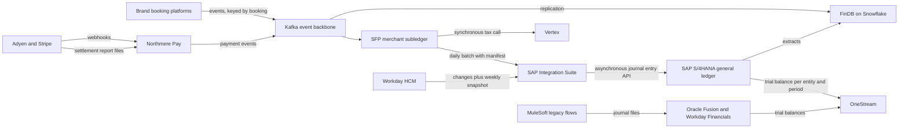
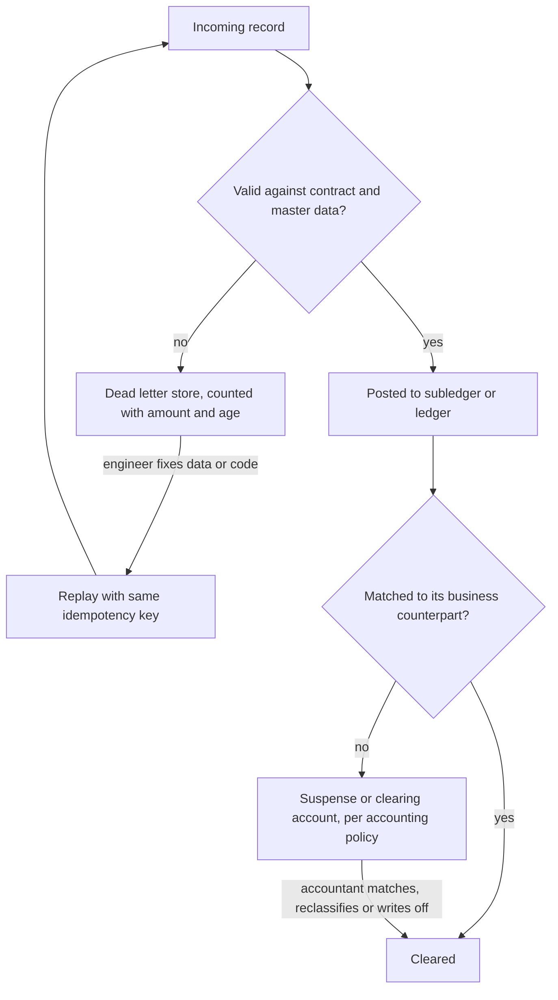
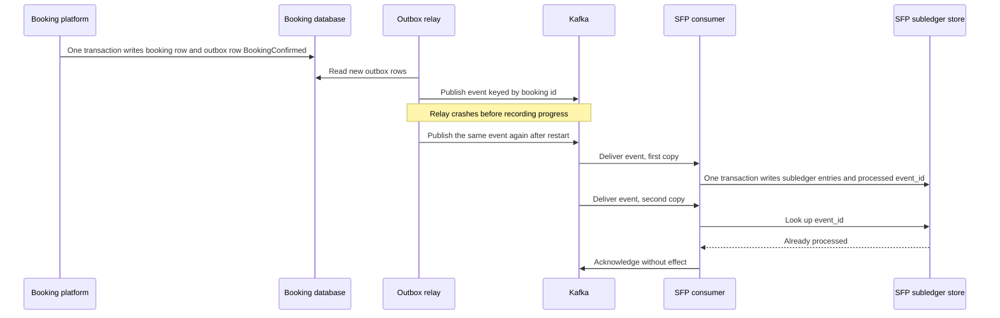
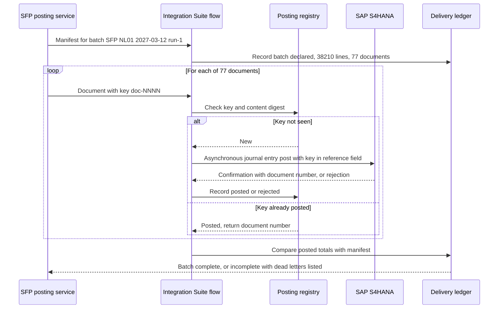

{id: integration-architecture}
# 12. Integration Architecture for Finance


> **IN THIS CHAPTER, YOU WILL:** Learn the five integration styles a finance estate uses and when each fits, the ten requirements that make an interface fit to carry money, and the transactional outbox and idempotent consumer patterns behind them. You will then see Northmere's daily posting from its custom subledger into SAP S/4HANA redesigned with a batch manifest, idempotency and safe replay.

> **WHY FINANCE CARES:** Every number in the trial balance arrived through an interface. If an interface can lose a record, post it twice or put it in the wrong month, the close becomes a hunt for differences, and the controller cannot say whether a balance is complete without someone checking it by hand.

> **WHY ARCHITECTS SHOULD CARE:** Integration is where finance estates quietly fail: an interface sends a file, gets a timeout and sends it again, or loads half a batch and reports success. These are not defects of one vendor or one tool. They are design decisions that nobody made, repeated across hundreds of interfaces.

> **KEY POINTS:**
>
> * **Choose the style by the job, not by the platform you own.** Synchronous APIs, events, files, change data capture and data pipelines each fit some finance flows and harm others. A decision table per use case beats a house preference for "everything on events" or "everything through the iPaaS".
> * **Exactly-once is an effect you build, not a guarantee you buy.** Messaging gives at-least-once delivery at best. A posting takes effect once only when the consumer is idempotent on a key derived from business identity, when every batch carries a manifest of control totals, and when a reconciliation proves the result.
> * **A dead letter is not a suspense account.** A dead letter is a technical failure that an engineer must fix and replay; a suspense account holds money that was posted but not yet explained, which an accountant must clear. If you confuse the two, the books hide integration defects, and engineers end up making accounting decisions.

> **[FAILURE PATTERNS THIS CHAPTER ADDRESSES](#where-finance-architecture-goes-wrong):**
>
> * **Point-to-Point Spaghetti** — about 1,100 finance interfaces on three integration technologies, most with their own format, retry logic and error handling, and few with any proof of completeness.
> * **The Suspense Swamp** — integration failures that are "resolved" by posting the unexplained amount to a suspense account turn engineering defects into accounting balances that nobody owns.
> * **Spreadsheet Glue** — about 70 interfaces have a person and a spreadsheet in the loop, where mappings, corrections and resends happen with no control total and no record.

Most enterprise integration writing assumes that a lost or duplicated message is an inconvenience. In finance it is a misstatement. A booking event that never reaches the subledger is revenue that does not exist in the books; a posting file sent twice is revenue that exists twice. Finance measures integration with a stricter standard than operations does: not "did it arrive", but **"can we prove that everything arrived, once, in the right period"**.

That standard changes the design. It adds **control totals** (counts and sums that sender and receiver compare), **idempotency** (the property that processing the same request twice has the same effect as processing it once) and **period cut-off rules** to every interface that carries money. It turns the integration platform from a set of pipes into part of the control environment the auditor tests. And it makes the most dangerous sentence in integration engineering, "just send it again", into a question about accounting.

This chapter owns four terms that other chapters rely on: the **integration styles**, **idempotency**, **control totals** and the **transactional outbox**. It introduces the canonical financial events that [Canonical Events and Adapters for Loosely Coupled Financial Domains](#loosely-coupled-domains) develops in depth, and it gives the vendor integration surfaces at a glance; the platform chapters hold the detail.

{id: integration-architecture--setting-the-scene-the-night-january-was-posted-one-and-a-half-times}
## Setting the Scene: The Night January Was Posted One and a Half Times

Northmere, the fictional group this book follows, closes January 2027 in the first week of February. On Monday 1 February, at 02:40 Amsterdam time, the Stayloft Finance Platform (SFP), the custom system that holds Stayloft's merchant subledger, writes its daily summary for posting date 31 January: about 38,000 general-ledger lines summarized from about 3 million subledger lines. The file goes by SFTP to an SAP Integration Suite flow, which splits it into journal entries and posts them into SAP S/4HANA through SAP's journal entry posting API.

That night the flow times out after posting about 60% of the entries. The monitoring shows a failed run. At 07:15 an operator on the S/4 platform team restarts it, as the runbook says, from the beginning of the file. S/4HANA accepts every entry again. Nothing in the interface tells S/4 that it has seen these entries before, and SAP documents that its journal entry posting APIs [perform no duplicate invoice check](https://userapps.support.sap.com/sap/support/knowledge/en/2817042). The 31 January summary is now in the ledger one and a half times.

The error surfaces on working day 3, when the BlackLine reconciliation of the traveler-funds control account shows S/4HANA about €38 million higher than SFP. Commission revenue for 31 January is overstated by about €2.9 million (illustrative figures). The fix is a manual reversal journal, approved by the Stayloft entity controller, and a day of the close is lost confirming that nothing else was doubled.


**Figure 1:** *A flow timed out after posting about 60% of 31 January's entries; restarting from the top of the file posted everything again, and nothing told the ledger it had seen those entries before.*

Dana Whitlock, the Chief Architect, asks Lucía Romero, the lead enterprise architect for integration, how many of the estate's interfaces could do the same thing, and how many could prove they had not. Lucía's inventory, built for Program Keystone (Northmere's finance transformation), counts about **1,100 interfaces** in the finance estate. About **240** are flat-file transfers and about **70** have a spreadsheet and a person in the loop. They run on three integration technologies: **SAP Integration Suite** for SAP-centric flows, **Kafka** as the event backbone owned by Ravi Menon's Platform Engineering, and **MuleSoft** carrying the legacy Wayfare and Tablekin flows.

Her answer to the second question is the uncomfortable one. Of the 1,100, about **310** carry a record count or control total that the receiver checks; the rest assume that a transfer that reported success was complete. Fewer than 100 can be safely re-run (illustrative counts from the 2027 inventory).

The incident did not reveal a bad tool; each component did what it is documented to do. It revealed that nobody had designed what the interface must guarantee. The rest of this chapter is that design.

{id: integration-architecture--five-integration-styles-and-what-each-is-good-for-in-finance}
## Five Integration Styles and What Each Is Good For in Finance

An **integration style** is the basic mechanism by which two systems exchange data. Hohpe and Woolf's [*Enterprise Integration Patterns*](https://www.enterpriseintegrationpatterns.com/) catalogs the patterns within each; for finance architecture, five styles are enough to classify every interface in the estate.

| Style | Mechanism | Strength for finance | Weakness for finance |
| --- | --- | --- | --- |
| **Synchronous API** | Caller sends a request and waits for the answer (REST, SOAP, OData, gRPC) | Immediate answers: tax determination, credit check, validation of an account before posting | Couples availability: if the callee is down or slow, the caller stops. Timeouts leave the outcome unknown, which is exactly the case that produces double postings |
| **Asynchronous events and messaging** | Producer publishes a fact; consumers subscribe through a broker (Kafka, event mesh, queues) | Per-transaction detail with low latency; many consumers from one publication; replay from a retained log | Delivery is at-least-once in practice; ordering holds only within a partition or key; completeness must be proven separately |
| **Files and batch** | A set of records is produced at a cut-off and transferred whole (SFTP, managed file transfer, vendor bulk-import templates) | Natural unit for period cut-off and control totals; matches how banks, PSPs and SaaS ERPs exchange bulk data | Latency of a day; partial loads; manual resends; a file is easily copied, edited or sent twice |
| **Change data capture (CDC)** | A tool reads the source database's transaction log and emits row changes | Captures changes without modifying the source application; useful for legacy systems and analytical replication | Emits table changes, not business facts; at-least-once after failures; couples the consumer to the source's physical schema |
| **Data pipelines and ELT** | Scheduled or streaming extraction into a data platform, transformed there | Builds the analytical and reconciliation views (FinDB) across all sources | Not a posting channel: a warehouse table is not a ledger, and its numbers need tie-out to the ledger of record |

**The styles are not ranked.** "Event-driven" is not more modern than "file" in any sense that matters to a controller: banks send statements as files (MT940 or ISO 20022 camt.053), PSPs publish settlement reports as files, and Oracle Fusion's bulk inbound path is a file template. **CDC, in particular, is a technique for integrating legacy systems, not a contract.** [Debezium](https://debezium.io/documentation/faq/), the widely used open-source CDC platform, reads database transaction logs. It documents that after a failure connectors restart from the last recorded offset, so "these duplicates will always be visible to downstream consuming applications". CDC on a business table also publishes the source's internal schema to every consumer. I use it in two cases: to replicate into the data platform, and as the relay for a transactional outbox, which is described below. I do not use it as the published interface between finance domains.

{id: integration-architecture--a-decision-table-for-finance-use-cases}
### A decision table for finance use cases

The rule I use is to **choose the style by the unit of completeness the receiver needs**. That might be one transaction, one business day, one settlement batch or one period. Then layer the finance requirements of the next section on top.

| Finance use case | Northmere example | Recommended style | Why |
| --- | --- | --- | --- |
| Operational financial events to a subledger | Booking, cancellation and payment events into SFP | Events on the backbone, keyed by booking | Per-transaction detail, many consumers, replay from the log |
| Subledger summary to general ledger | SFP to S/4HANA, ~38,000 lines a day | Batch with manifest, posted through the ERP's asynchronous API or bulk import | A posting date is a natural batch; control totals per batch; the ERP is built for summaries, not streams |
| PSP settlement to reconciliation and ledger | Adyen settlement details, Stripe balance transactions | Files or report APIs, announced by webhook | The report is the financial record; webhooks are early operational signals ([Payments for Finance Architects: The Lifecycle of Money Movement](#payments-fundamentals)) |
| PSP payment status to operations | Adyen and Stripe webhooks into Northmere Pay | Webhook received into a durable store, then events | The provider pushes; the receiver must accept fast and process later |
| Bank statements and payment files | Kyriba to banks and back | Files in ISO 20022 or SWIFT formats through bank connectivity | The banking standard; each file is a control unit |
| Real-time decision during a transaction | Vertex tax determination for an SFP commission invoice | Synchronous API with timeout and fallback rule | The answer is needed before the invoice is issued |
| Master and reference data distribution | Cost centers and approvers from Workday HCM; FX rates from treasury | Events on change, plus a periodic full snapshot for reconciliation | Consumers need changes fast and a way to prove they hold the full set |
| Trial balances to consolidation | S/4HANA, Fusion and Workday to OneStream | Batch per entity and period, with control totals | Consolidation works on closed periods |
| Analytics and tie-out | All of the above into FinDB (Snowflake) | Data pipelines and CDC replication | Analytical, not posting; tie-out to the ledger is mandatory ([Finance Data Across the Estate: From Operations to Analytics](#finance-data-flows)) |

Lucía's inventory maps the 1,100 interfaces onto these styles (counts rounded, illustrative):

| Style | Interfaces | Typical technology at Northmere |
| --- | --- | --- |
| Synchronous APIs | ~410 | SAP Integration Suite, MuleSoft, direct calls |
| Events and messaging | ~180 | Kafka |
| Files and batch | ~240 | SFTP scripts, Integration Suite, MuleSoft, Kyriba bank connectivity |
| Spreadsheets in the loop | ~70 | Email, shared drives, manual upload |
| Data pipelines and ELT | ~150 | dbt and loaders into Snowflake |
| Change data capture | ~50 | Replication into FinDB |

The mix is not the problem; each of the 1,100 making its own decisions about completeness, retries and errors is.



**Figure 2:** *One finance estate uses all five styles. The architecture question for each arrow is not which technology carries it but what unit of completeness it must prove: one transaction, one batch or one period.*

{id: integration-architecture--ten-requirements-for-an-interface-that-carries-money}
## Ten Requirements for an Interface That Carries Money

An operational integration is judged on latency and availability. A finance integration must also meet the ten requirements below. Together they are the specification Keystone's integration standard imposes on every interface that changes a balance. [Controls, Auditability and Security by Design](#controls-and-auditability) explains why the auditor cares; [Designing for Traceability, Reconciliation and Audit Across Boundaries](#traceability-and-reconciliation) turns the same properties into a reconciliation catalog.

**1. Completeness.** Every record the source produced for the period reaches the target, or is visibly accounted for as rejected or pending. Completeness is a property you **prove**, not one you assume. The proof is a comparison of what was sent with what was received and accepted, made by the receiver, on numbers the sender declared independently.

**2. Accuracy.** What arrives means what was sent. Amounts arrive in **minor units with an ISO 4217 currency code**, never as floating-point values, and minor-unit exponents vary (zero for the Japanese yen, three for the Kuwaiti dinar). Mappings from source codes to accounts are versioned master data ([Finance Data Architecture: Master Data, Systems of Record and Governance](#finance-data-architecture)), not logic hidden in an integration flow.

**3. Exactly-once effect.** Each business fact changes the books once. The next section explains why this is a property of the receiver's processing, not of the transport.

**4. Ordering, and its limits.** Some facts depend on others: a refund cannot be accounted for before the capture it refunds. Brokers give narrow ordering guarantees. Apache Kafka [guarantees](https://kafka.apache.org/intro) that "any consumer of a given topic-partition will always read that partition's events in exactly the same order", and says nothing about order across partitions. Providers give less: Stripe states that it ["doesn't guarantee the delivery of events in the order that they're generated"](https://docs.stripe.com/webhooks), and Adyen advises checking timestamps and, where present, a `sequenceNumber` ([Adyen webhooks](https://docs.adyen.com/development-resources/webhooks/handle-webhook-events)). My rule: **key the stream by the business entity whose order matters** (the booking or the payment) so its events share a partition, and **make consumers tolerate the remaining disorder** by parking an event whose parent has not arrived, or by treating the event as a hint and reading current state.

**5. Cut-off and period assignment.** Every record carries enough time information to decide its accounting period without asking when it arrived. That means at least the **event time** (`occurred_at`), the **receipt time** (`recorded_at`) and a **posting date** assigned by a declared rule. The rule names the timestamp, the time zone and the owner. At Northmere, Leila Haddad's team owns the cut-off rules. For SFP, the booking event's `occurred_at` is read in Amsterdam time for Stayloft B.V.; for Adyen events, the rule uses the merchant account's report time zone ([Adyen: Single-Platform Acquiring and Platform Payments](#adyen)). A record that arrives after its period is locked is posted in the current open period with its original event date kept, so the late arrival can be measured ([Accounting for Architects: Ledgers, Journals and Revenue](#accounting-for-architects)).

**6. Control totals and batch manifests.** A **control total** is a number computed independently by sender and receiver over the same set of records and then compared: a record count, an amount total per currency, a debit total and a credit total, or a **hash total** (a sum of a field such as account number that has no meaning except as a check). A **batch manifest** is the sender's declaration of a batch: its identifier, its scope (source, entity, posting date), its record count, its control totals, and a cryptographic digest of the content. The receiver checks the manifest before it accepts the batch and records the result. For a stream there is no natural batch, so the producer publishes a periodic **completeness checkpoint** instead, for example per source, per hour and per event type: "between 10:00 and 11:00 I published 88,120 `BookingConfirmed` events totaling €51,302,447.15".

**7. Replay and backfill.** **Replay** re-delivers records already sent, to recover from a consumer defect or outage. **Backfill** sends records for a past period that were never sent, after a new consumer is added or a source defect is found. Both are routine, so both must be safe. Replay must not double-post, which requires idempotency. Backfill must not land silently in a closed period, which requires the cut-off rule. And both need retention: a Kafka topic that keeps seven days of events cannot replay a month-end. Martin Fowler's warning about [event sourcing](https://martinfowler.com/eaaDev/EventSourcing.html) applies in full: during a replay, calls to external systems must be suppressed, or a replay can resend payments.

**8. Back-pressure at month-end.** Finance volume is not flat. On the first working days of a close, accrual runs, settlement files, intercompany postings, trial-balance loads and reconciliation extracts all compete for the same integration runtime and the same ERP posting capacity. At Northmere, the integration runtime carries roughly four times an average day's postings on working day 1 (illustrative). An interface needs a declared behavior when the receiver slows down: it queues, throttles or sheds non-financial load, and it never times out into the unknown-outcome state that caused the January double posting. Vendors document their own limits. Workday, for example, [may reject requests with HTTP 429 or 500 under load](https://doc.workday.com/admin-guide/en-us/manage-workday/tenant-configuration/it-administrator-resources/limitations-and-availability/dan1370797408285.html) and recommends exponential back-off.

**9. Error handling: dead letters versus suspense accounts.** This distinction is the most important one in the chapter, and the next section takes it in full.

**10. Observability of money in flight.** Operational observability asks whether the pipes are healthy. Finance asks **how much money is between systems right now, and for how long**. At any moment some value has left one system and not yet been accepted by the next: events consumed but not yet summarized, batches sent but not yet posted, documents parked in a dead-letter queue. I recommend that each finance interface publishes, per source and day, the counts and amounts received, rejected, delivered, replayed and pending. That record is the **delivery ledger**, and it makes "money in flight" a metric with an owner and an aging profile, not a guess on working day 3. Tracing standards such as [OpenTelemetry](https://opentelemetry.io/docs/what-is-opentelemetry/) correlate the hops; the delivery ledger counts the money.


**Figure 3:** *Finance observability asks how much money sits between systems right now and for how long, including the value parked in dead-letter stores.*

{id: integration-architecture--dead-letters-and-suspense-accounts-are-different-things}
### Dead letters and suspense accounts are different things

A **dead letter** is a message the integration layer could not process: malformed, failing validation, referencing an account that does not exist, or rejected by the target. Hohpe and Woolf's [Dead Letter Channel](https://www.enterpriseintegrationpatterns.com/patterns/messaging/DeadLetterChannel.html) is where "a messaging system … may elect to move the message" when it "cannot or should not deliver" it. A dead letter has not reached the books. Fixing it is an engineering task, and the fix is a correction followed by a replay.

A **suspense account** (or clearing account) is a general-ledger account that holds amounts that have been **posted** but whose final destination is not yet known: a settlement line that cannot be matched to a booking, a receipt without a remittance reference. A suspense item is in the books, it affects the balance sheet, and clearing it is an accounting decision with an approver.

| | Dead letter | Suspense account |
| --- | --- | --- |
| Where it lives | Integration layer: a queue, topic or error store | General ledger: a balance-sheet account |
| Has it reached the books? | No | Yes |
| Typical cause | Technical: schema error, invalid master data reference, target unavailable, duplicate rejected | Business: unmatched or unexplained money, missing reference, timing difference |
| Who resolves it | The interface's engineering owner | An accountant, with approval for write-offs |
| How it is resolved | Fix the data or the code, then replay | Match, reclassify by journal, or write off under policy |
| What it must report | Count, amount and age per interface | Balance, aging and items older than policy, reconciled monthly |
| Failure if confused | Engineers "park" bad records by posting them to suspense, so defects become balances | Accountants fix balances by journal, so the defect that caused them recurs |

The anti-pattern is easy to slip into. A deadline approaches and someone configures a flow to post anything unmappable to a suspense account "so the batch balances". From then on every mapping defect becomes an accounting balance: the dead-letter count drops to zero and the suspense balance grows. That is how **The Suspense Swamp** starts. Northmere's PSP clearing and suspense balances averaged **€14 million** at month-end in 2026, with about €2.1 million older than 90 days. Not all of that came from integration defects, but Lucía's sample found mapping failures among the oldest items ([Payments-to-Ledger: Connecting Providers, Brand Platforms and the ERP](#payments-to-ledger) owns the fix).

**The rule I use: technical failures stay out of the ledger.** An interface may post to a suspense account only where an accounting policy defines that account for a specific business situation, such as an unmatched PSP settlement line. It may never use one as an error handler. Dead letters carry money too, so they are reported in the delivery ledger with amounts and ages. An interface with zero dead letters and a growing suspense account is not healthy.



**Figure 4:** *Two error paths with two owners. Technical failures stop before the books and are replayed after a fix; business exceptions are posted to accounts defined by policy and cleared by accounting decisions. The dangerous arrow is the one this diagram leaves out: from dead letter straight to suspense.*

{id: integration-architecture--exactly-once-is-an-effect-not-a-delivery-guarantee}
## Exactly-Once Is an Effect, Not a Delivery Guarantee

A sender that gets no acknowledgment cannot tell whether the message or the acknowledgment was lost. It can retry and risk a duplicate, or give up and risk a loss. Finance cannot accept a loss, so **at-least-once delivery** is the realistic baseline.

Middleware marketing blurs this. Kafka does offer "exactly-once semantics", but Confluent's own explanation ([Narkhede and Wang, 2017](https://www.confluent.io/blog/exactly-once-semantics-are-possible-heres-how-apache-kafka-does-it/)) limits it to read-process-write **within Kafka**. Side effects outside Kafka, such as a call to an ERP or a write to another database, are not covered, and rewinding offsets cannot roll back external state. An ERP posting is precisely such a side effect. **No middleware delivers exactly-once postings.**

What finance can have is an **exactly-once effect**: each business fact changes the books once, however many times it is delivered. It is built from three parts:

1. **At-least-once delivery**, so nothing is lost: durable publication, retries with exponential back-off and jitter.
2. **Idempotent processing**, so repeats change nothing: the consumer recognizes a fact it has already applied and returns the earlier result.
3. **Reconciliation**, so any residual error is caught: control totals per batch and a subledger-to-GL comparison per day.


**Figure 5:** *Exactly-once is an effect, not a delivery guarantee: at-least-once delivery, an idempotent receiver and reconciliation together make each business fact change the books once.*

Hohpe's short essay ["Your Coffee Shop Doesn't Use Two-Phase Commit"](https://www.enterpriseintegrationpatterns.com/docs/IEEE_Software_Design_2PC.pdf) makes the same point from the other direction. Loosely coupled systems handle errors by write-off, retry or compensating action. Retry needs idempotent receivers, and the write-off strategy depends on "reconciliation reports" run periodically. In finance, all three of those are architecture.

{id: integration-architecture--idempotency-keys-derived-from-business-identity}
### Idempotency keys derived from business identity

An **idempotency key** identifies the business operation a request represents, so that the receiver can detect a repeat. Stripe's implementation is the reference most engineers know. A client sends an [`Idempotency-Key`](https://docs.stripe.com/api/idempotent_requests) of up to 255 characters on a POST; Stripe stores the result and returns it for a repeated key, and rejects a repeat whose parameters differ. Keys can be pruned after at least 24 hours. Brandur Leach's [essay on idempotency](https://stripe.com/blog/idempotency) adds the retry discipline: exponential back-off with jitter.

Three design rules follow for finance.

- **Derive the key from business identity, never from the attempt.** A random identifier generated per attempt satisfies the API and defeats the purpose, because the retry gets a new identifier. Northmere's keys look like `SFP:NL01:2027-03-12:run-1:doc-0042` for a summary document or `ADYEN:{pspReference}:CAPTURE` for a payment modification. A reviewer can read the key and tell which business fact it represents.
- **Same key, different content, is an error, not an update.** A corrected batch gets a new run number and is preceded by a reversal of the run it replaces. A silent overwrite would destroy the audit trail.
- **Hold keys for at least as long as you can replay.** Stripe's 24-hour minimum protects a caller's retries, not a replay a week later. The receiver's own processed-key store must cover the longest replay or backfill window the interface supports. For a ledger posting, that window runs to period close and beyond.

Most ERP posting interfaces will not do this for you. SAP's knowledge base states that there is [no duplicate invoice check](https://userapps.support.sap.com/sap/support/knowledge/en/2817042) for the Journal Entry Post API, synchronous or asynchronous. The duplicate checks that exist sit in the payables application, not in the generic posting service. The idempotency gate therefore belongs in front of the ERP, under the integration owner's control, with the key also written into a reference field of each posted document so that a reconciliation can find duplicates that slipped through.

{id: integration-architecture--the-transactional-outbox-and-the-idempotent-consumer}
### The transactional outbox and the idempotent consumer

The producer side has its own version of the problem, called the **dual write**. A service that updates its database and then publishes an event can crash between the two, leaving a change with no event or, if it publishes first, an event with no change. The **transactional outbox** ([Richardson](https://microservices.io/patterns/data/transactional-outbox.html)) removes the gap. The service writes the business change and an outbox row in the same database transaction; a separate **relay** reads the outbox and publishes. Debezium's [Outbox Event Router](https://debezium.io/documentation/reference/stable/transformations/outbox-event-router.html) is a common relay. It routes rows to topics by aggregate type and keys messages by aggregate identifier, which preserves per-aggregate order. The relay can publish a row twice after a crash, so the outbox always pairs with an **idempotent consumer**: Hohpe and Woolf's [Idempotent Receiver](https://www.enterpriseintegrationpatterns.com/patterns/messaging/IdempotentReceiver.html), "one that can safely receive the same message multiple times". In practice the consumer records each processed event identifier **in the same transaction as its own effect**.



**Figure 6:** *The outbox closes the gap between changing state and announcing it; the idempotent consumer closes the gap the relay reopens. Neither guarantees exactly-once delivery. Together they give an exactly-once effect on the subledger, which reconciliation then confirms.*

Two details make or break this in finance. The processed-event record and the accounting effect must commit **atomically**. A consumer that posts and then records the key, in two steps, recreates the dual write it was meant to remove. And when the effect lands in a system the consumer does not control, such as an ERP or a PSP, atomicity is impossible. Then the key must travel with the request and be stored on the target document, and a reconciliation must look for duplicates by that key.

{id: integration-architecture--integration-platforms-ipaas-esb-event-backbone-or-code}
## Integration Platforms: iPaaS, ESB, Event Backbone or Code

Styles describe how data moves; platforms describe where integration logic runs and who owns it. Four options recur: an **integration platform as a service (iPaaS)**, a vendor-run platform with connectors, mapping, API management and monitoring (SAP Integration Suite, MuleSoft Anypoint, Oracle Integration, Boomi, Workato), commonly organized in layers such as MuleSoft's widely cited system, process and experience APIs; an **enterprise service bus (ESB)**, its usually self-hosted predecessor; an **event backbone**, a durable, partitioned log or broker (Kafka, SAP Integration Suite's advanced event mesh) that moves and retains events but does not transform them; and **integration in code**, adapters and services run by the domain team that owns the data.

| Option | Who usually owns it | Fits | Does not fit | The finance risk |
| --- | --- | --- | --- | --- |
| **iPaaS** | A central integration team or a platform team (at Northmere: Sven Aalto's SAP team for Integration Suite) | Connecting SaaS and ERP surfaces through delivered adapters; API management; moderate-volume, mapping-heavy flows | Per-transaction streams at marketplace volume; logic that needs domain tests | **Posting logic creeps into mappings.** Account derivation, summarization and tax rules end up in flows no accountant reviews and no unit test covers |
| **ESB** | Central middleware team | Legacy estates already built on it | New finance designs | Becomes the place every rule lives, and the bottleneck every change waits on |
| **Event backbone** | Platform engineering (at Northmere: Ravi Menon's team) | Canonical financial events; many consumers; replay; decoupled domains | Request-reply; bulk vendor imports; anything needing transformation in the pipe | Ownership of the platform without ownership of the contract. The topics run reliably while their meaning drifts |
| **Code in the domain** | The domain team that owns the data | Idempotent consumers, posting services, PSP adapters, anything with financial logic | Commodity SaaS-to-SaaS connections a delivered adapter already handles | Every team writes its own retry, idempotency and control-total code, differently. A shared library and standard fix this |

The real trade-off is **where the financial logic is allowed to live**. My position: integration platforms **move and validate** data and never **decide accounting**. Account determination, summarization rules and posting rules belong in the subledger or the accounting engine, under the change controls the auditor tests ([Designing Custom Ledgers and Financial Event Processing](#designing-financial-ledgers)). If an iPaaS mapping decides which account a commission lands in, that mapping is an application control in an unlikely place. It needs versioning, approval and a test the auditor can rely on, and it rarely has any of them.

{id: integration-architecture--three-technologies-a-keystone-decision}
### Three technologies: a Keystone decision

Northmere runs three integration technologies because of its history, not because of a design. SAP Integration Suite arrived with S/4HANA in 2021. Kafka grew in brand engineering and is run by Platform Engineering. MuleSoft came with the Wayfare and Tablekin acquisitions. Each has a different owner, a different monitoring console and a different idea of an error.

Lucía's recommendation to the Keystone design authority, which Dana adopted as the 2027 position, assigns each technology a lane rather than picking a winner:

| Lane | Technology | Scope | Direction |
| --- | --- | --- | --- |
| **Event lane** | Kafka | Canonical financial events between domains; retained for replay through period close plus one month | Invest. Platform Engineering runs it; Lucía's team owns the event contracts |
| **ERP and SaaS lane** | SAP Integration Suite | Surfaces of S/4HANA, Workday HCM, Coupa, Concur, Kyriba and other vendors; API management | Invest, under a rule that it moves and validates but does not derive accounting |
| **Legacy lane** | MuleSoft | Existing Wayfare and Tablekin flows | Contain: no new flows from 2027; flows retire with the ledger convergence from 2029 |
| **Domain adapters** | Code, on a shared library | Posting services, PSP adapters, webhook receivers | Standard library for idempotency keys, manifests and delivery-ledger reporting |

The lane model is a transition state, not a target. It accepts two technologies' overlap in the ERP lane until 2029 because migrating working MuleSoft flows ahead of the ledger convergence would mean rebuilding each twice. [Preventing Redundant Capabilities and Unnecessary Coupling](#redundancy-and-coupling) treats the general question of when duplication is acceptable.

{id: integration-architecture--vendor-integration-surfaces-at-a-glance}
## Vendor Integration Surfaces at a Glance

Each platform exposes its own surfaces, with its own semantics for bulk, events and errors. The table compares them on the questions this chapter asks. It includes only documented facts and limits; the platform chapters ([SAP S/4HANA: The Enterprise Finance Core](#sap-s4hana), [Oracle Fusion Cloud ERP: Ledgers, Accounting Hub and Coexistence](#oracle-fusion), [Workday: Financials, People and the Organizational Backbone](#workday), [Adyen: Single-Platform Acquiring and Platform Payments](#adyen), [Stripe: Programmable Payments, Billing and Connected Accounts](#stripe)) hold the detail.

| Platform | Inbound for bulk financial data | Inbound for transactions | Outbound and events | Documented limits and behaviors that matter |
| --- | --- | --- | --- | --- |
| **SAP S/4HANA** | Asynchronous Journal Entry Post API; IDoc for classic integrations | Released OData and SOAP APIs (synchronous Journal Entry Post among them); BAPIs as "classic APIs" | Business events (RAP events in recent releases) through SAP Integration Suite and its event mesh | SAP's [clean-core levels](https://news.sap.com/2025/08/extend-sap-s4hana-cloud-right-way-clean-clear/) rate released APIs as Level A and BAPIs as Level B. Large synchronous postings can [time out; SAP advises the asynchronous API](https://userapps.support.sap.com/sap/support/knowledge/en/2830584). No [duplicate invoice check](https://userapps.support.sap.com/sap/support/knowledge/en/2817042) in the journal entry APIs |
| **Oracle Fusion Cloud ERP** | [FBDI](https://docs.oracle.com/en/cloud/saas/supply-chain-and-manufacturing/23d/faipr/file-based-data-import-fbdi-process.html) (file-based data import): files uploaded to Universal Content Management (UCM), then load and import jobs; Accounting Hub's [Import Accounting Transactions](https://docs.oracle.com/en/cloud/saas/financials/26c/faiac/upload-transaction-data-for-accounting-hub.html) | [REST APIs](https://docs.oracle.com/en/cloud/saas/financials/26c/farfa/index.html) per resource; ERP Integration Service to automate FBDI | Business events through the Oracle Integration ERP adapter; [BI Cloud Connector (BICC)](https://docs.oracle.com/en/cloud/saas/supply-chain-and-manufacturing/25b/faips/sco-large-scale-raw-data-extraction-using-business-intelligence-cloud-connector-bicc.html) for bulk extraction, with a newer extraction tool since 26A | Oracle publishes [volume mechanisms](https://docs.oracle.com/en/cloud/saas/financials/26c/faiac/advanced-features-for-importing-transaction-data-to-accounting.html) (split files, separate upload, import and accounting processes) but **no throughput number**. Imports are scheduled jobs, so completeness is checked per import run |
| **Workday** | Enterprise Interface Builder (EIB) file loads; Workday Web Services (SOAP); Accounting Center for external accounting | REST and [versioned SOAP](https://community-content.workday.com/en-us/public/products/platform-and-product-extensions/workday-web-services-versioning.html) APIs; Studio and Orchestrate for complex flows | RaaS (custom reports as web services) for extracts; outbound integrations from business processes | [Published limits](https://doc.workday.com/admin-guide/en-us/manage-workday/tenant-configuration/it-administrator-resources/limitations-and-availability/dan1370797408285.html): up to 5 concurrent EIBs; HTTP 429 or 500 throttling; RaaS quotas by tenant size (a tenant under 100,000 workers, like Northmere's, gets 250,000 extracts per 24 hours and 75,000 per hour); datetimes returned in Pacific Time |
| **Adyen** | Settlement details and payment accounting reports, announced by a `REPORT_AVAILABLE` webhook | API requests for payments and modifications; modifications are asynchronous and confirmed by webhook | [Webhooks](https://docs.adyen.com/development-resources/webhooks/handle-webhook-events), HMAC-signed, at-least-once | Acknowledge within 10 seconds; [retries](https://docs.adyen.com/development-resources/webhooks/troubleshoot) from 30 seconds up to 8 hours for up to 30 days; duplicates share `eventCode` and `pspReference`; reports follow the account's time zone |
| **Stripe** | Payout reconciliation and balance reports (API and Dashboard) | API with `Idempotency-Key` on POST requests | [Webhooks](https://docs.stripe.com/webhooks), signed, at-least-once, unordered; thin or snapshot event payloads | Retries for up to three days in live mode; no ordering guarantee; keys up to 255 characters, prunable after 24 hours; API and event shapes [versioned](https://docs.stripe.com/api/versioning) |

Three patterns run through the table. **The SaaS ERPs are batch-shaped for volume.** Their documented bulk paths are files or asynchronous jobs, and the vendors document throttling rather than promising throughput. Marketplace-scale detail is therefore summarized before it reaches them ([Why Enterprises Build Their Own Finance Platforms](#custom-finance-platforms)). **The PSPs are event-shaped for operations and report-shaped for money.** Webhooks are fast, unordered and at-least-once, while the reports are the financial record. **Time zones differ by surface.** Workday returns Pacific Time, Adyen's reports follow the account setting, and Stripe's reporting views differ. No interface should rely on a timestamp without declaring the time zone in its contract.

{id: integration-architecture--canonical-financial-events-introduced}
## Canonical Financial Events, Introduced

An estate of 1,100 interfaces cannot be governed one interface at a time. Keystone's answer is a **canonical financial event**: a business fact with financial consequence, published once by the domain that owns it, in a shared envelope that every consumer understands. Lucía's team drafted version 1 in early 2027; the design authority approved it in June 2027, with the schema registry live from 1 July 2027. The event names include `BookingConfirmed`, `BookingCancelled`, `StayCompleted`, `PaymentCaptured`, `PaymentSettled`, `RefundIssued`, `ChargebackReceived`, `PSPFeeCharged`, `PartnerPayoutInstructed`, `PartnerPayoutSettled`, `CommissionInvoiced`, `SubscriptionInvoiced`, `UsageRated`, `AdClickBilled` and `FXRateApplied`.

The envelope is where this chapter's requirements become fields. Here it is for the capture of the Lisbon booking, the €600.00 Stayloft stay paid by card through Adyen on 12 March 2027:

| Envelope field | Value for the Lisbon capture | Requirement it serves |
| --- | --- | --- |
| `event_id` | Derived from the Adyen modification: `ADYEN:{pspReference}:CAPTURE` | Exactly-once effect: the idempotency key |
| `event_type`, `event_version` | `PaymentCaptured`, `1` | Contract versioning |
| `occurred_at` | 2027-03-12, time of capture, with offset | Cut-off and period assignment |
| `recorded_at` | Time Northmere Pay recorded it | Late-arrival measurement |
| `brand`, `legal_entity`, `business_model` | Stayloft; Northmere Payments B.V. for the funds; merchant | Routing and account derivation without lookups in the pipe |
| `source_system` | Northmere Pay | Completeness per source |
| `correlation_id` | The booking id | Ordering key and traceability |
| `amount` | `60000` minor units, `EUR` | Accuracy: no floating point |
| `counterparty_id`, `tax_jurisdiction` | The traveler's tokenized id; PT | Downstream tax and partner logic |
| `payload` | Event-specific detail | Kept versioned and validated |

Three properties of the model matter for integration design: events are **immutable** (corrections are new events that reference the original), **keyed by business identity**, and **accompanied by completeness checkpoints** per source. Everything else, including the adapter kit that lets a brand publish canonical events, the schema registry, consumer-driven contract tests and the governance of the model, belongs to [Canonical Events and Adapters for Loosely Coupled Financial Domains](#loosely-coupled-domains).

{id: integration-architecture--worked-example-redesigning-the-sfp-to-s-4hana-daily-posting}
## Worked Example: Redesigning the SFP-to-S/4HANA Daily Posting

The January incident gave Keystone its first integration pattern to standardize. Lucía, Jonas Berg (who owns SFP) and Sven Aalto (who owns S/4HANA and Integration Suite) redesigned the SFP-to-S/4HANA posting between February and April 2027. The design changes the interface, not the systems. SFP still summarizes, S/4HANA still owns the balances, and Integration Suite still carries the traffic.

{id: integration-architecture--what-was-wrong}
### What was wrong

| Property | Before | Consequence |
| --- | --- | --- |
| Batch identity | A file name with a timestamp | A re-sent file looked like a new batch |
| Completeness | Integration Suite logged "success" when it finished | A partial post reported as a failure, and a full re-run reported as a success |
| Idempotency | None. The S/4 API performs no duplicate check and nothing in front of it did either | Re-run doubled what had already posted |
| Recovery procedure | Restart from the beginning of the file | Turned a partial load into a double posting |
| Error handling | Rejected documents written to a log file; the batch "balanced" by an operator's manual journal | Defects turned into ledger adjustments |
| Reconciliation | Monthly, in BlackLine, on working day 3 | Found on day 3 what the interface could have known in minutes |

{id: integration-architecture--the-new-design}
### The new design

**1. A batch manifest that SFP produces before it sends anything.** For each legal entity and posting date, SFP writes a manifest that declares the batch. Using the posting date 12 March 2027, the date [Why Enterprises Build Their Own Finance Platforms](#custom-finance-platforms) uses to illustrate SFP's summary controls:

```yaml
batch_id: SFP:NL01:2027-03-12:run-1
source: SFP
legal_entity: NL01            # Stayloft B.V.
posting_date: 2027-03-12      # Amsterdam-time cut-off rule v2
period: 2027-03
events_consumed: 2114880
detail_lines: 3061442
summary_lines: 38210
documents: 77                 # summary lines chunked into journal entries
totals:
  - {currency: EUR, debit_minor: 18240633117, credit_minor: 18240633117}
  - {currency: GBP, debit_minor: 1102448902, credit_minor: 1102448902}
content_digest: sha256:9f2c…
supersedes: null
```

Debits equal credits per currency, the detail lines and the summary lines agree to the cent, and the manifest is signed by SFP's posting service (amounts illustrative). The manifest is the sender's independent declaration. Everything downstream is checked against it.

**2. Deterministic chunking and document keys.** The 38,210 summary lines are chunked into journal entries of at most 500 lines each, a Northmere design choice that keeps each request small after document splitting. SAP warns that [document splitting can multiply item counts and slow large postings](https://userapps.support.sap.com/sap/support/knowledge/en/2830584). Chunking is deterministic: the same batch always yields the same 77 documents, each with a key such as `SFP:NL01:2027-03-12:run-1:doc-0042`. The key is written into the journal entry's reference field in S/4HANA.

**3. An idempotency gate in front of S/4HANA.** The Integration Suite flow checks a **posting registry**, a small store owned by Sven's team, before it sends each document:

- key not seen → send to the asynchronous Journal Entry Post API and record "sent";
- key seen and posted → return the stored S/4 document number and send nothing;
- key seen and pending → wait for the asynchronous confirmation instead of resending;
- key seen with a different content digest → reject the batch as a contract violation and alert both owners.

The asynchronous API removes the timeout that left January's outcome unknown. Each document is confirmed or rejected individually, and the registry records which.

**4. A completion check against the manifest.** When every document is confirmed, the flow compares the posted documents, lines and debit and credit totals per currency with the manifest and writes the result to the delivery ledger. Only then is the batch marked complete. A mismatch raises an alert to the S/4 platform team within minutes, not to a controller on working day 3.

**5. Rejected documents go to a dead-letter store, never to a suspense account.** A document that S/4HANA rejects, for example because it references a blocked account, is held with its amount and age, visible in the delivery ledger. Jonas's team fixes the cause and the same key is replayed. The batch stays incomplete until the dead letters are resolved. The controller sees "€1.2 million of 12 March not yet posted, one document, rejected for a blocked account", not a balancing journal.

**6. Corrections as superseding runs.** If SFP finds an error in a posted batch, it does not resend. It produces `run-2` with `supersedes: run-1`; the flow first posts a reversal of every document in `run-1`, keyed by the original keys with a reversal suffix, and then posts `run-2`. Both runs stay visible in S/4HANA and in the registry.

**7. Daily subledger-to-GL reconciliation.** BlackLine compares SFP's control-account balances with S/4HANA's each day, per entity and currency, instead of once a month. It is the safety net for everything the first six steps miss: a manual journal on an SFP control account, a posting into a closed period, a document posted outside the gate.



**Figure 7:** *The redesigned daily posting. The manifest declares what should arrive, the registry makes every resend harmless, and the delivery ledger compares what arrived with what was declared before anyone calls the batch complete.*

{id: integration-architecture--the-january-night-replayed-under-the-new-design}
### The January night, replayed under the new design

The redesign was tested by replaying the January failure in a test environment. The flow posts 46 of 77 documents and then loses its connection. The operator re-runs the batch, as before. The registry returns the stored document numbers for documents 1 to 46 and the flow sends only 47 to 77. The delivery ledger shows the batch complete at 38,210 lines with debit and credit totals equal to the manifest. Nothing was doubled, and nobody had to know which documents had posted.

A second test sends a hand-edited copy under the same `run-1` key; the registry rejects it on the content digest. A changed file with an old identity is exactly what an auditor wants an interface to refuse.

{id: integration-architecture--what-it-cost-and-what-it-bought}
### What it cost and what it bought

The redesign took about eleven engineer-weeks across three teams (illustrative). It made duplicate postings from retries structurally impossible through the gate, made partial loads visible within minutes, replaced "restart from the top" with "re-run; the registry decides", and gave Mei Tanaka's team an automated interface control with a complete population of batches and results ([Controls, Auditability and Security by Design](#controls-and-auditability)).

It did not fix everything. The summary is still a summary: drill-back from an S/4HANA line to bookings still goes through SFP's batch index, and the convergence of the merchant subledger into the group core remains a 2029 program. The pattern, though, became the reference implementation of the **idempotent posting** standard Dana had proposed in November 2026, cataloged as STD-FIN-02 and enforced from 1 July 2027 ([Principles, Standards and Reference Architectures](#principles-standards-reference)). By the end of 2027 it applied to the Northmere Ads summary postings to S/4HANA and to Tablekin's journal loads into Workday.

{id: integration-architecture--integration-governance-catalog-contracts-versions-and-retirement}
## Integration Governance: Catalog, Contracts, Versions and Retirement

Lucía's team built the inventory in six weeks from LeanIX, integration-platform configuration, Kafka topic metadata and interviews for the spreadsheets. Keeping it true is the governance problem, and four instruments do the work.

**An interface catalog with finance fields.** Every interface that changes a balance or feeds a key report is registered with more than its endpoints:

| Field | Example for SFP-to-S/4HANA |
| --- | --- |
| Identifier and owner (sender side, receiver side) | INT-0412; Jonas Berg (sender), Sven Aalto (receiver) |
| Style and technology | Batch with manifest; SAP Integration Suite |
| Financial relevance | Posts to GL; in scope for internal control over financial reporting (ICFR); feeds key reconciliation R-117 |
| Unit of completeness and control totals | Entity and posting date; lines, documents, debit and credit per currency |
| Idempotency key and retention | Batch and document key; registry retained 13 months |
| Cut-off rule | Amsterdam-time rule v2, owner Leila Haddad's team |
| Error path | Dead-letter store; suspense posting not permitted |
| Replay procedure | Re-run under same key; corrections as superseding runs |
| Contract and version | Data contract `sfp-daily-gl-summary` 3.1.0 |
| Retirement | Planned replacement by canonical events into the group core, 2029 |

**Contracts as the unit of change.** A **data contract** is the agreed, versioned specification of what an interface carries, including completeness and semantics as well as schema ([Finance Data Architecture: Master Data, Systems of Record and Governance](#finance-data-architecture) shows SFP's posting contract in the [Open Data Contract Standard](https://bitol-io.github.io/open-data-contract-standard/latest/) format). A change to an interface that is not a change to its contract is not reviewable.

**Versioning that follows the vendors' own discipline.** The vendors' practices are a reasonable model. Workday's SOAP API introduces a new version [only for breaking changes](https://community-content.workday.com/en-us/public/products/platform-and-product-extensions/workday-web-services-versioning.html) and lets the caller pin it. Stripe ships [monthly non-breaking versions and twice-yearly breaking releases](https://docs.stripe.com/api/versioning), with requests pinned by header. The same rules suit canonical events: additive changes in place, breaking changes as a new major version run in parallel, and consumers pinned and tested at upgrade.

**Deprecation with a date and a census.** An interface or contract version is deprecated with an end date, a list of its consumers taken from the catalog and from runtime traffic, and a named owner for each migration. Lucía's rule is that **nothing is switched off that still carries traffic, and nothing is left running after its date without a waiver that itself expires.** The expiring waiver comes from the standards process Dana set up in November 2026.

{id: integration-architecture--failure-modes}
## Failure Modes

**Point-to-Point Spaghetti.** Each of the 1,100 interfaces was the cheapest answer to one project's need. Lucía found booking cancellations represented five different ways across the three technologies. The signs are an inventory nobody trusts, failures found by downstream users, and replacement projects that discover their interface count only during testing. The remedy is not a big rewrite. Canonical events and a few governed patterns become mandatory for new interfaces, and old ones migrate when their systems change.

**Silent partial loads.** A batch loads 80% of its records and reports success because the loader counts only rejected records it saw, or because a file was truncated in transfer. Without a manifest, the receiver has no independent number to compare with. Watch for interfaces whose only completeness check is "the job finished". At Northmere, about 790 of 1,100 were in that state at the start of 2027.

**Double posting on retry.** The January incident is the textbook case: a timeout leaves the outcome unknown, a well-meaning retry restarts from the beginning, and a target with no duplicate check accepts everything. It is caused by random or attempt-based keys, by synchronous calls for bulk work, and by runbooks that say "re-run" without saying how the interface knows what already happened.

**Time-zone cut-off errors.** A payment at 23:30 in Lisbon on 31 March is 00:30 on 1 April in Amsterdam and 15:30 on 31 March in Workday's Pacific Time. Interfaces that assign periods by server time or arrival time put the same transaction in different months in different systems. Every close then opens with a "timing difference" that hides real breaks. The signs are recurring unexplained differences at month boundaries that "reverse next month". The remedy is a declared cut-off rule per source, with event time and time zone carried in the contract ([Many Entities, Currencies, Jurisdictions and Brands](#global-scale) takes up the multi-time-zone, multi-entity version).

**Spreadsheet relays.** The 70 spreadsheets-in-the-loop are interfaces with no control totals and a human as the retry mechanism, and often where mapping decisions are made invisibly. Each is a candidate for automation or, where the human judgment is real, for a workflow with an approval record.

{id: integration-architecture--the-chief-architect-s-view}
## The Chief Architect's View

**Decide the guarantees, not the tools.** The first standard I would issue: every interface that changes a balance declares its unit of completeness, control totals, idempotency key, cut-off rule, error path and replay procedure, and the receiver verifies them. Tool choices matter less than they seem.

**Separate platform ownership from contract ownership.** At Northmere, Platform Engineering runs Kafka and the SAP team runs Integration Suite, and both run them well. Neither owns what a `PaymentSettled` event means, how complete a batch must be, or who clears a dead letter at month-end. Lucía's team owns the contracts and the standard; domain teams own their interfaces; Leila's team owns the cut-off rules. Write this down in the decision-rights table ([The Chief Architect's Job: Coherence Across a Finance Estate](#chief-architect-role)), because each owner will otherwise assume one of the others has it.

**Keep financial logic out of the pipes.** The cheapest-looking place to put a mapping is an integration flow. It is also the place where the auditor is least likely to find it and the accountant least likely to review it. I treat any account derivation found in an integration platform as technical debt with a control risk attached.

**Fund the boring parts centrally.** The idempotency library, the manifest format, the posting registry and the delivery ledger benefit every team and are funded by none. Unfunded, every team rebuilds them slightly differently, which is how an estate gets 1,100 interfaces with 1,100 retry strategies.

**Measure money in flight.** A few metrics belong on Leila's and Dana's joint dashboard: value and age of dead letters per interface; share of financially relevant interfaces with verified control totals; batches complete by cut-off on working day 1; duplicate postings found by reconciliation (target zero); integration-related items in suspense. Each moves before the close does.

**Watch the vendors' surfaces as part of the roadmap.** API versions, event formats, throttling limits and extraction tools change with vendor releases. Oracle introduced a new extraction capability in 26A, Stripe publishes breaking versions twice a year, and SAP renames and repackages its integration products from time to time. The interface catalog should record which interfaces depend on which vendor surface version, so a release note becomes a query, not a surprise.

{id: integration-architecture--questions-to-ask}
## Questions to Ask

1. For this interface, what is the unit of completeness, and which control totals does the receiver check against an independent declaration from the sender?
2. What happens, step by step, if the sender retries after a timeout? Where is the idempotency key stored, how is it derived, and how long is it kept?
3. Which timestamp and which time zone decide the accounting period, who owns that rule, and what happens to a record that arrives after the period is locked?
4. Where do rejected records go, who is alerted, and can any rejected record end up in a suspense account?
5. How far back can we replay, and what prevents a replay from re-triggering payments or other external effects?
6. How will this interface behave on working day 1, at four times its normal volume, when the target system throttles?
7. Is any account derivation, summarization or tax logic implemented inside the integration platform? Who reviews it, and how is it tested?
8. Which vendor surface and version does this interface depend on, and what is the plan when that version is deprecated?
9. How much money is in flight on this interface right now, and how old is the oldest item?

{id: integration-architecture--next-many-entities-currencies-and-jurisdictions}
## Next: Many Entities, Currencies and Jurisdictions

This chapter treated an interface as a pipe between two systems. At Northmere, almost every pipe also crosses a boundary between legal entities, currencies or jurisdictions. The Lisbon booking's €600 moves from a Dutch e-money institution's safeguarding account to a Portuguese property, its commission settles intercompany, and its period depends on whose clock is read. The next chapter, [Many Entities, Currencies, Jurisdictions and Brands](#global-scale), takes up the legal-entity, intercompany, multi-currency and multi-jurisdiction design that the integration layer has to carry correctly.

{id: integration-architecture--sources-and-evidence}
## Sources and Evidence

*Vendor documentation*

- [No Duplicate Invoice Check for API Posting (KBA 2817042)](https://userapps.support.sap.com/sap/support/knowledge/en/2817042), SAP — states that the Journal Entry Post APIs, synchronous and asynchronous, have no duplicate invoice check.
- [Time out error occurs in Journal Entry – Post (Synchronous) API (KBA 2830584)](https://userapps.support.sap.com/sap/support/knowledge/en/2830584), SAP — advises the asynchronous API for large postings and notes the effect of document splitting on item counts.
- [Extend SAP S/4HANA Cloud the right way](https://news.sap.com/2025/08/extend-sap-s4hana-cloud-right-way-clean-clear/), SAP News, 2025 — clean-core levels A to D; released APIs as Level A and BAPIs as Level B.
- [File-Based Data Import (FBDI) process](https://docs.oracle.com/en/cloud/saas/supply-chain-and-manufacturing/23d/faipr/file-based-data-import-fbdi-process.html), Oracle — upload to UCM, load and import jobs.
- [Upload transaction data for Accounting Hub](https://docs.oracle.com/en/cloud/saas/financials/26c/faiac/upload-transaction-data-for-accounting-hub.html) and [advanced features for importing transaction data](https://docs.oracle.com/en/cloud/saas/financials/26c/faiac/advanced-features-for-importing-transaction-data-to-accounting.html), Oracle, 26C — Accounting Hub import mechanics and volume mechanisms with no published throughput figure.
- [REST API for Oracle Fusion Cloud Financials](https://docs.oracle.com/en/cloud/saas/financials/26c/farfa/index.html) and [BICC large-scale extraction](https://docs.oracle.com/en/cloud/saas/supply-chain-and-manufacturing/25b/faips/sco-large-scale-raw-data-extraction-using-business-intelligence-cloud-connector-bicc.html), Oracle — transactional and bulk outbound surfaces.
- [Integration and Web Service Limits](https://doc.workday.com/admin-guide/en-us/manage-workday/tenant-configuration/it-administrator-resources/limitations-and-availability/dan1370797408285.html), Workday — throttling responses, RaaS quotas by tenant size, EIB concurrency, Pacific Time datetimes.
- [Workday Web Services versioning](https://community-content.workday.com/en-us/public/products/platform-and-product-extensions/workday-web-services-versioning.html), Workday — new versions only for breaking changes; caller-pinned versions.
- [Handle webhook events](https://docs.adyen.com/development-resources/webhooks/handle-webhook-events) and [Troubleshoot webhooks](https://docs.adyen.com/development-resources/webhooks/troubleshoot), Adyen — 10-second acknowledgment, duplicates, ordering hints, retry schedule up to 30 days.
- [Webhooks](https://docs.stripe.com/webhooks), [Idempotent requests](https://docs.stripe.com/api/idempotent_requests) and [API versioning](https://docs.stripe.com/api/versioning), Stripe — retries up to three days, no ordering guarantee, idempotency-key behavior, version cadence.
- [Introduction to Apache Kafka](https://kafka.apache.org/intro), Apache Software Foundation — ordering guaranteed within a topic-partition.
- [Debezium FAQ](https://debezium.io/documentation/faq/) and [Outbox Event Router](https://debezium.io/documentation/reference/stable/transformations/outbox-event-router.html), Debezium project — at-least-once delivery after failures; outbox routing keyed by aggregate.

*Standards and regulation*

- [Open Data Contract Standard](https://bitol-io.github.io/open-data-contract-standard/latest/), Bitol — the data contract format referenced for interface contracts.
- [What is OpenTelemetry?](https://opentelemetry.io/docs/what-is-opentelemetry/), OpenTelemetry project — vendor-neutral traces, metrics and logs used to correlate hops.

*Practitioner and research sources*

- [*Enterprise Integration Patterns*](https://www.enterpriseintegrationpatterns.com/), Gregor Hohpe and Bobby Woolf, 2003 — the pattern language, including [Idempotent Receiver](https://www.enterpriseintegrationpatterns.com/patterns/messaging/IdempotentReceiver.html) and [Dead Letter Channel](https://www.enterpriseintegrationpatterns.com/patterns/messaging/DeadLetterChannel.html).
- ["Your Coffee Shop Doesn't Use Two-Phase Commit"](https://www.enterpriseintegrationpatterns.com/docs/IEEE_Software_Design_2PC.pdf), Gregor Hohpe, *IEEE Software*, 2005 — write-off, retry and compensation, and the dependence of write-off on reconciliation.
- ["Exactly-Once Semantics Are Possible: Here's How Kafka Does It"](https://www.confluent.io/blog/exactly-once-semantics-are-possible-heres-how-apache-kafka-does-it/), Neha Narkhede and Guozhang Wang, Confluent, 2017 — the scope of Kafka's exactly-once guarantee and its exclusion of external side effects.
- ["Pattern: Transactional outbox"](https://microservices.io/patterns/data/transactional-outbox.html), Chris Richardson — the outbox pattern and the duplicate-publication caveat.
- ["Designing robust and predictable APIs with idempotency"](https://stripe.com/blog/idempotency), Brandur Leach, Stripe, 2017 — idempotency keys and jittered exponential back-off.
- ["Event Sourcing"](https://martinfowler.com/eaaDev/EventSourcing.html), Martin Fowler, 2005 — replay hazards with external systems.

Northmere is fictional, and its interfaces, incidents and figures are illustrations. The architectural recommendations are the author's judgment.
