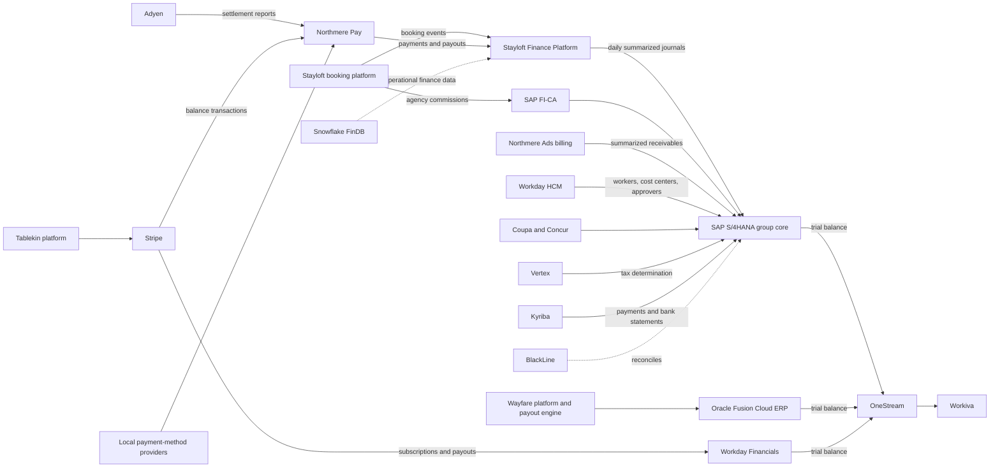
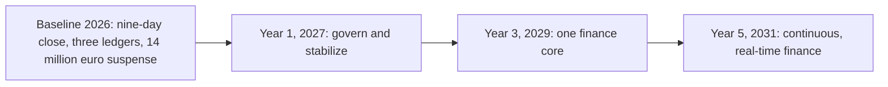

{id: meet-northmere}
# 3. Meet Northmere: The Running Example

> **IN THIS SECTION, YOU WILL:** Meet Northmere Group, the fictional enterprise this book follows: its brands and business models, its legal entities and licensed payments entity, its systems landscape and volumes, the people who run it, the seven problems it starts 2027 with, the transformation program approved to solve them, and the worked examples the chapters reuse.

> **KEY POINTS:**
>
> * **Northmere is a fictional composite, not a disguised company.** It generalizes patterns common to multinational, multi-brand, technology-driven groups, so the book can show real architectural tensions with consistent numbers without describing any real enterprise's internals.
> * **Its difficulty comes from variety, not size.** Four business models, three ERPs, two payment providers, two e-money institutions and 71 legal entities must produce one set of US GAAP statements and one auditable story of the money.
> * **Every chapter starts from one of seven 2027 problems.** The nine-day close, the €14 million suspense balance, three charts of accounts, duplicate capabilities, an audit finding, a heavily customized ERP and a queue of new regulations give each chapter a concrete question to answer.

Architecture books often fail in one of two ways. Either their examples are toy systems too simple to show the trade-offs that matter, or they describe one real company in detail that does not transfer and cannot be verified. This book takes a third route: **one fictional enterprise, detailed enough to be realistic and consistent enough to be followed across fifty chapters**.

**Northmere Group is fictional.** Every name, figure, system choice and event on this page is invented for teaching. Its shape generalizes patterns that commonly appear in multinational, multi-brand, technology-driven groups: a marketplace business shifting from agency to merchant payments, acquired brands that arrive with their own ERPs, a licensed payments entity inside a commercial group, custom finance platforms built by product engineering, and a finance function trying to close faster while the business changes underneath it. It is **not a portrait of any real company**, and nothing here should be read as a claim about how any real enterprise is built.

The vendor platforms Northmere uses are real products, chosen because they commonly appear in such estates and because Part II explains each one in depth. Northmere's configuration of them, its problems with them and its decisions about them are invented.

{id: meet-northmere--the-group-at-a-glance}
## The Group at a Glance

Northmere is a multinational digital commerce group, headquartered in Amsterdam, with major hubs in London, Dublin, Singapore, Austin and São Paulo. It is listed in New York, which makes it an SEC registrant reporting under US GAAP, with management's assessment and the auditor's attestation of internal control over financial reporting required under Section 404 of the Sarbanes-Oxley Act (see [Controls, Auditability and Security by Design](#controls-and-auditability)).

| Measure (fiscal 2026, calendar year) | Value |
| --- | --- |
| Gross transaction value (GTV), the total value customers transact through its platforms | about **$64 billion** |
| Revenue | about **$8.2 billion** |
| Employees | about **24,000** |
| Legal entities | **71** in **38** countries |
| Currencies customers pay in | **46** |
| Currencies Northmere settles with partners in | **31** |
| Group reporting currency | US dollar (most European entities have euro functional currency) |
| Group GAAP | US GAAP; local GAAP or IFRS per entity for statutory accounts |

The gap between GTV and revenue is the first thing an architect should notice. Most of the $64 billion is **other people's money**: payments that Northmere collects and passes on to properties, rail operators or restaurants, or that customers pay to those partners directly. Northmere's revenue is mainly the commissions and fees it earns along the way. The finance estate must track the whole flow, not just the revenue, because the money in transit is a liability, a regulatory obligation and a reconciliation problem.

**Figure 1:** *Most of the $64 billion Northmere handles is other people's money in transit; its $8.2 billion of revenue is the smaller stream it keeps, but the estate must track the whole flow.*

{id: meet-northmere--brands-and-business-models}
## Brands and Business Models

Northmere runs five businesses. Four earn revenue directly; one is the payments platform the others rely on.

| Brand | What it does | Business model(s) | Share of 2026 revenue | Finance stack (2027 baseline) |
| --- | --- | --- | --- | --- |
| **Stayloft** | Accommodation marketplace: hotels, apartments, homes | Agency and merchant; merchant share of GTV **64%** in 2026, up from 51% in 2023 | ~58% | **Stayloft Finance Platform (SFP)**, custom; posts daily summaries to SAP S/4HANA |
| **Wayfare** | Flights, rail and ground transport | Mostly agency for flights; merchant for rail and transfers | ~19% | **Oracle Fusion Cloud ERP**; legacy Oracle E-Business Suite read-only until 2028 |
| **Tablekin** | B2B software for restaurants and venues: reservations, table management, embedded payments | Subscription, usage fees and payments facilitation | ~11% | **Workday Financial Management**, **Stripe Billing**, **Stripe Connect** |
| **Northmere Ads** | Advertising and sponsored listings across the brands | Cost-per-click and sponsored placement | ~7% | Custom ad-billing service posting summarized receivables to S/4HANA |
| **Northmere Pay** | Internal payments platform and the licensed e-money institution | Payment acceptance, traveler-funds safeguarding, partner payouts | enabler; fees recharged | Custom platform; **Adyen** primary, **Stripe** secondary for Stayloft and primary for Tablekin; local payment-method providers in Brazil, India and Indonesia |

The remaining ~5% of revenue comes from insurance commissions and other services, which the book uses only when needed.

The business models are what make Northmere's finance architecture hard, because each one creates different records, different timing and different obligations. In brief (the accounting is developed in [Accounting for Architects: Ledgers, Journals and Revenue](#accounting-for-architects)):

- **Agency model.** The traveler pays the property, usually at the stay. Northmere never holds the money; it invoices the property a commission monthly and collects it. The finance work is billing and receivables: invoices, dunning and partner balances, for hundreds of thousands of partners. At Stayloft this runs in SAP FI-CA, SAP's contract-accounting subledger for high-volume receivables.
- **Merchant model.** Northmere collects the traveler's payment at booking, holds it until after the stay, and pays the property the amount net of its commission. The finance work multiplies: payment acceptance, settlement reconciliation with the payment provider, refunds, chargebacks, a large liability for funds held, safeguarding obligations, and millions of partner payouts. Under US GAAP's principal-versus-agent assessment, Northmere treats itself as **agent** for the accommodation in both models, so its revenue is the commission (net presentation), even though the merchant model puts the full booking amount through its bank accounts.
- **Subscription and usage.** Tablekin charges venues a monthly or annual plan fee plus a fee per seated cover. Revenue is recognized as the service is delivered over the period; the finance work is rating usage, invoicing, collections and deferred revenue.
- **Marketplace payments facilitation.** Tablekin also processes diners' payments on behalf of venues through Stripe Connect, Stripe's product for platforms that route payments to connected sellers ([Stripe: Programmable Payments, Billing and Connected Accounts](#stripe) covers its charge models). The venue is the seller; Tablekin earns a facilitation fee and must ensure every venue is paid correctly.
- **Advertising.** Northmere Ads bills advertisers for clicks and sponsored placements, a high-volume, rated-usage receivables flow.

Two trends shape the book's timeline. **Stayloft is shifting from agency to merchant**: the merchant share of its GTV rose from 51% in 2023 to 64% in 2026, and every point of that shift moves volume from invoicing into payments, settlement, safeguarding and payouts. And **Northmere grows by acquisition**: Tablekin joined in 2023 and Wayfare in 2024, each bringing a working finance stack that was never designed to fit the group's.

{id: meet-northmere--legal-entities-and-the-licensed-payments-entity}
## Legal Entities and the Licensed Payments Entity

Northmere's 71 legal entities include operating companies per brand and region, holding and financing companies, and the payments entities. Each legal entity keeps its own books, files its own statutory accounts and tax returns, and appears in group consolidation; the system representation of entities is one of the recurring themes of [Many Entities, Currencies, Jurisdictions and Brands](#global-scale).

Two entities are special because they are regulated as financial institutions:

- **Northmere Payments B.V.** is an **e-money institution** (EMI), a firm licensed to issue electronic money and provide payment services, authorized in the Netherlands and supervised by De Nederlandsche Bank, and passported across the European Economic Area. It accepts payments for Stayloft merchant bookings and must **safeguard** traveler funds: keep them segregated from its own money in safeguarding accounts and reconcile them daily. As a financial entity it is subject to the EU's Digital Operational Resilience Act (DORA) and to PSD2, the payment services directive, with its successors PSD3 and the Payment Services Regulation when they apply.
- **Northmere Payments UK Ltd** is an FCA-authorized EMI serving UK customers, needed since the UK left the EU's passporting regime.

**Northmere is not a bank**, and the distinction matters. An EMI may hold customer funds only under safeguarding rules; it cannot lend them. The safeguarding reconciliation is a regulatory control that must be produced daily from data the finance estate can prove complete, which makes payments-to-ledger accuracy a licensing matter, not only an accounting one ([Payments for Finance Architects: The Lifecycle of Money Movement](#payments-fundamentals) and [Payments-to-Ledger: Connecting Providers, Brand Platforms and the ERP](#payments-to-ledger) develop this).

{id: meet-northmere--the-systems-landscape}
## The Systems Landscape

Northmere's 2027 baseline estate has a recognizable shape: one group finance core on SAP, two brand ERPs from acquisitions, a custom platform for the brand that generates most of the volume, specialist platforms for close, consolidation, tax and treasury around the core, and three integration technologies connecting them.

**Figure 2:** *Northmere's 2027 baseline: three ledgers meet only at consolidation in OneStream, and most of the volume flows through a custom platform before it reaches the group core.*

| Area | System | What to know |
| --- | --- | --- |
| Group finance core and GL | **SAP S/4HANA**, Private Edition under RISE with SAP | Greenfield implementation, live since 2021 (a system conversion from ECC 6.0 was rejected). General ledger, payables, receivables, assets, controlling and the group chart of accounts for Stayloft, Northmere Pay, Northmere Ads and corporate entities. About 2,300 custom objects. Central Finance is not used. |
| High-volume receivables subledger | **SAP FI-CA** | Since 2025, for Stayloft agency partner accounts: commission invoices, dunning and balances for about 850,000 partner contract accounts. |
| Brand finance platform | **Stayloft Finance Platform** (custom) | Commission billing, the merchant-model subledger, partner payouts and traveler funds; owned by Stayloft Finance Engineering. |
| Brand ERPs | **Oracle Fusion Cloud ERP** (Wayfare), **Workday Financial Management** (Tablekin) | Both predate their acquisition; Wayfare moved from Oracle E-Business Suite to Fusion in 2022. |
| Human capital management | **Workday HCM** | Group-wide since 2019 for about 24,000 workers; source of organization structure, worker cost-center assignments and approvers; Workday Payroll in the US, UK and Canada. |
| Consolidation, planning, reporting | **OneStream** | Since 2022, replacing Oracle Hyperion HFM and a planning tool; loads trial balances from all three ledgers. |
| Close and reconciliation | **BlackLine** | Account reconciliations (about 6,800 balance-sheet accounts monthly), task management, journal entry and transaction matching of payment-provider settlements. |
| Indirect tax | **Vertex** | Tax determination for S/4HANA and SFP commission invoicing; Wayfare uses Oracle's tax engine in some markets. |
| Treasury | **Kyriba** | Cash positioning, bank connectivity, FX hedging and the payment factory; about 410 bank accounts at 27 banks. |
| Procurement and expenses | **Coupa**, **SAP Concur** | Indirect spend and employee expenses, posting to S/4HANA; supplier payments executed through Kyriba. |
| Disclosure | **Workiva** | 10-K and 10-Q drafting and inline XBRL, linked to OneStream outputs. |
| Finance data platform | **Snowflake** with dbt ("FinDB") | Operational finance data and governed metrics; tie-out to the ledger is a known gap. |
| Integration | **SAP Integration Suite**, **Kafka**, **MuleSoft** | SAP-centric flows, the event backbone owned by Platform Engineering, and legacy Wayfare and Tablekin flows respectively. |
| Architecture repository | **SAP LeanIX** | The application portfolio fact base. |

The most important architectural fact in the table is a gap: **Wayfare and Tablekin are integrated with the group only at consolidation level**. Their ledgers send trial balances to OneStream, where accounts are mapped to the group structure. There is no shared chart of accounts, no common financial event, and no drill-back from a group number into a Wayfare or Tablekin transaction except through each brand's own system. Whether to close that gap with SAP Central Finance or with an accounting-hub pattern is an open decision for the fourth quarter of 2027 ([Multiple ERPs, One Finance Core: Coexistence and Convergence](#multiple-erps) discusses the options and records the December 2027 decision).

{id: meet-northmere--volumes}
## Volumes

The numbers below are 2026 figures, rounded. They explain why Northmere cannot simply put everything in its ERP.

| Flow | Volume |
| --- | --- |
| Operational financial events (bookings, modifications, cancellations, payments, refunds, payouts, billed ad clicks) | ~**1.1 billion** a year |
| Payment transactions through Northmere Pay | ~**420 million** a year: Adyen ~68%, Stripe ~22%, local payment-method providers ~10% |
| Partner payouts (Stayloft merchant model and Tablekin venues) | ~**9 million** a month |
| SFP subledger lines | ~**3 million** a day |
| GL lines posted by SFP to S/4HANA after summarization | ~**38,000** a day |
| Interfaces in the finance estate inventory (2027) | ~**1,100**, of which ~240 flat-file transfers and ~70 undocumented spreadsheets-in-the-loop |
| Finance-relevant applications in LeanIX (2027) | **214** |

The drop from 1.1 billion events to tens of thousands of daily ledger lines is the **volume gradient** that [Anatomy of a Financial Systems Landscape](#finance-landscape) uses to explain why finance estates have layers. Every step down that gradient is a summarization, and every summarization is a place where traceability can be lost.

**Figure 3:** *The volume gradient: every step from 1.1 billion events to 38,000 ledger lines a day is a summarization, and every summarization is a place where traceability is either kept or lost.*

{id: meet-northmere--the-people}
## The People

The cast is small enough to remember. Each person owns something the architecture depends on, and most of the book's tensions are between their legitimate goals.

| Name | Role | What they own and want |
| --- | --- | --- |
| **Dana Whitlock** (she/her) | Chief Architect, Enterprise Applications & Financial Systems | Joined in September 2026 from a payments company. Reports to Ravi with a dotted line to Tomás; holds final decision rights on mandatory enterprise-application standards; leads about 30 architects and influences brand finance engineering through the matrix. The book's point of view. |
| **Tomás Ferreira** (he/him) | Group CFO | Sponsor of Program Keystone; wants a faster close and fewer surprises. |
| **Leila Haddad** (she/her) | Chief Accounting Officer and Group Controller | Owns record-to-report, accounting policy and the close; process owner for the general ledger. |
| **Ravi Menon** (he/him) | Group CTO | Owns engineering platforms (Kafka, cloud, identity); Dana's line manager. |
| **Ingrid Solberg** (she/her) | Managing Director, Northmere Pay | Owns the payments platform, provider relationships and the e-money entities. |
| **Kofi Asante** (he/him) | Group Head of Tax and Treasury | Owns Vertex, Kyriba and the Pillar Two program. |
| **Mei Tanaka** (she/her) | Head of Internal Controls (SOX) | Owns the ICFR program; liaison with the external auditor. |
| **Jonas Berg** (he/him) | Engineering Director, Stayloft Finance Engineering | Owns SFP and about 60 engineers. |
| **Hana Kowalski** (she/her) | Director of Finance Systems, Wayfare | Owns Oracle Fusion and Wayfare's payout engine. |
| **Arjun Rao** (he/him) | Head of Finance Systems, Tablekin | Owns Workday Financials and the Stripe integration. |
| **Owen Mbeki** (he/him) | Head of Finance Data | Owns FinDB and the governed metrics. |
| **Lucía Romero** (she/her) | Lead Enterprise Architect, Integration | Dana's lead for canonical financial events and the integration hub. |
| **Marco Bellini** (he/him) | CISO | Security architecture, PCI DSS scope, privileged access. |
| **Sven Aalto** (he/him) | SAP Platform Lead | Owns S/4HANA, FI-CA and Integration Suite operations. |

Northmere's **external auditor** is an unnamed audit firm. It appears in several chapters as the party whose questions the architecture must be able to answer.

{id: meet-northmere--seven-problems-northmere-starts-2027-with}
## Seven Problems Northmere Starts 2027 With

When Dana arrives, the estate works: the books close, the statements are filed, partners are paid. But it works through effort, and the effort grows faster than the business. Seven problems define her starting position. Each is an instance of one or more patterns from [Where Finance Architecture Goes Wrong](#where-finance-architecture-goes-wrong).

1. **The close takes nine working days.** The group target is **five** by the end of 2028 and **three** by 2030, as a step toward continuous close. Most of the nine days go to reconciliation, mapping and investigation, not to accounting judgment.
2. **Payments do not reach the ledger cleanly.** On working day 3 of each close, about **1.9%** of payment-provider settlement lines for Stayloft's alternative payment methods are unmatched. Unreconciled balances in clearing and suspense accounts averaged **€14 million** at month-end in 2026, with about **€2.1 million** older than 90 days. *(The Suspense Swamp.)*
3. **Three charts of accounts.** SAP's group chart, Oracle's Wayfare chart and Workday's Tablekin chart are mapped only in OneStream, with the mappings maintained in spreadsheets. *(Spreadsheet Glue, The Doppelgänger Record.)*
4. **Duplicate capabilities.** Two partner-payout engines (SFP and Wayfare's engine for ground-transport suppliers); three billing approaches (SFP commission billing, FI-CA invoicing, Stripe Billing); reconciliations performed in BlackLine, in a rarely used OneStream module bought in 2022, and in Oracle Fusion for Wayfare intercompany. *(Capability Creep, The Permanent Exception.)*
5. **An audit finding.** The FY2026 audit raised a **significant deficiency** (not a material weakness) on change management and access for the SFP payout engine: developers had production access, and payout-rule changes lacked documented approval. Remediation is under way. *(Audit Archaeology.)*
6. **A heavily customized ERP.** About 2,300 custom objects in S/4HANA, a low clean-core score, and upgrades that take seven months. *(Customization Concrete.)*
7. **Regulation on the horizon.** The EU's VAT in the Digital Age package (e-invoicing, digital reporting and deemed-supplier rules for platforms in short-term accommodation), Pillar Two's global minimum tax information return, national e-invoicing mandates in markets such as Poland, Belgium, France and Germany, PSD3 and the Payment Services Regulation, ongoing DORA obligations, and the planned Brazil launch. *(The Permanent Exception, if each is solved locally.)*

None of these is a technology problem alone. The close is slow because the estate cannot prove its records agree; the suspense balance grows because payment methods launch faster than matching rules; the audit finding exists because a product platform became a financial system without being designed as one.

{id: meet-northmere--program-keystone}
## Program Keystone

In **December 2026** Northmere's board approved **Program Keystone**, a multi-year finance transformation sponsored by Tomás, with a design authority chaired by Dana together with Leila. Its budget is about **$310 million** over five years (capital and operating spend), against a target of **$95 million** a year in run-rate savings by 2030 from retired systems, reduced manual effort and lower payment-provider and bank costs.

**Figure 4:** *Keystone moves through three plateaus; each must leave the estate stable and closable on its own, not only as a step toward the next.*

| Horizon | Theme | Commitments |
| --- | --- | --- |
| **Year 1 (2027)** | Govern and stabilize | One architecture decision record and review board; mandatory standards; payments-to-ledger completeness for cards and alternative payment methods; publish the financial-systems target state; portfolio return-on-investment baseline; remediate the SFP significant deficiency. |
| **Year 3 (2029)** | One finance core | Converge brand ledgers onto a single group finance core on S/4HANA (Central Finance versus an accounting-hub pattern to be decided in 2027 Q4); canonical financial events and a brand adapter kit; one group chart of accounts; tax determination and e-invoicing as shared services; retire the duplicate payout engine. |
| **Year 5 (2031)** | Continuous, real-time finance | Continuous close in three days; AI-assisted reconciliation and controls with auditable evidence; real-time views of cash and liabilities; new brands and markets onboarded as configuration. |

Timeline anchors the chapters rely on: the decision record and review board launch in the first quarter of 2027 alongside version 1 of the capability map and the system-of-record matrix; the payments-to-ledger program runs from mid-2027, extending BlackLine transaction matching to alternative payment methods; the convergence decision falls in 2027 Q4; Brazil launches in 2028 with a new legal entity, local payment methods including PIX and local e-invoicing rules, the same year the Wayfare E-Business Suite archive is decommissioned; and in 2029 the group chart of accounts goes live and the SFP merchant subledger migrates, incrementally, to the group core.

Keystone also fixes the vocabulary of the integration layer. Its version-1 canonical financial events (`BookingConfirmed`, `PaymentCaptured`, `PaymentSettled`, `RefundIssued`, `ChargebackReceived`, `PartnerPayoutInstructed`, `SubscriptionInvoiced`, `UsageRated`, `AdClickBilled` and others) share an envelope that carries brand, legal entity, business model, source system, a correlation identifier such as the booking id, and an amount in minor units with currency. [Integration Architecture for Finance](#integration-architecture) introduces them and [Canonical Events and Adapters for Loosely Coupled Financial Domains](#loosely-coupled-domains) owns the model.

{id: meet-northmere--the-recurring-worked-examples}
## The Recurring Worked Examples

Four transactions recur throughout the book. Their amounts never change, so a reader can follow one booking from the traveler's card to the published statements across many chapters.

| Example | Facts | Where it does most work |
| --- | --- | --- |
| **The Lisbon booking** (Stayloft, merchant model) | A traveler from Germany books a three-night stay in a Lisbon apartment, total **€600.00** including VAT, paid by card through Adyen on **12 March 2027**; Adyen books the capture into settlement batch 1047 on **14 March 2027**, and the batch payout reaches Northmere Payments B.V.'s bank on **16 March 2027**. Stay **18–21 April 2027**. Commission at **15%** = **€90.00**, Stayloft's revenue as agent. Illustrative Adyen processing fee **€1.74**. Partner payout **€510.00** instructed on **22 April** and settled on **26 April 2027**. | [Accounting for Architects: Ledgers, Journals and Revenue](#accounting-for-architects), [Payments for Finance Architects: The Lifecycle of Money Movement](#payments-fundamentals), [Adyen: Single-Platform Acquiring and Platform Payments](#adyen), [From Customer Transaction to Financial Statement](#transaction-to-report), [Payments-to-Ledger: Connecting Providers, Brand Platforms and the ERP](#payments-to-ledger) |
| **The chargeback** (Stayloft) | A traveler disputes a separate **€420** booking (stay 1–4 May 2027, commission €63.00, partner payout €357.00); the chargeback arrives on **13 June 2027**, **40 days after the stay**, long after the partner was paid, and is lost on 26 July. ([Adyen: Single-Platform Acquiring and Platform Payments](#adyen) also follows an earlier, unrelated €420 chargeback.) | [Payments for Finance Architects: The Lifecycle of Money Movement](#payments-fundamentals), [Payments-to-Ledger: Connecting Providers, Brand Platforms and the ERP](#payments-to-ledger), [Designing for Traceability, Reconciliation and Audit Across Boundaries](#traceability-and-reconciliation) |
| **The Tablekin invoice** (subscription and usage) | An Austin venue on the "Pro" plan: **$249** a month plus **$0.25** per seated cover; 3,120 covers in March 2027 = **$780**; invoice **$1,029** before sales tax; billed through Stripe Billing, posted to Workday Financials. | [Stripe: Programmable Payments, Billing and Connected Accounts](#stripe), [Workday: Financials, People and the Organizational Backbone](#workday), [The End-to-End Finance Processes](#finance-processes) |
| **The Wayfare rail ticket** (merchant) | A **€84.00** Paris–Lyon ticket; Wayfare is merchant of record but, under Northmere's policy, **agent** for the rail operator, so its revenue is the **€6.72** net margin, recognized at ticket issue; paid through Stripe as Wayfare's secondary payment provider; the rail operator is paid its €77.28 monthly. | [Oracle Fusion Cloud ERP: Ledgers, Accounting Hub and Coexistence](#oracle-fusion), [Multiple ERPs, One Finance Core: Coexistence and Convergence](#multiple-erps) |

The Lisbon booking is the book's spine. Within six weeks it touches the booking platform, Northmere Pay, Adyen, the e-money entity's safeguarding account, the SFP subledger, Vertex, S/4HANA, BlackLine and the partner's bank, and creates records on at least three clocks: when the money moved, when the service was delivered, and when the books were closed. Of the €600 that moves, only €90 is Northmere's revenue, and that revenue is earned in April, not in March when the cash arrives. Chapters simplify the VAT treatment of the commission when they need to, and say so.

{id: meet-northmere--how-the-chapters-use-northmere}
## How the Chapters Use Northmere

Each chapter opens with a scene set at Northmere in 2027, usually one of Dana's conversations with the cast, that poses the chapter's question. The chapter then works the answer through Northmere's numbers. The table maps the seven problems to the chapters that do most of the work on each.

| Northmere problem | Part I: Foundations | Part II: Platforms | Part III: Integrated | Part IV: Lead |
| --- | --- | --- | --- | --- |
| Nine-day close | [The End-to-End Finance Processes](#finance-processes) | [BlackLine: Close Automation, Reconciliation and Continuous Accounting](#blackline), [OneStream: Consolidation, Planning and Performance Management](#onestream) | [From Customer Transaction to Financial Statement](#transaction-to-report) | [Technical Debt, Architectural Fitness and Modernization Priorities](#technical-debt-and-fitness) |
| Payments-to-ledger gap and suspense | [Integration Architecture for Finance](#integration-architecture) | [Payments for Finance Architects: The Lifecycle of Money Movement](#payments-fundamentals), [Adyen: Single-Platform Acquiring and Platform Payments](#adyen), [Stripe: Programmable Payments, Billing and Connected Accounts](#stripe) | [Payments-to-Ledger: Connecting Providers, Brand Platforms and the ERP](#payments-to-ledger), [Designing for Traceability, Reconciliation and Audit Across Boundaries](#traceability-and-reconciliation) | [Resilience, Observability, Security and Recovery for Finance Systems](#resilience-and-security) |
| Three charts of accounts | [Finance Data Architecture: Master Data, Systems of Record and Governance](#finance-data-architecture) | [OneStream: Consolidation, Planning and Performance Management](#onestream), [SAP S/4HANA: The Enterprise Finance Core](#sap-s4hana) | [Multiple ERPs, One Finance Core: Coexistence and Convergence](#multiple-erps), [Systems of Record and Authoritative Data Boundaries](#systems-of-record) | [Target State, Transition States and the Roadmap](#target-and-transition-states) |
| Duplicate capabilities | [Map Capabilities Before Systems](#capability-mapping), [Manage the Application Portfolio as an Investment](#application-portfolio) | [Around the Core: Tax, Treasury, Procurement and Reporting Platforms](#satellite-platforms) | [Preventing Redundant Capabilities and Unnecessary Coupling](#redundancy-and-coupling) | [Vendor Strategy and Avoiding Excessive Dependency](#vendor-portfolio-strategy) |
| SFP audit finding | [Controls, Auditability and Security by Design](#controls-and-auditability) | [Why Enterprises Build Their Own Finance Platforms](#custom-finance-platforms), [Designing Custom Ledgers and Financial Event Processing](#designing-financial-ledgers) | [Designing for Traceability, Reconciliation and Audit Across Boundaries](#traceability-and-reconciliation) | [Architecture Governance That Speeds Decisions](#architecture-governance) |
| Customized S/4HANA | [Modernization Patterns for Legacy Finance Systems](#modernization-patterns) | [SAP S/4HANA: The Enterprise Finance Core](#sap-s4hana) | [Modernizing Without Stopping the Close: An Incremental Migration](#incremental-modernization) | [Technical Debt, Architectural Fitness and Modernization Priorities](#technical-debt-and-fitness) |
| Regulation and new markets | [Many Entities, Currencies, Jurisdictions and Brands](#global-scale) | [Around the Core: Tax, Treasury, Procurement and Reporting Platforms](#satellite-platforms) | [Onboarding Brands, Entities and Markets as Configuration](#brands-entities-markets) | [Evolving the Finance Estate Over a Decade](#long-term-evolution) |

Part IV follows Keystone itself: how Dana sets up governance in its first year, writes principles and standards, describes the target and transition states, negotiates with vendors, organizes teams and introduces AI under control. [The Chief Architect's Job: Coherence Across a Finance Estate](#chief-architect-role) begins with her first ninety days.

Three conventions hold throughout. Northmere is **always labeled fictional** the first time it appears in a chapter. Its facts come from one canonical record, so the €14 million, the 2,300 custom objects and the €600 booking mean the same thing everywhere. And when a chapter needs a new detail, a meeting, an interface or a metric, it adds it without contradicting what is established here.

With the group and its problems introduced, Part I begins with the role at the center of the book: what a Chief Architect is accountable for in a finance estate like this one. Continue with [FOUNDATIONS: The Enterprise and Its Finance Domain](#part-1).

{id: meet-northmere--sources-and-evidence}
## Sources and Evidence

Northmere Group, its brands, entities, people, figures and events are fictional and invented for teaching; they are not drawn from any single real company. The vendor products named are real; their capabilities are described, with sources, in the Part II chapters. Architectural observations on this page are the author's judgment.
