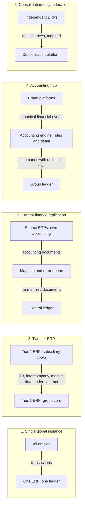
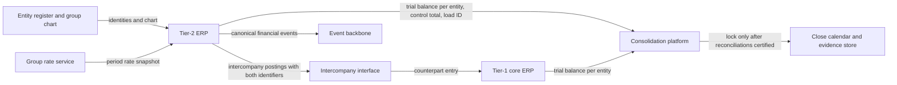
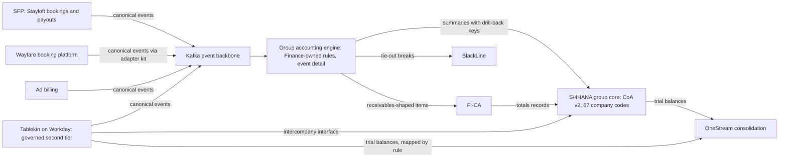
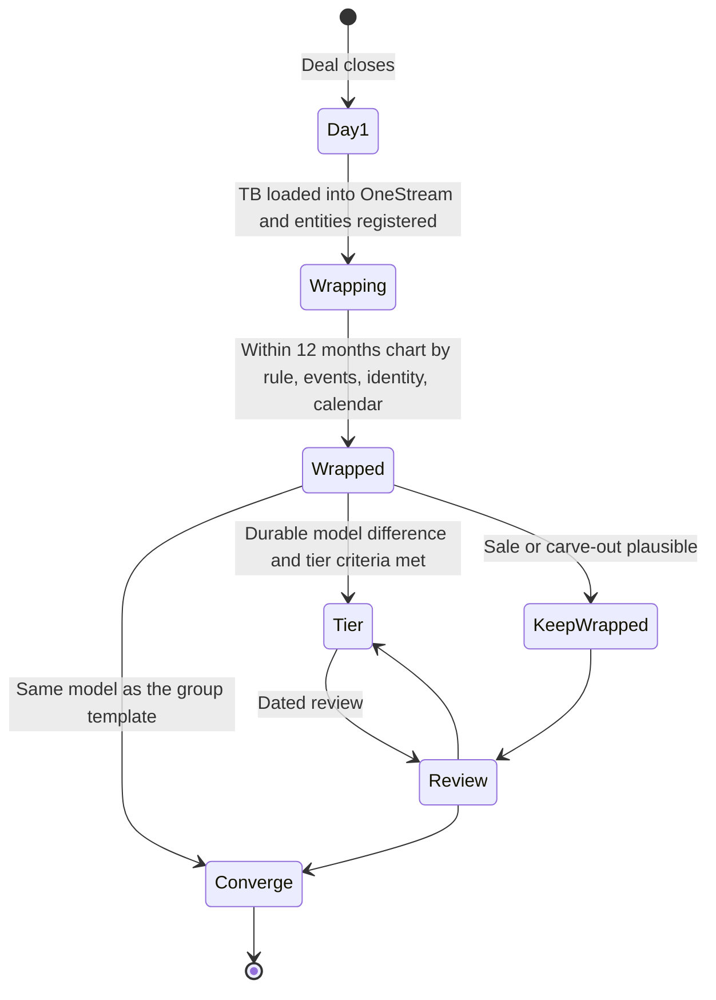

{id: multiple-erps}
# 31. Multiple ERPs, One Finance Core: Coexistence and Convergence

> **IN THIS CHAPTER, YOU WILL:** Learn why enterprises end up with several ERPs, the five coexistence patterns (single instance, two-tier, central-finance replication, accounting hub, consolidation-only federation) and the criteria that choose between them, how to price convergence, how to absorb an acquisition from the ERP side, and how to run several ERPs as one finance core. You will follow Northmere's 2027 Q4 decision on how its three brand ledgers converge.

> **WHY FINANCE CARES:** Every extra ledger adds a mapping, an intercompany boundary, a control set the auditor tests and a day of reconciliation somewhere in the close. Converging costs years of finance capacity. The controller needs to know which ledgers are worth that cost and which can be made safe where they are.

> **WHY ARCHITECTS SHOULD CARE:** Choosing a coexistence pattern decides where accounting logic lives, which integration contracts the estate depends on and which vendor roadmaps set your release calendar. It is the largest structural decision in a finance estate, and it is usually taken by default after an acquisition, not by design.

> **KEY POINTS:**
>
> * **One finance core is a set of shared rules, not a single product.** Chart semantics, the entity register, FX rates, the close calendar and the evidence standard must each be one thing. The number of ledgers that apply them is a separate question, answered by volume, control, cost and business-model fit.
> * **The convergence pattern is a decision about where accounting logic lives.** Central-finance replication centralizes documents that the source ledgers have already produced. An accounting hub centralizes the posting rules. A two-tier ERP keeps a second ledger under a contract. Consolidation-only federation centralizes nothing below the trial balance. Each is right somewhere, and each needs a retirement or review date.
> * **Price convergence against the realistic alternative, not against doing nothing.** Run-cost savings alone rarely repay a ledger migration inside a contract term. The case is usually made by work the estate needs under every option, plus control and close-speed benefits that should be stated as such. A kept ERP should be justified as a governed tier with entry criteria, never kept because the migration looks expensive.

> **[FAILURE PATTERNS THIS CHAPTER ADDRESSES](#where-finance-architecture-goes-wrong):**
>
> * **The Swiss-Army ERP** — "one ERP" is set as the goal when the real goal is one set of books, and a business model the core was never designed for is forced into it at high migration cost.
> * **The Permanent Exception** — acquired ledgers are tolerated without a tier, a template or an exit test, and each one becomes a permanent fork.
> * **Spreadsheet Glue** — several ERPs are stitched together at consolidation through mapping workbooks that nobody owns, and the close depends on them.

Almost every large enterprise runs more than one ERP. Some got there by acquisition, some by running genuinely different businesses, some because a regional subsidiary needed something the corporate system could not do. Running several ERPs is not a failure. The failure is **having no recorded decision about why each one exists, what it must share with the others and when that will be reviewed**.

This chapter treats coexistence as an architectural choice with five recognizable patterns. It separates two questions that boards routinely merge: *how many ledgers should we run?* and *what must be identical across them?* The second question has a firm answer. The first depends on volume, control, cost and how far the business models diverge, and the honest answer is often "more than one".

The chapter owns three terms: **two-tier ERP**, **accounting-hub coexistence** and the **convergence criteria**. The platform chapters supply the vendor facts: [SAP S/4HANA: The Enterprise Finance Core](#sap-s4hana) covers Central Finance at SAP level, [Oracle Fusion Cloud ERP: Ledgers, Accounting Hub and Coexistence](#oracle-fusion) covers Accounting Hub and Wayfare's options, and [Workday: Financials, People and the Organizational Backbone](#workday) covers Accounting Center and Tablekin's second-tier recommendation. This chapter brings those facts together in the decision Northmere took in December 2027.

{id: multiple-erps--setting-the-scene-three-ledgers-and-a-date-that-cannot-move}
## Setting the Scene: Three Ledgers and a Date That Cannot Move

Northmere, the fictional multi-brand digital commerce group this book follows, runs three ERPs in 2027. **SAP S/4HANA** is the group finance core for 55 company codes: Stayloft, Northmere Pay, Northmere Ads and the corporate entities. **Oracle Fusion Cloud ERP** holds Wayfare's 12 legal entities in three primary ledgers, one per functional currency. **Workday Financial Management** holds Tablekin's four companies in Tablekin's own pre-acquisition tenant. The three meet only at consolidation, in **OneStream**, through three charts of accounts. Until May 2027, about 6,100 mapping rows sat in 14 workbooks.

Program Keystone, Northmere's five-year finance transformation, promises one group finance core on S/4HANA by 2029. In the March 2027 close, intercompany balances in 41 of about 140 active entity pairs disagreed by a gross $3.8 million at working day 4, mostly because of FX rates. In April, a Tablekin account with no mapping row moved $41 million of usage revenue into "Other revenue" until working day 7. Both problems come from the same cause: three ledgers that share nothing below the trial balance.

The calendar is fixed by [Target State, Transition States and the Roadmap](#target-and-transition-states). Chart of accounts v2 can go live only at a fiscal year start. Working back from 1 January 2029 leaves dry-run closes in Q4 2028, posting rules and adapters in Q2 and Q3 2028, a volume proof in H1 2028, and the convergence decision by the end of 2027. **There is no slack.** If the decision slips into 2028, the chart moves to January 2030.

By October 2027 each platform has a local answer: Sven Aalto, the SAP Platform Lead, doubts Central Finance ([SAP S/4HANA: The Enterprise Finance Core](#sap-s4hana)); Hana Kowalski has priced three options for Wayfare's Fusion ([Oracle Fusion Cloud ERP: Ledgers, Accounting Hub and Coexistence](#oracle-fusion)); Arjun Rao has a conditional recommendation, made in June 2027, to keep Tablekin on Workday as a governed second tier ([Workday: Financials, People and the Organizational Backbone](#workday)). What nobody has written down is the group pattern those answers must fit. **Dana Whitlock**, the Chief Architect, chairs the Keystone design authority with **Leila Haddad**, the Chief Accounting Officer. She puts the question to it on one page: *should Northmere converge, federate or tier its ERPs, and by which route?* **Tomás Ferreira**, the Group CFO, adds the question every CFO asks: *what does each ledger cost us to keep, and when does converging it pay back?*

{id: multiple-erps--why-enterprises-end-up-with-several-erps}
## Why Enterprises End Up With Several ERPs

Four forces produce multi-ERP estates. They are worth separating, because each one has a different legitimate answer.

| Cause | What it looks like | When a second ERP is legitimate | When it is drift | Northmere |
| --- | --- | --- | --- | --- |
| **Mergers and acquisitions** | The acquired company arrives with a working ledger, a team that knows it and a contract with time left on it | During integration, under a dated wrap; permanently, if the business is likely to be sold or the ledger becomes a tier | When "for now" has no date, and the ledger stays outside group controls | Wayfare (Fusion, acquired 2024), Tablekin (Workday, acquired 2023) |
| **Business-model diversity** | A subscription or services business inside a transaction or manufacturing group, or the reverse | When the models differ in revenue pattern, cost base and approvals, not just in product names | When the "different model" is a pricing variant the group template already handles | Tablekin's subscription, usage and payments-facilitation model |
| **Regional and statutory needs** | A country with clearance e-invoicing, statutory formats or a local GAAP the core handles poorly | Rarely today. Localization in the major ERPs, and dedicated tax and e-invoicing services, cover most of it | When a local system is kept because local finance prefers it | None. Brazil (2028) goes into S/4HANA with the shared tax and e-invoicing services ([Many Entities, Currencies, Jurisdictions and Brands](#global-scale)) |
| **Vendor history** | A ledger kept because of an old decision, a sunk migration or a vendor relationship | Almost never as a reason on its own. It is a timing input: renewal dates set the cheapest moment to move | Whenever it is the main argument | Wayfare's 2022 move from EBS to Fusion: a good decision for a stand-alone company, irrelevant as a group criterion |

The cause does not decide the end state, but it narrows it: **only business-model diversity is a durable reason for a second ledger.** M&A is a reason for a transition, regional need is usually solved by shared services, and vendor history is a date in the calendar, not an argument.

{id: multiple-erps--the-swiss-army-erp-why-one-erp-is-the-wrong-goal}
## The Swiss-Army ERP: Why "One ERP" Is the Wrong Goal

**The Swiss-Army ERP** is a single platform expected to do everything, including what it was never designed to do at the required volume. In multi-ERP decisions it shows up as a goal: "one ERP" stated as the destination, with the migration cost treated as the price of virtue.

The goal is wrong because it names a product when the finance need is a property. What a group controller needs is **one set of books**: every entity's balances produced under the same chart semantics, the same entity definitions, the same rates, the same calendar and the same evidence standard, and traceable to their sources. One product makes that easier. It neither guarantees it nor is required for it. A single S/4HANA instance with country-specific account explosions, a custom posting engine in front of it and mappings in spreadsheets fails the property. Two ERPs mapped by governed rules, matched daily for intercompany and closed to one calendar can pass it.

So I split the goal in two:

| Must be one thing | May be several things |
| --- | --- |
| Chart semantics: what each group account and dimension means, and the mapping rules into it | The ledgers that record entities' books |
| The legal entity register: identity, ownership, functional currency, statutory basis | The transaction systems that originate accounting: billing, subledgers, payroll |
| FX rates: one snapshot per period from one service | The accounting engines that turn events into entries, if each runs on approved rules |
| The close calendar: cut-offs, load times, lock rules | The tools that operate each ledger day to day |
| The evidence standard: control totals, reconciliations, drill-back keys, sign-off | The vendors, provided each has an exit plan |
| Consolidation: one place where group numbers are produced | Local statutory books, where a jurisdiction requires them |

The left column is what [Finance Data Architecture: Master Data, Systems of Record and Governance](#finance-data-architecture) and [Many Entities, Currencies, Jurisdictions and Brands](#global-scale) call golden sources. The right column is where the convergence decision lives. The rule I use is that **the left column is mandatory from day one for every ledger, and the right column is decided case by case with a dated review.** An enterprise that achieves the left column with three ERPs is better governed than one that has a single ERP without it. None of this makes convergence wrong; it makes the burden of proof specific: *this* ledger converges because of *these* criteria, not because one is a nice number.

**Figure 1:** *One finance core is a set of shared rules, not a single product: chart semantics, entities, rates, calendar and evidence must each be one thing, while the number of ledgers built on them is a separate decision.*

{id: multiple-erps--five-coexistence-patterns}
## Five Coexistence Patterns

Five patterns cover nearly every multi-ERP estate. They differ in one thing above all: **where accounting decisions are made**, and therefore what the group core receives.

**Figure 2:** *The five coexistence patterns, ordered roughly by how much they centralize. What crosses each arrow differs: transactions, a contracted trial balance, finished accounting documents, business events, or mapped trial balances. That difference decides where the group can drill down and who owns the posting logic.*

{id: multiple-erps--chapter-1-single-global-instance}
### 1. Single global instance

All entities post into one ERP instance with one chart, one calendar and one configuration. Intercompany is matched inside one system, drill-down is native, and the auditor tests one control set. In exchange, every business model must fit the template, every change competes for one release calendar, and a failed upgrade hits the whole group. It fits groups whose businesses are homogeneous enough that the template is not a compromise, and whose volume shape suits the ERP's posting model. It fails when the template is forced onto a business that does not fit it, which is The Swiss-Army ERP in operation.

{id: multiple-erps--chapter-2-two-tier-erp}
### 2. Two-tier ERP

A **two-tier ERP** runs a tier-1 ERP for the corporate core and one or more tier-2 ERPs for subsidiaries with simpler, smaller or different needs, connected by a defined template and integration contract. SAP's learning material describes the tier-1 layer as handling central administrative processes such as finance, with tier 2 ["tailored for localized business needs"](https://learning.sap.com/courses/exploring-sap-cloud-erp/defining-the-sap-cloud-erp-solutions-and-implementation-methods_bef8e096-dd6b-4dbd-8919-220d5c0edda4). It lists onboarding acquisitions quickly and preparing for divestitures among the market drivers. SAP positions its public cloud edition, marketed since 2025 as SAP Cloud ERP, for the [subsidiary tier](https://pages.community.sap.com/topics/s4hana-cloud/two-tier-erp). Oracle's NetSuite has been marketed as a [subsidiary tier under a corporate Oracle ERP since 2012](https://www.eweek.com/enterprise-apps/netsuite-unveils-two-tier-erp-application-paired-with-oracle/). Mixed-vendor tiers are common too; Workday under S/4HANA is Northmere's candidate. Read vendor material for mechanisms, not economics.

What makes two-tier ERP an architecture rather than a polite name for an exception is the **integration contract**. Without it, a tier-2 ERP is federation with a better story.

| Contract element | What the tier-2 ERP must do | What the tier-1 core provides | Proof |
| --- | --- | --- | --- |
| **Chart alignment** | Design its accounts or dimensions against the group chart, so every account maps by rule | The group chart and an owner who approves new accounts | Unmapped accounts stop the load; no manual mapping in the close |
| **Entity and master data** | Consume entity, cost-center and counterparty identities from the golden sources; create none locally | The entity register and partner identities | Daily comparison of tier-2 masters against the register |
| **Intercompany** | Post group-facing charges through a defined interface with both sides' identifiers | The counterpart entry and the matching rule | Pairs matched daily, not at consolidation |
| **Consolidation feed** | Deliver a trial balance per entity on the group calendar, with a control total and load ID | The load schedule and validations | Load-to-ledger tie-out per entity and period |
| **Rates and calendar** | Use group rates and group period dates | The rate service and the close calendar | Rate IDs on converted amounts |
| **Controls and release** | Run the group's control standard and its own regression testing | The control framework and the evidence store | Tier-2 controls in the risk and control matrix, tested by the same auditor |
| **Entry criteria and review** | Meet the tier's criteria while it exists | A dated review | A decision record with an exit test |

**Figure 3:** *A tier-2 ERP is governable only if every arrow is a contract with an owner and a proof. Identities, chart and rates flow in from golden sources. Intercompany flows across through an interface rather than being matched late at consolidation. Trial balances and events flow out under control totals.*

{id: multiple-erps--chapter-3-hub-and-spoke-with-central-finance-replication}
### 3. Hub-and-spoke with central-finance replication

A central finance system receives accounting documents from source ERPs, maps them to a harmonized chart and posts them into its own ledger while the sources keep running operations. **SAP Central Finance** is the best-known product. It is described in SAP practitioner material as replicating financial postings from SAP and non-SAP sources, with SAP sources replicated through SLT, non-SAP sources arriving through an inbound interface, mapping in mapping tables, and errors worked in the Application Interface Framework ([SAP S/4HANA: The Enterprise Finance Core](#sap-s4hana) gives the mechanics and sources). These are practitioner-documented mechanics; verify them for the release you target.

Its virtue is speed to a harmonized general ledger without first replacing the operational ERPs. Its limits are structural. It **centralizes accounting someone else has already done**: if a source posts daily summaries, the center holds daily summaries, and errors in the source's posting logic are replicated faithfully. And it is not a migration: if operational convergence never follows, the enterprise has added a ledger, a mapping layer and an error queue rather than removed anything ([Modernization Patterns for Legacy Finance Systems](#modernization-patterns) calls this "hub without retirement"). Its strongest case is a group with several SAP ERPs, where replication carries detailed documents with little effort.

{id: multiple-erps--chapter-4-accounting-hub-receiving-canonical-events}
### 4. Accounting hub receiving canonical events

In **accounting-hub coexistence**, brand and operational platforms publish business events, and an accounting engine applies posting rules owned by Finance. The engine keeps event-level detail and posts summaries with drill-back keys into the group ledger. The input is business facts, not accounting. So the posting logic moves out of the source systems and into governed configuration, and a brand ERP can shrink to whatever local operations remain.

The engine can be ERP-native or custom. Oracle documents that its **Accounting Hub** uses ["the same subledger accounting rules engine"](https://docs.oracle.com/en/cloud/saas/financials/26c/faiac/how-oracle-accounting-hub-cloud-works.html) as its own subledgers to account for non-Oracle transactions. Workday describes **Accounting Center** as turning ["high volumes of business events into detailed accounting entries"](https://www.workday.com/en-us/products/financial-management/accounting-center.html) from external systems. Both post into their own vendor's general ledger. Neither publishes throughput figures, so a peak-day proof of concept is mandatory ([Designing Custom Ledgers and Financial Event Processing](#designing-financial-ledgers) compares the options). A custom engine, as in Northmere's redesigned Stayloft subledger, puts the rule store under the enterprise's own change control and can post into any ledger through its APIs.

Its cost is that **the hub is a critical system in its own right**: a canonical event model, adapters per source, a volume proof and a source-to-hub completeness reconciliation that stays a key control. It is slower to first value than replication, because each brand needs events and approved rules before anything posts.

{id: multiple-erps--chapter-5-federated-consolidation-only}
### 5. Federated, consolidation-only

Each ERP keeps complete books, and the group meets only at consolidation, where trial balances are loaded, mapped to the group chart, eliminated and translated. This is Northmere's 2027 baseline. It is the cheapest pattern to start and the most expensive to run well. Every mapping, every intercompany difference and every drill-down request is resolved at the end of the close, in the consolidation platform, by people. It is the right pattern on day one of an acquisition and for a business the group may sell. As a destination for a business the group intends to keep, it is usually **Spreadsheet Glue** waiting to happen, unless mappings are governed rules with owners, as Northmere made them in May 2027 ([OneStream: Consolidation, Planning and Performance Management](#onestream)).

{id: multiple-erps--choosing-a-pattern-the-convergence-criteria}
## Choosing a Pattern: The Convergence Criteria

The **convergence criteria** are the tests that decide, for a given ledger, which pattern it belongs in. I use seven. No single criterion decides. Two or three usually dominate in any real case, and the decision record should say which.

| Criterion | Single instance | Two-tier | Central-finance replication | Accounting hub | Consolidation-only |
| --- | --- | --- | --- | --- | --- |
| **Business-model divergence** from the core template | Low | Material and durable | Any; the operations stay where they are | Any, provided the business can publish events | Any |
| **Transaction volume and shape** | Within the ERP's posting model | Tier-2 volume within its own ERP's model | Whatever the sources already summarize | High-volume, event-shaped flows where detail must stay traceable | Irrelevant to the group |
| **Control requirement**: drill-down, one control set | Strongest | Two control sets under one standard | One group ledger, controls still in every source | One rule set under Finance control, plus source completeness | Weakest; drill-down stops at the trial balance |
| **Run cost** | Lowest per entity at scale | Two platforms, but each fit for purpose | Highest: sources plus center plus mapping | Engine plus core; source ERPs shrink | Low platform cost, high close effort |
| **One-off cost and time to value** | Highest; slowest | Medium | Fastest to a harmonized ledger | Slow; per brand | Lowest; immediate |
| **Statutory and regulatory needs** | Must all be met by the core | Tier 2 can meet local needs where the core cannot | Sources keep statutory books | Engine supports multiple accounting methods; local books where needed | Each ERP keeps statutory books |
| **Ownership horizon** (likelihood of sale or carve-out) | Long | Long | Medium; often a stepping stone | Long | Short or uncertain |

Four rules of thumb, which are my judgment:

1. **Business-model divergence decides tier versus converge.** If the acquired business is the same kind of business as the core, converge it. A second ledger for the same model is duplication.
2. **Where accounting logic lives decides replication versus hub.** If the problem is reporting from many sound ledgers, replicate documents. If the problem is posting logic scattered in source code and summaries that cannot be traced, centralize the rules.
3. **Ownership horizon overrides everything.** Converging a business the group may sell destroys value twice: once to integrate it and again to separate it.
4. **Volume constrains every option.** No pattern makes a ledger an event processor. Whichever pattern you choose, high-volume detail needs an accounting engine that can carry the peak day, and that engine must be proven, not assumed.

{id: multiple-erps--convergence-economics}
## Convergence Economics

Tomás's question deserves a model, not a slogan. **The cost of keeping an ERP** has more lines than the subscription, and most business cases count only the first two.

| Cost line | What it includes | Usually counted? |
| --- | --- | --- |
| Licenses and subscription | Platform, add-on modules, non-production tenants | Yes |
| Team | Run and change effort for the platform's own team | Usually |
| Upgrades and regression | Mandatory releases, regression windows, business testers' time | Rarely in full |
| Integration | Interfaces, middleware share, mapping maintenance, contract tests | Rarely |
| Audit and controls scoping | IT general controls, application controls, SoD design, evidence, auditor hours for a separate system | Almost never |
| Group-side separation cost | Mapping stewardship, late intercompany matching, separate trial-balance loads, close days absorbed by group reporting | Almost never |

**The one-off cost of converging** has its own lines: design, posting rules and adapters, data migration (open items, balances, history policy), parallel runs, cut-over, audit walkthroughs of new posting paths, decommissioning and archive, and the business capacity consumed. Finance capacity is usually the binding constraint rather than the budget.

The **break-even** is then simple arithmetic. It is misleading only when one of its terms is chosen badly:

> break-even years = (convergence one-off cost − one-off cost the alternative needs anyway) ÷ (annual cost of keeping − annual cost after converging)

The subtraction in the numerator is the one most cases miss. The comparison is not between converging and doing nothing, because doing nothing is rarely on the table. It is between converging and the **realistic alternative**, which usually has its own investment.

{id: multiple-erps--northmere-s-numbers}
### Northmere's numbers

Dana's team priced the two brand ledgers in September 2027 using the six cost lines above. All figures are illustrative and rounded, at Northmere's planning rate of $165,000 per fully loaded FTE-year.

| Annual cost of keeping (2027) | Wayfare: Oracle Fusion | Tablekin: Workday Financials |
| --- | --- | --- |
| Licenses and subscription | $2.2M | $1.2M |
| Team | $1.5M (Hana's 9 people) | $0.9M (about 5.5 FTE in Arjun's team) |
| Upgrades and regression | Inside the team line; about 56 working days a year of regression windows | Inside the team line; two Workday tenants to test |
| Integration | $0.5M (MuleSoft flows, file-based loads) | $0.3M (MuleSoft, nightly worker copy) |
| Audit and controls scoping | $0.6M | $0.4M |
| Group-side separation cost | $0.6M | $0.3M |
| **Total** | **about $5.4M a year** | **about $3.1M a year** |

Tablekin's figure agrees with the seven-year comparison in [Build, Buy or Compose: Vendor Selection and Portfolio Rationalization](#build-versus-buy). There, Option A (stay as is) costs $21.4 million over 2028–2034, Option B (move to S/4HANA) $20.5 million, and Option C (a governed second tier in the group tenant) $18.2 million. The ranges overlap, so the tests decided. The second-tier route wins on cost only modestly. It wins on criteria because Tablekin's business genuinely differs from the group template.

Wayfare is the instructive case. Converging Wayfare's general ledger onto S/4HANA through the group accounting engine was estimated at about **$24 million one-off** over 2028–2030: rail and ground-transport posting rules, the Wayfare adapter, migration of open items and balances for 12 entities, two parallel closes, auditor walkthroughs and Fusion's exit. After convergence, Wayfare's ledger costs would fall to about **$2.1 million a year**: incremental S/4HANA capacity and users, Wayfare's share of the engine, and a three-person local finance-systems team owning the adapter. A further $0.6 million a year of counterpart effort, on the SAP side of Wayfare's intercompany and in shared services, sits outside Wayfare's own cost and also disappears.

Measured against doing nothing, the arithmetic is unflattering: $24 million ÷ ($5.4M − $2.1M + $0.6M) ≈ **6.2 years** after completion, which is beyond any contract term anyone would sign. A board shown only that line would keep Fusion.

But doing nothing is not an option, because **Wayfare's event-accounting gap exists under every option**. Its 150 million events a year reach Fusion as about 2,600 summarized lines a day, which is Lost in Aggregation ([Oracle Fusion Cloud ERP: Ledgers, Accounting Hub and Coexistence](#oracle-fusion)). The realistic alternative to convergence is Option C: keep Fusion and put Wayfare's rail events onto Oracle Accounting Hub. Hana's team priced that at about $7 million one-off, plus about $0.5 million a year of added license and operation. Against that alternative the calculation becomes ($24M − $7M) ÷ ($5.4M + $0.5M − $2.1M + $0.6M) = $17M ÷ $4.4M ≈ **3.9 years**. That is inside a normal subscription term, and it is before counting the close days and control-scope reductions, which Dana states separately as benefits rather than converting them into dollars nobody can audit.

**Figure 4:** *Measured against doing nothing, Wayfare's convergence pays back in about 6.2 years; measured against the realistic alternative, which needs about $7 million of investment anyway, it pays back in about 3.9 years.*

The general lesson: **if a convergence case needs run-cost savings alone to pay back, check that it prices the realistic alternative**, count the control line (about 40% of the difference between Tablekin's options in [Build, Buy or Compose: Vendor Selection and Portfolio Rationalization](#build-versus-buy)), and state close days and drill-down as benefits rather than speculative dollars an audit committee will test.

{id: multiple-erps--in-practice-northmere-s-2027-q4-decision}
## In Practice: Northmere's 2027 Q4 Decision

The design authority met on **8 December 2027**. Tomás co-approved, because the choice is an investment-level decision. The evidence pack had been circulated in October, as [Target State, Transition States and the Roadmap](#target-and-transition-states) required. Three group routes were on the table.

- **Route A, Central Finance.** Fusion and Workday keep their accounting. Their documents are replicated into a Central Finance capability on S/4HANA and mapped to chart of accounts v2. SFP and ad billing keep posting summaries directly.
- **Route B, accounting hub.** Brand platforms publish Keystone's canonical financial events to a group accounting engine. The engine applies posting rules owned by Leila's accounting policy team, keeps event-level detail, and posts summaries with drill-back keys into S/4HANA through released APIs, or into FI-CA where the work is receivables-shaped. Brand ERPs shrink or are retired.
- **Route C, consolidation-only federation, made permanent.** Keep three ledgers, keep the governed OneStream mappings, and invest only in the shared rules: entity register, rate service, close calendar and evidence standard.

{id: multiple-erps--the-evidence-that-mattered}
### The evidence that mattered

Dana's paper reduced the platform chapters' findings to five facts.

1. **Northmere has one SAP system and two non-SAP ledgers.** Central Finance's strongest feature, detailed replication from SAP sources, does not apply. Its input from Fusion and Workday would be whatever they post: summaries ([SAP S/4HANA: The Enterprise Finance Core](#sap-s4hana)).
2. **The largest accounting problem in the group is posting logic in the wrong places.** SFP decided its own GL accounts until 2027 ([Why Enterprises Build Their Own Finance Platforms](#custom-finance-platforms)). Wayfare summarizes 410,000 events a day before Fusion sees them. Route A centralizes the results of that logic. Route B moves the logic.
3. **The engine already exists in embryo.** The redesigned SFP merchant subledger went live on 1 November 2027 with canonical events, a versioned rule store owned by Leila's team, a `summary_id` drill-back key on every line and a daily tie-out to S/4HANA. By Q4 it was tied out at working day 1, with month-end breaks down from 23 to 2 ([Designing Custom Ledgers and Financial Event Processing](#designing-financial-ledgers)). Stayloft's merchant volume, about 3 million subledger lines a day, is by far the largest flow in the group. Wayfare's 410,000 events on an average day would add about 1.1 million lines ([Oracle Fusion Cloud ERP: Ledgers, Accounting Hub and Coexistence](#oracle-fusion)'s estimate), roughly a third more.
4. **Tablekin's business is different, and Wayfare's is not.** Wayfare sells tickets as an agent with a net margin, which is the same shape as Stayloft's commission. Tablekin sells subscriptions and usage to venues, with a people-centric cost base ([Workday: Financials, People and the Organizational Backbone](#workday)).
5. **Federation's costs are already measurable**: the $3.8 million of March intercompany differences, the $41 million April mis-mapping, and working days 6–7 spent loading and mapping. Governed mappings fixed the control failure, not the cost.

{id: multiple-erps--the-decision}
### The decision

The decision record, in its operative paragraphs:

> **Decision.** Northmere converges its brand ledgers through an **accounting-hub pattern** (route B). The group accounting engine is Northmere-built, generalized from the SFP subledger engine, and operated outside the S/4HANA core by a group finance platform team. It posts into S/4HANA only through released APIs, and into FI-CA for receivables-shaped items. The decision is conditional on a **volume proof in H1 2028**: a simulated peak day of about 13 million subledger lines across the brands (three times the 2027 combined average of about 4.3 million), posted and tied out before the 06:00 working-day-1 cut-off.
>
> **Wayfare** converges. Its rail and ground-transport events are published through the adapter kit in 2028 and run through the engine in shadow mode against Fusion's results. Its 12 entities keep their books in S/4HANA under chart of accounts v2 from the 2029 fiscal year. Payables, supplier payouts and tax move to group services. Fusion is retired in wave 3 (2030), after the FY2029 audit. Oracle Accounting Hub is not adopted.
>
> **Tablekin** remains on Workday Financials as a **governed second tier**, under the three conditions recorded in June 2027. Its Q1 2028 review stands. It publishes `SubscriptionInvoiced` and `UsageRated` events whatever that review concludes.
>
> **Central Finance** is not adopted. **Consolidation-only federation** is rejected as an end state for any business the group intends to keep.

{id: multiple-erps--dana-s-reasoning}
### Dana's reasoning

Dana's argument to the design authority had three parts.

**The route must fix the problem we actually have.** Central Finance would give OneStream a cleaner input within about a year. But it would leave posting logic in three places, and it would not move the merchant subledger at all. Northmere's audit finding, its suspense balances and its drill-back gap all trace to logic and detail in the wrong place, not to the number of ledgers. Route B attacks that cause. Route A reorganizes the symptoms.

**Converge where the business is the same; tier where it is not.** Wayfare's agency-style ticket revenue fits the group template that Stayloft's commission defines. Keeping Fusion would mean two ledgers, two quarterly regression cycles and two tax engines for the same kind of business. Tablekin's subscription business is what Workday Financials was designed for and what nothing else at Northmere is. That justifies a tier, but only with entry criteria, an integration contract and a review date.

**Federation was right for 2023 and 2024 and is wrong for 2029.** It let the group report on day one, but it never produces drill-back from a group number to a ticket. Governed mappings made it safe; nothing makes it fast.

Leila added one condition before signing: no posting rule enters the engine without her team's approval as a versioned rule, and the auditor walks through each brand's posting path before it goes live. That is the same discipline [Controls, Auditability and Security by Design](#controls-and-auditability) requires of SFP. Mei Tanaka, Head of Internal Controls, recorded that the engine becomes a key system in the FY2028 scoping, with source-to-engine completeness as a key control.

{id: multiple-erps--what-would-reverse-it}
### What would reverse it

A decision without reversal conditions is a preference. Dana wrote down four, each with a named trigger and a fallback.

| Condition | Trigger | Fallback |
| --- | --- | --- |
| **The volume proof fails** | The H1 2028 peak-day test misses the working-day-1 cut-off or the tie-out, and a remediation retest by September 2028 also fails | "Documents now, logic later": Wayfare's rail events go onto Oracle Accounting Hub, as [Oracle Fusion Cloud ERP: Ledgers, Accounting Hub and Coexistence](#oracle-fusion) prepared, and Fusion and Workday documents reach S/4HANA through Central Finance. The engine stays for Stayloft only. The chart still goes live in January 2029 |
| **An SAP-run company is acquired before 2029** | A signed acquisition whose finance runs on SAP ERP | Central Finance is re-evaluated for that source only, because detailed replication from SAP sources is its strongest case |
| **A Wayfare sale or carve-out becomes plausible** | A board-level review of strategic options for Wayfare | Wayfare stays wrapped under governed federation. No convergence investment; the [Build, Buy or Compose: Vendor Selection and Portfolio Rationalization](#build-versus-buy) rule applies |
| **Tablekin's conditions fail** | The Q1 2028 review finds manual mapping judgment, a failed Accounting Center proof or an unacceptable license cost | Tablekin migrates onto S/4HANA through the engine in 2029–2030, as [Workday: Financials, People and the Organizational Backbone](#workday)'s Option B describes |

The first row reconciles the two fallbacks that [SAP S/4HANA: The Enterprise Finance Core](#sap-s4hana) and [Oracle Fusion Cloud ERP: Ledgers, Accounting Hub and Coexistence](#oracle-fusion) recorded separately. If the group engine cannot carry the peak day, Oracle Accounting Hub keeps Wayfare's detail traceable, and Central Finance becomes the cheapest route for finished documents to reach the core. The two vendor components that each lost on its own become the fallback together.

**Figure 5:** *Northmere's 2030 estate after the decision. Wayfare's ledger has gone, and its 12 entities join the 55 SAP company codes. One engine holds the posting rules for every event-shaped flow. Tablekin is the only second ledger, connected by contract rather than by a mapping spreadsheet. OneStream consolidates two trial-balance sources instead of three.*

The decision changes the 2028 plan in specific ways. The route-A branch of the roadmap is deleted. The engine's volume proof becomes a gate with a date. MuleSoft's containment gets an end date tied to Fusion's retirement. Fusion moves from Tolerate to Migrate in the portfolio, while Workday Financials stays in Tolerate until Q1 2028 ([Manage the Application Portfolio as an Investment](#application-portfolio)). Wayfare's no-regret moves, retiring the USD reporting currency and moving intercompany reconciliation into BlackLine, continue unchanged.

{id: multiple-erps--the-m-a-integration-playbook-from-an-erp-viewpoint}
## The M&A Integration Playbook From an ERP Viewpoint

Most multi-ERP estates are created by acquisitions, so the most valuable discipline is the one applied on the day a new ledger arrives. Northmere's playbook, adopted with the decision, turns [Build, Buy or Compose: Vendor Selection and Portfolio Rationalization](#build-versus-buy)'s post-acquisition rule into dated steps.

**Figure 6:** *An acquired ledger moves through wrapping to one of three governed states. There is no path in which it remains merely tolerated, and every state other than convergence has a dated review.*

**Day 1: trial balance into consolidation.** On the closing date the acquired entities are added to the legal entity register with identity, ownership, functional currency and statutory basis. Their opening trial balance is loaded into OneStream through a provisional mapping, approved by group reporting, with an expiry date. The acquired ledger keeps running untouched. Nobody migrates anything in the first quarter. Purchase-accounting adjustments are booked at group level until the ledger can carry them.

**First 100 days: scoping and the first close.** Two scoping exercises run in parallel. The **ICFR scoping** decides how the acquired business enters Northmere's SOX program. The SEC staff permits management to exclude an acquired business from its assessment of internal control over financial reporting, but the exclusion ["may not extend beyond one year from the date of acquisition"](https://www.sec.gov/oca/controlfaq), and it requires disclosure of the excluded business and its significance. That relief sets a hard date for bringing the acquired ledger's controls into the risk and control matrix. The **ERP fact base** records contract and notice dates, release cadence, interfaces, custom code and the control environment, which [Build, Buy or Compose: Vendor Selection and Portfolio Rationalization](#build-versus-buy) says to price at due diligence.

**Within 12 months: wrap.** Wrapping means the four non-negotiables: the chart mapped to the group chart entirely by rule, canonical financial events published for the event-shaped flows, group identity and access, and the group close calendar. A wrapped ledger is safe to keep for a while. An unwrapped one, like Tablekin's between 2023 and 2027, accumulates spreadsheet mappings and copied masters.

**By the next contract or release event: the converge-or-keep test.** The test asks six questions, and the answers go into a decision record:

| Question | Points toward converge | Points toward tier or keep wrapped |
| --- | --- | --- |
| Is the business model the same as the core template's? | Yes | No, and the difference is durable |
| Does its volume and shape fit the core and its accounting engine? | Yes, proven | Only with a dedicated engine |
| Are there statutory or regulatory needs the core cannot meet? | No | Yes, and no shared service covers them |
| Is a sale or carve-out plausible within five years? | No | Yes: keep wrapped, invest nothing in convergence |
| Does convergence break even, against the realistic alternative, inside the next contract term? | Yes | No |
| Can the acquired ledger meet the group control standard at acceptable cost? | Irrelevant if converging | Required for a tier |

The test is timed to the acquired ledger's next renewal or forced upgrade, because that is the cheapest moment to move and missing it costs a full term. Had it existed in 2023, Tablekin would have been wrapped by 2024, and the April 2027 mis-mapping would not have happened.

{id: multiple-erps--operating-multiple-erps-well}
## Operating Multiple ERPs Well

Whatever the pattern, the left column of the Swiss-Army ERP table must be operated, not just declared. These are the five "ones" I make mandatory for any estate with more than one ledger, with Northmere's 2027 implementation of each.

| The one | What it means | Owner at Northmere | How it is enforced | Northmere status, end 2027 |
| --- | --- | --- | --- | --- |
| **One chart, through a mapping standard** | Every source account maps to the group chart by an effective-dated rule; no catch-all rules; a source chart change cannot go live without an approved mapping | Leila (data owner); group reporting (steward); source owners for Wayfare, Tablekin and SAP | Unmapped accounts stop the OneStream load; mapping set published to FinDB after each change | Governed since the May 2027 close; CoA v2 with about 1,150 natural accounts goes live 1 January 2029 ([Finance Data Architecture: Master Data, Systems of Record and Governance](#finance-data-architecture)) |
| **One entity register** | Every legal entity's identity, ownership, functional currency and statutory basis comes from one golden source that all ERPs consume | Legal for identity and ownership; group reporting for accounting attributes | No entity can be created in any ledger without a register ID | Register is the Keystone golden source ([Many Entities, Currencies, Jurisdictions and Brands](#global-scale)) |
| **One rate service** | One snapshot per period (spot, average, closing), sourced from treasury and consumed by every ERP and OneStream; rate IDs on converted amounts | Kofi Asante, Group Head of Tax and Treasury | Loads rejected without a rate ID; ERP-level translation features switched off | Kyriba snapshot live; Fusion's USD reporting currency being retired ([OneStream: Consolidation, Planning and Performance Management](#onestream)) |
| **One close calendar** | One set of cut-offs and load times for every ledger: brand ledgers' final daily summary by 06:00 on working day 1, preliminary trial balances daily from WD−2, flash consolidation WD3, final WD7, lock WD9 | Leila | OneStream workflow; an entity is locked only after BlackLine certifies its key reconciliations | Live from mid-2027 ([BlackLine: Close Automation, Reconciliation and Continuous Accounting](#blackline)) |
| **One evidence standard** | Control totals on every amount-carrying interface, a reconciliation for every boundary, drill-back keys, a `tb_load_id` on every trial-balance load, and one evidence store | Mei Tanaka with Dana | "Closed means reconciled": entity periods cannot lock until catalog entries are green or exceptions are owned and below threshold | Reconciliation catalog v1 (64 entries) from October 2027 ([Designing for Traceability, Reconciliation and Audit Across Boundaries](#traceability-and-reconciliation)) |

**Intercompany** needs one rule more: **originate once, record twice.** A cross-ERP charge is created in one place with both entities' register IDs and a shared reference, and the counterpart is generated from it, so matching confirms agreement instead of discovering differences. The rate service removes Northmere's FX-driven differences; originating once removes most of the rest. This is the interface Tablekin's second tier needs.

{id: multiple-erps--integration-with-the-rest-of-the-estate}
## Integration With the Rest of the Estate

The canonical events and adapter kit that route B depends on are owned by [Canonical Events and Adapters for Loosely Coupled Financial Domains](#loosely-coupled-domains). The migration of each brand through shadow mode, parallel runs and period-boundary cut-overs follows [Modernizing Without Stopping the Close: An Incremental Migration](#incremental-modernization). Authority over balances moves from brand ledgers to the group core in [Systems of Record and Authoritative Data Boundaries](#systems-of-record)'s transitional rows. OneStream remains the only consolidation ([OneStream: Consolidation, Planning and Performance Management](#onestream)). BlackLine certifies the engine's tie-outs and the remaining tier's reconciliations ([BlackLine: Close Automation, Reconciliation and Continuous Accounting](#blackline)). The vendor-dependency consequences, with one ERP vendor fewer and an in-house engine to sustain, belong to [Vendor Strategy and Avoiding Excessive Dependency](#vendor-portfolio-strategy).

{id: multiple-erps--failure-modes}
## Failure Modes

- **Converging by vendor preference.** The decision is framed as "SAP or Oracle" rather than "where should accounting logic live". *Signal:* the decision paper compares feature lists and has no criteria table.
- **A tier without a contract.** A kept ERP is called "second tier" but has no entry criteria, no intercompany interface and no review date. *Signal:* the tier's mapping still needs monthly manual judgment.
- **Replication mistaken for convergence.** A central-finance system goes live, the group reports from it, and the source ledgers never retire. *Signal:* no source ledger in the business case has a dated retirement.
- **An unproven hub.** An accounting hub is chosen on architecture diagrams and its peak-day volume is assumed. *Signal:* the volume proof is scheduled after the cut-over date.
- **Economics against doing nothing.** Convergence is approved or rejected on run-cost savings alone. *Signal:* the alternative column in the business case has no investment line.
- **The acquired ledger left unwrapped.** An acquisition's trial balance is loaded on day one and nothing else changes for years. *Signal:* the ICFR exclusion year ends with no plan for the acquired ledger's controls.

{id: multiple-erps--the-chief-architect-s-view}
## The Chief Architect's View

**What to decide.** First, the group's non-negotiables, the five "ones", as mandatory standards with owners, before any convergence debate. Second, a coexistence pattern for every ledger in the estate, each recorded with the criteria that chose it and a review date. Third, the entry criteria for any second tier, written before the first candidate argues for one. Northmere's are subscription or services revenue, a people-centric cost base, no inventory or manufacturing, a capped number of legal entities, and the ability to publish canonical events. Fourth, the acquisition playbook, so that the next ledger arrives into a process rather than a debate.

**Who decides.** The design authority, chaired by Dana with Leila, decides patterns and standards. Tomás co-approves convergence investments. Leila owns every posting rule, wherever it runs. Mei signs off any change in what can post journals and sets ICFR scoping for acquisitions. Platform owners (Sven, Hana, Arjun) own their platforms' evidence: volume tests, regression, control operation. Corporate development must bring the ERP fact base to the design authority before signing, not after closing. The governance mechanics are in [Architecture Governance That Speeds Decisions](#architecture-governance).

**What to watch.** The engine's volume proof and tie-out breaks per close; the share of each tier's mapping done by rule; intercompany differences at working day 4, by cause; and the number of ledgers without a dated review, which should be zero.

**The long view.** The decision that lasts is not the product choice. It is the separation between **business events, posting rules and ledgers**. An estate that publishes facts, keeps its rules as approved configuration and treats each ledger as a replaceable recorder of balances can change its ledger count again in 2035 without another program of this size. One that lets brands post accounting can only replace one tangle with another.

{id: multiple-erps--questions-to-ask}
## Questions to Ask

1. For each ERP we run, what is its recorded pattern (converge, tier, replicate, hub, federate), which criteria chose it, and when is it next reviewed?
2. Which of the five "ones" (chart, entity register, rates, calendar, evidence) are enforced by a system, and which only by a policy document?
3. Where does accounting logic live today for each high-volume flow, and does our convergence route move it or only move its output?
4. What is each ledger's full annual cost of keeping, including upgrades, integration, controls scoping and the group-side separation cost?
5. What is the realistic alternative to converging, and what does that alternative cost one-off?
6. If we chose a hub, has it carried our peak day, end to end, in our own environment, and what happens to the chart go-live if it has not?
7. What are the entry criteria for a second tier, and does every current tier meet them?
8. For our last acquisition, when does the ICFR exclusion end, and is the acquired ledger wrapped?
9. Which reversal conditions did we record with our convergence decision, and who is watching for each trigger?

{id: multiple-erps--from-ledger-count-to-capability-count}
## From Ledger Count to Capability Count

Deciding how many ledgers to run is the largest instance of a more general problem: the estate accumulates the same capability in several places, and each copy brings its own coupling. Wayfare's payout engine, three invoicing approaches, three reconciliation tools and two tax engines are the same question at smaller scale. The next chapter, [Preventing Redundant Capabilities and Unnecessary Coupling](#redundancy-and-coupling), builds the overlap register that finds them and the coupling rules that keep the converged estate from fragmenting again.

{id: multiple-erps--sources-and-evidence}
## Sources and Evidence

*Vendor documentation*

- [Defining the SAP Cloud ERP solutions and implementation methods](https://learning.sap.com/courses/exploring-sap-cloud-erp/defining-the-sap-cloud-erp-solutions-and-implementation-methods_bef8e096-dd6b-4dbd-8919-220d5c0edda4), SAP Learning — two-tier definition, tier roles, acquisition and divestiture drivers.
- [Two-Tier ERP](https://pages.community.sap.com/topics/s4hana-cloud/two-tier-erp), SAP Community topic page — public cloud edition positioned for headquarters-subsidiary models; finance scenarios including group reporting data collection and Central Finance.
- [Central Finance lessons learned: SLT](https://blogs.sap.com/2021/10/22/central-finance-lessons-learned-sap-landscape-transformation-replication-server-slt/) and [initial load and real-time replication](https://blogs.sap.com/2021/10/01/central-finance-lessons-learned-initial-load-realtime-replication/), SAP blogs, 2021 — Central Finance replication mechanics (practitioner-level).
- [How Oracle Accounting Hub Cloud Works](https://docs.oracle.com/en/cloud/saas/financials/26c/faiac/how-oracle-accounting-hub-cloud-works.html), Oracle, release 26C — Subledger Accounting rules engine applied to non-Oracle sources, detailed journals, drill-down.
- [EPM Cloud data integration: integrations with SAP](https://docs.oracle.com/en/cloud/saas/enterprise-performance-management-common/diepm/integrations_sap.html), Oracle — Oracle EPM consolidating SAP entities: an example of consolidation-level federation across vendors.
- [Workday Accounting Center](https://www.workday.com/en-us/products/financial-management/accounting-center.html), Workday — high-volume external events turned into accounting entries, Finance-maintained rules, drill to source.

*Standards and regulation*

- [Management's Report on Internal Control Over Financial Reporting and Certification of Disclosure in Exchange Act Periodic Reports: Frequently Asked Questions](https://www.sec.gov/oca/controlfaq), SEC Office of the Chief Accountant, revised 24 September 2007 — Question 3: exclusion of an acquired business from management's ICFR assessment for no more than one year, with disclosure.

*Practitioner and research sources*

- [NetSuite Unveils Two-Tier ERP Application Paired With Oracle](https://www.eweek.com/enterprise-apps/netsuite-unveils-two-tier-erp-application-paired-with-oracle/), eWeek, 2012 — vendor-marketed two-tier pattern with a corporate Oracle ERP.
- [Evolution of postmodern ERP to composable ERP explained](https://techtarget.com/searcherp/podcast/Evolution-of-postmodern-ERP-to-composable-ERP-explained), TechTarget — secondary account of Gartner's "postmodern ERP" and "composable ERP" framing of loosely coupled ERP estates.
- [Strangler Fig Application](https://martinfowler.com/bliki/StranglerFigApplication.html), Martin Fowler, 2024 — the incremental-replacement pattern behind hub-based convergence.

Northmere is fictional; its figures, decisions and people are invented for teaching. Architectural recommendations, criteria and rules of thumb are the author's judgment.
