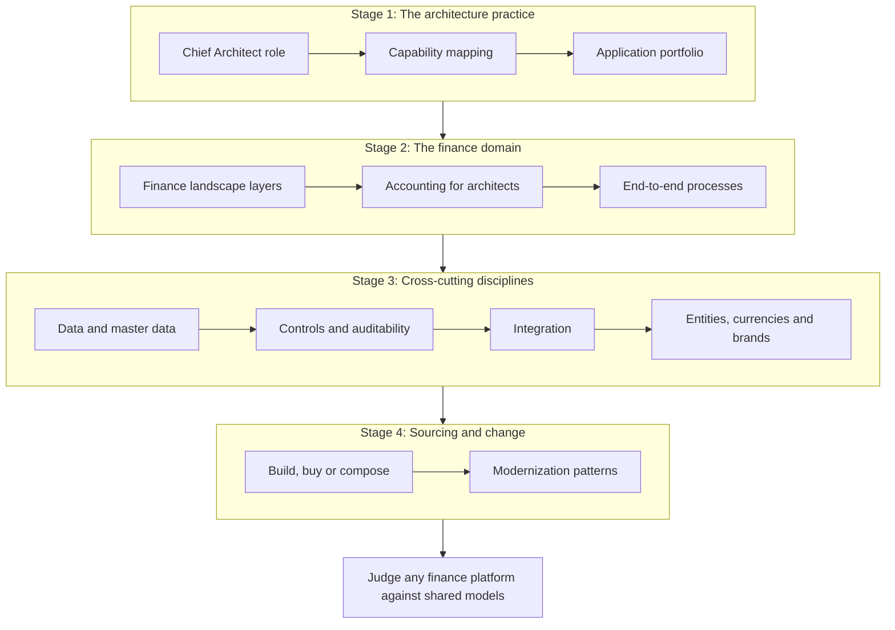

{class: part, id: part-1}
# FOUNDATIONS: The Enterprise and Its Finance Domain

> **IN THIS PART, YOU WILL:** Build the vocabulary and the models a Chief Architect needs before judging any finance platform: what the architecture function is for, what finance does, how a finance estate is layered, what accounting demands of systems, and how data, controls, integration, scale, sourcing and modernization shape every later decision.

> **[FAILURE PATTERNS THIS PART ADDRESSES](#where-finance-architecture-goes-wrong):**
>
> * **Capability Creep** — The capability map and the portfolio make duplicate capabilities visible and force an owner decision for each.
> * **Spreadsheet Glue** — Treats mappings, hand-offs and control totals as governed master data and controls rather than files on a laptop.
> * **Point-to-Point Spaghetti** — Chooses integration styles per job and gives every financial flow a contract, a key and a reconciliation.
> * **Audit Archaeology** — Designs controls and evidence into systems from the start instead of retrofitting them after a finding.

In her first weeks at Northmere, the fictional group this book follows, Dana Whitlock is asked three questions by the CFO, Tomás Ferreira. The first is: **why does the close take nine working days?** The honest answer is not in any single system. It sits in a payments clearing account carrying €14 million of unmatched items, in three charts of accounts mapped through spreadsheets, in about 1,100 interfaces and in a payout engine whose change control drew an audit finding. Before she can say which platform to change, she needs a way to see the estate as one system.

This part provides that view. It describes no product; it sets out the concepts every later chapter relies on, so that a discussion about SAP, Workday, BlackLine or Adyen starts from shared definitions rather than vendor vocabulary.

Three terms carry most of the weight. A **finance estate** is the set of systems, data, integrations and controls through which an enterprise records what it owns, owes, earns and spends, and proves it. A **business capability** is something finance must be able to do, named independently of the system, team or process that does it today. A **subledger** is a detailed record of one area of activity (bookings, payouts, partner balances) whose summarized total must equal a control account in the **general ledger**, the official book of account. Much of this book is about keeping those totals provably equal as volume, brands and platforms multiply.

The chapters move from the architecture practice, through the finance domain and the disciplines that cut across every platform, to how systems are sourced and changed. Experienced finance-systems architects can skim the domain stage; experienced enterprise architects should not skip it, because it is where most architecture mistakes in finance begin.

{id: part-1--the-learning-path}
## The Learning Path

**Figure 1:** *Twelve chapters in four stages: first the practice, then the domain it serves, then the disciplines every platform must respect, and finally how systems are sourced and replaced.*

**The architecture practice.**

- [The Chief Architect's Job: Coherence Across a Finance Estate](#chief-architect-role) — what the architecture function is for, which decisions it owns and how finance changes the job.
- [Map Capabilities Before Systems](#capability-mapping) — how to name what finance does independently of systems, heat-map it, and draw bounded contexts.
- [Manage the Application Portfolio as an Investment](#application-portfolio) — how to build an inventory that reconciles, cost applications in full and retire them for real.

**The finance domain.**

- [Anatomy of a Financial Systems Landscape](#finance-landscape) — the layers of a finance estate, the volume gradient between them and the failures that occur at layer boundaries.
- [Accounting for Architects: Ledgers, Journals and Revenue](#accounting-for-architects) — double entry, revenue recognition and principal versus agent, worked through the €600 Lisbon booking.
- [The End-to-End Finance Processes](#finance-processes) — the end-to-end processes as chains of hand-offs, including the marketplace variants of Order-to-Cash.

**Cross-cutting disciplines.**

- [Finance Data Architecture: Master Data, Systems of Record and Governance](#finance-data-architecture) — who is authoritative for each master data domain and attribute, and why a mapping table is a control.
- [Controls, Auditability and Security by Design](#controls-and-auditability) — IT general controls, remediation by architecture and evidence produced by the systems themselves.
- [Integration Architecture for Finance](#integration-architecture) — integration styles chosen by job, idempotent postings and why a dead letter is not a suspense account.
- [Many Entities, Currencies, Jurisdictions and Brands](#global-scale) — legal entity, brand, market, business model and currency as separate dimensions, and intercompany by design.

**Sourcing and change.**

- [Build, Buy or Compose: Vendor Selection and Portfolio Rationalization](#build-versus-buy) — sourcing capabilities rather than systems, costed over a decade and selected on the hardest scenarios.
- [Modernization Patterns for Legacy Finance Systems](#modernization-patterns) — choosing a modernization pattern by what must change, with reconciliation as the gate and retrievability as the end.

By the end of this part you should be able to place any finance system in a layer, name the capability it serves and the data it masters, say which controls and integrations it depends on, and frame a sourcing or modernization decision in terms a CFO and an auditor will both accept. You will not yet know how the individual platforms work; that is the next part. Begin with [The Chief Architect's Job: Coherence Across a Finance Estate](#chief-architect-role). [PLATFORMS: The Core Enterprise Finance Platforms](#part-2) then examines the platforms themselves.
