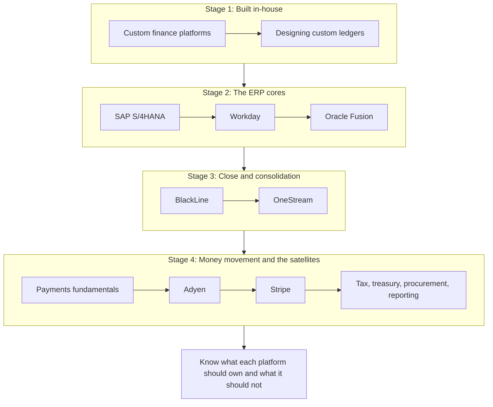

{class: part, id: part-2}
# PLATFORMS: What Each Is For, and What It Costs to Depend On

> **IN THIS PART, YOU WILL:** Learn what each core finance platform is for, how its data model and integration surfaces work, where its boundaries with the rest of the estate should sit, and what it costs to depend on it, from custom ledgers through the ERPs, close and consolidation, to payments and the satellites.

> **[FAILURE PATTERNS THIS PART ADDRESSES](#where-finance-architecture-goes-wrong):**
>
> * **The Swiss-Army ERP** — Shows what each ERP was built to carry and where high-volume event detail belongs instead.
> * **Customization Concrete** — Treats clean core and release discipline as architecture levers the enterprise controls.
> * **The Shadow Ledger** — Draws the boundary between custom platforms that compute financial facts and the ledger that keeps the books.
> * **The Borrowed Roadmap** — Asks for an explicit owner decision before a platform's adjacent modules quietly take over a capability.

Northmere, the fictional group this book follows, runs three ledgers from three vendors and a custom platform that posts 38,000 summarized lines a day into one of them. By the end of 2027 Dana Whitlock and the Keystone design authority must recommend whether Central Finance or an accounting-hub pattern should bring Wayfare's Oracle Fusion and Tablekin's Workday books closer to the SAP group core. Every option has an advocate, and every advocate quotes a vendor. **How should a Chief Architect judge platforms that each claim they can do the whole job?**

This part answers by taking the platforms one at a time, with the same questions for each: what problem it was designed to solve, what its core data model is, how data gets in and out, where it should stop, and what it costs to run over a decade, including upgrades, controls and exit. The chapters cite vendor documentation for capabilities, do not rank vendors, and label every judgment as the author's.

Two terms recur. A **book of record** is the ledger whose balances the enterprise reports and the auditor tests; in a multi-ERP group there can be several, one per set of legal entities, joined at consolidation. A **platform boundary** is the line between what a platform masters and what it only receives or computes. Most trade-offs in this part are about where that line sits; most damage occurs where it was never drawn.

The order follows the finance landscape from [FOUNDATIONS: How Money Moves Through an Enterprise](#part-1): the platforms an enterprise builds itself, then the ERP cores that hold the books, then close and consolidation above them, then money movement below them and the specialist satellites around them.

{id: part-2--the-learning-path}
## The Learning Path

**Figure 1:** *Eleven chapters in four stages, following the finance landscape: custom platforms, the ledgers of record, the close and consolidation layer above them, and the payment and satellite platforms at the edge of the core.*

**Built in-house.**

- [When the ERP Isn't Enough: Custom Finance Platforms](#custom-finance-platforms) — when building finance capability pays off, and why custom platforms own operational financial facts while the ERP owns the books.
- [Never Update, Only Append: Designing Custom Ledgers](#designing-financial-ledgers) — how to separate events from accounting entries, enforce invariants on the write path and design for evidence.

**The ERP cores.**

- [SAP S/4HANA: One Journal, Clean Core](#sap-s4hana) — the Universal Journal, FI-CA and Central Finance at volume, and clean core as a governance lever.
- [Workday: The Org Chart Behind the Ledger](#workday) — Workday HCM as the organizational backbone, worktags as a long-lived design decision and Workday Financials as a second-tier ERP.
- [Oracle Fusion: An Accounting Hub for High-Volume Events](#oracle-fusion) — the ledger as a design decision, Subledger Accounting and Accounting Hub, and quarterly updates as a permanent cost.

**Close and consolidation.**

- [BlackLine: Matching, Certifying and Closing](#blackline) — what close automation can and cannot fix, matching rules as controls and continuous accounting as an architecture.
- [OneStream: Consolidating Actuals, Planning the Future](#onestream) — consolidation across several ERPs, the mapping layer as hidden architecture and how to keep the platform from becoming a second ledger.

**Money movement and the satellites.**

- [Payments for Finance Architects: Eleven Reasons the Numbers Disagree](#payments-fundamentals) — a payment as a chain of events and why holding money, bearing risk and being merchant of record are separate questions.
- [Adyen: One Platform from Checkout to Settlement](#adyen) — single-platform acquiring, reconciling from reports while operating from webhooks, and references designed before the first payment.
- [Stripe: Every Movement Is a Balance Transaction](#stripe) — the balance transaction as the unit of reconciliation and a Connect charge type as an accounting decision.
- [Around the Core: Where Specialist Platforms Earn Their Place](#satellite-platforms) — tax, treasury, procurement and reporting platforms defined by their boundaries, and capabilities consolidated rather than vendors.

By the end of this part you should be able to say, for each platform in your own estate, what it masters, what it receives, how its numbers are proven against the ledger and what it would take to leave it, and to challenge a vendor proposal on those terms. Begin with [When the ERP Isn't Enough: Custom Finance Platforms](#custom-finance-platforms). [INTEGRATION: The Finance Estate as One System](#part-3) then follows money and data across these platform boundaries as one system.
