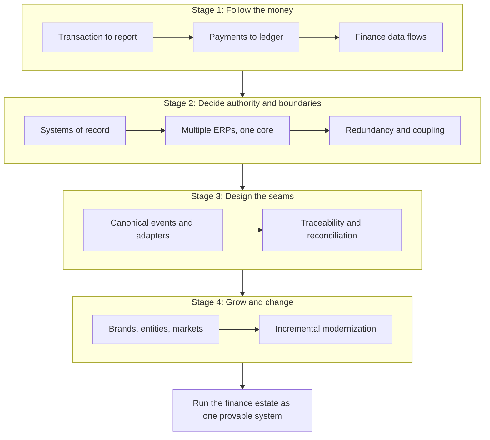

{class: part, id: part-3}
# INTEGRATION: The Finance Estate as One System

> **IN THIS PART, YOU WILL:** Learn to treat the finance estate as one system rather than a set of platforms: how a transaction and its money travel from the customer to the published statements, who is authoritative for each fact at each stage, how several ledgers coexist under one set of rules, how coupling is kept deliberate, how every hop is proven, and how the estate grows and changes without stopping the close.

> **[FAILURE PATTERNS THIS PART ADDRESSES](#where-finance-architecture-goes-wrong):**
>
> * **The Suspense Swamp** — Gives every clearing account an expected zero date and drains suspense by fixing causes upstream rather than by clearing faster.
> * **Lost in Aggregation** — Makes the identifier carried across each hop a contract, so a summary can always be expanded back into the transactions behind it.
> * **The Doppelgänger Record** — Assigns authority per data element and lifecycle stage, and enforces it by removing write paths rather than publishing a matrix.
> * **The Permanent Exception** — Turns "our business works differently" into a template, a mapping in an adapter or a fork with an expiry date.

In August 2027 the external auditor of Northmere, the fictional group this book follows, sent a planning memo with a simple request: pick any number in the revenue note and trace it to transactions, and pick any booking and trace it to the statements. The September dry run used the €600 Lisbon booking. Tracing it top-down took three engineers nine working days, and the chain broke at a daily safeguarding sweep that was posted as one amount per entity pair. Through 2026 the payment-provider clearing accounts had averaged **€14 million** of unexplained balance at month-end. Every platform involved was working as designed. **Where does a finance estate fail when each of its platforms works?**

At the boundaries between them. Part II examined the platforms one at a time; this part follows money and data across them. The questions change from what a platform can do to what crosses each line: which identifier, which definition, which period, and which control proves the crossing was complete and accurate.

Two terms recur. A **hop** is one hand-off of a financial fact from one system to the next; each hop needs a record, a carried key, an invariant and a control. **Authority** is the right to create and change a fact, held by one system per data element and lifecycle stage, and passed on only with proof. Most of the defects in this part are hops with no proof or facts with more than one authority.

The chapters first follow the money end to end, then decide who owns what, then design the seams so that the system can be coupled loosely and proven tightly, and finally show how the same design absorbs new brands and a migration of the core.

{id: part-3--the-learning-path}
## The Learning Path

**Figure 1:** *Ten chapters in four stages: trace money and data end to end, decide which system is authoritative for what, design the events and reconciliations that join the platforms, and use that design to onboard and migrate without breaking the close.*

**Follow the money.**

- [The Life of a Booking: From €600 Payment to $97.38 of Revenue](#transaction-to-report) — eleven hops from a booking to the statements, three clocks per hop, and invariants that hold whatever the business model or ERP.
- [Payments-to-Ledger: Draining the Suspense Swamp](#payments-to-ledger) — every capture as an expected receivable with a zero date, the three-way match as three keyed joins, and suspense drained at its causes.
- [One Number, Many Views: Finance Data from Operations to Analytics](#finance-data-flows) — operational, accounting and management numbers joined by a published bridge, and a data platform that ties out daily but is the book for nothing.

**Decide authority and boundaries.**

- [Systems of Record: Ending the Doppelgänger Record](#systems-of-record) — authority per data element and lifecycle stage, hand-offs proven by reconciliation, and write paths removed rather than matrices published.
- [Converge or Coexist: Living with More Than One ERP](#multiple-erps) — one finance core as shared rules rather than one product, and the convergence pattern as a decision about where accounting logic lives.
- [Duplicates and Dependencies: The Hidden Costs of a Grown Estate](#redundancy-and-coupling) — duplication as a dated decision, six faces of coupling with semantic coupling the worst, and consolidation only behind a published interface.

**Design the seams.**

- [Canonical Events: A Common Language for Money](#loosely-coupled-domains) — publish facts not accounting, keep the canonical model narrow and governed, and put translation at the edges with a hub that only counts and routes.
- [Reconciled by Design: Traceability and Audit Across Boundaries](#traceability-and-reconciliation) — traceability as an identifier contract, every reconciliation a cataloged control, and "closed means reconciled".

**Grow and change.**

- [The Next Brand Should Be Boring: Onboarding as Configuration](#brands-entities-markets) — onboarding as governed configuration in known layers, business-model templates and launch kits, and acquisitions in stages with expiring forks.
- [Modernizing Without Stopping the Close](#incremental-modernization) — migration slices along reconciliation boundaries, gates that are reconciliations with owners, and a first stage designed to fail cheaply.

By the end of this part you should be able to trace any reported number to its transactions and back, name the authoritative system for each fact in your estate, and judge an integration or migration design by whether every crossing it creates can be proven at close. Begin with [The Life of a Booking: From €600 Payment to $97.38 of Revenue](#transaction-to-report). [LEADERSHIP: The Chief Architect's Agenda](#part-4) then turns to leading the estate through years of change.
