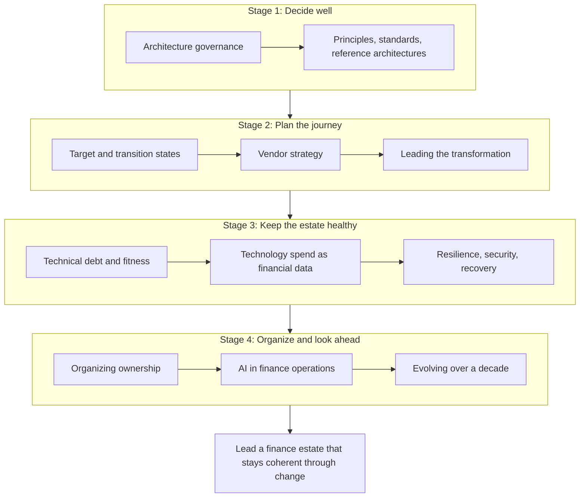

{class: part, id: part-4}
# LEAD: Strategic Architecture and Transformation

> **IN THIS PART, YOU WILL:** Learn to lead the finance estate over years rather than projects: how decisions get made and enforced, how a target state turns into stable steps, how vendor dependency and transformation risk are managed, how the estate is kept healthy and recoverable, and how the organization, AI and a decade of change are kept inside the architecture.

> **[FAILURE PATTERNS THIS PART ADDRESSES](#where-finance-architecture-goes-wrong):**
>
> * **The Borrowed Roadmap** — Turns each vendor dependency into a measured, capped budget with an exit plan that has actually been exercised.
> * **Big-Bang Bravado** — Plans transformation as stable plateaus that could each be the last, with cut-overs timed by evidence and the business calendar.
> * **Nobody's Bot** — Keeps repair scripts and AI agents behind owned, controlled processes that propose rather than post.
> * **Audit Archaeology** — Puts a control impact assessment into every decision record, transition state and incident from the start.

In December 2026 the board of Northmere, the fictional group this book follows, approved Program Keystone: about **$310 million over five years**, a target of $95 million a year of run-rate savings by 2030, one finance core by 2029 and a three-day continuous close by 2031. Dana Whitlock, three months into the job, now co-chairs its design authority with Leila Haddad, the Chief Accounting Officer. She has final say on mandatory standards and no line authority over the brand engineering teams who will build most of it. The approval settles the money, not the decisions it will take to spend it well. **How does a Chief Architect lead a five-year transformation whose biggest choices are still open on the day it is funded?**

Parts I to III gave the concepts, the platforms and the flows. This part is about the strategic work that turns them into a direction the enterprise actually follows: deciding quickly and on the record, setting few standards and making them easy to meet, drawing a target that is a hypothesis rather than a blueprint, and moving towards it in steps that can each stand on their own.

Two terms recur. A **design authority** is the body that owns the data model, the boundaries and the global template of a transformation and decides every variation from them; the program owns scope, timing and resources. A **transition state** (or plateau) is an intermediate estate that is operable, auditable and closable at period end, so the enterprise could stop there without loss. Most of the leadership in this part consists of protecting those two things from schedule pressure.

The chapters move from how decisions are made, through how the journey is planned and run, to keeping the estate healthy under change, and end with the organization and the decade ahead.

{id: part-4--the-learning-path}
## The Learning Path

**Figure 1:** *Eleven chapters in four stages: how decisions are made and enforced, how the journey is planned and delivered, how the estate is kept measurable and recoverable, and how ownership, AI and long-term change are kept inside the architecture.*

**Decide well.**

- [Architecture Governance That Speeds Decisions](#architecture-governance) — route decisions by reversibility and reach, write one decision record for every path, and make standards bite through expiring waivers and automated checks.
- [Principles, Standards and Reference Architectures](#principles-standards-reference) — a principle is real only if something can fail it; few standards, and golden paths that make the conformant design the cheapest to build.

**Plan the journey.**

- [Target State, Transition States and the Roadmap](#target-and-transition-states) — a target state as a hypothesis with a register of what is not yet decided, and plateaus that are funded, measured and re-baselined.
- [Vendor Strategy and Avoiding Excessive Dependency](#vendor-portfolio-strategy) — dependency as a chosen and capped budget, exit plans that have been exercised, and abstraction only at the seams where a switch would happen.
- [Leading an ERP Modernization and Finance Transformation](#finance-transformation) — benefits owned by Finance and landed in budgets, a design authority that budgets exceptions, and delivery outsourced but never the architecture, the data or the proof.

**Keep the estate healthy.**

- [Technical Debt, Architectural Fitness and Modernization Priorities](#technical-debt-and-fitness) — debt priced in money, risk and close days, fitness functions with owners and thresholds, and tranches gated by what they actually removed.
- [Technology Spend as Financial Data: FinOps Meets the Ledger](#finops) — cloud, SaaS and AI spend as financial data: FOCUS billing data under contract, allocation as master data, accruals and recharges from one snapshot, and unit cost tied to the ledger.
- [Resilience, Observability, Security and Recovery for Finance Systems](#resilience-and-security) — criticality that follows money and the close calendar, correctness with no error budget, and incidents corrected by entries rather than by restore.

**Organize and look ahead.**

- [Organizing Architecture Ownership Across Finance, Engineering, Security and Data](#organizing-for-architecture) — in finance the organization is the architecture; teams aligned to flows and platforms, led through products rather than permissions.
- [AI, Automation and Agentic Finance Operations](#ai-in-finance) — AI in the exception layer, agents that propose while controlled processes dispose, and every agent treated as an application plus a control.
- [Evolving the Finance Estate Over a Decade](#long-term-evolution) — design for stressors rather than forecasts and invest in the residues that survive many of them, keep data, events and evidence in the enterprise's own form, move the architecture function from reviewing to providing, and draw the book's argument together.

By the end of this part you should be able to set up governance that speeds decisions rather than slowing them, defend a roadmap of stable plateaus against a big-bang plan, price your vendor dependencies and technical debt, bring technology spend into the books as trustworthy data, and show how the estate stays correct and auditable while it changes. Begin with [Architecture Governance That Speeds Decisions](#architecture-governance). The templates behind these chapters (decision record, vendor scorecard, cut-over checklist, debt register, agent control card) are collected in [Toolkit: Templates for the Finance Architect](#toolkit).
