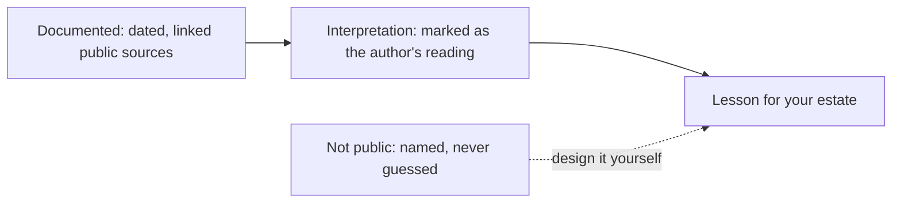

{class: part, id: part-5}
# LEARN: Lessons From Public Case Studies

> **IN THIS PART, YOU WILL:** Test the book's patterns against real finance and payments platforms described in public by the engineers who built them, and learn to read each case for what it documents, what it only suggests and what it leaves out.

> **[FAILURE PATTERNS THIS PART ADDRESSES](#where-finance-architecture-goes-wrong):**
>
> * **The Shadow Ledger** — Shows where a well-engineered platform ledger ends and the book of record begins, and why the reconciliation between them is the part a public case rarely shows.
> * **The Permanent Exception** — Follows real platforms that replaced functionality built once per business with one shared platform that each business configures.
> * **Point-to-Point Spaghetti** — Examines narrow, generic interfaces between many businesses and many providers, so that neither side integrates with every member of the other.

Every number in Northmere, the fictional group this book follows, was chosen to teach. That is a fictional case's strength: it can be complete, down to the posting rule, the period lock and the reconciliation that proves them. It is also its weakness: nothing in it can surprise the author, and nothing in it has run under load. **Do the patterns in this book hold up when the system is real and the author did not design it?**

This part answers with **evidence rather than illustration**. Each chapter takes a platform whose engineers have described it in public (in talks, engineering blogs and retrospectives) and sets what they built beside the patterns of Parts I to IV and the choices Northmere made.

Public evidence has limits that the fictional case did not. Engineering posts are written by people who know the system, which makes them specific, and to explain a success or to recruit, which makes them selective. **Survivorship** shapes the record: platforms that worked get written up, and abandoned designs rarely do. **Disclosure is selective**: controls, reconciliation to the general ledger, audit findings and cost are seldom mentioned. And every statement has a **date**: a 2018 architecture is a historical fact, not a description of today's system. A public case can show that a pattern has worked somewhere at scale. It cannot show that it is the whole design, that it is still in place, or that it would suit your volumes and your auditors.

{id: part-5--how-to-read-each-case}
## How to Read Each Case

Every case chapter sorts its statements into three kinds, and the wording says which:

- **Documented**: stated by the organization's engineers in a dated, linked source.
- **Interpretation**: my reading of what the documented facts imply, marked as mine.
- **Not public**: what a finance architect would need to know and the record does not show, named rather than guessed.

**Figure 1:** *The evidence boundary. A lesson rests on what is documented and on an interpretation the reader can check; what is not public is named so that it becomes part of your own design work rather than an assumption.*

The third column matters as much as the first. Where a case falls silent, usually at the governance of the book of record, the earlier chapters of this book are where the answer lies.

{id: part-5--the-case-in-this-part}
## The Case in This Part

- [Uber's Payments Platform: A Ledger at the Center of Money Movement](#case-uber-payments) — Uber's engineers have described, since 2018, one payments platform between many lines of business, payment service providers and banks, built on a zero-sum ledger of immutable money orders. Correctness at scale comes from the edges: at-least-once streams, idempotent consumers, dead letters and a request store before any retry across providers. Later posts show accounting computed from money movement by a separate, rule-driven platform, the facts-versus-accounting split of [Designing Custom Ledgers and Financial Event Processing](#designing-financial-ledgers). What stays unpublished is the governance of the book of record: chart of accounts, rule approval, periods and the tie-out to the general ledger.

{id: part-5--a-growing-collection}
## A Growing Collection

This part is a collection, not a fixed set. The journal is a living book, and further cases will be added as public records accumulate that are rich enough to read this way, chosen for depth of evidence rather than fame. Each will follow the same three-way discipline and end where its evidence ends.

{id: part-5--using-the-cases}
## Using the Cases

Read a case with the chapter it tests open beside it. The comparison tables in each case name those chapters: for Uber, [Designing Custom Ledgers and Financial Event Processing](#designing-financial-ledgers), [Payments-to-Ledger: Connecting Providers, Brand Platforms and the ERP](#payments-to-ledger), [Designing for Traceability, Reconciliation and Audit Across Boundaries](#traceability-and-reconciliation) and [Why Enterprises Build Their Own Finance Platforms](#custom-finance-platforms) above all. Where a case confirms a pattern, it is evidence you can cite in a decision record; where it differs from Northmere, ask which conditions (volume, team, regulation, history) explain the difference. Where it falls silent, take the gap to the [Toolkit: Templates for the Finance Architect](#toolkit), whose canonical event specification, reconciliation design card and decision record are built for exactly that design work.

Begin with [Uber's Payments Platform: A Ledger at the Center of Money Movement](#case-uber-payments).
