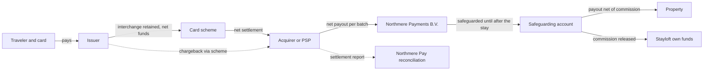
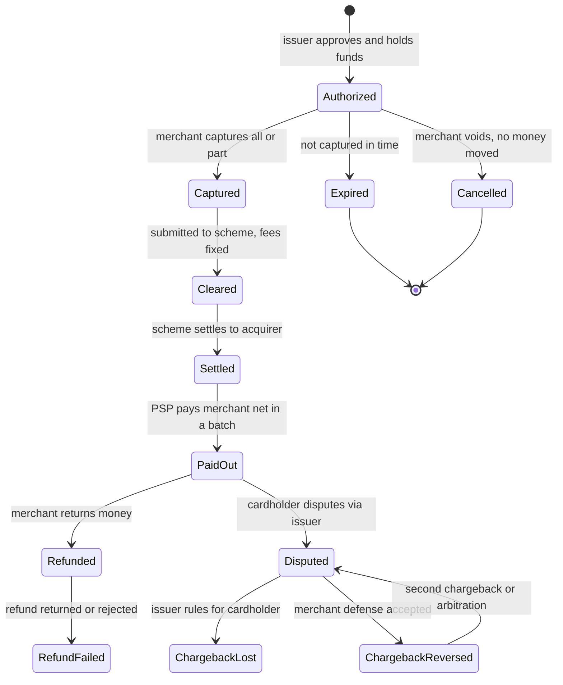
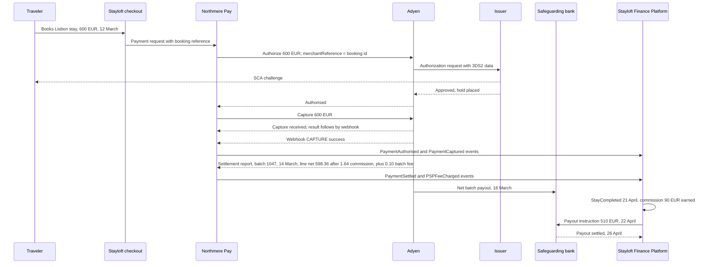
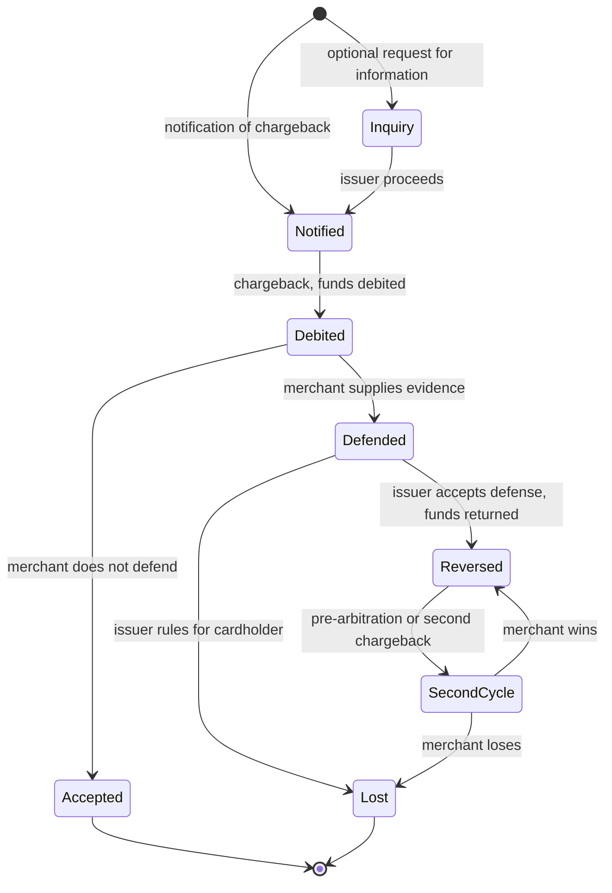
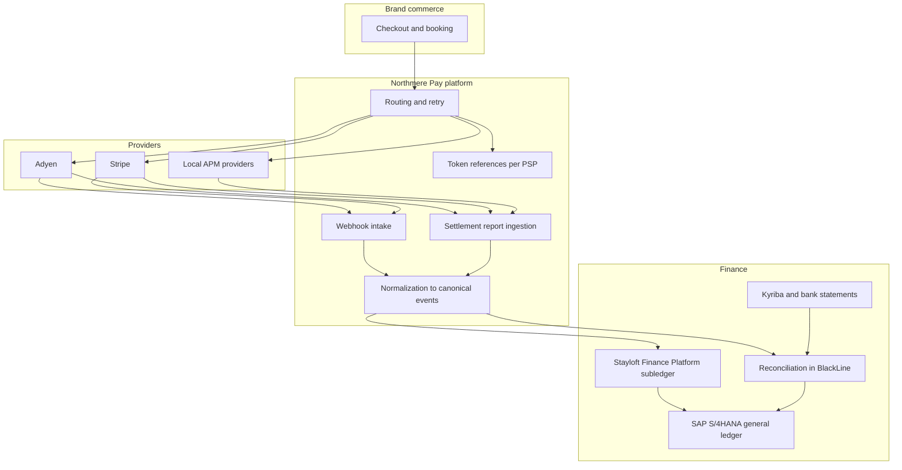

{id: payments-fundamentals}
# 23. Payments for Finance Architects: Eleven Reasons the Numbers Disagree

> **IN THIS CHAPTER, YOU WILL:** Follow one €600 booking and one €420 chargeback through every step of a payment's life. You will learn who holds the money and who bears the risk at each step, how pricing, payment methods, tokens, foreign exchange and regulation shape the records, and why settlement reconciliation is hard enough to need its own architecture.

> **WHY FINANCE CARES:** Cash that arrives later than expected, smaller than expected and sometimes negative is the payments business working as designed. A controller who knows which party owes what, and when, can tell a fee from a leak and a timing difference from a missing payment.

> **WHY ARCHITECTS SHOULD CARE:** An "order paid" flag in a commerce system almost never means the cash has arrived. Every payments design choice decides what the ledger will later have to explain: the provider, the payment method, the token vault, the funds flow and the payout model.

> **KEY POINTS:**
>
> * **A payment is a chain of events, not a single event.** Authorization, capture, clearing, settlement, payout, refund and dispute happen on different days. Different parties perform them, often for different amounts. The booking screen records the first link. The ledger needs every link, and the cash arrives last, net and batched.
> * **Holding the money, bearing the risk and being merchant of record are three separate questions.** Answer each one for every flow before designing accounts. Being merchant of record for a payment does not make a company the principal for the sale. Holding travelers' money as a licensed institution brings safeguarding duties that no commerce system knows about.
> * **Payments do not reconcile themselves, and every addition makes it worse.** Interchange++ fees arrive late, payment methods have their own finality rules, foreign exchange happens in several places, and providers report in their own vocabularies. Design the references, clearing accounts and event model before launch, because nobody can design them in after the first month-end.

> **[FAILURE PATTERNS THIS CHAPTER ADDRESSES](#where-finance-architecture-goes-wrong):**
>
> * **The Suspense Swamp** — Payment methods and providers launched without settlement data the ledger can match fill the clearing accounts with items that nobody can explain.
> * **Lost in Aggregation** — Posting a provider's net payout as one bank line, without its sales, fees, refunds and chargebacks, makes the balance untraceable.
> * **The Borrowed Roadmap** — Card tokens held in one provider's vault, and one provider's report vocabulary built into the ledger, quietly decide which payment providers the enterprise can use in the future.

Most finance architects meet payments as a feed: a settlement file arrives, a bank credit arrives, and someone has to make them agree with the bookings. That view starts too late. By the time the file arrives, the decisions that determine whether it can be matched have already been made, by the payments team, when it chose a provider, a payment method, a capture policy, a reference format and a payout schedule. **The reconciliation problem is designed upstream, in places finance rarely looks.**

This chapter is the payments primer a finance architect needs before reading the provider chapters, [Adyen: One Platform from Checkout to Settlement](#adyen) and [Stripe: Every Movement Is a Balance Transaction](#stripe), and before [Payments-to-Ledger: Draining the Suspense Swamp](#payments-to-ledger), which owns the integration design. It does not repeat the accounting; [Accounting for Architects: Ledgers, Journals and Revenue](#accounting-for-architects) owns the journal entries. It explains the **lifecycle of money movement**: the parties, the steps, the prices, the methods, the regulation, and the mechanisms that make a provider's payout differ from the sales a commerce system thinks it made.

The method is to trace real-looking money. Northmere, the fictional group this book follows (see [Meet Northmere: Five Brands, One Set of Books](#meet-northmere)), moved about 420 million payment transactions through its payments platform in 2026. We follow two of them, a €600 booking and a €420 chargeback, from the moment a traveler presses "pay" to the moment the books can prove what happened.

{id: payments-fundamentals--setting-the-scene-why-is-600-not-cash-yet}
## Setting the Scene: Why Is €600 Not Cash Yet?

It is late March 2027. Tomás Ferreira, Northmere's Group CFO, has a question that sounds simple. A traveler from Germany booked a three-night stay in a Lisbon apartment on Stayloft, Northmere's accommodation brand, on 12 March. The booking screen showed the payment as successful that afternoon. Why did the €600 appear in no bank report that day? Why was the bank credit that later contained it a net figure that matched no single booking? And why, at month-end, did Northmere's provider clearing and suspense accounts hold about **€14 million** that nobody could fully explain?

Dana Whitlock, Northmere's Chief Architect, runs a working session with Ingrid Solberg, who leads Northmere Pay, the group's internal payments platform and licensed e-money institution, and Leila Haddad, the Chief Accounting Officer. Dana does not open with the suspense balance. She draws the parties on a whiteboard and asks three questions about each one: *does it hold the money, what risk does it bear, and whose name is on the cardholder's statement?* Then she traces the €600 through every step, with dates.

The rest of this chapter is that whiteboard, written down. Northmere Pay routes about **68%** of its transactions through Adyen, about **22%** through Stripe and about **10%** through local providers of alternative payment methods in Brazil, India and Indonesia. Its licensed entity, **Northmere Payments B.V.**, is an e-money institution supervised by De Nederlandsche Bank. It holds travelers' money for Stayloft's merchant-model bookings in segregated safeguarding accounts until the money is paid to properties.

{id: payments-fundamentals--the-parties-who-holds-the-money-who-bears-the-risk}
## The Parties: Who Holds the Money, Who Bears the Risk

A card payment involves between five and eight parties, depending on how the merchant is set up. The vocabulary is standard, but legal definitions differ by jurisdiction and contract; in the EU, "payment service provider" is a regulatory term under the Second Payment Services Directive (PSD2), elsewhere a commercial label. The table defines each party and answers Dana's three questions. "Holds the money" means the funds sit on the party's balance sheet or in accounts it controls at that step.

| Party | What it does | Holds the money? | Risk it bears | Merchant of record? |
| --- | --- | --- | --- | --- |
| Cardholder | Pays; can dispute months later | Until the issuer settles | Card fraud, largely shifted to the issuer | No |
| **Issuer** | Bank that issued the card: approves payments, bills the cardholder, receives interchange, raises chargebacks | Briefly, between billing and scheme settlement | Cardholder credit; fraud where authentication shifts liability to it | No |
| **Card scheme** (network) | Visa, Mastercard and others: set rules, route authorization and clearing, charge scheme fees | Nets obligations; settlement runs through settlement banks | Rule enforcement, not credit | No |
| **Acquirer** | Licensed institution that contracts the merchant, receives funds from the scheme and pays the merchant | Between scheme settlement and payout | **Merchant credit risk**: if the merchant cannot pay a chargeback, the acquirer must | No |
| **Payment service provider (PSP)** | Packages acquiring (own or partner) with gateway, risk tools, payment methods and reporting | Same as acquirer, until payout | Same as acquirer; manages it with reserves | No |
| Gateway | Routes payment requests only | **Never** | Availability | No |
| **Payment orchestrator** | Layer over several PSPs: routing, retries, sometimes a card vault, normalized data | **Never**, unless it also acquires | Availability; data custody if it vaults cards | No |
| **Payment facilitator (PayFac)** | Master merchant that onboards sub-merchants under its own acquiring contract | Between acquirer payout and sub-merchant payout | **Sub-merchant losses**, plus know-your-customer (KYC) duties | Usually the sub-merchant |
| Merchant | Sells, captures, refunds, defends disputes | After payout, and in held funds | Chargebacks, refunds, fraud not shifted | Yes, unless a platform or PayFac is |

The **merchant of record (MoR)** is the entity whose name is on the cardholder's statement and that carries the payment side of the sale: refunds and chargebacks. Three points from the table matter for everything that follows.

1. **The acquirer, not the merchant, is the scheme's counterparty.** If a merchant fails with open chargebacks, the acquirer pays. That is why acquirers hold reserves and can change payout terms.
2. **Gateways and orchestrators hold no money, but they hold data.** An orchestrator that vaults cards becomes custodian of the most portable asset in payments, and that custody is itself a dependency.
3. **Merchant of record is a payments and legal concept, not an accounting one.** Whether revenue is presented gross (as principal) or net (as agent) is the judgment [Accounting for Architects: Ledgers, Journals and Revenue](#accounting-for-architects) owns. The funds flow is evidence for it but does not settle it.

Point 3 is where Northmere's own structure becomes instructive.

| Flow (Northmere) | Who holds the money between payment and payout | Who bears chargeback losses first | Merchant of record (statement) | Revenue presentation |
| --- | --- | --- | --- | --- |
| Stayloft merchant booking | Northmere Payments B.V., in safeguarding accounts | Northmere, as the acquirer's merchant; recovery from the property only if the contract allows | Northmere, with a Stayloft descriptor | **Net**: the commission, as agent for the property |
| Stayloft agency booking | The property and its own acquirer | The property | The property | Net: commission invoiced monthly |
| Wayfare flight (agency) | The airline | The airline | The airline | Net: commission or service fee |
| Wayfare rail ticket (merchant) | Wayfare, until the operator is paid monthly | Wayfare | Wayfare | **Net**: Wayfare is agent for the operator's transport service |
| Tablekin venue payment | Stripe, then the venue's connected account | Depends on the Stripe Connect charge type (see [Stripe: Every Movement Is a Balance Transaction](#stripe)) | Depends on the charge type | Net: Tablekin's platform fees |

The Stayloft and Wayfare merchant rows are the ones that confuse people. Northmere is merchant of record for the *payment*: its name is on the statement, it receives the chargebacks, and its licensed entity holds the money. Yet Stayloft is an *agent* for the *stay*, so its revenue on the €600 booking is the €90 commission, not the €600. **Payments vocabulary and accounting vocabulary describe the same transaction but answer different questions**, and the architecture has to keep both answers.

**Figure 1:** *Holding the money, bearing the risk and being merchant of record are separate questions; Northmere is merchant of record for the €600 Lisbon payment, yet Stayloft acts as agent for the stay, so its revenue is the €90 commission.*

**Figure 2:** *Money and data take different paths. Funds move issuer to scheme to acquirer to merchant, net at every hop, while the settlement report that explains the net travels separately. Chargebacks travel backwards along the money path.*

{id: payments-fundamentals--the-lifecycle-six-steps-and-the-ones-that-come-later}
## The Lifecycle: Six Steps and the Ones That Come Later

The **payment lifecycle** is the sequence of states a payment passes through, from approval to final cash and beyond. A card-not-present payment (online, card not physically presented) has six forward steps.

1. **Authorization.** The issuer approves an amount and places a hold on the cardholder's available funds. **No money moves**, and authorizations expire: Stripe documents card-not-present windows of 7 days for Mastercard, American Express and Discover, and for Visa 7 days for customer-initiated and about 5 days for merchant-initiated payments ([Stripe](https://docs.stripe.com/payments/place-a-hold-on-a-payment-method)).
2. **Authentication.** In the European Economic Area, PSD2's regulatory technical standards require **strong customer authentication (SCA)**: two independent elements out of knowledge, possession and inherence, with the authentication code *dynamically linked* to amount and payee for remote payments ([Delegated Regulation (EU) 2018/389](https://eur-lex.europa.eu/eli/reg_del/2018/389/oj), Art. 5). For cards it usually runs through the 3-D Secure 2 protocol (3DS2), inside the authorization flow but with its own failure modes and evidence.
3. **Capture.** The merchant instructs the PSP to collect the authorized amount or less: immediately, later or in parts. A partial capture releases the remainder unless multiple captures are enabled. Adyen gives each capture its own reference, links it to the authorization through `originalReference`, and confirms the result asynchronously by webhook, not in the API response ([Adyen](https://docs.adyen.com/online-payments/capture)).
4. **Clearing.** Captured transactions go to the scheme, typically in batches, where they are matched to authorizations and each side's obligation is fixed, including interchange and scheme fees.
5. **Settlement.** The scheme nets positions between issuers and acquirers, and funds move from issuer to acquirer.
6. **Payout** (or funding). The acquirer or PSP pays the merchant **net** of fees, refunds, chargebacks and reserve movements, in batches. Adyen puts it plainly: "Payouts are net" ([Adyen](https://docs.adyen.com/account/getting-paid)).

Steps 4 and 5 are industry practice that varies in detail by scheme. A marketplace adds a seventh step the networks never see: paying the seller, weeks later and net of commission. At Northmere that is the partner payout, about 9 million a month across Stayloft and Tablekin.

The common misconception is that **"authorized" means "paid."** The order system records success at authorization or capture. The cash arrives days later, inside a net figure that also contains other customers' refunds, earlier chargebacks and this week's fees. Every reconciliation problem in this chapter starts from that gap.

**Figure 3:** *A card payment's states. Only the first transitions are visible at checkout. Expiry and void move no money, refunds can fail, and a reversed chargeback can be disputed again. The ledger must handle every state, including those that occur after the original period has closed.*

{id: payments-fundamentals--the-lisbon-booking-step-by-step}
### The Lisbon Booking, Step by Step

The traveler pays **€600.00** including VAT with a German consumer debit card, through Adyen, on Friday **12 March 2027**, for a stay on **18–21 April 2027**. Stayloft's commission is **15%**, or **€90.00**; the property is owed **€510.00**. The contracting entity is Stayloft B.V.; Northmere Payments B.V. receives the money. VAT on the commission is ignored to keep the example readable. Event names are Program Keystone's canonical financial events.

| Step | Date | Who acts | Does money move? | Event and record |
| --- | --- | --- | --- | --- |
| Authorization with SCA | 12 Mar | Issuer approves after 3DS2; €600 is above every SCA exemption threshold | No; a €600 hold | `PaymentAuthorised`; booking confirmed |
| Capture | 12 Mar | Northmere Pay captures €600 at once, because the authorization would expire long before the stay | No; a claim on Adyen | `PaymentCaptured`; €600 owed to traveler and property |
| Clearing | Night of 12–13 Mar | Adyen submits to the scheme | No; obligations and fees fixed | Fee components become knowable |
| Scheme settlement | 13 Mar | Scheme settles issuer to acquirer | Yes, between banks | Visible to Northmere only through the provider's report |
| Payout | Batch 14 Mar, bank credit 16 Mar | Adyen books the capture into settlement batch 1047, then pays the batch net into Northmere Payments B.V.'s safeguarding account | **Yes**: €598.26 for this booking, inside a larger batch | `PaymentSettled`, `PSPFeeCharged` (€1.74) |
| Stay | 18–21 Apr | Traveler stays | No | `StayCompleted`; €90 commission earned |
| Partner payout | Instructed 22 Apr, settled 26 Apr | Stayloft's payout engine pays €510 | Yes, out of safeguarded funds | `PartnerPayoutInstructed`, `PartnerPayoutSettled` |

The Friday sale is booked into Adyen's settlement batch on Sunday 14 March, but the bank credit arrives only on Tuesday 16 March, because payouts are initiated on business days and the bank needs time to credit them; that gap is itself one of the timing problems discussed below. Three things in the table deserve a pause.

**The €1.74 fee changes the €600 three ways.** Adyen paid €598.26, but Northmere still owes €600 to the traveler and property combined, and safeguarding attaches to what is owed to users, not to what the provider paid. Northmere's policy is to safeguard the full €600 and top up the €1.74 from its own funds; that reading should be confirmed with counsel and the supervisor. And because Northmere Pay recharges payment fees to the brands, the €1.74 is also an intercompany charge to Stayloft. One fee: a cost, a safeguarding top-up and an intercompany entry.

**The commission and the payout come five weeks after the cash.** For those five weeks the €600 is other people's money held by a licensed institution; the cash-collection moment is past and the revenue moment is still ahead. [Accounting for Architects: Ledgers, Journals and Revenue](#accounting-for-architects) shows the entries.

**The 16 March bank credit matched nothing on its own.** It was the net of every Stayloft card payment in the batch, minus their fees, refunds and chargebacks. Only the provider's settlement report links the €598.26 inside it to the Lisbon booking's reference. Without that report, the bank credit cannot be traced back to the booking.

**Figure 4:** *The Lisbon booking. The traveler sees one step; Northmere sees an authorization, an asynchronous capture, a net batch payout explained by a separate report, and a partner payout five weeks later. Every arrow that carries the booking reference makes reconciliation possible; every arrow that drops it makes reconciliation manual.*

{id: payments-fundamentals--pricing-interchange-scheme-fees-and-the-markup}
## Pricing: Interchange, Scheme Fees and the Markup

The price of a card payment has three layers.

- **Interchange**, paid by the acquirer to the issuer. The EU [Interchange Fee Regulation (EU) 2015/751](https://eur-lex.europa.eu/eli/reg/2015/751/oj) caps consumer debit at **0.2%** (Art. 3) and consumer credit at **0.3%** (Art. 4); Member States may set lower domestic caps. **Commercial cards are excluded** (Art. 1(3)(a)), and the UK has had its own rules since Brexit. "Interchange is capped" is true only for a defined subset of transactions.
- **Scheme fees**, charged by the network to issuers and acquirers. They are numerous and hard to see from the merchant's side.
- **The PSP or acquirer markup**, the provider's margin.

Contracts package these in two ways. **Blended pricing** charges one rate whatever the card: easy to forecast, but it hides the cost drivers. **Interchange++ (IC++)** passes interchange and scheme fees through at cost and adds an explicit markup. Adyen's public pricing presents card pricing this way, as a fixed fee plus "Interchange++" plus a percentage, with custom pricing available ([Adyen pricing](https://www.adyen.com/pricing)). At Northmere's volume the markup is negotiated. An illustrative IC++ breakdown of the Lisbon €1.74:

| Fee component | Basis | Amount |
| --- | --- | --- |
| Interchange | Consumer debit, EEA issuer, capped at 0.2% of €600 | €1.20 |
| Scheme fees | Several network fees, illustrative total | €0.21 |
| PSP markup | Negotiated, illustrative: €0.23 on the transaction line plus a €0.10 processing fee charged at batch level | €0.33 |
| **Total** | | **€1.74** |

In Adyen's reports the €1.74 appears in two places: €1.64 (interchange, scheme fees and €0.23 of the markup) on the payment's settlement line, which therefore shows a net of €598.36, and the remaining €0.10 of the markup as a processing fee charged once per batch. Northmere Pay attributes that €0.10 back to the payment, so the canonical net is €598.26; [Adyen: One Platform from Checkout to Settlement](#adyen) walks through the batch.

Had the traveler used a consumer credit card, the interchange cap alone would have been €1.80; with a corporate card, no EU cap would apply. **Card mix is a cost driver that the commerce system never sees**, and IC++ makes it visible only if data is kept at transaction level.

IC++ also has a timing consequence that matters more to the ledger than the price. **The fee is often final only at clearing, and some scheme fees arrive later on a monthly invoice.** Adyen's settlement details report splits commission into Markup, Scheme Fees and Interchange columns when interchange-level data is available, and shows a single Commission figure when it is not ([Adyen](https://docs.adyen.com/reporting/settlement-reconciliation/transaction-level/settlement-details-report)). A separate payment accounting report exists to "match fees to payment statuses and perform invoice reconciliation" ([Adyen](https://docs.adyen.com/reporting/invoice-reconciliation/payment-accounting-report)). **Payment fees therefore need an accrual at the time of sale and a true-up** when actual fees and invoices arrive. Treating the payout deduction as the whole fee misstates cost month by month.

{id: payments-fundamentals--alternative-payment-methods-same-word-different-semantics}
## Alternative Payment Methods: Same Word, Different Semantics

An **alternative payment method (APM)** is any way to pay other than a card on the major schemes: wallets, bank redirects, instant account-to-account schemes, buy-now-pay-later and direct debits. Calling them all "payments" hides that **each method has its own rules for authorization, finality, refunds, disputes and settlement timing.**

| Method family | Examples | Separate authorization and capture? | When final? | Disputes | Settlement to merchant |
| --- | --- | --- | --- | --- | --- |
| Card-based wallets | Apple Pay, Google Pay | Yes, as cards | As cards | Card chargebacks | As cards |
| Own-network wallets | PayPal | Method-specific | Method-specific | Provider's process; Stripe notes such methods "typically allow customers up to 180 days" | Provider-specific |
| Bank redirect | iDEAL (now "iDEAL \| Wero") | No | At payment (a push from the payer's bank) | No card-style chargeback | Provider-specific |
| Instant account-to-account | Pix (Brazil), UPI (India, operated by the National Payments Corporation of India, NPCI) | No | Near-immediate | Scheme-specific return mechanisms (verify per market) | Often daily; sometimes pass-through only |
| Buy-now-pay-later | Klarna, Afterpay, Affirm | Yes, with method-specific windows (Stripe: Klarna by the 28th day, Afterpay 13 days, Affirm 30) | When the lender pays the merchant | The lender's process | Lender pays merchant; consumer repays lender |
| Direct debit | SEPA Direct Debit, ACH | Pull payment | Only after the return window | Long return rights | Stripe: ACH Debit 4 business days, SEPA Direct Debit 6 |

Sources: [Stripe, place a hold](https://docs.stripe.com/payments/place-a-hold-on-a-payment-method); [Stripe disputes](https://docs.stripe.com/disputes/how-disputes-work); [Stripe payouts](https://docs.stripe.com/payouts); [iDEAL](https://www.ideal.nl/en/); [NPCI](https://www.npci.org.in/what-we-do/upi/product-overview).

Two consequences follow. **Each method needs its own cash-recognition and aging rules**: a card capture is a receivable from the PSP until payout, a completed bank redirect is close to cash, and a direct debit is not safe until its return window passes. Putting them all in one clearing account mixes very different risks.

**Each method also brings its own settlement data, often from its own provider**, and this is the origin of most of Northmere's suspense balance. At working day 3 of each close, about **1.9%** of the settlement lines from Stayloft's APM providers are still unmatched. Adyen card lines match far better, because their references and formats stabilized years ago; the local providers each send different files with different references and cut-offs, two of them sometimes after the payout they describe. Dana's conclusion became a Keystone standard: **a payment method does not launch until finance can match its settlement data**, a condition often described as "ledger-ready before launch."

One date matters for bank transfers. Under the EU [Instant Payments Regulation (EU) 2024/886](https://eur-lex.europa.eu/eli/reg/2024/886/oj), euro-area payment service providers had to receive instant credit transfers from 9 January 2025 and send them, with Verification of Payee, from 9 October 2025; for payment and e-money institutions the compliance date is **9 April 2027**, in the middle of Keystone's first year and relevant to how Northmere Payments B.V. pays partners.

{id: payments-fundamentals--tokens-who-owns-the-card-on-file}
## Tokens: Who Owns the Card on File?

Merchants store **tokens** instead of card numbers. A **PSP token** stands in for the card inside one provider's vault and works only there. A **network token** is issued by the card scheme, bound to a token requestor and merchant, and updated by the scheme when the card is reissued; providers claim better approval rates for them, and specific uplift figures should be treated as vendor claims.

The finance architect's interest is **portability**. PSP tokens do not move between providers, and network tokens are usually requested by the PSP as token requestor, so moving them also needs cooperation. A merchant that wants to move stored cards has three routes: a third-party vault it controls, which forwards card data or network tokens to each provider (Spreedly, for example, describes its vault as one "the merchant owns" ([Spreedly](https://www.spreedly.com/))); network tokens under its own token-requestor identity where the schemes allow; or a negotiated provider-to-provider card-data export at exit. That export right belongs in the contract before signature.

At Northmere in 2027 the payments platform stores no card numbers. Returning Stayloft travelers' cards are Adyen tokens; the Stripe share carries Stripe tokens. Ingrid's team can route a *new* card to either provider, but not a *stored* card to the provider that lacks its token. **The vault, not the contract, decides how much volume Northmere can move**, which makes it a question for [Own Your Roadmap: Vendor Strategy Without Lock-In Panic](#vendor-portfolio-strategy) as much as for payments.

{id: payments-fundamentals--refunds-a-new-payment-in-the-other-direction}
## Refunds: A New Payment in the Other Direction

A **refund** returns money after capture. It is a **new money movement**, not the deletion of the old one, with its own reference, fees, settlement and failure modes. Adyen's settlement report records **Refunded** as a debit and **RefundedReversed** when a refund could not be credited to the cardholder; Stripe's balance transactions include `refund` and `refund_failure` ([Stripe](https://docs.stripe.com/api/balance_transactions/object)). Four distinctions keep refund accounting correct.

1. **A void is not a refund.** Canceling before capture moves no money; booking it as a refund creates a debit with nothing to match.
2. **A refund can follow the partner payout.** Northmere then owes the traveler money it has already passed to the property, and recovery becomes a receivable offset against a future payout. The refund flow and the payout flow must agree.
3. **A refund can fail weeks later**, for example on an expired card. Money is again owed to the traveler, with no card to pay it to, and someone must own that balance.
4. **A refund settles in a later batch.** A refund of a February sale reduces a March payout; the two never meet in the same batch.

{id: payments-fundamentals--disputes-and-chargebacks-the-lifecycle-that-outlives-the-period}
## Disputes and Chargebacks: The Lifecycle That Outlives the Period

A **dispute** is the cardholder's challenge to a payment through their issuer; a **chargeback** is the forced reversal that follows, debited from the merchant through the acquirer. The issuer debits first and decides later. Stripe documents that networks "typically allow cardholders to initiate disputes within 120 days of the original payment", with the window possibly starting at the service date for future-dated services such as a stay; merchants usually have 7 to 21 days to respond, issuers take 60 to 75 days to decide, and the whole cycle "can take 2-3 months" ([Stripe](https://docs.stripe.com/disputes/how-disputes-work)). These are typical ranges, not rules.

Adyen's documented stages run from an optional request for information, through notification of chargeback (which starts the defense period), the chargeback debit, information supplied and chargeback reversed, to optional pre-arbitration, arbitration (where a loss can add a fee of up to USD 600) and second chargeback ([Adyen](https://docs.adyen.com/risk-management/understanding-disputes/dispute-process-and-flow)). Stripe debits the disputed amount plus a dispute fee, does not support the arbitration phase, and can report "late win" changes outside the normal cycle. **Two providers, two lifecycles**, one ledger.

**Figure 5:** *A card dispute, generalized from documented provider flows. Funds leave at "Debited", long before the outcome is known, and a win can be reopened. Each state needs its own accounting, and each transition can land in a different period from the sale.*

{id: payments-fundamentals--the-420-chargeback}
### The €420 Chargeback

The second example is a separate Stayloft merchant booking of **€420**, paid by card through Adyen on 2 April 2027 for a stay on 1–4 May. The commission is €63 (15%), and the property's €357 payout settles on 7 May. On **13 June 2027**, 40 days after check-out, Adyen notifies Northmere Pay of a chargeback: the traveler says the apartment was not as described.

| Date | What happens | What finance must record |
| --- | --- | --- |
| 2 Apr | Authorization and capture | Receivable from Adyen; €420 owed to traveler and property |
| Early Apr | Net payout includes the sale less fees | Settlement matched; funds safeguarded |
| 4 May | Stay completed | €63 commission earned; €357 owed to the property |
| 7 May | €357 paid to the property | Safeguarded funds reduced; €63 released to Stayloft |
| 13 Jun | Chargeback debited in the next batch with a €15 dispute fee | A €420 debit inside a net payout; dispute case opened; loss provision assessed |
| Late Jun | Northmere supplies evidence: check-in confirmation, messages, listing photos | Case updated; no money moves |
| 26 Jul | Issuer rules for the cardholder; the chargeback stands | Loss confirmed; €357 recovered from the property against its next payout; €63 to contra-revenue under Northmere policy |

Four things here are rarely modeled by commerce systems.

- **The money left before the decision.** For six weeks the €420 was neither lost nor recovered; it needs a dispute state of its own.
- **The partner had already been paid.** €357 was with the property, so recovery is a partner-settlement problem, governed by contract and evidence.
- **The dispute crossed periods.** The sale was in April, the stay in May, the debit in June and the outcome in July. Nothing is reopened; each event is recorded in its own period, which is why the case needs its own record rather than a flag on the booking.
- **The disputed amount need not equal the sale.** Stripe documents that FX movements, partial disputes and disputes on partially refunded charges all produce different amounts, so matching chargebacks by amount alone fails.

A chargeback arriving inside a net payout with no case record and no link to the original booking and payout is the most common source of the old items in Northmere's suspense accounts, which held about €2.1 million over 90 days old in 2026.

{id: payments-fundamentals--reserves-money-that-is-yours-but-not-available}
## Reserves: Money That Is Yours but Not Available

A **reserve** is part of the merchant's funds that the acquirer withholds against future refunds and chargebacks: a fixed deposit, a percentage held for a rolling period (a **rolling reserve**) or a minimum balance. Adyen reports them with journal types such as MerchantPayin and ReserveAdjustment; Stripe with `reserve_hold`, `reserve_release` and a `risk_reserved` balance type. **Reserved funds belong to the merchant but cannot be used**, so they belong in a restricted receivable or restricted-cash account, not netted against sales or fees. A payout €40,000 short because the acquirer raised a reserve is a balance-sheet reclassification, not a reconciliation break. For a licensed institution, reserve changes also alter the cash available to meet obligations to users, so treasury needs to see them as they happen.

{id: payments-fundamentals--foreign-exchange-who-converts-and-where-the-difference-lands}
## Foreign Exchange: Who Converts, and Where the Difference Lands

Northmere's customers pay in **46 currencies**, and Northmere pays partners in **31**. A payment can be converted in several places, and **the party that converts books the FX margin and the gain or loss**.

| Who converts | How | Rate | Where margin or gain or loss lands |
| --- | --- | --- | --- |
| The cardholder's issuer | Merchant charges in its own currency | Scheme rate plus issuer fee | With the cardholder; the merchant sees no FX |
| Merchant at checkout (**dynamic currency conversion**, DCC) | Cardholder chooses to pay in their home currency | Provider's rate with a markup | Provider and merchant share the markup; EU disclosure rules apply |
| The PSP at settlement | Merchant prices in the customer's currency (**presentment**) and settles in its own (**settlement**) | Provider's rate plus margin | FX cost inside fees; rate movement between capture and settlement is the merchant's |
| The merchant's treasury | Merchant settles in several currencies and converts itself | Treasury's dealt rate | Treasury FX result, with hedge accounting where applied |

Provider data helps only partly: Stripe's balance transaction carries an `exchange_rate`, and Adyen's settlement report an exchange rate that, for externally settled payments, is "Adyen's reference rate, not the acquirer's actual rate".

Suppose the Lisbon traveler had come from the United States and Stayloft had shown $650, settled in euros. The provider converts at settlement, and the dollar's movement between 12 March and settlement is Northmere's. A dollar refund later is converted at that day's rate, so returning "the same" $650 costs a different number of euros, a gain or loss the booking never modeled; a dispute months later brings yet another rate. On top of that, Northmere reports in US dollars. The rule I use is that **every converted amount carries both currencies and the rate actually applied, recorded at the moment of conversion**. That is what Keystone's `FXRateApplied` event is for; recomputing FX later from a reference rate produces differences nobody can explain.

{id: payments-fundamentals--merchant-of-record-marketplaces-and-payouts}
## Merchant of Record, Marketplaces and Payouts

Marketplaces take money from buyers and pass most of it to sellers, in one of three structures.

| Model | Merchant of record | Who holds buyer funds | Who bears refunds and chargebacks | Typical revenue presentation |
| --- | --- | --- | --- | --- |
| **Platform as merchant of record** | Platform | Platform, until it pays the seller | Platform, then recovery from the seller by contract | Gross or net, per the principal-versus-agent assessment |
| **Seller as merchant of record, facilitated by the platform** | Seller | The provider, or the platform as PayFac, until payout | Seller, with the platform liable if the seller cannot pay | Net |
| **Pure software platform** | Seller, with its own acquirer | The seller's acquirer | Seller | Net (software or application fees) |

Northmere uses all three. Stayloft's merchant model is the first; its agency model is close to the third. Tablekin's embedded payments use Stripe Connect, where the **charge type** decides whether refunds, chargebacks and provider fees land on the platform or on the venue's connected account ([Stripe Connect charges](https://docs.stripe.com/connect/charges)). Stripe calls its `on_behalf_of` concept the "business of record"; that is Stripe's term, not an accounting conclusion.

A **payment facilitator** formalizes the second model: the acquirer lets a master merchant onboard sub-merchants, and the facilitator carries their KYC duty and loss liability. Registering as one is a large compliance and risk commitment, so most software platforms, Tablekin among them, use a provider's platform product instead and accept less control over funds flow and data in return.

**Partner payouts** are where marketplace payments become a treasury and control problem. Each of Northmere's 9 million monthly payouts is calculated net of commission, adjustments and recoveries, released in batches by currency and cut-off, and later confirmed or returned; a "booked" payout can still fail, which Adyen documents and Stripe records as `payout_failure`. Payout bank details are a prime fraud target, and the FY2026 significant deficiency on Stayloft's payout engine concerned exactly this: production access and undocumented payout-rule changes. **A payout engine is a payments system with the control profile of accounts payable**, and should be governed as one.

{id: payments-fundamentals--regulation-that-shapes-the-architecture}
## Regulation That Shapes the Architecture

Regulation changes which flows are allowed, which data must be kept and which reconciliations are mandatory. Dates are as of October 2026.

**PSD2 and SCA.** The exemptions in the regulatory technical standards are architectural levers, because each moves work and liability: low value (Art. 16: up to €30, within cumulative limits of €100 or five transactions); transaction risk analysis (Art. 18: €100, €250 or €500, tied to the provider's card fraud rates of 0.13%, 0.06% and 0.01%); recurring same-amount payments to the same payee (Art. 14: SCA on the first only); trusted beneficiaries (Art. 13); and secure corporate processes (Art. 17). Treating merchant-initiated transactions as outside SCA scope rests on supervisory guidance, not the RTS text, so check the current European Banking Authority position. And SCA does not end disputes: Stripe documents that 3DS-authenticated payments can still be disputed.

**PSD3 and the Payment Services Regulation (PSR).** Proposed on 28 June 2023, politically agreed on 27 November 2025, with final compromise texts published by the Council on 23 April 2026 and ECON committee approval on 5 May 2026. The European Parliament's Legislative Train lists the file as "close to adoption", noting it "needs to be formally adopted by Parliament and Council before it can enter into force" ([Legislative Train](https://www.europarl.europa.eu/legislative-train/theme-an-economy-that-works-for-people/file-payment-services-and-electronic-money-services-(directive))); a law-firm note from April 2026 confirms that adoption, signature and Official Journal publication were still to come ([Matheson](https://www.matheson.com/insights/psd3-and-psr-published-whats-changing-for-eu-payment-services/)). **PSD3/PSR is not in force.** PSD3 is a directive on licensing and supervision that absorbs the e-money regime; the PSR is a directly applicable regulation on conduct, fraud, payee verification, open banking and SCA refinements. Existing payment and e-money licenses remain valid for 30 months after entry into force if a new application is made within 24 months. Application dates are estimates until the final text is published. For Northmere this means a relicensing workstream for Northmere Payments B.V. in the years after adoption, and safeguarding and fraud-liability rules to anticipate, but nothing to build against final text yet.

**E-money and safeguarding.** PSD2 Article 10 requires institutions holding users' funds to safeguard them either by **segregation**, with funds still held at the end of the business day after receipt placed in a separate account at a credit institution or in secure low-risk assets, insulated from other creditors in insolvency, or by an **insurance policy or comparable guarantee** ([Directive (EU) 2015/2366](https://eur-lex.europa.eu/eli/dir/2015/2366/oj)). The E-Money Directive applies these requirements to e-money institutions; funds received by payment instrument, such as a card, must be safeguarded once credited to the institution's account and no later than five business days after the e-money is issued ([Directive 2009/110/EC](https://eur-lex.europa.eu/eli/dir/2009/110/oj), Art. 7). In the UK, the FCA's new safeguarding regime (CASS 15) is reported to have applied from 7 May 2026, with daily reconciliations, monthly returns and, above a threshold, an annual safeguarding audit ([S&W](https://www.swgroup.com/insights-events/insights/cass-15-safeguarding-for-payments-and-e-money-firms/)); it governs Northmere Payments UK Ltd.

**Safeguarding turns a treasury reconciliation into a regulatory control.** Each day, Northmere Payments B.V. must compare what its records say it owes users, every captured, unrefunded, unpaid traveler payment by currency, net of chargebacks, with the balances in its safeguarding accounts. A break is a regulatory event, not a month-end adjustment, and the calculation depends on exactly the status data that the eleven reasons below make hard to get right.

**PCI DSS.** The Payment Card Industry Data Security Standard v4.0.1 was published in June 2024; v4.0 was retired on 31 December 2024, and the future-dated requirements took effect on 31 March 2025 ([PCI SSC](https://blog.pcisecuritystandards.org/just-published-pci-dss-v4-0-1)). The architectural point is **scope**. Provider-hosted fields, redirects and SDKs keep card numbers off merchant systems; a merchant-run vault, or an orchestrator that proxies raw card numbers through merchant systems, brings those systems into scope. Version 4's payment-page script-integrity requirements apply even to iframe and redirect integrations, and the PCI SSC has since adjusted the eligibility wording of the simplest self-assessment questionnaire (SAQ A), so check the current text with the assessor. Marco Bellini, Northmere's CISO, treats "no card number touches a Northmere server" as a constraint on any orchestration design.

**DORA.** The EU Digital Operational Resilience Act has applied since 17 January 2025 to financial entities, including e-money institutions. For Northmere Payments B.V., the PSPs, the payments platform and bank connectivity are ICT services that may support critical or important functions, which brings contractual clauses, a register of information and exit strategies; [Recover Before the Close: Resilience and Security for Finance](#resilience-and-security) and [Own Your Roadmap: Vendor Strategy Without Lock-In Panic](#vendor-portfolio-strategy) take it further.

{id: payments-fundamentals--architecture-where-the-payments-components-sit}
## Architecture: Where the Payments Components Sit

A finance architect needs a component view that shows where payment data is created, transformed and matched.

**Figure 6:** *Webhooks give operational state early; settlement reports give financial truth later. Both converge on normalization, which feeds the subledger and the reconciliation engine. Bank statements arrive independently, through treasury, to close the third leg of the match.*

| Component | Responsibility | Finance-architecture concern |
| --- | --- | --- |
| Checkout and booking | Creates the commercial fact and the **booking reference** | The reference must reach every provider as the merchant reference |
| Routing and retry | Chooses the provider; retries soft declines | Each route reports in a different vocabulary; retries create several attempts per booking |
| Token store | Holds PSP and network token references | Decides which provider can charge a stored card |
| Webhook intake | Receives notifications at least once, not in order | Must be idempotent; webhooks show state, not money |
| Report ingestion | Collects settlement reports and checks completeness | Reports can arrive after their payout; missing files must be detected |
| Normalization | Maps provider records to canonical events | Keeps the raw record immutably beside the normalized one; reversals become new events |
| Subledger | Booking-level money owed, held and earned | Reflects refunds, chargebacks and payouts as they happen |
| Reconciliation | Booking to transaction, transaction to payout, payout to bank | Owns exception queues and aging |
| Treasury and bank | Statements, safeguarding accounts, payouts | The independent third leg |

Two boundaries matter most. The **boundary between webhooks and reports**: designs that post to the ledger from webhooks alone drift, because fees, FX and batch membership appear only in reports. And the **boundary between Northmere Pay and finance**: the payments team owns provider relationships and data contracts, finance owns the accounts, and the canonical events are the agreement between them. [Payments-to-Ledger: Draining the Suspense Swamp](#payments-to-ledger) designs that agreement; [Files, Events and APIs: How Finance Systems Talk](#integration-architecture) covers the patterns.

{id: payments-fundamentals--multiple-providers-and-orchestration}
## Multiple Providers and Orchestration

Northmere runs three provider families because each solves a different problem. The usual reasons for more than one PSP are **resilience** (failover when a provider degrades), **approval rates** (local acquiring, retries of soft declines elsewhere), **cost and leverage** (routing by cost, a credible alternative at renewal), **coverage** of methods and countries, **acquisitions** (Tablekin arrived with Stripe) and **data or regulatory constraints**. Coverage includes payout models: Adyen documents pass-through payout as "the only available payout model in Africa, Brazil, and India" ([Adyen](https://docs.adyen.com/account/getting-paid)).

The counter-argument is real. Every additional provider adds an integration, a report format, a dispute operation, a token vault and a reconciliation stream, and splits volume that would earn better pricing in one place. Stripe's 2026 conference framed it as a trade-off under the title "More PSPs, more problems?" ([Stripe Sessions 2026](https://stripe.com/sessions/2026/more-psps-more-problems)). Routing also adds a quieter risk: a payment retried at a second provider after a timeout can be charged twice, and [Uber's Payments Platform: A Ledger at the Center of Money Movement](#case-uber-payments) shows how Uber's engineers described closing that trap with a request store that sends every retry back to the original provider.

A **payment orchestrator** adds a layer above the providers. As examples rather than a ranking: Primer presents a unified platform with vault, workflows, fallbacks and reconciliation ([primer.io](https://primer.io/)); Spreedly positions itself on a merchant-owned vault ([spreedly.com](https://www.spreedly.com/)); Gr4vy describes cloud orchestration with a dedicated instance per merchant ([gr4vy.com](https://gr4vy.com/)); Juspay publishes **Hyperswitch** as open source under Apache 2.0, with routing, vault and two- and three-way reconciliation ([GitHub](https://github.com/juspay/hyperswitch)). Providers are adding orchestration too: Stripe's Orchestration routes to third-party processors, is in private preview as of October 2026, and "doesn't support disputes or settlement-related activity" ([Stripe](https://docs.stripe.com/payments/orchestration)).

That caveat is the key point for finance. **Orchestration unifies routing, and sometimes the vault. It does not unify settlement.** Each acquirer still pays in its own batches, under its own contract, in its own vocabulary.

| Option | Resilience and leverage | Reconciliation effort | Token portability | Dependency created | When it is right |
| --- | --- | --- | --- | --- | --- |
| **Single PSP** | Low: one failure domain, weak negotiating position | Lowest | Locked to the provider | One deep dependency | One region or moderate volume; a provider covering every market and method needed |
| **Several PSPs, integrated directly** (Northmere today) | High, if routing is real | High: one adapter and stream per provider | Low without network tokens or own vault | Several, plus in-house routing code | Large volume, strong payments engineering, distinct market needs |
| **Third-party orchestrator** | High | Medium: one normalized feed, provider settlement remains | High if the vault is merchant-controlled and exportable | A new critical dependency holding the vault | Many providers or markets; limited appetite to build routing and vault |
| **Provider-native orchestration** | Medium | Unchanged for other processors' settlement | Tied to the primary provider | Deeper dependency on the primary | Mostly one provider with fallback, once generally available |

My recommendation at Northmere's scale is to **keep the canonical payment event model and the reconciliation engine as the enterprise's own assets, whatever routing layer is chosen**. An orchestrator can be replaced if the ledger depends only on canonical events, but not if it depends on the orchestrator's schema; for the same reason, no provider's journal-type vocabulary should appear in a general-ledger account name. This holds only with the engineering capacity to own normalization. Without it, an orchestrator's data model becomes the de facto standard, and that should be accepted openly and governed.

{id: payments-fundamentals--eleven-reasons-payments-do-not-reconcile-themselves}
## Eleven Reasons Payments Do Not Reconcile Themselves

Everything above leads to one conclusion: a provider's payout and the bookings it pays for will not agree on their own. Here are the reasons, each traceable to a mechanism already described. They are the bridge to Part III, where [Payments-to-Ledger: Draining the Suspense Swamp](#payments-to-ledger) designs the response.

1. **Timing.** The sale is recorded at authorization or capture, revenue at fulfillment, cash at payout. Stripe separates a balance transaction's `created` and `available_on` dates, and default delays differ by country: 2 business days in the US, 7 calendar days initially then 3 business days in Germany, 4 business days in Japan ([Stripe](https://docs.stripe.com/payouts)). The Lisbon €600 was paid on 12 March, settled into an Adyen batch on 14 March, credited to the bank on 16 March and earned in April.
2. **Batching and netting.** One bank credit equals many sales minus refunds, chargebacks, fees and reserves. Stripe's payout reconciliation report exists to list "every payment, refund, dispute, fee, and other balance transaction included in the payout" ([Stripe](https://docs.stripe.com/reports/payout-reconciliation)).
3. **Fees netted, and sometimes invoiced separately.** Adyen's InvoiceDeduction journal type deducts invoice amounts from payouts, and under IC++ part of the fee is final only after clearing.
4. **Foreign exchange at several moments**: capture, settlement, refund and dispute, each possibly at a different rate set by a different party.
5. **Partial and multiple captures.** One authorization can become several captures, each with its own reference.
6. **Chargebacks months later**, in another period, possibly another amount, often after the partner has been paid. The €420 debit came two months after the sale.
7. **Status reversals.** Settlements, refunds and payouts can be reversed after they look complete. Under Adyen's pre-financed sales-day payout model, reversals such as SettledReversed and CaptureFailed are posted later, and Adyen notes that some of the corresponding webhooks are disabled by default.
8. **Time zones and cut-offs.** Adyen's reports follow the account's time-zone setting while its invoices use Central European Time; Stripe's Dashboard reports default to local time while Sigma, its SQL reporting tool, uses UTC. A payment at 23:30 on 31 March can belong to different months in different documents.
9. **Report data lags payouts.** Stripe warns that "a payout might arrive before its reconciliation data is ready". An unexplained bank credit is not necessarily an error, but it is an exception until the explanation arrives.
10. **Reference propagation.** The booking reference survives into settlement data only if every integration path passes it, as Adyen's `merchantReference` or Stripe's metadata. One path that forgets it, such as a retry, a manual refund or a new method, creates items only a person can match.
11. **Multiple providers** multiply all of the above, each with its own vocabulary, file format, lifecycle, sign convention and cut-off.

**None of the eleven is an error.** Each is the payments system working as designed, which is why the response is architectural, not operational: a booking reference mandatory on every provider call; a **clearing account per provider and currency** that returns to zero once the order, provider and bank legs are matched; reversals recorded as new events, never as updates; fees accrued and trued up; exception queues with owners and aging. Stripe's engineering team describes the same principle for its internal Ledger: clearing accounts should be zero at steady state, and a non-zero balance signals missing, late or incorrect data ([Stripe engineering, 2024](https://stripe.dev/blog/ledger-stripe-system-for-tracking-and-validating-money-movement)). That system is internal to Stripe, not a product, but the idea transfers directly.

**Figure 7:** *A clearing account per provider and currency returns to zero once the order, provider and bank legs are matched, so a break shows; one shared account lets a €200,000 shortfall at one provider hide behind a €190,000 surplus at another.*

{id: payments-fundamentals--failure-modes}
## Failure Modes

- **Posting from webhooks alone.** The ledger sees captures and refunds but never fees, FX or batch membership, and the clearing accounts drift by the fee total every month.
- **One clearing account for all providers and currencies.** A €200,000 Stripe shortfall hides behind a €190,000 Adyen surplus: **The Suspense Swamp** with camouflage.
- **Payouts posted as single bank lines.** The receivable is cleared in total, the detail is never posted, and nobody can tell which bookings remain unpaid: **Lost in Aggregation**.
- **A chargeback as a status on the booking.** The booking is overwritten, the period in which the dispute happened loses its evidence, and the recovery claim has nothing to point to.
- **Refunds paid from the wrong pot.** A refund after the partner payout is funded from safeguarded money owed to other travelers, a shortfall only the daily safeguarding reconciliation catches.
- **Token lock-in discovered at renegotiation.** The stored-card base cannot move, so the alternative provider is not credible: **The Borrowed Roadmap** in its purest form.

{id: payments-fundamentals--the-chief-architect-s-view}
## The Chief Architect's View

**Decide who owns the payment data contract.** The payments platform owns provider integrations, finance owns accounts and controls, and the canonical financial events are the contract between them. At Northmere, Dana makes the event model a mandatory Keystone standard: Lucía Romero owns its specification, Ingrid's team produces it, Leila's team consumes it. A change to a payment event is reviewed as a change to a financial control, because it is one.

**Make "ledger-ready" a launch criterion.** No provider, payment method, market or payout route goes live until finance can match its settlement data automatically at an agreed rate. It is the cheapest control in this chapter and the one most often waived for revenue reasons; a waiver needs a named owner and an expiry date.

**Keep payments vocabulary out of the general ledger.** Accounts should describe economic substance: receivable from provider, funds held for users, payment cost, chargeback loss, FX result. Provider journal types belong in the subledger and the reconciliation engine. That is what lets the enterprise change providers without restructuring its chart of accounts.

**Treat the token vault as a strategic asset.** Contract for export rights, prefer network tokens held under the enterprise's control where possible, and include the vault in DORA exit plans.

**Design the licensed entity's obligations in, once.** Daily safeguarding reconciliation and the month-end close depend on the same payment, refund and payout statuses. Build them on the same records so they cannot disagree.

**Watch leading indicators, not only the suspense balance.** Track the share of settlement lines matched automatically by provider and method, the aging of unmatched items, payout lines without a booking reference, the delay between payout and report, and the share of fees still estimated at close. The suspense balance lags; by the time it moves, the cause is a month old.

{id: payments-fundamentals--questions-to-ask}
## Questions to Ask

1. For each payment flow, who holds the money between capture and payout, who bears chargeback losses first, and whose name is on the cardholder's statement?
2. Does every provider call carry the booking reference, and how do we know no code path (retries, manual refunds, new methods) drops it?
3. Is there a clearing account per provider and currency, does it return to zero once all three legs match, and what is its aging today?
4. Which payment methods launched before their settlement data could be matched automatically, and who owns closing that gap?
5. Are payment fees accrued at sale and trued up against reports and invoices, and is interchange-level data retained?
6. When a refund or chargeback arrives after the partner has been paid, which system creates the recovery receivable, and who decides to pursue it?
7. Where is foreign exchange converted in each flow, and is the applied rate recorded at that moment with both currencies?
8. Where are stored cards tokenized, can we move them to another provider, and what does the contract say about export?
9. If we hold a payment or e-money license, do the daily safeguarding reconciliation and the month-end close use the same data?
10. Which regulatory dates in the next 24 months change our flows: PSD3/PSR adoption, instant-payment obligations, PCI scope changes?

{id: payments-fundamentals--from-fundamentals-to-providers}
## From Fundamentals to Providers

This chapter described payments in vendor-neutral terms: the parties, the steps, the prices, the methods, the rules and the eleven reasons the records diverge. The next two chapters make it concrete for the providers Northmere uses most. [Adyen: One Platform from Checkout to Settlement](#adyen) shows what a single-platform acquirer's account structure, batches and reports look like from the ledger's side, including the settlement details report that explained the Lisbon payment's €598.36 line and the batch fee behind the €598.26 net. [Stripe: Every Movement Is a Balance Transaction](#stripe) shows how an object model built around the balance transaction shapes integration. Part III returns to the eleven reasons in [Payments-to-Ledger: Draining the Suspense Swamp](#payments-to-ledger), where Northmere designs the clearing accounts, the three-way match and the canonical events that bring the €14 million suspense balance under control.

{id: payments-fundamentals--sources-and-evidence}
## Sources and Evidence

*Vendor documentation*

- [Getting paid](https://docs.adyen.com/account/getting-paid), Adyen: net payouts, payout models and timing, pass-through as the only model in Africa, Brazil and India.
- [Settlement details report](https://docs.adyen.com/reporting/settlement-reconciliation/transaction-level/settlement-details-report), Adyen: journal types (Refunded, RefundedReversed, InvoiceDeduction, reserve journals, sales-day-payout reversals), the markup/scheme fee/interchange split, exchange-rate semantics.
- [Payment accounting report](https://docs.adyen.com/reporting/invoice-reconciliation/payment-accounting-report), Adyen: matching fees to statuses and invoices; time-zone basis.
- [Capture](https://docs.adyen.com/online-payments/capture), Adyen: partial and multiple captures, `originalReference`, asynchronous results.
- [Dispute process and flow](https://docs.adyen.com/risk-management/understanding-disputes/dispute-process-and-flow), Adyen: dispute stages, arbitration fee.
- [Pricing](https://www.adyen.com/pricing), Adyen: Interchange++ presentation of card pricing.
- [How disputes work](https://docs.stripe.com/disputes/how-disputes-work), Stripe: dispute windows and timing ranges, amounts differing from the sale, 3DS and disputes, 180-day local-method window.
- [Place a hold on a payment method](https://docs.stripe.com/payments/place-a-hold-on-a-payment-method), Stripe: authorization validity, BNPL capture windows, methods without separate capture.
- [Payouts](https://docs.stripe.com/payouts), Stripe: settlement delays by country; direct debit timing.
- [Balance transaction object](https://docs.stripe.com/api/balance_transactions/object), Stripe: `available_on`, `exchange_rate`, refund, reserve and fee types.
- [Payout reconciliation report](https://docs.stripe.com/reports/payout-reconciliation), Stripe: itemized payout contents; data lagging payouts.
- [Connect charges](https://docs.stripe.com/connect/charges), Stripe: charge types and liability; "business of record".
- [Orchestration](https://docs.stripe.com/payments/orchestration), Stripe, 2026: private preview; disputes and settlement excluded.
- [Ledger: Stripe's system for tracking and validating money movement](https://stripe.dev/blog/ledger-stripe-system-for-tracking-and-validating-money-movement), Stripe engineering, 2024: clearing accounts that reach zero (internal system, not a product).

*Standards and regulation*

- [Commission Delegated Regulation (EU) 2018/389](https://eur-lex.europa.eu/eli/reg_del/2018/389/oj), 2018: SCA elements, dynamic linking, exemptions.
- [Interchange Fee Regulation (EU) 2015/751](https://eur-lex.europa.eu/eli/reg/2015/751/oj), 2015: 0.2% and 0.3% caps; commercial-card exclusion.
- [Directive (EU) 2015/2366 (PSD2)](https://eur-lex.europa.eu/eli/dir/2015/2366/oj), 2015: Article 10 safeguarding.
- [Directive 2009/110/EC (E-Money Directive)](https://eur-lex.europa.eu/eli/dir/2009/110/oj), 2009: Article 7 safeguarding; five-business-day rule for funds received by payment instrument.
- [Regulation (EU) 2024/886 (Instant Payments)](https://eur-lex.europa.eu/eli/reg/2024/886/oj), 2024: compliance dates, including 9 April 2027 for payment and e-money institutions.
- [Legislative Train: payment services and electronic money services](https://www.europarl.europa.eu/legislative-train/theme-an-economy-that-works-for-people/file-payment-services-and-electronic-money-services-(directive)), European Parliament, September 2026: PSD3/PSR milestones, "close to adoption", license transition.
- [PSD3 and PSR published: what's changing](https://www.matheson.com/insights/psd3-and-psr-published-whats-changing-for-eu-payment-services/), Matheson, April 2026: compromise texts; adoption and Official Journal publication pending.
- [Just published: PCI DSS v4.0.1](https://blog.pcisecuritystandards.org/just-published-pci-dss-v4-0-1), PCI Security Standards Council, 2024: version and effective dates.
- [CASS 15 safeguarding for payments and e-money firms](https://www.swgroup.com/insights-events/insights/cass-15-safeguarding-for-payments-and-e-money-firms/), S&W, 2026: UK safeguarding regime from 7 May 2026 (secondary source).
- [Digital Operational Resilience Act](https://www.eiopa.europa.eu/digital-operational-resilience-act-dora_en), EIOPA: application from 17 January 2025; scope includes payment and e-money institutions.

*Practitioner and research sources*

- [iDEAL](https://www.ideal.nl/en/), Currence: "iDEAL | Wero" branding; bank-redirect model.
- [UPI product overview](https://www.npci.org.in/what-we-do/upi/product-overview), NPCI: UPI operator.
- [Spreedly](https://www.spreedly.com/), [Primer](https://primer.io/), [Gr4vy](https://gr4vy.com/): orchestration vendors' self-descriptions (October 2026), examples, not endorsements.
- [Hyperswitch](https://github.com/juspay/hyperswitch), Juspay: open-source orchestration with routing, vault and reconciliation.
- [More PSPs, more problems?](https://stripe.com/sessions/2026/more-psps-more-problems), Stripe Sessions, 2026: the multi-provider trade-off, framed by a provider.

Northmere Group and all its people, systems and figures are fictional; the architectural recommendations are the author's judgment.
