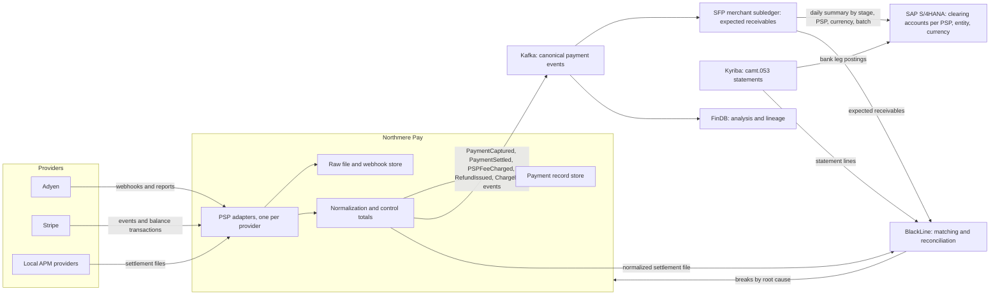
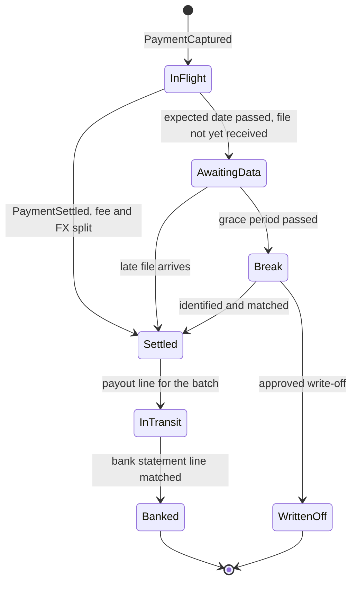
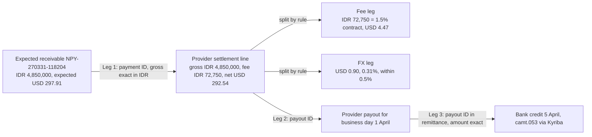
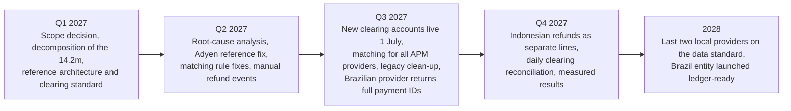

{id: payments-to-ledger}
# 28. Payments-to-Ledger: Connecting Providers, Brand Platforms and the ERP

> **IN THIS CHAPTER, YOU WILL:** Design the end-to-end path from payment provider data to the general ledger: provider adapters and canonical events, clearing accounts per provider, entity and currency, the three-way match with its separate fee and foreign exchange (FX) legs, month-end cut-off, late refunds and chargebacks, ownership and metrics. Then follow the 2027 program that brought Northmere's €14 million suspense balance under control.

> **WHY FINANCE CARES:** A controller signs a reconciliation that says the cash, the receivables from providers and the money owed to customers and partners are complete and accurate. With an unexplained balance in the provider clearing accounts, that signature is a judgment call. Every old item in it is a potential write-off, an audit question and a day added to the close.

> **WHY ARCHITECTS SHOULD CARE:** The suspense balance is an output of the architecture: of references that do not survive a retry, of adapters that pass on poor provider data, of clearing accounts that mix what should be separate, and of summaries that throw away the keys. Matching tools and clearing teams cannot fix what the design left out.

> **KEY POINTS:**
>
> * **Every captured payment is an expected receivable with a due date to reach zero.** Clearing accounts per provider, legal entity and currency, staged as in-flight, settlement receivable and cash in transit, turn an unexplained balance into a list of items, each with an expected zero date. Money still in flight at month-end is then a dated reconciling item, not suspense.
> * **The three-way match is three joins with three keys, plus separate fee and FX legs.** Booking to provider line, line to payout, payout to bank. Each join works only if its key is set at the source and carried unchanged by an adapter that the payments team owns. Fees and conversion differences are split by rule, never left as residue.
> * **Suspense drains when the causes are removed.** Northmere's balance fell because references, provider file contracts, matching windows and refund flows were fixed upstream, each with a named owner and a measured effect. Bigger exception teams and faster triage reduce the backlog without reducing the inflow.

> **[FAILURE PATTERNS THIS CHAPTER ADDRESSES](#where-finance-architecture-goes-wrong):**
>
> * **The Suspense Swamp** — Northmere's provider clearing accounts held about €14 million of unexplained balance at month-end because nothing distinguished money in flight from money nobody could match.
> * **Lost in Aggregation** — Daily summaries and provider aggregates removed the keys that would have let a clearing balance be expanded back into payments.
> * **The Shadow Ledger** — Four teams each proposed to keep "the" payments balance, and without a decision each copy would have become a book of its own.

Earlier chapters described the parts: why a provider's payout never equals the sales behind it ([Payments for Finance Architects: The Lifecycle of Money Movement](#payments-fundamentals)), what two providers send back ([Adyen: Single-Platform Acquiring and Platform Payments](#adyen), [Stripe: Programmable Payments, Billing and Connected Accounts](#stripe)), and how a matching engine pairs records at volume ([BlackLine: Close Automation, Reconciliation and Continuous Accounting](#blackline)). This chapter joins them into one architecture and asks one question of it: **can the enterprise prove, for every payment it accepted, where the money is now?**

**Payments-to-ledger** is the name I use for that end-to-end path: the events and settlement reports of each payment service provider (PSP), through normalization and the subledger, into clearing accounts in the general ledger (GL), matched against bank statements and closed by reconciliation. It runs across a payments platform, a brand finance platform, an ERP, a treasury system and a close platform, each owned by a different team. Each team does its own part correctly, and the gaps between the parts end up in suspense.

The illustrations use **Northmere, the fictional group this book follows** (see [Meet Northmere: The Running Example](#meet-northmere)). In 2026, Northmere's provider clearing and suspense accounts held an average of **€14 million** of unreconciled balance at month-end, about **€2.1 million** of it older than 90 days. About **1.9%** of the settlement lines for Stayloft's alternative payment methods (APMs: local wallets, bank transfers and other non-card methods) were still unmatched at working day 3 (WD3) of each close. This chapter shows the architecture and the Keystone Year-1 program that brought the balance down.

{id: payments-to-ledger--setting-the-scene-at-northmere-the-14-million-nobody-owned}
## Setting the Scene at Northmere: The €14 Million Nobody Owned

In December 2026, one of the first decisions taken under Dana Whitlock's new decision rights as Chief Architect settled the scope of the payments-to-ledger work: **every payment method Northmere Pay accepts is in scope**, including the local methods in Brazil, India and Indonesia that earlier matching projects had carved out as "too small to automate". The carve-outs were where the suspense lived.

After the February 2027 close, Leila Haddad, the Chief Accounting Officer, asked a question no one had asked before: **what exactly is in the €14 million?** Not by account but by item. Over five days in early March, two of her accountants and two engineers from Northmere Pay, the group's payments platform and licensed e-money institution, assigned every euro in the provider clearing and suspense accounts of Northmere Payments B.V. and Northmere Payments UK Ltd to a cause. The February month-end balance was €14.2 million.

| What the balance actually was (28 February 2027, illustrative) | Amount (€m) | Of which older than 90 days (€m) |
| --- | --- | --- |
| APM payments captured at the end of February whose provider files had not yet arrived, all within their provider's normal settlement window | 5.8 | 0.0 |
| Settlement lines with no usable Northmere reference, mostly from local APM providers | 3.4 | 0.5 |
| Refunds and chargebacks not linked to their original payment, including refunds made outside the provider | 2.2 | 0.6 |
| Fee and FX differences never split from the gross amount | 1.0 | 0.1 |
| Items from before 2026 whose cause could no longer be established | 1.8 | 0.9 |
| **Total** | **14.2** | **2.1** |

The first row changed the conversation. **About 40% of the "unreconciled" balance was not a problem at all.** It was money in flight: local-method payments from the last weekend of February, settling in the first days of March exactly as the provider contracts said it would. Card payments in flight were already explained by Adyen's and Stripe's batch reports; these were not, because the local providers' files arrived days later and the accounts held no item list of their own. Nothing in the accounts said which item was expected to clear when, so the preparer could not tell €5.8 million of normal timing from €8.4 million of genuine breaks, and the whole €14.2 million was reported as one unexplained balance.

**Figure 1:** *Decomposing February's €14.2 million showed €5.8 million of dated money in flight that was never a problem, and €8.4 million of genuine breaks, each pointing upstream to a cause.*

The other four rows were genuine breaks, and each pointed upstream: to a reference that did not survive a retry, a provider file that reported a day's total, refunds that bypassed the provider, fee rules that did not exist. None pointed at the accountants who had been clearing items by hand for three years.

A month earlier, the architecture review board had heard Ingrid Solberg, who runs Northmere Pay, propose a new "payments ledger" service, and Jonas Berg's Stayloft Finance Platform (SFP) team, Sven Aalto's SAP team and Owen Mbeki's finance data team each say they already did that job ([Anatomy of a Financial Systems Landscape](#finance-landscape)). The decomposition gave Dana the brief for the answer: **one place where each payment is expected, one set of accounts in which it waits, one match that proves it has arrived, and one owner for each break.**

{id: payments-to-ledger--concepts-the-vocabulary-of-money-in-motion}
## Concepts: The Vocabulary of Money in Motion

{id: payments-to-ledger--clearing-account-suspense-account-and-reconciling-item}
### Clearing account, suspense account and reconciling item

A **clearing account** is a balance-sheet account where money waits between two known events, for example a provider's settlement and the bank credit; it should return to zero when the second event happens. A **suspense account** holds amounts posted whose destination is not yet known. [Integration Architecture for Finance](#integration-architecture) separates suspense from dead letters; this chapter separates it from clearing.

**A clearing balance is not suspense if every item in it has an identity and an expected zero date that has not yet passed.** At month-end it is listed on the account reconciliation as a **reconciling item**: a known difference with an explanation, an amount and a date by which it will clear. It becomes a **break**, an exception someone must investigate, only when its expected date passes without the matching event. Most of this chapter's design exists to make that distinction mechanical.

{id: payments-to-ledger--expected-receivable}
### Expected receivable

An **expected receivable** is the open item created when a payment is captured: what the enterprise expects the provider to pay, and when. It carries the keys that will match it (Northmere's payment ID, the provider's reference, the booking ID as correlation key), the gross amount and currency, the contract fee, and an **expected settlement date** computed from the capture time and the settlement window for that provider and method. Every later event moves it to its next stage or closes it. It is a subledger record: at Northmere it lives in SFP's merchant subledger beside the booking-level liability to the traveler ([Designing Custom Ledgers and Financial Event Processing](#designing-financial-ledgers)), and the general ledger holds only summarized balances.

{id: payments-to-ledger--the-three-way-match-and-its-side-legs}
### The three-way match and its side legs

The **three-way match** proves one payment complete across three independent records (the enterprise's record of the sale, the provider's settlement line, the bank's statement line) through three joins, each with its own key:

1. **Order to provider line**, on the merchant reference the enterprise sent.
2. **Provider line to payout**, on the batch number or payout ID.
3. **Payout to bank**, on the payout reference in the statement's remittance information.

Two **side legs** explain why amounts differ. The **fee leg** splits gross minus net into the fee components the provider reports and checks them against the contract. The **FX leg** splits the difference between the amount expected in settlement currency and the amount the provider actually converted. Both are posted by rule; neither should reach a person as an unexplained difference.

{id: payments-to-ledger--the-target-architecture}
## The Target Architecture

{id: payments-to-ledger--components-and-flow}
### Components and flow

Figure 2 shows the reference architecture Northmere's design authority approved in March 2027 (it is the worked example in [Principles, Standards and Reference Architectures](#principles-standards-reference)).

**Figure 2:** *Northmere's payments-to-ledger reference architecture. Provider formats stop at the adapters; everything downstream speaks canonical events. The subledger holds expected receivables item by item, the ledger holds clearing balances by stage, and the matching engine proves the three legs against an independent bank feed. Breaks go back to the team that can remove their cause.*

The responsibilities are deliberately narrow:

| Component | Is the record for | Does | Does not |
| --- | --- | --- | --- |
| **PSP adapters** (Northmere Pay) | Nothing; they translate | Collect webhooks and files, verify completeness, keep raw input unchanged, map to canonical events, quarantine unknown record types | Post to any ledger; apply accounting policy |
| **Payment record store** (Northmere Pay) | Payment transactions and settlement records | Hold every payment attempt, modification and settlement line with provider keys, as single-entry records | Hold balances by account; decide periods |
| **SFP merchant subledger** | Expected receivables and booking-level liabilities | Apply posting rules to canonical events; age open items; summarize to the GL with drill-back keys | Parse provider formats |
| **S/4HANA general ledger** | Clearing account balances by entity | Hold the summarized stage balances; post the bank leg from statements | Hold item-level detail |
| **Kyriba** | Bank account master and statements | Deliver camt.053 end-of-day statements, the ISO 20022 bank-to-customer statement message, for all safeguarding and operating accounts | Match or interpret payments |
| **BlackLine** | Match results and reconciliation evidence | Run the three legs, split fee and FX by rule, classify breaks, certify the clearing reconciliations | Post the accounting for matched items |
| **FinDB** | Nothing financial; it is a copy | Analyze settlement timing, fees and breaks; derive matching windows | Serve as the source for any posting |

Three choices in this table answer the "payments ledger" debate.

**First, Northmere Pay keeps records, not a ledger.** Ingrid's proposal was right that someone must hold every provider transaction in normalized form, and wrong that it should keep balances and post them. The **payment record store** is the system of record for payment transactions and settlement records: complete, single-entry and keyed, like Stripe's balance transaction ([Stripe: Programmable Payments, Billing and Connected Accounts](#stripe)). Turning them into double entries is the job of one accounting engine, for Stayloft's merchant flows SFP's.

**Second, SFP posts, and the matching tool proves.** A matching engine that also posts becomes a second accounting logic for 1.3 million lines a day ([BlackLine: Close Automation, Reconciliation and Continuous Accounting](#blackline)). BlackLine Journal Entry handles only the residue: approved write-offs and adjustments for worked breaks.

**Third, FI-CA was not chosen for merchant clearing in 2027.** SAP FI-CA, the contract-accounting subledger introduced in 2025 for agency partner accounts, could hold the open items. But the merchant subledger moves into the group finance core in 2029 ([Why Enterprises Build Their Own Finance Platforms](#custom-finance-platforms)); moving clearing twice would have added a migration and removed no break. The expected receivables move with the subledger.

{id: payments-to-ledger--where-adapters-run-and-who-owns-them}
### Where adapters run and who owns them

For Tablekin's and Wayfare's Stripe accounts, the finance feed is Stripe's Data Pipeline into FinDB ([Stripe: Programmable Payments, Billing and Connected Accounts](#stripe)), so the Stripe adapter's transformations run on Snowflake. That does not make Owen's team the owner. **An adapter is owned by the team that owns the provider relationship and the data contract, wherever it executes.** Northmere Pay owns the mapping code, its tests and its change approvals; FinDB provides the runtime. A mapping change is a change to a financial control, and it needs one accountable owner.

{id: payments-to-ledger--normalization-one-vocabulary-for-many-providers}
## Normalization: One Vocabulary for Many Providers

{id: payments-to-ledger--the-canonical-payment-events}
### The canonical payment events

Keystone's canonical financial events ([Canonical Events and Adapters for Loosely Coupled Financial Domains](#loosely-coupled-domains) owns the model and its envelope) include six that carry money between providers and the ledger. Each provider adapter maps its own records onto them:

| Canonical event | Meaning | Adyen source ([Adyen: Single-Platform Acquiring and Platform Payments](#adyen)) | Stripe source ([Stripe: Programmable Payments, Billing and Connected Accounts](#stripe)) | Typical local APM provider |
| --- | --- | --- | --- | --- |
| `PaymentCaptured` | Funds committed by the payer; an expected receivable opens | `CAPTURE` webhook, success | `charge.succeeded` or PaymentIntent succeeded | Payment confirmation callback, often without fee or settlement date |
| `PaymentSettled` | The provider has booked the payment into a payable batch | Settled journal line in the settlement details report | Balance transaction, reporting category `charge` | Settlement file line, or a daily aggregate per method |
| `PSPFeeCharged` | A fee is deducted or invoiced | Commission columns on the Settled line; Fee and InvoiceDeduction journals | `fee` and `fee_details` on the balance transaction | Fee column per line, per day or only on a monthly invoice |
| `RefundIssued` | Money returned to the payer | `REFUND` webhook; Refunded journal line | Balance transaction, reporting category `refund` | Refund line, sometimes netted against the day's sales |
| `ChargebackReceived` | Payer's bank has reversed the payment | Chargeback journal line | Balance transaction for the dispute | Method-specific return or dispute notice, often by email or portal |
| `ChargebackResolved` | Dispute closed, won or lost | ChargebackReversed line, or no further movement | Dispute closed; reversal balance transaction if won | Often not reported as data at all |

Payouts are published as settlement records of their own type, and every `PaymentSettled` event carries the batch or payout ID, so the second and third legs have something to join. **Every money event carries the same mandatory key set**, whatever the provider: provider and provider account; provider transaction reference and, for modifications, the original reference; Northmere's payment ID or refund ID as sent; batch or payout ID once known; gross, fee components and net in minor units with currency; the rate the provider applied; the provider's event time and time zone. The booking ID travels as the envelope's `correlation_id`. A record that cannot fill the keys is quarantined in a queue Ingrid's team owns, and counted.

{id: payments-to-ledger--what-the-adapter-must-guarantee}
### What the adapter must guarantee

Each adapter guarantees five things for every file or feed:

1. **Completeness.** Every file is checked against the provider's own control figures (line count, batch totals, the payout amount) before any line is published. A file that fails is held whole, not published in part.
2. **Raw retention.** The input is stored unchanged and hashed before mapping. It is the evidence that the loader did not alter a report used in a key control ([Controls, Auditability and Security by Design](#controls-and-auditability)).
3. **One sign convention and one time basis.** Adyen reports debits and credits in separate columns; Stripe uses signed amounts ([Stripe: Programmable Payments, Billing and Connected Accounts](#stripe)). Provider times are converted to UTC with the original kept, and the accounting date is derived by one rule (below).
4. **No silent defaults.** An unknown journal type, reporting category or file column stops that record and raises an alert. A default account is how a format change becomes a year of suspense.
5. **Idempotency.** A file or webhook delivered twice produces the same canonical events once. Files are deduplicated on provider, account, reference and record type, extending the webhook rules in [Adyen: Single-Platform Acquiring and Platform Payments](#adyen). Uber's engineers describe the same requirement for their finance computation platform, which must "always produce the same transaction for a given event" and reconciles collections against PSP files; [Uber's Payments Platform: A Ledger at the Center of Money Movement](#case-uber-payments) compares that design with this chapter's.

{id: payments-to-ledger--local-apm-providers-and-their-poorer-data}
### Local APM providers and their poorer data

In 2027 Northmere Pay worked with four local APM providers (one in Brazil, one in India, two in Indonesia), together carrying about 10% of its transactions. Their data differed from Adyen's and Stripe's in predictable ways:

| Property | Adyen and Stripe (2027) | Northmere's four local providers (2027 baseline) |
| --- | --- | --- |
| Merchant reference returned on settlement lines | Yes, as sent | Two of four; one truncated it to 20 characters |
| Line-level settlement | Yes | Two of four; two sent one line per method per day |
| Fee detail | Per line, with components | Per line for one provider; per day or per monthly invoice for the others |
| File timing | Scheduled, announced by webhook or available by API | Daily, with no completeness signal; sometimes after the payout it describes |
| Time zone of the business day | Account setting (Adyen); UTC or local, depending on the surface (Stripe) | Local time, undocumented in two cases |
| Refunds | Separate lines with their own references | Netted against the same day's sales by two providers |

No mapping can invent a reference the provider did not send. **The adapter's job with a poor provider is to make the gap visible and attributable**: every published line carries a data-quality flag (reference valid, line-level or aggregate, fee actual or estimated), and its breaks are counted against that provider. That count became the evidence in Northmere's provider negotiations.

{id: payments-to-ledger--clearing-account-design}
## Clearing-Account Design

{id: payments-to-ledger--why-per-provider-entity-and-currency}
### Why per provider, entity and currency

Northmere's rule, a Keystone standard from March 2027, is **one clearing position per provider, legal entity and settlement currency**, with one account per stage within each position. Each split has its own reason:

- **Legal entity**, because the clearing balance is a receivable in a specific entity's books. A clearing account shared by two entities is an intercompany balance nobody posted.
- **Provider**, because each provider is a separate counterparty with its own payout, its own files and its own exposure. Treasury must know how much money sits with each ([Vendor Strategy and Avoiding Excessive Dependency](#vendor-portfolio-strategy)), and a shared account lets one provider's shortfall hide behind another's surplus.
- **Settlement currency**, because netting currencies inside one account turns every rate movement into an unexplained difference. Revaluation into functional currency is a separate, mechanical step ([Many Entities, Currencies, Jurisdictions and Brands](#global-scale)).

Payment method is **not** a split. Methods need different matching windows and aging rules, but they share a payout and a counterparty, so method travels as an attribute on every item and is reported on without multiplying accounts. Brand and business model travel as data too, as [Adyen: Single-Platform Acquiring and Platform Payments](#adyen) argues for merchant accounts.

{id: payments-to-ledger--the-stage-accounts}
### The stage accounts

Within each position, the stages follow the life of the money ([Adyen: Single-Platform Acquiring and Platform Payments](#adyen) calls the second stage the batch receivable):

| Stage account (illustrative numbers) | Holds | Opened by | Closed by | Expected zero |
| --- | --- | --- | --- | --- |
| 113100 PSP in-flight receivable | Captured payments not yet in a provider batch, gross | `PaymentCaptured` | `PaymentSettled` | Capture time plus the provider and method settlement window |
| 113200 PSP settlement receivable | Net amounts booked into a batch, not yet paid out | `PaymentSettled` | Payout line for the batch | Batch close plus the provider's payout lead time |
| 113300 Cash in transit, PSP payouts | Payouts instructed by the provider, not yet on the bank statement | Payout line | Bank statement line | Payout date plus bank lead time |
| 113400 Refunds in flight | Refunds issued, not yet deducted in a batch | `RefundIssued` | Refund settlement line | Refund date plus window |
| 113500 Disputes receivable | Chargebacks debited, outcome open | `ChargebackReceived` | `ChargebackResolved` | Dispute deadline for the scheme or method |
| 113600 Restricted funds at PSP | Reserves held by the provider | Reserve movement | Reserve release | Per contract |
| 113900 Unidentified PSP items | Provider or bank items with no expected receivable | Unmatched provider or bank line | Identification or approved write-off | Immediately; every item is a break |

The numbers are illustrative. In 2027 S/4HANA, each stage is a separate account per provider, kept in one currency, in the contracting entity's company code; the group chart-of-accounts redesign ([Finance Data Architecture: Master Data, Systems of Record and Governance](#finance-data-architecture)) will decide whether the provider becomes a dimension.

Two properties make this work. **Only 113900 is suspense**, and every item in it is a break; all other accounts hold items with expected zero dates. And **the stages are separate assertions with separate owners**: an overdue in-flight item is a provider or reference question for Northmere Pay, an overdue settlement receivable a payout question for treasury, overdue cash in transit a bank question.

For Northmere Pay the rule produced ten positions: Adyen and Stripe each with euro and US-dollar positions in Northmere Payments B.V. and a sterling position in Northmere Payments UK Ltd, and the four local providers each with a US-dollar position in Northmere Payments B.V. That is seventy stage accounts, replacing twelve 2026 accounts that mixed stages and providers and fed one "PSP suspense" account per entity. Seventy accounts are less work, not more: most auto-certify when the ledger agrees with the subledger's open items, and the rest show exactly where the problem is. Tablekin's "Stripe clearing – USD" and "Cash in transit – Stripe payouts" in Workday ([Stripe: Programmable Payments, Billing and Connected Accounts](#stripe)) are the same standard applied to a Stripe position.

{id: payments-to-ledger--the-lifecycle-of-one-expected-receivable}
### The lifecycle of one expected receivable

**Figure 3:** *An expected receivable moves through stage accounts until the bank leg closes it. "Awaiting data" is a status, not an exception: the item is overdue only because a file is late. An item becomes a break only after its grace period, and it leaves the break state by identification or by an approved write-off, never by netting.*

{id: payments-to-ledger--aging-rules}
### Aging rules

Aging is measured **from the expected zero date, not from the capture date**: a Pix payment one day old should already have settled, while a card payment one day old is still within its window. The rules, applied daily by SFP and reported in BlackLine:

| Status | Definition | Owner | Action |
| --- | --- | --- | --- |
| In window | Before the expected zero date | None needed | Listed as a reconciling item at month-end |
| Awaiting data | Up to 2 business days past the expected date, provider file not received | Northmere Pay operations | Chase the provider; no accounting action |
| Break, 1–30 days | Past the grace period, or file received and no match | Root-cause owner for the break category | Investigate; fix the cause, not only the item |
| Break, 31–90 days | | Leila's payments accounting lead | Weekly review; recovery or write-off proposal |
| Break, over 90 days | | Leila; reported to the audit committee | Write-off only with approval under the threshold matrix |

Matching windows are set **per provider and method from observed data**, not from contracts: the 99th percentile of capture-to-settlement days over the trailing quarter, computed in FinDB, plus one business day. A window change needs the same approval as any matching rule.

{id: payments-to-ledger--the-three-way-match-in-practice}
## The Three-Way Match in Practice

[Adyen: Single-Platform Acquiring and Platform Payments](#adyen) reconciles batch 1047, which contained the Lisbon booking's €598.36 Settled line, to the €1,380.52 bank credit on 16 March 2027, and [BlackLine: Close Automation, Reconciliation and Continuous Accounting](#blackline) shows the matching rules for card batches. Cards were never Northmere's main problem; local methods were, so this chapter works the harder case.

{id: payments-to-ledger--keys-per-provider-family}
### Keys per provider family

| Leg | Adyen | Stripe | Local APM provider (target standard) |
| --- | --- | --- | --- |
| 1. Expected receivable ↔ provider line | Merchant reference (Northmere payment ID) plus `pspReference` | `payment_metadata` payment ID plus balance transaction `source` | Northmere payment ID echoed on the line, plus provider transaction ID |
| 2. Provider line ↔ payout | Batch number and the MerchantPayout line | `automatic_payout_id` | Settlement batch or payout ID on every line |
| 3. Payout ↔ bank credit | Payout reference on the MerchantPayout line, in the statement's remittance information | `trace_id` or `payout_reference_token` | Payout ID in the remittance information of the credit transfer |

The Stripe keys appear in its [payout reconciliation report](https://docs.stripe.com/reports/payout-reconciliation); the Adyen keys in its [settlement details report](https://docs.adyen.com/reporting/settlement-reconciliation/transaction-level/settlement-details-report), where the MerchantPayout line's modification reference contains the payout reference that also appears on the bank statement. For local providers, the right-hand column is not what they sent in 2027. It is the **minimum settlement data standard** Northmere wrote into its provider contracts that year.

{id: payments-to-ledger--worked-example-a-bali-villa-paid-by-e-wallet}
### Worked example: a Bali villa paid by e-wallet

An Indonesian traveler books a three-night stay in a villa near Ubud, 14–17 May 2027, on Stayloft's merchant model. Total **IDR 4,850,000**, paid with an Indonesian e-wallet through the first of Northmere Pay's two Indonesian providers, which already sent line-level files with Northmere's payment ID in 2027. The figures are illustrative.

- The traveler pays at **01:30 Western Indonesia Time on Thursday 1 April 2027**. That is 18:30 UTC, and 20:30 in Amsterdam, on **Wednesday 31 March**.
- Northmere Pay's payment ID is `NPY-270331-118204`; the booking ID `SL-BK-9987102` travels as the correlation ID. Northmere Pay records the rate it uses for the expected amount, IDR 16,280 per US dollar, in an `FXRateApplied` event.
- The provider's contract fee for e-wallets is 1.5% of the gross, deducted at source. The provider settles net, converted to US dollars, into Northmere Payments B.V.'s dollar safeguarding account, two Indonesian business days after its business day.

SFP opens the expected receivable in the in-flight account of the provider's USD position:

| Field | Expected |
| --- | --- |
| Gross | IDR 4,850,000 = USD 297.91 at 16,280 |
| Expected fee (1.5%) | IDR 72,750 = USD 4.47 |
| Expected net | IDR 4,777,250 = USD 293.44 |
| Expected settlement | Provider business day 1 April, settlement Monday 5 April |
| Expected zero date (bank) | 5 April value date, on the statement received Tuesday 6 April |

The provider settles on Monday 5 April. Under its 2027 contract, it converted the net amount at IDR 16,330 per dollar and credited **USD 292.54** for this payment, within a daily payout for all its Northmere e-wallet payments of 1 April.

**Figure 4:** *The three legs and two side legs for one e-wallet payment. Leg 1 matches in the currency the traveler paid, so FX cannot cause a false break. The fee is checked against the contract in that same currency; the conversion difference is measured against a tolerance and posted by rule.*

The match runs in order:

1. **Leg 1.** The settlement line carries `NPY-270331-118204`, and the gross amount agrees exactly in rupiah. The match is made in the **transaction currency**, never in the settlement currency, because a rule that compares dollar amounts would treat every rate movement as a break.
2. **Fee leg.** The deducted IDR 72,750 equals 1.5% of the gross under the contract. Posted at Northmere's rate: USD 4.47 to payment processing fees. A fee that differs from the contract is a separate break category, owned by Ingrid's provider managers: a billing question, not a matching one.
3. **FX leg.** Expected net USD 293.44, actual USD 292.54. The USD 0.90 difference is 0.31% of the expected net, inside the 0.5% tolerance for this method, and is posted to FX result. Above the tolerance it becomes a break: a large difference more often signals a wrong rate, a partial payment or a duplicate.
4. **Leg 2 and Leg 3.** The line belongs to the provider's payout for business day 1 April; the payout's lines sum to the payout; the bank credit on the 5 April statement carries the payout ID and the exact amount.

The postings come from SFP, driven by the canonical events, in Northmere Payments B.V.'s books (amounts in USD; the stage accounts are those of the provider's USD position):

| Date | Account | Debit | Credit | Note |
| --- | --- | --- | --- | --- |
| 31 Mar | PSP in-flight receivable | 297.91 | | `PaymentCaptured`, expected gross |
| | Traveler funds held | | 297.91 | Liability for a stay not yet taken |
| 5 Apr | PSP settlement receivable | 292.54 | | `PaymentSettled`, actual net |
| | Payment processing fees | 4.47 | | `PSPFeeCharged` |
| | FX result | 0.90 | | FX leg, within tolerance |
| | PSP in-flight receivable | | 297.91 | Expected receivable moves stage |
| 5 Apr | Cash in transit, PSP payouts | 292.54 | | Payout line, as part of the day's payout |
| | PSP settlement receivable | | 292.54 | |
| 5 Apr | Bank – safeguarding USD | 292.54 | | Bank leg, value date 5 April, from the camt.053 statement received on 6 April |
| | Cash in transit, PSP payouts | | 292.54 | Matched on payout ID |

(The posting of fees and the FX result in Northmere Payments B.V.'s euro functional currency, the recharge of fees to Stayloft B.V. and the safeguarding top-up for the fee follow the conventions [Accounting for Architects: Ledgers, Journals and Revenue](#accounting-for-architects) sets for the Lisbon booking; they are omitted here.)

{id: payments-to-ledger--the-same-payment-in-february-2027-and-with-the-other-provider}
### The same payment in February 2027, and with the other provider

Before the 2027 changes, even this payment would have failed: the rule used **Amsterdam dates** against the provider's Jakarta dates, so evening payments looked like the wrong day, and a **two-day window set for cards** let a day-three settlement age into suspense after the money had arrived. Through the second Indonesian provider it would not have matched at all: **one aggregate line per method per day, with no Northmere payment ID**, left Leg 1 as a many-to-one match of about 2,100 expected receivables against one total, which a single netted refund could break with no way to find it. That provider was still on aggregates at the end of 2027.

{id: payments-to-ledger--timing-cut-off-and-the-month-end}
## Timing, Cut-Off and the Month-End

{id: payments-to-ledger--one-rule-for-the-accounting-date}
### One rule for the accounting date

The Bali payment straddles a month-end: Amsterdam says 31 March, Jakarta says 1 April, and the cash arrives on 5 April. Northmere's cut-off rule, owned by Leila's accounting policy team, settles it for every provider:

- **The accounting date of a payment event is the provider's event time, converted to the time zone of the legal entity whose books receive it.** For Northmere Payments B.V., Amsterdam time: the payment is captured in March.
- **Provider business days and files never decide the period.** The Jakarta date decides when the money should arrive, not the month it belongs to.
- **Late events post in the open period**, with the original accounting date carried as an attribute ([Designing Custom Ledgers and Financial Event Processing](#designing-financial-ledgers) describes period states).

Provider documents use different clocks (Adyen's reports the account's time zone, its invoices Central European Time; Stripe's Dashboard local time, Sigma UTC; see [Payments for Finance Architects: The Lifecycle of Money Movement](#payments-fundamentals)), so without one written rule the same fee lands in two periods, or none.

{id: payments-to-ledger--in-flight-money-is-a-reconciling-item}
### In-flight money is a reconciling item

At the March 2027 close, the Bali payment was one of 3,940 payments in the in-flight account of its provider's USD position. On the old design, they would all have been part of the unexplained balance, because nothing listed them. Reconciled against expected receivables (the structure went live in July; this is the March balance restated in the new form during the design work), the account reads:

| Reconciliation of PSP in-flight receivable, Indonesian provider, USD, 31 March 2027 (illustrative) | USD |
| --- | --- |
| Balance per S/4HANA | 1,184,620.15 |
| Open expected receivables per SFP, all within window (3,940 items, expected 1–6 April) | 1,184,620.15 |
| Difference | 0.00 |
| Of which past expected zero date | 0.00 |

The account is not zero, and it is fully reconciled. Every item has an identity, an amount and a date by which it will clear; the preparer certifies that the ledger equals the subledger list, and BlackLine checks on WD3 that the items due by then have cleared. **The month-end question changes from "why is this not zero?" to "is anything overdue?"** The first has no good answer; the second has a precise one. An account reconciled to its open items can also be certified on any day of the month, which is the basis of the daily clearing reconciliation in Northmere's close plan ([BlackLine: Close Automation, Reconciliation and Continuous Accounting](#blackline)).

{id: payments-to-ledger--refunds-and-chargebacks-months-later}
## Refunds and Chargebacks, Months Later

Reversals arrive in a different period, often for a different amount, often after the partner has been paid. [Accounting for Architects: Ledgers, Journals and Revenue](#accounting-for-architects) owns the journal entries for the €420 chargeback; this section covers what the architecture must provide.

The €420 booking was paid on 2 April 2027 for a stay on 1–4 May. The property's €357 payout settled on 7 May. On **13 June**, 40 days after check-out, the chargeback arrived with a €15 dispute fee; on **26 July** the issuer ruled for the cardholder, and Northmere recovered €357 from the property against its next payout and booked €63 to contra-revenue under its policy. Four architectural requirements follow.

1. **Post in the current period, linked to the original.** The `ChargebackReceived` event posts in June and `ChargebackResolved` in July. Both carry the original payment's provider reference, the booking's correlation ID and the ID of the payout that paid the property. April and May are not reopened; the link, not the period, makes the June posting traceable.
2. **Keep a case, not a flag.** The disputes receivable account holds the €420 for six weeks between debit and outcome. A dispute case in Northmere Pay (stage, deadline, liability owner, recovery decision) is the open item behind it, due by the scheme's decision deadline. A chargeback stored as a booking status has no open item and no age.
3. **Let the partner subledger hold a receivable.** Recovery from the property is a partner receivable netted against a future payout. If the payout engine can only pay, recoveries are made outside it, and they reach suspense.
4. **Give every refund its own event, including refunds outside the provider.** In 2026, agents refunded some APM payments by bank transfer when the provider could not, and the clearing account waited for a provider refund line that never came. From May 2027, a manual refund generates its own `RefundIssued` event with a bank reference, closed on the bank leg. Each partial refund carries Northmere's refund ID and the original payment ID, so a line on which a provider netted refunds against sales can be split back into its parts.

Disputed amounts can differ from the sale through FX, partial disputes and earlier partial refunds ([Stripe](https://docs.stripe.com/disputes/how-disputes-work)), so **matching a chargeback on amount alone fails exactly when it matters.** Reversals match on reference; the amount difference is a separate leg.

{id: payments-to-ledger--ownership-who-owns-what}
## Ownership: Who Owns What

The 2027 decision record split ownership along one line: **Northmere Pay owns the quality of payment data, Finance owns the accounts and what counts as matched, and Architecture owns the vocabulary between them.**

| Activity | Northmere Pay (Ingrid) | SFP (Jonas) | Group accounting and close (Leila) | Architecture (Dana, Lucía) | Treasury (Kofi) | Internal controls (Mei) |
| --- | --- | --- | --- | --- | --- | --- |
| Provider adapters, raw store, control totals | **A/R** | I | I | C | | C |
| Provider data contracts and minimum settlement data standard | **A/R** | | C | C | | |
| Canonical payment event model and its changes | R (proposes) | C | C | **A** (Lucía) | | I |
| Clearing-account structure and posting rules | C | R | **A** | C | C | C |
| Expected receivables, aging, GL summarization | I | **A/R** | C | | | |
| Matching rules, keys, tolerances, windows | C | C | **A/R** | | | C |
| Bank statement delivery and bank master | | | I | | **A/R** | |
| Break resolution: missing or invalid references | **A/R** | C | I | | | |
| Break resolution: fee, FX, cut-off, write-off proposals | C | C | **A/R** | | C | |
| Write-off approval above threshold | | | **A** (Leila) | | | C |
| Reconciliation evidence and control testing | I | I | R | | | **A** |
| "Ledger-ready" gate for new providers, methods and markets | R | R | C | **A** (design authority) | C | C |

*A = accountable, R = responsible, C = consulted, I = informed.*

Two rows carry the design. **Reference breaks belong to Northmere Pay**, not to the accountants who find them. Until 2027 they were found and cleared in Finance, and the team that could remove their cause never heard of them. **Matching tolerances belong to Finance**, because every tolerance is a materiality judgment about what nobody will review. Engineers may propose a wider window; only Leila's team approves it.

The last row is the Keystone standard "ledger-ready before launch" ([Payments for Finance Architects: The Lifecycle of Money Movement](#payments-fundamentals)), made concrete in 2027: a new provider, method, market or payout route runs for two settlement cycles on production-like data, reaches at least 99.5% automatic matching by count on Leg 1 with every Leg 2 and Leg 3 matched, and has a named owner for each break category before launch. A waiver needs an owner and an expiry.

{id: payments-to-ledger--metrics-that-drive-the-right-behavior}
## Metrics That Drive the Right Behavior

Northmere tracks six measures per clearing position and method, published daily by SFP and BlackLine and reviewed monthly by Leila, Ingrid and Dana together.

| Metric | Definition | Why this definition |
| --- | --- | --- |
| **Auto-match rate** | Provider lines matched on Leg 1 without human action by the expected date plus one business day, by count and by value | Count alone hides large items; WD3 alone hides intra-month problems |
| **Unexplained balance** | Clearing balance not covered by open items within their window: the true suspense | The like-for-like successor of the 2026 "unreconciled balance" |
| **Reconciling items in flight** | Clearing balance covered by items within window | Reported so that it is not mistaken for suspense, and so that growth in it is noticed |
| **Break aging** | Breaks by days past expected zero date: 1–30, 31–90, over 90 | Age from the due date, not the capture date |
| **Breaks by root cause** | Share of new breaks per category, per provider | Points each break at the owner who can remove its cause |
| **Reference coverage** | Share of provider lines carrying a valid Northmere payment ID | The leading indicator of most of the other five |

Two warnings. **A falling suspense balance can be bad news**: write-offs, wider tolerances and many-to-one matches all reduce it without fixing anything, so the review shows them next to the balance. And **the inflow matters more than the stock**: new breaks per million provider lines, by root cause, show whether the system is improving; the backlog shows only whether people have been busy.

{id: payments-to-ledger--the-2027-program-draining-suspense-at-the-source}
## The 2027 Program: Draining Suspense at the Source

{id: payments-to-ledger--what-the-root-causes-were}
### What the root causes were

In April 2027, Dana's team analyzed the roughly 40,000 APM lines unmatched at WD3 of the March close, and Lucía Romero's integration team traced a sample of 400 by hand ([BlackLine: Close Automation, Reconciliation and Continuous Accounting](#blackline) and [Adyen: Single-Platform Acquiring and Platform Payments](#adyen) report the two analyses). Together they produced one root-cause tree:

| Cause (share of unmatched APM lines, April 2027) | Mechanism | Owner of the fix | Fix |
| --- | --- | --- | --- |
| **No usable Northmere reference (48%)** | Two local providers did not return the payment ID; one truncated it; on Adyen's redirect methods, the checkout session ID was reused as merchant reference across retries | Northmere Pay | Unique payment ID per attempt (Adyen, May 2027); reference echo in the minimum data standard for local providers |
| **Provider daily aggregates (19%)** | Two providers sent one line per method per day | Northmere Pay, with procurement | Line-level reporting in contract amendments; until then, many-to-one with a tight control total and a ceiling on group size |
| **Partial refunds netted into later settlements (21%)** | Refunds deducted inside sales lines; refunds outside the provider | Northmere Pay and SFP; rule in BlackLine | Refund ID on every partial refund; netted-refund rule; manual refunds as their own events matched on the bank leg |
| **Time-zone and window cut-off (12%)** | Provider local business days versus Amsterdam dates; matching windows set for card timing | Leila's team, with Owen's data | One accounting-date rule; time normalization in the adapter; windows per method from FinDB |

About a third of the problem (the refunds and the cut-offs) could be fixed in matching rules and adapters within weeks. About two-thirds (the references and the aggregates) needed provider code changes and contract amendments. **No row could be fixed by working items faster.**

**Figure 5:** *Every root cause sat upstream (references, provider aggregates, netted refunds and cut-off windows), so suspense fell when those taps were closed, not when the exception team worked items faster.*

{id: payments-to-ledger--the-program-timeline}
### The program timeline

**Figure 6:** *Northmere's payments-to-ledger program in Keystone Year 1. Design came first, then the fixes Northmere controlled itself, then the provider changes that took contract negotiation. Every step was measured by the same six metrics.*

The steps that carried the program:

- **March 2027: decide.** A design-authority decision record adopted the reference architecture, the clearing-position standard and the ownership split, and re-scoped Ingrid's payments-ledger proposal into the payment record store.
- **April–June 2027: fix what Northmere controls.** The unique payment ID per attempt for Adyen redirect methods shipped in May; the netted-refund and time-zone rules went live in BlackLine within six weeks; manual refunds became events; per-method windows came from FinDB.
- **1 July 2027: the new clearing structure.** On the June month-end, every open item in the twelve old accounts was either assigned to an expected receivable in one of the seventy new stage accounts or moved to 113900 as a break. Leila and Mei signed off the conversion, reconciled to the cent, before July postings began. From July, Transaction Matching ran for all four local providers on the normalized file.
- **July–September 2027: a time-boxed legacy clean-up.** Finance operations asked for a standing team of ten; Dana and Leila agreed to four analysts for three months, paired with the root-cause work so nothing they cleared would recur.
- **August–October 2027: the provider contracts.** The Brazilian provider began returning the full payment ID in August; the first Indonesian provider began reporting refunds as separate lines in October. The Indian provider and the second Indonesian provider, both still sending daily aggregates without references, agreed in principle but scheduled their changes for the first quarter of 2028. From August, the `apm-triage` pilot ([AI, Automation and Agentic Finance Operations](#ai-in-finance)) worked the remaining exceptions, and its category data strengthened the case against those two providers.
- **From September 2027: daily reconciliation** of every clearing position against SFP's open items, certified weekly.

{id: payments-to-ledger--measured-results-by-the-fourth-quarter-of-2027}
### Measured results by the fourth quarter of 2027

| Measure | 2026 baseline | Q4 2027 | Comment |
| --- | --- | --- | --- |
| APM settlement lines unmatched at WD3, by count | 1.9% | 0.7% (December close) | Target 0.3% after the last two providers change |
| Card settlement lines unmatched at WD3, by count | 0.3% | 0.1% | Mostly the cut-off rule and per-method windows |
| APM lines without a usable Northmere reference | about 0.9% | 0.4% | Almost all from the Indian and second Indonesian providers |
| Average month-end unreconciled (2026) / unexplained (2027) balance | €14.0m | €3.4m | Like-for-like definition: balance not covered by items in window |
| Average month-end items in window of the kind the 2026 method reported as unreconciled (mainly local-method payments awaiting files) | part of the €14.0m | €6.2m | Now explained, dated and certified; no longer counted as suspense |
| Breaks older than 90 days | €2.1m | €0.4m | Of the €2.1m: €1.1m identified and matched or recovered, €0.6m written off with approval, €0.4m open, in dispute with one provider |
| Write-offs in the year | €1.3m | €0.6m | 2027 write-offs all legacy items, all approved under the threshold matrix |

Three observations matter more than the numbers. **The largest single reduction came from the definition**: separating €6.2 million of dated, explained in-flight money from the true suspense. That was not cosmetic: the close team spent WD3 to WD5 on €3.4 million of breaks instead of €14 million of everything. **The second largest came from references**, fixed in code and contracts by the payments team, which had not been in the room before 2027. And **the breaks that remain are concentrated and owned**: by December, about 57% of new APM breaks were missing references from two named providers, with contracted dates for the fix.

The program did not by itself shorten the 2027 close. In December the payments work finished a day early and the Adyen EUR clearing reconciliation was certified on WD3 for the first time, but the close plan counts that day in 2028, once daily reconciliation has run through a year-end ([BlackLine: Close Automation, Reconciliation and Continuous Accounting](#blackline)).

{id: payments-to-ledger--trade-offs}
## Trade-Offs

| Decision | Northmere's choice | Alternative | When the alternative is right |
| --- | --- | --- | --- |
| **Where normalization lives** | Enterprise-owned adapters in the payments platform | An orchestrator's normalized data, or the matching tool's import layer | Orchestrator: many providers, no appetite to own normalization, and data good enough for finance. Import layer: one or two providers, no event backbone |
| **Where the item-level open items live** | The brand subledger (SFP), moving with it to the group core in 2029 | An ERP open-item subledger such as FI-CA; or the matching tool only | ERP subledger: when the merchant subledger is already in the ERP or will be soon. Matching tool only: low volume, where the GL can hold item-level postings |
| **Clearing granularity** | Provider × entity × currency, staged | One account per provider and currency, no stages; or one account per method | Unstaged: low volume and short windows, where every item clears within days. Per method: when methods have different counterparties or payout flows |
| **Who posts matched items** | The subledger, from canonical events | The matching tool posts journals for matched items | When no subledger exists and volumes are moderate; accept a second accounting logic and control it as one |
| **What drains suspense** | Root-cause fixes upstream, with a time-boxed clean-up | A standing exception team, or AI triage at scale | As a bridge while upstream fixes are contracted, never as the end state |

The pattern behind the table is the one the book keeps returning to: **keep the record in the enterprise, use provider data as evidence, and put each piece of accounting logic in exactly one place.**

{id: payments-to-ledger--integration-with-the-rest-of-the-estate}
## Integration with the Rest of the Estate

- **Brand platforms** emit `BookingConfirmed` with the booking ID that becomes every payment's correlation ID ([From Customer Transaction to Financial Statement](#transaction-to-report) follows the whole chain).
- **SFP** owns expected receivables and their aging, summarized to S/4HANA with drill-back keys ([Why Enterprises Build Their Own Finance Platforms](#custom-finance-platforms), [Designing Custom Ledgers and Financial Event Processing](#designing-financial-ledgers)).
- **SAP S/4HANA** holds the clearing positions ([SAP S/4HANA: The Enterprise Finance Core](#sap-s4hana)); **Kyriba** delivers the statements and masters bank accounts ([Around the Core: Tax, Treasury, Procurement and Reporting Platforms](#satellite-platforms)).
- **BlackLine** proves the three legs, certifies the clearing reconciliations and sends an "entity certified" status to OneStream ([BlackLine: Close Automation, Reconciliation and Continuous Accounting](#blackline), [OneStream: Consolidation, Planning and Performance Management](#onestream)).
- **The daily safeguarding reconciliation** of the two e-money institutions uses the same expected receivables and payout statuses as the close, so the regulatory view and the accounting view cannot disagree.
- **FinDB** analyzes windows, fees and provider quality but never feeds postings; its tie-out to the ledger is the subject of [Finance Data Across the Estate: From Operations to Analytics](#finance-data-flows).
- **The reconciliation catalog** for all these boundaries belongs to [Designing for Traceability, Reconciliation and Audit Across Boundaries](#traceability-and-reconciliation).

{id: payments-to-ledger--failure-modes}
## Failure Modes

- **The Suspense Swamp.** Items enter clearing and suspense accounts faster than they leave. The cause is an inflow of breaks from upstream gaps nobody owns; the countermeasure is staged accounts with expected zero dates, one suspense account, and break counts reported to the team that can remove their cause.
- **Lost in Aggregation.** A provider's daily aggregate, or a GL summary by day alone, removes the keys that let a balance be expanded into payments. Every summarization must keep the keys of the next match.
- **Matching on amount only.** When the reference is missing, an amount-and-date rule looks like a solution. At volume it creates false matches, it fails whenever FX, partial refunds or disputes change the amount, and it makes errors that cancel each other invisible. Amount is a check after a key match, never the key.
- **In-flight money treated as suspense.** Without expected zero dates, normal timing and genuine breaks are indistinguishable, and the close team investigates both. It is the cheapest failure to fix.
- **Plugging by netting.** A preparer offsets unmatched debits against unmatched credits so that the account nets to an acceptable number. Two errors are hidden; items should leave a break only by identification or approved write-off.
- **Tolerances widened under deadline.** A date window widened at WD3 raises the match rate and lowers its quality.
- **Exceptions made cheap instead of rare.** A large exception team, or an efficient AI triage agent, can turn the suspense account into a well-managed backlog. [AI, Automation and Agentic Finance Operations](#ai-in-finance) calls this a faster shovel.
- **Adapters owned by whoever runs the compute.** When mapping code runs on the data platform and nobody in payments owns it, a provider change reaches the books with no accountable reviewer.

{id: payments-to-ledger--the-chief-architect-s-view}
## The Chief Architect's View

The path crosses five teams, so its important decisions belong on the design authority's agenda:

| Decision | Decided by | Why it is an enterprise decision |
| --- | --- | --- |
| The clearing-position standard (provider × entity × currency, staged) | Leila, with Dana's design authority | It fixes the shape of the balance sheet's payment accounts and the unit of reconciliation for years |
| Where expected receivables live, now and after ledger convergence | Dana's design authority, with Jonas and Sven | It is a system-of-record decision ([Systems of Record and Authoritative Data Boundaries](#systems-of-record)) that must survive the 2029 migration |
| The canonical payment events and the mandatory key set | Lucía, as model owner, under the design authority | Every match depends on it; a change is a change to a control |
| The minimum settlement data standard for providers | Ingrid, with procurement and Dana | It decides which providers Northmere can use without creating suspense |
| The "ledger-ready" gate and its waivers | The design authority; waivers to Tomás when revenue is at stake | It is the one control that stops new suspense at the source, and the one most often waived |
| Write-off thresholds and approvals | Leila, with Mei | It defines how suspense may leave the books |

Three things I watch. **Reference coverage by provider and method**, the earliest signal that a code path or provider release has started dropping keys; the suspense balance shows it a month later. **Items in flight past their window**, which rise before breaks do when settlement timing drifts. And **new payment routes**: the Brazil launch in 2028, with Pix and pass-through payouts, is the first real test of whether "ledger-ready" holds when a launch date is at stake ([Onboarding Brands, Entities and Markets as Configuration](#brands-entities-markets)).

When the merchant subledger moves into the group finance core in 2029 ([Modernizing Without Stopping the Close: An Incremental Migration](#incremental-modernization)), the adapters, canonical events, clearing standard and matching legs should not change; only the holder of the expected receivables moves. If the migration forces a redesign of any of the four, the 2027 design was too coupled to SFP, and a parallel run should find that out well before cut-over.

{id: payments-to-ledger--questions-to-ask}
## Questions to Ask

1. What is in our provider clearing and suspense balances today, item by item, and how much of it is money in flight within its normal window?
2. Do we have one clearing position per provider, legal entity and currency, with separate stage accounts, or do providers, entities, currencies or stages share accounts?
3. Does every captured payment create an expected receivable with an expected zero date, and is aging measured from that date?
4. For each provider, which key joins each of the three legs, and which providers or methods do not return our payment reference on settlement lines?
5. Do we match in the transaction currency, and are fee and FX differences split by rule with written tolerances that Finance approves?
6. What is our written rule for the accounting date of a payment event, and does any provider's file date decide a period?
7. When a chargeback or refund arrives months later, can we find the original payment, the booking and the partner payout from the event itself?
8. Who owns breaks caused by missing references, and does that team see the break counts every month?
9. Which payment methods or providers went live without meeting a "ledger-ready" test, and who holds the waiver?
10. If our suspense balance fell last quarter, how much of the fall came from write-offs, wider tolerances or many-to-one matches?

{id: payments-to-ledger--from-payments-to-the-rest-of-the-finance-data}
## From Payments to the Rest of the Finance Data

Payments-to-ledger is the estate's most demanding reconciliation, because the money moves through parties the enterprise does not control and arrives net, late and in someone else's vocabulary. The design that works treats every payment as an expected receivable, fixes keys at the source, keeps accounting logic in one place, and measures the inflow of breaks rather than the stock. The same records are the data analysts and planners want to use, which creates a second reconciliation problem: between the ledger and every other place its numbers appear. [Finance Data Across the Estate: From Operations to Analytics](#finance-data-flows) takes it up, starting with why Northmere had three revenue numbers in 2027.

{id: payments-to-ledger--sources-and-evidence}
## Sources and Evidence

{id: payments-to-ledger--vendor-documentation}
### Vendor documentation

- [Settlement details report](https://docs.adyen.com/reporting/settlement-reconciliation/transaction-level/settlement-details-report), Adyen Docs, 2026 — journal types, batch number, MerchantPayout modification reference with the payout reference used for bank matching.
- [Getting paid](https://docs.adyen.com/account/getting-paid), Adyen Docs, 2026 — net payouts per payable batch, payout timing, pass-through payout markets.
- [Payment accounting report](https://docs.adyen.com/reporting/invoice-reconciliation/payment-accounting-report), Adyen Docs, 2026 — report time zone versus CET-based invoices.
- [Payout reconciliation report](https://docs.stripe.com/reports/payout-reconciliation), Stripe Docs, 2026 — itemized payout contents, `payment_metadata`, `trace_id` and `payout_reference_token`, reconciliation data that can lag the payout.
- [Balance transaction object](https://docs.stripe.com/api/balance_transactions/object), Stripe API reference, 2026 — gross, fee, net, `available_on`, reporting categories.
- [How disputes work](https://docs.stripe.com/disputes/how-disputes-work), Stripe Docs, 2026 — disputed amounts that differ from the original charge; typical dispute timelines.
- [Payouts](https://docs.stripe.com/payouts), Stripe Docs, 2026 — default payout timing by country.
- [BlackLine FY2025 Form 10-K](https://www.sec.gov/Archives/edgar/data/1666134/000162828026011915/bl-20251231.htm), BlackLine, Inc., 2026 — Transaction Matching as high-volume matching with exception flagging.

{id: payments-to-ledger--standards-and-regulation}
### Standards and regulation

- [ING Format Description, CGI version camt.053.001.02](https://assets.ing.com/m/db4c6ca1e0e59abb/original/ING-Format-Description-CGI-version-CAMT-053-001-02.pdf), ING, accessed October 2026 — camt.053 as the ISO 20022 end-of-day bank-to-customer statement, with bank-specific usage guidelines.
- [camt.053 and camt.052](https://corporates.dzbank.com/content/firmenkunden/en/homepage/products/transaction-banking/national-international_payments/iso-20022/camt-053-52.html), DZ BANK, accessed October 2026 — camt.053 replacing MT940 for end-of-day statements; camt.052 for intraday reporting.
- [Directive (EU) 2015/2366 (PSD2)](https://eur-lex.europa.eu/eli/dir/2015/2366/oj), EUR-Lex, 2015 — safeguarding of user funds, the basis of the daily safeguarding reconciliation.

{id: payments-to-ledger--practitioner-and-research-sources}
### Practitioner and research sources

- [Ledger: Stripe's system for tracking and validating money movement](https://stripe.dev/blog/ledger-stripe-system-for-tracking-and-validating-money-movement), Ilya Ganelin, Stripe engineering blog, 2024 — clearing accounts that should be zero at steady state, and clearing, timeliness and completeness as data-quality measures (Stripe's internal system, not a product).
- [More PSPs, more problems?](https://stripe.com/sessions/2026/more-psps-more-problems), Stripe Sessions, 2026 — the cost side of multi-provider estates.
- [Uber's Finance Computation Platform](https://www.uber.com/blog/ubers-finance-computation-platform/), Shashank Agarwal, Uber Blog, 2021 — idempotent, rule-driven journal entries and reconciliation of collections to PSP files.
- [Hyperswitch](https://github.com/juspay/hyperswitch), Juspay, open source, accessed October 2026 — an example of an orchestration platform that includes two- and three-way reconciliation.

Northmere is fictional; architectural recommendations are the author's judgment.
