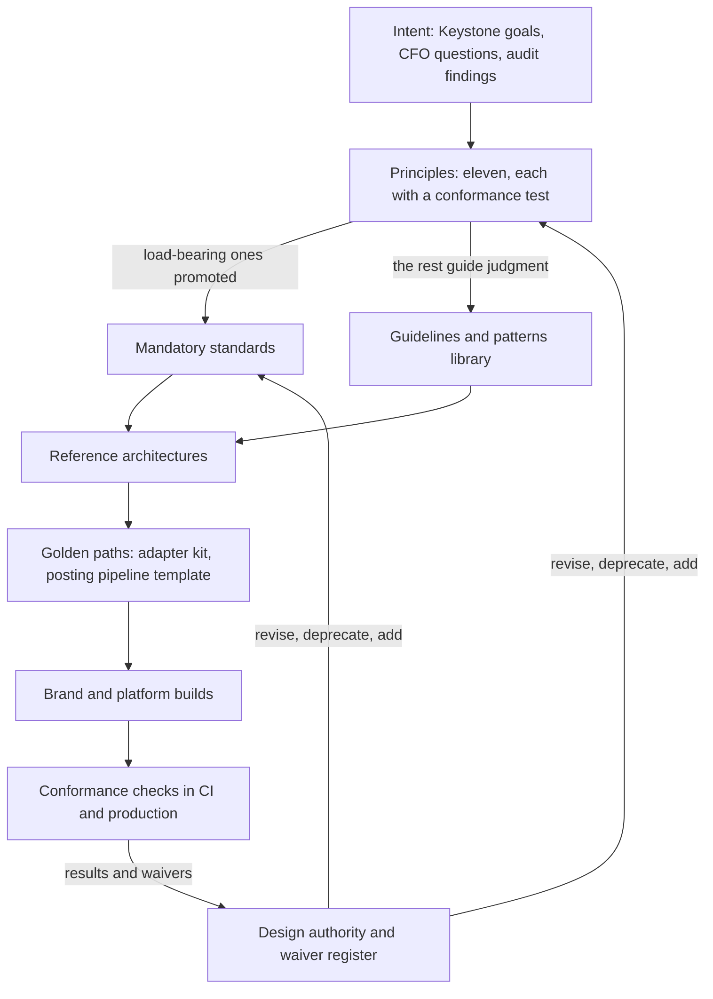
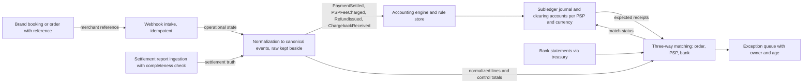
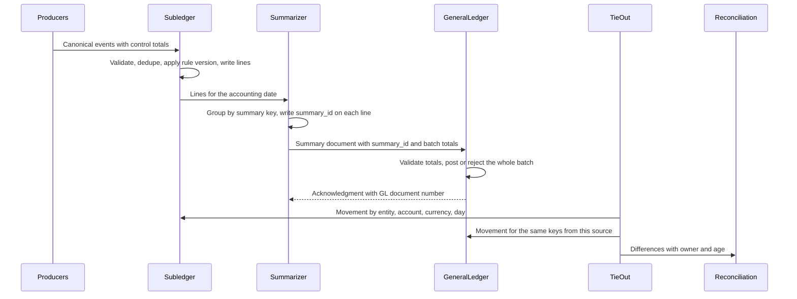
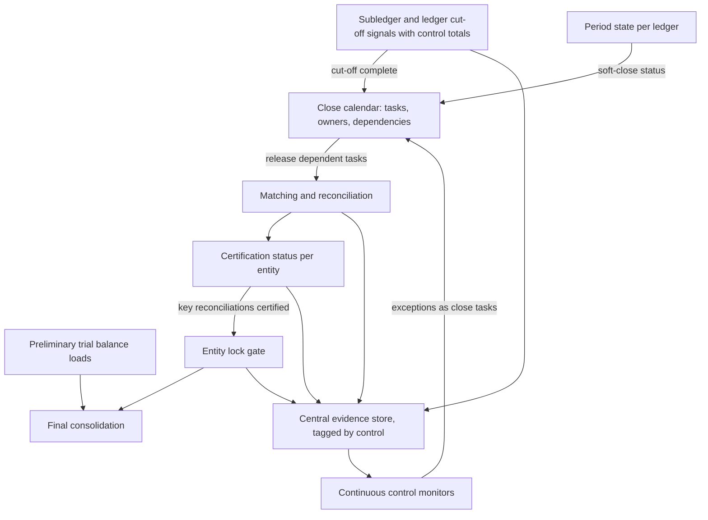

{id: principles-standards-reference}
# 38. Principles, Standards and Reference Architectures


> **IN THIS CHAPTER, YOU WILL:** Learn to write architecture principles that can be tested, separate principles from standards, guidelines, patterns and reference architectures, work through eleven finance-architecture principles and three reference architectures (payments-to-ledger, subledger-to-GL with drill-back, close orchestration and evidence), and see how golden paths turn them into something a brand team can use.

> **WHY FINANCE CARES:** Every principle in this chapter is a promise about the numbers: that each entity's books have one home, that every boundary is reconciled, that a figure in the trial balance can be traced to the transactions behind it. A controller cannot inspect architecture, but can check at quarter-end whether those promises held.

> **WHY ARCHITECTS SHOULD CARE:** A principle that no build can fail is decoration, and a standard without a reference implementation is a tax on the teams that must comply. In a federated estate, the architecture function's influence comes mostly from how easy it makes the right thing to do.

> **KEY POINTS:**
>
> * **A principle is only real if something can fail it.** Write each one with a statement, a rationale, implications, a conformance test and counter-examples. If you cannot name a design that violates it, it is a platitude. If you cannot name a check that detects the violation, it is an aspiration.
> * **Few principles, fewer standards, one easy way to comply.** Eleven principles guide judgment. Only the handful that protect the whole estate (how money events are published, posted and reconciled, how the ERP is extended, how duties are separated) become mandatory standards, each with an owner, a version, conformance checks and expiring waivers.
> * **Reference architectures and golden paths are the delivery vehicle.** A reference architecture names the components, responsibilities, interfaces, variation points and conformance checks of a recurring solution. A golden path (the adapter kit, the posting pipeline template) makes the conformant design the cheapest one to build, which is what changes behavior in brands that do not report to the Chief Architect.

> **[FAILURE PATTERNS THIS CHAPTER ADDRESSES](#where-finance-architecture-goes-wrong):**
>
> * **The Permanent Exception** — Principles that cannot be tested are negotiable, and every brand negotiates its own version of them.
> * **Point-to-Point Spaghetti** — Without a reference architecture and a reusable kit, each team integrates money flows its own way, with its own formats and its own error handling.
> * **Customization Concrete** — "Clean core" stays a slogan until it is a standard with a code-inspection check and a sanctioned place to put the extension instead.

Most enterprises have architecture principles. They sit on a wiki page, eight to fifteen of them, with names like "Data is an asset", "Reuse before buy before build" and "Security by design". Most of them change nothing. They are not wrong; they are **untestable**. No team has had a design rejected for failing "data is an asset", because nobody can say what failing it would look like.

Finance is where untestable principles cost the most. The defects they fail to prevent are not slow pages; they are a balance nobody can trace, a clearing account that grows every month, or a mapping row that sends $41 million of revenue to the wrong line. They surface at period end, under audit, when fixing them costs the most.

This chapter treats principles, standards and reference architectures as one chain: **intent becomes principles, the load-bearing principles become standards, standards are made concrete in reference architectures, and reference architectures are delivered as golden paths**. Each link carries a test. The chain is how a Chief Architect with narrow decision rights ([The Chief Architect's Job: Coherence Across a Finance Estate](#chief-architect-role)) shapes an estate whose engineers mostly report elsewhere.

{id: principles-standards-reference--setting-the-scene-a-principle-that-did-not-stop-41-million}
## Setting the Scene: A Principle That Did Not Stop $41 Million

Northmere, the fictional multi-brand digital commerce group this book follows, closed its first quarter of 2027 in April. On working day 7, a group reporting analyst noticed that "Other revenue" was $41 million higher than forecast. The cause, described in [Finance Data Architecture: Master Data, Systems of Record and Governance](#finance-data-architecture), was ordinary. Tablekin's finance systems team had added a ledger account for usage revenue in Workday. No mapping row existed for it in the spreadsheets that fed OneStream, and a catch-all rule put the whole balance in "Other revenue". Nobody had done anything forbidden, because nothing was forbidden.

Dana Whitlock, Northmere's Chief Architect for enterprise applications and financial systems, reread the draft principles her team had circulated in December 2026. Principle 4 said: "Financial data is accurate, complete and consistent across systems." Every system involved would have claimed to comply. Workday was accurate; the mapping spreadsheet was internally consistent; OneStream consolidated what it was given. The defect lived at a **boundary**, and the principle said nothing about boundaries, nothing about who was authoritative for the mapping, and nothing about what should happen to an account with no mapping.


**Figure 1:** *Every system involved could claim it was accurate, complete and consistent; the $41 million in "Other revenue" lived at the boundary between them, which the untestable principle never mentioned.*

Jonas Berg, who runs the roughly 60 engineers on the Stayloft Finance Platform (SFP), put it bluntly at the next design authority: "Tell me which of these principles can fail my build. Those are the ones I'll read." Dana took that as the specification for the rewrite. By the end of May 2027 the December deck had become eleven principles, each with a conformance test; the five mandatory standards she had proposed in November 2026 were in force; three reference architectures were published; and two golden paths were under construction. The mapping defect is now blocked twice: by the governed, effective-dated mapping rules adopted in May 2027 (an unmapped account stops the load), and by a principle that requires every boundary to prove its completeness.

{id: principles-standards-reference--concepts-six-kinds-of-architectural-guidance}
## Concepts: Six Kinds of Architectural Guidance

Architecture functions produce several kinds of guidance and often blur them. The distinctions matter because each has a different binding force, owner and test.

**Architecture principle.** A durable statement of how the enterprise intends to build and change its systems, used to guide decisions where no standard applies. The TOGAF Standard's widely reproduced template gives a principle four parts: a **name**, a one-sentence **statement**, a **rationale** in business terms and the **implications** for the organization ([The TOGAF Standard](https://www.opengroup.org/togaf)). I add two parts that decide whether a principle gets used: a **conformance test** (how a reviewer or a pipeline would detect a violation) and **counter-examples** (plausible designs that fail it).

**Standard.** A specific, mandatory requirement with a scope, an owner, a version, an effective date, conformance checks and a waiver process. A standard is how a principle becomes enforceable. How standards are approved and waived belongs to [Architecture Governance That Speeds Decisions](#architecture-governance).

**Guideline.** Recommended practice a team may depart from without a waiver, provided it can explain why. Guidelines carry most of an architecture function's experience and should far outnumber standards.

**Pattern.** A named, reusable solution to a recurring design problem: the transactional outbox, the idempotent receiver ([Hohpe and Woolf](https://www.enterpriseintegrationpatterns.com/)), the reversal adjustment ([Fowler](https://martinfowler.com/eaaDev/AccountingNarrative.html)), control totals per batch. Patterns are vocabulary; they do not say where they apply in this enterprise.

**Reference architecture.** A solution template for a recurring problem *in this enterprise*: components, responsibilities, interfaces, the points where implementations may legitimately differ (**variation points**), and the checks that prove an implementation conforms. It composes patterns and implements standards.

**Golden path.** A supported, opinionated, ready-to-use way of building one kind of thing. Spotify's engineering team, which popularized the term, calls it "the opinionated and supported path" to build something; engineers may leave it but "will not have the same support" ([Niemen, 2020](https://engineering.atspotify.com/2020/08/how-we-use-golden-paths-to-solve-fragmentation-in-our-software-ecosystem)). A golden path is a reference architecture turned into templates, libraries, test harnesses and pipelines.

| | Principle | Standard | Guideline | Pattern | Reference architecture | Golden path |
| --- | --- | --- | --- | --- | --- | --- |
| **Binding force** | Guides judgment; cited in decisions | Comply or hold a dated waiver | Explain departures | None by itself | Conform at checkpoints; vary at variation points | Optional; leaving it means proving conformance yourself |
| **Form** | One sentence plus anatomy | Numbered "must" clauses and checks | Prose, examples | Problem, forces, solution | Diagram, component table, interfaces, checks | Code, schemas, templates, CI checks |
| **Typical count** | 8–12 | 5–10 enterprise-wide | Dozens | Dozens | 3–8 for a finance estate | One per reference architecture |
| **Owner at Northmere** | Chief Architect; Leila Haddad co-owns accounting-facing ones | Chief Architect decides; named standard owner | Domain architects | Architecture community | Named lead architect | A platform team funded as a product |
| **How it is tested** | Design review against its test | Automated checks, or attestation with sampling | Peer review | — | Conformance checklist at design and go-live | By construction: the kit runs the checks |
| **Changes** | Rarely; recorded | Versioned; major versions need a transition period | Freely | Rarely | With the standards it implements | Released like software |



**Figure 2:** *Guidance as a chain. Each link narrows interpretation and adds support; conformance results flow back to governance, which revises principles and standards. A link without a test breaks the chain.*

{id: principles-standards-reference--writing-a-principle-that-can-fail}
## Writing a Principle That Can Fail

Each part of the anatomy has a job, and a weak part is easy to spot.

| Part | Weak version | Strong version |
| --- | --- | --- |
| **Statement** | "Data quality is important" | "Every boundary that moves financial data proves its completeness and accuracy" |
| **Rationale** | "Best practice" | "A difference found at a boundary on the day costs a day of investigation; found at close it costs a month and can reach the published statements" |
| **Implications** | Omitted | "Every interface carries control totals; reconciliation is funded with the interface, not after go-live" |
| **Conformance test** | Omitted | "An interface specification that names no control totals and no consuming reconciliation fails design review" |
| **Counter-examples** | Omitted | "A nightly file transfer monitored for arrival but not for record counts and totals" |

Three drafting rules follow. **Name no products in the statement**: "clean core" is a principle; "use SAP BTP" is a decision that may change. **Use verbs a design can fail**: "proves", "derives", "owns", "carries", not "supports", "considers" or "enables". **Write the rationale for the CFO**: if the reason cannot be stated in terms of the close, the audit, cost or risk to the numbers, the principle is probably engineering taste rather than finance architecture.

Principles should not come from a workshop with a blank flipchart. Andrew Harmel-Law lists **team-sourced architectural principles** among the four supporting elements of the advice process, alongside decision records, an advisory forum and a technology radar ([Harmel-Law, 2021](https://martinfowler.com/articles/scaling-architecture-conversationally.html)). Northmere's came from three places: the 11 cross-team decisions Dana's team reconstructed in her first 90 days (three of them reopened), the FY2026 significant deficiency on the SFP payout engine, and the failure patterns that recurred in the capability-overlap and portfolio work ([Map Capabilities Before Systems](#capability-mapping), [Manage the Application Portfolio as an Investment](#application-portfolio)). Each principle generalizes a decision Northmere wished it had made earlier.

{id: principles-standards-reference--eleven-principles-for-a-finance-estate}
## Eleven Principles for a Finance Estate

These are the principles Northmere adopted in May 2027. I would propose them, adapted, to any multi-entity enterprise with custom platforms around vendor ERPs. Change the wording if you must; keep the conformance tests.

{id: principles-standards-reference--p1-one-book-of-record-per-legal-entity-and-ledger}
### P1. One book of record per legal entity and ledger

**Statement:** For each legal entity and accounting basis, exactly one system is the book of record for the general ledger; every other system holding that entity's balances is a subledger that reconciles to it.

- **Rationale.** Statutory accounts, tax returns and consolidated statements are signed per entity. If two systems can claim to hold an entity's books, "which number is right?" has no answer, only a negotiation.
- **Implications.** An acquired brand's ERP stays the book of record for its own entities only until a dated decision says otherwise. A custom platform that holds balances (SFP's merchant subledger, the traveler funds ledger) is declared a subledger with named control accounts.
- **Conformance test.** The entity register names one book-of-record system per entity and basis for all 71 legal entities; every other system holding balances appears in the reconciliation catalog ([Designing for Traceability, Reconciliation and Audit Across Boundaries](#traceability-and-reconciliation)).
- **Counter-example.** A brand platform producing "P&L by property" from its own balances that nobody ties to the GL (**The Shadow Ledger**).

{id: principles-standards-reference--p2-post-facts-derive-accounts}
### P2. Post facts, derive accounts

**Statement:** Operational systems publish financial facts as events; only the accounting engine derives accounts, amounts and periods from them, under versioned, approved posting rules.

- **Rationale.** When brand systems choose GL accounts, accounting policy is scattered across repositories and changed through engineering releases, and nobody can show an auditor which rule produced an entry. Fowler's **Posting Rule** pattern states the alternative: the rule, not the event source, decides the entries ([Fowler, Accounting Patterns](https://martinfowler.com/apsupp/accounting.pdf)).
- **Implications.** Brand platforms stop holding GL mapping tables. Posting rules live in a rule store with maker-checker approval by accounting ([Designing Custom Ledgers and Financial Event Processing](#designing-financial-ledgers)). Corrections are new entries (reversal and re-post), never edits.
- **Conformance test.** No registered event schema contains a GL account, cost center or posting key; every journal line carries the `rule_id` and `rule_version` that produced it.
- **Counter-example.** SFP in 2027, which still chose its own GL accounts from an internal table maintained by Stayloft finance.

{id: principles-standards-reference--p3-reconcile-at-every-boundary}
### P3. Reconcile at every boundary

**Statement:** Every boundary that moves financial data or money proves, on the cadence of the flow, that what left one side arrived complete and accurate on the other; every difference has an owner and an age.

- **Rationale.** Retries, at-least-once delivery and late settlement files make some divergence inevitable. Hohpe notes that even the "write-off" style of error handling works only because "periodically, they'd run reconciliation reports" ([Hohpe, 2005](https://www.enterpriseintegrationpatterns.com/docs/IEEE_Software_Design_2PC.pdf)). Reconciliation is what turns eventual consistency into a closed-period guarantee.
- **Implications.** Control totals (counts, amounts per currency, a hash) travel with every batch and every daily event stream.
- **Conformance test.** Each of the roughly 1,100 cataloged interfaces names its control totals, the reconciliation that consumes them and the owner of breaks. For event streams, published = posted + no-entry + quarantined + in flight, computed daily.
- **Counter-example.** The April 2027 mapping load, which accepted an unmapped account instead of stopping. A suspense account used as a destination rather than a queue (**The Suspense Swamp**).

{id: principles-standards-reference--p4-detail-where-it-is-created-summaries-where-they-are-consumed-drill-back-always}
### P4. Detail where it is created, summaries where they are consumed, drill-back always

**Statement:** Transaction detail stays in the system that creates or accounts for it; downstream ledgers receive summaries; every summary carries a key back to its detail for as long as the detail is retained.

- **Rationale.** Posting three million SFP lines a day into the GL buys nothing; summarizing without a link makes balances untraceable and audits slow.
- **Implications.** Summary keys and drill-back keys are designed explicitly and approved by the controller, because they decide what the GL can report.
- **Conformance test.** A reviewer picks any subledger-fed GL line and reaches the originating events through stored keys alone, with no log search and no spreadsheet; run on a sample quarterly.
- **Counter-example.** A batch map kept in a log store with 13-month retention (**Lost in Aggregation**).

{id: principles-standards-reference--p5-authority-is-explicit-and-singular-per-attribute}
### P5. Authority is explicit and singular per attribute

**Statement:** For every shared data attribute and lifecycle stage, exactly one system is authoritative; every other system holding it is a subscriber that cannot change it.

- **Rationale.** **The Doppelgänger Record** causes the costliest data defects in finance: bank details changed in two places, 12,400 Stayloft partners linked to two FI-CA business partners. Authority per attribute, not per object, lets a booking be authoritative in the brand platform, the receivable in the subledger and the balance in the GL ([Systems of Record and Authoritative Data Boundaries](#systems-of-record)).
- **Implications.** Subscribers get no write path for mastered attributes. Mappings are attributes too: OneStream mapping rules have an author (the source ledger's team) and an approver (group reporting).
- **Conformance test.** Every attribute in the system-of-record matrix names one authority, and access reviews find no user or service with write access to it elsewhere.
- **Counter-example.** Supplier bank details editable in both Coupa and the ERP.

{id: principles-standards-reference--p6-clean-core-extend-beside-the-erp-not-inside-it}
### P6. Clean core: extend beside the ERP, not inside it

**Statement:** Vendor platforms are extended through released interfaces, side-by-side services and configuration; no modifications to vendor objects and no direct writes to vendor tables.

- **Rationale.** Northmere carries about 2,300 custom objects in S/4HANA and needs about seven months per upgrade (**Customization Concrete**). SAP classifies extensions by **clean core levels A to D**: Level A uses released APIs, and Level D (modifications, direct table writes, implicit enhancements) is not recommended; SAP names the ABAP Test Cockpit (ATC) as the key code-governance tool ([SAP News, 2025](https://news.sap.com/2025/08/extend-sap-s4hana-cloud-right-way-clean-clear/)). The principle applies equally to Fusion, Workday and SaaS close tools.
- **Implications.** There must be a sanctioned place for the extension: a side-by-side platform or a Northmere service behind an anti-corruption layer. Without one, the principle is a ban, and bans get waived.
- **Conformance test.** ATC clean-core checks run in the transport pipeline; new Level D objects fail; Level C needs a recorded decision. For SaaS, custom objects are inventoried before each vendor release.
- **Counter-example.** A user exit that changes posting logic inside the ERP for one brand.

{id: principles-standards-reference--p7-configuration-before-code-code-before-forks}
### P7. Configuration before code, code before forks

**Statement:** Differences between brands, entities, markets and business models are expressed first as configuration of a shared capability, then as code behind a published extension point, and only as a fork by recorded decision with a retirement date.

- **Rationale.** Three billing approaches and two payout engines are the residue of forks that were each locally reasonable (**The Permanent Exception**).
- **Implications.** Shared capabilities need configuration models rich enough to carry real differences ([Onboarding Brands, Entities and Markets as Configuration](#brands-entities-markets)); configuration that changes money is itself versioned and approved.
- **Conformance test.** Every design introducing brand- or market-specific code names the configuration option it rejected and why; every fork in the portfolio has a decision record and a retirement date.
- **Counter-example.** A copy of the posting pipeline "temporarily" maintained for one brand.

{id: principles-standards-reference--p8-controls-are-designed-not-retrofitted}
### P8. Controls are designed, not retrofitted

**Statement:** Every finance-relevant system is designed with its controls, segregation of duties and evidence as requirements, and produces its evidence automatically as a by-product of operation.

- **Rationale.** The FY2026 significant deficiency on SFP's payout engine (14 engineers with standing production access; 9 of 23 rule changes without documented approval) cost a remediation program that a design-time rule store and pipeline would have avoided ([Controls, Auditability and Security by Design](#controls-and-auditability)). Retrofits happen under audit pressure (**Audit Archaeology**).
- **Implications.** Every decision record for a finance-relevant system carries a control impact assessment signed by Internal Controls; evidence goes to the central evidence store, tagged by control.
- **Conformance test.** Role designs pass a segregation-of-duties conflict check before go-live; evidence for each key control can be produced by query, without assembly.
- **Counter-example.** A pipeline that lets the author of a change approve it.

{id: principles-standards-reference--p9-money-is-integers-with-a-currency}
### P9. Money is integers with a currency

**Statement:** Every monetary amount is stored and transmitted as an integer in minor units (or fixed-point decimal) with its ISO 4217 currency code; rounding, allocation and conversion follow declared rules, and every conversion records rate, source and timestamp.

- **Rationale.** Binary floating point cannot represent most decimal amounts exactly. Minor units differ by currency ([ISO 4217](https://www.iso.org/iso-4217-currency-codes.html)): two decimals for the euro and dollar, none for the yen, three for the Kuwaiti dinar. Northmere collects in 46 currencies. Fowler's **Money** pattern is the standard treatment ([PoEAA](https://martinfowler.com/eaaCatalog/money.html)).
- **Implications.** The canonical envelope carries the Lisbon booking as `60000` with `EUR`. Allocation computes one amount and derives the other as the remainder: the €510.00 payout is €600.00 minus the €90.00 commission. Rates come from the one per-period snapshot Kyriba publishes.
- **Conformance test.** Schema linting rejects floating-point money fields and money fields without a currency; property tests assert every generated entry nets to zero per currency.
- **Counter-example.** A hard-coded exponent of 2 for every currency.

{id: principles-standards-reference--p10-every-automated-actor-has-an-owner-and-an-evidence-trail}
### P10. Every automated actor has an owner and an evidence trail

**Statement:** Every bot, script, scheduled job, integration identity and AI agent that reads, proposes, posts, approves or changes financial data has a named owner, scoped permissions and a log an auditor can rely on.

- **Rationale.** Automation moves work to identities nobody reviews (**Nobody's Bot**).
- **Implications.** Technical identities are in the access review. AI agents follow "the agent may propose; a controlled process disposes", with an agent control card as conformance artifact ([AI, Automation and Agentic Finance Operations](#ai-in-finance)).
- **Conformance test.** No technical identity with financial write rights lacks a named owner; every agent in a financially relevant process has an approved control card.
- **Counter-example.** A robotic process automation (RPA) bot posting accruals under a former employee's credentials.

{id: principles-standards-reference--p11-prefer-reversible-decisions-make-irreversible-ones-slowly}
### P11. Prefer reversible decisions; make irreversible ones slowly

**Statement:** Where options exist, choose designs that can be reversed at known cost; decisions that cannot (book-of-record changes, vendor commitments, chart-of-accounts structure, data deletion) go through the design authority with options, an exit path and a review date.

- **Rationale.** Finance decisions are often reversible only at a period boundary, after an audit, or never. Treating every decision as heavy makes architecture a bottleneck; treating every decision as light makes it reckless. The principle sorts them.
- **Implications.** Integration contracts stay independent of tools (normalized settlement records, control totals, status signals), so replacing a vendor is a migration, not a rebuild ([Vendor Strategy and Avoiding Excessive Dependency](#vendor-portfolio-strategy)).
- **Conformance test.** Decisions classified as hard to reverse have a record with at least two options, an exit path and a review date.
- **Counter-example.** A year-end ledger switch with no parallel run (**Big-Bang Bravado**).

Northmere deliberately left out "API first", "cloud first" and "reuse before buy before build". They are reasonable defaults, but they do not protect the numbers, so they live among the guidelines.

{id: principles-standards-reference--from-principles-to-mandatory-standards}
## From Principles to Mandatory Standards

A principle is promoted to a mandatory standard when three conditions hold. **The harm of non-compliance falls on others**: the group's books, its auditors or other teams. **Compliance can be checked**, ideally automatically. **A reference implementation exists or is funded**, so the standard does not impose an unfunded cost on teams outside the Chief Architect's line.

Dana's five proposed standards came into force in Q1 2027, effective for new builds and changed interfaces from 1 April 2027, with dated transition plans for existing systems. STD-FIN-01 and STD-FIN-02 were declared on that date but enforced from 1 July 2027, when the schema registry went live ([Canonical Events and Adapters for Loosely Coupled Financial Domains](#loosely-coupled-domains)). The agent control card became the sixth in Q3 2027. How each standard is approved, waived and checked is described in [Architecture Governance That Speeds Decisions](#architecture-governance).

| Standard | Principles | Core requirement | Conformance check | Reference implementation |
| --- | --- | --- | --- | --- |
| **STD-FIN-01 Canonical financial events** | P2, P4, P9 | Facts crossing a domain boundary are registered canonical events with the Keystone envelope (`event_id`, `event_version`, `occurred_at`, `legal_entity`, `correlation_id`, `amount` in minor units plus currency, among others) | Schema-registry compatibility; consumer-driven contract tests; envelope linting | Adapter kit |
| **STD-FIN-02 Idempotent posting** | P2, P3 | Every posting interface accepts a stable idempotency key; a repeated event creates no new entries | CI replay test; production duplicate-rejection counters | Posting pipeline template |
| **STD-FIN-03 Subledger-to-GL reconciliation** | P1, P3, P4 | Every subledger reconciles daily to its GL control accounts by entity, account and currency, with drill-back keys and control totals | Daily tie-out published as evidence; difference zero or explained by batches in flight | Posting pipeline template |
| **STD-FIN-04 Clean-core ERP extension** | P6, P7 | No new modifications or direct table writes in vendor ERPs | ATC clean-core checks in the transport pipeline; custom-object inventory for SaaS ERPs | Side-by-side extension guide (Sven Aalto's SAP team) |
| **STD-FIN-05 Segregation of duties by design** | P8, P10 | Roles, pipelines and rule stores enforce maker-checker and no standing production access | Role-conflict check before go-live; pipeline policy check; break-glass reviewed within one working day | SFP remediation design |
| **STD-FIN-06 Agent control card** (Q3 2027) | P10, P8 | No AI agent in a financially relevant process without an approved control card; agents may not post, approve, pay or change master data | Card approved by control owner, system owner and Internal Controls | Pilot 1 card ([AI, Automation and Agentic Finance Operations](#ai-in-finance)) |

Each standard is a short document with numbered "must" clauses. STD-FIN-02 fits on a page:

```text
STD-FIN-02 Idempotent posting                      v1.1, effective 2027-04-01
Owner: Lucía Romero (integration)    Accounting liaison: Leila Haddad's policy team
Scope: every interface that creates journal entries in a Northmere ledger or subledger
2.1  The producer MUST supply an idempotency key that is stable across retries
     (canonical events: event_id; files: batch_id plus line number).
2.2  The receiver MUST keep keys for at least the open period plus 13 months
     and MUST return the original result for a repeated key.
2.3  A repeated key with a different payload MUST go to quarantine, not be posted
     or silently discarded.
2.4  Corrections MUST be new events (reversal and re-post), never re-sends of the
     original key with changed content.
Checks: CI replay test (2.1-2.3); production metric "duplicates rejected" per source;
        quarterly sample of corrections (2.4).
Waivers: dated expiry; compensating control required for systems in ICFR scope.
```

The format does what the December principles could not: a team knows what to build, a pipeline knows what to check, an auditor knows what evidence to ask for. Clause 2.3 earns its place from a common payments failure: a provider re-sends a corrected settlement line under the original reference, and a receiver that checks only the key silently drops the correction. Standards should earn their clauses from incidents.

Note what was *not* promoted. P9 is enforced through STD-FIN-01's envelope rather than standing alone. P11 is a governance rule, not a design rule. P7 is judged in review, because no pipeline can tell whether configuration was "sufficient". The list stays short because, as [The Chief Architect's Job: Coherence Across a Finance Estate](#chief-architect-role) argues, a long mandatory list is either unenforced or a centralized operating model in disguise.

{id: principles-standards-reference--reference-architecture-1-payments-to-ledger}
## Reference Architecture 1: Payments-to-Ledger

Every brand that takes payments faces the same question: how do provider events and settlement reports become accounting entries and reconciled cash? [Payments-to-Ledger: Connecting Providers, Brand Platforms and the ERP](#payments-to-ledger) owns the clearing account design, the three-way match and the €14 million suspense remediation; this section gives the reusable shape and its checks.



**Figure 3:** *Payments-to-ledger reference architecture. Webhooks carry state early, settlement reports carry money later; both converge on one enterprise-owned normalization layer. The accounting engine posts from canonical events, and matching proves that clearing accounts empty out against the bank.*

| Component | Responsibility | Never does |
| --- | --- | --- |
| Webhook intake | Receive provider notifications at least once; deduplicate | Post money to the ledger |
| Settlement report ingestion | Collect every report; detect missing or late files; compute provider-side control totals | Drop a file silently |
| Normalization | Map provider records to canonical events (STD-FIN-01); keep the raw record immutably beside the normalized one | Let provider vocabulary reach GL accounts |
| Accounting engine | Derive entries from canonical events under approved rules (P2) | Choose accounts per provider in code |
| Clearing accounts | Hold amounts in transit per PSP and currency until matched | Become a permanent home for differences |
| Three-way matching | Match order to PSP settlement to bank credit within tolerances | Post the accounting entry itself |
| Exception queue | Hold each unmatched item with owner, reason code and age | Auto-clear without a tested rule |

**Interfaces.** The canonical events are owned by [Canonical Events and Adapters for Loosely Coupled Financial Domains](#loosely-coupled-domains). Normalized settlement lines are a contract keyed by booking reference, carrying the provider's own reference and batch. Bank statements arrive through treasury as camt.053 or MT940.

**Worked trace.** The Lisbon booking (€600.00, captured through Adyen on 12 March 2027) is booked into Adyen settlement batch 1047 on 14 March (the batch's bank credit to Northmere Payments B.V. follows on 16 March): normalization emits `PSPFeeCharged` for 174 and `PaymentSettled` for 59826 euro cents, both with the booking reference as `correlation_id`. Under the rule set in [Designing Custom Ledgers and Financial Event Processing](#designing-financial-ledgers), "PSP clearing – Adyen" was debited €600.00 at capture and is now credited €1.74 (to Payment processing fees) and €598.26 (to Bank – safeguarding). Matching ties the normalized line to SFP's expected receipt and, through batch 1047, to the 16 March batch credit on the bank statement. The clearing account is back to zero for this booking, the only state a clearing account should converge to.

**Variation points.**

| Variation point | Allowed options | Decided by |
| --- | --- | --- |
| Routing layer | In-house routing or a third-party orchestrator, if the ledger depends only on canonical events | Payments domain, with architecture review |
| Matching granularity | Per transaction (cards); per provider daily aggregate plus a line-level report (some local payment methods) | Payments domain and the controller |
| Fee recognition | Per transaction from settlement lines, or per batch where providers report only batch fees | Accounting policy |
| Target subledger | SFP; the Stripe-to-Workday feed for Tablekin; Fusion for Wayfare until convergence | Recorded per brand |
| Matching tool | BlackLine Transaction Matching today; replaceable because the normalized contract is Northmere's | Close platform owner |

**Conformance checks.** (1) Per provider and day, lines reported equal lines normalized plus lines quarantined. (2) Every clearing account is aged by expected zero date, and items older than 30 days are reported to the controller. (3) No GL account or posting rule contains a provider-specific transaction type. (4) A new payment method goes live only after its settlement report is mapped, its matching rule has been tested on a month of sample data, and booking references are present on its lines. Northmere lacked the fourth check while most of the €14 million accumulated: in April 2027, 48% of unmatched local-payment-method lines had no booking reference.

{id: principles-standards-reference--reference-architecture-2-subledger-to-gl-with-drill-back}
## Reference Architecture 2: Subledger-to-GL With Drill-Back

The second reference architecture applies wherever a high-volume subledger, custom or vendor, feeds a general ledger. [Designing Custom Ledgers and Financial Event Processing](#designing-financial-ledgers) builds SFP's version component by component; this section abstracts it into a contract that any subledger must meet, whether SFP, SAP FI-CA, a vendor accounting engine or the Northmere Ads billing service.



**Figure 4:** *Subledger-to-GL reference architecture. The summary carries a drill-back key and control totals; the GL accepts or rejects whole batches and returns its document number; a daily tie-out compares movements on both sides and sends any difference to reconciliation with an owner.*

**Components.** *Intake* validates and quarantines. The *accounting engine* applies the approved rule version and refuses unbalanced entries. The *summarizer* groups lines by an approved **summary key** (for SFP: legal entity, ledger, accounting date, GL account, profit center, currency, business model, tax code) and writes a `summary_id` on every contributing line. The *GL inbound interface* validates batch totals and posts all or nothing. The *tie-out* compares movements daily, and *reconciliation* in the close platform receives breaks as reconciling items.

**Interfaces.** Three are contractual: the **summary document** (header reference holding the `summary_id`; line count, debit and credit totals per currency; a hash of contained `summary_id`s), the **acknowledgment** (GL document number, stored against the summary), and the **tie-out extract**, which uses the same keys on both sides so differences are computed rather than investigated.

**Worked numbers.** SFP turns about 3 million subledger lines a day into about 38,000 S/4HANA lines, roughly 79 to 1. A controller drilling from the S/4HANA commission revenue line for 21 April 2027 reaches the summary, then its lines, then the `StayCompleted` event for the Lisbon booking (€90.00 commission), then the booking: four joins on stored keys.

| Variation point | Options | Constraint |
| --- | --- | --- |
| Subledger technology | Custom (SFP), SAP FI-CA, Oracle Accounting Hub, Workday Accounting Center | Vendors implement the same idea: FI-CA consolidates documents into totals records under a reconciliation key before transfer ([SAP Learning](https://learning.sap.com/courses/implementing-sap-financial-contract-accounting/describing-general-ledger-integration)); Workday Accounting Center posts summarized journals with drill-down to source ([Workday](https://www.workday.com/en-us/products/financial-management/accounting-center.html)) |
| Summary key | Any approved set of dimensions | Approved by the controller and Owen Mbeki's finance data team, because it decides which reports the GL can certify |
| Posting cadence | Daily by default; intraday where the close needs it | Never monthly only: that makes a daily tie-out impossible |
| Target GL | S/4HANA for SAP-run entities; Fusion and Workday until convergence | The contract stays when the target changes, which makes the 2029 convergence a re-pointing, not a rebuild |

**Conformance checks.** (1) The daily tie-out difference is zero or explained by batches sent and not yet acknowledged. (2) Every subledger line older than a day carries a `summary_id`. (3) No batch is partially posted; an unacknowledged batch older than four hours raises an alert. (4) The P4 drill-back sample passes quarterly. (5) Drill-back keys are retained as long as the detail. In mid-2027 SFP met checks 1 to 3; Tablekin's and Wayfare's daily summarized feeds met only check 3, and the gaps went into their transition plans.

{id: principles-standards-reference--reference-architecture-3-close-orchestration-and-evidence}
## Reference Architecture 3: Close Orchestration and Evidence

The third reference architecture governs the period end. Its components are mostly signals and gates rather than data pipelines, which makes it the least obvious to engineers and the most valuable to the controller, because the critical path of the close runs through it. [BlackLine: Close Automation, Reconciliation and Continuous Accounting](#blackline) covers the close platform, [OneStream: Consolidation, Planning and Performance Management](#onestream) consolidation, and [The End-to-End Finance Processes](#finance-processes) record-to-report as a process.



**Figure 5:** *Close orchestration reference architecture. Ledgers emit cut-off signals with control totals; the calendar releases tasks on signals, not dates; consolidation locks an entity only when its key reconciliations are certified; every gate writes evidence that monitors can query.*

| Component | Responsibility | Northmere implementation (2027) |
| --- | --- | --- |
| Close calendar | Tasks, owners, predecessors; release tasks when inputs are ready | BlackLine Task Management |
| Cut-off signal | Each ledger and subledger announces that the period's final feed is complete, with control totals | SFP final daily summary; target 06:00 on WD1 |
| Period state | Open, soft-closed, closed; the ledgers' period locks remain authoritative | S/4HANA, Fusion, Workday |
| Reconciliation and certification | Prove balances; publish certification status per entity (status, not data) | BlackLine, about 6,800 accounts |
| Consolidation gate | Accept preliminary loads early; lock an entity only after its key reconciliations are certified | OneStream: preliminary loads from WD−2, flash WD3, final WD7, lock WD9 |
| Evidence store | Evidence from every gate, tagged by control, immutable to the people controlled | Central store owned by Internal Controls and Security |
| Control monitors | Test the full population; raise exceptions as close tasks | Mei Tanaka's control and evidence register |

The decisive design choice is that the close runs on **signals rather than dates**. A task that depends on SFP's final summary starts when SFP emits its cut-off signal with matching control totals, not at 09:00 on WD2. That turns the close calendar from a schedule into an orchestration, which is how hidden waiting time disappears.

**Variation points.** The calendar tool (SAP Advanced Financial Closing becomes an option if convergence shrinks the non-SAP close); the number of ledgers emitting signals (three ERPs today, one group core by 2029); the gate rule per entity tier (all key reconciliations for significant entities, a smaller approved set for dormant ones).

**Conformance checks.** (1) No entity is locked without the certification signal for its key reconciliations. (2) Every source feeding the close emits a cut-off signal with control totals, and the calendar consumes it. (3) Every key close control writes evidence tagged with its control identifier. (4) Manual journals above threshold are approved by someone other than the preparer, verified by monitor. (5) Task dependencies are machine-readable, so the critical path is computed rather than reconstructed. Check 5 is what let Northmere decompose its nine-day close into the tool-only, shared and upstream measures behind the plan to reach five days by the end of 2028.

{id: principles-standards-reference--golden-paths-making-the-conformant-way-the-easy-way}
## Golden Paths: Making the Conformant Way the Easy Way

Reference architectures describe; golden paths deliver. A team handed a forty-page specification builds something close to it, late; a team handed a library and a test harness builds exactly it, early. Two golden paths carry most of Northmere's standards.

**The adapter kit**, owned by Lucía Romero's integration architects and funded centrally by Keystone, is the path for publishing financial facts:

- an envelope library that generates `event_id`, stamps `recorded_at`, enforces minor units plus currency and refuses floating-point amounts (STD-FIN-01, P9);
- schema templates for each canonical event type, registered with compatibility rules;
- a mapping template from brand-internal events to canonical ones;
- a control-total emitter publishing daily counts and totals per event type, the producer side of the completeness equation (P3);
- a conformance harness for the brand's CI: envelope linting, consumer contract tests, and a replay test that re-sends a day of events and asserts no new entries downstream (STD-FIN-02).

**The posting pipeline template**, owned by a ledger platform team formed from SFP engineers in 2027, is the path for any subledger-to-GL integration: intake and quarantine services, the rule store with its maker-checker workflow, the accounting engine invariants, a summarizer configured by summary key, the GL acknowledgment handler, the tie-out job with its evidence writer, and money-in-flight dashboards. A team using it meets STD-FIN-02, STD-FIN-03 and the evidence parts of STD-FIN-05 by construction. What remains is its posting rules and summary key, which are accounting decisions.

The first two feeds on the adapter kit, in the second half of 2027, were Northmere Pay's normalized settlement events (`PaymentSettled`, `PSPFeeCharged`), which already existed as files for BlackLine, and Northmere Ads' `AdClickBilled`. Neither was the hardest feed; both had owners willing to report what the kit got wrong.

Golden paths change the economics of compliance. Leaving the path is allowed, as Spotify's framing intends, but a team that leaves it must demonstrate conformance with its own evidence, which is more work than adopting the kit. That is the point. A golden path harder to use than building from scratch is a mandate in a library's clothing, and teams route around it.


**Figure 6:** *Golden paths change the economics of compliance: the adapter kit and the posting pipeline template make the conformant design the cheapest to build, and a team that leaves the path must demonstrate conformance with its own evidence.*

{id: principles-standards-reference--in-practice-the-first-months-of-the-catalog}
## In Practice: The First Months of the Catalog

The catalog went live in May 2027 as one page in Northmere's developer portal, linked from every relevant LeanIX application record. Three things happened that are typical.

**Principles with tests were used within weeks; the others were quoted.** P2, P3 and P5 appeared in design reviews because reviewers could apply them on the spot. P11 was cited by both sides of the Central Finance versus accounting-hub debate, which showed it working: it framed the decision as hard to reverse and therefore due a slow, recorded process with an exit path.

**Standards produced waivers, and the waivers were informative.** By the end of Q3 2027 the register held 14 active waivers, all dated. Six were against STD-FIN-03 for Tablekin and Wayfare feeds without a daily tie-out or drill-back keys; they became items in those brands' transition plans. Four were against STD-FIN-04 for S/4HANA objects that needed a released API SAP did not yet provide; those carried compensating controls and a review at each SAP release. A register of that shape shows that standards bite and that their owners are honest about what cannot yet be met.

**Reference architectures were found because they were linked from the work.** One that lives in an architecture repository is read by architects; one linked from the interface intake form, the portfolio record and the CI failure message is read by engineers. The most effective single change was making every conformance failure in CI print the clause number and a link to the section that explains it.

{id: principles-standards-reference--trade-offs-how-much-to-mandate}
## Trade-offs: How Much to Mandate

The trade-off is coherence against autonomy, and the right point differs by capability.

| Approach | Coherence | Team autonomy | Cost to the center | Right for | Fails when |
| --- | --- | --- | --- | --- | --- |
| **Advisory principles only** | Low to medium | High | Low | Capabilities where divergence harms only the team itself | Applied to money flows: every brand reconciles differently (**The Permanent Exception**) |
| **Standards with attestation** | Medium | Medium | Medium: reviewers, evidence assembly | Rules no pipeline can check (organizational segregation of duties, contract terms) | Attestations become box-ticking between audits |
| **Standards with automated checks and a golden path** | High on the standardized points | Medium to high outside the variation points | High up front, falling with adoption | Load-bearing recurring designs: event publication, posting, tie-out, ERP extension | The golden path is not maintained; teams fork it and checks erode |
| **One mandatory shared platform** | Very high | Low | Highest: the center runs it | Commodity capabilities with no legitimate variation: the tax service adapter in front of Vertex, the payment factory, the e-invoicing gateway | Legitimate variation exists; the platform becomes a queue and brands build around it |

I recommend the third row for the load-bearing standards and the fourth for genuinely commodity capabilities, which is where Northmere's May 2027 decisions on tax and e-invoicing ([Around the Core: Tax, Treasury, Procurement and Reporting Platforms](#satellite-platforms)) already sit. Advisory principles suffice for most of the rest of the estate. The common error is one level everywhere: everything mandated (the function becomes a bottleneck and is bypassed) or nothing mandated (coherence depends on goodwill that does not survive the first deadline).

{id: principles-standards-reference--keeping-guidance-alive}
## Keeping Guidance Alive

Guidance decays predictably: it goes stale as platforms change, accumulates exceptions nobody revisits, and becomes unfindable as the organization grows. Five practices counter that.

**Ownership by name.** Every principle, standard, reference architecture and golden path has one named owner, published beside it. Golden paths have a platform team, a backlog and a budget line.

**Versioning with meaning.** A minor version of a standard clarifies or adds checks for existing obligations; a major version adds an obligation and therefore needs a recorded decision and a transition period. Golden-path releases state which standard versions they satisfy.

**Deprecation with dates.** A superseded standard, pattern or kit version has a sunset date, after which conformance checks treat it as a failure. Without dates, the catalog describes an estate that no longer exists.

**Adoption metrics that resist gaming.** Northmere tracks four: the share of new or changed financial-event feeds that pass the conformance harness (not "use the kit", which a thin wrapper can fake); active waivers, their age and the share closed by expiry; median time from a team's first commit to its first conformant feed; and production incidents at boundaries covered by a standard. The last is the outcome; the first three lead it. These are fitness functions in the sense of Ford, Parsons, Kua and Sadalage, objective checks of an architectural characteristic run continuously ([Building Evolutionary Architectures](https://thoughtworks.com/insights/books/building-evolutionaryarchitectures-second-edition)); [Technical Debt, Architectural Fitness and Modernization Priorities](#technical-debt-and-fitness) develops the estate-level set.

**A yearly review that can delete.** The design authority reviews each principle and standard against the year's incidents, waivers and decisions, and must be able to retire guidance, not only add it. A catalog that only grows stops being read.

{id: principles-standards-reference--integration-with-the-rest-of-the-estate}
## Integration With the Rest of the Estate

This chapter supplies the content that the governance machinery in [Architecture Governance That Speeds Decisions](#architecture-governance) approves and waives. The reference architectures summarize designs owned by [Payments-to-Ledger: Connecting Providers, Brand Platforms and the ERP](#payments-to-ledger), [Canonical Events and Adapters for Loosely Coupled Financial Domains](#loosely-coupled-domains), [Designing Custom Ledgers and Financial Event Processing](#designing-financial-ledgers), [Designing for Traceability, Reconciliation and Audit Across Boundaries](#traceability-and-reconciliation) and [Systems of Record and Authoritative Data Boundaries](#systems-of-record); clean core depends on the extension options in [SAP S/4HANA: The Enterprise Finance Core](#sap-s4hana) and [Oracle Fusion Cloud ERP: Ledgers, Accounting Hub and Coexistence](#oracle-fusion).

{id: principles-standards-reference--failure-modes}
## Failure Modes

**Principles as platitudes.** Statements no design can fail, like the December 2026 draft. Symptom: no design review in a year cites a principle as the reason for a change. Remedy: add a conformance test and counter-examples, and delete any principle for which neither can be written.

**Standards without tests.** Enforcement depends on a reviewer's attention on the day. Symptom: conformance reported at 95% while incidents keep occurring at the boundaries the standard covers. Remedy: every clause names its check; uncheckable clauses move to guidelines or to attestation with sampling.

**Reference architectures nobody can find.** Symptom: teams rebuild the same integration with a different design, then ask whether a pattern exists. Remedy: link them from intake forms, portfolio records and CI failure messages.

**The rotting golden path.** Built once with project money and not maintained; a dependency change makes teams fork it. Symptom: several stale copies of the kit across brand repositories. Remedy: fund golden paths as products and measure time to first conformant feed.

**Standards creep.** Every incident produces a new mandatory standard. Symptom: the list doubles in a year and waivers multiply. Remedy: the promotion criteria; each new standard is a recorded decision with consultation and a reference implementation.

**The vendor's reference architecture.** A vendor's reference architecture adopted unchanged, with the vendor's products in every box and no enterprise-owned contract anywhere. This is **The Borrowed Roadmap**; name the enterprise-owned contracts first and fit products to them.

{id: principles-standards-reference--the-chief-architect-s-view}
## The Chief Architect's View

**What to decide.** A short, tested, owned principle set; the promotion criteria; the mandatory list; which reference architectures to publish first; which golden paths to fund. Northmere's order was the standards first, because they are the only lever that does not depend on persuasion; then payments-to-ledger and subledger-to-GL, because the suspense balance and the drill-back gap were the CFO's visible problems; then the close.

**Who decides.** The Chief Architect decides mandatory standards after consulting the controller, Internal Controls and the payments and brand engineering leads. The controller signs off whatever encodes accounting judgment: summary keys, posting-rule ownership, the drill-back test. Internal Controls signs off control impact. Brand teams decide everything at the variation points.

**What to fund.** The golden paths. A standard without a funded reference implementation shifts its cost onto teams outside the Chief Architect's line, who will spend that money on their own roadmaps. Keystone's central funding of the adapter kit is what made STD-FIN-01 enforceable.

**What to watch.** Waiver age and on-time closure, the share of feeds passing conformance, time to first conformant feed, incidents at standardized boundaries, and citations: if principles stop appearing in decision records, they have stopped working.

**The long view.** Principles should outlive platforms. Northmere's eleven name no vendor, which is why they will still apply after the 2029 convergence. The reference architectures name products only in their variation points, so that when a product changes, only a variation point changes.

{id: principles-standards-reference--questions-to-ask}
## Questions to Ask

1. For each of our principles, can you name a design that violates it and a check that detects the violation?
2. Which principles were cited in a recorded decision in the last year, and which were not?
3. Does each mandatory standard have an owner, a version, checks and a reference implementation a team can copy?
4. Does every subledger tie out daily to its GL, with a drill-back path a controller can follow unaided?
5. Where do operational systems still choose GL accounts?
6. Which reference architectures exist for our recurring finance designs, and how would an engineer find them from the work they are already doing?
7. Who owns and funds each golden path, and how long does a new team take to produce its first conformant feed?
8. How many waivers are active, how old are they, and how many closed on time last quarter?
9. When did we last retire a principle or a standard?

{id: principles-standards-reference--from-principles-to-a-roadmap}
## From Principles to a Roadmap

Principles and standards say how the estate should be built; reference architectures show what good looks like for its recurring parts. None of them says where the estate as a whole is going, or in what order Northmere moves from three ledgers, three integration technologies and a nine-day close to one finance core and a continuous close. That is the job of the target state and the transition states between, each of which can now be described partly by the standards it brings into conformance and the waivers it closes. [Target State, Transition States and the Roadmap](#target-and-transition-states) takes up that question.

{id: principles-standards-reference--sources-and-evidence}
## Sources and Evidence

*Vendor documentation*

- [Extend SAP S/4HANA Cloud the right way: clean and clear](https://news.sap.com/2025/08/extend-sap-s4hana-cloud-right-way-clean-clear/) — SAP News, 2025; clean core levels A to D and the ABAP Test Cockpit as the governance tool (P6, STD-FIN-04).
- [Describing General Ledger Integration (FI-CA)](https://learning.sap.com/courses/implementing-sap-financial-contract-accounting/describing-general-ledger-integration) — SAP Learning; FI-CA totals records under a reconciliation key (reference architecture 2).
- [Workday Accounting Center](https://www.workday.com/en-us/products/financial-management/accounting-center.html) — Workday; summarized journals with drill-down to source (reference architecture 2).

*Standards and regulation*

- [The TOGAF Standard, 10th Edition](https://www.opengroup.org/togaf) — The Open Group, 2022; the four-part principle template (name, statement, rationale, implications), widely reproduced; the standard's text sits behind registration.
- [ISO 4217 Currency codes](https://www.iso.org/iso-4217-currency-codes.html) — International Organization for Standardization; currency codes and minor units (P9).

*Practitioner and research sources*

- [How we use Golden Paths to solve fragmentation in our software ecosystem](https://engineering.atspotify.com/2020/08/how-we-use-golden-paths-to-solve-fragmentation-in-our-software-ecosystem) — Gary Niemen, Spotify Engineering, 2020; the golden path as opinionated, supported and optional.
- [Scaling the Practice of Architecture, Conversationally](https://martinfowler.com/articles/scaling-architecture-conversationally.html) — Andrew Harmel-Law, 2021; team-sourced principles within the advice process.
- [Accounting Patterns (Analysis Patterns supplement)](https://martinfowler.com/apsupp/accounting.pdf) — Martin Fowler; the Posting Rule pattern behind P2.
- [Patterns for Accounting](https://martinfowler.com/eaaDev/AccountingNarrative.html) — Martin Fowler, 2006 (draft); reversal adjustment.
- [Money](https://martinfowler.com/eaaCatalog/money.html) — Martin Fowler, *Patterns of Enterprise Application Architecture*, 2003; currency-aware money types (P9).
- [Your Coffee Shop Doesn't Use Two-Phase Commit](https://www.enterpriseintegrationpatterns.com/docs/IEEE_Software_Design_2PC.pdf) — Gregor Hohpe, *IEEE Software*, 2005; reconciliation as the backstop of loosely coupled error handling (P3).
- [Enterprise Integration Patterns](https://www.enterpriseintegrationpatterns.com/) — Gregor Hohpe and Bobby Woolf, 2003; idempotent receiver and related patterns (STD-FIN-02).
- [Building Evolutionary Architectures, 2nd edition](https://thoughtworks.com/insights/books/building-evolutionaryarchitectures-second-edition) — Ford, Parsons, Kua and Sadalage, O'Reilly, 2022; fitness functions as automated governance.

Northmere Group, its people, systems, standards and figures are fictional; the architectural recommendations are the author's judgment.
