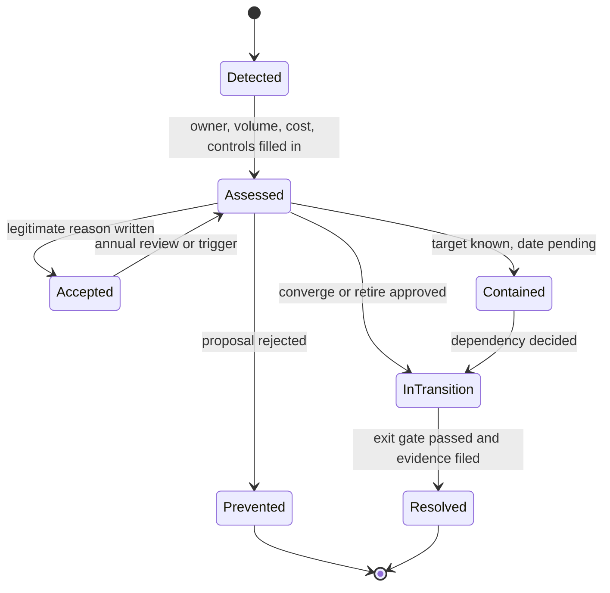
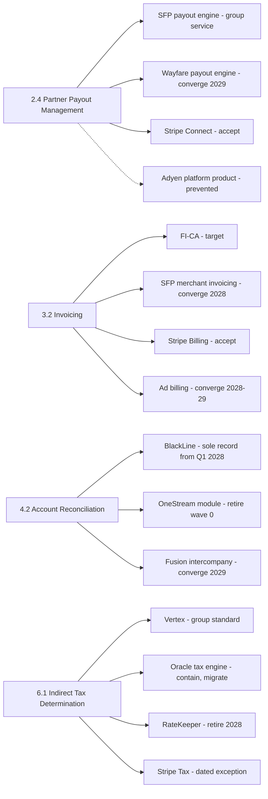
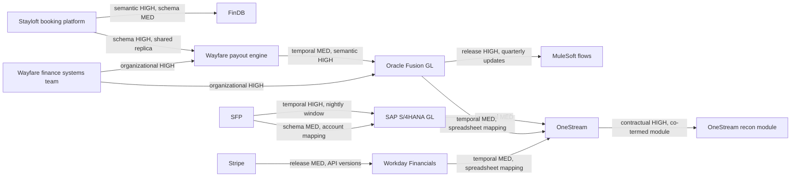
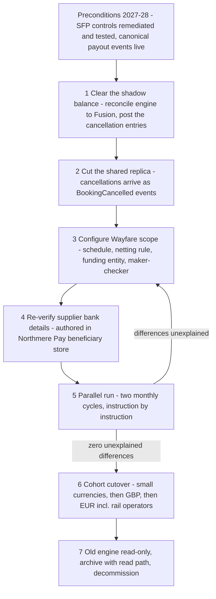

{id: redundancy-and-coupling}
# 32. Duplicates and Dependencies: The Hidden Costs of a Grown Estate

> **IN THIS CHAPTER, YOU WILL:** Learn why finance estates accumulate duplicate capabilities, tell legitimate duplication from waste, run an overlap register that forces a dated decision on every duplicate, classify coupling into six finance-specific types with remedies, measure coupling from data you already have, and follow Northmere's decision to collapse two partner-payout engines into one.

> **WHY FINANCE CARES:** Every duplicated capability is a second set of rules to keep identical, a second control to test and a second number to reconcile. Every unnecessary dependency is a way for a change in one team's system to move a balance in another's, usually discovered at close.

> **WHY ARCHITECTS SHOULD CARE:** Redundancy and coupling trade against each other: removing a duplicate concentrates dependency on the survivor. An architect who manages only one of the two either leaves money and control risk on the table or builds a shared platform that every team is afraid to change.

> **KEY POINTS:**
>
> * **Duplication is a decision, not a defect.** Resilience, regulatory separation, genuinely different business models and dated transitions justify a second implementation. Convenience, inertia and "it was in the bundle" do not. The overlap register makes every duplicate carry an owner, a volume, a cost, a control impact, a decision and a date.
> * **Finance coupling has six faces, and the worst one is semantic.** Temporal, schema, semantic, release, contractual and organizational coupling each break differently. Two systems that share the word "revenue" or "booking date" without sharing its definition can both be correct and still produce numbers that do not reconcile.
> * **Consolidating a capability raises the stakes on its interface.** Collapsing two payout engines into one removes a reconciliation and a control set, and makes the survivor a dependency of two brands. Do it only behind a published interface, with configuration rather than forks, and with the old path kept runnable until two parallel cycles agree.

> **[FAILURE PATTERNS THIS CHAPTER ADDRESSES](#where-finance-architecture-goes-wrong):**
>
> * **Capability Creep** — Reconciliation in three tools, billing three ways and payouts twice arrived one reasonable local decision at a time, and only a register with decision dates stops the next one.
> * **The Borrowed Roadmap** — Bundled modules, "included" tax engines and co-terminated subscriptions set the estate's shape unless every activation passes the same check as a purchase.
> * **The Permanent Exception** — Wayfare's payout engine survived its acquisition on the claim that ground transport "works differently"; by 2027 the difference was one schedule and one netting rule.

The capability map in [Map What Finance Does Before What Runs It](#capability-mapping) showed Northmere four places where it does the same thing more than once. It did not say what to do about them, or how to stop a fifth. This chapter does both. It treats **redundancy** (several implementations of one capability for comparable scope) and **coupling** (the degree to which a change in one system forces a change, a delay or a failure in another) as the two forces that make a finance estate expensive to change, and it argues that **they must be managed together, because fixing one moves pressure onto the other.**

Finance makes both forces more costly than in most domains. A duplicated capability in a product estate wastes engineering. A duplicated capability in a finance estate also produces two versions of a number that someone must reconcile, two control designs the auditor must test, and two places where a new regulation must be implemented on the same date. **Coupling in finance has a deadline attached**: the close. A schema change that breaks an interface on a Tuesday in the middle of the month is an incident; the same change on working day two is a late close.

Northmere, the fictional multi-brand commerce group this book follows, is the running example. By the autumn of 2027 its Chief Architect, Dana Whitlock, has an approved capability map, an application portfolio with rationalization waves ([Manage the Application Portfolio as an Investment](#application-portfolio)) and a decision on what stays custom in the Stayloft Finance Platform ([When the ERP Isn't Enough: Custom Finance Platforms](#custom-finance-platforms)). What she does not yet have is a mechanism that keeps the estate from drifting back.

{id: redundancy-and-coupling--setting-the-scene-at-northmere-eleven-rows-where-there-were-four}
## Setting the Scene at Northmere: Eleven Rows Where There Were Four

In late October 2027 Dana brings the first full **overlap register** to the Keystone steering committee. Tomás Ferreira, the Group CFO, reads the summary line and frowns. "In March you showed me four overlaps. This register has eleven rows. Did it get worse?"

It did not. The March list held the four duplications nobody had decided: payouts in two engines, invoicing three ways, account reconciliation in three tools, and indirect tax in two engines. All four now have a decision and a date. The other seven rows are duplications that were *always there* but had been treated as normal (two payment service providers, two payment-execution routes, two planning tools at Tablekin), plus three that the register caught before they happened: a request to switch on Stripe Revenue Recognition at Tablekin, a proposal to configure Oracle's tax engine for four new Wayfare markets, and an evaluation of Adyen's platform product that would have created a third payout engine. **The count went up because the register now records decided duplication as well as accidental duplication.** The number that matters went from four to zero: duplications with no decision.

Lucía Romero, Dana's lead integration architect, brings the second half of the story. In July 2027 Stayloft's booking platform changed what it stamps as the *booking date* on instant-book reservations, from the moment the traveler submitted the request to the moment the property's calendar confirmed it. The change was correct for the booking platform's own purpose. It moved about **€3.1 million** of merchant gross bookings across the June–July boundary in FinDB, the group's finance data platform, so the June flash numbers that group FP&A had already loaded into OneStream no longer tied to the July re-run. The ledger was unaffected, because the Stayloft Finance Platform (SFP) recognizes revenue on stay completion, not booking. Nobody broke an interface. Nobody had a test that could fail. Two systems shared a word without sharing its definition.

The two halves pose this chapter's question. **How does a Chief Architect stop the estate from accumulating duplicate capabilities and brittle dependencies, without either freezing every team or building one shared platform that every team is afraid to touch?**

{id: redundancy-and-coupling--why-redundancy-accumulates}
## Why Redundancy Accumulates

No one designs a duplicate. Redundancy arrives through mechanisms that are each rational at the moment they act. Naming the mechanism matters because each has a different counter.

| Mechanism | How it looks when it happens | Northmere instance | The counter |
| --- | --- | --- | --- |
| **Acquisition** | The acquired company's systems keep running "for now" to protect the deal | Wayfare's payout engine and intercompany reconciliation in Oracle Fusion (2024); Tablekin's Adaptive Planning license (2023) | Map acquired applications onto the capability map in the first month; every carried-over duplicate enters the register with a decision date |
| **Vendor bundling** | A suite adds an adjacent module at a marginal price, or "included" in the subscription | The OneStream reconciliation module bought in 2022; Fusion's balance-level US-dollar reporting currency, added in 2024 | Treat activating a module as a procurement event, even when the license costs nothing |
| **"Free" capability** | A team uses what is already licensed instead of the group platform, to avoid an integration | Hana Kowalski's proposal to configure Oracle's tax engine for four more Wayfare markets because "it is already in the box" ([Around the Core: Where Specialist Platforms Earn Their Place](#satellite-platforms)) | Price the second rule set, the second control and the second regression suite, not the license |
| **Team autonomy** | A brand team builds what it needs because the shared capability is slower to obtain | SFP's commission billing, built before FI-CA (SAP's contract-accounting subledger) existed in the estate | Fund the shared capability to be the faster path; give exceptions an expiry |
| **The transition that lost its end date** | Two implementations run side by side during a migration that stalls | FI-CA took over Stayloft agency invoicing in 2025; merchant invoicing stayed in SFP with no date to follow | Every transitional overlap carries a sunset date and an owner, reviewed like a waiver |

**Vendor bundling is The Borrowed Roadmap in its quietest form.** Nobody decides to run reconciliations in a consolidation tool; a bundle is signed, a team finds the module already licensed, and three years later the estate has two systems of record for reconciliation evidence. Both BlackLine and OneStream sell account reconciliation and transaction matching, as their annual reports show ([BlackLine 10-K](https://www.sec.gov/Archives/edgar/data/1666134/000162828026011915/bl-20251231.htm); [OneStream 10-K](https://www.sec.gov/Archives/edgar/data/1889956/000119312526076771/ck0001889956-20251231.htm)). Overlapping vendor footprints are the normal state of the market, so the enterprise must decide where each capability lives, because no vendor will. **Acquisitions are the largest single source**, and The Permanent Exception is how their duplicates harden: "ground transport works differently" was true enough in 2024 to keep Wayfare's engine, and nobody re-checked the claim until 2027.

{id: redundancy-and-coupling--when-duplication-is-legitimate}
## When Duplication Is Legitimate

The rule "one implementation per capability" is wrong as an absolute. Some duplication buys something the enterprise needs. The test I use is short: **would we choose to build or buy the second implementation today, knowing the first exists, for a reason we can write in one sentence that does not mention history?** Five reasons pass that test.

1. **Resilience.** A second implementation that can take the load when the first fails. Northmere Pay accepts payments through Adyen (about 68% of transactions), Stripe (about 22%) and local alternative-payment-method providers (about 10%). A second payment service provider (PSP) gives failover, routing leverage and coverage of markets one provider does not serve. It also costs a second settlement format, a second clearing account and a second set of dispute operations, a trade-off Stripe itself framed in a 2026 conference session titled ["More PSPs, more problems?"](https://stripe.com/sessions/2026/more-psps-more-problems) (as reported). The duplication is legitimate because it is designed: both feeds are normalized into the same canonical events and matched in the same reconciliation ([Payments-to-Ledger: Draining the Suspense Swamp](#payments-to-ledger)).
2. **Regulatory or legal separation.** Two implementations because the law requires the money or the data to be handled apart. Northmere Pay executes payouts from safeguarded client funds under its e-money license; Kyriba's payment factory executes corporate payments from operating accounts. Merging them would put corporate payments inside the safeguarding perimeter, which is the opposite of what the supervisor expects.
3. **Genuinely different business models.** The capability is the same at level 2 of the map but the calculation underneath is not. Stripe Billing rates Tablekin's per-cover usage and bills subscriptions about 41,000 times a month; FI-CA invoices agency commission to Stayloft properties. **Rating differs by business model; invoicing as the issuing of a compliant document does not.** The register therefore accepts Stripe Billing as Tablekin's billing subledger and still routes its documents through the group e-invoicing gateway.
4. **Deliberate transitional overlap with an end date.** Two implementations while one replaces the other, with an exit gate and a date. Each wave of the Oracle-to-Vertex tax migration runs both engines on the same transactions for one month, and every difference must be explained before the Oracle engine is switched off for those markets ([Around the Core: Where Specialist Platforms Earn Their Place](#satellite-platforms)). That is duplication by design, and it ends.
5. **Separability.** A capability kept inside a business that the group may sell, because extracting it later would cost more than running it twice now. This is rarer than it is claimed. It needs a board-level reason, such as an announced strategic review, not a manager's sense that "we might divest someday".

Everything else is waste: duplication kept because the second implementation already exists, because a team prefers its own tool, because a module was in the bundle, or because nobody holds the decision right. The table below is the decision aid the Keystone design authority uses.

| Question | Points to legitimate duplication | Points to waste |
| --- | --- | --- |
| Why does the second implementation exist today? | A resilience, regulatory, business-model or transition reason written in the register | "It came with the acquisition", "it was licensed", "the team preferred it" |
| Is the scope genuinely different? | Different calculation, different legal regime, different volume class by an order of magnitude | Same calculation, same documents, comparable volume, different brand label |
| Is there an end date or a review date? | A sunset date with an exit gate, or an annual review of the resilience case | None, or a date that has already slipped once without a new decision |
| Are the outputs reconciled to each other or to a common record? | Both feed the same canonical events and the same reconciliation | Each reports its own totals upward; nobody proves they agree |
| Do both share one control design for the risk they carry? | One standard, applied in both, tested once as a design and twice in operation | Two control designs, one weaker, usually the minority implementation |
| Who arbitrates when they diverge? | A named capability owner in Finance with decision rights | Two engineering owners and an escalation path |
| Would we buy or build the second one today? | Yes, for the written reason | Only because switching costs money |

Legitimate duplication still costs money, reconciliation effort and control testing. The register exists so that the enterprise pays that cost knowingly and stops paying it on the date it chose.

{id: redundancy-and-coupling--the-overlap-register}
## The Overlap Register

The **overlap register** is the governed list of every capability the estate implements more than once, with a decision about each. It is the artifact that turns the capability map's duplication score into action, and it is owned by the Chief Architect, with each row's decision signed by the Finance capability owner. It is not a list of problems. A row that says "accepted, because resilience, reviewed annually" is as complete as a row that says "retire by 30 June 2029".

{id: redundancy-and-coupling--the-fields}
### The fields

| Field | What it holds | Why it matters | Source |
| --- | --- | --- | --- |
| **Capability** | The level-2 capability from the map, with its number | Keeps the register stable when systems are renamed | Capability map in LeanIX |
| **Scope** | Brands, entities, markets or business models covered | Duplication is only meaningful for comparable scope | Capability-to-application trace |
| **Implementations** | Each application performing the capability, with its owning team | Shows the minority implementation and its owner | Application fact sheets |
| **Volume per implementation** | Transactions, documents, accounts or markets per month | The smallest implementation is usually the cheapest to retire and the most expensive per unit | Operational metrics, interface counts |
| **Capability owner** | The Finance leader accountable for the outcome across implementations | Someone must arbitrate between engineering owners | Capability map v1 |
| **Cost** | Annual run cost per implementation, labeled cash or capacity | Ranks attention; not a savings estimate | Six-component TCO from the portfolio |
| **Control impact** | Key controls per implementation, open findings, what a decision does to the control matrix | The auditor tests controls per application; every duplicate multiplies testing | Risk and control matrix |
| **Decision** | One of: Accept, Converge, Retire, Contain, Prevent | Forces a verb; "under review" is not a decision | Architecture decision record |
| **Reason** | One sentence, without history, for the decision | The test from the previous section | Decision record |
| **Date** | Sunset, review or decision-due date | A row without a date is a row that will be forgotten | Wave plan, contract calendar |
| **Exit gate** | The evidence that ends a transition | Prevents retiring into an unready platform | Wave plan |
| **Decision record** | Link to the ADR | Traceability for audit and for the next architect | ADR repository |

The five decision verbs have precise meanings. **Accept** keeps the duplication with a written reason and a review date. **Converge** moves one implementation's scope onto another by a date. **Retire** removes an implementation whose scope is already covered or no longer needed. **Contain** freezes an implementation's scope (no new markets, entities or volume) without yet setting a retirement date, which is the honest answer when the target is known but its date depends on another decision. **Prevent** records a proposed duplication that was rejected, so that the same proposal does not return through a different door a year later.

{id: redundancy-and-coupling--how-a-row-moves}
### How a row moves

**Figure 1:** *The lifecycle of an overlap-register row. Every row ends in a decision state; an accepted row returns to assessment at its review date, and a resolved row closes only when the exit evidence is filed.*

{id: redundancy-and-coupling--northmere-s-register-october-2027-excerpt}
### Northmere's register, October 2027 (excerpt)

The excerpt below shows the rows the steering committee discussed. Volumes are monthly unless stated, costs are annual and rounded, and every figure is fictional.

| Capability and scope | Implementations and volume | Owner | Cost | Control impact | Decision and date |
| --- | --- | --- | --- | --- | --- |
| **2.4 Partner Payout Management**, Stayloft and Wayfare | SFP payout engine, ~7.6 million payouts; Wayfare payout engine, ~3,900 supplier payouts in 14 currencies | Head of Partner Settlement (CAO organization) | Wayfare engine ~$2.64m; capability ~$7.6m | Two control designs for bank-detail and payout-rule changes; FY2026 significant deficiency on SFP | **Converge** Wayfare into the group payout service; wave 2, last Wayfare run in the old engine July 2029 |
| 2.4 Partner Payout Management, Tablekin venues | Stripe Connect, ~1.4 million venue payouts | Head of Partner Settlement | Inside Tablekin's payments fees | Stripe's controls plus Tablekin payout reconciliation in BlackLine | **Accept**: product-embedded payments facilitation, a different business model; review when the Connect account migration ends (2028) |
| 2.4 Partner Payout Management, proposed | Adyen platform product for Stayloft | Ingrid Solberg | n/a | Would move partner balances outside the licensed estate | **Prevent** (2027): would be a third payout engine for only Adyen's share of volume ([Adyen: One Platform from Checkout to Settlement](#adyen)) |
| **3.2 Invoicing**, all brands | FI-CA, up to ~850,000 agency contract accounts; SFP merchant statements, ~400,000; Stripe Billing, ~41,000; ad billing, ~18,000 | Leila Haddad, delegated to group billing lead | ~$6.3m | E-invoicing and numbering controls in four places | **Converge** SFP merchant invoicing to FI-CA (2028) and ad invoicing to FI-CA (2028–2029); **Accept** Stripe Billing for Tablekin rating and invoicing, documents routed through the group e-invoicing gateway |
| **4.2 Account Reconciliation**, all entities | BlackLine, ~6,800 accounts; OneStream module, 22 accounts; Fusion intercompany, ~150 Wayfare balances | Leila Haddad | OneStream module ~$448k; capability ~$3.4m | Two systems of record for reconciliation evidence | **Retire** OneStream module (wave 0, accounts moved by Q1 2028); **Converge** Fusion intercompany into BlackLine (2029). BlackLine is the sole system of record for balance-sheet reconciliation from Q1 2028 |
| **6.1 Indirect Tax Determination**, all invoicing systems | Vertex (S/4HANA, SFP, FI-CA); Oracle tax engine, 9 Wayfare markets; RateKeeper, 5 markets; Stripe Tax, Tablekin | Kofi Asante | RateKeeper ~$651k; capability ~$2.6m | Two tax rule sets to keep identical under ViDA deemed-supplier rules | **Converge** to Vertex: RateKeeper 2028, Oracle markets in two waves gated by one-month parallel runs; **Contain** Oracle engine (no new markets); Stripe Tax accepted under a dated exception until the shared tax service (2029 target) |
| 3.4 Revenue Recognition, Tablekin | Workday revenue schedules; Stripe Revenue Recognition proposed | Leila Haddad | n/a | Would create a second revenue engine for one brand | **Prevent** (March 2027): Workday generates revenue accounting from invoice-line service periods ([Stripe: Every Movement Is a Balance Transaction](#stripe)) |
| 5.x Planning, Tablekin | OneStream (group plan of record); Workday Adaptive Planning (Tablekin ARR cohorts) | Group FP&A | Adaptive license | Not in ICFR scope; plan consistency risk | **Accept** until renewal decision, Q2 2028: retire if OneStream can host the cohort model ([Workday: The Org Chart Behind the Ledger](#workday)) |
| 4.4 Currency Translation | OneStream; Fusion balance-level USD reporting currency | Leila Haddad | Small | Two translated numbers for Wayfare | **Contain**: Fusion translation for labeled sub-group management views only, tied to OneStream monthly; retire with ledger convergence |
| 2.1 Payment Acceptance | Adyen, Stripe, local APM providers | Ingrid Solberg | In PSP fees | Three settlement formats into one matching design | **Accept**: resilience and coverage; reviewed annually; new providers subject to "ledger-ready before launch" |
| 10.1 Financial Event Management | Kafka, SAP Integration Suite, MuleSoft | Lucía Romero (interim) | ~$5.2m | Three monitoring and evidence models for interfaces | **Contain** MuleSoft (no new flows from July 2027; existing flows retire with ledger convergence, 2029–2030); Kafka the only backbone for canonical events; Integration Suite the S/4HANA and FI-CA boundary (design authority, June 2027, [Canonical Events: A Common Language for Money](#loosely-coupled-domains)) |

Two features of the excerpt are worth noticing. First, **the register splits rows by scope when the decision differs by scope.** Partner payouts appear three times, because Wayfare's suppliers, Tablekin's venues and a proposed Adyen product each get a different verb. A register that forced one verb per capability would either overrule Tablekin's legitimate model or wave through Wayfare's engine. Second, **the register records decisions taken elsewhere rather than retaking them.** The three integration technologies were decided by the design authority in June 2027, together with the canonical events v1; the row points to that record and carries its dates, so the register stays one list without becoming a second forum.

**Figure 2:** *Northmere's overlap map in October 2027. Every implementation of the four March overlaps now carries a verb and a date; the dotted line is a duplication the register prevented.*

The register is neither the portfolio, which decides the future of each application, nor the capability map, which scores duplication; it decides each *duplicated capability*. Nor is it a savings plan: it ranks decisions by **control impact first, cost second**, because the controls column is where duplication most often turns into an audit finding.

{id: redundancy-and-coupling--a-coupling-taxonomy-for-finance}
## A Coupling Taxonomy for Finance

Redundancy is the visible half of the problem. Coupling is the half that shows up at close. **Coupling** is not bad in itself: a subledger that posts to the general ledger is coupled to it by design, and a finance estate with no coupling would be a set of unreconcilable islands. The question is whether each dependency is *necessary* (it carries a fact the receiver must have) and *managed* (it goes through a published contract that someone owns and tests).

Vlad Khononov's [*Balancing Coupling in Software Design*](https://www.pearson.com/en-us/subject-catalog/p/balancing-coupling-in-software-design-successful-software-architecture-in-general-and-distributed-systems/P200000000372/9780137353576) (Addison-Wesley, 2024) offers a useful general lens: judge a dependency by how much knowledge the two sides share, how far apart they are, and how often the shared knowledge changes. Finance needs a more specific vocabulary, because its dependencies fail in ways that are particular to periods, balances and definitions. I use six types.

| Type | What is shared | Finance example at Northmere | How it breaks | Remedy |
| --- | --- | --- | --- | --- |
| **Temporal** | Time: one system must finish, or be available, before another can proceed | SFP's nightly summarization must complete before the S/4HANA posting window; BlackLine matching waits for the PSP settlement file | A late batch on working day 1 delays every downstream close task | Asynchronous events with durable queues; idempotent consumers; cut-off rules that tolerate lateness ([Reconciled by Design: Traceability and Audit Across Boundaries](#traceability-and-reconciliation)) |
| **Data and schema** | Structure: one system reads another's fields, files or tables | The Wayfare payout engine reads cancellations from a replica of the booking platform's database | A column rename silently changes what is read | Published interfaces and contracts; no shared databases |
| **Semantic** | Meaning: both use a term but define it differently | "Booking date" in the booking platform versus FinDB; "revenue" in Stripe reports versus Workday | Both systems are correct and the numbers do not tie | One owned definition per financial term, published with the interface |
| **Deployment and release** | Change cadence: one system cannot change without another changing or retesting | Oracle's quarterly updates force about 14 working days of regression across Wayfare interfaces; a Stripe API upgrade changes report columns | Upgrades become projects; teams defer them | Version-tolerant consumers; contract tests; anticorruption layers that absorb vendor change |
| **Vendor and contractual** | Commercial terms: a contract ties capabilities or dates together | The OneStream reconciliation module is co-termed with the master subscription; resale routes for close software | A retirement can save money only at a date the contract sets | Track notice dates in the register; keep data formats and rules independent of the tool ([Own Your Roadmap: Vendor Strategy Without Lock-In Panic](#vendor-portfolio-strategy)) |
| **Organizational** | People: one team must act for another's change to ship | Hana Kowalski's team owns the minority implementation of three overlaps, so every Wayfare convergence queues on the same nine people | Changes wait for another team's backlog | Align team boundaries to capabilities; platform teams with service interfaces |

{id: redundancy-and-coupling--temporal-coupling-the-close-is-a-dependency-graph}
### Temporal coupling: the close is a dependency graph

Temporal coupling is the type finance tolerates most, because the close calendar makes it visible. Every arrow on the close's critical path ([The Chief Architect's Job: Making Many Systems Tell One Story](#chief-architect-role)) is a temporal dependency. The unnecessary ones are **synchronous calls on a period-end path**, where a posting fails because another system was slow at that moment. The remedy is events delivered at least once, consumed idempotently and proven complete by control totals. Kafka's exactly-once guarantee covers processing inside Kafka, not side effects such as a ledger posting ([Confluent](https://www.confluent.io/blog/exactly-once-semantics-are-possible-heres-how-apache-kafka-does-it/)), so correctness comes from idempotency and reconciliation, not middleware.

{id: redundancy-and-coupling--data-and-schema-coupling-the-shared-database}
### Data and schema coupling: the shared database

The most damaging form of schema coupling is two systems sharing a database. Martin Fowler's description of the [integration database](https://martinfowler.com/bliki/IntegrationDatabase.html) (2004, updated 2015) states the problem plainly: a database shared across applications couples them deeply, and he concludes that "integration databases should be avoided." In finance the shared database is usually a read replica that a downstream team was given access to during an incident and never lost, or a reporting schema that became an interface by accident. Wayfare's payout engine reads cancellations from a replica of the booking platform's database. When the booking team restructures that table, the payout calculation changes without a single line of payout code changing.

Even a published interface leaks. Hyrum's Law, as its author states it, is that ["with a sufficient number of users of an API … all observable behaviors of your system will be depended on by somebody"](https://www.hyrumslaw.com/). A summarized journal file sorted by account by accident becomes a file whose sort order a reconciliation depends on. The remedy is to **publish what is promised and test consumers against that**, not to assume that a documented interface is the only thing consumed.

{id: redundancy-and-coupling--semantic-coupling-the-most-expensive-kind}
### Semantic coupling: the most expensive kind

Semantic coupling is the type I watch hardest in finance, because it produces no errors. Two systems exchange a field called `booking_date` or a measure called `revenue`; both validate; both are correct by their own definition. The difference appears only when someone compares totals, usually at a close or in front of an auditor. The July 2027 booking-date change is the archetype: no schema changed, no contract test could fail, and €3.1 million of gross bookings moved across a month boundary in a flash report.

**Figure 3:** *Semantic coupling produces no errors: when 'booking date' moved from request to confirmation, about €3.1 million of gross bookings crossed the June–July boundary in a flash report without any interface breaking.*

Domain-driven design gives the vocabulary. A **bounded context** is the boundary within which a model and its language are consistent ([DDD Reference](https://www.domainlanguage.com/ddd/reference/)); [Map What Finance Does Before What Runs It](#capability-mapping) drew Northmere's. Semantic coupling is what happens when a term crosses a context boundary without translation. "Account" means a customer account in Sales, a bank account in Treasury and a GL account in Accounting. "Revenue" means gross bookings to a commercial team, cash collected to a payments team and recognized revenue to the controller. "Supplier" means an indirect-spend vendor in Coupa and a ground-transport partner in Wayfare's payout engine, which is why the two have different bank-detail authorities. The remedy has two parts: **one owned definition per financial term that crosses a boundary**, published with the interface in the **published language** of the canonical events; and **explicit translation at the boundary**, so that a context that uses the term differently converts it rather than reusing the name. The governed metrics in [One Number, Many Views: Finance Data from Operations to Analytics](#finance-data-flows) apply the same rule to reporting.

{id: redundancy-and-coupling--release-and-vendor-coupling-someone-else-s-calendar}
### Release and vendor coupling: someone else's calendar

Release coupling is mostly imported. Software-as-a-service (SaaS) vendors set their own cadence: Oracle ships quarterly Fusion updates that customers cannot skip ([Oracle Fusion: An Accounting Hub for High-Volume Events](#oracle-fusion)); Workday delivers two feature releases a year plus weekly updates ([Workday: The Org Chart Behind the Ledger](#workday)); Stripe ships monthly non-breaking API versions and twice-yearly major versions with breaking changes ([Stripe API versioning](https://docs.stripe.com/api/versioning)). An interface written directly against a vendor's payload inherits that cadence. The remedy is an **anticorruption layer** (ACL), a translation component that converts a vendor's model into the enterprise's published language, so that a vendor change is absorbed in one place and tested once.

Vendor coupling is contractual. A module co-termed with a master subscription can be dropped only when the bundle renews: OneStream's renews on 31 December 2027 with notice due by 30 September, which is why the reconciliation module's retirement was decided in July ([Manage the Application Portfolio as an Investment](#application-portfolio)). The remedy is to **keep matching rules, mappings and data formats owned by the enterprise**, so that a vendor can be changed by a migration rather than a rebuild.

{id: redundancy-and-coupling--organizational-coupling-conway-s-law-at-close}
### Organizational coupling: Conway's law at close

Melvin Conway's 1968 observation that systems mirror the communication structure of the organizations that build them ([Fowler on Conway's law](https://martinfowler.com/bliki/ConwaysLaw.html)) has a twist in finance: Finance's organization and Engineering's are different structures, and finance systems must satisfy both. When a capability has two engineering owners and no Finance owner, the interface between them is negotiated rather than designed. *Team Topologies* ([2nd edition, 2025](https://itrevolution.com/book/team-topologies/)) supplies the remedy's vocabulary: a platform team for a shared capability such as payouts, consumed as a service through an interface rather than through collaboration on each change ([Who Owns What: Organizing Architecture Across Finance and Technology](#organizing-for-architecture)).

{id: redundancy-and-coupling--the-coupling-heat-diagram}
### The coupling heat diagram

Lucía's team scored the twelve busiest finance boundaries on the six types, using the interface catalog, incident records and release data. The diagram shows the hottest edges.

**Figure 4:** *Coupling heat on Northmere's busiest finance boundaries, Q3 2027. The hottest edges cluster around Wayfare: a shared database replica, an undefined handover of cancellations to the ledger, quarterly vendor releases and one team on every path.*

The diagram changed the order of Keystone work. The Wayfare payout engine sits on three hot edges, which made it the first convergence candidate on coupling grounds as well as redundancy grounds.

{id: redundancy-and-coupling--design-rules}
## Design Rules

The register stops accidental duplication; design rules stop unnecessary coupling. Northmere adopted seven as mandatory enterprise-application standards in 2027, each with an enforcement mechanism. A rule without enforcement is a recommendation, and recommendations drift.

| Rule | What it says | Why | How it is enforced |
| --- | --- | --- | --- |
| **1. One owner per capability per scope** | Every level-2 capability has one Finance owner; every scope has one owning implementation, unless the register records an accepted duplicate | Two owners negotiate; one owner decides | Register completeness checked at every portfolio gate |
| **2. Published interfaces only** | Systems exchange financial facts only through versioned, documented contracts in the published language, with owned definitions of every financial term | Prevents schema and semantic coupling | Interface catalog: an interface without a contract and an owner is a defect |
| **3. No shared databases** | No system reads or writes another system's database, replica or reporting schema as an integration | Fowler's integration database; hidden schema coupling | Database access reviews; service accounts listed per system and reviewed quarterly |
| **4. No direct posting to GL tables** | Only the ledger's posting interface creates journal entries; no direct writes to ERP tables | Bypasses validation, period locks and audit trail | SAP clean-core rating (direct table writes are Level D, below) and access controls; a fitness function in the deployment pipeline |
| **5. Anticorruption layers at vendor boundaries** | Each SaaS or PSP integration translates the vendor model into the canonical one in one owned component | Absorbs vendor release cadence; keeps vendor vocabulary out of the core | Architecture review of every new vendor interface |
| **6. Configuration, not forks** | Variation by brand, market or business model is expressed as configuration of a shared capability, never as a copy of it | Forks are permanent duplicates with divergent rules | Register entry required for any fork; waivers expire, so no fork becomes The Permanent Exception |
| **7. Explicit transitional overlaps** | Any period in which two implementations run carries a sunset date, an exit gate and an owner | Transitions without dates become permanent | Transitional rows in the register reviewed monthly by the design authority |

Rule 4 deserves its source. SAP rates extensions on a clean-core scale from A to D; Level D covers "not-recommended" techniques, including **direct write access to SAP tables**, and needs remediation ([SAP, August 2025](https://news.sap.com/2025/08/extend-sap-s4hana-cloud-right-way-clean-clear/)). Oracle Fusion and Workday, as SaaS products, give customers no write access to their tables at all; the rule matters most in private-cloud S/4HANA and in custom ledgers, where nothing technical stops it. A dependency rule such as "no service writes to GL tables except the ledger service" is a natural **fitness function** in the sense of [*Building Evolutionary Architectures*](https://thoughtworks.com/insights/books/building-evolutionaryarchitectures-second-edition): an automated check that the architecture still has a property it is supposed to have.

Rule 2 carries the semantic remedy. Northmere's canonical events define `occurred_at` and `recorded_at` separately in the envelope, and Keystone's data council owns the business definitions of the terms that drive period assignment. After July 2027, "booking date" no longer crosses a boundary unqualified: the booking platform publishes `requested_at` and `confirmed_at`, and FinDB's gross-bookings metric names which one it uses.

Rules 1 and 7 connect the two halves of the chapter: the first prevents redundancy, the last makes the unavoidable kind temporary.

{id: redundancy-and-coupling--measuring-coupling}
## Measuring Coupling

Coupling can be measured from data most estates already have. Three measures are enough to start, and none needs a new tool.

**Change coupling from release data.** Two components are *change-coupled* when they tend to change together. CodeScene's documentation describes deriving this from version-control history: modules changed in the same commit, by the same developer within a time window, or under the same ticket ([CodeScene, change coupling](https://docs.enterprise.codescene.io/versions/6.0.0/guides/technical/change-coupling.html)), and notes that change coupling is neither good nor bad in itself; it should be compared against the intended architecture. At estate level the same idea works on release records: **the share of releases of system A that required a coordinated change in system B.** Northmere computes it from change tickets that reference more than one application.

**Interface fan-in and fan-out.** From the interface catalog, count inbound and outbound interfaces per system, and weight them by type (event, API, file, spreadsheet). A system with very high fan-in is a hub whose changes have a large blast radius; a system with high fan-out to many vendors is exposed to many release calendars. The catalog's 1,100 interfaces are the denominator.

**Incident propagation.** From the incident log, count finance incidents whose root cause is in one system and whose impact is in another. A high cross-boundary share means the estate fails along its seams, which is where coupling lives.

| Measure | Computation | Source | Q3 2027 baseline (illustrative) | Keystone target |
| --- | --- | --- | --- | --- |
| Coordinated-release share, SFP | SFP releases requiring a change in another system ÷ all SFP releases | Change tickets | 38 of about 520 (7%) | Under 3% by 2029, as canonical events replace the summarization interface |
| Interface fan-in, S/4HANA | Inbound interfaces to the group core | Interface catalog | 190, of which 64 file-based | Fewer than 40 file-based by 2029 |
| Vendor-update blast radius, Fusion | Interfaces regression-tested per quarterly update | Test plans | 63 interfaces, about 14 working days | Under 20 interfaces behind one ACL |
| Cross-boundary incidents | Finance P1/P2 incidents with impact outside the root-cause system ÷ all | Incident log | 17 of 41 in H1 2027 (41%) | Under 20% |
| Shared-database dependencies | Service accounts reading another system's database | Access review | 9 | Zero by end of 2028 |
| Undefined cross-boundary terms | Financial terms exchanged without an owned definition | Data council glossary | 23 identified | Zero for terms that drive period or account assignment |

The numbers are imperfect. Ticket hygiene varies, and incident root causes are argued. They are good enough to show direction and to point at the hot boundaries, and they turn "this is tightly coupled" from an opinion into a trend line that [Technical Debt on the Balance Sheet](#technical-debt-and-fitness) can carry as a fitness function.

{id: redundancy-and-coupling--worked-decision-collapsing-the-two-payout-engines}
## Worked Decision: Collapsing the Two Payout Engines

The May 2027 decision record on SFP ([When the ERP Isn't Enough: Custom Finance Platforms](#custom-finance-platforms)) already said *what*: Wayfare's payout engine retires into SFP's engine, which becomes the group payout service. The register row said *when*: wave 2, 2029. This section shows *how*, because it is where redundancy and coupling meet.

{id: redundancy-and-coupling--the-starting-point}
### The starting point

Wayfare's engine pays about **3,400 active rail and ground-transport suppliers**, roughly **3,900 payout instructions a month in 14 currencies**, about **€2.1 billion in 2026**, in a monthly run on the 12th. It is the engine that paid the €77.28 net fare for the Paris–Lyon rail ticket on 12 April 2027 ([Oracle Fusion: An Accounting Hub for High-Volume Events](#oracle-fusion)). It calculates what each supplier is owed from bookings and cancellations, nets cancellations against later payouts, writes payment files that MuleSoft sends to two Wayfare banks outside the Kyriba payment factory, and posts one payables journal per supplier batch into Fusion. It costs about $2.64 million a year to run, including ten people across run and change.

Three of the coupling heat diagram's hottest edges touch it: it reads cancellations from the booking platform's database replica; it holds a **shadow balance** of what suppliers are owed that does not reconcile to Fusion; and only Hana's team can change it. In June 2027 her team measured the gap: open supplier balances in the engine exceeded the accrued supplier liability in Fusion by about **€1.3 million**, because cancellations netted after payout reduce what the engine owes but are never posted as entries in Fusion. That is The Shadow Ledger, and it is the first thing the migration must fix, not the last.

{id: redundancy-and-coupling--the-options}
### The options

| Option | What it means | For | Against | Verdict |
| --- | --- | --- | --- | --- |
| **Keep both** | Leave Wayfare's engine; harmonize controls | No migration cost | Two control designs for the most fraud-sensitive master data; the shadow balance persists; Wayfare stays on three hot edges | Rejected: the duplication passes none of the five tests |
| **Wayfare into the group payout service** | Wayfare suppliers become a configured scope of SFP's engine | One control design; the better engine; configuration covers the remaining differences | Makes SFP's engine a dependency of two brands; migration risk on supplier payments | **Chosen** |
| **Both into a new engine** | Build or buy a third engine and move both | Clean design | Moves 7.6 million payouts a month to fix 3,900; years of parallel running | Rejected: disproportionate |
| **PSP platform product** | Use Adyen's or Stripe's marketplace payouts | Vendor-run | Covers only that PSP's share of funds; partner balances leave the licensed estate | Rejected; recorded as Prevent |

The chosen option has a coupling cost the decision record states openly. **The group payout service becomes a shared dependency of Stayloft and Wayfare**, so a change made for one brand can break the other. Three conditions contain that cost: Wayfare's differences (the monthly schedule and the post-payout netting rule) are configuration in the engine, under the maker-checker approval designed for the FY2026 significant deficiency, not code branches; Wayfare reaches the service only through the canonical payout events (`PartnerPayoutInstructed`, `PartnerPayoutSettled`) and a Wayfare adapter that posts to Fusion until the brand ledgers converge; and the service's release process carries regression packs for both brands' configurations.

{id: redundancy-and-coupling--execution-funding-and-the-legal-boundary}
### Execution, funding and the legal boundary

One difference is not configuration. Stayloft merchant payouts are paid from **safeguarded traveler funds** held by Northmere Payments B.V., the licensed e-money institution, and executed by Northmere Pay. Wayfare supplier payouts are paid from **Wayfare's own operating accounts**: Wayfare is merchant of record for rail and collects the fare itself, so those funds are not client funds in the e-money sense. Routing Wayfare payouts through Northmere Pay's safeguarding accounts would be a commingling error. The group payout service therefore *calculates and instructs* for both brands, and execution splits by funding entity: Stayloft through Northmere Pay, Wayfare through the Kyriba payment factory from Wayfare's accounts. This is the regulatory-separation duplication from earlier in the chapter, kept on purpose and recorded as an accepted row for payment execution. Wayfare's direct bank files through MuleSoft retire with the old engine.

{id: redundancy-and-coupling--the-sequence}
### The sequence

**Figure 5:** *The payout-engine collapse as gated stages. Fixing the shadow balance and removing the shared database come before any supplier moves; the parallel run loops back to configuration until every difference is explained.*

| Stage | When | Exit gate | Control evidence |
| --- | --- | --- | --- |
| 0. Preconditions | 2027–2028 | SFP access and change controls operating from 1 July 2027 and tested in the FY2027 audit; canonical payout events in production for Stayloft | Auditor's FY2027 testing; event completeness reports |
| 1. Clear the shadow balance | Q1 2028 | Engine open balances equal Fusion supplier liability per supplier; €1.3 million gap explained and posted | Reconciliation in BlackLine, signed by Wayfare controllership |
| 2. Cut the shared replica | Q2 2028 | Engine consumes `BookingCancelled` events; replica access removed | Access-removal record; event-to-engine control totals |
| 3. Configure Wayfare scope | Q2–Q3 2028 | Schedule, netting rule and funding entity configured and approved | Maker-checker approvals in the payout rule store |
| 4. Re-verify bank details | Q4 2028 | Every Wayfare supplier's bank details re-verified out of band and authored in Northmere Pay | Verification log; changes during migration frozen except via the standard change process |
| 5. Parallel run | February and March 2029 cycles | Both engines calculate on the same inputs; every instruction-level difference explained | Parallel-run reconciliation, reviewed by Mei Tanaka's controls team |
| 6. Cohort cutover | April–May 2029 (small currencies in April, GBP and EUR in May; clear of the July–August peak) | Each cohort's first live run reconciles to the engine's last; no supplier paid twice or missed | Idempotency key per supplier and period; control totals per batch |
| 7. Decommission | Q3–Q4 2029 | Evidence pack complete; archive with read path | Decommissioning criteria from [Manage the Application Portfolio as an Investment](#application-portfolio) |

{id: redundancy-and-coupling--the-risks-that-shaped-the-sequence}
### The risks that shaped the sequence

**Double payment or missed payment at the boundary.** The month a supplier moves, either engine could pay the same period, or neither. Each payout instruction carries an idempotency key built from supplier, period and funding entity; the group service refuses a key the old engine has already settled, and the cutover control totals compare the last old run with the first new run per cohort.

**Bank-detail fraud during migration.** A migration that asks thousands of suppliers to confirm bank details is an invitation to payment-diversion fraud. Re-verification uses contact details already on file, never details supplied in the change request, and bank-detail changes are frozen except through the standard approval during stages 4–6.

**Migrating the shadow balance or a control weakness.** Moving unreconciled open balances would carry the €1.3 million gap into the group service, which is why stage 1 comes first; moving Wayfare onto an engine with an open significant deficiency would spread it, which is why the parallel run waits for the auditor's FY2027 testing of the remediated controls ([Controls by Design, Not by Audit Season](#controls-and-auditability)).

**Rollback.** Until stage 7, the old engine stays able to run one more monthly cycle for any cohort. Rollback is a decision the Head of Partner Settlement can take before a cohort's run, not an emergency after it.

{id: redundancy-and-coupling--what-it-buys}
### What it buys

The economics are modest and the decision does not rest on them. Dana's team estimates a one-off cost of about **$3.4 million** (configuration, the Wayfare adapter, parallel running and supplier communication) against the old engine's $2.64 million a year, less about $0.5 million a year of added cost in the group service and the Kyriba route: payback in roughly 18 months after cutover. The larger gains are in the other columns of the register row: **one control design for partner bank details and payout rules instead of two**, one reconciliation removed, the shadow balance gone, one shared database dependency gone, and three hot edges off the coupling diagram. Those are the reasons the row's decision is Converge, not the payback.

{id: redundancy-and-coupling--trade-offs-redundancy-against-coupling}
## Trade-offs: Redundancy Against Coupling

The payout decision shows the chapter's central trade-off. Every duplicate removed makes the surviving implementation a dependency of more consumers. The question is not "how much duplication" but "which mix of duplication and coupling is cheapest to own".

| Posture | What it looks like | Strengths | Weaknesses | Right when |
| --- | --- | --- | --- | --- |
| **Tolerate duplication** | Each brand keeps its own stack; integration at consolidation only | Brand autonomy; failures stay local; low coordination | Every regulation implemented N times; N control designs; reconciliation between stacks | Portfolio holding companies; businesses likely to be sold |
| **Register and decide** | Duplication allowed per written reason and date; shared capabilities behind published interfaces | Duplication where it buys something; coupling contained by contracts | Requires a functioning register, owners and gates; slower than mandates for the first year | Integrated groups with distinct business models, such as Northmere |
| **Mandate one platform per capability** | Single implementation, everywhere, without exception | Lowest license and control-testing cost; one rule set | High fan-in on each platform; one release calendar for all brands; forks reappear as "configuration" that is really code | Homogeneous businesses on one ERP with a stable model |
| **Shared platform without contracts** | Duplicates removed by giving everyone access to one system's internals | Fast consolidation | Worst coupling: schema, semantic and organizational at once; nobody can change the platform | Never by design; it is what an unmanaged consolidation produces |

I recommend the second posture for any group with more than one business model, and I would choose the first deliberately, not by default, for a business that is likely to be sold within three years. The fourth row is the one to watch for: it is what a consolidation program produces when it removes duplicates faster than it publishes interfaces.

**Figure 6:** *Redundancy and coupling trade against each other: every duplicate removed makes the survivor a dependency of more consumers, so consolidation is safe only behind a published interface.*

{id: redundancy-and-coupling--governance-hooks-that-keep-the-register-honest}
## Governance Hooks That Keep the Register Honest

A register maintained by architects alone decays within a year. It stays honest only if the moments at which duplication is created all pass through it. Northmere wired five hooks.

1. **The portfolio gate.** No new application enters LeanIX as *Planned* without its capabilities mapped and a register check: if a capability already has an owning implementation for that scope, the request is either a register row with a decision or it does not proceed ([Manage the Application Portfolio as an Investment](#application-portfolio)).
2. **The procurement check.** Coupa purchase requests and every renewal for finance-relevant software carry a field naming the capabilities in scope; procurement routes any that match an existing register row to the design authority. **Activating an included module counts as procurement**, which is the hook that would have caught the OneStream reconciliation module in 2022 and did catch the Oracle tax proposal in 2027.
3. **The architecture decision record.** Every ADR for a finance-relevant system carries, alongside its control impact assessment, an overlap statement (which capabilities it adds, removes or duplicates) and a coupling statement (which of the six types it introduces, and through which contract) ([Architecture Governance That Speeds Decisions](#architecture-governance)).
4. **The acquisition playbook.** Within the first month after closing, the acquired company's applications are mapped onto the capability map and every duplicate enters the register as *Detected*, with a decision due within two quarters. The cheapest moment to decide an overlap is before anyone has argued for keeping it.
5. **The control matrix link.** Mei Tanaka's team reviews register decisions that change where a key control runs. A *Converge* or *Retire* row cannot reach *Resolved* until the control matrix shows the control redesigned and tested at the surviving implementation.

The design authority reviews transitional rows monthly and accepted rows annually, and Dana reports one number to the steering committee each quarter: **duplications without a decision.** It should be zero, and when an acquisition closes it will briefly not be.

{id: redundancy-and-coupling--integration-with-the-rest-of-the-estate}
## Integration With the Rest of the Estate

The register sits between the capability map that feeds it ([Map What Finance Does Before What Runs It](#capability-mapping)) and the portfolio waves that execute its retirements ([Manage the Application Portfolio as an Investment](#application-portfolio)). Rule 1 assumes the authority matrix in [Systems of Record: Ending the Doppelgänger Record](#systems-of-record); brand-ledger duplication, the largest redundancy in the estate, belongs to [Converge or Coexist: Living with More Than One ERP](#multiple-erps). Rules 2 and 5 are designed in [Canonical Events: A Common Language for Money](#loosely-coupled-domains), the control totals that make decoupled flows provable are in [Reconciled by Design: Traceability and Audit Across Boundaries](#traceability-and-reconciliation), and exit plans for vendor coupling belong to [Own Your Roadmap: Vendor Strategy Without Lock-In Panic](#vendor-portfolio-strategy).

{id: redundancy-and-coupling--failure-modes}
## Failure Modes

- **The register as an inventory.** Rows without verbs or dates look complete and decide nothing.
- **Counting licenses, not rule sets.** An "included" module is judged free; its second rule set, control design and regression suite are not counted. This is how Capability Creep survives cost reviews.
- **Consolidation without contracts.** Duplicates are removed by giving consumers access to the survivor's database or internals. Redundancy falls, coupling rises, and the shared platform freezes.
- **Semantic drift treated as a data-quality issue.** Two definitions of "revenue" or "booking date" are logged as bad data and patched downstream every month, instead of being given one owned definition at the boundary.
- **Transitions without end dates.** Parallel implementations kept "until the migration finishes", where nothing defines finishing.
- **Migrating the shadow balance.** A retiring engine's balances are copied into the survivor without first being reconciled to the ledger, and the unexplained gap moves with them.

{id: redundancy-and-coupling--the-chief-architect-s-view}
## The Chief Architect's View

**What to decide.** Four things belong to the Chief Architect with the Finance capability owners: the register's verbs and fields, and the rule that every row has a decision and a date; the mandatory design rules and their enforcement; which boundaries get anticorruption layers and which may conform to a vendor; and, case by case, whether a consolidation's coupling cost is worth its redundancy saving.

**Who decides.** At Northmere the Finance capability owner signs each row's decision, because the capability's outcome is theirs; Dana holds the decision right on the mandatory standards that make duplication and coupling visible; the Keystone design authority, chaired by Dana with Leila Haddad, decides disputed rows; and Mei's team holds a veto in practice, because no row resolves until the control matrix agrees.

**What to watch.** Duplications without a decision (target zero); transitional rows past their sunset date; the cross-boundary incident share; the shared-database count; and the number of financial terms crossing boundaries without an owned definition. The last is the one most estates never count, and it is where the next unreconcilable number will come from.

**The long-term consideration.** The register and the rules matter most at moments Northmere does not control: the next acquisition, the next vendor bundle, the next regulation that must land everywhere at once. ViDA's deemed-supplier rules arrive on 1 July 2028 ([Around the Core: Where Specialist Platforms Earn Their Place](#satellite-platforms)); an estate with one tax engine implements them once.

{id: redundancy-and-coupling--questions-to-ask}
## Questions to Ask

1. Which capabilities do we perform more than once, and for each, what is the one-sentence reason, without history, that we would choose the second implementation today?
2. Which of our duplications has no decision and no date?
3. What does each duplicate cost us in rule sets, control designs and reconciliations, not only in licenses?
4. Which modules are we licensed for but not using, and what would stop a team from activating one tomorrow?
5. Which systems read another system's database, replica or reporting schema?
6. Which financial terms (revenue, booking date, account, supplier) cross a system boundary without an owned definition?
7. How many interfaces must we regression-test for each vendor update, and do they pass through one anticorruption layer or many?
8. What share of our finance incidents start in one system and land in another?
9. When we consolidate a capability, which consumers become dependent on the survivor, and through what contract?
10. In the last acquisition, how long did it take to put every duplicate into the register?

{id: redundancy-and-coupling--from-design-rules-to-contracts}
## From Design Rules to Contracts

Northmere now decides its duplications and can see where its coupling is hottest. The design rules say what every boundary must look like: published, contracted, translated at vendor edges, free of shared databases. What they do not yet say is what the contract between financial domains actually contains: which events, which mandatory attributes, which identifiers and versions, and how an adapter kit lets a brand join without coupling itself to the core. That is the subject of [Canonical Events: A Common Language for Money](#loosely-coupled-domains).

{id: redundancy-and-coupling--sources-and-evidence}
## Sources and Evidence

{id: redundancy-and-coupling--vendor-documentation}
### Vendor documentation

- [BlackLine, Inc. Form 10-K for fiscal year 2025](https://www.sec.gov/Archives/edgar/data/1666134/000162828026011915/bl-20251231.htm), SEC, 2026 — BlackLine's product scope including reconciliation and matching.
- [OneStream, Inc. Form 10-K for fiscal year 2025](https://www.sec.gov/Archives/edgar/data/1889956/000119312526076771/ck0001889956-20251231.htm), SEC, 2026 — OneStream's platform scope, including reconciliation solutions.
- ["Extend SAP S/4HANA Cloud the Right Way"](https://news.sap.com/2025/08/extend-sap-s4hana-cloud-right-way-clean-clear/), SAP News, 2025 — clean-core levels A to D; direct write access to SAP tables rated Level D.
- [Stripe API versioning](https://docs.stripe.com/api/versioning), Stripe, as of 2026 — monthly non-breaking and twice-yearly major API versions.
- [Stripe Revenue Recognition methodology](https://docs.stripe.com/revenue-recognition/methodology), Stripe, as of 2026 — scope of Stripe's revenue subledger, relevant to the prevented overlap.
- ["More PSPs, more problems?"](https://stripe.com/sessions/2026/more-psps-more-problems), Stripe Sessions, 2026 (as reported) — the multi-PSP trade-off framed by a provider.
- [Change coupling](https://docs.enterprise.codescene.io/versions/6.0.0/guides/technical/change-coupling.html), CodeScene documentation — deriving change coupling from version-control history and comparing it with intended architecture.
- ["Exactly-once semantics are possible: here's how Kafka does it"](https://www.confluent.io/blog/exactly-once-semantics-are-possible-heres-how-apache-kafka-does-it/), Confluent, 2017, updated 2025 — exactly-once covers Kafka-internal processing, not external side effects.

{id: redundancy-and-coupling--standards-and-regulation}
### Standards and regulation

- No regulation is cited directly in this chapter; the regulatory dates used (ViDA deemed-supplier rules) are sourced in [Around the Core: Where Specialist Platforms Earn Their Place](#satellite-platforms), and e-money safeguarding in [Payments for Finance Architects: Eleven Reasons the Numbers Disagree](#payments-fundamentals).

{id: redundancy-and-coupling--practitioner-and-research-sources}
### Practitioner and research sources

- Martin Fowler, ["Integration Database"](https://martinfowler.com/bliki/IntegrationDatabase.html), 2004, updated 2015 — the shared-database coupling argument.
- Martin Fowler, ["Conway's Law"](https://martinfowler.com/bliki/ConwaysLaw.html), 2022 — Conway's 1968 observation and the Inverse Conway Maneuver.
- Hyrum Wright, ["Hyrum's Law"](https://www.hyrumslaw.com/) — every observable behavior of an interface will be depended on.
- Eric Evans, [*Domain-Driven Design Reference*](https://www.domainlanguage.com/ddd/reference/), 2015 — bounded context, published language, anticorruption layer.
- Vlad Khononov, [*Balancing Coupling in Software Design*](https://www.pearson.com/en-us/subject-catalog/p/balancing-coupling-in-software-design-successful-software-architecture-in-general-and-distributed-systems/P200000000372/9780137353576), Addison-Wesley, 2024 — coupling judged by shared knowledge, distance and volatility.
- Neal Ford, Rebecca Parsons, Patrick Kua and Pramod Sadalage, [*Building Evolutionary Architectures*, 2nd edition](https://thoughtworks.com/insights/books/building-evolutionaryarchitectures-second-edition), O'Reilly, 2022 — fitness functions for architectural rules.
- Matthew Skelton and Manuel Pais, [*Team Topologies*, 2nd edition](https://itrevolution.com/book/team-topologies/), IT Revolution, 2025 — team types and interaction modes for organizational coupling.

Northmere Group, its people, systems and figures are fictional; the architectural recommendations are the author's judgment.
