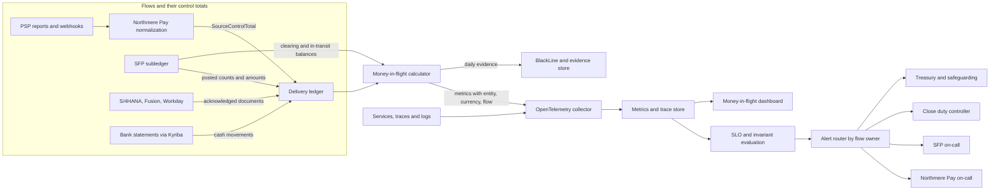
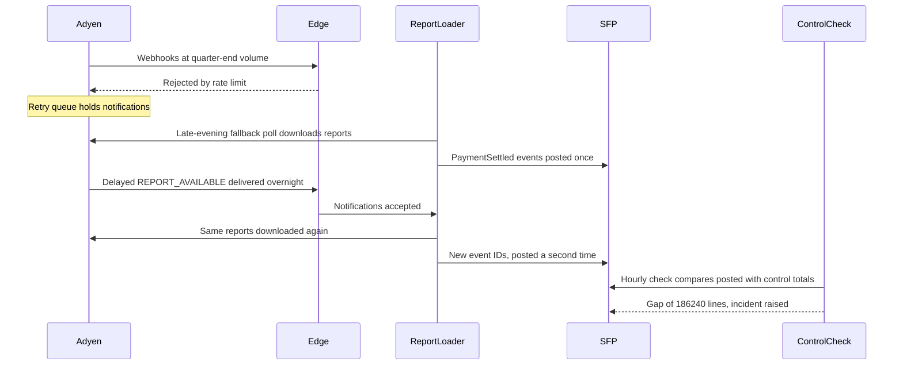
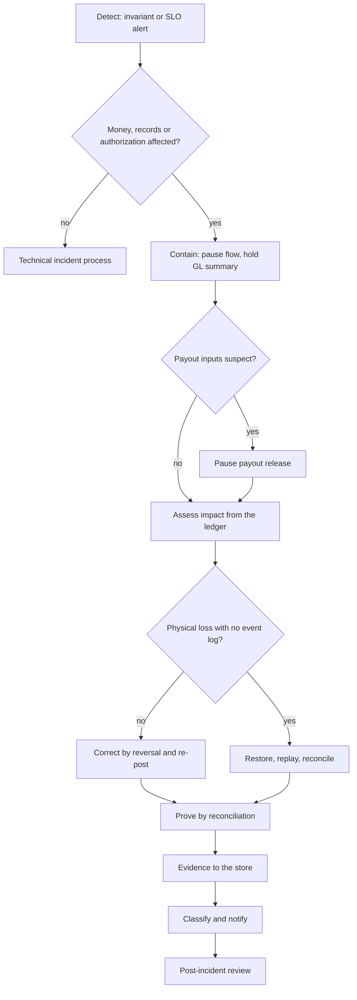

{id: resilience-and-security}
# 44. Resilience, Observability, Security and Recovery for Finance Systems

> **IN THIS CHAPTER, YOU WILL:** Learn how to set criticality tiers and recovery objectives for finance systems that follow the close calendar and the movement of money, which resilience patterns protect money movement, how to observe financial flows in money rather than in CPU, and how to respond to a financial incident. The worked example is a quarter-end duplicate-posting incident at Northmere, caught by control totals and corrected without a restore.

> **WHY FINANCE CARES:** A finance system that is up but wrong is worse than one that is down, because nobody stops to check it. The controller needs to know at any hour how much money is between systems, whether every flow is complete, and that a correction will leave evidence the auditor and the regulator can follow.

> **WHY ARCHITECTS SHOULD CARE:** Standard resilience practice protects availability and assumes that a backup restores the truth. In finance, the dangerous failures are logical: duplicates, gaps and wrong rules that replication copies faithfully. Recovery objectives, observability and incident response all have to be redesigned around correctness, and for a regulated payments entity the EU's Digital Operational Resilience Act makes that design a legal obligation.

> **KEY POINTS:**
>
> * **Criticality follows money and the calendar.** Tier finance systems by what their failure does to money movement, safeguarded funds and the close, and raise a system's tier during the days it sits on the close's critical path. A consolidation platform that can be down for a day on the fifteenth of the month cannot be down for an hour on working day seven.
> * **Observe money in flight, and give correctness no error budget.** Control totals, clearing-account aging and completeness equations are telemetry, routed to the owner who can act. Timeliness gets service level objectives and error budgets; completeness and balance are invariants, and every breach is an incident.
> * **A financial incident is corrected by entries, not by restore.** Replication and point-in-time recovery reproduce or erase history; they do not fix it. Contain the flow, quantify the impact from the ledger, reverse and re-post through an approved path, prove the result by reconciliation, and keep the evidence. A restore is the last resort, and a restore test passes only when the restored books reconcile.

> **[FAILURE PATTERNS THIS CHAPTER ADDRESSES](#where-finance-architecture-goes-wrong):**
>
> * **Nobody's Bot** — repair scripts that update ledger rows in place during an incident move the books with no approval, no population and no evidence.
> * **The Suspense Swamp** — the residue of incidents (duplicates, parked events, unexplained clearing balances) is left in clearing and suspense accounts long after the systems recover.
> * **Audit Archaeology** — incident evidence is reconstructed weeks later from chat logs, when the auditor or the supervisor asks how a correction was approved.

Most resilience engineering asks one question: is the service available? Finance asks two more: **is the money where the records say it is, and is every record there?** A payment platform can answer every request in 80 milliseconds while posting each settlement twice. A database can fail over without losing a byte and faithfully replicate a posting rule that has been wrong since Tuesday. The failures that hurt finance are usually not outages. They are **logical errors in systems that look healthy**.

This chapter treats resilience, observability, security and recovery as one design problem for the finance estate. Its organizing idea is the **financial incident**: an event in which the records or money movements the enterprise relies on are, or may be, wrong, incomplete, late or unauthorized, whether or not any system is down. Financial incidents need a different response from technical ones, because the remedy is an accounting entry with an approver, not a rollback.

The chapter builds on two others. [Controls, Auditability and Security by Design](#controls-and-auditability) set the security baseline for finance systems (identity, privileged access, secrets, segregation of duties) and the evidence rules; here they are applied, not repeated. [Designing Custom Ledgers and Financial Event Processing](#designing-financial-ledgers) designed the reversal job and the six money-in-flight signals for one subledger; this chapter generalizes them into an estate-wide practice and owns the term **business observability**.

{id: resilience-and-security--setting-the-scene-at-northmere-01-40-on-the-first-day-of-the-close}
## Setting the Scene at Northmere: 01:40 on the First Day of the Close

Northmere, the fictional group this book follows, closes its third quarter on Thursday 30 September 2027. Quarter-end is the busiest day in Northmere Pay's calendar: Stayloft's late-September booking volumes are high, partner payout batches are larger than usual, and every ledger is preparing the summaries that the close will depend on from working day 1 (WD1).

At 17:40 that Thursday, the edge rate limit in front of Northmere Pay's webhook receiver, set in 2025 at twice the average daily load, starts rejecting Adyen's notifications. Adyen does what its documentation says it will: undelivered webhooks go to a retry queue with intervals ["from 30 seconds up to 8 hours", for up to 30 days](https://docs.adyen.com/development-resources/webhooks/troubleshoot). Nothing is lost, but the notifications arrive hours late. Among them are the `REPORT_AVAILABLE` messages that tell the report loader a settlement details report is ready.

At 23:30 the report loader's fallback poll, built for exactly this case, downloads the settlement reports for the batches that closed that day. At 01:40 on Friday, the delayed notifications finally arrive, and the loader downloads the same two reports again. Two defects, each harmless alone, line up. The loader mints a new `event_id` for every line of a new download, and a release of the Stayloft Finance Platform (SFP) two weeks earlier had added the recording date to the duplicate-detection key for `PaymentSettled`. **186,240 settlement lines, worth €41,372,618.40, are posted a second time** into the merchant subledger that went live on 1 September.

At 02:00 an hourly completeness check, switched on for period-end, compares what SFP posted with the control totals that Northmere Pay's normalization service published for the same batches. The numbers do not close. By 07:05 the duplicates are reversed and proven, before any of them reach the general ledger. The rest of this chapter explains why the check existed, why nobody restored a database, and what Dana Whitlock, the Chief Architect, made of the incident afterwards.

{id: resilience-and-security--concepts-outages-financial-incidents-and-recovery-objectives}
## Concepts: Outages, Financial Incidents and Recovery Objectives

{id: resilience-and-security--availability-failures-and-correctness-failures}
### Availability failures and correctness failures

| | Availability failure | Correctness failure |
| --- | --- | --- |
| **What happens** | A service is down, slow or unreachable | A service runs and produces wrong, duplicated, missing or late records |
| **How it is noticed** | Health checks, error rates, latency | Control totals, reconciliations, clearing balances, or a person asking why a number moved |
| **Typical time to detect** | Seconds to minutes | Hours to weeks, unless designed otherwise |
| **What replication does** | Protects | Copies the error |
| **Recovery** | Failover, restart, capacity | Containment, then correcting entries proven by reconciliation |
| **Who decides it is over** | The on-call engineer | The controller, on evidence |

**Figure 1:** *A system that is down is noticed in minutes; a system that is up but wrong looks healthy while it posts duplicates, which is why correctness needs its own detection.*

The Google *Site Reliability Engineering* book defines the **error budget** as the gap between 100% and the service level objective: releases continue while budget remains and pause when it is spent ([Google SRE, "Embracing Risk"](https://sre.google/sre-book/embracing-risk/)). That model fits availability and timeliness. It does not fit posted money. **No finance team accepts that 0.1% of settlement lines may be posted twice.** Correctness is an invariant, and a breach is an incident however small.

{id: resilience-and-security--the-financial-incident}
### The financial incident

I define a **financial incident** as any event that makes the financial records or money movements an entity relies on wrong, incomplete, late beyond a committed deadline, or unauthorized, or that makes it impossible to show they are right. Four properties set it apart from an ordinary technical incident:

1. **It may have no technical symptom.** The Northmere duplicate raised no error and no latency alarm.
2. **Its impact is measured in money, entities and periods**, not in minutes of downtime.
3. **It is resolved by accounting**: entries, approvals and reconciliations, inside the period rules of [Designing Custom Ledgers and Financial Event Processing](#designing-financial-ledgers).
4. **It can carry regulatory and audit consequences** independent of its technical size: a safeguarding shortfall, a misstatement, a deficiency in a control.

Many financial incidents are also ICT incidents, and for a regulated entity some must be classified and reported as such. The two classifications run in parallel and use the same facts.

{id: resilience-and-security--recovery-time-and-recovery-point}
### Recovery time and recovery point

The **recovery time objective (RTO)** is how long a function may be unavailable before the consequences become unacceptable. The **recovery point objective (RPO)** is how much recently written data may be lost when the function is recovered. Both are business requirements set per function; DORA requires financial entities to determine them [for each function](https://eur-lex.europa.eu/eli/reg/2022/2554/oj/eng), taking criticality into account (Article 12).

AWS's disaster recovery guidance orders four strategies from cheapest and slowest to most expensive and fastest: backup and restore, pilot light, warm standby, and multi-site active/active. It also notes that even active/active has a non-zero recovery point for **data corruption**, which needs point-in-time backups ([AWS, *Disaster Recovery of Workloads on AWS*](https://docs.aws.amazon.com/whitepapers/latest/disaster-recovery-workloads-on-aws/disaster-recovery-options-in-the-cloud.html)). For a ledger, I add a third objective that the infrastructure vocabulary lacks: **recovery proof**, the reconciliation that must close before a recovered system may be used for money or reporting again.

{id: resilience-and-security--criticality-tiers-tied-to-money-and-the-close}
## Criticality Tiers Tied to Money and the Close

A tiering scheme is only useful if it predicts what to protect first and how much to spend. For finance, the predictor is the consequence of failure for **money movement**, **regulated funds** and **the close**. Northmere's scheme, agreed by Dana with Leila Haddad (Chief Accounting Officer), Ingrid Solberg (Managing Director, Northmere Pay) and Marco Bellini (CISO) in mid-2027, has four tiers.

| Tier | Definition | Consequence of failure | Northmere examples |
| --- | --- | --- | --- |
| **0 — Money movement and regulated funds** | Moves, holds or safeguards money, or instructs a bank or PSP to do so | Customers cannot pay, partners are not paid, safeguarded funds cannot be shown to cover what is owed; regulatory breach within hours | Northmere Pay acceptance and routing; payout execution; traveler funds ledger; Kyriba payment factory and bank connectivity |
| **1 — Books of record and close-critical** | Holds the books, or sits on the close's critical path | Close slips; reporting deadline at risk; balances cannot be relied on | SAP S/4HANA, SAP FI-CA, SFP merchant subledger, Oracle Fusion (Wayfare), Workday Financials (Tablekin), Northmere Pay settlement normalization, Kafka backbone |
| **2 — Finance operations** | Supports finance processes that tolerate a delay of a day or more | Backlogs, late supplier payments, manual workarounds | Coupa, SAP Concur, Vertex outside invoicing peaks, BlackLine outside the close |
| **3 — Analysis and reporting** | Reads finance data; can be rebuilt from sources | Delayed insight; no record loss | FinDB on Snowflake, finance reports, planning outside the forecast cycle |

The important rule is the last column of the next table. **Criticality is a function of the calendar.** OneStream is a tier 2 system on the fifteenth of the month and a tier 1 system from WD−2, when preliminary trial balances start loading, to WD9, when entities are locked. Workiva is tier 2 for eleven months and tier 1 in the weeks before a 10-Q or 10-K filing. BlackLine moves up from WD1 to WD5, when reconciliations and Transaction Matching carry the close.

| System | Base tier | Elevated tier | When elevated |
| --- | --- | --- | --- |
| BlackLine | 2 | 1 | WD1 to WD5 of every close |
| OneStream | 2 | 1 | WD−2 (first preliminary trial-balance load) to WD9 (lock) |
| Workiva | 2 | 1 | Filing weeks for 10-Q and 10-K |
| Vertex | 2 | 1 | Commission invoicing runs and e-invoicing clearance windows |
| Kyriba | 0 | 0 | Always; payment cut-offs make every working day critical |

**Figure 2:** *Criticality is a function of the calendar: the consolidation platform is tier 2 on the fifteenth of the month and tier 1 from WD−2 to WD9, when the close depends on it.*

A tier sets four things at once: the recovery objectives, the redundancy pattern, the change rules (freeze windows apply to tiers 0 and 1, and to elevated systems during their elevated days), and the observability required. A system without a tier gets the defaults of tier 1 until someone argues it down, which turns an inventory gap into a visible cost.

{id: resilience-and-security--recovery-objectives-across-the-estate}
## Recovery Objectives Across the Estate

The table shows Northmere's requirements as Dana's team recorded them in LeanIX in 2027. The figures are Northmere's illustrative requirements, not vendor commitments; for each SaaS platform the contract's commitment is recorded next to the requirement, and a gap is either accepted by the business owner or closed by a compensating design.

| System | Tier | Operated by | RTO (normal / peak) | RPO | Recovery mechanism | Northmere's own recovery duty |
| --- | --- | --- | --- | --- | --- | --- |
| Northmere Pay acceptance and routing | 0 | Northmere (cloud, two regions active/active) | 5 min / 5 min | 0 for accepted payments | Regional failover; route new card and APM traffic to the second PSP | Prove PSP records and canonical events agree after failover |
| Payout execution | 0 | Northmere | 4 h / 2 h | 0 for instructions | Warm standby; idempotent payout IDs | Never re-instruct without checking bank and PSP status |
| Traveler funds ledger and SFP merchant subledger | 0 / 1 | Northmere | 4 h / 2 h (WD1–WD3) | 5 min from database; 0 after replay of events | Point-in-time recovery plus replay from the event store | Reconcile restored journal to control totals before use |
| Kafka event backbone | 1 | Platform Engineering | 1 h / 1 h | 0 for acknowledged writes | Replicated clusters | Retention long enough to replay a full close |
| SAP S/4HANA and FI-CA | 1 | SAP under RISE (infrastructure, backup, DR); Northmere (application) | 8 h / 4 h | Per contract, compared with a 15-minute requirement | Provider DR | Re-send documents posted inside the RPO window; business recovery test |
| Oracle Fusion (Wayfare), Workday Financials (Tablekin) | 1 | SaaS provider | 24 h / 8 h | Per contract | Provider DR | Same as S/4HANA |
| Kyriba | 0 | SaaS provider | 4 h / 2 h | Per contract | Provider DR; banks' own channels as fallback | Payment status from bank acknowledgments, not from Kyriba's last state |
| BlackLine | 2 → 1 | SaaS provider | 24 h / 8 h | Per contract; inputs reloadable | Provider DR | Reload matching inputs; certifications re-evidenced |
| OneStream | 2 → 1 | SaaS provider | 24 h / 4 h | Per contract | Provider DR | Reload trial balances; rerun consolidation from locked inputs |
| Vertex | 2 → 1 | SaaS provider | 4 h with fallback active | Request log | Tax service adapter fallback | True-up of fallback determinations |
| FinDB on Snowflake | 3 | SaaS provider, Owen Mbeki's team | 24 h / 24 h | Rebuildable | Rebuild from sources | Re-run tie-outs before governed metrics are published |

Two columns deserve comment.

**"Operated by" is not "responsible for".** Under RISE, SAP operates the infrastructure, database, backups and disaster recovery; Northmere owns everything that makes the system correct for Finance, including interfaces and period-end operations ([SAP S/4HANA: The Enterprise Finance Core](#sap-s4hana) sets out the split). The same holds for every SaaS platform. The vendor recovers *its* platform to *its* recovery point. Northmere recovers the business process, and that is the column most continuity plans leave empty.

**The RPO window is an interface problem.** Suppose S/4HANA is recovered to a point 15 minutes before a failure. Every document that reached S/4HANA in those 15 minutes is gone, but each sender's logs show it as delivered. Unless something reconciles, the gap is permanent and silent. Northmere's answer is the **delivery ledger** from [Integration Architecture for Finance](#integration-architecture): each finance interface records, per source and day, what it sent, what was acknowledged and with which document number. After a provider recovery, the integration team compares the delivery ledger with what the recovered system holds and re-sends the difference using the original idempotency keys, so a document that did survive is not posted twice. **A SaaS recovery is complete when the delivery ledger reconciles, not when the vendor's status page turns green.**

{id: resilience-and-security--resilience-patterns-for-money-movement}
## Resilience Patterns for Money Movement

Money-moving systems need the familiar resilience patterns, applied with one extra constraint: **a retry must never become a second payment, and a fallback must never become an unrecorded decision.**

| Pattern | What it protects | Northmere application | The finance trap |
| --- | --- | --- | --- |
| **Idempotency keys from business identity** | Retries and redeliveries produce one effect | Payout instruction IDs, `event_id` derived from the PSP reference, batch and journal type; posting keys in SFP | A key minted per attempt or per download, as in the quarter-end incident, satisfies the API and defeats the purpose |
| **Retries with exponential backoff and jitter** | Transient failures recover without overload | All PSP, bank and ERP calls; Stripe recommends backoff with jitter alongside its `Idempotency-Key` header ([Leach, 2017](https://stripe.com/blog/idempotency)) | Retrying a payout whose outcome is unknown, instead of first asking the bank or PSP what happened |
| **Store, acknowledge, then process** | Senders are not blocked; nothing is lost while consumers are slow | Webhook receiver stores the raw message and returns 202; Adyen marks a webhook failing if not acknowledged [within 10 seconds](https://docs.adyen.com/development-resources/webhooks/handle-webhook-events) | An edge limit sized for an average day rejects the peak before the store sees it |
| **Durable queues and quarantine** | Bad or early messages wait with an owner instead of being dropped | Kafka topics; SFP quarantine as "a suspense account for events" | Quarantine without aging and owners becomes The Suspense Swamp |
| **Circuit breakers per flow** | A failing dependency or a suspect flow stops cleanly | Settlement intake per PSP and merchant account can be paused while other flows continue | One global switch that stops all postings at quarter-end |
| **Bulkheads by entity and provider** | One provider's or entity's failure does not drain shared capacity | Separate consumers per PSP; separate payout batches per currency and entity | Shared thread pools that let one slow provider block all others |
| **Graceful degradation with a recorded fallback** | The business continues on reduced function | Tax fallback, PSP failover, payout pausing (below) | A fallback that leaves no trace of which transactions used it |

{id: resilience-and-security--three-degradations-that-need-finance-s-consent}
### Three degradations that need finance's consent

**Tax engine fallback.** In May 2027 the design authority made Vertex the group standard for indirect tax, called only through a Northmere-owned tax service adapter with a fallback policy and a request log ([Around the Core: Tax, Treasury, Procurement and Reporting Platforms](#satellite-platforms)). The fallback is a business decision written down in advance: for commission invoices in markets without real-time clearance, the adapter applies the last confirmed rate for the same tax code and seller jurisdiction, marks the line `fallback=true`, and queues it for re-determination when Vertex returns; a difference is corrected by a credit note and reissue, not by editing the invoice. For markets where an e-invoice must be cleared by the tax authority before issue, there is no fallback: invoices wait in a queue, because issuing an uncleared invoice is worse than issuing it late. Kofi Asante's tax team owns the list of which markets are which.

**PSP failover through multi-PSP routing.** Northmere Pay routes new payments in-house between Adyen (about 68% of transactions) and Stripe (about 22%), with local providers for the rest. Failover works for **new cards and most alternative payment methods**, which can be sent to whichever provider is healthy. It does not work for **stored cards**: returning Stayloft travelers' cards are Adyen tokens, and Northmere Pay cannot route a stored card to a provider that does not hold its token ([Payments for Finance Architects: The Lifecycle of Money Movement](#payments-fundamentals)). During an Adyen degradation, a returning traveler is asked to enter the card again. The honest statement of Northmere's resilience is therefore "new-card acceptance survives a provider outage; stored-card checkout degrades to re-entry". The finance consequence is also planned: payments routed to Stripe land in Stripe clearing accounts and Stripe settlement, so the matching rules for the alternative route have to be live before the day they are needed. Northmere Pay's annual exercise of moving a market's traffic for a week ([Adyen: Single-Platform Acquiring and Platform Payments](#adyen)) tests routing and reconciliation together.

**Payout pausing.** When the integrity of payout inputs is in doubt (partner bank details, payout rules, partner payable balances), the safe state is to **pause release, not to guess**. Instructions remain as partner payables in the ledger, nothing is lost, and release resumes when the inputs are proven. Pausing has a cost: Northmere's 2027 on-time payout rate is 98.6% against a 99.5% target, and roughly 300,000 payouts a day leave in a normal week, so a pause is a partner-relations event and, for funds held by the e-money institution, a matter Ingrid's compliance team must assess. The decision rule Dana and Ingrid wrote down: **pause payouts when the inputs to the payout calculation are suspect; do not pause them when the incident is elsewhere.** In the quarter-end incident, they were not paused, and the reasoning is shown below.

{id: resilience-and-security--period-end-peak-engineering}
## Period-End Peak Engineering

Finance load follows the calendar. [Why Enterprises Build Their Own Finance Platforms](#custom-finance-platforms) noted that SFP's heaviest hours are the nightly summarization, the payout batches after weekends and the first working days of each month. The engineering response has three parts.

**Capacity tested on the calendar's worst day.** Northmere's performance tests use three load profiles, each recorded from production: an average day, a month-end WD1, and a quarter-end WD1. In 2027 the illustrative ratios against an average day were about 2.2 times for month-end and 2.8 times for quarter-end on SFP posting and summarization, and higher on webhook intake on the last day of the quarter. The quarter-end incident began with a limit sized against the average profile. After it, every tier 0 and tier 1 component's limits, pools and quotas are tested at **three times the quarter-end profile**, and the test is part of the release gate for changes that touch capacity.

**Freeze windows that freeze risk, not work.** Tier 0 and tier 1 systems, and elevated systems on their elevated days, are under a change freeze from WD−2 to WD3, and again around year-end. The freeze allows pre-approved standard changes, data fixes through approved application paths, and emergency changes through the normal pipeline with a named approver; it blocks feature releases and configuration changes to posting, payout and mapping rules. The error budget policy reinforces it: a flow whose timeliness budget is spent gets no non-urgent change until the reliability work is done. A freeze that blocks the emergency fix is a freeze that drives people to break-glass access, which [Controls, Auditability and Security by Design](#controls-and-auditability) treats as a warning sign when it becomes routine.

**Monitoring the close's critical path.** Dana's close walk in 2026 mapped the critical path: subledger feeds and accruals on WD1–2, settlement matching and intercompany on WD3–5, trial-balance load and consolidation on WD6–7, review and sign-off on WD8–9 ([The Chief Architect's Job: Coherence Across a Finance Estate](#chief-architect-role)). From the Q2 2027 close, that path is a monitored dependency graph: each step has an expected completion time, an upstream dependency and an owner. "SFP final daily summary acknowledged by S/4HANA by 06:00 WD1" is a node; "BlackLine reports key reconciliations certified for entity NL01" is another, and OneStream cannot lock an entity until it is green ([OneStream: Consolidation, Planning and Performance Management](#onestream)). A late node alerts the owner of the next node as well as its own, because the next owner is the one who has to re-plan. The close becomes a pipeline with service levels, which is what it is.

{id: resilience-and-security--business-observability-watching-money-in-flight}
## Business Observability: Watching Money in Flight

**Business observability** is the practice of instrumenting financial flows so that the estate reports, continuously and in money, how much value is between systems, how old it is, whether every flow is complete, and who must act when it is not. It complements, and does not replace, infrastructure observability.

OpenTelemetry is a vendor-neutral, open-source framework for traces, metrics and logs, and explicitly not a storage or visualization backend ([OpenTelemetry](https://opentelemetry.io/docs/what-is-opentelemetry/)). Northmere uses it for what it is good at: propagating the canonical `correlation_id` (the booking ID) and `event_id` across hops, so an engineer can follow one booking from webhook to subledger line to summary. **Tracing follows one transaction; control totals account for all of them.** A trace sampled at 1% says nothing about the 186,240 lines that were posted twice. The money signals therefore come from the ledgers and the delivery ledger, not from sampled telemetry.

**Figure 3:** *Money signals come from control totals and ledger balances, not from sampled telemetry. OpenTelemetry carries them alongside traces, but every alert is routed by financial flow to the owner who can act, and the same numbers become daily control evidence.*

{id: resilience-and-security--control-totals-as-telemetry}
### Control totals as telemetry

Every finance interface hop at Northmere carries **control totals**: record counts, amount totals per currency and a hash over identifiers ([Designing Custom Ledgers and Financial Event Processing](#designing-financial-ledgers) shows the SFP-to-S/4HANA summary batch). Historically they were checked once, at the receiving end, and thrown away. In a business-observability design they are **emitted as metrics**, per flow, entity, currency and business day, and the comparison between hops becomes a continuously evaluated equation:

*published = posted + deliberately not posted + quarantined + in flight*

When the equation does not close, money is missing or duplicated. When "in flight" grows older than its expected age, money is stuck. Both are measured in euros and counts, which the controller reads without translation. During period-end, Northmere evaluates the equation hourly instead of daily; that one setting is why the duplicates were caught in 20 minutes instead of at the WD1 tie-out.

{id: resilience-and-security--the-money-in-flight-dashboard}
### The money-in-flight dashboard

The dashboard Leila's and Ingrid's teams share has one row per flow and four numbers per row: value in flight, age of the oldest item, completeness gap, and clearing balance against expectation. The flows are the ones that cross ownership boundaries: PSP capture to settlement, settlement to bank, subledger to general ledger, payout instruction to bank confirmation, safeguarding requirement to safeguarded balance, brand ledgers to OneStream. Each has an owner from the end-to-end process owner list in [The End-to-End Finance Processes](#finance-processes).

{id: resilience-and-security--service-level-objectives-on-financial-flows}
### Service level objectives on financial flows

| Objective | Indicator | Target | Window | Owner | Type |
| --- | --- | --- | --- | --- | --- |
| Settlement posting timeliness | PSP settlement lines posted to the subledger within 4 hours of the provider's report being available | 99.9% | Monthly | Jonas Berg (SFP) | SLO with error budget |
| Subledger-to-GL timeliness | SFP daily summary acknowledged by S/4HANA by 06:00 WD1 and by 06:00 on other days | 99.5% of days; 100% on WD1 | Quarterly | Jonas Berg with Sven Aalto | SLO; WD1 is a close-path node |
| Partner payout timeliness | Payouts settled on the scheduled date | 99.5% (2027 baseline 98.6%) | Monthly | Ingrid Solberg | SLO with error budget |
| Cash visibility | Prior-day bank statements loaded and cash reported by 09:00 Amsterdam | 99% (2027 baseline 94%) | Monthly | Kofi Asante | SLO |
| Settlement completeness | Source control totals equal posted plus quarantined plus no-entry, per batch | 100% by T+1 | Daily | Jonas Berg | **Invariant; every breach is an incident** |
| Safeguarding reconciliation | Daily internal-versus-external safeguarding reconciliation completed and breaks explained | 100% by noon | Daily | Ingrid Solberg | **Regulatory invariant** |
| Clearing account integrity | No PSP clearing account with an unexpected sign or past its expected zero date beyond tolerance | 100% | Daily | Leila Haddad | **Invariant** |

The settlement-posting SLO is the example to remember. At about 1.3 million PSP settlement lines a day, roughly 39 million a month, a 99.9% target leaves an error budget of about 39,000 late lines a month. Lateness is tolerable within a budget; it costs a later reconciliation, not wrong money. The three invariants have no budget, because a duplicate, a gap or a wrong-signed clearing balance is not a degraded service but a wrong record.

{id: resilience-and-security--alerting-to-the-owner-who-can-act}
### Alerting to the owner who can act

A finance alert that goes to a generic operations channel is an alert nobody owns. Northmere's router reads the flow, entity and failure type from each signal and sends it to the owning on-call engineer and, above a value threshold (in 2027, €1 million absolute or any safeguarding signal), also to the **close duty controller**, a rotating role in Leila's team during WD−2 to WD5 and an on-call role at other times. The controller's job in an incident is not to debug; it is to decide what the books can tolerate and to approve the correction. [Organizing Architecture Ownership Across Finance, Engineering, Security and Data](#organizing-for-architecture) returns to why that role has to exist on the finance side of the org chart.

{id: resilience-and-security--recovery-for-ledgers-why-restore-is-the-last-resort}
## Recovery for Ledgers: Why Restore Is the Last Resort

A **point-in-time restore** returns a database to its state at an earlier moment. For a ledger, that is almost never the right response to a logical error, for four reasons.

1. **It erases good work along with bad.** Every legitimate posting after the restore point disappears, across every entity in the database.
2. **It erases the evidence.** The wrong entries, which the auditor may later need to see, vanish; the books no longer show what was posted and corrected.
3. **The world has already read the books.** Summaries reached the general ledger, BlackLine matched against balances, FinDB copied them, and payouts were instructed from them. Restoring one system makes it disagree with all the others.
4. **It does not fix the cause.** The defective rule or consumer runs again after the restore unless it is fixed first.

The alternatives, in order of preference for a logical error:

| Approach | How it works | Preserves evidence | Effect on downstream systems | When it is right |
| --- | --- | --- | --- | --- |
| **Reversal and re-post** | Select the affected population by query; post exact reversals; re-post correctly from stored events; prove with control totals | Yes; original, reversal and re-post all remain | Downstream receives corrections as ordinary postings | Default for any wrong, duplicated or misclassified entries |
| **Difference adjustment** | Post only the net difference | Partially; detail of the error is less visible | Same | Revaluations and true-ups where the original entry was right when made |
| **Re-derivation from the event log** | Rebuild a ledger or projection by replaying stored events through the current rules into a new store, then compare | Yes, if the old store is kept | Requires a controlled switch-over | Corrupted projections and balances; rebuilding after a physical loss; testing |
| **Point-in-time restore** | Return the database to an earlier state | No | Breaks consistency with every system that read it | Physical corruption or destruction where no event log can rebuild the data; then followed by replay and reconciliation |

**Figure 4:** *A restore rewinds the books and erases good postings and evidence alike; a reversal adds one correcting entry per wrong entry, keeps the trail, and is proven by reconciliation.*

[Designing Custom Ledgers and Financial Event Processing](#designing-financial-ledgers) defines the reversal job: the population selected by query and recorded with its control totals before anything is posted, one reversal entry per affected entry with a `reverses_entry_id`, re-posting from stored events, and a proof presented to the controller. It also warns, following Martin Fowler, that replay must not re-send instructions to external systems; in SFP only the payout engine moves money, so re-deriving the journal cannot trigger a payout.

{id: resilience-and-security--restore-testing-with-reconciliation-as-the-pass-criterion}
### Restore testing with reconciliation as the pass criterion

Restores are still necessary for physical failures, and DORA requires financial entities to test backup and restoration procedures periodically (Article 12) and to test continuity plans at least yearly (Article 11(6)) ([Regulation (EU) 2022/2554](https://eur-lex.europa.eu/eli/reg/2022/2554/oj/eng)). The weak version of a restore test checks that the database starts and the row count looks plausible. The finance version passes only when **the restored books reconcile**.

Northmere's November 2027 restore test of the SFP merchant subledger (illustrative) ran in an isolated environment:

1. Restore the journal from the backup of 31 October 2027, 23:59.
2. Replay the canonical events recorded from 1 to 14 November from the event store through the same rule versions, about 42 million subledger lines.
3. Compare the result with production by entity, account, currency and day, and run the daily SFP-to-S/4HANA tie-out against the restored copy.
4. Pass criterion: zero differences in balances and in tie-out; every control total closes.

The test passed, in 6 hours 10 minutes, against a 4-hour RTO. It also found the finding that made it worth running: one Kafka topic carrying Stayloft refund events had a retention of seven days, so a restore from a backup older than a week could not have been replayed. Retention was raised to 35 days for every topic that feeds a ledger, enough to replay a full close from the last month-end backup, and the replay was made parallel by entity to bring the time under the RTO. **A restore test that does not reconcile would have reported success.**

{id: resilience-and-security--in-practice-the-quarter-end-duplicate}
## In Practice: The Quarter-End Duplicate

The timeline below is the incident from the opening, as Northmere's incident record shows it (all times Amsterdam).

**Figure 5:** *Two defects that were harmless alone combined under peak load: event IDs minted per download, and a duplicate key that included the recording date. Adyen's retries worked as documented; the control total check, not the infrastructure, caught the result.*

| Time | What happened | Who |
| --- | --- | --- |
| Thu 17:40 | Edge rate limit starts rejecting Adyen webhooks at quarter-end volume | — |
| 18:05 | Webhook acceptance alert to Northmere Pay on-call; treated as an availability issue | Northmere Pay on-call |
| 22:50 | Limit raised; backlog drains as Adyen's retry intervals elapse | Northmere Pay on-call |
| 23:30 | Fallback poll downloads the settlement reports for `NMPay_Stayloft_EEA` and the euro batch of `NMPay_Stayloft_INTL`; lines post once | Report loader |
| Fri 01:40 | Delayed `REPORT_AVAILABLE` notifications trigger a second download; 186,240 `PaymentSettled` lines post again | Report loader, SFP |
| 02:00 | Hourly completeness check fails for both batches; PSP clearing – Adyen shows an unexpected credit balance in both merchant accounts | Control check |
| 02:20 | Incident declared; amount above €1 million, so the close duty controller is paged | SFP on-call lead as incident commander |
| 02:35 | Settlement intake for Adyen reports paused (other flows continue); SFP-to-S/4HANA summary for 30 September held | SFP on-call |
| 02:50 | Payouts assessed and not paused; treasury informed | Close duty controller, Northmere Pay |
| 04:10 | Population identified by download receipt; control totals recorded | SFP engineers |
| 06:30 | Reversal job approved by the close duty controller and the SFP engineering lead | Two approvers |
| 06:45 | 186,240 reversal lines posted to September, still open | SFP |
| 07:05 | Proof: completeness equation closes; clearing accounts back to expectation; hotfix to the duplicate key deployed through the pipeline as an emergency change; intake resumed | SFP, close duty controller |
| 09:40 | 30 September summary sent to S/4HANA, acknowledged at 09:52; target was 06:00 | SFP, Sven Aalto's team |
| 11:00 | Classification under DORA and the internal incident policy | Marco Bellini's team, Northmere Pay compliance |

{id: resilience-and-security--the-entries}
### The entries

Under the merchant-model rules, `PaymentSettled` debits Bank – safeguarding and credits PSP clearing – Adyen; for the Lisbon booking that was €598.26 on 14 March, the date the payment was booked into Adyen's settlement batch (the batch's bank credit followed on 16 March and is matched separately). The duplicates therefore overstated the ledger's safeguarding bank balance and drove the clearing account to an impossible credit. The correction, posted in September because the period was still open:

| Account | Debit | Credit | Note |
| --- | --- | --- | --- |
| PSP clearing – Adyen (`NMPay_Stayloft_EEA`, EUR) | 33,816,207.15 | | Reverses 151,904 duplicated lines |
| Bank – safeguarding (EUR) | | 33,816,207.15 | |
| PSP clearing – Adyen (`NMPay_Stayloft_INTL`, EUR) | 7,556,411.25 | | Reverses 34,336 duplicated lines |
| Bank – safeguarding (EUR) | | 7,556,411.25 | |
| **Total** | **41,372,618.40** | **41,372,618.40** | One reversal line per duplicated line, each with `reverses_entry_id`; summarized here |

No re-post was needed: the first posting of each line was correct. The proof had three parts: reversals equal the recorded population line for line; posted settlement lines now equal the normalization service's control totals per batch; and both clearing accounts returned to the balances the open captures and fees explain.

{id: resilience-and-security--assessing-the-financial-impact}
### Assessing the financial impact

The close duty controller's assessment, written into the incident record before the correction was approved:

- **Money moved:** none. No payment, refund or payout was created from the duplicates.
- **Payouts:** not affected. The payout engine reads Partner payables, which `PaymentSettled` does not touch; pausing roughly 300,000 payouts on a Friday would have harmed partners for no protective benefit.
- **Safeguarding:** actual safeguarded funds and the safeguarding requirement (traveler funds held, unaffected) were correct; only the ledger's view of the safeguarding bank balance was overstated, for about five hours, and the daily safeguarding reconciliation for 1 October ran after the correction.
- **Reporting:** no effect. The duplicates were reversed in the subledger before the summary reached S/4HANA, and before September's soft close.
- **Profit and loss:** none; balance-sheet accounts only.
- **Timeliness:** the WD1 summary was 3 hours 40 minutes late; the close plan absorbed it. The settlement-posting SLO's October budget of about 39,000 late lines was exhausted on its first day, with about 58,000 lines beyond four hours, which froze non-urgent changes to the settlement intake until the post-incident actions were done.

{id: resilience-and-security--notification-and-classification}
### Notification and classification

Northmere Payments B.V. is a financial entity under DORA, which requires a process to classify ICT-related incidents against criteria including the clients and counterparts affected, duration, geographical spread, **data losses** (covering integrity as well as availability and confidentiality), criticality of the services affected and economic impact (Article 18), and to report **major** incidents to the competent authority (Article 19). The detailed thresholds sit in Commission Delegated Regulation (EU) 2024/1772. If an incident is classified as major, Commission Delegated Regulation (EU) 2025/301 sets the clock: an initial notification within four hours of classification and no later than 24 hours after becoming aware of the incident, an intermediate report within 72 hours of the initial notification, and a final report within a month of the latest intermediate report ([Delegated Regulation (EU) 2025/301, Article 5](https://eur-lex.europa.eu/eli/reg_del/2025/301/oj/eng)).

The classification is a compliance judgment, not an architecture one. In this illustration Northmere Pay's compliance function, with Marco's team, recorded the event as an ICT-related incident affecting data integrity in a system supporting a critical function, assessed each criterion, and concluded it was not major: no client was affected, no money moved, the integrity effect was internal and corrected within hours. The reasoning was documented and kept. **The architectural point is that the classification took one hour, because every fact it needed (population, amounts, duration, client impact) was already in the incident record.** Mei Tanaka's Internal Controls team also assessed whether the change that weakened the duplicate key indicated a deficiency in SFP's change controls; it was approved and tested under the remediated pipeline, but the test suite had no case for redelivery across recording days.

{id: resilience-and-security--what-changed-afterwards}
### What changed afterwards

The post-incident review on 6 October produced five actions, each with an owner and a date:

1. Event IDs from the report loader derive from the provider's batch, journal type and line reference, never from the download (Lucía Romero, the integration lead, as a canonical-event contract rule).
2. The `PaymentSettled` duplicate key is restored and protected by a property-based test that delivers every event twice, across different recording days (Jonas Berg).
3. Edge and intake limits on tier 0 and tier 1 paths are load-tested at three times the quarter-end profile (Ingrid Solberg).
4. Webhook backlog age at the edge becomes a money-in-flight signal, so a delayed notification is visible as delayed money (Ingrid Solberg).
5. A standing **duplicate-injection** experiment runs weekly in the pre-production environment: replayed reports and redelivered webhooks must leave the completeness equation closed.

The last action is chaos engineering applied to correctness. The *Principles of Chaos Engineering* describe experiments that start from steady-state behavior, vary real-world events and minimize blast radius ([principlesofchaos.org](https://principlesofchaos.org/)). For finance, the steady state is a closed completeness equation and clearing accounts at their expected balances; the real-world events are duplicates, late files, out-of-order webhooks and provider outages. I do not recommend running such experiments against production money flows. I do recommend running them continuously against production-shaped data, because the incident above was exactly such an experiment, run by accident.

{id: resilience-and-security--the-financial-incident-playbook}
## The Financial Incident Playbook

The playbook below is the one Dana's team, Leila's close team and Marco's security team agreed after the incident. It applies to any financial incident, whatever its technical cause, including security incidents that touch financial data or payment instructions.

| Phase | The question | Actions | Owner | Evidence produced |
| --- | --- | --- | --- | --- |
| **Detect** | Is a record or money movement wrong, missing, late or unauthorized? | Invariant or SLO alert; reconciliation break; report from finance or a partner | Flow owner's on-call | Alert with flow, entity, currency, amount |
| **Contain** | How do we stop it growing without stopping what is healthy? | Pause the affected flow (circuit breaker); hold summaries to the GL; pause payouts only if payout inputs are suspect; revoke access or rotate keys if unauthorized | Incident commander with close duty controller | Time-stamped containment decisions |
| **Assess financial impact** | Which entities, accounts, periods, currencies and counterparties, and how much? | Query the population from the ledger; record control totals; check safeguarding, payouts, reporting and P&L effects | Close duty controller | Population file and impact statement, approved |
| **Correct by entries** | What entries make the books right? | Fix the cause first; reversal and re-post job through the approved application path; never in-place updates | Engineering lead, approved by controller | Job record with approvals; entries with `reverses_entry_id` |
| **Prove** | Do the books now reconcile? | Completeness equation; clearing balances; subledger-to-GL tie-out; bank and safeguarding reconciliation | Controller | Reconciliation results attached to the incident |
| **Evidence** | Can an auditor or supervisor follow it without us? | Incident record in the evidence store, linked to control IDs and change records | Internal Controls receives | Complete, tamper-evident record |
| **Notify** | Who must know, by when? | Classify under DORA and internal policy; inform the audit committee chain if a control deficiency is possible; inform partners or customers if they were affected | Compliance, CISO, controller | Classification with reasoning; any reports filed |
| **Learn** | What would have prevented or caught it earlier? | Post-incident review; actions with owners and dates; new invariant tests or experiments | Flow owner with architecture | Review record; tracked actions |

**Figure 6:** *The financial incident path. Restore appears only on the branch where no event log can rebuild the data, and every path ends in a reconciliation that proves the result before evidence and notification.*

{id: resilience-and-security--security-architecture-for-finance-concisely}
## Security Architecture for Finance, Concisely

[Controls, Auditability and Security by Design](#controls-and-auditability) set the baseline: single sign-on for every finance system, no standing privileged access, secrets in a vault, encryption, a data-residency register, and segregation of duties analyzed across systems. Four areas need finance-specific design beyond it.

**Privileged access to ERPs and payout configuration.** The most dangerous rights in the estate are not database administrator rights; they are the business-configuration rights that change where money goes or how it is accounted for: payout rules, posting rules, account mappings, bank account masters, PSP payout settings, and ERP firefighter roles. At Northmere these are held as approved, versioned data with maker-checker approval, and elevated access to them is time-limited and session-recorded, as in the SFP remediation. Marco's addition in 2027 is to treat PSP and bank portals the same way: Adyen and Stripe dashboard roles that can change payout settings, and Kyriba roles that can approve payments, are privileged access under the same tool, reviewed quarterly.

**Payment-fraud controls on bank detail changes.** The most common way to steal from a finance estate is to change a bank account, not to break encryption: a supplier's or partner's details are altered, by an attacker who took over the account or by social engineering, shortly before a payment. The architectural control is a single authoritative path per counterparty type (Coupa onboarding for suppliers; Northmere Pay for partner bank and KYC attributes from 2028; Kyriba for Northmere's own bank accounts) plus four checks on every change: independent verification through a known channel, a cooling-off hold on the first payout to a changed account, anomaly signals (a change shortly after a contact-detail change, or from an unusual location), and a name check against the account where available. For euro credit transfers, EU payment service providers have had to offer **verification of payee** since 9 October 2025 under the Instant Payments Regulation ([ECB, 2025](https://www.ecb.europa.eu/press/intro/news/html/ecb.mipnews250310.en.html)); Kofi's treasury team uses it for outgoing payments, but it complements the change control rather than replacing it.

**PCI scope minimization via tokenization.** The Payment Card Industry Data Security Standard (PCI DSS) v4.0.1 is the current version; its future-dated requirements took effect on 31 March 2025 ([PCI SSC](https://blog.pcisecuritystandards.org/just-published-pci-dss-v4-0-1)). Northmere Pay stores no card numbers: cards are captured in PSP-hosted fields and SDKs and stored as PSP tokens, which keeps the payments platform, SFP and every finance system out of the cardholder-data environment ([Payments for Finance Architects: The Lifecycle of Money Movement](#payments-fundamentals)). Two cautions keep the scope honest. The checkout pages that embed the PSP fields still carry PCI obligations, including the v4 requirements on payment-page scripts, so the exact self-assessment applicable should be confirmed against the current PCI SSC text. And any future plan to run a merchant-controlled vault, for example to make stored cards portable between PSPs, would bring Northmere's own systems into scope; that is a trade between resilience and security scope that [Vendor Strategy and Avoiding Excessive Dependency](#vendor-portfolio-strategy) has to weigh, not an engineering detail.

**Secrets, keys and data residency.** The payout API keys, PSP report credentials and bank-connectivity certificates are tier 0 assets: rotated automatically, scoped to one function, never readable by humans in production, and monitored for use from unexpected workloads. Encryption keys for ledgers are themselves recovery dependencies; a restore test that cannot reach the key service is a failed test. Residency is a register, not a reflex ([Controls, Auditability and Security by Design](#controls-and-auditability)): DR regions for each ledger are chosen with Tax and Legal, because a failover to another region is also a transfer.

{id: resilience-and-security--dora-at-the-architecture-level-for-northmere-pay}
## DORA at the Architecture Level for Northmere Pay

The **Digital Operational Resilience Act (DORA)**, Regulation (EU) 2022/2554, has applied since 17 January 2025 to financial entities including payment and e-money institutions ([EIOPA](https://www.eiopa.europa.eu/digital-operational-resilience-act-dora_en)). It applies to Northmere Payments B.V., not to the group as a whole: DORA does not reach Stayloft B.V. or the listed parent because they are large. But the e-money institution runs on group systems, so its obligations shape group architecture. Northmere Payments UK Ltd falls under the UK's own operational resilience rules, which compliance maps separately. What follows is the architecture reading; legal interpretation belongs to compliance and counsel.

| DORA area | What the regulation requires (in brief) | What it means for Northmere's architecture |
| --- | --- | --- |
| **ICT risk management** | A documented framework; business continuity and response and recovery plans tested at least yearly (Art. 11(6)); backup and restoration procedures with periodic testing; recovery time and recovery point objectives for each function (Art. 12) | The tiering and RPO/RTO table above, kept per function of the e-money institution (acceptance, safeguarding, payouts, regulatory reporting); restore tests with reconciliation as the pass criterion count as evidence |
| **Incident management and reporting** | A process to detect, classify and record ICT-related incidents; reporting of major incidents to the competent authority (Arts 17–19), with time limits in Delegated Regulation 2025/301 | The financial incident playbook includes the classification step; incident records hold the facts the criteria need; the four-hour clock runs from classification, so classification must be fast |
| **Digital operational resilience testing** | A testing program; appropriate tests at least yearly on ICT systems supporting critical or important functions (Art. 24(6)); threat-led penetration testing (TLPT) at least every three years for entities the competent authority identifies (Art. 26) | Annual tests of payments, safeguarding and payout systems; the PSP failover exercise; restore tests; Northmere plans architecture and test environments so that a TLPT could be run if De Nederlandsche Bank requires it |
| **ICT third-party risk** | A register of information on all contractual arrangements for ICT services, at entity, sub-consolidated and consolidated level (Art. 28(3)); exit strategies for ICT services supporting critical or important functions (Art. 28(8)); contract terms including termination rights and, for critical or important functions, an adequate transition period (Art. 30) | The register covers Adyen, Stripe, the cloud provider, Kyriba, SAP under RISE (which keeps Northmere Pay's books), BlackLine, and intra-group services; exit plans and contract clauses exist for those supporting critical functions, and the exit plan for the PSPs is exercised yearly |

Three points deserve emphasis because they are commonly misread.

**Intra-group services count.** DORA defines an "ICT intra-group service provider" ([Article 3](https://eur-lex.europa.eu/eli/reg/2022/2554/oj/eng)). The Kafka backbone and identity platform run by Platform Engineering, whose engineers are employed by Northmere Technology Inc., are ICT services to Northmere Payments B.V. and belong in its register, with service levels and an understanding of how the entity would continue if the group service failed. Dana's team uses the LeanIX interface catalog to keep that register complete; a register assembled by procurement from contracts alone misses every internal dependency.

**Exit strategies apply to critical or important functions, not to every vendor.** A tested exit plan for Coupa is not a DORA obligation for the e-money institution, because Coupa does not support its critical functions. Overextending the obligation wastes effort that the PSP and ledger exit plans need. [Vendor Strategy and Avoiding Excessive Dependency](#vendor-portfolio-strategy) owns exit plans and the EU Data Act's switching rights in general.

**Testing must include finance correctness.** DORA's test list ranges from vulnerability scans to scenario-based tests and penetration testing (Article 25). For a payments entity, the scenario that matters most is often not an intrusion but a wrong record at scale: a duplicated settlement, a corrupted payout file, a provider outage on the last day of the quarter. Northmere's annual scenario test since 2027 is a quarter-end replay of the incident above, run in pre-production, with reconciliation as the pass criterion.

{id: resilience-and-security--trade-offs-how-much-resilience-to-buy}
## Trade-offs: How Much Resilience to Buy

| Option | What it buys | What it costs | When it is right |
| --- | --- | --- | --- |
| **Active/active across regions for tier 0** | Minutes of RTO for acceptance and payouts | Doubled run cost; harder consistency for ledgers; still no protection against logical errors | Acceptance and routing, where every minute down is lost bookings |
| **Warm standby plus event replay for ledgers** | Hours of RTO with near-zero data loss after replay | Event retention and replay tooling; regular restore tests | Subledgers and traveler funds ledger: correctness matters more than seconds |
| **Vendor DR only for SaaS** | No engineering cost | Recovery to the vendor's RPO, with a silent gap in interfaces | Tier 2 and 3 platforms, with the delivery ledger covering the gap |
| **Second PSP as warm alternative** | New-card acceptance survives a provider outage; credible exit | Integration, dispute operations, reconciliation rules for both; weaker pricing tiers | Northmere's scale and concentration; not a small single-market merchant |
| **Third-party orchestrator with own vault** | Stored-card failover between providers | A new critical dependency; PCI scope for the vault | When stored-card checkout is a large share and token portability is unavailable otherwise |
| **Continuous correctness telemetry** | Logical errors found in minutes, not at WD3 | Control totals on every hop; owners for every flow; a controller on call | Any estate where finance closes in days and money is safeguarded |

My recommendation at Northmere's scale is to buy availability where minutes cost bookings (acceptance), buy **detection and correction** everywhere money is recorded, and resist active/active ledgers. A ledger that is down for two hours on a Tuesday costs a delayed summary; a ledger that is wrong for two days costs the close and, possibly, the auditor's confidence. The money is better spent on control totals, replayable events and restore tests that reconcile.

{id: resilience-and-security--integration-with-the-rest-of-the-estate}
## Integration with the Rest of the Estate

Resilience and security sit on top of the whole book. The canonical events and delivery ledger that make money in flight measurable come from [Integration Architecture for Finance](#integration-architecture); the reversal job, period states and subledger signals from [Designing Custom Ledgers and Financial Event Processing](#designing-financial-ledgers); the controls, privileged access and evidence store from [Controls, Auditability and Security by Design](#controls-and-auditability). PSP concentration and failover are developed in [Adyen: Single-Platform Acquiring and Platform Payments](#adyen), [Stripe: Programmable Payments, Billing and Connected Accounts](#stripe) and [Payments for Finance Architects: The Lifecycle of Money Movement](#payments-fundamentals), and the settlement-to-bank matching that detects many incidents in [Payments-to-Ledger: Connecting Providers, Brand Platforms and the ERP](#payments-to-ledger) and [Designing for Traceability, Reconciliation and Audit Across Boundaries](#traceability-and-reconciliation). The SaaS shared-responsibility split for S/4HANA is in [SAP S/4HANA: The Enterprise Finance Core](#sap-s4hana); exit plans and dependency budgets in [Vendor Strategy and Avoiding Excessive Dependency](#vendor-portfolio-strategy). Measures such as incident-driven change freezes and restore-test results feed the fitness functions in [Technical Debt, Architectural Fitness and Modernization Priorities](#technical-debt-and-fitness), and the agents of [AI, Automation and Agentic Finance Operations](#ai-in-finance) fall under the same incident rules as any other automation that touches financial data.

{id: resilience-and-security--failure-modes}
## Failure Modes

- **Health checks green, books wrong.** Monitoring covers availability only. Warning sign: the first person to notice a financial error is in finance, days later.
- **Fix-in-place under pressure.** An engineer updates or deletes ledger rows at 03:00 to "clean up" duplicates. Warning sign: incident tickets that mention SQL updates; [Designing Custom Ledgers and Financial Event Processing](#designing-financial-ledgers) records a 2026 SFP fix that updated 140,000 lines in place.
- **Restore as the reflex.** A logical error is answered with a point-in-time restore that erases good postings and evidence. Warning sign: the continuity plan has no step for correcting entries.
- **Vendor DR mistaken for business recovery.** The SaaS provider recovers; documents inside its RPO are lost and nobody re-sends them. Warning sign: no interface reconciliation step after a provider incident.
- **Peaks sized on averages.** Limits, pools and quotas are set from average traffic. Warning sign: incidents cluster on WD1 and the last day of the quarter.
- **Alerts without owners.** Money signals go to a shared channel. Warning sign: an alert acknowledged by several people and acted on by none.
- **Incident residue in suspense.** The system recovers, and the duplicates, parked events or unexplained balances stay in clearing accounts. Warning sign: clearing-account aging jumps after every incident and never returns.
- **The register that only procurement knows.** DORA's register of information lists contracts, not dependencies. Warning sign: intra-group platforms and PSP report channels are missing from it.
- **Failover that was never reconciled.** Traffic moves to the second PSP in an outage; its settlement does not match because the rules were never live. Warning sign: the failover test checks authorizations, not settlement.

{id: resilience-and-security--the-chief-architect-s-view}
## The Chief Architect's View

**Decide the tiering once, with Finance.** A criticality scheme agreed between architecture, the controller, the payments business and security is the single document that drives recovery objectives, freeze windows, observability and test scope. Dana took it through the design authority, because every exception later costs a debate.

**Make correctness observable as a standard.** At Northmere, "every finance interface publishes control totals as metrics, and every flow on the money-in-flight dashboard has a named owner" became a mandatory clause of the subledger-to-GL reconciliation standard (STD-FIN-03) in Q4 2027, alongside idempotent posting (STD-FIN-02) ([Principles, Standards and Reference Architectures](#principles-standards-reference)). A new flow without control totals is not ledger-ready, which extends the Keystone rule that nothing goes live until its settlement data matches automatically.

**Put finance in the incident.** The close duty controller is the most important design decision in this chapter and the least technical. Without a finance decision-maker in the incident, engineers either wait (the close slips) or decide alone (Nobody's Bot).

**Who decides what.** Leila owns correction approval and the tolerance for books; Ingrid owns payment and payout continuity and the e-money institution's obligations; Marco owns security incidents and the DORA incident classification with compliance; flow owners own their SLOs; Dana owns the standards, the tiering and the test program's architectural scope; Mei's team decides whether incidents reveal control deficiencies.

**What to watch.** Five measures, reported quarterly: time from a financial error to detection (minutes, from the incident records); share of finance interfaces with control totals emitted as metrics; restore tests passed **with reconciliation**; incidents corrected by reversal versus by any other means (target: all by reversal); and break-glass sessions per incident.

{id: resilience-and-security--questions-to-ask}
## Questions to Ask

1. Which of our systems are tier 0 and tier 1, and which become tier 1 during the close? Who agreed it?
2. For each SaaS finance platform, what is the vendor's contracted recovery point, and how do we find and re-send the documents lost inside it?
3. Which financial flows have control totals emitted as metrics, and who receives the alert when the completeness equation does not close?
4. Which of our objectives are invariants with no error budget, and are they treated as incidents when breached?
5. When did we last restore a ledger, and did the test pass on reconciliation or on row counts?
6. What is our written rule for pausing payouts, and who can invoke it at 02:00?
7. Is there a finance decision-maker on call during the close, with authority to approve a correcting entry?
8. Which changes to bank details, payout rules and PSP payout settings can one person make, and in which systems?
9. Does our DORA register of information include intra-group platforms, and has the PSP exit plan been exercised with settlement reconciliation, not only routing?
10. If we failed over to our second PSP tomorrow, would its settlement match automatically?

The practices in this chapter cross every boundary in the organization: an incident that starts at an edge limit owned by Platform Engineering is caught by a control owned by Finance, corrected by a team in Stayloft engineering, classified by Security and Compliance, and approved by the controller. That works only if ownership, roles and decision rights are designed as deliberately as the systems. [Organizing Architecture Ownership Across Finance, Engineering, Security and Data](#organizing-for-architecture) takes up that design.

{id: resilience-and-security--sources-and-evidence}
## Sources and Evidence

{id: resilience-and-security--vendor-documentation}
### Vendor documentation

- [Troubleshoot webhooks](https://docs.adyen.com/development-resources/webhooks/troubleshoot), Adyen Docs, 2026 — retry queue intervals from 30 seconds to 8 hours for up to 30 days.
- [Handle webhook events](https://docs.adyen.com/development-resources/webhooks/handle-webhook-events), Adyen Docs, 2026 — acknowledge within 10 seconds, store before processing, duplicates and ordering.
- [Designing robust and predictable APIs with idempotency](https://stripe.com/blog/idempotency), Brandur Leach, Stripe, 2017 — idempotency keys, exponential backoff with jitter.
- [What is OpenTelemetry?](https://opentelemetry.io/docs/what-is-opentelemetry/), OpenTelemetry project — scope of traces, metrics and logs; not a backend.
- [Disaster Recovery of Workloads on AWS: Recovery in the Cloud](https://docs.aws.amazon.com/whitepapers/latest/disaster-recovery-workloads-on-aws/disaster-recovery-options-in-the-cloud.html), Amazon Web Services — four DR strategies; non-zero RPO for data corruption.

{id: resilience-and-security--standards-and-regulation}
### Standards and regulation

- [Regulation (EU) 2022/2554 (DORA)](https://eur-lex.europa.eu/eli/reg/2022/2554/oj/eng), European Union, 2022 — definitions including ICT intra-group service provider (Art. 3); continuity testing (Art. 11(6)); backup, restoration, RTO and RPO (Art. 12); incident classification and reporting (Arts 17–19); testing (Arts 24–26, TLPT at least every three years); register of information and exit strategies (Art. 28); contract terms (Art. 30).
- [Commission Delegated Regulation (EU) 2025/301](https://eur-lex.europa.eu/eli/reg_del/2025/301/oj/eng), European Commission, 2025 — time limits for initial, intermediate and final reports of major ICT-related incidents (Art. 5).
- [Digital Operational Resilience Act (DORA)](https://www.eiopa.europa.eu/digital-operational-resilience-act-dora_en), EIOPA — application from 17 January 2025, scope including e-money institutions, pillars.
- [Just Published: PCI DSS v4.0.1](https://blog.pcisecuritystandards.org/just-published-pci-dss-v4-0-1), PCI Security Standards Council, 2024 — current version and the 31 March 2025 effective date for future-dated requirements.
- [Eurosystem to offer verification of payee service](https://www.ecb.europa.eu/press/intro/news/html/ecb.mipnews250310.en.html), European Central Bank, 10 March 2025 — verification of payee obligation under Regulation (EU) 2024/886 by 9 October 2025.

{id: resilience-and-security--practitioner-and-research-sources}
### Practitioner and research sources

- [Embracing Risk](https://sre.google/sre-book/embracing-risk/), *Site Reliability Engineering*, Google, 2016 — error budgets as the gap between 100% and the SLO.
- [Principles of Chaos Engineering](https://principlesofchaos.org/), principlesofchaos.org, 2019 — steady-state hypotheses, real-world events, minimal blast radius.
- [Patterns for Accounting](https://martinfowler.com/eaaDev/AccountingNarrative.html) and [Event Sourcing](https://martinfowler.com/eaaDev/EventSourcing.html), Martin Fowler — reversal adjustments and the rule that replay must not re-send external instructions (as applied in [Designing Custom Ledgers and Financial Event Processing](#designing-financial-ledgers)).

Northmere is fictional, and its incident, figures and decisions are illustrations; the architectural recommendations are the author's judgment.
