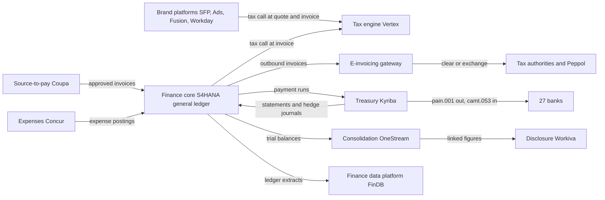
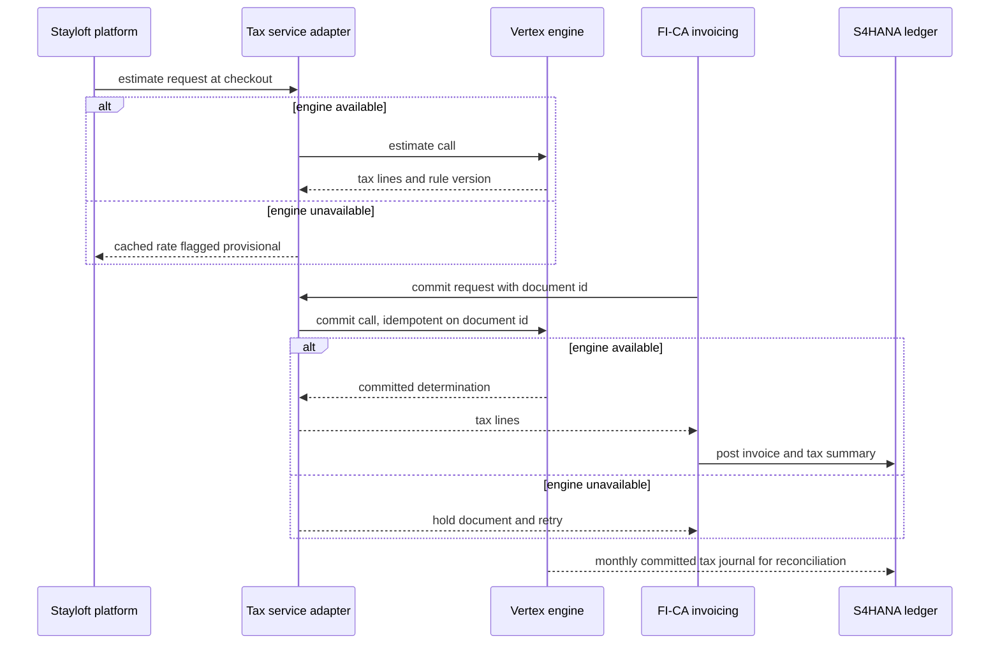
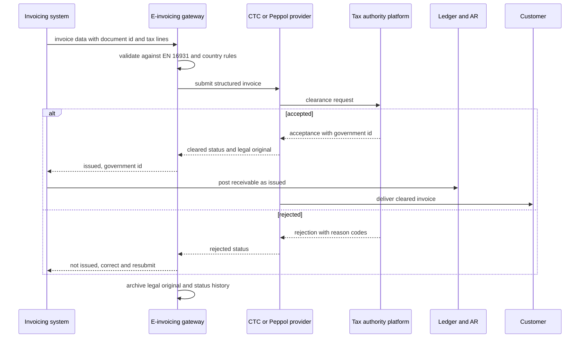
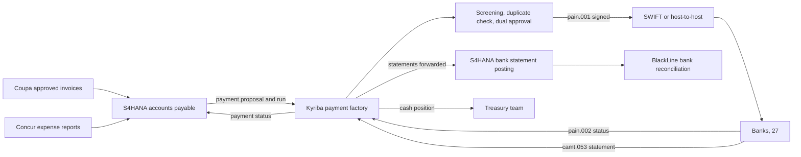

{id: satellite-platforms}
# 26. Around the Core: Tax, Treasury, Procurement and Reporting Platforms

> **IN THIS CHAPTER, YOU WILL:** Learn the satellite pattern, a specialized platform that owns one finance capability and attaches to the core through a narrow, owned interface, and apply it to indirect tax and e-invoicing, treasury and bank connectivity, source-to-pay and expenses, direct tax, disclosure and the finance data platform, with the rules that tell you when a satellite is right and when it has become a tangle.

> **WHY FINANCE CARES:** The tax return, the morning cash position, the supplier payment run and the 10-K are all produced outside the general ledger. If those platforms disagree with the ledger, the controller finds out at quarter-end and the tax authority or the auditor finds out later.

> **WHY ARCHITECTS SHOULD CARE:** Satellites sit on the critical path of order-to-cash and procure-to-pay more often than their size suggests: a tax engine outage stops invoicing, a clearance platform rejection stops an invoice from legally existing, and a payment file altered between ERP and bank is a fraud. Their interfaces deserve the same design attention as the ERP itself.

> **KEY POINTS:**
>
> * **A satellite is defined by its boundary, not its vendor.** It owns one capability and the data that capability creates, it hands the core a small number of contracted outputs, and a named reconciliation proves the satellite and the ledger agree. Tax engines, treasury systems, procurement suites, disclosure tools and finance data platforms all fit the pattern; most tangles come from breaking one of those three conditions.
> * **Regulation is pulling satellites into the critical path.** Continuous transaction controls make an invoice legally valid only after a tax platform accepts it, and ISO 20022 payment and statement messages make the treasury system the enterprise's gateway to its banks. Fallback behavior, idempotency and status handling are now integration design decisions, not tax- or treasury-department details.
> * **Consolidate capabilities, not vendors.** The decision that matters is that each capability (tax determination, e-invoice exchange, payment execution, bank account master) has one owning platform and one interface pattern across all ERPs. At Northmere that means tax determination converging on one engine and one e-invoicing gateway shared by order-to-cash and procure-to-pay before the EU's 2030 deadline.

> **[FAILURE PATTERNS THIS CHAPTER ADDRESSES](#where-finance-architecture-goes-wrong):**
>
> * **Capability Creep** — two tax engines determine VAT for overlapping invoice flows, and e-invoicing formats are bolted onto each ERP country by country.
> * **The Doppelgänger Record** — supplier, bank account and legal entity data are created in the ERP, the procurement suite, the treasury system and the tax engine with no agreed authority.
> * **Point-to-Point Spaghetti** — satellites call each other and each ERP directly, each in its own format, so that one mandate change becomes six integration projects.

The general ledger is the book of record, but much of the enterprise's finance logic does not live in it. Tax rates and invoice formats change faster than an ERP release cycle. Banks connect through networks the ERP does not own. Suppliers sit on procurement networks. Filings are drafted in a tool built for narrative and tagging, and analytics run on a data platform built for volume. Enterprises therefore surround the ledger with **specialized platforms**, and those platforms, not the ERP, are often where the newest regulation lands first.

This chapter calls them **satellites** and argues that the useful question is not "which vendor?" but "what does this platform own, and how is it attached?" A satellite that owns one capability, talks to the core through a narrow interface someone is accountable for, and is reconciled to the ledger is one of the cheapest ways to get specialist depth. A satellite that quietly acquires a second capability, keeps its own copy of master data, or is called by five systems in five ways is how an estate turns into a tangle.

The chapter works through each satellite family, then compares ERP-native modules with specialists. Payment service providers belong to [Payments for Finance Architects: The Lifecycle of Money Movement](#payments-fundamentals) and the finance data platform's internals to [Finance Data Across the Estate: From Operations to Analytics](#finance-data-flows); this chapter owns the **satellite pattern**, the **payment factory** and the **architecture of e-invoicing and continuous transaction controls**.

{id: satellite-platforms--setting-the-scene-at-northmere-two-requests-in-one-week}
## Setting the Scene at Northmere: Two Requests in One Week

Northmere, the fictional multi-brand commerce group this book follows, runs its group finance core on SAP S/4HANA, with Wayfare on Oracle Fusion Cloud ERP and Tablekin on Workday Financials. Around the core sit Vertex for indirect tax, Kyriba for treasury, Coupa for indirect procurement, SAP Concur for expenses, Workiva for SEC filings and Snowflake for the finance data platform, FinDB. Kofi Asante, Group Head of Tax and Treasury, owns Vertex, Kyriba and the Pillar Two program. In May 2027 two requests reach Dana Whitlock, the Chief Architect, in the same week.

The first comes from Hana Kowalski, who runs finance systems at Wayfare. Wayfare is expanding ground transport into four more European markets. Hana proposes to configure Oracle's tax engine for them, as Wayfare already does in nine markets, because "it is already in the box, it is included in the subscription, and it saves us an integration." (Wayfare also runs RateKeeper, a home-built rate service for rail and transfers in five markets, already slated to move to Vertex in 2028; see [Manage the Application Portfolio as an Investment](#application-portfolio).) Kofi's team objects: Stayloft's commission invoices and the group's S/4HANA invoicing already use Vertex, a tax audit has asked why two brands treat the same kind of intermediary fee differently, and the EU's VAT in the Digital Age package will make platforms the deemed supplier for short-term accommodation and passenger road transport from **1 July 2028**. Every additional engine is another set of rules to keep identical.

The second comes from Kofi himself. Northmere has been meeting national e-invoicing mandates one at a time: a Peppol connection bought for the Belgian entity in 2025, a German format added to S/4HANA output for the 2027 issuing obligation, a Polish clearance integration built in a hurry for KSeF in 2026, and an inbound receiving channel in Coupa. Each was the right answer on the day. Together they are four integrations, three providers and no shared view of which invoices were legally issued where. The EU's 2030 requirement for intra-EU business-to-business e-invoicing and digital reporting will hit Stayloft's commission invoices to properties across Europe, which are millions of documents a year.

Both requests have the same shape. A specialist capability exists in more than one place; nobody has written down which platform owns it, what the interface to the core looks like, or how the result is proven against the ledger. Dana's answer to both is the subject of this chapter.

{id: satellite-platforms--the-satellite-pattern}
## The Satellite Pattern

{id: satellite-platforms--what-makes-a-platform-a-satellite}
### What makes a platform a satellite

A **satellite platform** is a specialized system that owns one finance capability and attaches to the finance core through a narrow, well-owned interface. I use five tests. A platform that passes all five is a satellite; one that fails any of them is on its way to becoming something else.

| Test | What it means | What failure looks like |
| --- | --- | --- |
| **One capability** | The platform owns one business capability from the capability map in [Map Capabilities Before Systems](#capability-mapping): tax determination, payment execution, disclosure. | The treasury system starts approving supplier invoices; the procurement suite starts doing expense reports for one country. |
| **Core keeps the book** | The general ledger remains the book of record. The satellite owns its working data and evidence, and the ledger receives the accounting consequence. | The satellite holds balances nobody posts to the ledger: The Shadow Ledger. |
| **Narrow interface** | A small number of contracted interactions, each documented, versioned and owned: a call, a file, an event. | Every consuming system integrates its own way; the satellite exposes its database to reporting. |
| **Named owner** | A business owner accountable for the capability and a technical owner accountable for the platform and its interfaces. | The platform belongs to "Finance"; the interfaces belong to whoever built them. |
| **Proven agreement** | At least one reconciliation proves the satellite and the ledger agree, at a defined frequency, with breaks owned. | Tax returns are prepared from the engine's journal and nobody ties it to the GL tax accounts. |

The **capability** test is the one that erodes first, because vendors expand their footprints. A tax engine vendor buys an e-invoicing company; a treasury vendor adds accounts-payable automation; a disclosure tool adds a consolidation engine. Whether the enterprise uses each addition is an architecture decision, not a license default, recorded in the capability overlap register described in [Preventing Redundant Capabilities and Unnecessary Coupling](#redundancy-and-coupling).

{id: satellite-platforms--four-ways-a-satellite-attaches}
### Four ways a satellite attaches

Satellites attach to the core in four recurring shapes. Recognizing the shape tells you most of what you need about latency, failure handling and reconciliation.

| Shape | How it works | Examples | Design concern |
| --- | --- | --- | --- |
| **Synchronous call-out** | The core, or a brand platform, calls the satellite while a transaction is being created and waits for an answer. | Tax determination at quote, order and invoice; sanctions screening at payment release. | Latency budget, availability, fallback when the satellite is down, idempotent commit. |
| **Subledger with summarized posting** | The satellite records detailed transactions and posts journal summaries to the GL with a key back to the detail. | Expense reports, hedge accounting, billing. | Completeness of postings, drill-back, subledger-to-GL reconciliation. |
| **Network or clearance gateway** | The satellite stands between the enterprise and an external network: banks, suppliers, tax authorities. | Bank connectivity, e-invoicing exchange, supplier networks. | Message standards, status feedback, legal originals, non-repudiation. |
| **Analytical or reporting consumer** | The satellite reads closed or near-real-time data from the core and produces outputs. | Disclosure management, Pillar Two calculations, the finance data platform. | Tie-out to the source, lineage, period locks. |

Some satellites use more than one shape. A treasury system is a gateway for payments and statements and a subledger for hedge accounting. That is acceptable as long as each interaction is contracted separately.

**Figure 1:** *Northmere's satellites around the finance core. Every arrow is a contracted interface with an owner; the e-invoicing gateway is drawn as one box because that is the target, not yet the 2027 reality.*

{id: satellite-platforms--when-a-satellite-is-the-right-answer}
### When a satellite is the right answer

I recommend a satellite over the ERP's own module when at least one of these holds, and I write the reason into the decision record so it can be checked later:

- **The rules change faster than the ERP.** Tax rates, e-invoicing formats and bank message versions change on the regulator's or the bank's schedule; a specialist updates that content once for all its customers.
- **The capability needs a network.** Banks, supplier networks and accredited e-invoicing providers are networks; joining through a provider is cheaper than certifying each connection.
- **The enterprise runs more than one ERP.** A capability that must behave identically across S/4HANA, Fusion and Workday is better placed outside all three than configured three times.
- **The specialist depth is the point.** Hedge accounting, Inline XBRL tagging and multi-jurisdiction tax content are domains where a generic module is materially weaker.
- **The capability must survive the ERP's release cycle.** A treasury platform that keeps paying suppliers through an ERP upgrade weekend is a resilience asset.

A satellite is the wrong answer when the ERP-native module works at the required scale, one ERP runs the process, and the integration would cost more to own than the depth is worth. Each satellite adds an interface, a vendor, a service organization control report to review and a reconciliation to run.

{id: satellite-platforms--when-a-satellite-becomes-a-tangle}
### When a satellite becomes a tangle

The signs that a satellite has become a tangle are concrete, and I look for them in architecture reviews:

1. **Logic leaks in both directions.** Tax rules live partly in the engine and partly in ERP code that overrides it for "special cases."
2. **The satellite becomes a second master.** It keeps its own supplier, entity or bank account records, which drift from the core's.
3. **Satellites call satellites.** Procurement calls the tax engine, which calls the e-invoicing provider, which calls back into the ERP; no system sees the whole transaction.
4. **Every consumer integrates differently.** Five callers in five integration technologies turn one version upgrade into five regression tests.
5. **Nobody reconciles.** The satellite's report is treated as the truth, and the ledger is adjusted to match.

Each of these maps to a failure pattern from [Where Finance Architecture Goes Wrong](#where-finance-architecture-goes-wrong): The Doppelgänger Record, Point-to-Point Spaghetti, Capability Creep and The Shadow Ledger. The remainder of the chapter applies the pattern to each family.

**Figure 2:** *A satellite owns one capability and attaches to the core through one owned interface with a reconciliation; when satellites call each other, keep their own masters and go unreconciled, the estate becomes a tangle.*

{id: satellite-platforms--indirect-tax-determination}
## Indirect Tax Determination

{id: satellite-platforms--why-specialists-exist}
### Why specialists exist

**Indirect tax** is tax on transactions rather than on profit: value-added tax (VAT) and goods and services tax (GST) in most of the world, sales and use tax in the United States, and a long tail of transaction-specific levies such as digital services taxes and tourist taxes. Determining it requires **content** (rates, rules and thresholds for thousands of jurisdictions), facts about the **parties** (who is established and registered where) and facts about the **transaction** (what is sold, where it is deemed supplied, whether a reverse charge applies). [Many Entities, Currencies, Jurisdictions and Brands](#global-scale) owns the tax concepts; this chapter owns how the engine is attached.

**Tax engines** exist because the content changes constantly and is the same for every customer. Vertex says its O Series automates tax calculation "on your sales and purchase transactions" and can be deployed on-premise, in the cloud, or in containers "to manage tax calculation at the point of transaction" ([Vertex O Series](https://www.vertexinc.com/solutions/products/vertex-indirect-tax-o-series)). Avalara's AvaTax is a cloud API in which a transaction is created through a `CreateTransaction` call whose document type distinguishes an uncommitted estimate (such as a sales order) from a recorded invoice ([AvaTax SDK](https://www.npmjs.com/package/avatax)). Thomson Reuters ONESOURCE is the other engine common in large SAP and Oracle estates. The ERPs have their own engines too; Oracle Fusion's is the one Wayfare uses.

{id: satellite-platforms--the-architectural-role}
### The architectural role

The tax engine is a **synchronous call-out** satellite with a memory: it answers "what tax applies to this line?" at each document event and keeps a record of every committed determination, which is the basis of the tax return.

| Document event | Call type | What the engine records | Consequence of getting it wrong |
| --- | --- | --- | --- |
| Quote or checkout | Estimate, not committed | Nothing for the return | Wrong price shown; customer dispute |
| Sales order | Estimate | Nothing for the return | Wrong order value |
| Invoice or billing document | **Commit** | A determination record that feeds the return | Wrong tax collected and reported |
| Credit memo or cancellation | Adjust or reverse the commit | A reversing record | Overpaid or underpaid tax |
| Supplier invoice | Verify, self-assess where required | Input tax and self-assessed tax | Lost input VAT recovery; unpaid use tax |

The rule that follows is simple and often broken: **only a commit counts, and every commit is idempotent.** A commit retried after a timeout must not record the tax twice, so the caller passes a stable document identifier, the same one the ledger posting carries.

{id: satellite-platforms--tax-master-data-who-owns-what}
### Tax master data: who owns what

In my experience most tax errors are master data errors: the engine computes correctly from wrong inputs. Four kinds of data drive the answer:

| Data | Typical system of record | Why it matters |
| --- | --- | --- |
| **Registrations and establishments** of the enterprise's own legal entities | Legal entity master, published to the engine | Determines which entity is liable and where |
| **Counterparty tax status** (VAT number, exemption certificate, business or consumer) | Customer, partner or supplier master in the owning platform | Decides reverse charge versus charging VAT |
| **Product tax codes** | Product or service catalog of the selling platform | Maps "commission on accommodation" to the right rule |
| **The taxability matrix** (which rule applies to which code in which jurisdiction) | The tax engine, owned by the tax team | The rules themselves |

The last row is the engine's own. The first three belong to other systems and are published to the engine or passed on each call. Copying them into the engine and maintaining them there is the beginning of The Doppelgänger Record.

{id: satellite-platforms--the-tax-call-and-what-happens-when-the-engine-is-down}
### The tax call, and what happens when the engine is down

The interesting question is the failure path. An engine called millions of times will sometimes be unreachable, and there are three options, each with different audit consequences:

| Option | Behavior when the engine is unavailable | Audit consequence | Where it fits |
| --- | --- | --- | --- |
| **Fail closed** | The document is not created until the engine answers. | Clean: every document has an engine determination. | Committed invoices in batch runs, where waiting is cheap. |
| **Fallback rate** | The caller applies a cached rate table and flags the line as provisional. | Every provisional line must be recalculated and any difference corrected; the flag is itself a control. | Estimates at quote or checkout, where a customer is waiting. |
| **Queue and recalculate** | The document is created without tax, queued, and completed when the engine returns. | Acceptable only if the document is not yet legally issued; under clearance regimes it cannot be. | Internal documents, supplier invoice verification. |

The rule I use is: **an estimate may degrade, a commit may wait, and nothing may silently guess.** A checkout page may show a price computed from a cached rate, because nothing is legally issued yet. An invoice may wait in a queue until the engine answers. What must never happen is a committed invoice carrying a fallback rate that nobody recalculates.

**Figure 3:** *The tax call sequence. Estimates may fall back to a flagged cached rate; commits wait for the engine and are idempotent on the document identifier; the engine's committed journal is reconciled to the ledger's tax accounts before any return is filed.*

The **tax service adapter** in Figure 3 is a thin internal component every Northmere caller uses instead of calling the engine directly. It owns the fallback policy, retries and idempotency, the mapping from Northmere's product codes to the engine's tax codes, and a log of every request and response. It is the narrow interface; without it, the audit question "which invoices carried a provisional rate?" has no single answer.

**Latency** shapes deployment: a per-line cloud call adds a round trip to every price shown at checkout, which is why containerized and batch options exist. Northmere uses both: real-time calls for brand checkout and quoting, and batch calls for the monthly FI-CA commission invoicing run across roughly **850,000 partner contract accounts**.

{id: satellite-platforms--controls-and-the-reconciliation-that-matters}
### Controls and the reconciliation that matters

The control set for a tax engine has three parts:

- **Content change control.** The tax team, not IT, changes the taxability matrix; each change is versioned, regression-tested on real transactions and approved, and the rule version is stored with each determination.
- **Determination evidence.** Inputs, rule version, result and timestamp per committed line: what answers "why did you charge this rate on 12 March?" in days rather than weeks.
- **Tax-to-ledger reconciliation.** The committed journal, per jurisdiction and period, is reconciled to the GL tax accounts before the return is filed. Breaks come from postings without commits, commits without postings, and manual journals to tax accounts. It belongs in the catalog of [Designing for Traceability, Reconciliation and Audit Across Boundaries](#traceability-and-reconciliation) and in BlackLine.

The engine's SOC 1 Type II report and its **complementary user entity controls** (controls the customer must operate, such as tenant access reviews) must map to owned controls in Mei Tanaka's internal control over financial reporting (ICFR) program; [Controls, Auditability and Security by Design](#controls-and-auditability) owns the general treatment.

{id: satellite-platforms--a-worked-example-one-commission-two-answers}
### A worked example: one commission, two answers

The Lisbon booking, the merchant-model stay that runs through this book, earns Stayloft a **€90.00** commission on a **€600.00** booking. Take the agency-model sibling of that booking: the same apartment, sold under the agency model, where Stayloft invoices the property its €90 commission at month-end through FI-CA.

The tax answer depends on master data, not on the amount. In a deliberately simplified form (real place-of-supply analysis for accommodation intermediation is a tax specialist's job, and this example is illustrative, not tax advice):

| Property's status | What the engine is told | Illustrative outcome |
| --- | --- | --- |
| A Portuguese company registered for VAT | Partner VAT number present and validated; product code "accommodation intermediation commission" | Portuguese place of supply; reverse charge, so the invoice shows €90.00 with no VAT and the property self-accounts |
| A private host not registered for VAT | No VAT number | Stayloft charges Portuguese VAT on the commission: at the 23% mainland standard rate, €20.70, invoice total €110.70 |

The same commission, two invoices. If the partner's VAT number lives in SFP, in FI-CA and in Vertex's own customer table, and the three disagree, the engine computes correctly from the wrong input. That is why the partner master, not the engine, owns the VAT number, and the adapter passes it on each call.

From July 2028 a third answer appears. Under ViDA's platform deemed-supplier rule, where a private host does not charge VAT on short-term accommodation, the platform is treated as having received and supplied the accommodation itself and must charge VAT on it ([European Commission, ViDA](https://taxation-customs.ec.europa.eu/taxation/vat/vat-digital-age-vida_en)). Member states may delay application to 1 January 2030. For a merchant booking like the Lisbon stay, that means a tax determination on the accommodation price at checkout, not only on the commission at month-end. It does **not** change Stayloft's accounting as an agent for revenue; the tax treatment and the revenue presentation are separate attributes of the transaction, a point [Accounting for Architects: Ledgers, Journals and Revenue](#accounting-for-architects) makes in full. The architecture must carry both.

{id: satellite-platforms--e-invoicing-and-continuous-transaction-controls}
## E-Invoicing and Continuous Transaction Controls

{id: satellite-platforms--from-post-audit-to-clearance}
### From post-audit to clearance

Traditionally the seller issued and kept invoices and the tax authority audited later, often through a periodic extract such as the OECD-originated Standard Audit File for Tax (SAF-T). **Continuous transaction controls (CTC)** are regimes in which invoice data reaches the authority at or near the time of the transaction. Their architectural consequence is that **the invoice moves into the critical path**: under clearance, a document is not legally an invoice until a government platform accepts it. Four models need distinguishing:

| Model | How it works | Examples (status as of October 2026) | Architectural consequence |
| --- | --- | --- | --- |
| **Post-audit** | The seller issues and stores invoices; the authority audits later through extracts. | SAF-T style regimes | Extract quality and chart-of-accounts mapping matter; issuance is not on the critical path. |
| **Peppol four-corner exchange** | Seller and buyer each connect through an accredited service provider; documents flow between providers. | Belgium's domestic business-to-business mandate from 1 January 2026 uses Peppol | A network gateway; delivery status and rejections must be handled. |
| **Clearance** | The invoice is submitted to a government platform and becomes legally valid only once accepted. | Italy's SdI; Poland's KSeF, mandatory from 1 February 2026 for the largest taxpayers and 1 April 2026 for others | Issuance waits on an external platform; availability, rejections and numbering become design concerns. |
| **Decentralized CTC, sometimes called five-corner** | Exchange through accredited platforms, with invoice and transaction data reported to the authority. | France, where large and mid-sized companies issue through accredited platforms (*plateformes agréées*) from 1 September 2026 | Provider choice is constrained by accreditation; reporting and exchange are coupled. |

**Peppol** is, in OpenPeppol's words, an interoperability framework, "not a portal, or a provider of exchange services," with the **four-corner model** "at the heart of Peppol": seller and buyer each connect through their chosen accredited service provider, and the providers exchange the document ([OpenPeppol](https://peppol.org/about/)). The standard document, Peppol BIS Billing 3.0, implements the European e-invoicing standard EN 16931.

Germany adds a post-audit-style mandate without a central platform: receiving structured e-invoices from 1 January 2025, issuing from 1 January 2027 for companies above €800,000 prior-year turnover and for all from 1 January 2028. These dates, as of October 2026, have moved repeatedly; check them against each tax authority, and see [Many Entities, Currencies, Jurisdictions and Brands](#global-scale) for the register.

At EU level, the **VAT in the Digital Age (ViDA)** package entered into force on 14 April 2025, letting member states mandate domestic e-invoicing without a derogation. From **1 July 2030** digital reporting requirements apply to intra-EU cross-border business-to-business transactions, with structured e-invoices as the default, and national real-time systems must align by 1 January 2035 ([European Commission](https://taxation-customs.ec.europa.eu/taxation/vat/vat-digital-age-vida_en)). Domestic e-invoicing remains a national choice.

{id: satellite-platforms--the-clearance-flow}
### The clearance flow

Under clearance, the seller submits structured invoice data and waits for an acceptance, typically carrying a government-assigned identifier. Only then is the invoice legally issued, posted as issued and delivered. A rejection is not an error to log; it is an invoice that does not exist yet.

**Figure 4:** *Clearance in the order-to-cash path. The receivable is posted as issued only after acceptance; rejections return to the invoicing system as documents that do not yet exist; the gateway keeps the legal original, which is the cleared version, not the ERP's copy.*

Five design decisions follow, and each needs an owner:

- **Where the legal original lives.** The cleared version is the legal invoice, not the ERP's rendering. The gateway or its provider archives it with its status history for the retention period; the ERP holds a reference.
- **Numbering.** Sequential numbering rules are national; if numbers are assigned before clearance, gaps from rejected documents must be explainable.
- **Status as a first-class field.** Created, submitted, cleared, rejected, delivered, canceled; receivables reporting distinguishes "posted" from "legally issued."
- **Availability and backlog.** Government platforms have outages; the gateway queues, retries idempotently and tells issuers which documents are waiting.
- **Inbound as well as outbound.** Under receiving obligations, accounts payable stores the received structured original, not a re-keyed or scanned copy; PDF capture remains for the residual unstructured invoices.

{id: satellite-platforms--one-gateway-shared-by-order-to-cash-and-procure-to-pay}
### One gateway, shared by order-to-cash and procure-to-pay

The response is an **e-invoicing gateway**: one internal service with one contract, used outbound by every invoicing system and delivering inbound documents to accounts payable, with one or a few providers behind it. The gateway owns validation, routing by country and regime, status, the legal-original archive and the evidence; the issuing systems own invoice content and accounting. The provider options:

| Option | What it means | Strengths | Weaknesses | Right when |
| --- | --- | --- | --- | --- |
| **ERP-native per ERP** | SAP Document and Reporting Compliance in S/4HANA, Oracle's and Workday's own options for their ERPs | Close to the document; vendor maintains country content for its ERP | Three ERPs means three solutions; custom platforms like SFP are not covered | One ERP issues almost all invoices |
| **Tax-engine vendor's e-invoicing** | E-invoicing from the same vendor as tax determination; Vertex acquired the e-invoicing provider ecosio in August 2024 for this purpose ([Vertex](https://www.vertexinc.com/company/news/latest-news/vertex-acquires-ecosio-accelerate-global-e-invoicing-compliance)) | One vendor for determination and exchange; tax lines and invoice data aligned | Concentration on one vendor; coverage must be checked country by country | Tax determination is already consolidated on that vendor and its coverage fits |
| **Independent CTC specialist** | A provider whose core business is e-invoicing and clearance across many countries | Breadth of country coverage and accreditations | Another vendor; integration to each issuing system still needed | Many clearance countries; heterogeneous issuers |
| **Build a Peppol access point** | Operate your own accredited service provider | Control | Accreditation, operations and every non-Peppol regime remain | Rarely, for an enterprise whose business is document exchange |

Most estates drift into a fifth option: each country solved separately by whichever team felt the deadline first, which is Capability Creep with a legal deadline. The gateway is primarily the decision to have one interface, so the next mandate is a provider configuration rather than a project in every ERP.

**Figure 5:** *Four integrations, three providers and no shared view become one e-invoicing gateway with one contract, so the next mandate is a provider configuration rather than a project in every ERP.*

{id: satellite-platforms--treasury-and-bank-connectivity}
## Treasury and Bank Connectivity

{id: satellite-platforms--why-treasury-management-systems-exist}
### Why treasury management systems exist

A **treasury management system (TMS)** manages cash, liquidity, funding, financial risk and the connections to banks. The ERP records what the enterprise owes and is owed; the TMS knows where the money is, in which bank and currency, this morning. Specialists exist because bank connectivity is a network problem, because instruments such as FX forwards need valuation and hedge accounting that ERPs do not do deeply, and because treasury must keep operating when the ERP is down.

Vendors include Kyriba, which says it connects "to 10,000 banks, right out of the box" with open APIs for the "ERP-to-bank payment journey" ([Kyriba](https://www.kyriba.com/)); **FIS Treasury and Risk Manager – Quantum Edition**, formerly Quantum ([FIS](https://www.fisglobal.com/products/fis-treasury-and-risk-manager-quantum-edition)); ION's Wallstreet Suite; and SAP Treasury and Risk Management with SAP Multi-Bank Connectivity.

{id: satellite-platforms--channels-and-messages}
### Channels and messages

A bank connection has a **channel** and a **format**. Channels are SWIFT (joined directly or through a service bureau), **host-to-host** file transfer (bespoke per bank), EBICS (Electronic Banking Internet Communication Standard, a German-originated standard also used in France and Switzerland) and bank APIs (real-time, not standardized). The formats that matter are ISO 20022 XML messages:

| Message | Name | Direction | What it carries |
| --- | --- | --- | --- |
| **pain.001** | Customer credit transfer initiation | Enterprise to bank | A payment instruction, typically a batch of payments |
| **pain.002** | Payment status report | Bank to enterprise | Accepted, rejected or pending, per payment or batch |
| **camt.052** | Bank-to-customer account report | Bank to enterprise | Intraday balances and movements |
| **camt.053** | Bank-to-customer statement | Bank to enterprise | The end-of-day statement, successor to MT940 |
| **camt.054** | Debit and credit notification | Bank to enterprise | Individual booked entries, often used for detailed remittance |

A caution: the SWIFT MT/ISO 20022 coexistence period that ended on 22 November 2025 concerned **interbank** cross-border payment instructions. Corporate MT940 statements remain in wide use. "MT940 is dead" is wrong; "plan to receive camt.053 from every bank" is right.

{id: satellite-platforms--cash-positioning}
### Cash positioning

The **cash position** answers "how much cash do we have, where, and what is about to move?" from prior-day statements, intraday reports and expected flows from the ERPs and the payments platform. The TMS is the system of record for bank balances and the position; the ledger receives the accounting through **bank statement processing**, which matches statement lines to open items and posts them. In Northmere's design, statements land in Kyriba first and are forwarded to S/4HANA for posting, and BlackLine reconciles the bank accounts in the ledger to the statements.

{id: satellite-platforms--the-payment-factory}
### The payment factory

A **payment factory** centralizes the execution of outgoing payments: the ERPs decide *what* to pay and *when*; the factory decides *how*. It receives proposals from each ERP's payment run, screens, deduplicates and approves them, formats and signs pain.001 instructions, routes them to the right bank and channel, and returns status to the originating ERP. A mature factory can pay and collect **on behalf of** subsidiaries (POBO and COBO) from central accounts, replacing external payments with intercompany balances; an **in-house bank** then keeps the internal accounts, charges internal interest and nets positions. It needs tight intercompany reconciliation, so the intercompany design in [Many Entities, Currencies, Jurisdictions and Brands](#global-scale) must be settled first.

**Figure 6:** *Northmere's payment factory. S/4HANA decides what to pay; Kyriba screens, approves, formats, signs and routes; status and statements flow back so that the ledger, the bank and the cash position agree, and BlackLine proves it.*

{id: satellite-platforms--controls-on-the-payment-path}
### Controls on the payment path

Payment fraud exploits the seams between systems, so the integration must make these controls explicit:

- **File integrity between ERP and TMS.** Use an API or a signed, hashed file; the TMS verifies the hash and control totals (count and amount) before accepting it.
- **Bank detail changes.** Verified out of band and approved by someone other than the requester, in the system that owns the supplier record.
- **Segregation of duties across systems.** Whoever can create a supplier in S/4HANA must not approve payments in Kyriba; cross-system conflicts are a frequent audit gap because each system's roles are reviewed separately.
- **Sanctions screening and duplicate detection** at release, with the result recorded per payment; duplicates also arise from a retried file.

{id: satellite-platforms--data-ownership-in-treasury}
### Data ownership in treasury

The **bank account master** (accounts, banks, entities, signatories) is often mastered in the ERP, the TMS, the reconciliation tool and a signatory spreadsheet at once. I recommend the TMS as its system of record, with the ERPs and BlackLine subscribing. The TMS also owns hedges, their valuation and the hedge accounting entries under IFRS 9 or ASC 815, which reach the ledger as summarized journals; exposures come from the ERPs, brand platforms and forecasts.

{id: satellite-platforms--northmere-s-treasury-in-2027}
### Northmere's treasury in 2027

Kyriba is Northmere's treasury system: cash positioning, bank connectivity over SWIFT and host-to-host connections, FX hedging, and the payment factory that executes S/4HANA's payment runs, across roughly **410 bank accounts at 27 banks**. Four features make Northmere's treasury harder than the generic picture:

- **Partner payouts bypass the factory.** Roughly 9 million partner payouts a month leave through Northmere Pay and its payment providers; Kyriba sees their funding, not each payout. That boundary is right for a high-volume payments capability ([Payments-to-Ledger: Connecting Providers, Brand Platforms and the ERP](#payments-to-ledger)), but the cash position then depends on the payments platform's forecasts.
- **Safeguarded funds are restricted.** Northmere Payments B.V. safeguards traveler funds in segregated accounts reconciled daily; they appear in the cash position as restricted, and the safeguarding reconciliation belongs to the e-money entity, not to treasury.
- **The FX exposure is born in the subledger.** Customers pay in 46 currencies and partners are settled in 31, so SFP's merchant balances are an exposure Kyriba must receive daily, not a month-end ERP extract.
- **Wayfare and Tablekin still pay from their own ERPs** in 2027. Bringing them into the factory is a Keystone Year 3 item and the precondition for paying on behalf of subsidiaries across brands.

Because Northmere Payments B.V. is a financial entity under the EU's Digital Operational Resilience Act (DORA), any SaaS platform supporting its critical or important functions needs DORA contract terms and a place in its register of information; [Resilience, Observability, Security and Recovery for Finance Systems](#resilience-and-security) covers this.

{id: satellite-platforms--source-to-pay-and-expenses}
## Source-to-Pay and Expenses

{id: satellite-platforms--procurement-suites}
### Procurement suites

**Source-to-pay (S2P)** runs from sourcing and requisition to supplier invoice and payment. Procurement suites such as Coupa and SAP Ariba exist because indirect spend is a user-experience problem (thousands of occasional buyers), a supplier-network problem and a policy problem. Coupa has been private since Thoma Bravo completed its acquisition on 28 February 2023 ([Thoma Bravo](https://www.thomabravo.com/press-releases/thoma-bravo-completes-acquisition-of-coupa-software)); SAP Ariba integrates with S/4HANA for purchase orders, confirmations and supplier invoices using cXML, as SAP's S/4HANA 1610 documentation from 2016 describes ([SAP Help](https://help.sap.com/doc/3281b65334e6b54ce10000000a174cb4/1610%20002/en-US/66357356dfd19d24e10000000a44147b.html)); the Ariba Network is now part of SAP Business Network, so check the current integration guide for your release.

The procurement suite is a **front end and network gateway** to the ledger's payables: request, approval, purchase order, receipt, supplier invoice, two- or three-way match, posting to accounts payable, payment. The design question is where the boundary sits. At Northmere:

| Step | Owner | Notes |
| --- | --- | --- |
| Requisition, approval, purchase order | Coupa | Approvers and cost centers come from Workday HCM |
| Supplier onboarding (tax IDs, bank details, risk and sanctions checks) | Coupa workflow | Writes the approved supplier to S/4HANA |
| Supplier master for payment | S/4HANA | The record the payment run uses |
| Invoice intake and matching | Coupa | Network invoices, Peppol and clearance inbound via the gateway, residual PDFs |
| Accounts payable posting | S/4HANA | Coupa sends approved, coded invoices |
| Payment | Kyriba factory | Executes S/4HANA payment runs |

The supplier record is where The Doppelgänger Record appears first: in Coupa where it was onboarded, S/4HANA where it is paid, Kyriba as a payee and the tax engine for input VAT. My rule: **one workflow creates and changes suppliers, and every other system receives the change**; bank details are verified there and nowhere else. Input tax is the other seam: Coupa should verify or self-assess tax through the same tax service adapter the outbound side uses, or inbound and outbound tax logic drift.

{id: satellite-platforms--expenses}
### Expenses

Expense platforms (SAP Concur at Northmere; Navan, formerly TripActions, is a newer entrant) are **subledger satellites**: they own reports, receipts, policy checks and approvals, post summarized journals to the ERP against employee payables, and leave reimbursement to the ERP's payment run. Approvers and cost centers come from Workday HCM ([Workday: Financials, People and the Organizational Backbone](#workday)); each posting carries the report identifier for drill-back; and because the receipts and approvals that auditors sample live in the satellite, its retention must match the ledger's.

{id: satellite-platforms--billing-and-subscription-platforms-subledgers-not-satellites}
## Billing and Subscription Platforms: Subledgers, Not Satellites

Billing platforms such as Stripe Billing, Zuora and SAP's BRIM components look like satellites but are **subledgers**: they own subscriptions, rating, invoices and often receivables, and hold balances that must reconcile to a GL control account. Zuora describes its Billing product as serving "as an accounts receivable subledger" ([Zuora](https://www.zuora.com/products/)). Northmere's three billing approaches (SFP, FI-CA and Stripe Billing) are treated in [Designing Custom Ledgers and Financial Event Processing](#designing-financial-ledgers), [Stripe: Programmable Payments, Billing and Connected Accounts](#stripe) and [Preventing Redundant Capabilities and Unnecessary Coupling](#redundancy-and-coupling); this chapter asks only that all three call the same tax service and use the same e-invoicing gateway.

{id: satellite-platforms--direct-tax-and-pillar-two}
## Direct Tax and Pillar Two

**Direct tax** is tax on profit. The quarterly income tax provision is computed in a provision tool (Thomson Reuters ONESOURCE Tax Provision, Oracle EPM Tax Reporting and insightsoftware's Longview Tax are examples) or, in less mature estates, in spreadsheets. **Pillar Two** is the OECD's global minimum tax: groups with consolidated revenue of at least €750 million compute an effective tax rate per jurisdiction and pay top-up tax to 15%. The first **GloBE Information Return** fell due on 30 June 2026 in many jurisdictions, and a January 2026 "side-by-side" package changed parts of the regime; [Many Entities, Currencies, Jurisdictions and Brands](#global-scale) tracks the moving dates.

The architectural effect: the calculation starts from the financial accounts used for consolidation, by constituent entity and jurisdiction, adjusted for many specific items. That makes the provision and Pillar Two tools **analytical consumers of the consolidation layer**, not of the ERPs directly. They need entity-level, reconciled data, deferred tax detail, payroll and tangible asset data for the substance carve-out, and lineage strong enough to defend each adjustment years later.

Northmere, with about $8.2 billion of revenue, is in scope. Kofi's Pillar Two program reads entity trial balances and supplemental schedules from OneStream, and payroll and headcount by entity from Workday HCM, into the provision dataset. The rule I would set: **Pillar Two inputs come from closed, consolidated data with a tie-out to OneStream, never from direct ERP extracts reworked in spreadsheets.** A Vertex-style indirect tax engine plays no part here. Indirect and direct tax are different capabilities with different vendors, and treating "tax" as one satellite is a category error that shows up in procurement decks more often than in architecture.

{id: satellite-platforms--disclosure-management}
## Disclosure Management

**Disclosure management** platforms produce the published filings: for a US registrant, the 10-K and 10-Q, tagged in Inline XBRL against the US GAAP taxonomy and submitted to the SEC's EDGAR system; for EU issuers, the European Single Electronic Format (ESEF) annual report. Workiva is the best-known example; its core proposition is **linked data**, in which a figure changed at the source updates every table and narrative that uses it, with connectors to ERPs and consolidation tools and built-in XBRL tagging (as summarized by [ERP Research](https://erpresearch.com/erp-add-ons/esg-sustainability/workiva); Workiva also acquired the ESEF specialist ParsePort in 2022).

Disclosure is an **analytical consumer** at the end of the chain:

1. The ERPs feed OneStream, which consolidates and produces the consolidated trial balance and supporting schedules.
2. Workiva links to OneStream outputs; narrative, tables and tags are drafted and reviewed.
3. Tie-outs prove the face statements and notes agree with the consolidated trial balance.
4. Tag review, approval and audit sign-off follow, and the filing is submitted.

Three decisions matter. **Link, do not re-key**, so a late adjustment flows through. **Govern the taxonomy mapping** from group accounts to XBRL elements like the chart of accounts mapping, because a tagging error is a public error. **Retain evidence** of tie-outs and approvals for SOX 404. Northmere's 2027 weakness is upstream: OneStream's mappings from three charts of accounts live partly in spreadsheets, so the final tie-out proves agreement with a number whose own lineage is weak. [OneStream: Consolidation, Planning and Performance Management](#onestream) and [From Customer Transaction to Financial Statement](#transaction-to-report) pick up that thread.

{id: satellite-platforms--the-finance-data-platform-as-a-satellite}
## The Finance Data Platform as a Satellite

The finance data platform is the newest satellite and has the most ambiguous boundary. Snowflake, Databricks and BigQuery harmonize multi-ERP data and hold subledger detail too voluminous for the ledger; ERP vendors offer their own variants: SAP Business Data Cloud (announced in February 2025 with Databricks, bundling SAP Datasphere, SAP Analytics Cloud, BW and SAP Databricks) and Oracle Fusion Data Intelligence (the renamed Fusion Analytics Warehouse).

As a satellite, FinDB passes the tests only if its boundary is explicit: it **consumes** ledger, subledger and operational data, it **owns** derived datasets and governed metric definitions, it **never** becomes a place where accounting is done, and it **ties out** to the ledger for any dataset presented as financial. Northmere's known 2027 gap is exactly the last test: FinDB's revenue does not tie to the ledger's, which produces the "three revenue numbers" problem [Finance Data Across the Estate: From Operations to Analytics](#finance-data-flows) resolves. As AI agents start answering finance questions, the tie-out stops being a reporting nicety: an agent asked for last quarter's gross margin must read a governed, tied-out metric, a point [AI, Automation and Agentic Finance Operations](#ai-in-finance) develops.

{id: satellite-platforms--erp-native-modules-or-specialists}
## ERP-Native Modules or Specialists?

Every satellite family has an ERP-native alternative. The comparison below is the one I would put in front of a design authority; it is a starting point, not a verdict, because the answer depends on how many ERPs the process spans and how fast its rules change.

| Capability | ERP-native option | Specialist option | Favor ERP-native when | Favor the specialist when |
| --- | --- | --- | --- | --- |
| Indirect tax determination | ERP tax engines (SAP, Oracle Fusion, Workday) | Vertex, Avalara, ONESOURCE | One ERP; few jurisdictions; simple products | Several ERPs and custom platforms; many jurisdictions; marketplace or platform rules |
| E-invoicing and CTC | SAP Document and Reporting Compliance; Oracle and Workday options | Tax-engine vendors' e-invoicing; CTC specialists | One ERP issues almost all invoices; its country coverage fits | Custom billing platforms issue invoices; many clearance countries |
| Treasury and bank connectivity | SAP Treasury and Risk Management with Multi-Bank Connectivity; Oracle Cash Management | Kyriba, FIS, ION | One ERP; simple instruments; few banks | Several ERPs; many banks; hedging; need to pay through ERP outages |
| Source-to-pay | Oracle Procurement; SAP purchasing | Coupa, SAP Ariba, Workday Strategic Sourcing | Direct spend tightly tied to ERP inventory | Large indirect spend, supplier network, guided buying |
| Expenses | ERP expense modules; Workday Expenses | SAP Concur, Navan | Small travel volumes; one HCM and ERP | Global travel, card programs, policy complexity |
| Tax provision and Pillar Two | Consolidation-adjacent modules (Oracle EPM Tax Reporting) | ONESOURCE with Orbitax, Longview | The consolidation platform's vendor covers it well | Complex jurisdictional footprint; tax team's existing tooling |
| Disclosure | Consolidation reporting packs | Workiva and peers | Private company; simple statutory filings | SEC or ESEF filer; heavy narrative and tagging |
| Finance analytics | SAP Business Data Cloud; Oracle Fusion Data Intelligence | Snowflake, Databricks, BigQuery | One ERP dominates the data | Multi-ERP, high-volume operational detail, enterprise data platform already exists |

Two cautions apply across the table. First, "included in the subscription" is not the same as free: the integration, the controls, the reconciliation and the second set of rules still have to be owned. Second, a specialist chosen for one ERP becomes a standard only if the other ERPs are attached to it; otherwise it is another overlap.

{id: satellite-platforms--integration-with-the-rest-of-the-estate}
## Integration With the Rest of the Estate

At Northmere the satellites are attached through SAP Integration Suite, MuleSoft and direct connectors, so a tax engine upgrade needs regression tests in several places. The principles of [Integration Architecture for Finance](#integration-architecture) apply with three satellite-specific additions:

- **An internal facade per shared satellite.** The tax service adapter and the e-invoicing gateway are Northmere-owned facades. Callers depend on Northmere's contract, not the vendor's API, so a vendor change is contained. This is the anti-corruption layer from [Canonical Events and Adapters for Loosely Coupled Financial Domains](#loosely-coupled-domains), applied to vendors.
- **Master data is published, not copied.** Legal entities, counterparties, bank accounts and product tax codes are published from their systems of record to the satellites that need them. [Systems of Record and Authoritative Data Boundaries](#systems-of-record) owns the matrix; the satellite charter names which objects each satellite consumes and which it owns.
- **Every satellite has a reconciliation in the catalog.** Tax engine to GL tax accounts; bank statements to GL bank accounts; Coupa approved invoices to S/4HANA AP postings; Concur reports to employee payables; Workiva figures to OneStream; FinDB metrics to the ledger. If a satellite has no reconciliation, nobody knows when it disagrees with the ledger.

{id: satellite-platforms--failure-modes}
## Failure Modes

The failures I see most often around satellites, with the Northmere version of each:

- **The override that became a ruleset.** Custom code corrects the engine's answer "for this one case" until the overrides are a second taxability matrix nobody owns. Test: count determinations whose final rate differs from the engine's.
- **The mandate bolted onto one ERP.** A country deadline is met by a format added to one ERP, while invoices for the same country also come from a custom platform that nobody remembered. At Northmere, the German issuing obligation was met in S/4HANA output, while Northmere Ads' German advertiser invoices, which are issued by the custom ad-billing service and posted to S/4HANA only as summaries, needed a separate fix.
- **The rejected invoice that was booked.** Under clearance, the ERP posts the receivable before acceptance, the authority rejects, and the receivable sits in the books for an invoice that legally does not exist.
- **The altered payment file.** An unencrypted payment file on a shared folder between ERP and TMS is modified. Test: does the TMS verify a hash and control totals on every file?
- **The bank account nobody owned.** An account closed at the bank lingers in the ERP and BlackLine, or a new one never reaches the cash position.
- **The satellite that reported its own truth.** The TMS's cash balance, FinDB's revenue or the tax engine's VAT payable is presented without tie-out to the ledger, and when it differs, the ledger is adjusted to match.
- **The included module.** An ERP-native module is switched on because it is in the subscription, creating a second owner for a standardized capability; the Wayfare proposal was this failure in its early stage.

{id: satellite-platforms--the-chief-architect-s-view}
## The Chief Architect's View

{id: satellite-platforms--a-charter-for-every-satellite}
### A charter for every satellite

The most useful governance artifact is a one-page **satellite charter** per platform, kept in the architecture repository (SAP LeanIX at Northmere). It states:

- the capability owned, and capabilities explicitly *not* owned even if the vendor sells them;
- the business owner and the technical owner;
- the data objects the satellite owns, and those it consumes with their source systems;
- the interface contracts (calls, files, events), each with an owner, a version and an idempotency rule;
- the fallback behavior when the satellite is unavailable, and when the core is unavailable;
- the reconciliation that proves agreement with the ledger, its frequency and the break owner;
- the control evidence it produces, and the SOC 1 report and complementary user entity controls;
- the exit path: how data and evidence would be extracted if the platform were replaced.

The charter turns the five satellite tests into something the design authority can check. A proposal that would add a capability to a satellite, or a second platform for a chartered capability, changes the charter, and that requires a decision record.

{id: satellite-platforms--northmere-s-decisions}
### Northmere's decisions

Dana takes both requests to the Keystone design authority with Kofi, Leila Haddad (the Chief Accounting Officer) and Hana. The decision records read, in substance:

**Tax determination consolidates on one engine.** Vertex becomes the group standard for indirect tax determination across S/4HANA, SFP, FI-CA, the ad-billing service and, in stages, Oracle Fusion. Wayfare's four new markets go live on Vertex, through the tax service adapter. RateKeeper's five markets move as already planned in 2028, and the nine Oracle tax engine markets migrate in two waves, EU markets first because of the 2028 deemed-supplier rules for passenger road transport, with each wave gated by a parallel run in which both engines determine tax on the same transactions for one month and every difference is explained. The Oracle engine is not removed until the parallel run passes. The reasoning: several ERPs and custom platforms invoice; the deemed-supplier rules make cross-brand consistency a legal requirement; and an "included" engine still costs a second ruleset. The record also states when it would be wrong: if Wayfare were divested, an engine inside its ERP would be the cleaner carve-out.

**One e-invoicing gateway, decided as a pattern before a vendor.** Northmere builds an internal e-invoicing gateway with one contract for all issuing systems (S/4HANA, FI-CA, SFP, the ad-billing service, Fusion and Stripe Billing for Tablekin) and for inbound delivery to Coupa. The provider behind it is chosen competitively: the tax-engine vendor's e-invoicing offering and independent CTC specialists compete on country coverage, accreditations, clearance latency and evidence retention, with SAP Document and Reporting Compliance assessed for S/4HANA documents. The four existing integrations move behind the gateway one at a time, starting with Poland, the only clearance regime among them. The gateway must carry domestic mandates well before 2030, so that the intra-EU requirement for Stayloft's cross-border commission invoices is a volume increase, not a new architecture.

Two smaller decisions ride along: Kyriba becomes the system of record for the bank account master and signatories, with S/4HANA, Fusion, Workday Financials and BlackLine subscribing; and Coupa's onboarding workflow becomes the only path to create or change a supplier's bank details.

{id: satellite-platforms--what-to-watch}
### What to watch

The indicators I would review each quarter: the share of tax determinations made by the standard engine (target: all of them); the number of determinations overridden after the engine answered; tax-to-GL reconciliation breaks by jurisdiction; e-invoices rejected and their age; bank accounts on automated statements; payment files accepted without hash verification (target: none); and the number of satellites without a charter. Each points to a specific owner, and each is the kind of number that slips quietly if nobody asks.

The satellite market changes ownership often: Coupa, Zuora and Avalara were taken private in recent years, and Vertex has been buying e-invoicing companies. That is not a reason to avoid vendors; it is a reason to keep internal facades and exit paths in each charter, so a vendor's change of strategy is a migration, not a redesign. [Vendor Strategy and Avoiding Excessive Dependency](#vendor-portfolio-strategy) treats vendor risk as a portfolio.

{id: satellite-platforms--questions-to-ask}
## Questions to Ask

1. For each satellite: which one capability does it own, and which of its vendor's other capabilities have we decided *not* to use?
2. Who are the business owner and the technical owner, and are both named in the architecture repository?
3. Which master data does the satellite hold, and is each object published from a system of record or maintained in the satellite?
4. When the tax engine is unavailable, what happens to an estimate, to a committed invoice, and to the audit trail of either?
5. Can we list every invoice issued last quarter with a provisional or overridden tax result?
6. For each country with an e-invoicing mandate, which systems issue invoices there, and do all of them go through the same gateway?
7. Under clearance, when is a receivable posted: before or after acceptance? Where is the legal original stored?
8. How does a payment file get from the ERP to the bank, and at which steps are integrity, duplicates and sanctions checked?
9. Which system is the authority for bank accounts and signatories, and when did someone last compare it with the banks' records?
10. Which reconciliation proves each satellite agrees with the ledger, how often does it run, and who owns its breaks?

{id: satellite-platforms--from-platforms-to-one-system}
## From Platforms to One System

This chapter closes Part II. The platforms are now on the table: custom ledgers, three ERPs, close and consolidation, payment providers, and the satellites around them. Each has been examined on its own terms, with its own boundary and its own reconciliation. But no transaction respects those boundaries. A traveler's booking becomes an event, a tax determination, a payment, a settlement, a journal, a reconciled balance, a consolidated figure and a tagged number in a 10-K, crossing almost every platform in Part II on the way. Part III ([INTEGRATED: The Finance Estate as One System](#part-3)) follows that path, starting with [From Customer Transaction to Financial Statement](#transaction-to-report), which traces one customer transaction from the moment it happens to the financial statements and asks what must hold true at every hop.

{id: satellite-platforms--sources-and-evidence}
## Sources and Evidence

*Vendor documentation*

- [Vertex Indirect Tax O Series](https://www.vertexinc.com/solutions/products/vertex-indirect-tax-o-series) — Vertex, accessed 2026. Sales and purchase tax calculation; on-premise, cloud and containerized deployment at the point of transaction.
- [Vertex acquires ecosio to accelerate global e-invoicing compliance](https://www.vertexinc.com/company/news/latest-news/vertex-acquires-ecosio-accelerate-global-e-invoicing-compliance) — Vertex, 2024. Tax-engine vendor expanding into e-invoicing and CTC.
- [AvaTax SDK](https://www.npmjs.com/package/avatax) — Avalara. Transaction creation API distinguishing estimates from recorded invoices.
- [Kyriba](https://www.kyriba.com/) — Kyriba, accessed 2026. Vendor claims on bank connectivity (10,000 banks), open APIs and ERP-to-bank payments.
- [FIS Treasury and Risk Manager – Quantum Edition](https://www.fisglobal.com/products/fis-treasury-and-risk-manager-quantum-edition) — FIS. Current product naming and scope.
- [SAP Help: Purchase Order and Invoice Collaboration Using the Ariba Network, S/4HANA 1610](https://help.sap.com/doc/3281b65334e6b54ce10000000a174cb4/1610%20002/en-US/66357356dfd19d24e10000000a44147b.html) — SAP, 2016 (an older release's documentation; check the current SAP Business Network integration guide for your release). cXML-based procurement integration with the ERP.
- [Zuora products](https://www.zuora.com/products/) — Zuora. Billing as an accounts receivable subledger.
- [Thoma Bravo completes acquisition of Coupa Software](https://www.thomabravo.com/press-releases/thoma-bravo-completes-acquisition-of-coupa-software) — Thoma Bravo, 2023. Coupa ownership and closing date.
- [Silver Lake and GIC complete acquisition of Zuora](https://www.zuora.com/press-release/silver-lake-gic-zuora) — Zuora, 2025. Zuora ownership.
- [Oracle Fusion Analytics Warehouse is now Oracle Fusion Data Intelligence](https://blogs.oracle.com/proactivesupportepm/attention-oracle-fusion-analytics-warehouse-is-now-oracle-fusion-data-intelligence) — Oracle. Product rename.
- [Thomson Reuters: Orbitax Global Minimum Tax integrated with ONESOURCE Tax Provision](https://www.thomsonreuters.com/en/press-releases/2023/june/thomson-reuters-empowers-corporate-tax-departments-with-robust-compliance-and-enhanced-efficiency.html) — Thomson Reuters, 2023. Pillar Two tooling in the provision space.

*Standards and regulation*

- [VAT in the Digital Age (ViDA)](https://taxation-customs.ec.europa.eu/taxation/vat/vat-digital-age-vida_en) — European Commission. Entry into force, domestic e-invoicing freedom, platform deemed-supplier date, 2030 digital reporting, 2035 alignment.
- [About Peppol](https://peppol.org/about/) — OpenPeppol. Interoperability framework and the four-corner model.
- [Germany e-invoicing timeline](https://www.avalara.com/us/en/blog/germany-e-invoicing.html) — Avalara (vendor source), 2025. Receiving from 2025, issuing from 2027 and 2028.
- [France: regulatory framework for e-invoicing and e-reporting](https://kpmg.com/us/en/taxnewsflash/news/2026/07/france-regulatory-framework-established-e-invoicing-digital-reporting-reform.html) — KPMG, 2026. September 2026 and 2027 phases via accredited platforms.
- [Poland signs into law mandatory national e-invoicing system](https://www.ey.com/en_gl/technical/tax-alerts/poland-signs-into-law-mandatory-national-e-invoicing-system) — EY. KSeF clearance and phasing.
- [ISO 20022 FAQ: end of MT/MX coexistence](https://www.pcbb.com/products/international-banking/international-payments/iso20022-faq) — PCBB. 22 November 2025 end of coexistence for interbank payment instructions.
- [Pillar Two key dates](https://www.revenue.ie/en/companies-and-charities/pillar-two/dates/index.aspx) — Irish Revenue. First GIR deadline and the January 2026 side-by-side package.
- [Digital Operational Resilience Act](https://www.eiopa.europa.eu/digital-operational-resilience-act-dora_en) — EIOPA. DORA scope for financial entities, including e-money institutions.

*Practitioner and research sources*

- [Workiva capabilities overview](https://erpresearch.com/erp-add-ons/esg-sustainability/workiva) — ERP Research. Linked data, SEC and ESEF filing, ERP connectors (secondary source).
- [Peppol, the four-corner model and continuous transaction controls](https://www.avalara.com/us/en/blog/peppol-the-four-corner-model-and-continuous-transactions-controls.html) — Avalara (vendor source). Peppol routing and CTC concepts.
- [Mandatory e-invoicing in 2026](https://econnect.eu/en/blog/mandatory-e-invoicing-in-2026-which-countries-are-affected-0) — eConnect. Belgium's Peppol-based 2026 mandate.
- [SAP Business Data Cloud architecture](https://learning.sap.com/courses/introducing-sap-business-data-cloud/exploring-the-architecture-of-sap-business-data-cloud) — SAP Learning. Datasphere as a component of Business Data Cloud.
- [SAP In-House Banking](https://blogs.sap.com/2022/11/03/sap-in-house-banking/) — SAP Community, 2022. In-house cash and in-house banking in S/4HANA.

Northmere Group and every figure, decision and person attached to it are fictional; the architectural recommendations are the author's judgment.
