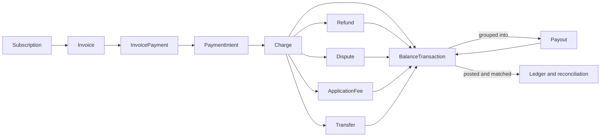
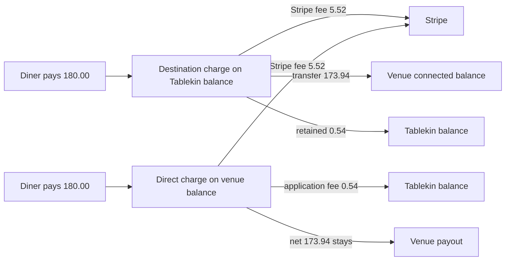
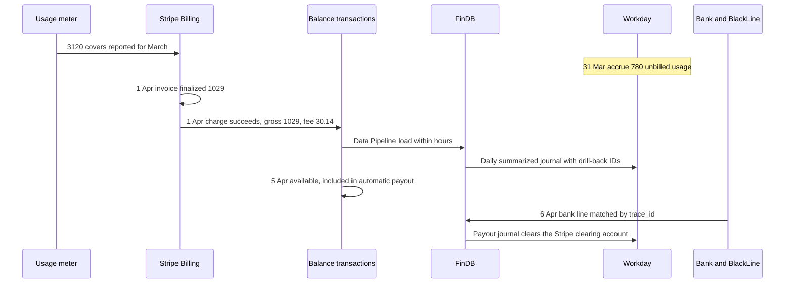
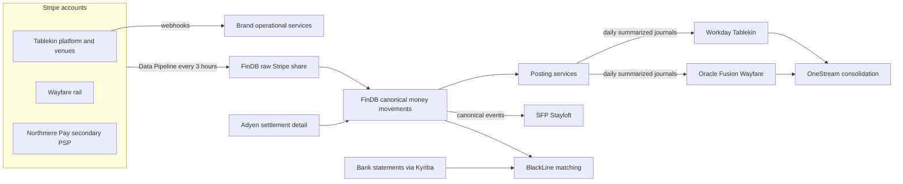

{id: stripe}
# 25. Stripe: Programmable Payments, Billing and Connected Accounts

> **IN THIS CHAPTER, YOU WILL:** Learn how Stripe's objects (PaymentIntent, Charge, Refund, Dispute, Transfer, ApplicationFee, Payout and, under all of them, the BalanceTransaction) become journal entries. You will also see how Connect charge types decide who carries funds, fees and losses, and where Stripe Billing, Tax and Revenue Recognition should hand over to the ERP and the group ledger.

> **WHY FINANCE CARES:** Every dollar that crosses a Stripe balance has to land in the general ledger with its fee, its date and its payout. The choice of Connect charge type changes reported revenue, the balance sheet and dispute losses, even when the commercial deal looks the same.

> **WHY ARCHITECTS SHOULD CARE:** Stripe is an API, not a report. Event ordering, idempotency and twice-yearly breaking API releases decide whether the finance integration is a reliable control or a slowly drifting copy. And because Stripe now sells billing, tax, revenue recognition and data products, it is easy for the estate to end up with a second finance stack nobody chose.

> **KEY POINTS:**
>
> * **The balance transaction is the unit of reconciliation.** Every Stripe object that moves money (charge, refund, dispute, application fee, transfer, payout) produces balance transactions carrying gross, fee, net, `available_on` and a `reporting_category`. Post to the ledger from them, match payouts through them, and the Stripe clearing account can reach zero.
> * **A Connect charge type is an accounting decision.** Direct, destination and separate charges and transfers decide whose balance receives the funds, who pays Stripe's fees and who absorbs refunds and disputes. Identical economics can produce different revenue presentation, different liabilities and different loss exposure.
> * **Let Stripe run the commercial edge, not the books.** Billing, payouts to connected accounts and tax calculation can sit in Stripe. The ledger of record, account reconciliation, group tax policy and consolidated revenue stay with Workday, BlackLine, the tax function and OneStream. Each Stripe finance product needs an explicit decision, not a default.

> **[FAILURE PATTERNS THIS CHAPTER ADDRESSES](#where-finance-architecture-goes-wrong):**
>
> * **Capability Creep** — Stripe Billing, Tax and Revenue Recognition each duplicate a capability the group already owns elsewhere (FI-CA, Vertex, Workday), and each arrives as a checkbox rather than a decision.
> * **The Shadow Ledger** — a Stripe balance that is posted to the ledger as one net payout line becomes a set of books nobody reconciles.
> * **The Borrowed Roadmap** — Stripe's API versions, account models and product packaging move twice a year, and an integration that does not pin and test versions lets Stripe's roadmap rewrite the finance interface.

Stripe calls itself financial infrastructure, and for finance integration that framing is useful because it is literal. A merchant on Stripe does not mainly receive a settlement file. It gets a set of **API objects**, each with an identifier, a lifecycle and a link to the money it moved. That suits engineers, and it is also a trap: there are dozens of object types, and only one of them is the right thing to reconcile against.

This chapter is about choosing that object, and about the boundary Stripe's product range now forces every enterprise architect to draw. **Stripe sells payments, billing, sales-tax calculation, revenue recognition, a data warehouse feed and financial accounts.** Each product works on its own terms. Together they could quietly become a finance stack that duplicates the ERP, the tax engine and the reconciliation platform the group already runs.

[Payments for Finance Architects: The Lifecycle of Money Movement](#payments-fundamentals) owns the payment lifecycle, interchange++, disputes and merchant of record, and I do not re-teach them. [Adyen: Single-Platform Acquiring and Platform Payments](#adyen) describes a report-driven provider; I contrast the two only where the difference changes a design decision. Clearing accounts across all PSPs, the three-way match and the €14 million suspense balance belong to [Payments-to-Ledger: Connecting Providers, Brand Platforms and the ERP](#payments-to-ledger).

{id: stripe--setting-the-scene-at-northmere-three-brands-three-stripe-shapes}
## Setting the Scene at Northmere: Three Brands, Three Stripe Shapes

Northmere, the fictional group this book follows, uses Stripe in three ways, and they are different enough to show most of the design space.

**Tablekin**, the restaurant-software brand acquired in 2023, runs its commercial engine on Stripe. Venues subscribe through **Stripe Billing**: the Pro plan costs $249 a month plus $0.25 per seated cover (a diner seated through Tablekin's reservation system). Diners pay deposits, prepaid tasting menus and bills through Tablekin's embedded payments, built on **Stripe Connect**, Stripe's product for platforms that move money between customers and many businesses. Venues are paid out by Stripe. Tablekin's books are in Workday Financial Management, owned by Arjun Rao, Head of Finance Systems at Tablekin.

**Northmere Pay**, the group's payments platform and licensed e-money institution, routes about 22% of its payment transactions to Stripe. Stripe is the secondary PSP for Stayloft's merchant bookings (Adyen is primary) and the primary PSP for Tablekin. **Wayfare** uses Stripe as the secondary PSP for its merchant-model rail tickets. One example is the €84.00 Paris–Lyon ticket, where Wayfare is merchant of record and the rail operator is paid monthly.

In March 2027, Dana Whitlock, the group's Chief Architect, opens a design review that Leila Haddad, the Chief Accounting Officer, has asked for. Leila's question is short. Tablekin's revenue, its venue liabilities and its Stripe fees reach Workday as one daily journal, booked from the payout amount. When the external auditor asked Tablekin to trace one venue's March invoice from the Stripe dashboard to the general ledger, it took two analysts most of a day. Mei Tanaka, Head of Internal Controls, wants to know whether that is a control gap. Arjun wants to know whether to switch on Stripe Revenue Recognition, which Stripe's sales team has offered. Kofi Asante, Group Head of Tax and Treasury, wants to know why Tablekin calculates US sales tax in Stripe Tax when the group standard is Vertex.

Behind all three questions is the same one: **which Stripe object is the unit of truth, and where does Stripe stop?**

{id: stripe--the-object-model-what-moves-money-and-what-only-describes-it}
## The Object Model: What Moves Money and What Only Describes It

Stripe's API has many objects. For finance, they fall into three groups: objects that describe **commercial intent**, objects that describe a **payment attempt and its aftermath**, and objects that record a **movement in a Stripe balance**. Integrations that go wrong usually post from the first or second group. Integrations that reconcile post from the third.

| Object | What it represents | Moves money? | Finance use |
| --- | --- | --- | --- |
| **Customer, Subscription, Invoice** | Who is billed, on what plan, for which period. An invoice line carries a service period. | No | Revenue recognition input; AR subledger detail |
| **InvoicePayment** | The link between an invoice and the payment(s) that settled it. Introduced in API version `2025-03-31.basil` so one invoice can be paid by several payments. | No | Cash application: which payment paid which invoice |
| **PaymentIntent** | One attempt to collect a payment, through states such as `requires_payment_method`, `requires_action`, `processing`, `requires_capture`, `succeeded`, `canceled` | No | Operational status; customer experience |
| **Charge** | One attempt to charge a payment method, created by a PaymentIntent | Yes, through its balance transaction | Payment-level detail, card and method data |
| **Refund** | Money returned to the payer against a charge | Yes | Contra-revenue or liability reduction |
| **Dispute** | A chargeback raised by the payer's bank, with its own lifecycle | Yes (debit, and possibly a later reversal) | Loss provisioning, dispute operations |
| **ApplicationFee** | A platform's fee taken from a connected account's charge | Yes, into the platform balance | Platform revenue |
| **Transfer** | Movement from a platform's balance to a connected account's balance | Yes | Amounts passed to sellers or venues |
| **Payout** | Movement from a Stripe balance to an external bank account | Yes | Cash in transit; bank match |
| **BalanceTransaction** | The effect of any of the above on a Stripe balance: gross, fee, net, currency, availability date | **It is the movement** | **The reconciliation unit** |

The [PaymentIntent](https://docs.stripe.com/payments/paymentintents/lifecycle) is the object engineers know best (Stripe now recommends its Checkout Sessions API over raw PaymentIntents for most integrations). For finance it is operational: `succeeded` says a payment was collected, not how much Stripe kept, when the funds become available or in which payout they leave. Captures can be partial, so its amount is not the ledger amount.

**Figure 1:** *Commercial and payment objects describe intent and outcome; every object that moves money leaves a balance transaction, and balance transactions are what payouts group and what the ledger should be built from.*

{id: stripe--why-the-balance-transaction-is-the-reconciliation-unit}
### Why the balance transaction is the reconciliation unit

Stripe's [BalanceTransaction object](https://docs.stripe.com/api/balance_transactions/object) records the net effect of a movement on a Stripe balance. For finance, five fields matter:

- **`amount`, `fee`, `fee_details[]`, `net`.** The gross amount, Stripe's total fee, an itemized breakdown of that fee (for example Stripe's processing fee, an application fee or a tax fee), and the net, which is amount minus fee. The fee is attached to the movement that caused it, not invoiced separately at month-end.
- **`currency` and `exchange_rate`.** The balance currency and, where Stripe converted, the rate it used.
- **`created` and `available_on`.** When the movement happened, and "the date that the transaction's net funds become available", with a `status` of `pending` or `available`. The gap between them is the PSP-side timing difference that [Payments for Finance Architects: The Lifecycle of Money Movement](#payments-fundamentals) describes. In the US, Stripe's [default payout timing](https://docs.stripe.com/payouts) is two business days; in Germany it is seven calendar days for a new account and three business days after that.
- **`type` and `reporting_category`.** `type` has around fifty-five values, including `charge`, `payment`, `refund`, `payment_refund`, `adjustment`, `application_fee`, `transfer`, `payout`, `payout_failure`, `stripe_fee`, `tax_fee`, and reserve and Issuing types. Stripe's own advice is: "To classify transactions for accounting purposes, consider `reporting_category` instead."
- **`source`.** An expandable link to the object that caused the movement: the charge, refund, dispute, transfer or payout. This is how a ledger line traces back to the business event.

[Reporting categories](https://docs.stripe.com/reports/reporting-categories) are Stripe's accounting-friendly regrouping of types. Card `charge` and non-card `payment` both become `charge`. `refund` and `payment_refund` become `refund`. `adjustment`, which hides disputes, dispute reversals and failed refunds, is split into its real meanings. `application_fee` becomes `platform_earning`, `stripe_fee` becomes `fee`, and `payout_failure` and `payout_cancel` become `payout_reversal`. A partial capture produces one balance transaction for the full authorized amount and a second, with reporting category `partial_capture_reversal`, for the uncaptured part. If you post by `type`, you post that reversal as a refund.

Three properties make the balance transaction the right unit, and they are the properties [Designing for Traceability, Reconciliation and Audit Across Boundaries](#traceability-and-reconciliation) asks of any reconciliation unit:

1. **Completeness.** Every movement in the balance has one. If you sum the balance transactions for a period, you get the change in the Stripe balance, so any total that disagrees with Stripe's balance report means something is missing.
2. **Money truth.** It carries the fee and the net as Stripe applied them, not as the contract says they should be.
3. **Grouping.** Each balance transaction that leaves through an automatic payout can be tied to that payout. The payout can be tied to a bank statement line. The order or invoice can be tied to the charge through `source` and metadata. Those are the three legs of the match that [Payments-to-Ledger: Connecting Providers, Brand Platforms and the ERP](#payments-to-ledger) designs.

The caveat matters. **A balance transaction is a single-entry record** of the effect on Stripe's view of your balance. It is not a double-entry journal. Mapping `reporting_category` to accounts, splitting fees, handling FX and treating reserves are the merchant's posting design. Stripe does not do them for you, and it should not. The posting rules belong to the entity's ledger and to the accounting policy owner.

{id: stripe--how-this-differs-from-adyen}
### How this differs from Adyen

[Adyen: Single-Platform Acquiring and Platform Payments](#adyen) reconciles through **reports**: journal types per settlement batch in the settlement details report. Stripe reconciles through an **object** you can query, stream or receive in a report. The difference is small at month-end and large in between: a Stripe posting service can build the ledger view continuously as balance transactions are created, while Adyen's natural rhythm is the batch. Both net fees from settlement, both deliver webhooks at least once and out of order, and both need the merchant's reference propagated (Adyen's `merchantReference`, Stripe's `metadata`). The canonical model in [Payments-to-Ledger: Connecting Providers, Brand Platforms and the ERP](#payments-to-ledger) maps Stripe's `reporting_category` and Adyen's journal type onto one money-movement vocabulary.

{id: stripe--payouts-and-the-payout-reconciliation-report}
## Payouts and the Payout Reconciliation Report

A **payout** moves funds from a Stripe balance to the merchant's bank account. Stripe supports [automatic payouts](https://docs.stripe.com/payouts) on a daily, weekly or monthly schedule, and manual payouts, where the merchant chooses when and how much. Same-day manual payouts exist in some markets, and instant payouts usually arrive within thirty minutes. Brazil and India are always automatic and daily. A negative balance can be debited from the bank account.

Automatic versus manual looks like a treasury preference; it is a reconciliation decision. Stripe's [payout reconciliation report](https://docs.stripe.com/reports/payout-reconciliation), the report that lists "every payment, refund, dispute, fee, and other balance transaction included in the payout", is available only for **automatic payouts**, or for a platform whose connected accounts use automatic payouts. Manual-payout users are directed to the balance report instead. For instant payouts, "Stripe can't identify which transactions are included in each payout", so the merchant reconciles them itself.

The report has four sections: a balance summary, the payout reconciliation itself grouped by reporting category, failed payouts, and an ending-balance reconciliation that lists what was still unsettled at period end. The itemized version carries, per balance transaction, `automatic_payout_id`, `automatic_payout_effective_at`, `available_on`, `balance_transaction_id`, `reporting_category`, gross, fee and net, `payment_intent_id`, `payment_metadata[key]` for any metadata the integration set, and `trace_id` and `payout_reference_token` for matching the payout to the bank line. Report type names carry version suffixes that change over time, so pin the version you consume and test the change, as with any other interface.

Two behaviors catch finance teams out:

- **Reconciliation data can lag the cash.** Stripe states that "a payout might arrive before its reconciliation data is ready". A bank-side match that runs on the morning the cash lands may find no itemization yet. The matching job must tolerate this and retry; it must not post the payout to suspense.
- **Payouts are grouped by estimated arrival date, not bank posting date.** Dashboard reports cover whole days; the Reporting API allows partial days, and Stripe fires webhooks twice daily when the 00:00 and 12:00 UTC data becomes available. A month-end cut-off rule has to say which date governs.

The ending-balance section matters most at month-end. A Stripe balance at 31 March is not zero. It holds funds not yet available, funds available but not yet paid out, and any reserve. **That balance is an asset of the entity**, in substance cash held at a payment provider, and it must appear in the ledger as a clearing or receivable account. That account is reconciled to Stripe's ending balance every month. If the ledger books only the payout, the balance disappears. That is the mechanism behind The Shadow Ledger in Tablekin's case: the Stripe balance was a set of books, and nobody reconciled it.

**Figure 2:** *Booking only the net payout hides fees, refunds and the balance still held at the provider; posting each balance transaction to a clearing account keeps that balance on the books and testable against the provider's ending balance.*

{id: stripe--connect-charge-types-account-models-and-who-carries-what}
## Connect: Charge Types, Account Models and Who Carries What

Connect is how a platform such as Tablekin takes payments for businesses on its platform (venues) and routes money between the payer, the business, the platform and Stripe. Two decisions shape the finance integration: the **account model** for connected accounts, and the **charge type** for each payment.

{id: stripe--the-account-model-has-moved-on}
### The account model has moved on

For a decade, Connect platforms chose between Standard, Express and Custom accounts. As of October 2026, Stripe documents these as [legacy "account types"](https://docs.stripe.com/connect/accounts), labeled "Deprecated feature". It recommends either **controller properties** on the v1 Accounts API or the [Accounts v2 API](https://docs.stripe.com/connect/accounts-v2). In v2, one account carries **configurations**:

- `merchant`: the account accepts payments.
- `customer`: the platform can charge the account, replacing a separate Customer object.
- `recipient`: the account receives transfers.

`defaults.responsibilities` sets the `fees_collector`, which decides who pays Stripe's fees, and the `losses_collector`, which decides who bears negative balances. At the time of writing v2 cannot yet be used for OAuth, the `treasury` or `card_issuing` capabilities, or recipient service agreements.

For Tablekin this is more than vocabulary. A venue is both a **merchant** (it accepts diners' payments) and a **customer** (it pays Tablekin's subscription invoice). In v2 those can be configurations of one account, which removes a mapping between a venue's connected account and its billing customer. That mapping is a master-data join Arjun's team maintains today, a small case of The Doppelgänger Record.

{id: stripe--charge-types-decide-where-the-money-and-the-losses-land}
### Charge types decide where the money and the losses land

Stripe's [charge types documentation](https://docs.stripe.com/connect/charges) defines three charge types. A **direct charge** is created on the connected account. A **destination charge** is created on the platform, with part of the funds transferred immediately to one connected account. **Separate charges and transfers** are created on the platform, with transfers decoupled from the charge, possibly to several connected accounts and possibly before or after the charge. Indirect charges can add **`on_behalf_of`**, which makes the connected account "the business of record". The charge then settles in the connected account's country, uses that country's fee structure, and shows the connected account's statement descriptor.

| | Direct charge | Destination charge | Destination charge with `on_behalf_of` | Separate charges and transfers |
| --- | --- | --- | --- | --- |
| **Charge created on** | Connected account | Platform | Platform | Platform |
| **Funds land in** | Connected account's balance; application fee moves to the platform's balance | Platform's balance; a portion transfers immediately to the connected account | As destination, settled in the connected account's country | Platform's balance; transfers created separately, to one or many accounts |
| **Name on the payer's statement** | Connected account | Platform | Connected account | Platform, unless `on_behalf_of` |
| **Stripe fees debited from** | Configurable: the connected account (`fees_collector: stripe`) or the platform (`application`) | Platform | Platform, at the connected account's country pricing | Platform |
| **Refunds and disputes debited from** | Connected account | Platform; recovered by transfer reversal | Platform; recovered by transfer reversal | Platform; recovered by transfer reversal |
| **Platform earns through** | Application fee | The retained portion, or an application fee | The retained portion, or an application fee | The difference between charge and transfers |
| **Stripe's stated fit** | SaaS platforms whose businesses transact directly with their customers | Marketplaces where customers transact with the platform | Marketplaces wanting local settlement and descriptors | One-to-many splits, charges before the recipient is known |
| **Typical legal merchant of record (judgment, not Stripe's statement)** | The business | Often the platform, depending on contracts | Often the business, but the contracts decide | Often the platform |

**Table 1:** *Connect charge types by funds flow, fee and loss liability. All rows except the last are from Stripe's documentation as of October 2026; the last row is a judgment.*

Two cautions sit under that table.

First, **Stripe's "business of record" is not the accounting concept of principal, and it is not the legal merchant of record.** [Payments for Finance Architects: The Lifecycle of Money Movement](#payments-fundamentals) owns merchant of record: the party that sells to the customer and carries the legal obligations of the sale. [Accounting for Architects: Ledgers, Journals and Revenue](#accounting-for-architects) owns the principal-versus-agent assessment under ASC 606 and IFRS 15 (the US GAAP and international revenue standards), which depends on who controls the good or service before it reaches the customer. Collecting the cash does not make an entity the principal. A charge type is evidence for those judgments. It does not settle them.

Second, **with direct charges, fee responsibility is fixed when the connected account is created.** Stripe's [fee-payer documentation](https://docs.stripe.com/connect/direct-charges-fee-payer-behavior) says the fee payer can be specified only at account creation. If the fee collector is `stripe`, Stripe deducts its fee and the platform's application fee separately, and the platform sets the application fee to "include only your fee". If it is `application`, the platform collects the payment and fees and pays Stripe, so the application fee must cover both. The setting also decides who pays dispute fees and fees for products such as Radar, Instant Payouts and Stripe Tax. That makes it a pricing and accounting decision that belongs in Leila's and the commercial team's design review, not only in an engineering ticket.

{id: stripe--the-accounting-consequence-for-tablekin}
### The accounting consequence for Tablekin

Tablekin's 2027 baseline is inherited from before the acquisition. Venues are legacy Express accounts, and diner payments are **destination charges**. Stripe now advises against direct charges on legacy Express and Custom accounts and points those platforms to v2 accounts or destination charges, so the baseline was a reasonable choice when it was made. Arjun's proposal is to onboard new venues on **Accounts v2 with direct charges**, with `fees_collector: stripe`, and migrate existing venues over 2027–2028.

Take one diner payment to show what changes. On Friday 12 March 2027 a diner prepays a **$180.00** tasting-menu reservation at Juniper & Ash, a 120-cover restaurant in Austin on the Pro plan. Tablekin's price to the venue for payments is an all-in **$6.06** on this charge. Stripe's processing fee is an illustrative **$5.52**, so Tablekin keeps a margin of $0.54 and the venue nets **$173.94** either way. The figures are illustrative and not Stripe's pricing.

| Step | Destination charge (baseline) | Direct charge, v2 account, `fees_collector: stripe` (proposed) |
| --- | --- | --- |
| Charge created on | Tablekin's platform balance: +$180.00 gross | Juniper & Ash's connected balance: +$180.00 gross |
| Stripe fee | −$5.52 from Tablekin's balance | −$5.52 from the venue's balance |
| Venue's share | Transfer of $173.94 to the venue's balance | Stays in the venue's balance |
| Tablekin's balance after the charge | +$0.54 net ($180.00 − $5.52 − $173.94) | +$0.54 application fee (`platform_earning`) |
| A $180.00 dispute | Debits Tablekin's balance $180.00 plus the dispute fee; Tablekin must reverse the transfer to recover $173.94 from the venue | Debits the venue's balance; Tablekin's balance is untouched unless the venue's balance cannot cover it and Tablekin carries negative-balance liability |

The venue receives the same money in both designs. Tablekin's books do not look the same:

- **Gross cash passes through Tablekin's balance under destination charges.** For about two business days, until the funds are available and transferred, Tablekin's Stripe balance holds $180.00, of which $173.94 belongs to the venue. That is a **payable to the venue**, not revenue and not a contract liability for Tablekin's own services. Tablekin's ledger needs a "funds payable to venues" account, and that account must reconcile to the transfers.
- **Reported revenue may change.** Under the baseline, Tablekin charges the venue $6.06 and pays Stripe $5.52 itself. Leila's policy team concluded in 2024 that Tablekin is the principal for the payment-processing service it sells to venues. It therefore reports **$6.06 of payments revenue** and **$5.52 of processing cost**. Under the proposal, Stripe charges the venue directly, Tablekin earns a $0.54 application fee, and Tablekin reports **$0.54 of revenue** with no processing cost. Gross margin dollars are unchanged, revenue on this line falls by about 91%, and margin percentage rises. If Tablekin instead chose `fees_collector: application`, it would set a $6.06 application fee and pay Stripe, and the gross presentation would likely survive. The policy team has to reassess, because the facts changed. Whichever answer it reaches, the charge-type migration is **a revenue-presentation event that must be disclosed in Tablekin's plans and in the group's segment reporting**, not an engineering refactor.
- **Loss exposure moves.** Under destination charges, disputes debit Tablekin first and recovery depends on reversing a transfer from a venue that may have already been paid out. Under direct charges, the venue bears the dispute. Tablekin's residual exposure is limited to negative balances where it is the `losses_collector`. Tablekin's dispute-loss allowance, its reserve policy and Mei's control over transfer reversals all change scope.
- **Reconciliation gets simpler.** Under direct charges, Tablekin's platform balance holds only Tablekin's own money: subscription receipts and application fees. Venue funds never pass through it, so there is no payable to reconcile.

I would approve Arjun's direction on three conditions: the policy team reassesses principal-versus-agent before the first migrated venue goes live; the commercial team reprices so the venue's all-in cost and Tablekin's margin are explicit; and OneStream's segment mapping flags gross and net presentation during the transition. Tablekin gives up some reported revenue and control of the fee experience, and gains a balance sheet that holds only its own money.

**Figure 3:** *The same economics routed two ways: under destination charges the gross amount, the fee and the dispute risk pass through Tablekin's balance; under direct charges only the application fee does.*

{id: stripe--billing-subscriptions-invoices-and-usage}
## Billing: Subscriptions, Invoices and Usage

**Stripe Billing** produces invoices from subscriptions. Each billing cycle a subscription generates an invoice, and [each subscription item becomes an invoice line item with a service period](https://docs.stripe.com/revenue-recognition/methodology). Licensed (flat) prices are normally billed in advance and metered (usage) prices in arrears. That is why the Tablekin invoice dated 1 April 2027 carries two periods:

| Invoice line | Service period | Quantity | Amount |
| --- | --- | --- | --- |
| Pro plan subscription | 1–30 April 2027 | 1 | $249.00 |
| Seated covers | 1–31 March 2027 | 3,120 × $0.25 | $780.00 |
| **Total before sales tax** | | | **$1,029.00** |

The service periods matter more to finance than the invoice date does. The $780 of usage is **March revenue**, earned before the invoice exists. The $249 is **April revenue**, invoiced before it is earned. Tablekin's March close must therefore accrue $780 of unbilled revenue on 31 March from the meter, and on 1 April must record $249 as **deferred revenue**: an obligation to provide service it has already invoiced. If you use the invoice date as the revenue date, you misstate both months.

Usage-based billing is where Stripe's product line is moving fastest. As of October 2026 Stripe's [usage-based billing documentation](https://docs.stripe.com/billing/subscriptions/usage-based) says "Metronome is now part of Stripe". It describes Metronome as "Stripe's primary usage-based billing platform and the recommended starting point for all new integrations". The **Meters API**, described as "basic usage-based billing", remains supported, and older usage records are documented as legacy. Tablekin's per-cover price is a simple meter: one count, one unit price, one period. It does not need Metronome's rating machinery today. My recommendation is to stay on Meters and record a review trigger: revisit if Tablekin introduces commitments, prepaid credits, tiered or blended rates, or multi-product contracts. Do not migrate a working billing engine because the vendor's recommended starting point changed.

{id: stripe--where-billing-should-sit-relative-to-the-erp}
### Where billing should sit relative to the ERP

[Around the Core: Tax, Treasury, Procurement and Reporting Platforms](#satellite-platforms) treats billing platforms as a category; the decision for Tablekin is narrower. **Billing belongs close to the product**: the plan catalog, proration, dunning (automated collection of failed payments) and the customer-facing invoice change at product speed, and Stripe Billing does all of these next to the payment it collects. Workday's billing is positioned for services and subscription contracts, not high-volume metered billing ([Workday: Financials, People and the Organizational Backbone](#workday)). Moving Tablekin's billing into Workday would put product changes behind ERP change control and buy nothing the controller needs.

What the controller needs is that **the billing subledger reconciles to the ledger**. Stripe Billing is Tablekin's accounts receivable subledger for venue invoices, and it must be governed like one:

- Invoice totals by period tie to AR postings in Workday.
- Open invoices tie to the AR balance.
- Credit notes and write-offs flow as their own events.
- Changes to price and plan configuration go through the same change control as any other revenue-relevant system. That is the lesson of Northmere's FY2026 significant deficiency on the SFP payout engine, which [Controls, Auditability and Security by Design](#controls-and-auditability) discusses.

Stripe Billing is also one of Northmere's three billing approaches, alongside SFP commission billing and FI-CA invoicing, and it appears in the overlap register in [Preventing Redundant Capabilities and Unnecessary Coupling](#redundancy-and-coupling). My verdict is that this is **duplication that earns its place**. The three engines bill different customers (venues, hotels, partners) under different commercial models, and none of them could absorb the others without becoming a worse product. The rule I apply is that duplicate engines are acceptable when each one feeds the ledger through the same canonical events (`SubscriptionInvoiced`, `UsageRated`) and the same reconciliation discipline.

{id: stripe--stripe-tax-and-revenue-recognition-where-stripe-s-finance-products-stop}
## Stripe Tax and Revenue Recognition: Where Stripe's Finance Products Stop

Stripe now sells two products that reach into the controller's territory.

[**Stripe Tax**](https://docs.stripe.com/tax) calculates sales tax, VAT and GST by product tax code and location. It monitors registration thresholds, manages registrations (including registering on the merchant's behalf in the US), files and remits directly or through partners, supports Connect, and has a Tax API for transactions that do not go through Stripe payments.

[**Stripe Revenue Recognition**](https://docs.stripe.com/revenue-recognition/methodology) automates accrual accounting for Stripe-originated revenue, and Stripe positions it for ASC 606 and IFRS 15. It is "built … on top of a double-entry accounting ledger". It treats each invoice line item as its own performance obligation and amortizes it evenly over its service period. Refunds and disputes become contra-revenue (deductions from revenue). It ships a default chart of accounts (revenue, contra-revenue, AR, cash, deferred and unbilled revenue, tax liability, FX loss, fees, pending cash and Connect transfer loss) that can be mapped to the merchant's GL. It supports imports of non-Stripe data, rules and exclusions, and a [debits-and-credits export with audit drill-down](https://docs.stripe.com/revenue-recognition). Stripe reports that Revenue Recognition data is available within three to four hours.

Both are well-built products. The question is not whether they work. It is **whether Northmere wants a second place where tax is determined and revenue is accounted for.**

| Capability | Stripe product | Enterprise owner at Northmere | Recommended boundary | Condition that would change it |
| --- | --- | --- | --- | --- |
| Subscription billing, invoicing, dunning | Stripe Billing | Tablekin product and finance systems | **Stripe** is the billing and AR subledger; Workday receives AR postings | Tablekin moves to complex contract billing that Stripe cannot model |
| Usage rating | Meters (or Metronome) | Tablekin product | **Stripe**; meter events are the source of the usage accrual | Pricing complexity triggers the Metronome review |
| Venue payouts | Connect | Tablekin | **Stripe**; the group payout engines do not take over venues | Venues need payout rails Stripe does not offer |
| Sales-tax calculation on venue invoices | Stripe Tax | Kofi's tax function (standard: Vertex) | **Stripe Tax for calculation, with a dated exception**; tax policy, product taxability mapping, returns and audit defense stay with group tax | The Keystone shared tax service is live (2029 target) and can price Tablekin's tax calls |
| Revenue recognition | Stripe Revenue Recognition | Leila (policy); Workday (ledger) | **Workday generates revenue accounting** from invoice-line service periods, through Accounting Center rules; Stripe RevRec is not adopted | Tablekin's revenue stays 100% Stripe-billed, and Workday rules cannot be maintained at reasonable cost |
| General ledger of record | none (internal only) | Workday for Tablekin; group view in OneStream | **Workday** | Brand-ledger convergence onto the group core (2029) |
| Account reconciliation | Reports, Sigma | BlackLine | **BlackLine**, fed with Stripe balance transactions and payout data | none |
| Finance analytics | Sigma, Data Pipeline | Owen's FinDB | **Snowflake FinDB** via Data Pipeline; Sigma for ad-hoc queries only | none |
| Cash holding and treasury | Financial accounts (preview in some markets) | Kofi's treasury, Kyriba | **Not adopted**; Stripe balances sweep to group-controlled bank accounts | none foreseen |
| Multi-PSP routing | Stripe Orchestration (private preview) | Northmere Pay | **Northmere Pay's own routing** | Orchestration reaches general availability and covers settlement data |

**Table 2:** *Where Stripe's finance products stop and the enterprise's begin, as Dana's design review recorded it in March 2027.*

The revenue row is the one readers will argue with. Stripe RevRec is a **subledger for Stripe-originated revenue**, and Tablekin's revenue is mostly but not entirely Stripe-billed: enterprise venue groups sign negotiated contracts with implementation fees, invoiced in Workday. Adopting RevRec would add a second revenue engine, with its own chart of accounts, rules and audit trail, for one brand in a group that already runs revenue accounting in SAP, Oracle and Workday. Policy owners would keep two rule sets aligned, the auditor would test two engines, and the 2029 ledger convergence would have one more thing to migrate. **The alternative is cheaper**: each invoice line already carries its service period, and Workday Accounting Center can apply the same straight-line rule on ingestion, where the policy owner already governs revenue logic. A stand-alone SaaS company with all revenue on Stripe and no ERP revenue module should probably reach the opposite verdict, because its alternative is spreadsheets.

Stripe Tax gets a **dated exception** rather than a rejection. It calculates at invoice finalization without a round trip to a second engine on the billing path, and Keystone's shared tax service is not due until 2029. Until then Tablekin keeps Stripe Tax on two conditions: group tax owns the product-taxability mapping, and the tax liability posts to Workday from the invoice's tax lines, not inferred from cash. Without the expiry date the exception would be Capability Creep with paperwork.

**Figure 4:** *Stripe runs the commercial edge for Tablekin, with Stripe Tax on a dated exception; the ledger of record, reconciliation, revenue policy and analytics stay with the enterprise, and Stripe Revenue Recognition is deliberately not adopted.*

{id: stripe--getting-data-out-webhooks-sigma-and-data-pipeline}
## Getting Data Out: Webhooks, Sigma and Data Pipeline

Stripe offers three ways to get data out, and each has one job.

**Webhooks** feed operational systems. A Tablekin service that suspends a venue whose invoice failed needs `invoice.payment_failed` within seconds. A posting service does not need any event within seconds.

**Sigma** is a read-only SQL environment inside the Stripe Dashboard, with report templates that include the payout reconciliation itemization. It filters in UTC, and a `data_load_time` parameter shows how fresh the data is ([how Sigma works](https://docs.stripe.com/stripe-data/how-sigma-works)). It suits finance self-service: an analyst's question, an investigation of one payout.

**Data Pipeline** delivers Stripe data to [Snowflake, Amazon Redshift, Databricks or BigQuery as a data share, or as Parquet to S3, GCS or Azure Blob storage](https://docs.stripe.com/stripe-data/access-data-in-warehouse). The first data arrives within 12 hours, and after that a full load arrives every three hours. Live and test data go to separate schemas, and every table carries a `merchant_id`. Data Pipeline is not offered in India.

For Northmere, Data Pipeline into Owen Mbeki's Snowflake FinDB is the **enterprise feed**. Owen's team lands Tablekin's, Wayfare's and Northmere Pay's Stripe shares immutably and normalizes balance transactions into the canonical model next to Adyen's settlement detail; the posting services and BlackLine's matching read that layer. A three-hour refresh is ample for a daily posting cycle, and nothing in the finance path needs minutes.

The time-zone rule needs to be explicit. Sigma works in UTC, Stripe's dashboard reports default to the account's local time zone, and Tablekin's Workday periods close on US Central time. A cover seated at 11:30 p.m. in Austin on 31 March is a 1 April event in UTC. Northmere's rule is that **the period of a balance transaction is decided by its `created` timestamp converted to the ledger entity's time zone**. The rule is written in the posting design and tested at every period end.

{id: stripe--webhooks-and-idempotency-the-integration-contract}
## Webhooks and Idempotency: The Integration Contract

Two Stripe guarantees, and one deliberate non-guarantee, shape every integration.

**Signatures.** Each webhook carries a `Stripe-Signature` header with a timestamp (`t=`) and a `v1=` HMAC-SHA256 signature computed over the timestamp and the raw payload, using the endpoint's secret. Stripe's libraries apply a five-minute tolerance to resist replay. Verification requires the **raw** request body, so a gateway that re-serializes JSON before the handler sees it breaks verification ([webhooks documentation](https://docs.stripe.com/webhooks)). That is an infrastructure requirement to give to whoever owns the API gateway.

**Retries.** In live mode Stripe retries failed deliveries "up to three days with an exponential back off". Events can be resent manually for 15 days from the Dashboard or 30 days from the CLI. A handler outage longer than three days loses events unless something else reconciles. That is one more reason the finance path should not depend on webhooks.

**No ordering.** "Stripe doesn't guarantee the delivery of events in the order that they're generated." The `created` field has one-second granularity and cannot be used to sort events. Duplicates happen. In some cases two distinct Event objects describe the same change, so Stripe advises deduplicating on the object identifier and event type, not only on the event ID. Stripe now offers **thin events** (recommended) alongside **snapshot events** on new event destinations, and can deliver to Amazon EventBridge or Azure Event Grid. Snapshot events are frozen at the API version in force when they were created.

The design consequence is the rule [Integration Architecture for Finance](#integration-architecture) states in general: **treat an event as a hint that something changed, then read the current state.** A handler that receives `charge.refunded` before `charge.succeeded` should fetch the charge and act on its state, not replay the event sequence. For finance this goes one step further. The posting service does not consume webhooks at all. It consumes balance transactions from the normalized FinDB layer. Those are append-only, carry their own identifiers, and do not depend on delivery order.

**Idempotency** protects the other direction. Every v1 POST accepts an `Idempotency-Key` header of up to 255 characters. Stripe keeps keys for at least 24 hours, rejects a reuse with different parameters, and in v1 replays the saved response, including a saved 500 error ([idempotent requests](https://docs.stripe.com/api/idempotent_requests)). v2 endpoints instead retry the failed work to completion. For Tablekin the requests that matter are the ones that move money or create billable quantities: creating transfers, refunds and payouts, and reporting covers to the meter. I recommend that **idempotency keys are derived from business identity**, never generated randomly per attempt. Tablekin's usage service, for example, keys each meter report by venue, service day and batch sequence. A retry then cannot count 3,120 covers twice, and a reviewer can tell from the key which business event a request represents. A random UUID per attempt satisfies the API and defeats the purpose.

{id: stripe--api-versioning-as-integration-governance}
## API Versioning as Integration Governance

Since `2024-09-30.acacia`, [Stripe ships monthly non-breaking releases and two major releases a year](https://docs.stripe.com/api/versioning) that may contain breaking changes. As of October 2026, Stripe's versioning page lists `2026-09-30.endive` as the current version; confirm the current version before pinning, because a new one ships every month. A request uses the account's default version unless it sets a `Stripe-Version` header, typed SDKs pin a version, and webhook payloads follow the version configured on the endpoint or, failing that, the account default.

One example shows why this belongs in finance governance and not only in engineering hygiene. The Basil release (`2025-03-31.basil`) [removed the `payment_intent`, `charge` and `paid` fields from the Invoice object](https://docs.stripe.com/changelog/basil/2025-03-31/add-support-for-multiple-partial-payments-on-invoices). It also removed the `invoice` field from PaymentIntent and Charge, and introduced the InvoicePayment object because one invoice can now be paid by several partial payments. A cash-application job that linked invoices to charges through `invoice.charge` would, after an unreviewed upgrade, find nothing to link. Every invoice would look unpaid while the cash sat in the Stripe balance. The upgrade would look like an engineering task and fail as a finance control.

Northmere's standard, which Lucía Romero's integration team owns, has four parts:

- **Pin the version explicitly** in every service and on every webhook endpoint. Never inherit the account default, because changing the default in the Dashboard would then change the finance interface silently.
- **Treat a major release as an interface change.** It gets a decision record, a named owner in finance systems, and a regression run of one closed month's balance transactions, invoices and payouts through the posting and matching logic, compared line by line with the published ledger.
- **Upgrade at most twice a year, never inside a close window.** Stripe's upgrade tooling allows a 72-hour rollback, which is shorter than any close.
- **Version the report types too.** Payout reconciliation report suffixes change independently of the API version.

{id: stripe--stripe-s-ledger-as-an-idea-source-not-a-product}
## Stripe's Ledger as an Idea Source, Not a Product

In February 2024 Stripe's engineering blog published ["Ledger: Stripe's system for tracking and validating money movement"](https://stripe.dev/blog/ledger-stripe-system-for-tracking-and-validating-money-movement) by Ilya Ganelin. It describes Stripe's **internal** system of record for its own financial data. **It is not a product Stripe customers can buy or use.** I cite it because it states, at very large scale, three ideas the enterprise side should copy:

- **Double entry and an immutable log.** Corrections are reversals and reprocessing, never edits.
- **Producer systems modeled as state machines and fund flows.** Every movement has a defined path from one account to another.
- **Clearing accounts that should be zero at steady state.** A non-zero balance flags data that is missing, late or wrong, and data-quality metrics are tracked for clearing, timeliness and completeness.

Stripe reports processing about five billion events a day and verifying 99.99% of dollar volume within four days.

The third idea is the one Tablekin is missing. A **Stripe clearing account** in Workday is debited when a balance transaction adds to the balance and credited when a payout leaves it. It is not a suspense account for unknown items: it holds known money in transit, and it has a known expected balance, namely Stripe's ending balance. When the ledger's clearing balance and Stripe's ending balance agree, the books and the money agree. When they differ, the difference is a list of balance transactions, not a mystery. [Designing Custom Ledgers and Financial Event Processing](#designing-financial-ledgers) generalizes the pattern for custom ledgers, and [Payments-to-Ledger: Connecting Providers, Brand Platforms and the ERP](#payments-to-ledger) applies it across PSPs.

{id: stripe--worked-example-the-tablekin-invoice-from-meter-to-workday}
## Worked Example: The Tablekin Invoice from Meter to Workday

This is the posting design Dana's review approved for Tablekin. Accounts are named descriptively; in Workday they are ledger accounts with worktags (Workday's dimensional attributes such as company, cost center and revenue category, described in [Workday: Financials, People and the Organizational Backbone](#workday)). Sales tax is left out to keep the arithmetic visible: in production the invoice's tax lines post to a sales-tax-payable account. The Stripe fee of **$30.14** is illustrative (it is roughly the shape of a card price of 2.9% plus 30 cents, not Tablekin's negotiated rate). The payout total is illustrative.

**Figure 5:** *The Tablekin invoice crosses three time boundaries: usage is earned in March, invoiced and paid on 1 April, and paid out on 5–6 April. Each boundary is a separate journal, not one net line.*

**Step 1 — Usage accrual, 31 March 2027.** The meter holds 3,120 covers for Juniper & Ash. The posting service reads the meter totals for every venue at the period cut-off and accrues usage revenue that has been earned but not yet invoiced.

| Account | Debit | Credit | Note |
| --- | --- | --- | --- |
| Unbilled receivable – usage | 780.00 | | Earned in March, invoiced 1 April |
| Revenue – usage (covers) | | 780.00 | Worktag: revenue category Usage, venue segment |

**Step 2 — Invoice finalized, 1 April 2027.** Stripe Billing finalizes invoice `in_…` for $1,029.00 with two lines and their service periods.

| Account | Debit | Credit | Note |
| --- | --- | --- | --- |
| Accounts receivable – Stripe Billing | 1,029.00 | | Detail stays in Stripe; invoice ID carried as reference |
| Unbilled receivable – usage | | 780.00 | Reverses the March accrual |
| Deferred revenue – subscriptions | | 249.00 | April service, not yet earned |

**Step 3 — Payment and fee, 1 April 2027.** The venue's card on file is charged. The charge's balance transaction `txn_…` shows `reporting_category: charge`, `amount` 102900, `fee` 3014, `net` 99886, currency `usd`, and `available_on` 5 April (two US business days after Thursday 1 April). The `source` links to the charge. The InvoicePayment links the charge to the invoice.

| Account | Debit | Credit | Note |
| --- | --- | --- | --- |
| Stripe clearing – USD | 1,029.00 | | Gross into the Stripe balance |
| Accounts receivable – Stripe Billing | | 1,029.00 | Cash applied via the InvoicePayment, not the amount |
| Payment processing fees | 30.14 | | From `fee_details`, not from a monthly invoice |
| Stripe clearing – USD | | 30.14 | Fee deducted in the balance |

**Step 4 — Revenue release, April 2027.** Accounting Center's straight-line rule releases the subscription over its service period.

| Account | Debit | Credit | Note |
| --- | --- | --- | --- |
| Deferred revenue – subscriptions | 249.00 | | Released over 1–30 April |
| Revenue – subscription (Pro) | | 249.00 | |

**Step 5 — Payout, 5–6 April 2027.** The automatic payout `po_…` created on 5 April, with estimated arrival on 6 April, totals an illustrative **$214,386.12**. It contains 3,412 balance transactions: subscription charges, application fees from direct-charge venues, refunds and Stripe fees. The net $998.86 from this invoice is one of them.

| Account | Debit | Credit | Note |
| --- | --- | --- | --- |
| Cash in transit – Stripe payouts | 214,386.12 | | One line per payout, referenced by payout ID |
| Stripe clearing – USD | | 214,386.12 | Clears the 3,412 balance transactions in the payout |
| Operating bank – USD | 214,386.12 | | On the bank statement line, 6 April |
| Cash in transit – Stripe payouts | | 214,386.12 | Matched by `trace_id` in BlackLine |

Three design choices make this auditable:

- **Summarize for posting, never for tracing.** Workday receives one journal per day per entity, currency and reporting category: subscription receipts, fees, refunds, platform earnings and payouts. Every line carries the list of balance-transaction IDs in FinDB. Each summarized line keeps a drill-back key to its detail, so the summary is a posting convenience and not Lost in Aggregation. When the auditor asks for Juniper & Ash's March invoice, an analyst runs one query from the Workday journal line to the FinDB rows to the Stripe IDs. That takes minutes, not a day.
- **Two clearing accounts, two zero tests.** Stripe clearing – USD must equal Stripe's ending balance at period end, using the ending-balance section of the payout reconciliation report. Cash in transit must be zero once every payout is matched to a bank line. Both are BlackLine reconciliations with a stated owner. With a daily automatic payout, the expected balance in Stripe clearing is roughly two business days of net flows plus any reserve. A balance much larger than that is a signal before it becomes a finding.
- **Fees are posted from the balance transaction.** Because `fee_details` itemizes Stripe's fee on each movement, fee expense is accrued as it is incurred, by fee type. No one has to estimate it at month-end or back it out of a net payout. This also gives Northmere Pay the per-transaction fee data it needs to compare Stripe's and Adyen's cost per route.

The same design, with different accounts, covers the other two Stripe shapes. For the **€84.00 Wayfare rail ticket**, Wayfare's own Stripe account produces a `charge` balance transaction in euros. Wayfare's posting service books gross to Stripe clearing – EUR in Oracle Fusion. Wayfare is merchant of record, but Northmere's policy treats it as agent for rail, so it recognizes only its €6.72 margin as revenue at ticket issue and owes the rail operator the €77.28 fare in the monthly supplier settlement ([Oracle Fusion Cloud ERP: Ledgers, Accounting Hub and Coexistence](#oracle-fusion)). That is a different revenue model, but the same reconciliation unit. For **Stayloft bookings routed to Stripe**, Northmere Pay normalizes the balance transactions into the canonical `PaymentSettled` and `PSPFeeCharged` events alongside Adyen's journal lines. SFP consumes the canonical events and does not see either provider's shape.

{id: stripe--trade-offs-how-deep-to-go-into-stripe}
## Trade-Offs: How Deep to Go into Stripe

The boundary in Table 2 is one point on a spectrum. Here are the realistic options for a brand like Tablekin.

| Option | What it means | Strengths | Costs and risks | When it is right |
| --- | --- | --- | --- | --- |
| **Payments only** | Stripe takes payments; billing, revenue and tax elsewhere | Minimal lock-in; one finance stack | Rebuilds billing and dunning that Stripe does well; payment and invoice live in different systems, so cash application is harder | Enterprises with a strong billing platform already in place for the same customers |
| **Commercial edge on Stripe** (Northmere's choice) | Billing, usage, Connect and (by exception) tax on Stripe; ledger, revenue accounting, reconciliation and analytics in the enterprise | Product speed at the edge; one policy and audit home for accounting | Two places to keep catalog-to-account mappings; needs a disciplined posting service | Acquired or product-led brands inside a group with an ERP and group policy |
| **Stripe as the finance stack** | Add Revenue Recognition, Tax and Stripe reports as the books of the business; ERP gets monthly totals | Fastest to run; one vendor; good drill-down inside Stripe | Shadow Ledger risk; second revenue and tax policy; migration at ledger convergence | A stand-alone company whose revenue is entirely Stripe-originated |
| **Custom ledger in front of Stripe** | A group payments subledger consumes balance transactions from all PSPs and posts to the ERP | Multi-PSP normalization, one clearing design, PSP independence | A platform to build and run; needs ledger engineering skills | Groups with several PSPs and high volume, which is Northmere Pay's case, owned in [Payments-to-Ledger: Connecting Providers, Brand Platforms and the ERP](#payments-to-ledger) |

**Table 3:** *Four depths of Stripe adoption and the conditions under which each is right.*

The options can be combined. Tablekin uses the second option, and Northmere Pay uses the fourth for Stayloft volume across Adyen and Stripe. What I would not accept is the third option drifting in by default. That happens when Revenue Recognition is enabled "to try it", its reports start appearing in the close pack, and a year later nobody can say which revenue number is authoritative.

{id: stripe--integration-with-the-rest-of-the-estate}
## Integration with the Rest of the Estate

At group level, Stripe's place is defined by its interfaces:

- **To Workday** (Tablekin) and **Oracle Fusion** (Wayfare): daily summarized journals with drill-back, generated by posting services reading the normalized FinDB layer. The brand ledgers own the postings; the posting rules are under change control.
- **To BlackLine**: balance transactions, payout itemization and bank lines for transaction matching, plus monthly account reconciliations of the clearing accounts. [BlackLine: Close Automation, Reconciliation and Continuous Accounting](#blackline) owns the matching design.
- **To Kyriba**: payouts as expected receipts for cash positioning. Stripe balances are visible as cash held at a provider, by entity and currency.
- **To OneStream**: no direct interface. Stripe data reaches consolidation only through the brand ledgers, with segment and presentation flags (gross or net payments revenue) carried in the mapping. [OneStream: Consolidation, Planning and Performance Management](#onestream) owns the mapping.
- **To Snowflake FinDB**: Data Pipeline shares for every Stripe account, immutable raw layer, normalized canonical layer shared with Adyen.
- **To Northmere Pay's routing**: Stripe is one route among several. Stripe Orchestration is in [private preview](https://docs.stripe.com/payments/orchestration) as of October 2026. It routes PaymentIntents to other processors, but it "doesn't support disputes or settlement-related activity" and does not support Connect. That means it unifies routing but not the settlement data that finance needs, so it does not change Northmere Pay's design.

**Figure 6:** *Webhooks serve operations; the finance path runs from Data Pipeline through one normalized layer, shared with Adyen, to the brand ledgers and BlackLine, and reaches consolidation only through the ledgers.*

{id: stripe--failure-modes}
## Failure Modes

Most of the failures I see are variations on the themes above; in a design review they are worth naming one by one.

| Failure | What goes wrong | Prevention |
| --- | --- | --- |
| **Posting the payout instead of the balance** | Fees hide inside revenue or cash, the Stripe balance is off the books, refunds and disputes surface only as smaller payouts | Post from balance transactions; reconcile Stripe clearing to the ending balance |
| **Classifying by `type`** | Disputes hide in `adjustment`; partial-capture reversals post as refunds | Post by `reporting_category`; keep `type` as a diagnostic |
| **Manual payouts for treasury convenience** | The payout reconciliation report stops being available | Payout-schedule changes need the finance systems owner's approval |
| **Instant payouts without a plan** | Stripe cannot itemize them | Matching logic allocates balance transactions itself |
| **Webhooks as the ledger feed** | Lost events after three days of retries, out-of-order and duplicate postings | Webhooks for operations; Data Pipeline for the ledger |
| **Random idempotency keys** | The same usage batch is accepted twice under two keys | Keys derived from business identity |
| **Unpinned API versions** | A default change or SDK upgrade reshapes invoices, events or reports (the Basil invoice change) | Pin, regression-test, upgrade outside close |
| **Charge-type migration as engineering work** | Revenue presentation and liabilities change; the first sign is a segment variance | Decision record co-signed by the accounting policy owner |
| **Finance products accepted by default** | A trial of Revenue Recognition or Tax becomes a second engine in the close pack | Product boundary register with an owner per product |
| **Several entities in one Stripe account** | Every balance transaction needs an entity allocation Stripe does not record | One Stripe account per legal entity, mapped in master data |

{id: stripe--the-chief-architect-s-view}
## The Chief Architect's View

At enterprise scale the Stripe questions are not about the API. They are about ownership, policy and change.

**Decide the reconciliation unit once, for every PSP.** For Stripe it is the balance transaction. For Adyen it is the settlement-detail line. Both normalize to one canonical money-movement record in FinDB. This is a group standard, owned by Lucía's integration team with Leila's team as policy owner, and each brand's posting service conforms to it.

**Make Connect configuration a governed decision.** Charge type, account model, `fees_collector`, `losses_collector` and `on_behalf_of` all change accounting and risk. Each gets a decision record signed by the brand's finance systems owner, the accounting policy owner and the payments owner (Ingrid Solberg's team for Northmere Pay-routed volume). A change to any of them is a change to the record, not a configuration ticket.

**Hold a product boundary register for Stripe.** Table 2 is the template. Every Stripe finance product the group uses, or deliberately does not use, is listed with an owner, an enterprise counterpart and the condition for revisiting. The register feeds the overlap analysis in [Preventing Redundant Capabilities and Unnecessary Coupling](#redundancy-and-coupling) and the vendor strategy in [Vendor Strategy and Avoiding Excessive Dependency](#vendor-portfolio-strategy). Stripe's product range grows every year at its Sessions conference, and the register is how the group says no on purpose.

**Govern API versions like an ERP release.** Twice-yearly major releases are Stripe's equivalent of an ERP upgrade, on a much shorter cycle. They belong on the finance-systems change calendar, outside close windows, with regression evidence that Mei's team can rely on as a change-management control.

**Keep the exit cheap.** Data Pipeline keeps the full Stripe history in Northmere's warehouse, and canonical events keep the brand ledgers independent of Stripe's shapes. Card tokens are the expensive asset to move, so the contract should state export rights. This is not a plan to leave Stripe; it keeps Northmere's architecture independent of Stripe's roadmap.

**What to watch in 2027–2028:**

- Accounts v2 closing its gaps.
- Metronome's role in Stripe Billing.
- Whether Orchestration reaches general availability and covers settlement.
- Revenue Recognition and Tax packaging.
- The cadence of Stripe's major API versions.

{id: stripe--questions-to-ask}
## Questions to Ask

1. Which Stripe object does our ledger posting read, and can we sum it to Stripe's ending balance for any period?
2. Is there a Stripe clearing account per entity and currency, reconciled monthly to the payout reconciliation report's ending balance, with a named owner?
3. Are all our Stripe accounts on automatic payouts, and if not, how are manual or instant payouts itemized?
4. For each Connect integration: which charge type, account model, `fees_collector` and `losses_collector`, and who in accounting signed off the revenue-presentation and liability consequences?
5. Which Stripe finance products (Billing, Tax, Revenue Recognition, Sigma, Data Pipeline, financial accounts) are switched on, and which enterprise system owns the same capability?
6. Are API versions pinned in every service and webhook endpoint, and when did we last regression-test a closed month against a new major version?
7. Do our idempotency keys encode business identity for every money-moving or billable request?
8. Does our period cut-off rule state which timestamp and time zone decide the period of a Stripe transaction?
9. Can we trace one customer invoice from the general ledger to Stripe in minutes, and have we shown the auditor?

Stripe is one of the satellites around Northmere's finance core: a specialized platform that does its part well and has to be attached without becoming a tangle. [Around the Core: Tax, Treasury, Procurement and Reporting Platforms](#satellite-platforms) extends the same boundary discipline to tax engines, treasury, procurement, disclosure management and the finance data platform.

{id: stripe--sources-and-evidence}
## Sources and Evidence

*Vendor documentation*

- [Balance Transaction object](https://docs.stripe.com/api/balance_transactions/object), Stripe, 2026 — fields (`amount`, `fee`, `fee_details`, `net`, `available_on`, `reporting_category`, `source`), types, and the advice to classify by reporting category.
- [Reporting categories and types](https://docs.stripe.com/reports/reporting-categories), Stripe, 2026 — mapping of types to categories, `partial_capture_reversal`, `platform_earning`.
- [Payout reconciliation report](https://docs.stripe.com/reports/payout-reconciliation), Stripe, 2026 — automatic-payout restriction, instant-payout limitation, report sections and columns, data lag, UTC availability webhooks.
- [Payouts](https://docs.stripe.com/payouts), Stripe, 2026 — automatic and manual schedules, settlement timing by country.
- [PaymentIntent lifecycle](https://docs.stripe.com/payments/paymentintents/lifecycle), Stripe, 2026 — states and the Checkout Sessions recommendation.
- [Connect charge types](https://docs.stripe.com/connect/charges), Stripe, 2026 — direct, destination and separate charges and transfers; `on_behalf_of`; refund and dispute liability.
- [Fee behavior on connected accounts](https://docs.stripe.com/connect/direct-charges-fee-payer-behavior), Stripe, 2026 — `fees_collector` and `controller.fees.payer`, application-fee setting, dispute fees, fee payer fixed at account creation.
- [Connect account types](https://docs.stripe.com/connect/accounts) and [Accounts v2](https://docs.stripe.com/connect/accounts-v2), Stripe, 2026 — Standard, Express and Custom as legacy; v2 configurations and responsibilities; v2 limitations.
- [Usage-based billing](https://docs.stripe.com/billing/subscriptions/usage-based), Stripe, 2026 — Metronome as part of Stripe and recommended starting point; Meters API supported.
- [Stripe Tax](https://docs.stripe.com/tax), Stripe, 2026 — calculation, registration, filing, Connect support, Tax API.
- [Revenue Recognition methodology](https://docs.stripe.com/revenue-recognition/methodology) and [Revenue Recognition overview](https://docs.stripe.com/revenue-recognition), Stripe, 2026 — double-entry basis, line items as performance obligations, default chart of accounts, imports and journal exports.
- [Stripe product updates from Sessions 2025](https://stripe.com/blog/top-product-updates-sessions-2025), Stripe, 2025 — Revenue Recognition data availability within three to four hours (vendor statement).
- [How Sigma works](https://docs.stripe.com/stripe-data/how-sigma-works), Stripe, 2026 — UTC filtering, `data_load_time`.
- [Access data in your warehouse (Data Pipeline)](https://docs.stripe.com/stripe-data/access-data-in-warehouse), Stripe, 2026 — destinations, 12-hour initial load, three-hourly full loads, schemas, India exclusion.
- [Webhooks](https://docs.stripe.com/webhooks), Stripe, 2026 — signatures, retries, no ordering guarantee, duplicates, thin and snapshot events.
- [Idempotent requests](https://docs.stripe.com/api/idempotent_requests), Stripe, 2026 — key length, retention, mismatch errors, v1 replay versus v2 behavior.
- [API versioning](https://docs.stripe.com/api/versioning), Stripe, 2026 — monthly and twice-yearly release cadence, current version `2026-09-30.endive` as of October 2026, version selection.
- [Basil changelog: multiple partial payments on invoices](https://docs.stripe.com/changelog/basil/2025-03-31/add-support-for-multiple-partial-payments-on-invoices), Stripe, 2025 — removal of invoice payment pointers, the InvoicePayment object, 72-hour rollback.
- [Orchestration](https://docs.stripe.com/payments/orchestration), Stripe, 2026 — private preview status; no dispute or settlement support; Connect excluded.
- [Workday Accounting Center](https://workday.com/en-us/products/financial-management/accounting-center.html), Workday, 2026 — rules-based accounting from external events, summarized posting with drill-down.

*Standards and regulation*

- [IFRS 15 Revenue from Contracts with Customers](https://www.ifrs.org/issued-standards/list-of-standards/ifrs-15-revenue-from-contracts-with-customers/), IFRS Foundation, 2014 — the converged revenue model behind performance obligations, deferral and the principal-versus-agent assessment (ASC 606 is the US GAAP counterpart).

*Practitioner and research sources*

- [Ledger: Stripe's system for tracking and validating money movement](https://stripe.dev/blog/ledger-stripe-system-for-tracking-and-validating-money-movement), Ilya Ganelin, Stripe engineering blog, 16 February 2024 — internal double-entry system, clearing accounts that should be zero, data-quality metrics, scale figures (vendor statements about an internal system).

Northmere Group, its brands, people, venues and figures are fictional, and the fees and payout totals in the examples are illustrative rather than Stripe's pricing; the architectural recommendations are the author's judgment.
