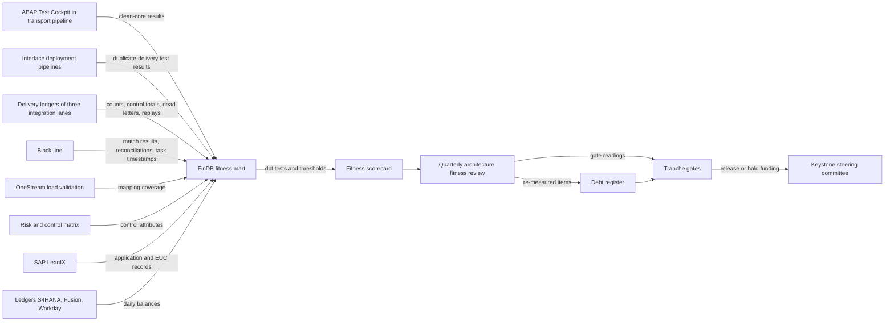
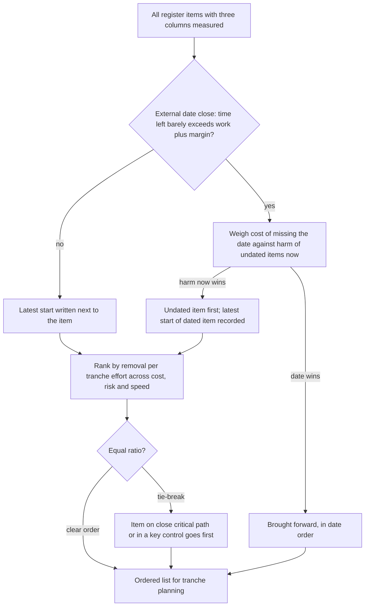
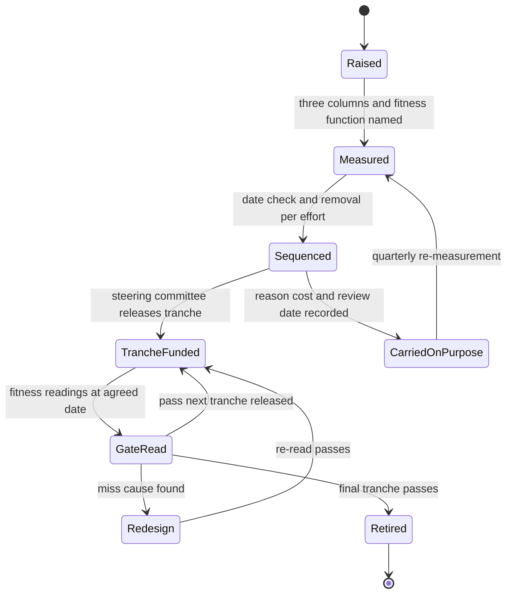

{id: technical-debt-and-fitness}
# 42. Technical Debt on the Balance Sheet

> **IN THIS CHAPTER, YOU WILL:** Learn to name the debt types that are specific to a finance estate, measure the estate's health with a catalog of finance fitness functions, keep a debt register in three columns (cost carried, risk carried, speed lost), and turn it into a sequenced, tranche-funded modernization plan that a CFO can approve.

> **WHY FINANCE CARES:** Debt in finance systems is paid in close days, manual controls, audit testing and suspense balances, not in code quality. A register that states those costs per item tells the CFO what each modernization euro buys and which risks Finance is choosing to carry.

> **WHY ARCHITECTS SHOULD CARE:** Without measured properties, every modernization proposal is an opinion and every standard decays after the program that set it ends. Fitness functions turn the architecture's intent into thresholds with owners, and the register turns their readings into funding decisions.

> **KEY POINTS:**
>
> * **Finance debt is a carrying cost in three columns, and two of its biggest types are not code.** Customization Concrete, unsupported versions, Spreadsheet Glue, integration, data, control and knowledge debt each charge interest in money, risk and close days. Count items on a register with those three columns, never as a backlog count or a code-quality percentage.
> * **Fitness functions make architectural intent measurable and owned.** Reconciliation completeness, auto-match rate, suspense aging, tie-out breaks, close duration by phase, clean-core score, upgrade lead time, idempotency conformance and decision lead time each get a definition, a threshold, one named owner and an automated feed from data the estate already produces. A quarterly architecture fitness review reads them.
> * **Sequence by dates, then by removal per effort, and gate each tranche with fitness readings.** Vendor, contract, audit and launch dates go first if waiting would miss them. The rest are ordered by what each tranche removes for its effort. Each tranche is released only when the fitness functions show it delivered and broke nothing the close depends on.

> **[FAILURE PATTERNS THIS CHAPTER ADDRESSES](#where-finance-architecture-goes-wrong):**
>
> * **Customization Concrete** — Northmere's 2,300 custom objects in S/4HANA made each upgrade a six- to seven-month project, and only a measured clean-core fitness function keeps the number falling.
> * **Spreadsheet Glue** — about 70 end-user computing tools sit in the close, 27 key controls still depend on one, and the register prices them like any other system.
> * **The Suspense Swamp** — unmatched payment lines are debt with a balance attached, and suspense aging is the fitness function that shows whether the debt is shrinking.

Every finance estate carries **technical debt**: the extra cost, risk and delay an enterprise carries because its systems were built, or have aged, in ways that make them harder to change or to trust than they need to be. In a software product, debt shows up as slow feature delivery. In a finance estate, it shows up somewhere less obvious: in the **days of the close**, in the number of **manual key controls** the auditor must test, in balances that sit in **suspense accounts** because a payment line carries no usable reference, and in upgrades that take most of a year.

The usual measures do not help a CFO. A static-analysis tool reports thousands of findings; a portfolio tool reports 97 applications as "Tolerate"; an integration team reports 1,100 interfaces. None says what the debt costs, risks or slows, or what money would remove. This chapter prices debt per item in a register the CFO can read, and measures the estate's architectural properties continuously with **fitness functions**, so that each modernization tranche is judged on evidence.

The method builds on one I proposed for a different audience. **In my book OWNED, written for investors and the technology leaders of the companies they own, I proposed a three-column carrying-cost register (cost carried, risk carried, speed lost), a sequencing rule that puts dated items first and orders the rest by what each unit of effort removes, and funding in tranches with gates.** A finance estate needs that method plus three extensions: debt types that are not code, units that Finance already uses (close days, key controls, suspense balances), and gates that are read from fitness functions rather than from project status reports.

{id: technical-debt-and-fitness--setting-the-scene-at-northmere-the-2028-funding-question}
## Setting the Scene at Northmere: The 2028 Funding Question

Northmere, the fictional multi-brand commerce group this book follows, finished its Q3 2027 close in about eight working days, one fewer than in 2026, after the BlackLine configuration work described in [BlackLine: Matching, Certifying and Closing](#blackline). The S/4HANA upgrade to release 2025 went live on the first weekend of October 2027. It took six months, one less than the previous upgrade, after 900 dead custom objects were archived out of the system first ([SAP S/4HANA: One Journal, Clean Core](#sap-s4hana)).

On Thursday 21 October 2027, Dana Whitlock, the Chief Architect, chairs Northmere's Q3 architecture fitness review. A week later Tomás Ferreira, the Group CFO, will review Program Keystone's 2028 plan with the steering committee. Keystone is Northmere's five-year finance transformation, and its 2028 plan includes a line for what the plan calls "estate remediation". Tomás has read the line and sent Dana two questions in one email:

> How much technical debt do we actually have? And why should 2028 money go to fixing old systems instead of building the new core?

Dana has material but no answer. Sven Aalto, the SAP Platform Lead, has a clean-core dashboard. Lucía Romero, the lead integration architect, has an interface inventory. Mei Tanaka, the Head of Internal Controls, has a risk and control matrix showing **610 key controls, 38% automated**. Leila Haddad, the Chief Accounting Officer, has a close calendar and a suspense-aging report. Owen Mbeki, the Head of Finance Data, has a list of the places where FinDB, the Snowflake finance data platform, does not tie out to the ledger. Each report is accurate, each is in its own units, and none of them answers the CFO.

{id: technical-debt-and-fitness--what-debt-means-in-a-finance-estate}
## What Debt Means in a Finance Estate

Ward Cunningham introduced the debt metaphor in 1992 to explain why shipping code before you fully understand a problem is acceptable if you go back and fix it. Martin Fowler's [Technical Debt Quadrant](https://martinfowler.com/bliki/TechnicalDebtQuadrant.html) (2009) separates debt along two axes. **Deliberate or inadvertent** asks whether the team knew it was taking the debt on. **Prudent or reckless** asks whether the trade-off was sensible. Fowler argues that prudent, inadvertent debt is inevitable even for excellent teams: "the moment you realize what the design should have been, you also realize that you have an inadvertent debt."

The quadrant is useful in a finance estate because it separates **who owns the remedy**. Northmere's debt arrived by every route:

| Quadrant | Northmere example | Who owns the remedy |
| --- | --- | --- |
| Prudent, deliberate | SFP posting daily summaries into S/4HANA through a custom function module in 2021, to make the go-live date | The design authority, which should have recorded the shortcut with a revisit date |
| Reckless, deliberate | 14 SFP engineers with standing production write access, granted during a 2024 incident and not withdrawn until June 2027 | The control owner; this became the FY2026 significant deficiency ([Controls by Design, Not by Audit Season](#controls-and-auditability)) |
| Prudent, inadvertent | The SAP group chart of accounts grown to about 3,900 accounts by country and product, before anyone designed dimensions ([Finance Data Architecture: Who Owns the Truth](#finance-data-architecture)) | The data owner (Leila), through the Finance Data Council |
| Reckless, inadvertent | Hundreds of flat-file interfaces built with no receiver-checked control totals | The integration standard owner (Lucía), through the interface contract standard |

A fifth origin matters more in finance than in product engineering: **acquired debt**. Wayfare and Tablekin each brought their own ERP, chart of accounts, integration platform and payout or billing logic. Nobody at Northmere chose that debt. The acquisition did, and its owner is whoever owns the integration decision.

{id: technical-debt-and-fitness--the-carrying-cost-in-three-columns}
### The carrying cost, in three columns

The useful answer to "how much debt?" is not a total but a **carrying cost**: what each item costs while it remains, in three columns that are read side by side and never added together.

| Column | What it counts in a finance estate | Unit | Source |
| --- | --- | --- | --- |
| **Cost carried** | Licenses and hosting kept only for the debt (cash); time on workarounds, manual matching, manual controls, extra testing, upgrade remediation (capacity) | Dollars per year, cash and capacity separately | Contracts; close task logs; team estimates; portfolio TCO ([Manage the Application Portfolio as an Investment](#application-portfolio)) |
| **Risk carried** | Key controls depending on the item; control deficiencies; unsupported software; suspense balances and their age; incidents that changed the books | Own units: controls, euros, days, incidents | Risk and control matrix; BlackLine; incident records; vendor support dates |
| **Speed lost** | Close days on the critical path; upgrade months of change freeze; lead time to onboard a market, PSP or entity | Close days, months, weeks | Close calendar by phase; upgrade history |

Two conventions keep the figures honest. **Cash** means money paid to a third party that would stop if the debt were removed: a license, hosting, a systems integrator. **Capacity** means existing staff time valued at Northmere's planning rate of **$165,000 per fully loaded FTE-year**. Freeing capacity does not reduce payroll by itself; it frees people for work that matters more. [Manage the Application Portfolio as an Investment](#application-portfolio) uses the same split for retirement savings, so the two documents compare.

The risk and speed columns are not converted into money. A significant deficiency, €2.1 million of suspense older than 90 days or a close day on the critical path are understood by a CFO in their own units. Converting them into a single dollar figure would hide the judgment the CFO is being asked to make.

**Figure 1:** *Debt is reported as a carrying cost in three columns read side by side and never added: cost carried with cash and capacity kept apart, risk carried in its own units, and speed lost in close days and months.*

{id: technical-debt-and-fitness--seven-debt-types-specific-to-finance}
## Seven Debt Types Specific to Finance

Beyond ordinary code-level debt, seven types set the CFO's agenda. Each charges interest differently, and each ends in a failure pattern from [Unreconciled: Fourteen Ways Finance Architecture Goes Wrong](#where-finance-architecture-goes-wrong).

| Debt type | What it is | How it charges interest | End-state failure pattern |
| --- | --- | --- | --- |
| **Custom code inside the ERP** | Modifications, enhancements and programs that read or change vendor tables | Every upgrade retests and remediates it; changes in the posting path draw IT general controls testing | Customization Concrete |
| **Unsupported versions and vendor deadlines** | Releases leaving maintenance, hosting contracts ending, archives on old platforms | Extended-support fees, unpatched vulnerabilities and a date that sets the schedule | The Borrowed Roadmap |
| **End-user computing in the close** | Spreadsheets and scripts that transform data or perform key controls outside IT change control | Manual effort every close; extra audit procedures for completeness and accuracy; errors nobody can trace | Spreadsheet Glue |
| **Integration debt** | Flat files without control totals; interfaces that cannot be safely re-run; several integration technologies | Break-fix effort; duplicated or missing postings found at the close; slow onboarding of new sources | Point-to-Point Spaghetti |
| **Data debt** | Several charts of accounts, duplicate partner and supplier records, inconsistent entity and tax attributes | Mapping maintenance; misclassification; invoices and payouts to the wrong record | The Doppelgänger Record |
| **Control debt** | Manual controls that could be automated; controls designed around a workaround; remediation not yet tested | Operating and testing effort every year; deficiency risk; manual review on the close critical path | Audit Archaeology |
| **Documentation and knowledge debt** | Hand-offs with no written contract; logic that only two people understand; custom objects with no design record | Slow diagnosis; key-person risk; every change starts with discovery | The Shadow Ledger, eventually |

Three of the seven are not code at all. **Control debt** and **Spreadsheet Glue** are invisible to a static-analysis tool and to an IT budget, because Finance's time and the auditor's fees pay for them. **Data debt** looks like an operations problem until a mapping error moves $41 million of Tablekin usage revenue into the wrong line, as in Northmere's Q1 2027 close ([Finance Data Architecture: Who Owns the Truth](#finance-data-architecture)).

**Figure 2:** *Three of the seven finance debt types are not code: control debt, Spreadsheet Glue and data debt sit below the line that static analysis and IT budgets can see, paid for in Finance's time and the auditor's fees.*

**Control debt is often the interest paid on another debt.** Northmere's 27 key controls that depend on a spreadsheet exist because the data the control needs is not where the control runs. Automating such a control without fixing the data beneath it builds an automated control on Spreadsheet Glue, so the register records which item each control-debt line depends on.

{id: technical-debt-and-fitness--fitness-functions-for-finance}
## Fitness Functions for Finance

Neal Ford, Rebecca Parsons, Patrick Kua and Pramod Sadalage, in [Building Evolutionary Architectures](https://www.thoughtworks.com/insights/books/building-evolutionaryarchitectures-second-edition) (2nd edition, 2022), describe the **architectural fitness function**. Thoughtworks' Technology Radar summarizes it as a function that "provides an objective integrity assessment of some architectural characteristics" ([Thoughtworks](https://www.thoughtworks.com/radar/techniques/architectural-fitness-function)). Their book presents fitness functions as a way to automate architectural governance and classifies them along several dimensions. Three of them matter here: **scope** (atomic, checking one part, or holistic, checking a property of the whole system), **cadence** (triggered by a change, run continually, or run on a schedule) and **result** (a fixed threshold or a dynamic one).

The term needs one clarification in this book. [Manage the Application Portfolio as an Investment](#application-portfolio) scores applications on **functional and technical fitness**, which are judgments made with written anchors. A **fitness function** in this chapter is a measurement of an architectural property of the estate, computed from data, with a threshold. The two meet in one place: a portfolio fitness score should cite the fitness functions that bear on it.

{id: technical-debt-and-fitness--what-makes-a-finance-fitness-function}
### What makes a finance fitness function

Most software fitness functions check code structure or runtime behavior, and a finance estate needs those too: "no service writes to the general ledger except through the posting service" is a dependency rule a build pipeline can enforce. But the properties Finance cares about most concern the **books**: every balance provably complete, differences found the day they arise, platforms changeable without stopping the close. Those are measured from finance data, not from code.

Every Northmere fitness function has five parts, and a candidate missing any one of them is not adopted:

1. **Metric** — a definition precise enough that two people compute the same number.
2. **Measurement** — where the data comes from, and whether a person has to touch it.
3. **Threshold** — the level that passes, with dated targets where the threshold tightens over time.
4. **Owner** — one named person who can change the outcome, not a committee and not the architect who proposed the metric.
5. **Automation and cadence** — how often it is computed and where the result lands.

{id: technical-debt-and-fitness--northmere-s-catalog}
### Northmere's catalog

The catalog below is the set Dana's team adopted for 2028. Baselines are October 2027 unless stated otherwise; all figures are illustrative.

| Fitness function | Metric and how it is measured | Baseline → threshold | Owner | Automation and cadence |
| --- | --- | --- | --- | --- |
| **Reconciliation completeness** | Balance-changing interfaces whose receiver checks a record count and control total on every run, from the delivery ledgers ([Files, Events and APIs: How Finance Systems Talk](#integration-architecture)) | ~240 of ~430 → all ~120 tier-1 interfaces (feeding a ledger, BlackLine or OneStream) by end 2028 | Lucía Romero | Daily, delivery-ledger events to FinDB |
| **Auto-match rate** | PSP settlement lines matched automatically by WD3, by payment-method family, from BlackLine Transaction Matching | Cards 99.6%; APMs 98.1% (Q2 2027) → APMs ≥ 99.0% for consecutive closes in 2028 | Ingrid Solberg | Daily extract; read at WD3 |
| **Suspense aging** | Unexplained items in PSP clearing and suspense older than 30 and 90 days at month end | Over 90 days: €2.1M (2026 average) → ≤ €0.5M by end 2028 | Leila Haddad | Month end, from BlackLine |
| **Subledger-to-GL tie-out breaks** | Unexplained differences at WD1 between each subledger (SFP, FI-CA, Stripe to Workday) and its GL control accounts | SFP: 23 breaks, ~€310,000 (Q2 2027), falling in shadow posting since August 2027; target 0 unexplained after the 1 November 2027 cut-over; FI-CA and Tablekin on the same basis by end 2028 | Leila Haddad, with each subledger owner | Daily tie-out feeding BlackLine |
| **Close duration by phase** | Working days per close phase, from BlackLine Task Management timestamps | 8 days → 5 by end 2028 | Leila Haddad | Every close |
| **Interface error rate and replay count** | Dead letters per 10,000 messages per lane; manual replays, and replays without the original idempotency key | Baseline being measured → < 5 per 10,000 on tier-1; zero replays without key | Lucía Romero | Daily, lane monitoring to FinDB |
| **Idempotency conformance** | Balance-changing interfaces with a declared idempotency key that pass an automated duplicate-delivery test in their pipeline | Fewer than 100 of ~1,100 safely re-runnable → ≥ 90% of tier-1 by end 2028 | Lucía Romero | On every deployment |
| **Clean-core score** | Custom objects; executed Level D; Level D in posting or billing path; share of executed objects at Level A or B (ABAP Test Cockpit) | 1,400 / 250 / 34 / 42% → 950 / 60 / 0 / 65% by end 2028 | Sven Aalto | Transport pipeline; quarterly roll-up |
| **Upgrade lead time** | Months from S/4HANA upgrade start to go-live | 7 (2024) → 6 (2027) → 3 (2029) | Sven Aalto | Per upgrade |
| **Mapping-rule coverage** | Source-ledger accounts with an approved, effective-dated OneStream mapping rule; catch-all rules in use | 100%, zero catch-alls since May 2027 → hold | Leila Haddad | Every load; unmapped accounts stop it |
| **EUCs in key controls** | Key controls whose operation or evidence depends on an EUC, from the risk and control matrix | 41 (Q1 2027) → 27 → ≤ 15 by end 2028; 0 by 2029 | Mei Tanaka | Quarterly |
| **Key-control automation** | Key controls automated or IT-dependent manual | 38% → 50% end 2028 → 60% by 2029 | Mei Tanaka | Quarterly |
| **Ledger-to-warehouse tie-out** | Entities and accounts where FinDB equals the GL each day, checked by dbt data tests | SAP entities partly → all entities on all three ledgers by end 2028 | Owen Mbeki | Daily |
| **Partner master quality** | FI-CA business partners with no group partner ID, or linked to two live SFP partners | ~31,000 / ~12,400 (Q2 2027) → under 1,000 each by 2029 | Head of Partner Settlement | Weekly, from the partner hub |
| **Decision lead time** | Median working days from request to recorded decision | 41 (Q4 2026) → 10 standard, 25 design authority | Dana Whitlock | Monthly, from the decision log ([Architecture Governance That Speeds Decisions](#architecture-governance)) |

**Most rows measure the books, not the code.** Ten of the fifteen are computed from finance data: matching results, reconciliation detail, close task timestamps, control-matrix attributes. A finance estate is healthy when its money can be proven, and the proof is in the data.

**Each owner can move the number.** Auto-match rate belongs to Ingrid Solberg, who runs Northmere Pay, not to Leila. About two-thirds of the unmatched APM lines are a data problem in the payment flow (missing booking references, provider daily aggregates) that no matching rule can fix ([BlackLine: Matching, Certifying and Closing](#blackline), [Adyen: One Platform from Checkout to Settlement](#adyen)). Leila owns suspense aging because clearing it takes accounting decisions. An owner who cannot change the outcome turns a fitness function into a report.

**Thresholds that tighten carry dates.** "≥ 99.0% for two consecutive closes in 2028" is a threshold. "Improve the match rate" is not. A threshold without a date cannot be failed, and a fitness function that cannot fail does no governing.

**A catalog needs both atomic and holistic rows.** Clean-core score and idempotency conformance are atomic and triggered: they run in a pipeline and block a change, so they stop new debt arriving. Close duration by phase and suspense aging are holistic: they move only when several debts are paid, so they show whether paying old debt made any difference to Finance.

Money in flight, the value that has left one system and not yet arrived in the next, is not in this catalog. It is an operational signal monitored in real time, and [Recover Before the Close: Resilience and Security for Finance](#resilience-and-security) treats it as business observability. The fitness review reads its monthly trend but does not own it.

{id: technical-debt-and-fitness--architecture-how-the-fitness-functions-are-measured-and-reviewed}
## Architecture: How the Fitness Functions Are Measured and Reviewed

A fitness function that someone computes by hand before each review is a status report. Northmere's rule is that every fitness function lands in FinDB from a system feed, and the review reads one model.

**Figure 3:** *Fitness functions are computed from feeds the estate already produces, land in one FinDB model and are read in one quarterly review. The review updates the debt register and reads the gates that decide whether the next tranche of funding is released.*

{id: technical-debt-and-fitness--three-measurement-mechanisms}
### Three measurement mechanisms

**Pipelines block new debt.** Two fitness functions are enforced before a change reaches production. Since June 2027, the ABAP Test Cockpit's clean-core checks run in the S/4HANA transport pipeline, and a new Level D object needs a design-authority waiver with an expiry date ([SAP S/4HANA: One Journal, Clean Core](#sap-s4hana)). In 2028, every deployment of a balance-changing interface runs a duplicate-delivery test: the pipeline sends the same batch twice under the same idempotency key and checks that the receiver posts once.

**Operational data proves the books.** BlackLine already holds the evidence for matching, reconciliation and close tasks. The delivery ledgers designed in [Files, Events and APIs: How Finance Systems Talk](#integration-architecture) already record counts, control totals and dead letters per batch. The task is to extract it daily into FinDB, not to create new measurements; BlackLine's own reports remain the audit evidence.

**FinDB computes and tests.** Owen's team keeps a small fitness mart in FinDB, built with dbt. Each threshold is written as a dbt data test, a SQL query that, in dbt's own definition, returns "a set of failing records" ([dbt documentation](https://docs.getdbt.com/docs/build/data-tests)). A breach is therefore a list of the interfaces, accounts or controls that fail, not a red cell, and the review starts from those records.

The fitness mart is deliberately not a key control and produces no audit evidence. If it is wrong, the review is wrong, but no balance is. Bringing it into scope for the Sarbanes-Oxley Act (SOX) would make every metric change a controlled change, and the catalog would stop evolving.

{id: technical-debt-and-fitness--the-quarterly-architecture-fitness-review}
### The quarterly architecture fitness review

The review runs for ninety minutes in the third week after each quarter close. Dana chairs it; every fitness-function owner attends, with Leila, Mei and, when a gate is due, someone from Tomás's office. It has three fixed agenda items:

1. **Breaches.** Every fitness function below threshold, with its failing records and the owner's explanation. The owner states the cause and the reading at which it will pass; a second consecutive breach becomes a register item.
2. **Register re-measurement.** Each debt item's three columns are re-measured from the scorecard and from the owners' time estimates. Items whose external date has moved closer are re-sequenced.
3. **Gates.** Any tranche whose gate falls due is read against its fitness thresholds, and the review recommends release, hold or redesign to the Keystone steering committee.

The review does not approve designs or waivers; [Architecture Governance That Speeds Decisions](#architecture-governance) owns those. Its output is measured facts and recommendations, which keeps it short.

{id: technical-debt-and-fitness--in-practice-northmere-s-debt-register}
## In Practice: Northmere's Debt Register

Dana's team builds the register in the week after the review, from every candidate item anyone has raised. Items whose columns cannot yet be measured stay on the full register with an owner assigned to measure them. The CFO sees the eight items below, which account for most of the measurable carrying cost.

| # | Item | Debt type and origin | Cost carried per year | Risk carried | Speed lost | External date |
| --- | --- | --- | --- | --- | --- | --- |
| 1 | **S/4HANA custom code.** ~1,400 objects after the first retirement wave; 250 executed Level D, 34 in posting or billing logic | Custom code in ERP; prudent-deliberate in 2021, never revisited | $0.7M cash (integrator remediation per upgrade, annualized); $1.9M capacity (upgrade regression and remediation; IT general controls testing) | 34 Level D objects where an upgrade defect changes the books | Six months of upgrade and change freeze per upgrade | 2029 upgrade: posting-path Level D must be 0 by end 2028 |
| 2 | **Colocation estate.** Read-only Wayfare EBS archive, RateKeeper, six Wayfare satellite tools | Unsupported versions and vendor deadline; acquired | $1.7M cash (hosting, archive, support); $0.7M capacity (~4 FTE) | A five-market tax engine kept by two engineers; audit and tax records on a platform with an end date | Satellite tools block Wayfare's own retirements | **Colocation ends 31 December 2028** |
| 3 | **Spreadsheet Glue in the close.** ~70 EUCs; 17 still registered after the 14 mapping workbooks retired in May 2027 | End-user computing; reckless-inadvertent | $1.4M capacity (~7 FTE upkeep and preparation; ~1.5 FTE extra SOX testing) | 27 key controls without change control; the Q1 2027 $41M misclassification shows the class of error | ~Half a close day: accrual workbooks and the Coupa open-PO extract at WD1–2 | BlackLine renewal 2028 |
| 4 | **Integration debt.** ~240 flat files; ~190 balance-changing interfaces without receiver-checked control totals; three integration technologies | Integration; reckless-inadvertent plus acquired | $1.1M cash (MuleSoft legacy lane); $2.3M capacity (~14 FTE break-fix and reruns) | The January 2027 double post: €38M control-account gap, €2.9M of revenue reversed by hand ([Files, Events and APIs: How Finance Systems Talk](#integration-architecture)) | ~Half a close day of late or rerun feeds; ~11 weeks to onboard a PSP or brand feed | None; MuleSoft retires with convergence |
| 5 | **Payments reference and matching debt.** APM lines without usable references, card-timed matching windows, refunds outside the PSP | Integration and data; prudent-inadvertent | $2.0M capacity (~12 FTE manual matching and suspense investigation) | €14M average in PSP clearing and suspense (2026), €2.1M over 90 days | ~One close day (WD3–5) | **Brazil launch 2028** ("ledger-ready before launch") |
| 6 | **Data debt.** Three charts of accounts; ~31,000 orphan FI-CA partners, ~12,400 double links, ~4% VAT-number mismatch | Data; acquired | $1.3M capacity (~8 FTE corrections, re-issues, mapping upkeep) | Invoices and dunning against the wrong partner; VAT data errors under e-invoicing | Group chart v2 waits for convergence (2029) | Partner hub sole path into FI-CA, 2029 |
| 7 | **Control debt.** ~378 of 610 key controls manual; SFP remediation in its first year | Control; mixed | $3.1M capacity (~19 FTE operating and testing manual controls) | A significant deficiency to close in the FY2027 audit | ~One close day of manual review at WD8–9 | **FY2027 audit fieldwork**, to February 2028 |
| 8 | **Knowledge debt.** ~150 of ~430 balance-changing hand-offs have a registered contract; design records for about a third of posting-path custom code | Documentation and knowledge; reckless-inadvertent | $0.5M capacity (~3 FTE diagnosis and rediscovery) | ~1.5 days to diagnose a feed failure; key-person dependence | Every change starts with discovery | None binding |

All figures are illustrative. Read across, the eight items carry about **$3.5 million a year of cash and $13.2 million of capacity**, about 80 FTE-years of Northmere's people. Those two totals are the only sums Dana presents. The risk and speed columns are not added up. Close days in particular are not additive, because removing one phase's delay moves the critical path to the next phase; each figure is the item's share of the upstream plan in [BlackLine: Matching, Certifying and Closing](#blackline).

Three cross-checks keep the register honest.

**It does not double-count the portfolio.** Item 2's cash is already part of the wave 1 saving in [Manage the Application Portfolio as an Investment](#application-portfolio). The register shows the item because its date sets the order of work, not as an additional saving.

**Each item names its fitness functions.** Item 1 is read through the clean-core score and upgrade lead time; item 3 through EUCs in key controls; item 4 through reconciliation completeness, idempotency conformance and interface error rate; item 5 through auto-match rate and suspense aging; item 7 through key-control automation. Without a fitness function nobody can show that the money worked, so the register requires one before the first tranche.

**Debt carried deliberately is recorded as a decision.** MuleSoft's legacy lane (part of item 4) is carried until ledger convergence, because migrating working flows earlier means rebuilding them twice ([Files, Events and APIs: How Finance Systems Talk](#integration-architecture)). The register records the reason, the cost ($1.1 million of cash a year) and what would reopen it: a sharply higher renewal, or convergence slipping past 2030.

{id: technical-debt-and-fitness--sequencing-dates-first-then-removal-per-effort}
## Sequencing: Dates First, Then Removal per Effort

In OWNED I wrote the sequencing rule into the register in three steps. First, find the items whose external date leaves little more time than the work needs. Second, weigh each of them against the harm the undated items are doing now. Third, order the rest by what each tranche removes for its effort, read across all three columns. A finance estate needs the same rule with two adaptations: **finance has more kinds of dates**, and **the close critical path and key controls weigh in the third step**.

**Figure 4:** *The OWNED sequencing rule adapted to a finance estate: dated items first when waiting would miss the date, then the rest by what each tranche removes for its effort, with the close critical path and key controls as the tie-break.*

{id: technical-debt-and-fitness--finance-s-dates}
### Finance's dates

A finance estate has five kinds of external date, and the register records each with its source: **vendor maintenance and hosting** (S/4HANA release maintenance, the colocation contract), **contract renewal and notice** (OneStream's notice date of 30 September 2027, used for wave 0; BlackLine's 2028 renewal), the **audit cycle** (FY2027 testing of the SFP remediation), **regulation** (e-invoicing mandates, ViDA and Pillar Two, [Around the Core: Where Specialist Platforms Earn Their Place](#satellite-platforms)) and **business launches** (Brazil in 2028). Missing a regulatory or launch date has a particular cost in finance: the workaround that fills the gap is usually a spreadsheet, so a missed date creates new Spreadsheet Glue.

{id: technical-debt-and-fitness--applying-the-rule}
### Applying the rule

**Step 1, dates.** Four items have dates that bind.

- **Item 2 (colocation):** moving RateKeeper's five markets to Vertex needs about four months of configuration, one quarter of reconciled parallel determinations and an archive read path for auditors and tax. With a margin, the latest start is Q1 2028; the work starts in Q4 2027.
- **Item 5 (payments references):** Brazil's local methods must match automatically before launch, so the known fixes for references, matching windows and refunds outside the PSP ([Adyen: One Platform from Checkout to Settlement](#adyen)) must be proven on existing APMs first.
- **Item 7 (control debt):** the FY2027 audit tests the SFP remediation regardless. The work is funded; the register ensures no tranche touches the payout controls during fieldwork.
- **Item 1 (custom code):** a three-month 2029 upgrade needs posting-path Level D at zero by the end of 2028. The work takes about a year, so the latest start is Q1 2028.

**Step 2, weigh against harm now.** No undated item does enough harm now to displace these four. Item 4's January incident cost a day of the close, but the redesigned posting interface now prevents its recurrence on the largest flow, so item 4 waits for step 3.

**Step 3, removal per effort.** For the undated items, the team estimates each first tranche and what it removes across all three columns.

| Item and first tranche | Effort | What it removes | Rank |
| --- | --- | --- | --- |
| 3: Move 12 control workbooks into BlackLine; replace the Coupa open-PO accrual extract with a system feed | About 3 FTE-years, $0.2M cash | 14 key controls off spreadsheets; about $0.7M capacity a year; about a quarter of a close day | 1 |
| 4: Control totals and idempotency keys on the ~120 tier-1 interfaces; duplicate-delivery test in their pipelines | About 9 FTE-years, $0.4M cash | The class of error behind the January double post on tier-1 flows; about $0.8M of break-fix a year; most WD1–2 reruns | 2 |
| 7: Automate 70 manual key controls in BlackLine, S/4HANA and the payout platform | About 10 FTE-years, $0.9M cash | About $0.9M capacity a year of operating and testing; automation share from 38% to about 50% | 3 |
| 6: Partner hub coexistence for FI-CA; cleanse double links | About 7 FTE-years, $0.6M cash | Most invoice and dunning errors; the VAT-number mismatch before e-invoicing expands | 4 |
| 8: Register contracts for the remaining ~280 balance-changing hand-offs | About 2 FTE-years | Diagnosis time; prerequisite for item 4's later tranches | Folded into item 4 |

Item 3 ranks first because it is small and sits on the close critical path and in key controls. Item 7 removes more cost in total but needs more effort per unit removed, and ten of its seventy controls depend on item 3's workbooks; automating them first would automate Spreadsheet Glue.

Item 8 has no tranche of its own. Hand-off contracts are cheap to write while someone is already changing an interface and expensive as a standalone documentation project, so knowledge debt is paid as a condition on other work: no tranche that touches an interface closes until its contract is registered.

{id: technical-debt-and-fitness--funding-in-tranches-gated-by-fitness-functions}
## Funding in Tranches, Gated by Fitness Functions

A **tranche** is a separately approved stage of work and spending. A **gate** is the check, agreed before the stage starts, that the stage delivered what it promised and made nothing worse. In OWNED, gates were read from rehearsal results and bills. In a finance estate, the gate conditions are fitness-function readings, read by the same quarterly review, and a gate that is a fitness function cannot be passed by a status report.

**Figure 5:** *A register item's life. An item is funded only after it has been measured and given a fitness function, and every tranche ends at a gate read from the fitness scorecard. Carrying an item is a recorded decision that is re-measured each quarter.*

Dana's 2028 request has two tranches and a third that is described but not requested.

| | Tranche 1: dates and the close path | Tranche 2: the posting path and controls | Tranche 3: convergence-dependent |
| --- | --- | --- | --- |
| Window | Q4 2027 – Q2 2028 | Q3 – Q4 2028 | 2029, after the 2027 Q4 convergence decision |
| Scope | Colocation exit work (item 2, already funded in wave 1 and excluded from the cost below); APM reference and matching fixes proven before Brazil (item 5); 12 workbooks into BlackLine (item 3); tier-1 control totals and idempotency (item 4, with item 8's contracts) | Posting-path Level D to zero (item 1); 70 manual controls automated (item 7); partner hub coexistence (item 6) | MuleSoft lane retirement; remaining flat files; the remaining manual controls; group chart v2 |
| Effort and cash | About 28 FTE-years ($4.6M capacity) and $2.1M cash, about $6.7M | About 39 FTE-years ($6.4M capacity) and $3.0M cash, about $9.4M | Estimated when the convergence pattern is known |
| Gate, read on the June 2028 close (tranche 1) and the December 2028 close (tranche 2) | APM auto-match ≥ 99.0% at WD3 for April, May and June; suspense over 90 days ≤ €1.0M; EUCs in key controls ≤ 15; idempotency conformance ≥ 90% of tier-1; Vertex parallel determinations for RateKeeper's markets reconciled for one quarter | Level D in posting path = 0; key-control automation ≥ 50%; close ≤ 5 days; partner double links under 3,000 | Set with the convergence design |
| Must not worsen | Subledger-to-GL tie-out breaks; mapping-rule coverage; no new control deficiency | Same, plus no upgrade-blocking objects added | Same |

The tranches are inside Keystone's approved $310 million envelope. Tomás is not asked for new money. He is asked to release 2028 funds against named results, and to hold tranche 2 until tranche 1's gate is read.

**A miss has a defined response.** If the APM match rate reaches 98.8% instead of 99.0%, tranche 2 waits. Ingrid's team takes the failing records from the fitness mart; if they come from one provider's daily aggregates, the fix is a reference agreement with that provider. Tranche 2 is released after the next reading passes, and Brazil's readiness is judged on the same evidence. Only the review can change a threshold, with a recorded reason, never an owner to make a reading pass.

**Why not one big remediation program?** The alternative Dana's team considered and rejected was a single 2028 "estate remediation program" of about $16 million with one end date. It would have looked simpler, but it would have put every benefit at the end, freed no close days before the 2028 year-end close and given Tomás no point at which to stop on evidence. The tranche shape gives him two, the first before year-end.

{id: technical-debt-and-fitness--presenting-it-to-the-cfo}
## Presenting It to the CFO

Tomás asked two questions. Dana answers in his units, in the order he asked, and puts the register and the catalog in the appendix.

**"How much technical debt do we have?"** Eight items that cost about $3.5 million a year in cash we would stop paying and about 80 people's worth of time, mostly in finance operations and controls. Four have dates we do not control: the colocation contract ending in December 2028, the Brazil launch, the FY2027 audit and the 2029 SAP upgrade. They sit in the close phases where the three days between our eight-day close and the five-day target must come from, and they keep 27 key controls on spreadsheets and €2.1 million of payments in suspense for more than 90 days. One item we carry on purpose: the legacy MuleSoft flows, at $1.1 million a year until the ledgers converge, because migrating them earlier means building them twice.

**"Why fix old systems instead of building the new core?"** Because the new core inherits whatever we feed it: the same partner records, payment references and interfaces. If they are not clean, we pay for the debt again inside the new core. And three of the dates arrive before the new core does. Tranche 1 costs about $6.7 million; the June 2028 close will show whether it worked, on the fitness functions in the appendix, and tranche 2 is released only if it did.

The script follows three rules I recommend for any CFO conversation about debt. **Lead with dates and close days**, not code. **Separate cash from capacity**, because a CFO who later finds that "savings" were time will discount every future business case. **Show the gate**, because the CFO's real question is "how will I know?", and a fitness reading he can see each quarter answers it better than a promised benefit.

{id: technical-debt-and-fitness--trade-offs-how-to-measure-estate-health}
## Trade-offs: How to Measure Estate Health

Each way of measuring estate health fits a different purpose.

| Approach | What it measures | Good for | Fails when | Use it |
| --- | --- | --- | --- | --- |
| **Code-quality and static analysis counts** | Findings, duplication, complexity in code | Engineering teams improving their own code | Presented to Finance as "debt"; misses control, data and EUC debt entirely | Inside teams, as an input to item estimates |
| **Portfolio scoring and TIME** ([Manage the Application Portfolio as an Investment](#application-portfolio)) | Judged functional and technical fitness per application | Deciding which applications to invest in, tolerate, migrate or eliminate | Used as the only debt view: says nothing about interfaces, controls or data between applications | Annually, with fitness functions cited as evidence |
| **Carrying-cost register and fitness functions** | Per-item cost, risk and speed; measured properties with owners | Funding decisions, sequencing, gates | Owners are not empowered, or the feeds are manual | Quarterly, as the primary instrument |
| **One large remediation program** | Program milestones | Debt with no useful intermediate state, such as a platform cut-over | Applied to divisible debt: benefits arrive at the end and nobody can stop early on evidence | Only for indivisible items, with a parallel run |

The register-plus-fitness approach costs real effort: someone must build the feeds, and owners must accept a number that can fail. I would not start with fifteen fitness functions. Northmere started in 2027 with four (clean-core score, auto-match rate, suspense aging, close duration by phase) and added the rest as feeds became reliable. A fitness function on a manual feed is worse than none: its first wrong reading destroys trust in the rest.

{id: technical-debt-and-fitness--integration-with-the-rest-of-the-estate}
## Integration With the Rest of the Estate

- **Portfolio.** Waves in [Manage the Application Portfolio as an Investment](#application-portfolio) retire whole applications; the register prices the debt carried while they wait and gives wave gates their evidence.
- **Governance and standards.** An expired waiver from [Architecture Governance That Speeds Decisions](#architecture-governance) becomes a register item. Each mandatory standard, STD-FIN-01 to STD-FIN-06, has at least one fitness function; a standard without one is hope. [Principles That Decide Things](#principles-standards-reference) owns the standards themselves.
- **Roadmap and migrations.** Tranches are the debt view of the transition states in [The Middle Matters: Transition States and the Roadmap](#target-and-transition-states); a transition state is not reached until its thresholds pass. [Modernizing Without Stopping the Close](#incremental-modernization) owns migration stage gates, which hand over to these steady-state thresholds.
- **Controls and AI.** Control debt is measured in Mei's risk and control matrix ([Controls by Design, Not by Audit Season](#controls-and-auditability)), and automated controls are designed with the control owner. Agents can raise the auto-match rate, but under [Automate the Work, Not the Accountability](#ai-in-finance) an agent proposes and a controlled process disposes, so an agent-driven rise is read together with match quality.

{id: technical-debt-and-fitness--failure-modes}
## Failure Modes

**Debt as a backlog count.** "We have 4,200 debt tickets" gives a CFO nothing to decide with and rewards closing small tickets over removing large costs. The symptom is a debt count that falls every quarter while close days and manual controls stay flat. The fix is the three-column register, with items sized to be funded and measured.

**Fitness theater.** Fitness functions computed by hand the day before the review, thresholds set where the number already passes, or lowered after a miss. The scorecard is always green while Finance's experience does not change. The fixes: automated feeds, dated thresholds that tighten, and threshold changes only through the review.

**Metrics without owners.** A fitness function owned by "Finance and IT", or by the architect who proposed it, breaches and nobody has the authority and budget to fix it. Northmere's auto-match rate sat with Leila at first and did not move for two quarters; it moved once Ingrid owned it, because the cause was in the payment data her teams produce.

**Gaming the holistic metrics.** Match rates rise when tolerances widen; suspense aging falls when items are written off instead of explained; close duration falls when work moves into the days before the close. Each holistic fitness function needs a companion check: logged tolerance changes ([BlackLine: Matching, Certifying and Closing](#blackline)), write-offs beside suspense aging, pre-close hours beside close days.

**Paying debt into the new core.** Funding the new core while leaving partner, reference and interface debt in place means migrating it, and convergence programs commonly discover this during data migration, when it is most expensive to fix.

**Automating a control on top of Spreadsheet Glue.** A control "automated" by a bot that reads a spreadsheet is still an EUC control, with an extra failure point. The register's dependency column exists to prevent this.

{id: technical-debt-and-fitness--the-chief-architect-s-view}
## The Chief Architect's View

**What to decide.** The Chief Architect sets the catalog's definitions, the register's conventions and the sequencing rule, as standards under her decision rights. Fitness owners decide how to meet their thresholds. The CFO, through the Keystone steering committee, funds tranches and accepts gate readings. Dana proposes and reads the gates; she does not release money.

**Who owns what.** Every fitness function and every register item has one owner who can change the outcome. Dana's team maintains the catalog, the mart's definitions and the register, but owns only one fitness function, decision lead time. An architecture function that owns most of the metrics has made itself the bottleneck it was meant to remove.

**What to keep stable.** Definitions change rarely, and only through the review with a recorded reason, so trends mean something across years; thresholds tighten on a published schedule; the three columns and the cash/capacity split never change, because the CFO learns to read them.

**What to watch.** Are tranche gates read on the agreed date, or postponed? Is any fitness function green for four quarters with a threshold that has not tightened? Is the capacity column falling, or only the cash column? And does the CFO ask about gate readings before he asks about budget? When Tomás's first question at the steering committee becomes "did the June gate pass?", the register has become his instrument rather than the architects'.

{id: technical-debt-and-fitness--questions-to-ask}
## Questions to Ask

1. Can we state, for our five largest debt items, the cost carried per year (split into cash and capacity), the risk carried and the close days or months it costs, from figures we already have?
2. Which of our debt items have an external date (maintenance end, contract notice, audit cycle, regulation, launch), and what is the latest start for each?
3. How many of our key controls depend on a spreadsheet, and is any automation planned on top of one?
4. For each mandatory architecture standard, which fitness function shows whether it is being followed, and is its feed automated?
5. Who owns our auto-match rate, and can that person change the data that causes unmatched lines?
6. Which of our fitness thresholds has not tightened in a year, and why?
7. For the next modernization tranche, which fitness readings will decide whether the following tranche is released, and on what date will they be read?
8. Which debt are we carrying on purpose, at what stated cost, until what date, and does the CFO know?
9. If we converge onto a new finance core, which debt items will we migrate into it unless we pay them first?

{id: technical-debt-and-fitness--handing-off}
## Handing Off

The register prices debt partly in hosting and subscription cash, and the Keystone savings it promises are claimed against the same bills. Neither figure is better than the data behind it. Today, cloud cost reaches the books by a quarterly spreadsheet, and nobody can say what technology costs per Stayloft booking. [FinOps Meets the Ledger: Technology Spend as Financial Data](#finops) treats technology spend as financial data: billing data under a contract, allocation as master data, accruals and amortization from a cut-off snapshot, a tie-out to the ledger, and unit cost as a governed metric. After it, [Recover Before the Close: Resilience and Security for Finance](#resilience-and-security) asks how a measured estate survives the day something fails.

{id: technical-debt-and-fitness--sources-and-evidence}
## Sources and Evidence

*Vendor documentation*

- [Add data tests to your DAG](https://docs.getdbt.com/docs/build/data-tests), dbt Labs, accessed October 2026 — data tests as SQL assertions that return failing records; used for the FinDB fitness mart design.
- [Extend SAP S/4HANA Cloud the Right Way](https://news.sap.com/2025/08/extend-sap-s4hana-cloud-right-way-clean-clear/), SAP, 2025 — clean-core levels A–D underlying the clean-core score; detail in [SAP S/4HANA: One Journal, Clean Core](#sap-s4hana).
- [Navigating release upgrades (SAP S/4HANA Cloud Private Edition)](https://learning.sap.com/courses/implementing-sap-s-4hana-cloud-private-edition/navigating-release-upgrades_ae2d796c-bafd-4e04-8b41-562ebda9eb49), SAP Learning — upgrade responsibilities and cadence behind upgrade lead time as a fitness function.

*Practitioner and research sources*

- [Building Evolutionary Architectures, 2nd edition](https://www.thoughtworks.com/insights/books/building-evolutionaryarchitectures-second-edition), Neal Ford, Rebecca Parsons, Patrick Kua and Pramod Sadalage, O'Reilly, 2022 — fitness functions as automated architectural governance and their classification.
- [Architectural fitness function](https://www.thoughtworks.com/radar/techniques/architectural-fitness-function), Thoughtworks Technology Radar — the definition quoted in this chapter.
- [Technical Debt Quadrant](https://martinfowler.com/bliki/TechnicalDebtQuadrant.html), Martin Fowler, 2009 — deliberate/inadvertent and prudent/reckless debt; prudent inadvertent debt as inevitable.
- [The WyCash Portfolio Management System](https://c2.com/doc/oopsla92.html), Ward Cunningham, OOPSLA experience report, 1992 — origin of the debt metaphor.
- [Managing Technical Debt: Reducing Friction in Software Development](https://www.sei.cmu.edu/library/managing-technical-debt-reducing-friction-in-software-development/), Philippe Kruchten, Robert Nord and Ipek Ozkaya, Addison-Wesley, 2019 — debt items managed on the same list as other work and decided by cost and value.
- [Nobody Ever Gets Credit for Fixing Problems that Never Happened](https://web.mit.edu/nelsonr/www/Repenning=Sterman_CMR_su01_.pdf), Nelson Repenning and John Sterman, California Management Review, 2001 — why improvement work is starved and why measured before-and-after readings matter.
- [Strangler Fig](https://martinfowler.com/bliki/StranglerFigApplication.html), Martin Fowler, 2024 — incremental replacement behind tranche-shaped funding.
- Željko Obrenović, *OWNED*, chapter "Manage Technical Debt" — the author's earlier three-column carrying-cost register, sequencing rule and tranche-and-gate funding method, adapted and extended here.

Northmere Group, its people, systems and figures are fictional; the architectural recommendations are the author's judgment.
