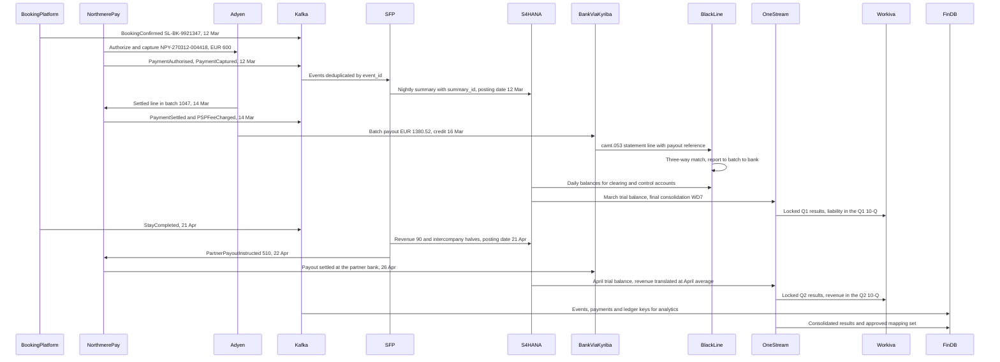
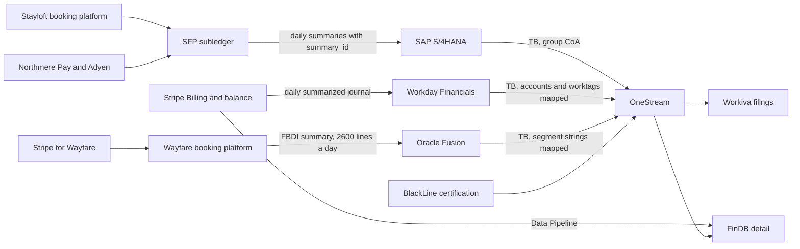

{id: transaction-to-report}
# 27. From Customer Transaction to Financial Statement

> **IN THIS CHAPTER, YOU WILL:** Follow one Stayloft merchant booking from the traveler's click to the 10-Q and 10-K, hop by hop: the system, the record, the identifier, the invariant, the control and the dates at each step. Then compare it with a Tablekin subscription invoice and a Wayfare rail ticket, whose chains are shaped by different business models and different ERPs.

> **WHY FINANCE CARES:** The CFO certifies the totals, but the auditor tests the path. When the path from a reported number back to the transactions behind it runs through undocumented hand-offs, every walkthrough becomes an investigation and every late finding becomes a disclosure risk.

> **WHY ARCHITECTS SHOULD CARE:** Nobody owns the whole chain. Each platform team owns its hop, so the breaks happen between hops, where identifiers are dropped, dates are reinterpreted and totals are summarized without a way back. The end-to-end chain is an architectural object, and it needs an owner, a design and tests like any other.

> **KEY POINTS:**
>
> * **A transaction reaches the financial statements through eleven hops, and the chain is only as strong as its weakest hand-off.** The €600 Lisbon booking passes through the booking platform, the event backbone, Northmere Pay and Adyen, the SFP subledger, S/4HANA, BlackLine, two month-end closes, OneStream, Workiva and FinDB. Each hop needs a record, a carried identifier, an invariant and a control that proves it.
> * **Three clocks govern every hop: when it happened, which period it belongs to and when it is reported.** The booking is paid in March, earned in April, appears as a liability in the Q1 10-Q and as $97.38 of revenue in the Q2 10-Q. Many period errors come from one system using one clock where another system uses a different one.
> * **The business model and the ERP change the chain, but the invariants do not.** Tablekin's $1,029 invoice reaches the group through Stripe, Workday and OneStream with no subledger of Northmere's own, and Wayfare's ticket reaches it through Oracle Fusion. All three chains must stay balanced, complete, traceable, period-correct and tied out, and in 2027 each of them failed at least one of those tests somewhere.

> **[FAILURE PATTERNS THIS CHAPTER ADDRESSES](#where-finance-architecture-goes-wrong):**
>
> * **Lost in Aggregation** — The trace shows exactly where the Lisbon booking disappears into a summary, and what each summary must keep so that the auditor can find it again.
> * **The Suspense Swamp** — Every hop that moves money has a clearing account that must reach zero by a known date; the trace names them and the controls that prove they did.
> * **Spreadsheet Glue** — Northmere's 2027 chain had spreadsheets at three hops (chart-of-accounts mapping, fee accruals and disclosure schedules), and each is a place where the trace can only be repeated by the person who built it.

Every chapter in Part II looked at one platform from the inside. This chapter looks at the **chain of platforms** from the outside, by following one transaction until it becomes a number someone signs. The question is simple: how does a traveler's €600 payment for a Lisbon apartment end up as $97.38 of revenue in a US dollar income statement filed with the Securities and Exchange Commission (SEC), and what has to be true at each step for that number to be right?

The answer is less simple than most architecture diagrams suggest. The booking passes through eleven systems owned by eight teams. It carries about ten identifiers, is recorded on three clocks, and lives in two legal entities and two currencies. At three points it is merged with millions of other transactions into totals that someone must be able to take apart again. **Each of those hand-offs is a place where the number can go wrong without any single system being wrong.**

This chapter owns the **end-to-end financial event chain**. It does not re-teach the accounting ([Accounting for Architects: Ledgers, Journals and Revenue](#accounting-for-architects)), the posting engine ([Designing Custom Ledgers and Financial Event Processing](#designing-financial-ledgers)) or the matching rules ([BlackLine: Close Automation, Reconciliation and Continuous Accounting](#blackline)). It connects them, and for each hop it states the record, the identifier carried, the **invariant** that must hold, the **control** that proves it, the timing, and what goes wrong when the invariant breaks. The chapters that follow in Part III take the chain apart again, one boundary at a time.

{id: transaction-to-report--setting-the-scene-at-northmere-one-booking-eleven-days}
## Setting the Scene at Northmere: One Booking, Eleven Days

In May 2027, during the planning of the FY2027 audit, the external auditor asked Mei Tanaka, Northmere's head of internal controls, for a walkthrough of one Stayloft merchant booking "from checkout to the 10-Q". A **walkthrough** is the audit procedure in which the auditor follows a transaction through the process and the systems, inspecting the records and controls at each step. Mei picked the Lisbon booking, the canonical example this book uses, because it had a payment in the first quarter and its revenue in the second.

Northmere, the fictional group this book follows, needed **eleven working days and six teams** to produce the walkthrough. Each team explained its own hop well: the booking in SFP, the Adyen settlement line, a summary document in S/4HANA, a Stayloft B.V. revenue balance in OneStream. But the joins between those views were made by people: an engineer who knew which reference field held the summary batch, an analyst who knew which mapping workbook applied in April, a controller who remembered that the fee recharge was a monthly manual journal.

Dana Whitlock, Northmere's Chief Architect, read the walkthrough pack with Leila Haddad, the Chief Accounting Officer. Leila's comment was short: "Every step is right. I could not have proven any of it without these six people in the room." Dana's conclusion: each platform had an owner and an architecture. **The path between them had neither.** This chapter is the design document Dana's team wrote in response: the chain as it is, hop by hop, with the invariants that must hold and the places where they did not.

{id: transaction-to-report--concepts-hops-invariants-keys-and-clocks}
## Concepts: Hops, Invariants, Keys and Clocks

Four ideas organize the trace.

A **hop** is a step at which a record is created in, or moved into, a system with a different owner, a different data model or a different granularity. What makes something a hop is usually a change of **authority**: after it, a different system is the reference for that fact ([Systems of Record and Authoritative Data Boundaries](#systems-of-record) owns the model). The booking is authoritative in the booking platform, the open item in the subledger, the balance in the general ledger (GL) and the consolidated figure in OneStream.

An **invariant** is a property that must be true at a hop for every transaction, at every volume, through every failure. [Accounting for Architects: Ledgers, Journals and Revenue](#accounting-for-architects) defines five for any single ledger: balanced, immutable, period-locked, traceable and complete. Across a chain they take a specific form at each hop, such as "the bank credit equals the batch payout".

A **control** is the activity that provides evidence that the invariant held, whether automated (a posting engine rejecting an unbalanced entry) or manual (a controller certifying a reconciliation); [Controls, Auditability and Security by Design](#controls-and-auditability) owns the taxonomy. The rule for this chapter is simple: **an invariant without a control is a hope, and a control without an owner is a document.**

A **key** is the identifier that lets the next hop find the record from the previous one. The chain needs several, because no single identifier survives every hop:

| Key | Example (Lisbon) | Set by | Survives to |
| --- | --- | --- | --- |
| Booking ID, the canonical `correlation_id` | `SL-BK-9921347` | Stayloft booking platform | Every canonical event, every SFP journal line, FinDB |
| Event ID | One per canonical event | The producing system | SFP intake and event store (deduplication key) |
| Payment ID, sent to Adyen as merchant reference | `NPY-270312-004418` | Northmere Pay | Adyen reports, SFP lines, BlackLine matching |
| Adyen PSP reference | Assigned by Adyen at authorization | Adyen | Northmere Pay, SFP, BlackLine |
| Batch number and merchant account | `1047`, `NMPay_Stayloft_EEA` | Adyen | Settlement lines, summary key on the Adyen clearing accounts, bank match |
| Payout reference | `TX…XT` on the bank statement | Adyen | Bank statement via Kyriba, BlackLine |
| Rule ID and version | `SFP-MERCH-PAYMENT-CAPTURED` version 2 | SFP accounting engine | SFP journal entry |
| Summary ID | One per SFP summary document | SFP summarizer | SFP lines and the S/4HANA document header |
| S/4HANA document number | Returned on posting | S/4HANA | SFP acknowledgment table, BlackLine, OneStream drill-back |
| Mapping rule and consolidation version | Effective-dated OneStream rule; locked Q2 consolidation | OneStream | Workiva link, FinDB mapping copy |

The chain is traceable when each record stores, as data, the key of the record it came from. **The trace from a filed number to the booking is a sequence of joins, and one missing join makes it an investigation.**

The fourth idea is **time**. Every hop has at least three dates, and the trace uses them precisely:

- The **event date** is when the business fact happened (`occurred_at` in the canonical envelope). The stay completed on 21 April.
- The **accounting date** (or posting date) is the date whose period the entry belongs to. The accounting engine assigns it by rule, in the legal entity's time zone. Usually it equals the event date. When a period is already closed, it does not.
- The **period** is the fiscal month and quarter whose statements include the entry, and the **reporting date** is when those statements are published.

[Designing Custom Ledgers and Financial Event Processing](#designing-financial-ledgers) owns the mechanics of these dates inside a ledger. This chapter follows how they are passed along the chain, which is where a date gets reinterpreted by a system with a different calendar, time zone or cut-off.

{id: transaction-to-report--the-chain-at-northmere-architecture}
## The Chain at Northmere: Architecture

Figure 1 is the Lisbon booking's chain as Dana's team drew it after the walkthrough, with the dates of the scenario.

**Figure 1:** *The Lisbon booking crosses eleven systems. Money moves along one path (Adyen, bank, partner) and records along another (events, subledger, GL, consolidation, filing); the two meet only at the reconciliations in BlackLine and at the subledger-to-GL tie-out, which is why those are the controls that hold the chain together.*

Three structural facts are visible in the diagram before any detail.

**Money and records travel separately.** The €600 moves from the card through Adyen to Northmere Payments B.V.'s safeguarding account, and €510 of it on to the property; no accounting system moves money. The two paths are joined only by reconciliation: BlackLine's three-way match on the payment side and the subledger-to-GL tie-out on the accounting side. If either is missing, the books describe one reality and the bank another.

**Granularity collapses three times.** The booking is a row in SFP. In S/4HANA it is part of a summary line, one of about 38,000 lines a day built from about 3 million subledger lines. In OneStream it is part of a Stayloft B.V. balance. In the 10-Q it is part of a caption. Each collapse is an aggregation that must be reversible: the summary through its summary ID, the balance through drill-back to S/4HANA, the caption through Workiva's link to a locked consolidation version.

**Figure 2:** *The Lisbon booking is merged with other transactions three times, into an S/4HANA summary line, an entity balance and a 10-Q caption; each collapse stays reversible only if the key of the layer below is stored with it.*

**Two legal entities and two currencies.** Northmere Payments B.V., the licensed e-money institution, holds the traveler's money; Stayloft B.V. earns the commission. Both are euro-functional and the group reports in US dollars, so the trace must show intercompany entries in the ledgers and translation in consolidation.

{id: transaction-to-report--the-lisbon-booking-hop-by-hop}
## The Lisbon Booking, Hop by Hop

The facts are the book's canonical ones. A traveler from Germany books a three-night stay in a Lisbon apartment on Stayloft: **€600.00** including VAT, paid with a German consumer debit card through Adyen on **Friday 12 March 2027**, for a stay on **18–21 April 2027**. The commission is **15%, €90.00**, and the property is owed **€510.00**. Adyen's total processing cost is **€1.74** (illustrative). The capture is settled into Adyen batch 1047 on **Sunday 14 March**, and the batch payout reaches Northmere Payments B.V.'s bank on **Tuesday 16 March**. The payout of €510.00 to the property is instructed on **Thursday 22 April** and reaches the property's bank on **Monday 26 April**.

Three simplifications, stated once. VAT on the commission is ignored: I assume a VAT-registered Portuguese property that accounts for VAT under the reverse charge, as [Accounting for Architects: Ledgers, Journals and Revenue](#accounting-for-architects) does. Northmere's accounting policy treats Stayloft as **agent**, so revenue is the €90 commission, recognized when the stay is completed. And the US dollar rates are illustrative: March average 1.0860, 31 March closing 1.0900, April average 1.0820 and 30 April closing 1.0840, in US dollars per euro.

{id: transaction-to-report--hop-1-the-operational-event-in-the-booking-platform}
### Hop 1: The operational event in the booking platform

The traveler confirms the booking at 14:12 Lisbon time on 12 March. The Stayloft booking platform creates booking `SL-BK-9921347` and publishes `BookingConfirmed` to Kafka, Northmere's event backbone. The event carries the fields every later hop needs: brand STL, legal entity Stayloft B.V., business model merchant, the property's partner ID, gross amount 60000 in euro cents, stay dates, cancellation terms and tax jurisdiction PT.

**The invariant is completeness at the source:** every confirmed, modified or canceled booking produces exactly one canonical event per change, with a unique `event_id`. **The control** compares, per day and per event type, the count and value of events published with the bookings the platform's own database records as confirmed. In 2027 this was a dashboard in the booking platform that nobody in Finance looked at. Keystone moved it into SFP intake as a daily control total with an owner.

`BookingConfirmed` creates no journal entry, because nothing is owed yet. That is a deliberate rule, not a gap: SFP's rule `SFP-MERCH-BOOKING-CONFIRMED` maps the event to "no accounting", so the completeness check can say every event was consumed ([Designing Custom Ledgers and Financial Event Processing](#designing-financial-ledgers)).

**If the invariant breaks**, the booking exists commercially but not financially. The payment will arrive without a booking to match, and it will sit in the Adyen clearing account until someone finds out why. That is The Suspense Swamp starting at hop 1.

{id: transaction-to-report--hop-2-payment-authorization-and-capture}
### Hop 2: Payment authorization and capture

Northmere Pay requests authorization from Adyen with merchant reference `NPY-270312-004418`, its own payment ID, unique per attempt; Adyen returns a PSP reference. After Strong Customer Authentication ([Payments for Finance Architects: The Lifecycle of Money Movement](#payments-fundamentals)), Northmere Pay captures the full €600 and publishes `PaymentAuthorised` and `PaymentCaptured` with the booking ID as `correlation_id` and the payment ID and PSP reference in the payload.

**The invariant:** every capture maps to exactly one booking, and the mapping from payment ID to booking ID is owned by one system, Northmere Pay. **The control** is the first leg of the three-way match: later, every Adyen settled line must match an SFP expected receipt on the merchant reference ([Adyen: Single-Platform Acquiring and Platform Payments](#adyen) describes the reference design). **What breaks without it** is the 2026 APM problem in miniature: a checkout session ID reused as merchant reference on redirect retries produced two payments with one reference, and matching found two candidates and matched neither.

{id: transaction-to-report--hop-3-canonical-events-into-the-sfp-subledger}
### Hop 3: Canonical events into the SFP subledger

SFP's intake validates each event against its contract version, deduplicates on `event_id`, stores it unchanged and hands it to the accounting engine. The engine selects the rule version effective on `occurred_at`, checks that March 2027 is open for Northmere Payments B.V., and writes the entry. For `PaymentCaptured`, that is a debit to the **Adyen in-flight receivable** and a credit to **Traveler funds held**, €600.00, with accounting date 12 March, in Northmere Payments B.V.'s books.

Where [Accounting for Architects: Ledgers, Journals and Revenue](#accounting-for-architects) uses one simplified "PSP clearing – Adyen" account, production splits it into the three accounts [Adyen: Single-Platform Acquiring and Platform Payments](#adyen) designs: in-flight receivable, batch receivable and cash in transit. Each is cleared by a different event from a different source, and each has its own expected zero date.

**The invariants:** every accepted event produces exactly one accounting effect (an entry or an explicit no-op); every entry balances per currency; every line carries `correlation_id`, rule ID and rule version. **The controls** are automated: the engine's balance check, the idempotent insert keyed on event, rule and ledger, and a daily count of events consumed against events published. **If they break**, an event delivered twice is booked twice, or an event without a rule is silently dropped, and the GL shows neither.

{id: transaction-to-report--hop-4-settlement-fees-and-the-bank}
### Hop 4: Settlement, fees and the bank

On Sunday 14 March, Adyen books the capture into batch 1047 of merchant account `NMPay_Stayloft_EEA`. The settlement details report shows a **Settled** line with a gross of €600.00, commission of €1.64 (interchange, scheme fees and markup) and a net of €598.36. A further €0.10 processing fee arrives as part of the batch's **Fee** line. Northmere Pay normalizes the report into `PaymentSettled` and `PSPFeeCharged`. SFP posts, with accounting date 14 March: debit Adyen batch receivable €598.36 and fee expenses €1.64, credit Adyen in-flight receivable €600.00; and debit processing fees €0.10, credit batch receivable €0.10.

On Monday 15 March, Adyen initiates the batch payout. Its MerchantPayout line moves the batch balance to cash in transit. On Tuesday 16 March, the bank credits **€1,380.52** to Northmere Payments B.V.'s EUR safeguarding account, and the camt.053 statement reaches BlackLine through Kyriba. The credit equals the whole batch, not the booking: batch 1047 also contained three other bookings, a refund and an earlier, unrelated €420 chargeback (a stay from 30 January to 2 February; not the June dispute followed in [Payments for Finance Architects: The Lifecycle of Money Movement](#payments-fundamentals)). **No bank line will ever equal €600 or €598.26.** The booking can be found in the bank only through the batch.

The same day, treasury tops up the safeguarding account from own funds by the day's fees, €1.74 of it for Lisbon, because Northmere's policy safeguards the full €600 owed to the traveler. Safeguarding is a regulatory obligation for e-money and payment institutions under the E-Money Directive and [PSD2 Article 10](https://eur-lex.europa.eu/eli/dir/2015/2366/oj), and it means the subledger's funds-held balance is reconciled against the bank every day, not only at month-end.

**The invariants:** the batch lines sum to the MerchantPayout; the MerchantPayout equals the bank credit; each clearing account returns to zero for the items it holds; the safeguarded cash covers the traveler funds owed. **The controls:** BlackLine Transaction Matching runs the three legs (subledger to report, report to batch, batch to bank) on the keys above ([BlackLine: Close Automation, Reconciliation and Continuous Accounting](#blackline)); the daily safeguarding reconciliation compares SFP's funds-held balance with the bank. **If they break**, items age in the clearing accounts. In 2026 that was the **€14 million** average month-end balance in PSP clearing and suspense, about €2.1 million of it older than 90 days.

{id: transaction-to-report--hop-5-daily-summarized-posting-into-s-4hana}
### Hop 5: Daily summarized posting into S/4HANA

Every night SFP summarizes the day's journal lines and posts them to S/4HANA, the group finance core for the SAP-run entities. The Lisbon capture becomes part of one line on 12 March: "Traveler funds held, Northmere Payments B.V., EUR", together with tens of thousands of other bookings. The summary key is the one in [Designing Custom Ledgers and Financial Event Processing](#designing-financial-ledgers): legal entity, ledger, accounting date, GL account, profit center, currency, business model and tax code. For the three Adyen clearing accounts, Keystone added merchant account and batch number to the key in 2027, so each GL line on those accounts belongs to exactly one batch ([Adyen: Single-Platform Acquiring and Platform Payments](#adyen)).

SFP writes a `summary_id` on every contributing line and in the S/4HANA document header, and stores the document number S/4HANA returns. The posting date is the SFP accounting date, not the send date: the summary for 31 March runs after midnight on 1 April, but it posts to March.

**The invariants:** detail lines equal summary lines per entity, account and currency; every summary is posted once, and only to an open period; SFP's open items equal the S/4HANA control account balances. **The controls** are the four control totals in [Why Enterprises Build Their Own Finance Platforms](#custom-finance-platforms): events in, detail to summary, summary to GL and subledger to GL. The fourth is the one that matters most. **If it breaks**, a summary rejected and re-sent twice, or a manual journal posted in S/4HANA against an SFP control account, creates a difference between the subledger and the GL that grows silently until month-end. In early 2027 it ran monthly, so differences surfaced during the close; Keystone made it daily and auto-certified in BlackLine.

{id: transaction-to-report--hop-6-month-end-close-in-march}
### Hop 6: Month-end close in March

The March close starts on working day 1, Thursday 1 April 2027. For the Lisbon booking, March has three jobs.

**Cut-off.** SFP soft-closes March at the end of working day 1. Events with a March accounting date that arrive later go to the late-postings report with their original period ([Designing Custom Ledgers and Financial Event Processing](#designing-financial-ledgers)). The Lisbon events all arrived on time.

**Accruals and recharges.** Two entries touch the booking without being driven by its events. First, Northmere accrues the scheme costs Adyen invoices monthly, per batch rather than per booking; in 2027 this was a spreadsheet calculation posted as a manual journal through BlackLine Journal Entry. Second, Northmere Payments B.V. recharges the month's PSP fees to Stayloft B.V.: €1.74 of recharge income and an intercompany receivable on one side, €1.74 of payment processing fees and an intercompany payable on the other. In early 2027 the recharge was the monthly manual journal from the walkthrough; Keystone moved it into Northmere Pay, which generates both halves from the fee lines it already posted.

**FX revaluation.** Revaluation retranslates foreign-currency monetary items at the closing rate, with the difference in profit or loss ([Accounting for Architects: Ledgers, Journals and Revenue](#accounting-for-architects)). It does not touch the Lisbon booking, because every amount is in euros in two euro-functional entities. The trace template still has the step: the same booking for a New York property settled in dollars would carry a revalued partner payable from 21 April onward.

At the March close, the booking's footprint is small and specific:

| Entity | Account | Balance at 31 Mar 2027 (EUR) |
| --- | --- | --- |
| Northmere Payments B.V. | Bank – safeguarding (Lisbon share after top-up) | 600.00 Dr |
| Northmere Payments B.V. | Traveler funds held | 600.00 Cr |
| Northmere Payments B.V. | Bank – operating (top-up) | 1.74 Cr |
| Northmere Payments B.V. | Intercompany receivable – Stayloft B.V. / Recharge income | 1.74 Dr / 1.74 Cr |
| Stayloft B.V. | Payment processing fees / Intercompany payable | 1.74 Dr / 1.74 Cr |
| Both | Adyen in-flight receivable, batch receivable, cash in transit | 0.00 |

**The invariant at month-end:** every balance-sheet account the booking touched is either zero or supported by open items that sum to it. **The control:** BlackLine account reconciliations for each account, risk-rated (traveler funds held and the Adyen clearing accounts are high-risk), certified by the preparer and reviewer before OneStream may lock the entity.

{id: transaction-to-report--hop-7-consolidation-in-onestream}
### Hop 7: Consolidation in OneStream

OneStream loads the trial balances of both entities from S/4HANA. In the March 2027 close they still arrived on working days 6 and 7; from mid-2027 preliminary trial balances load daily from working day −2 ([OneStream: Consolidation, Planning and Performance Management](#onestream)). Because S/4HANA entities already use the group chart of accounts, the mapping is mostly one to one. OneStream checks each load: balanced, every account mapped, control totals equal to S/4HANA's extract, and BlackLine's certification signal received for the entity.

Then come the two consolidation steps that touch the booking:

- **Translation.** Both entities are translated from euros into US dollars: balance-sheet accounts at the 31 March closing rate, income and expenses at the March average, equity at historical rates, with the difference in the cumulative translation adjustment (CTA). Lisbon's €600 of traveler funds held becomes **$654.00**, and its €1.74 of fees becomes **$1.89**.
- **Elimination.** The €1.74 recharge is eliminated: Northmere Payments B.V.'s recharge income against Stayloft B.V.'s fee expense, and the intercompany receivable against the payable. Both sides are in euros, translated at the same rates, so they eliminate exactly. Compare [OneStream: Consolidation, Planning and Performance Management](#onestream)'s worked example between a euro entity and a dollar entity, where the same kind of charge leaves a $20 translation difference. After elimination, the group shows one $1.89 fee paid to Adyen, an outside party.

**The invariants:** the consolidated trial balance equals the sum of the entity trial balances plus translation, elimination and approved top-side adjustments, and nothing else; intercompany pairs agree or their difference is categorized. **The controls:** OneStream's workflow gates (no unmapped data, control totals agree, reconciliations certified before lock, unlock only with a reason) and the intercompany difference report reviewed before final consolidation on working day 7 ([OneStream: Consolidation, Planning and Performance Management](#onestream)).

{id: transaction-to-report--hop-8-the-q1-10-q}
### Hop 8: The Q1 10-Q

March is a quarter-end. OneStream locks the Q1 consolidation on working day 9, Tuesday 13 April. Workiva, Northmere's disclosure management platform, links to the locked Q1 results. As a large accelerated filer, Northmere must file the 10-Q within 40 days of quarter-end ([SEC: Form 10-Q](https://www.sec.gov/answers/form10q.htm)), so by **Monday 10 May 2027**. That deadline falls during the April close. The Q1 numbers must therefore be locked and linked before April's close starts competing for the same people.

The Lisbon booking appears in the Q1 10-Q in three places, none of them as revenue:

1. **The balance sheet.** $654.00 sits in Northmere's caption for funds held for travelers and amounts payable to partners, separate from contract liabilities, because money an agent collects for a principal is a payable, not the agent's deferred revenue ([Accounting for Architects: Ledgers, Journals and Revenue](#accounting-for-architects)). Whether the safeguarded cash is presented as restricted cash is a policy judgment for Leila's team; the trace only requires that the policy is the same in the ledger, in consolidation and in the note.
2. **The notes.** A note on traveler funds and deferred merchant bookings presents the balance by entity and expected recognition period. Booking groups commonly call money held for future stays **deferred merchant bookings**, and investors read its movement as a leading indicator. The input is an SFP report by expected stay date, not a trial balance, so its completeness must be proven separately, as for any report used as audit evidence ([Controls, Auditability and Security by Design](#controls-and-auditability)).
3. **Management's discussion and analysis.** Gross bookings, an operating metric outside GAAP, include €600 at the booking date, $651.60 at March's average rate. That number comes from FinDB, not from the ledger.

**The invariants:** every value in the filing equals a value in a specific locked consolidation version, or in a named, controlled supplementary source. **The controls:** the Workiva link to the locked version, a tie-out before each draft circulates, a flag if OneStream is unlocked after linking ([OneStream: Consolidation, Planning and Performance Management](#onestream)), the disclosure committee's review, and the CEO and CFO certifications under Sarbanes-Oxley section 302.

{id: transaction-to-report--hop-9-stay-completion-revenue-and-intercompany-in-april}
### Hop 9: Stay completion, revenue and intercompany in April

On Wednesday 21 April the traveler checks out. The booking platform publishes `StayCompleted`. SFP applies the merchant rule. Here the entity split matters, and the entries are the ones [Accounting for Architects: Ledgers, Journals and Revenue](#accounting-for-architects) derives:

| Entity | Account | Debit (EUR) | Credit (EUR) |
| --- | --- | --- | --- |
| Northmere Payments B.V. | Traveler funds held | 600.00 | |
| Northmere Payments B.V. | Partner payables | | 510.00 |
| Northmere Payments B.V. | Intercompany payable – Stayloft B.V. | | 90.00 |
| Stayloft B.V. | Intercompany receivable – Northmere Payments B.V. | 90.00 | |
| Stayloft B.V. | Commission revenue (brand STL, merchant, market PT) | | 90.00 |

**One event, one rule and one accounting date produce both intercompany halves.** That is the design rule from [Accounting for Architects: Ledgers, Journals and Revenue](#accounting-for-architects), and SFP followed it for commission even in 2027. The summarizer posts the two entities' lines to S/4HANA that night with posting date 21 April.

On Thursday 22 April, two things happen. SFP's payout engine instructs the €510.00 payout, and Northmere Pay executes it: partner payables move to payouts in transit. Treasury sweeps the €90 commission from the safeguarding account to Northmere Payments B.V.'s operating account, because it is no longer traveler money. On Monday 26 April the property's bank credits the payout, the bank confirmation clears payouts in transit, and the safeguarding balance for this booking reaches zero. The intercompany €90 stays open until the May intercompany netting run settles April's balances between the two entities.

**The invariants:** revenue is recognized exactly once, on the event that satisfies the obligation, in the period of that event; the funds-held liability for the booking reaches zero on the same entry; the payout equals the partner payable; both intercompany halves carry the counterparty. **The controls:** the subledger-to-GL tie-out, a daily rule that any booking with a past stay date and an open funds-held balance is an exception with an owner, the payout reconciliation in BlackLine, and the change-controlled payout rule store that fixed Northmere's FY2026 significant deficiency ([Controls, Auditability and Security by Design](#controls-and-auditability)).

**If `StayCompleted` arrives late or never**, revenue is late or missing, and the funds-held liability is overstated by the same amount. The ledger cannot detect that from its own data, which is why the completeness control at hop 1 covers the whole booking lifecycle, not only confirmations.

{id: transaction-to-report--hop-10-april-close-consolidation-and-the-q2-10-q}
### Hop 10: April close, consolidation and the Q2 10-Q

The April close starts on Monday 3 May. At the 30 April close, Stayloft B.V. shows €90.00 of commission revenue and a €90.00 intercompany receivable. Northmere Payments B.V. shows the matching payable. Every other balance the booking touched is zero.

In OneStream, the revenue is translated at April's average rate: **$97.38**. The intercompany balances are translated at the 30 April closing rate, $97.56 on each side, and eliminated. The group is left with $97.38 of revenue, the cash Northmere kept (€88.26 after the fee, translated at closing rate) and nothing owed to anyone for this booking.

The Q2 10-Q, due by **Monday 9 August 2027**, shows the booking in two places:

- **Revenue**, inside Stayloft's merchant revenue in the disaggregation note. ASC 606 requires revenue to be disaggregated into categories that show how economic factors affect its nature, amount, timing and uncertainty, and the standard leaves the choice of categories to the entity ([Deloitte, Revenue Roadmap, 15.2](https://dart.deloitte.com/USDART/home/codification/revenue/asc606-10/roadmap-revenue-recognition/chapter-15-disclosure/15-2-contracts-with-customers)). Northmere disaggregates by brand and business model. That disclosure is possible only because brand and business model were carried from hop 1 as dimensions, all the way into OneStream's UD1 and UD2. **A disclosure category that is not a posting dimension has to be rebuilt in a spreadsheet each quarter.**
- **The roll-forward** of traveler funds held. In dollars, the booking enters at $654.00 at the 31 March rate. It is released at $649.20, which is €600 at the April average, and an FX translation line of −$4.80 closes it to zero. Without that line the roll-forward does not foot in dollars.

The FY2027 10-K, due within 60 days of year-end and therefore by Tuesday 29 February 2028, includes the same $97.38 in the annual revenue. The SEC's 2026 proposal to let companies report semiannually would change the cadence of hops 8 and 10, not their design ([Controls, Auditability and Security by Design](#controls-and-auditability) tracks its status).

{id: transaction-to-report--hop-11-findb-the-analytical-copy}
### Hop 11: FinDB, the analytical copy

FinDB, Northmere's Snowflake finance data platform, receives the canonical events, Northmere Pay's payment records and, after each close, OneStream's consolidated results and approved mapping set. For the Lisbon booking it holds three numbers that people call "revenue" or something like it:

| Number | Value | Date | Definition | Owner |
| --- | --- | --- | --- | --- |
| Gross bookings | €600.00 | March (booking date) | Total booking value incl. VAT, merchant and agency | Stayloft commercial |
| Booked commission | €90.00 | March (booking date) | Expected commission at booking, before cancellations | Stayloft commercial |
| Recognized revenue | €90.00 / $97.38 | April (stay completion) | Ledger revenue under Northmere's policy | Leila Haddad |

All three are legitimate and different. The 2027 problem was that dashboards showed them without labels, and nobody could show that FinDB's recognized revenue, summed by entity and month, equalled OneStream's. **The invariant at this hop is that any figure presented as financial ties to the ledger within a stated tolerance, or is labeled as an operational metric.** The control is the ledger-to-warehouse **tie-out**, which [Finance Data Across the Estate: From Operations to Analytics](#finance-data-flows) designs.

{id: transaction-to-report--the-whole-chain-in-one-table}
## The Whole Chain in One Table

The table is the walkthrough document Mei Tanaka now gives the auditor at the start of each year. Each row is one hop of the Lisbon booking.

| # | System | Record | Identifier carried | Invariant | Control that proves it | Timing (event / accounting date / period) | If the invariant breaks |
| --- | --- | --- | --- | --- | --- | --- | --- |
| 1 | Stayloft booking platform | Booking; `BookingConfirmed` | Booking ID as `correlation_id`; `event_id` | One event per booking change; no-op rule explicit | Daily count and value, platform vs SFP intake | 12 Mar / no entry / — | Payment arrives without a booking; clearing items age |
| 2 | Northmere Pay, Adyen | Payment; `PaymentCaptured` | Payment ID as merchant reference; PSP reference | One capture maps to one booking | Leg 1 of three-way match | 12 Mar / 12 Mar / Mar, Q1 | Duplicate or orphan payments; unmatched lines |
| 3 | SFP accounting engine | Journal entry, Northmere Payments B.V. | `correlation_id`, rule ID and version | One accounting effect per event; balanced per currency | Engine balance check; idempotent insert; events-in total | 12 Mar / 12 Mar / Mar | Double-counted or missing liability |
| 4 | Adyen, bank, Kyriba | Settled and Fee lines; MerchantPayout; camt.053 credit | Batch 1047, merchant account, payout reference | Lines sum to payout; payout equals bank credit; clearing to zero | BlackLine legs 2 and 3; daily safeguarding reconciliation | 14–16 Mar / 14–16 Mar / Mar | The Suspense Swamp; safeguarding breach |
| 5 | SFP summarizer, S/4HANA | Summary document | `summary_id`; S/4HANA document number | Detail equals summary; posted once to an open period | Control totals; daily subledger-to-GL reconciliation | Daily / SFP accounting date / Mar, Apr | Subledger and GL drift apart unnoticed |
| 6 | S/4HANA, BlackLine | Accruals, recharge, account reconciliations | Reconciliation ID per account and period | Every touched account zero or supported by open items | Risk-rated certification before lock | WD1–WD5 of each close | Unsupported balances reach consolidation |
| 7 | OneStream | Entity trial balance; translation; eliminations | Entity, group account, mapping rule version, origin | Consolidated = entities + translation + eliminations + approved top-sides | Workflow gates; intercompany difference report | WD−2 (from mid-2027) to WD9 / — / Mar, Apr | Wrong account or rate in group numbers |
| 8 | Workiva | Q1 10-Q values | Link to locked Q1 consolidation version | Every filed value equals a locked source | Link, tie-out, unlock flag, 302 certification | Filed by 10 May 2027 | Public misstatement |
| 9 | SFP, S/4HANA | Revenue and intercompany halves | `correlation_id`, counterparty | Revenue once, in the event's period; funds held to zero | Funds-held exception rule; tie-out; payout reconciliation | 21 Apr / 21 Apr / Apr, Q2 | Late or missing revenue; overstated liability |
| 10 | OneStream, Workiva | Translated revenue; roll-forward; Q2 10-Q | Consolidation version; disclosure category | Disaggregation sums to revenue; roll-forward foots | Tie-out of note to consolidated TB | Filed by 9 Aug 2027 | Note does not foot; comment letter |
| 11 | FinDB | Events, payments, consolidated results | `correlation_id`, ledger keys, mapping set | Financial figures tie to the ledger | Ledger-to-warehouse tie-out | Daily and after close | "Three revenue numbers" |

Figure 3 shows the same chain against the calendar, which is where period errors are found.

```mermaid
flowchart LR
    subgraph MAR["March period, Q1"]
        A1["12 Mar: booking, capture, funds held 600"]
        A2["14 Mar: Settled in batch 1047, fee 1.74"]
        A3["16 Mar: bank credit 1380.52, safeguarding top-up"]
        A1 --> A2 --> A3
    end
    subgraph MCL["March close"]
        B1["WD1 1 Apr: SFP cut-off, accruals, recharge"]
        B2["WD7 9 Apr: final consolidation, liability 654 USD"]
        B3["WD9 13 Apr: Q1 locked"]
        B1 --> B2 --> B3
    end
    subgraph APR["April period, Q2"]
        C1["21 Apr: stay completed, revenue 90"]
        C2["22 Apr: payout instructed, commission swept"]
        C3["26 Apr: payout settled at partner bank"]
        C1 --> C2 --> C3
    end
    subgraph FIL["Reporting"]
        D1["10 May: Q1 10-Q, no revenue"]
        D2["9 Aug: Q2 10-Q, revenue 97.38 USD"]
        D3["29 Feb 2028: FY2027 10-K"]
        D1 --> D2 --> D3
    end
    A3 --> B1
    B3 --> D1
    B3 --> C1
    C3 --> D2
```

**Figure 3:** *The booking spans two periods, two closes and three filings. The cash arrives in March, the revenue in April, and the Q1 10-Q is filed while the April close is running, so the chain needs period-correct dates at every hop and no system may reassign a period it did not own.*

{id: transaction-to-report--timing-where-clocks-disagree}
## Timing: Where Clocks Disagree

Three timing disagreements produced most of Northmere's period errors in 2026 and early 2027, and each lies on the Lisbon path.

**Time zone of the accounting date.** Adyen reports in the account's configured time zone, Stripe's Sigma in UTC, the booking platform stamps events in UTC, and each entity's calendar is local. An event at 23:30 UTC on 31 March happened on 1 April in Lisbon. If two hops use different clocks, one event lands in two periods; about 12% of the APM lines unmatched in April 2027 were cut-off differences of this kind ([BlackLine: Close Automation, Reconciliation and Continuous Accounting](#blackline)). Keystone's rule: **the accounting engine assigns the accounting date once, in the legal entity's time zone, and no later hop recomputes a period from a timestamp.**

**Batch date versus value date.** A capture batched on 31 March is credited by the bank in April. Cash in transit holds that difference across the period end and must be reconciled at month-end to the batches paid out and not yet credited, item by item.

**Event date versus discovery date.** Fee adjustments, chargebacks and late `StayCompleted` events post to the open period with `original_period` recorded and reported to the entity controller ([Designing Custom Ledgers and Financial Event Processing](#designing-financial-ledgers)), so the trace can show both what was reported for March and what is now known about March.

{id: transaction-to-report--a-different-chain-the-tablekin-invoice}
## A Different Chain: The Tablekin Invoice

Tablekin, Northmere's restaurant software brand, sells subscriptions and usage, not stays. Its chain shows how much of the Lisbon chain is driven by the business model and the ERP, and how much is universal.

The facts are the book's canonical ones. Juniper & Ash, an Austin venue on the Pro plan, pays **$249 a month** plus **$0.25 per seated cover**. In March 2027 it seated 3,120 covers, so usage is **$780**. Stripe Billing bills the subscription in advance and usage in arrears, so the **$1,029** invoice dated **1 April 2027** (before sales tax) contains **April's** subscription and **March's** usage. The card on file is charged on 1 April; Stripe's fee is **$30.14** (illustrative), the net **$998.86** becomes available on 5 April and arrives in an automatic payout of **$214,386.12** on 6 April. [Stripe: Programmable Payments, Billing and Connected Accounts](#stripe) works the entries.

| # | System | Record | Identifier | Invariant | Control | Timing |
| --- | --- | --- | --- | --- | --- | --- |
| 1 | Usage meter | 3,120 covers | Venue ID, meter period | Every seated cover is counted once | Meter totals vs reservation system | March |
| 2 | Tablekin posting service, Workday | Usage accrual $780 | Venue ID, meter snapshot | Earned usage accrued at cut-off | Accrual vs invoiced usage next month | 31 Mar / Mar |
| 3 | Stripe Billing | Invoice $1,029 | Invoice ID | Invoice equals March usage + April plan | Invoiced usage vs accrual reversed | 1 Apr / Apr |
| 4 | Stripe balance | Charge balance transaction, fee | Balance transaction ID | Gross − fee = net | Stripe clearing equals Stripe ending balance | 1 Apr / Apr |
| 5 | Stripe payout, bank | Payout $214,386.12 | Payout ID, `trace_id` | Payout equals its balance transactions | BlackLine match, cash in transit zero | 5–6 Apr / Apr |
| 6 | FinDB, MuleSoft, Workday | Daily summarized journal | Balance transaction IDs per line | Summary equals detail | Daily tie-out FinDB vs Workday | Daily / Apr |
| 7 | Workday Financials | Revenue: $1,029 in March ($249 + $780) | Ledger account and worktags | Subscription released over service period | Deferred revenue reconciliation | Mar, Apr |
| 8 | OneStream | Tablekin Inc. trial balance, mapped | Ledger account + worktag → group account | Every account mapped by an approved rule | No-unmapped gate | WD−2 to WD7 |
| 9 | Workiva, FinDB | Subscription and usage revenue in disaggregation | Consolidation version | Same as Lisbon | Same as Lisbon | Q1 and Q2 10-Q |

Five differences from the Lisbon chain are architectural, not cosmetic.

**There is no Northmere subledger.** Stripe is the billing system, the payment processor and the holder of the balance, and the detail behind each Workday journal is Stripe's balance transactions. In April 2027 the journals arrived as one summarized journal per company per day through MuleSoft and an Enterprise Interface Builder (EIB) load, with a mapping spreadsheet in the middle: the Lost-in-Aggregation risk [Workday: Financials, People and the Organizational Backbone](#workday) describes. In the approved design, Stripe Data Pipeline copies the balance transactions into FinDB and Accounting Center posts with drill-back to them. FinDB then holds the detail behind an accounting record, which makes the FinDB-to-Workday tie-out a SOX-relevant reconciliation, not an analytics nicety.

**Revenue timing comes from service periods, not from an operational event.** Usage is earned as covers are seated and accrued at cut-off from meter totals; the subscription is a contract liability until its service month. The venue's March revenue is $1,029 (the March subscription billed on 1 March plus March usage), which equals the April invoice only by coincidence, a coincidence that has misled more than one reviewer.

**One entity, one currency, no third party.** Tablekin Inc. is US-dollar functional, so there is no translation and no intercompany, and no safeguarding, because the invoice is Tablekin's own revenue, not money held for others.

**The join to the group happens in OneStream, not in S/4HANA.** Tablekin's trial balance is mapped from Workday's ledger accounts and worktags to the group chart. This is the hop that failed in the Q1 2027 close. Tablekin's new usage-revenue ledger account had no mapping row, a catch-all rule put **$41 million** of usage revenue, Juniper & Ash's March $780 among it, into group "Other revenue", and the error was caught only on working day 7 ([Finance Data Architecture: Master Data, Systems of Record and Governance](#finance-data-architecture)). Every hop before it was correct. The invariant that failed belonged to no platform team, which is why it failed.

**The posting dimensions decide the disclosure.** Tablekin's revenue reaches the disaggregation note as subscription and usage only if Workday's Revenue Category worktag carries that split and the mapping preserves it. The proposed FDM redesign makes the worktag carry exactly the revenue stream ([Workday: Financials, People and the Organizational Backbone](#workday)).

{id: transaction-to-report--a-third-shape-the-wayfare-rail-ticket}
## A Third Shape: The Wayfare Rail Ticket

Wayfare's €84.00 Paris–Lyon ticket shows a third chain, shaped by Oracle Fusion. Wayfare is merchant of record, but Northmere's policy treats it as **agent** for rail, so revenue is the **€6.72** margin, recognized at ticket issue on **3 March 2027**, and the €77.28 fare is a payable to the operator ([Oracle Fusion Cloud ERP: Ledgers, Accounting Hub and Coexistence](#oracle-fusion)). Stripe takes a €1.51 fee and pays out €82.49 on 5 March. Wayfare's payout engine pays the operator €77.28 in the monthly supplier run on 12 April.

The chain differs from Lisbon's in four ways:

- **Revenue is recognized at the first hop.** The operational event and the revenue event coincide; there is no funds-held liability and no `StayCompleted`. The risk moves to cancellations, which must reverse margin and payable together.
- **The subledger is the booking platform's own summary.** About 2,600 summarized lines a day reach Fusion through File-Based Data Import, by entity, account, product line and day, and nothing below that survives. Oracle Accounting Hub, which [Oracle Fusion Cloud ERP: Ledgers, Accounting Hub and Coexistence](#oracle-fusion) evaluates, would keep the ticket ID as a supporting reference.
- **Two translations exist.** Fusion keeps a US dollar reporting currency on Wayfare's euro ledgers, and OneStream translates the same balances again from Kyriba's rates, breaking the rule to translate once, in consolidation. Hana Kowalski's team explains the differences every quarter.
- **Intercompany and supplier payment stay inside Wayfare.** Fusion reconciles Wayfare's intercompany, and the operator is paid from Wayfare's own bank, outside the Kyriba payment factory; the group's controls see both only as balances.

**Figure 4:** *Three business models, three chains, one consolidation. Only Stayloft's chain joins the group in the general ledger; Tablekin and Wayfare join in OneStream, so for two of the three chains the mapping rule is the first group-level control their transactions meet.*

{id: transaction-to-report--trade-offs-where-a-brand-s-chain-joins-the-group}
## Trade-Offs: Where a Brand's Chain Joins the Group

The most consequential design choice in the chain is **where each brand's records join the group's books**. Northmere has three answers at once, and the 2027 Q4 convergence decision is about which one becomes the standard ([Multiple ERPs, One Finance Core: Coexistence and Convergence](#multiple-erps)).

| Join point | Northmere example | Strengths | Weaknesses | Right when |
| --- | --- | --- | --- | --- |
| **Group GL, via a subledger with summarized, keyed postings** | Stayloft: SFP → S/4HANA | One chart and one period table early in the chain; subledger-to-GL tie-out is a daily control; drill-back from GL to booking | The subledger is a critical, high-volume system the group must own and control | High-volume brands whose business model the group understands and runs long term |
| **Consolidation only, via mapped trial balances** | Tablekin (Workday), Wayfare (Fusion) | Brand keeps its ERP and its close; fastest after an acquisition | Mapping is the first group control; three charts, three calendars of change; detail reached only by drill-back through another ERP | Acquired brands in transition, or brands too small to justify convergence |
| **Group accounting hub or Central Finance, from canonical events or replicated documents** | Keystone options for 2029 | One accounting policy implementation; detail available centrally; one group chart at posting time | Large migration; the hub becomes the most critical finance system; replication or event contracts to govern | Several brands sharing policies, and a decision to converge ([SAP S/4HANA: The Enterprise Finance Core](#sap-s4hana), [Oracle Fusion Cloud ERP: Ledgers, Accounting Hub and Coexistence](#oracle-fusion)) |
| **Per-transaction posting into the GL** | Not used at Northmere | Full detail in the GL | Volume and latency move into the ERP; GL becomes unreadable | Low-volume flows such as procurement, or a high-volume ERP subledger such as FI-CA |

The test I recommend, and the one Dana put to Northmere's design authority, is: **at which hop does a transaction first meet a group-owned control, and how far is that hop from where the transaction happened?** For Stayloft it is hop 5, the posting into S/4HANA under the group chart and period table, the night after the event. For Tablekin and Wayfare it is the OneStream mapping, weeks after the event. The further away the first group control sits, the more the chain depends on the brand's controls being as good as the group's, and the later errors are found. That is not an argument for converging everything: a small acquired brand with a good ERP can stay federated for years. But federation must be paid for with controls at the mapping hop as strict as those on a posting hop, and in 2027 Northmere did not have them.

{id: transaction-to-report--integration-with-the-rest-of-the-estate}
## Integration With the Rest of the Estate

Each hop is owned elsewhere in the book: the entries by [Accounting for Architects: Ledgers, Journals and Revenue](#accounting-for-architects), the engine by [Designing Custom Ledgers and Financial Event Processing](#designing-financial-ledgers), SFP's boundaries by [Why Enterprises Build Their Own Finance Platforms](#custom-finance-platforms), the payment hops by [Payments for Finance Architects: The Lifecycle of Money Movement](#payments-fundamentals), [Adyen: Single-Platform Acquiring and Platform Payments](#adyen) and [Stripe: Programmable Payments, Billing and Connected Accounts](#stripe), the ledgers by [SAP S/4HANA: The Enterprise Finance Core](#sap-s4hana), [Workday: Financials, People and the Organizational Backbone](#workday) and [Oracle Fusion Cloud ERP: Ledgers, Accounting Hub and Coexistence](#oracle-fusion), the close by [BlackLine: Close Automation, Reconciliation and Continuous Accounting](#blackline) and consolidation by [OneStream: Consolidation, Planning and Performance Management](#onestream). The rest of Part III takes the chain apart at its hardest boundaries: hop 4 in [Payments-to-Ledger: Connecting Providers, Brand Platforms and the ERP](#payments-to-ledger), hop 11 in [Finance Data Across the Estate: From Operations to Analytics](#finance-data-flows), authority per hop in [Systems of Record and Authoritative Data Boundaries](#systems-of-record), the events behind hops 1–3 in [Canonical Events and Adapters for Loosely Coupled Financial Domains](#loosely-coupled-domains), and the keys and controls as a reconciliation catalog in [Designing for Traceability, Reconciliation and Audit Across Boundaries](#traceability-and-reconciliation).

{id: transaction-to-report--what-must-hold-true-at-every-hop}
## What Must Hold True at Every Hop

These are the chain invariants Dana's team proposed as a Keystone standard in June 2027. Each one has an owner, a control and a test that runs without the six people from the walkthrough.

- [ ] **Complete at the source.** Every operational change with a financial consequence emits exactly one canonical event with a unique `event_id`, and the count is proven daily against the source system's own records.
- [ ] **Explicitly consumed.** Every event produces an entry or an explicit no-op under a named rule; an event without a rule is quarantined with an owner and an age, never dropped.
- [ ] **Keyed end to end.** The `correlation_id` and the key of the previous hop are stored, as data, on every record at every hop, including on summaries through a summary ID with the same retention as the detail.
- [ ] **Balanced and versioned.** Every entry balances per currency and records the rule version that produced it.
- [ ] **Dated once.** The accounting date is assigned once, by the accounting engine, in the legal entity's time zone; later hops inherit it and never derive a period from a timestamp.
- [ ] **Period-safe.** Nothing posts into a closed period; late events post to the open period with their original period recorded and reported.
- [ ] **Clearing by item.** Every clearing account has an expected zero date per item and is emptied by matching items, not by netting totals; aged items have named owners.
- [ ] **Money agrees with records.** Batch lines sum to the provider payout, the payout equals the bank credit, and safeguarded cash covers the funds owed, every day.
- [ ] **Subledger equals GL, daily.** Open items in each subledger equal the GL control accounts per entity and currency, reconciled and auto-certified every day.
- [ ] **Intercompany originated once.** Both halves come from one event or one calculation, with the same amount, rate, date and counterparty.
- [ ] **One rate, one translation.** One rate snapshot per period from one source; revaluation in the ledger, translation once, in consolidation.
- [ ] **Mapped by approved rule.** Every source account maps to one group account through an approved, effective-dated rule; unmapped data stops the load.
- [ ] **Locked before linked.** An entity locks only after its key reconciliations are certified; filings link only to locked consolidation versions and are tied out before every draft.
- [ ] **Dimensions carry the disclosure.** Every disclosure category (brand, business model, market) is a posting dimension from the first hop.
- [ ] **Analytics tie out or say so.** Every figure presented as financial ties to the ledger within a stated tolerance; everything else is labeled as an operational metric.

{id: transaction-to-report--where-northmere-s-chain-was-broken-in-2027}
## Where Northmere's Chain Was Broken in 2027

Measured against that list, Northmere's 2027 chains had a break at almost every boundary. None was a platform defect. Each was a hand-off without an owner or a control.

| Break in 2027 | Hop | Symptom | Fixed in |
| --- | --- | --- | --- |
| APM payments without Northmere's reference; reused merchant references; card-timed matching windows | 2, 4 | 1.9% of APM settlement lines unmatched at WD3; €14 million average in clearing and suspense | [Payments-to-Ledger: Connecting Providers, Brand Platforms and the ERP](#payments-to-ledger) |
| SFP summarized by day without batch number on the clearing accounts | 5 | GL clearing balances could not be tied to batches | [Adyen: Single-Platform Acquiring and Platform Payments](#adyen), [Designing for Traceability, Reconciliation and Audit Across Boundaries](#traceability-and-reconciliation) |
| SFP determined its own GL accounts from an internal mapping table | 3, 5 | Account determination outside group governance | [Why Enterprises Build Their Own Finance Platforms](#custom-finance-platforms), [Systems of Record and Authoritative Data Boundaries](#systems-of-record) |
| Subledger-to-GL reconciliation monthly, not daily | 5 | Differences found during the close | [Designing for Traceability, Reconciliation and Audit Across Boundaries](#traceability-and-reconciliation), [BlackLine: Close Automation, Reconciliation and Continuous Accounting](#blackline) |
| Fee accruals and the March scheme-cost true-up calculated in spreadsheets | 6 | Spreadsheet Glue on a key manual journal | [BlackLine: Close Automation, Reconciliation and Continuous Accounting](#blackline), [Controls, Auditability and Security by Design](#controls-and-auditability) |
| Payout rule changes without documented approval; standing production access | 9 | FY2026 significant deficiency on the payout engine | [Controls, Auditability and Security by Design](#controls-and-auditability) |
| Chart-of-accounts mapping in 14 workbooks with catch-all rules | 7 (Tablekin, Wayfare) | $41 million of usage revenue in "Other revenue" at Q1 | [OneStream: Consolidation, Planning and Performance Management](#onestream), [Finance Data Architecture: Master Data, Systems of Record and Governance](#finance-data-architecture) |
| Intercompany reconciled in three tools | 6, 7 | Cross-ERP differences found on WD5–7 | [BlackLine: Close Automation, Reconciliation and Continuous Accounting](#blackline), [Preventing Redundant Capabilities and Unnecessary Coupling](#redundancy-and-coupling) |
| Two translations of Wayfare balances | 7 | Quarterly explanation of rate differences | [Oracle Fusion Cloud ERP: Ledgers, Accounting Hub and Coexistence](#oracle-fusion), [Many Entities, Currencies, Jurisdictions and Brands](#global-scale) |
| Trial balances reached OneStream only on WD6–7 | 7 | Mapping and intercompany issues found late | [OneStream: Consolidation, Planning and Performance Management](#onestream) |
| Disclosure schedules (funds-held roll-forward, disaggregation) built from extracts in spreadsheets | 8, 10 | Values with weak lineage in the filing | [Finance Data Across the Estate: From Operations to Analytics](#finance-data-flows), [Around the Core: Tax, Treasury, Procurement and Reporting Platforms](#satellite-platforms) |
| FinDB revenue not tied to the ledger | 11 | "Three revenue numbers" in executive reviews | [Finance Data Across the Estate: From Operations to Analytics](#finance-data-flows) |
| Three integration technologies and no canonical events for Tablekin and Wayfare | 1–3 | Each brand's chain different in shape and controls | [Canonical Events and Adapters for Loosely Coupled Financial Domains](#loosely-coupled-domains), [Multiple ERPs, One Finance Core: Coexistence and Convergence](#multiple-erps) |

**Figure 5:** *Northmere's 2027 chains broke at almost every boundary, yet none of the breaks was a platform defect: each was a hand-off without an owner or a control.*

{id: transaction-to-report--failure-modes}
## Failure Modes

Beyond Northmere's specific breaks, four failures recur in end-to-end chains in any enterprise, in addition to the reinterpreted clock described above.

- **The orphaned hop.** Each platform has an owner, but the hand-off between two of them does not, and its control is written in both teams' documents and performed by neither. The test: for each row of the chain table, name one person.
- **The key dropped for convenience.** A summary, a file format or a vendor field limit removes an identifier "because nobody uses it", most often during a migration. Years later the auditor uses it.
- **Reconciling at the wrong level.** Totals agree, so the hop is declared complete, while offsetting item-level errors hide inside. A net clearing balance of zero does not prove that every item cleared.
- **The re-keyed last mile.** Numbers are copied, not linked, into the filing or a disclosure schedule, so every unlock and late adjustment depends on someone remembering to copy again.

{id: transaction-to-report--the-chief-architect-s-view}
## The Chief Architect's View

The end-to-end chain is the clearest case in this book of something an enterprise depends on that no platform team owns. I would treat it as an architectural product with four elements.

**An owner for the chain, not only for the platforms.** At Northmere the process owner for record-to-report is Leila, and the hand-off contracts approved in 2027 ([The End-to-End Finance Processes](#finance-processes)) give every hop a trigger, a cut-off, an identifier, a completeness proof and a failure path. The Chief Architect's job is to keep those contracts in the architecture repository and refuse any design that changes a hop without updating its contract. Dana's design authority now asks one question of every finance-relevant change: **which rows of the chain table does this change, and who re-ran the trace?**

**A living trace, not an annual walkthrough.** The walkthrough that took eleven days should be a query. I recommend that the chain table becomes a test: once a quarter, a sample of bookings, invoices and tickets is traced automatically from the filed caption back to the source and forward again, and the result goes to Mei's control team as evidence. When the trace cannot be completed automatically, that failure is the finding. It is far cheaper to discover it in May than in the audit.

**Decisions to make, and who makes them.** Where each brand's chain joins the group (design authority, with Leila and Tomás for the convergence decision in 2027 Q4). Which keys are mandatory at every hop (an enterprise standard, Dana's decision right). Which disclosure categories must be posting dimensions (Leila, with Owen's data team). Which tolerances apply at each reconciliation (process owners, with Mei). The rule I use for all four: a decision that changes the chain is recorded with its control impact, or it is not a decision.

**What to watch.** Four measures show whether the chain is healthy without reading a reconciliation: the age and value of clearing-account items; manual journals and spreadsheets per hop; the time from a filed caption to its source transactions in the quarterly trace; and the number of chains whose first group-owned control sits outside the group core. All four should fall each year of Keystone.

{id: transaction-to-report--questions-to-ask}
## Questions to Ask

1. For one recent transaction of each business model, how long does it take to trace it from the filed number back to the source, and how many people does it need?
2. Which identifier does each hop carry forward, and where is each one stored as data, not in a log?
3. At which hop does each brand's transaction first meet a group-owned control?
4. Which system assigns the accounting date, in which time zone, and does any later system recompute it?
5. Which clearing accounts sit on the chain, what is each item's expected zero date, and who owns items past it?
6. Is the subledger-to-GL reconciliation daily or monthly, and is it auto-certified?
7. Are both halves of every intercompany entry generated from one event or calculation?
8. Is any balance translated twice, or revalued in consolidation?
9. Which disclosure values come from outside the consolidated trial balance, and how is their completeness proven?
10. Does the analytical "revenue" tie to the ledger, and is the tie-out a control or a hope?

{id: transaction-to-report--from-the-whole-chain-to-its-hardest-boundary}
## From the Whole Chain to Its Hardest Boundary

The trace shows that most of the chain's weight rests on one boundary: the point where money reported by a payment provider meets the records of a booking and the entries of a ledger. That is where Northmere's €14 million sat, where most of its 2027 unmatched items were born, and where the business keeps adding new providers, methods and markets. [Payments-to-Ledger: Connecting Providers, Brand Platforms and the ERP](#payments-to-ledger) designs that boundary in full: canonical payment events, clearing accounts per provider, the three-way match, refunds and chargebacks that arrive months later, and the metrics that tell Finance and Northmere Pay whether the money is accounted for.

{id: transaction-to-report--sources-and-evidence}
## Sources and Evidence

*Vendor documentation*

- [Settlement details report](https://docs.adyen.com/reporting/settlement-reconciliation/transaction-level/settlement-details-report), Adyen Docs, 2026 — journal types, batch numbers, merchant and modification references used as keys at hops 2 and 4.
- [Getting paid](https://docs.adyen.com/account/getting-paid), Adyen Docs, 2026 — payable batches, net payouts and payout timing behind the Sunday batch and Tuesday credit.
- [Balance Transaction object](https://docs.stripe.com/api/balance_transactions/object), Stripe, 2026 — gross, fee, net and `available_on` in the Tablekin chain.
- [Payout reconciliation report](https://docs.stripe.com/reports/payout-reconciliation), Stripe, 2026 — tying a payout to its balance transactions.
- [Workday Accounting Center](https://workday.com/en-us/products/financial-management/accounting-center.html), Workday, 2026 — rules-based accounting from external events with drill-down from summarized postings.
- [How Oracle Accounting Hub Cloud works](https://docs.oracle.com/en/cloud/saas/financials/26c/faiac/how-oracle-accounting-hub-cloud-works.html), Oracle, 2026 — detailed journals from external sources transferred to GL with drill-down, the option for Wayfare.
- [Implementing SAP FI-CA: general ledger integration](https://learning.sap.com/courses/implementing-sap-financial-contract-accounting/describing-general-ledger-integration), SAP Learning — totals records and reconciliation keys as the vendor precedent for summarized, keyed posting.
- [OneStream dimensions](https://documentation.onestream.com/1384528/Content/Design%20and%20Reference/Cube/Dimensions.html), OneStream documentation — the Origin dimension that separates imported data from journals and supports the audit trace.
- [Workiva capabilities overview](https://erpresearch.com/erp-add-ons/esg-sustainability/workiva), ERP Research — linked data from source systems into SEC filings with Inline XBRL tagging.

*Standards and regulation*

- [Form 10-Q](https://www.sec.gov/answers/form10q.htm), U.S. Securities and Exchange Commission — 10-Q filing deadlines by filer category (40 days for large accelerated filers); the 60-day 10-K deadline for the same category is in the SEC's filing-deadline rules.
- [Revenue Recognition Roadmap, 15.2 Contracts With Customers](https://dart.deloitte.com/USDART/home/codification/revenue/asc606-10/roadmap-revenue-recognition/chapter-15-disclosure/15-2-contracts-with-customers), Deloitte DART — the ASC 606 disaggregation requirement and its entity-chosen categories.
- [IFRS 15 Revenue from Contracts with Customers](https://www.ifrs.org/issued-standards/list-of-standards/ifrs-15-revenue-from-contracts-with-customers/), IFRS Foundation — the converged revenue model and principal-versus-agent assessment behind net commission revenue.
- [IAS 21 The Effects of Changes in Foreign Exchange Rates](https://www.ifrs.org/issued-standards/list-of-standards/ias-21-the-effects-of-changes-in-foreign-exchange-rates/), IFRS Foundation — revaluation versus translation and the CTA (ASC 830 is the US GAAP counterpart).
- [Directive (EU) 2015/2366 (PSD2)](https://eur-lex.europa.eu/eli/dir/2015/2366/oj), EUR-Lex — Article 10 safeguarding requirements for payment institutions, applied to e-money institutions through the E-Money Directive.

*Practitioner and research sources*

- [Bitemporal History](https://martinfowler.com/articles/bitemporal-history.html), Martin Fowler, 2021 — actual time versus record time, the basis for keeping event and accounting dates distinct along the chain.
- [Ledger: Stripe's system for tracking and validating money movement](https://stripe.dev/blog/ledger-stripe-system-for-tracking-and-validating-money-movement), Stripe engineering blog, 2024 — clearing accounts that must be empty at steady state as a completeness signal.
- [SEC proposes optional semiannual reporting](https://www.dlapiper.com/insights/publications/2026/05/sec-proposes-optional-semiannual-reporting-for-public-companies), DLA Piper, May 2026 — status of the proposal that could change reporting cadence.

Northmere Group, its systems, people, amounts and dates are fictional; the architectural recommendations are the author's judgment.
