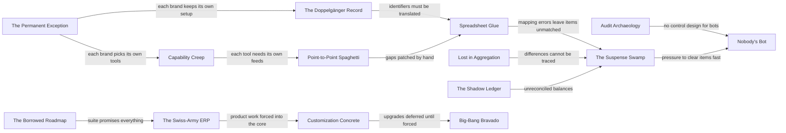

{id: where-finance-architecture-goes-wrong}
# 2. Where Finance Architecture Goes Wrong

> **IN THIS SECTION, YOU WILL:** Learn fourteen named failure patterns that recur in enterprise finance estates, recognize their warning signs, understand the incentives that produce them and what they cost in control, money, speed and audit risk, and find the chapters whose designs prevent or repair each one.

> **KEY POINTS:**
>
> * **Each pattern is locally rational.** A brand team that keeps its own ledger, a controller who builds a mapping spreadsheet, a program that customizes the ERP to hit a go-live date: each made a sensible choice under its own constraints. The failure is the accumulation, and only someone accountable for the whole estate sees it.
> * **The cost shows up in the close, the suspense account and the audit, rarely in the project budget.** These patterns are paid for in days to close, unreconciled balances, upgrade lead times and control findings, long after the project that created them was declared a success.
> * **The patterns reinforce each other.** The Doppelgänger Record creates Spreadsheet Glue, which feeds The Suspense Swamp; The Permanent Exception breeds Capability Creep and Point-to-Point Spaghetti. Treating one symptom at a time rarely works; breaking the chain at its origin usually does.

A finance estate is the set of systems, data, integrations and controls through which an enterprise records what it owns, owes, earns and spends, and proves it. In a multinational, multi-brand group it includes the general ledger (the official book of account), subledgers (detailed records of one area, such as partner payables), payment platforms, close and consolidation tools, tax and treasury systems, and the custom platforms that brands build because no package fits their business model.

Such an estate rarely fails dramatically. What fails is **coherence**: the estate slowly loses the ability to show that its records agree with each other and with the money. Unmatched items accumulate. Mappings drift. Every upgrade becomes a project. The close takes nine days because people spend six of them reconciling things the architecture should have kept consistent.

This guide names the **fourteen failure patterns** I see most often. The names are shorthand for observable behavior, so a steering committee or design review can say "this is The Suspense Swamp" and move straight to the mechanism and the remedy. Each pattern is described the same way: a typical quote, what it looks like, why it happens, what it costs, a short illustration, the direction of the remedy, and the chapters that address it. The illustrations use **Northmere, the fictional group this book follows** (see [Meet Northmere: The Running Example](#meet-northmere)); they are composites, not accounts of any real company.

None of these patterns implies incompetence. **Most are the residue of reasonable decisions** taken under deadline, by teams accountable for one part of the estate. That is exactly why they need a name and an owner.

{id: where-finance-architecture-goes-wrong--fourteen-patterns-to-recognize}
## Fourteen Patterns to Recognize

The patterns fall into four loose families: **truth** (the first five, which damage the ability to know which record is right), **platform** (the next four, which misuse the systems), **change** (how the estate grows and moves) and **control** (evidence and accountability).

| Pattern | The warning sign |
| --- | --- |
| **The Shadow Ledger** | A brand or product system keeps its own books that nobody reconciles to the general ledger. |
| **The Suspense Swamp** | Unmatched items accumulate in clearing and suspense accounts faster than anyone clears them. |
| **The Doppelgänger Record** | The same entity — a legal entity, a partner, an account — is created and changed in several systems with no agreed authority. |
| **Lost in Aggregation** | Detail is aggregated before it reaches the ledger, and nobody can trace a balance back to its transactions. |
| **Spreadsheet Glue** | Mappings, controls and hand-offs that the close depends on live in spreadsheets on someone's laptop. |
| **Customization Concrete** | Custom code inside a vendor platform makes every upgrade a project and every release a risk. |
| **The Swiss-Army ERP** | One platform is expected to do everything, including what it was never designed to do at the required volume. |
| **Point-to-Point Spaghetti** | Every system talks directly to every other, in its own format, with its own error handling. |
| **Capability Creep** | Several platforms quietly acquire the same capability, and nobody decides which one owns it. |
| **The Permanent Exception** | Every brand, market or acquisition claims to be special, and each exception becomes a fork that never ends. |
| **Big-Bang Bravado** | Everything switches over at once, usually at year-end, with no way back. |
| **The Borrowed Roadmap** | The vendor's roadmap, packaging and sales cycle set the enterprise's architecture. |
| **Audit Archaeology** | Controls and evidence are retrofitted after the system is built, usually after an audit finding. |
| **Nobody's Bot** | Bots, scripts or AI agents post, approve or change financial data without an owner, a control or an evidence trail. |

Every chapter in Parts I to IV opens with a callout naming the patterns it addresses, linked back here.

{id: where-finance-architecture-goes-wrong--the-shadow-ledger}
### The Shadow Ledger

*"Don't worry about the balances, our platform tracks all of that. Finance only needs the monthly totals."*

**What it looks like.** A brand platform, a payout engine or a billing service holds balances that matter financially: amounts owed to partners, credits granted to customers, prepaid funds, accrued fees. It computes them, reports them on its own dashboards, and acts on them by paying out or netting. The general ledger receives a monthly figure, typed in or loaded from a file, and nobody proves that the platform's balances and the ledger's balances agree. Observable signs: finance cannot reproduce what the platform says a partner is owed; month-end adjustments are booked "to align with the platform".

**Why it happens.** Product engineering builds what the product needs. A payout engine needs a running balance per partner to decide what to pay, so it gets one; that balance is, functionally, a subledger, but nobody calls it one, so nobody designs it to the standards of one (double entry, immutability, period locks, reconciliation to the general ledger). Acquisitions add more: the acquired platform keeps working and reports its balances upward as totals.

**What it costs.** **Control**: an unreconciled balance is uncontrolled, so the reported liability rests on code nobody audits. **Cost**: every close investigates differences by hand. **Speed**: payout-rule changes become slow and fearful. **Audit risk**: a material balance computed outside the control environment pulls audit testing into the platform, usually at the worst moment.

**An illustration.** At Northmere, Wayfare runs its own payout engine for ground-transport suppliers. It tracks what each supplier is owed, nets cancellations and pays monthly. Oracle Fusion, Wayfare's ERP, receives one payables journal per supplier batch. In 2027 Hana Kowalski's team finds that the engine's open supplier balances exceed Fusion's accrued supplier liability by about **€1.3 million**, a figure nobody can explain without opening the engine's database, because cancellations after payout are netted in the engine but never posted as entries.

**The remedy direction.** Recognize any system that holds balances as a subledger, give it ledger discipline (entries, not mutable balances), and reconcile it to the general ledger at a defined frequency with an owner. Then decide whether it should be a subledger at all.

**Where this book helps:** [Why Enterprises Build Their Own Finance Platforms](#custom-finance-platforms) sets the boundary rules for what brand platforms may own; [Designing Custom Ledgers and Financial Event Processing](#designing-financial-ledgers) shows how to build a subledger that behaves like one; [Systems of Record and Authoritative Data Boundaries](#systems-of-record) decides who is authoritative for each balance; [Designing for Traceability, Reconciliation and Audit Across Boundaries](#traceability-and-reconciliation) designs the subledger-to-GL reconciliation; [Uber's Payments Platform: A Ledger at the Center of Money Movement](#case-uber-payments) shows a real payments ledger and where it must hand off to the book of record.

{id: where-finance-architecture-goes-wrong--the-suspense-swamp}
### The Suspense Swamp

*"It's just timing. Those items will clear next month."*

**What it looks like.** A **clearing account** is a temporary account where money waits between two events, for example between a payment provider confirming a payment and the money arriving at the bank. A **suspense account** holds items that cannot yet be classified or matched. Both are legitimate and should net to near zero over a short, predictable period. The Suspense Swamp is the state where they do not: the balance grows, the aging profile lengthens, and the population becomes a mixture of genuine timing differences, unrecorded fees, missed refunds, duplicated postings and real losses that nobody can tell apart. Observable signs: the share of items older than 90 days rises month after month; the reconciliation of the account is "explained" by a list rather than a match; periodic write-offs are booked as a policy.

**Why it happens.** Suspense is where integration gaps go to hide. A new payment method launches before its settlement file can be matched automatically. A refund is processed in the payments platform but reaches the subledger late. A provider changes a report format. Each gap puts a small number of items into suspense; each item is individually immaterial, so nobody prioritizes it. Launching the payment method is somebody's target; clearing suspense is somebody else's chore.

**What it costs.** **Control**: the enterprise cannot assert that cash and liabilities are complete and accurate. **Cost**: old items cost far more to clear than new ones, because the context is gone, and some become write-offs. **Speed**: the close waits for the suspense review. **Audit risk**: aged suspense is a classic source of audit adjustments.

**An illustration.** At Northmere in 2026, on working day 3 of each close, about **1.9%** of payment-provider settlement lines for Stayloft's alternative payment methods (wallets, local bank transfers) are unmatched. Unreconciled balances in clearing and suspense accounts average **€14 million** at month-end, of which about **€2.1 million** is older than 90 days. Each new local payment method added a small, unmatched stream; together they made the largest open item on Leila Haddad's close agenda.

**Figure 1:** *The Suspense Swamp as sediment: small unmatched streams settle faster than they are cleared, and the oldest layer, €2.1 million over 90 days of Northmere's €14 million average balance, is the hardest to explain.*

**The remedy direction.** Treat suspense as a measured output of the architecture, not an accounting chore: matching rules designed before a payment method launches, settlement files treated as contracts with completeness checks, aging limits with owners, and the suspense balance reported as an engineering metric.

**Where this book helps:** [Payments-to-Ledger: Connecting Providers, Brand Platforms and the ERP](#payments-to-ledger) designs clearing accounts and three-way matching; [BlackLine: Close Automation, Reconciliation and Continuous Accounting](#blackline) covers high-volume transaction matching; [Integration Architecture for Finance](#integration-architecture) covers completeness controls and error handling; [Designing for Traceability, Reconciliation and Audit Across Boundaries](#traceability-and-reconciliation) provides the reconciliation catalog.

{id: where-finance-architecture-goes-wrong--the-doppelganger-record}
### The Doppelgänger Record

*"We created the new entity in SAP. Can someone set it up in the other systems?"*

**What it looks like.** **Master data** is the shared reference data that transactions point to: legal entities, accounts, cost centers, customers, suppliers, partners, bank accounts. The Doppelgänger Record is the state where the same entity is created and maintained independently in several systems, each with slightly different attributes, and no system or team is agreed to be the authority. Observable signs: the same partner has different bank details in two systems; a legal entity exists in the ERP but not yet in the tax engine; the auditor's entity list takes a week to assemble.

**Why it happens.** Every platform ships with its own master data model and its own create screen, and the path of least resistance is to use it. Projects scope their own system, not the authority question. Mergers bring complete parallel sets of master data. Master data management delivers no visible feature, so it is deferred.

**What it costs.** **Control**: approval over bank-detail changes means little if the detail can be changed in another system. **Cost**: every mapping table must be maintained and reconciled. **Speed**: opening an entity or onboarding a partner needs coordinated manual setup. **Audit risk**: reports whose population depends on unsynchronized masters are hard to rely on.

**An illustration.** Northmere has **71 legal entities in 38 countries**. Each must exist in SAP S/4HANA (or Oracle Fusion or Workday Financials), in OneStream, in Vertex, in Kyriba, in Workday HCM and in the payments platform, with consistent codes, currencies and ownership. When a dormant Asian entity was renamed in 2026, the change reached four systems within a month and the fifth only when the treasury team noticed a bank account mapped to the old name.

**The remedy direction.** Decide, per master data domain, which system is the authority, which systems subscribe, and who is the steward; then enforce it through integration (subscribers cannot create, only consume) rather than through policy alone.

**Where this book helps:** [Finance Data Architecture: Master Data, Systems of Record and Governance](#finance-data-architecture) covers master data domains, management styles and stewardship; [Systems of Record and Authoritative Data Boundaries](#systems-of-record) builds the authority matrix; [Many Entities, Currencies, Jurisdictions and Brands](#global-scale) covers the legal-entity model; [Onboarding Brands, Entities and Markets as Configuration](#brands-entities-markets) turns entity onboarding into configuration.

{id: where-finance-architecture-goes-wrong--lost-in-aggregation}
### Lost in Aggregation

*"The ledger can't handle that volume, so we post daily totals. The detail is in the platform somewhere."*

**What it looks like.** High-volume businesses must summarize: putting every booking, click or payment into the general ledger would make it slow and unreadable. Summarization becomes a failure when the summary loses its link to the detail. Observable signs: a general-ledger line cannot be traced to the subledger lines that make it up; the summarization key changed and nobody kept the old one; the detail is retained for less time than the audit and statutory retention period; answering "which transactions make up this revenue figure for this property in March?" requires an engineer and a week.

**Why it happens.** Summarization is designed for performance by people who are not asked about investigation. The summarization key (which attributes are kept: entity, account, currency, date, business model) is set once, early, and then becomes invisible. Retention of detail is trimmed as a storage cost. Drill-back, going from a ledger line to its sources, is a requirement nobody states until an auditor asks.

**What it costs.** **Control**: a balance that cannot be traced can only be asserted, not demonstrated. **Cost**: every investigation becomes a data-engineering project. **Speed**: errors in summaries take days to locate. **Audit risk**: auditors who sample transactions need a reliable path from the reported figure to the population; without it they expand testing.

**An illustration.** The Stayloft Finance Platform, Northmere's custom brand finance platform, posts about **38,000** general-ledger lines a day into SAP S/4HANA, summarized from about **3 million** subledger lines. In 2027 the external auditor asks Northmere to trace a March revenue balance for one Portuguese entity back to bookings. The summary lines carry a batch identifier, but for periods before 2025 the mapping from batch to subledger lines was kept only in a log store with a 13-month retention. The trace for those periods has to be rebuilt from raw events.

**The remedy direction.** Design summarization and drill-back together: a stable summarization key, a persisted link from every summary line to its constituent detail, retention aligned to audit and statutory requirements, and a tested drill-back path.

**Where this book helps:** [Designing Custom Ledgers and Financial Event Processing](#designing-financial-ledgers) covers summarization and drill-back; [Anatomy of a Financial Systems Landscape](#finance-landscape) explains the volume gradient that forces summarization; [From Customer Transaction to Financial Statement](#transaction-to-report) traces one transaction through every hop; [Designing for Traceability, Reconciliation and Audit Across Boundaries](#traceability-and-reconciliation) designs the identifiers and evidence.

{id: where-finance-architecture-goes-wrong--spreadsheet-glue}
### Spreadsheet Glue

*"Only one person in group reporting knows how the mapping file works, and they are on leave during close."*

**What it looks like.** **End-user computing** (EUC) is any spreadsheet, desktop database or personal script that performs a step a business process depends on. Spreadsheet Glue is the state where the close relies on EUCs for mappings, allocations, reconciliations, journal preparation or interface hand-offs. Observable signs: a journal is uploaded from a spreadsheet each month; account mappings between ledgers live in a workbook; a "macro" transforms a provider report before it is loaded; nobody can say how many such files exist or which are key to financial reporting.

**Why it happens.** Spreadsheets are the most flexible integration tool ever built, and controllers are skilled at them. When a new brand is acquired, the mapping of its chart of accounts to the group chart is needed by the first quarter close, long before a system could be configured; a workbook solves it in a week. The workbook then becomes permanent because it works.

**What it costs.** **Control**: reporting EUCs need versioning, access and logic checks; doing that well is expensive and doing it badly is a common deficiency. **Cost**: manual preparation every period. **Speed**: every change needs the one person who understands the file. **Audit risk**: auditors test spreadsheets used in controls as **information produced by the entity**, and uncontrolled ones invite findings.

**An illustration.** Northmere runs three charts of accounts (SAP group, Oracle for Wayfare, Workday for Tablekin) and maps them to the group structure only in OneStream, using mappings maintained in spreadsheets. Its 2027 interface inventory finds about **70** undocumented spreadsheets-in-the-loop among some 1,100 finance interfaces. When Tablekin added a new revenue account for usage fees, the mapping workbook was not updated, and a catch-all mapping rule put about **$41 million** of first-quarter usage revenue in "other revenue" at group level until the review caught it on working day 7.

**The remedy direction.** Inventory EUCs, rate them by reporting risk, control the ones that must stay, and replace the key ones with governed configuration in the system that owns the mapping or hand-off.

**Where this book helps:** [Controls, Auditability and Security by Design](#controls-and-auditability) covers EUC and report controls; [Finance Data Architecture: Master Data, Systems of Record and Governance](#finance-data-architecture) covers governed mappings and the group chart of accounts; [OneStream: Consolidation, Planning and Performance Management](#onestream) covers consolidation mapping; [Technical Debt, Architectural Fitness and Modernization Priorities](#technical-debt-and-fitness) puts EUCs on the debt register.

{id: where-finance-architecture-goes-wrong--customization-concrete}
### Customization Concrete

*"The standard doesn't fit how we work here, so we built a small enhancement."*

**What it looks like.** Vendor platforms allow extension, and some extension is necessary. Customization Concrete is the state where custom code inside the vendor platform (modified standard objects, custom tables, user exits, bespoke reports) has grown until it governs the upgrade schedule. Observable signs: each upgrade needs months of regression testing; the custom object count is known only roughly; release notes are read for what they will break.

**Why it happens.** Each customization is approved in isolation, against a go-live date, by a project that will not run the system afterward. Clean-core disciplines (extend through published interfaces, outside the core) are cheaper over the system's life but more expensive in the project, and projects are measured on the project.

**What it costs.** **Control**: errors in custom posting logic hit the book of record directly. **Cost**: regression testing at every upgrade and scarce skills to maintain old code. **Speed**: vendor capability arrives late or never. **Audit risk**: custom posting logic draws IT general controls testing.

**An illustration.** Northmere's SAP S/4HANA core went live in 2021 as a greenfield implementation, chosen precisely to avoid carrying old customizations. It still accumulated about **2,300** custom objects from early design decisions, and upgrades now take **seven months**. Sven Aalto, the SAP platform lead, estimates that fewer than a third of those objects are used weekly.

**The remedy direction.** Make "standard first, extend outside the core" a mandatory standard with a waiver process, measure the custom object count and upgrade lead time as fitness indicators, and retire unused objects deliberately.

**Where this book helps:** [SAP S/4HANA: The Enterprise Finance Core](#sap-s4hana) explains clean core and extensibility; [Principles, Standards and Reference Architectures](#principles-standards-reference) turns it into a principle and standard; [Technical Debt, Architectural Fitness and Modernization Priorities](#technical-debt-and-fitness) measures it; [Modernization Patterns for Legacy Finance Systems](#modernization-patterns) covers the paths out.

{id: where-finance-architecture-goes-wrong--the-swiss-army-erp}
### The Swiss-Army ERP

*"Once everything is in one ERP, we'll have one version of the truth."*

**What it looks like.** A single enterprise resource planning (ERP) platform is expected to absorb every finance capability: high-volume transaction processing, partner settlement, billing, payments, revenue allocation, planning and analytics. Observable signs: requirements for billions of events a year are written as ERP requirements; product teams wait for ERP configuration to launch a business model; the program's scope grows every quarter; "we will do it in the ERP" ends design discussions. The result is a Swiss-Army knife of finance: every blade present, none sharp enough at billions of events.

**Why it happens.** The ERP's original promise, one integrated database, is real and valuable for the accounting core. It is extended by analogy to everything financial. Vendors encourage it, because suite adoption is their growth model. It is also a reaction to the opposite failure: after years of Point-to-Point Spaghetti, one platform looks like the cure.

**What it costs.** **Control**: operational-volume detail degrades the ledger and makes the book of record harder to read. **Cost**: customization to make the ERP do product work, feeding Customization Concrete. **Speed**: business-model innovation waits for the ERP's release cycle. **Audit risk**: indirect; overruns tend to defer control design.

**An illustration.** In early 2027 a Keystone workshop at Northmere proposes moving Stayloft's merchant-model subledger, about 3 million lines a day, directly into the S/4HANA general ledger "so that there is one book". Dana Whitlock, the Chief Architect, asks the workshop to separate two goals: one book of record per entity (which Keystone needs), and one system processing every transaction (which it does not). The convergence decision is reframed as Central Finance versus an accounting-hub pattern, with high-volume detail staying in a subledger designed for it. In December 2027 the design authority chooses the accounting-hub pattern ([Multiple ERPs, One Finance Core: Coexistence and Convergence](#multiple-erps)).

**The remedy direction.** Use the ERP as the accounting core it is designed to be, and place high-volume, product-coupled processing in layers designed for volume (subledgers, billing and settlement services), integrated through summarized postings with drill-back.

**Where this book helps:** [Anatomy of a Financial Systems Landscape](#finance-landscape) lays out the layers and the volume gradient; [Why Enterprises Build Their Own Finance Platforms](#custom-finance-platforms) sets the ERP boundary; [Multiple ERPs, One Finance Core: Coexistence and Convergence](#multiple-erps) compares convergence patterns; [SAP S/4HANA: The Enterprise Finance Core](#sap-s4hana) shows what the ERP core is designed to hold; [Build, Buy or Compose: Vendor Selection and Portfolio Rationalization](#build-versus-buy) gives the decision criteria.

{id: where-finance-architecture-goes-wrong--point-to-point-spaghetti}
### Point-to-Point Spaghetti

*"We just need one more file from their system to ours. It's a small interface."*

**What it looks like.** Systems integrate directly with each other, each pair with its own format, schedule, error handling and owner. Observable signs: an interface inventory nobody trusts; the same booking data transformed differently in four places; failures discovered by downstream users; several integration technologies, each with a different owner.

**Why it happens.** Each interface is the cheapest way to meet one project's need. Shared integration patterns require someone to fund and own them before any single project benefits. Acquisitions bring their own integration platforms. Finance-specific requirements, such as completeness proofs, control totals, period cut-off and replay, are not visible to the project until the first close.

**What it costs.** **Control**: without control totals, a missing file shows up only when a reconciliation fails. **Cost**: every source change ripples through every consumer. **Speed**: replacing a system means re-implementing all its interfaces. **Audit risk**: undocumented interfaces in the reporting path become findings.

**An illustration.** Northmere's 2027 inventory counts about **1,100** interfaces in the finance estate, of which about **240** are flat-file transfers. Three integration technologies coexist: SAP Integration Suite for SAP-centric flows, Kafka owned by Platform Engineering, and MuleSoft carrying legacy Wayfare and Tablekin flows. Lucía Romero, the lead integration architect, finds booking cancellations represented in five different ways across them.

**The remedy direction.** Introduce canonical financial events and a small number of governed integration styles, with completeness and control totals as standard, and migrate interfaces when systems change rather than in a big rewrite.

**Where this book helps:** [Integration Architecture for Finance](#integration-architecture) covers styles, idempotency and control totals; [Canonical Events and Adapters for Loosely Coupled Financial Domains](#loosely-coupled-domains) defines canonical events and adapters; [Preventing Redundant Capabilities and Unnecessary Coupling](#redundancy-and-coupling) classifies coupling; [Architecture Governance That Speeds Decisions](#architecture-governance) keeps new interfaces conformant; [Uber's Payments Platform: A Ledger at the Center of Money Movement](#case-uber-payments) shows a public example of one narrow waist between many businesses and many providers.

{id: where-finance-architecture-goes-wrong--capability-creep}
### Capability Creep

*"We already pay for that module. Let's use it for our team's reconciliations."*

**What it looks like.** Several platforms in the estate offer the same capability (reconciliation, billing, tax determination, payouts, planning), and different teams use different ones, each for good local reasons. Observable signs: two or three tools perform the same function for different entities; license renewals include modules nobody can name an owner for; the same metric is computed differently in two tools and the results disagree.

**Why it happens.** Enterprise suites grow sideways: each major release adds adjacent capability, often bundled at a marginal price. Teams adopt what is already licensed; acquired companies bring their own. Nobody holds the capability map that would show the overlap, or the decision right to resolve it.

**What it costs.** **Control**: one control run in several tools produces inconsistent evidence. **Cost**: duplicate licenses, integrations and skills. **Speed**: every process change is made several times. **Audit risk**: each tool's configuration is tested separately.

**An illustration.** In 2027 Northmere performs reconciliations in BlackLine, in a OneStream module bought in 2022 and rarely used, and in Oracle Fusion for Wayfare's intercompany balances. It runs three billing approaches (SFP commission billing, SAP FI-CA invoicing, Stripe Billing) and two tax engines for overlapping invoice flows (Vertex, and Oracle's tax engine in some Wayfare markets). Each choice was defensible when made.

**The remedy direction.** Map capabilities, not systems; assign one owning platform per capability per scope; record the rare legitimate duplications as explicit decisions with a review date; and use renewal dates to retire the rest.

**Where this book helps:** [Map Capabilities Before Systems](#capability-mapping) builds the capability map; [Manage the Application Portfolio as an Investment](#application-portfolio) uses it to rationalize; [Preventing Redundant Capabilities and Unnecessary Coupling](#redundancy-and-coupling) runs the overlap register; [Vendor Strategy and Avoiding Excessive Dependency](#vendor-portfolio-strategy) uses contract timing as a lever.

{id: where-finance-architecture-goes-wrong--the-permanent-exception}
### The Permanent Exception

*"Our business is different. The group standard doesn't work for us."*

**What it looks like.** Every brand, market or acquired company argues for its own variant of a shared capability: its own payout logic, its own revenue calculation, its own chart of accounts, its own integration platform. Some exceptions are justified. The failure is that exceptions have no expiry, so each becomes a permanent fork. Observable signs: "temporary" exceptions older than two years; group standards with more waivers than adopters; new brands onboarded by copying the most similar existing brand's stack.

**Why it happens.** Brand leaders are measured on brand growth, and a shared standard is a dependency they do not control. The central function often cannot deliver the shared capability as fast as the brand needs it, so the exception is rational. Acquisitions are integrated lightly to protect the deal's value, and light integration hardens.

**What it costs.** **Control**: each fork needs its own documented and tested control design. **Cost**: duplicated engineering, licenses and operations. **Speed**: a new tax rule or reporting requirement is built once per fork. **Audit risk**: more variants, more testing.

**An illustration.** Northmere runs two partner-payout engines: the Stayloft Finance Platform's, and Wayfare's engine for ground-transport suppliers. When Wayfare was acquired in 2024, its engine was kept because ground-transport supplier contracts "work differently". By 2027 the differences that remain are a payment schedule and a netting rule, both of which the Stayloft engine could support as configuration. Retiring the duplicate is a Keystone Year 3 goal.

**The remedy direction.** Grant exceptions through a recorded decision with a reason, an owner and an expiry date; design shared capabilities with configuration points for the variations that are real; and fund the central capability well enough that the exception is not the faster path.

**Where this book helps:** [Onboarding Brands, Entities and Markets as Configuration](#brands-entities-markets) turns brand and market variation into configuration; [Architecture Governance That Speeds Decisions](#architecture-governance) covers waivers with expiry; [Many Entities, Currencies, Jurisdictions and Brands](#global-scale) explains which variation is legally required; [Why Enterprises Build Their Own Finance Platforms](#custom-finance-platforms) judges when a fork is legitimate; [Uber's Payments Platform: A Ledger at the Center of Money Movement](#case-uber-payments) shows a real platform that turned each new line of business into configuration.

{id: where-finance-architecture-goes-wrong--big-bang-bravado}
### Big-Bang Bravado

*"We'll cut over on 1 January. Clean start, new year, new system."*

**What it looks like.** A finance system replacement is planned as a single switch: all entities, all processes, all data, on one date, commonly the start of a fiscal year, with the old system decommissioned shortly after. Observable signs: no parallel run; rollback described as "not an option"; migration rehearsals scheduled late; a cut-over date set by the board calendar rather than readiness.

**Why it happens.** Big-bang plans look cheaper on paper: no interim interfaces, no dual maintenance, one training wave. The fiscal-year boundary is attractive because balances carry forward cleanly. Program leaders are rewarded for a date. Incremental patterns, such as moving one entity or one process at a time, require interim architecture that looks like waste to a steering committee.

**What it costs.** **Control**: a failed cut-over can leave the enterprise unable to close or evidence its controls. **Cost**: recovery costs far more than the interim architecture it avoided. **Speed**: everything waits for the slowest component. **Audit risk**: a year-end conversion lands in the audit's busiest weeks, and the completeness of migrated balances is tested closely.

**An illustration.** Keystone's Year 3 goal at Northmere is to migrate the Stayloft merchant subledger to the group finance core. An early integrator proposal schedules it for 1 January 2029, in one step. Leila Haddad rejects it: the merchant subledger carries deferred balances for bookings whose stays are months away, and a cut-over at year-end would put the migration and the US GAAP annual close on the same team in the same weeks. The plan becomes an entity-by-entity migration with parallel runs and reconciliations as stage gates.

**The remedy direction.** Plan migrations as a sequence of reversible steps, cut over at period boundaries away from quarter- and year-end, run old and new in parallel with reconciliations as gates, and keep a tested rollback for each step.

**Where this book helps:** [Modernization Patterns for Legacy Finance Systems](#modernization-patterns) catalogs strangler, parallel run and cut-over patterns; [Modernizing Without Stopping the Close: An Incremental Migration](#incremental-modernization) works through a migration step by step; [Target State, Transition States and the Roadmap](#target-and-transition-states) defines stable intermediate states; [Leading an ERP Modernization and Finance Transformation](#finance-transformation) covers program design.

{id: where-finance-architecture-goes-wrong--the-borrowed-roadmap}
### The Borrowed Roadmap

*"The vendor says this is where the platform is going, so we should align our roadmap."*

**What it looks like.** Architectural choices are made in the vendor's terms and on the vendor's timetable: a maintenance deadline drives a migration date, a license bundle drives the choice of module, a new product name drives a re-platforming. Observable signs: the target state reads like a vendor's product map; decisions cluster around renewal dates; nobody can say what the enterprise would do if the vendor changed prices or packaging.

**Why it happens.** Strategic vendors invest heavily in executive relationships and roadmap briefings, and their roadmaps are often good. Internal architecture functions may lack an independent target state, so the vendor's fills the gap. Maintenance deadlines are real and create genuine urgency. Commercial teams optimize the discount, not the dependency.

**What it costs.** **Control**: indirect; vendor-default control designs may not fit the enterprise's risks. **Cost**: lost negotiating power, and unused bundles that feed Capability Creep. **Speed**: the enterprise moves at the vendor's pace. **Audit risk**: low directly; the real risk is a concentration nobody chose.

**An illustration.** In 2027 Northmere must decide how to converge its brand ledgers: SAP Central Finance or an accounting-hub pattern. The SAP account team presents Central Finance alongside an expanded RISE with SAP renewal, with a discount that expires at quarter-end. Dana separates the two: the architecture decision is scheduled for Q4 2027 on its own criteria (volume, drill-back, coexistence with Fusion and Workday), and the commercial negotiation follows it rather than leading it. The decision, taken on 8 December 2027, adopts the accounting-hub pattern and rejects Central Finance; the RISE renewal is negotiated afterward ([Vendor Strategy and Avoiding Excessive Dependency](#vendor-portfolio-strategy)).

**The remedy direction.** Hold an enterprise-owned target state, tier vendors by strategic importance, maintain exit plans for critical ones, and sequence decisions so that architecture precedes commercial commitment.

**Where this book helps:** [Vendor Strategy and Avoiding Excessive Dependency](#vendor-portfolio-strategy) covers tiering, exit plans and contract levers; [Build, Buy or Compose: Vendor Selection and Portfolio Rationalization](#build-versus-buy) covers the selection process; [Target State, Transition States and the Roadmap](#target-and-transition-states) provides the independent target; [Evolving the Finance Estate Over a Decade](#long-term-evolution) treats vendor change as a stressor to design for.

{id: where-finance-architecture-goes-wrong--audit-archaeology}
### Audit Archaeology

*"Let's get the system live first. We'll sort out the controls before the auditors come."*

**What it looks like.** Systems that affect financial reporting are designed and built without control requirements, and controls are added later, typically after an audit finding. Observable signs: internal controls learns about a new system at go-live; production access is broad "for support"; change approvals live in chat; evidence is assembled by hand before each audit. Each audit season becomes an excavation: teams dig through logs, tickets and chat history to reconstruct proof the system should have produced as a by-product.

**Why it happens.** Controls are perceived as compliance overhead, not as requirements. Product engineering teams building finance-relevant platforms often come from consumer software, where production access for developers is normal. Internal controls teams lack architecture vocabulary, and architects lack controls vocabulary, so neither engages early. Under the **Sarbanes-Oxley Act**, management must assess **internal control over financial reporting** (ICFR) and, for large filers, the auditor attests to it, yet the systems that carry those controls are designed without ICFR in mind.

**What it costs.** **Control**: deficiencies, graded under the US audit standard by severity. A **significant deficiency** is less severe than a material weakness but important enough to merit the attention of those overseeing financial reporting; a **material weakness** means there is a reasonable possibility that a material misstatement will not be prevented or detected on a timely basis ([PCAOB AS 2201, Appendix A](https://pcaobus.org/oversight/standards/auditing-standards/details/AS2201)). **Cost**: retrofitting costs more than designing in. **Speed**: remediation freezes change. **Audit risk**: the highest of any pattern.

**An illustration.** Northmere's FY2026 audit raised a **significant deficiency** (not a material weakness) on the Stayloft payout engine: developers had production access, and payout rule changes lacked documented approval. Remediating it is a Keystone Year 1 goal. Mei Tanaka, head of internal controls, and Jonas Berg, who owns the platform, find that the engine's deployment pipeline already records every change; what is missing is an approval step and the separation of who writes from who deploys.

**The remedy direction.** Treat control requirements as architecture requirements: involve controls specialists at design, build evidence capture into pipelines and platforms ("evidence by design"), and review the control impact of every change to a finance-relevant system.

**Where this book helps:** [Controls, Auditability and Security by Design](#controls-and-auditability) covers ICFR, IT general controls and evidence by design; [Designing for Traceability, Reconciliation and Audit Across Boundaries](#traceability-and-reconciliation) designs the auditor's walkthrough; [Resilience, Observability, Security and Recovery for Finance Systems](#resilience-and-security) covers access and incident handling; [Designing Custom Ledgers and Financial Event Processing](#designing-financial-ledgers) builds immutability and audit trails into custom ledgers.

{id: where-finance-architecture-goes-wrong--nobody-s-bot}
### Nobody's Bot

*"The bot handles those journals now. It's been running fine for months."*

**What it looks like.** Robotic process automation, scheduled scripts, auto-matching rules and, increasingly, AI agents create, approve or change financial data. The automation itself may be sound; the failure is that it has no named owner, no control over its own changes, no evidence of what it did and why, and often runs under a shared or generic service account. Observable signs: journals posted by a user ID nobody recognizes; matching rules edited by whoever is on duty; an AI tool clearing reconciliation items with no record of its reasoning.

**Why it happens.** Automation is introduced bottom-up by operations teams under pressure to reduce manual work, often successfully. It does not pass through the architecture or controls processes designed for "systems". AI tools add a new twist: their behavior can change with a model update or a prompt edit, outside traditional change management. The savings are visible at once; the control gap is visible only when something goes wrong.

**What it costs.** **Control**: an unowned bot is an uncontrolled control. **Cost**: errors made at machine speed, investigated without logs. **Speed**: once trust is lost, the automation is switched off and manual work returns. **Audit risk**: generic service accounts and unlogged changes are typical findings.

**An illustration.** In 2027 Northmere's shared-service center runs a bot that posts monthly reclassification journals in SAP S/4HANA under a generic service account. When a cost-center hierarchy changes in Workday HCM, the bot continues to post with the old mapping for two months. Nobody owns the bot's logic; the person who built it has moved to another team. Keystone's Year 5 ambition of AI-assisted reconciliation now starts from a rule: every automated actor has an owner, its own identity, controlled changes and an evidence log.

**The remedy direction.** Register every automated actor that touches financial data, give each an owner and a distinct identity, put its logic under change control, log its decisions, and define where a human approves.

**Where this book helps:** [AI, Automation and Agentic Finance Operations](#ai-in-finance) covers agentic workflow controls; [Controls, Auditability and Security by Design](#controls-and-auditability) covers automated controls and access; [Organizing Architecture Ownership Across Finance, Engineering, Security and Data](#organizing-for-architecture) assigns ownership; [Architecture Governance That Speeds Decisions](#architecture-governance) brings automation into review.

{id: where-finance-architecture-goes-wrong--how-the-patterns-reinforce-each-other}
## How the Patterns Reinforce Each Other

The patterns rarely appear alone. Most estates show several, and they feed each other in recognizable chains. Seeing the chain matters because **fixing a downstream symptom while the upstream pattern continues produces the same symptom again**, usually within a year.

**Figure 2:** *The patterns form chains; most downstream symptoms, such as growing suspense balances, trace back to an upstream choice about authority, standards or vendors.*

Four chains appear most often.

**The truth chain: The Doppelgänger Record → Spreadsheet Glue → The Suspense Swamp.** When several systems create the same partner, entity or account, identifiers must be translated between them. The translation is first done in a spreadsheet, because that is fastest. The spreadsheet drifts from the systems it maps, so some transactions land against the wrong counterparty or account and fail to match. The unmatched items go to suspense. Finance then sees a suspense problem and staffs a clearing team, while the cause sits two steps upstream in master data authority. At Northmere, part of the €14 million suspense balance traces to partner records whose bank and contract identifiers differ between the Stayloft Finance Platform and SAP FI-CA. **Break the chain at the master**, not at the suspense account.

**The fragmentation chain: The Permanent Exception → Capability Creep → Point-to-Point Spaghetti.** Each brand exception brings its own tools; each tool needs its own interfaces; each interface carries its own format and error handling. Within a few acquisitions the estate has three integration technologies and five representations of a cancellation. The remedy is not a heroic integration rewrite but a governance change: exceptions expire, capabilities have owners, and new interfaces use canonical events.

**The platform chain: The Borrowed Roadmap → The Swiss-Army ERP → Customization Concrete → Big-Bang Bravado.** A vendor's suite story encourages putting everything in one platform; work the platform was not designed for is forced in through custom code; custom code makes upgrades so expensive that they are deferred until a maintenance deadline forces a large, single migration.

**The control chain: Audit Archaeology → Nobody's Bot.** An organization that designs controls late will also automate without control design, and pressure from The Suspense Swamp ("clear those items faster") accelerates it. The audit finding, when it comes, covers both.

Two patterns sit at the roots of most chains. **The Permanent Exception** is a governance failure: nobody has the decision right, or the will, to say no with an expiry date. **The Borrowed Roadmap** is a strategy failure: the enterprise lacks a target state of its own. That is why this book spends Part IV on governance, target states and vendor strategy, not only on technology.

**Figure 3:** *Fixing a downstream symptom while the upstream pattern keeps flowing brings the symptom back; the cheaper fix is usually at the origin, a decision right, a standard or an expiry date.*

{id: where-finance-architecture-goes-wrong--a-diagnostic-table}
### A diagnostic table

The patterns leave measurable traces. The indicators below are the ones I would ask for in a first review of any finance estate; each is cheap to obtain and hard to argue with.

| Pattern | First indicator to ask for | Typical owner of the number |
| --- | --- | --- |
| The Shadow Ledger | Balances held outside the GL with no scheduled reconciliation | Controller, platform owner |
| The Suspense Swamp | Suspense and clearing balances by aging bucket, trended over 12 months | Controller, payments operations |
| The Doppelgänger Record | Number of systems where each master data object can be created | Data governance lead |
| Lost in Aggregation | Time to trace a sampled GL line to its transactions | Finance systems, internal audit |
| Spreadsheet Glue | Count of key EUCs in the close, by risk rating | Internal controls |
| Customization Concrete | Custom object count and upgrade lead time | ERP platform owner |
| The Swiss-Army ERP | Share of program scope that is product or volume processing | Program design authority |
| Point-to-Point Spaghetti | Interfaces per system, share without control totals | Integration architecture |
| Capability Creep | Capabilities served by more than one platform | Enterprise architecture |
| The Permanent Exception | Open waivers and their age | Architecture review board |
| Big-Bang Bravado | Number of reversible steps in the migration plan | Program, design authority |
| The Borrowed Roadmap | Critical vendors without an exit plan | Chief Architect, procurement |
| Audit Archaeology | Control deficiencies by root cause (design vs operation) | Head of internal controls |
| Nobody's Bot | Automated actors without a named owner or distinct identity | Internal controls, operations |

These are not targets in themselves. A suspense balance can be low because items are written off too quickly; a custom object count can fall because code moved to an unmanaged side system. **Read each indicator with the mechanism in mind.**

{id: where-finance-architecture-goes-wrong--using-the-patterns}
## Using the Patterns

The names are meant to be used in rooms where decisions are made. In a design review, ask which pattern a proposal risks, and what would stop it. In a steering committee, ask which pattern a delay or overrun is a symptom of. In a portfolio review, ask which patterns the estate shows and which root (governance or target state) they trace back to.

Three habits keep the names useful rather than accusatory: **name the mechanism, not the person**; **pair every pattern with a measure** from the table above; and **look for the upstream pattern** before funding a downstream remedy, because the cheapest fix is usually a decision right, a standard or an expiry date, not a new tool.

Some duplication, customization and exception is legitimate. A second payment provider is a resilience choice, not Capability Creep; a market-specific tax process required by law is not The Permanent Exception. The test is whether the variation was **decided, owned and reviewed**, or simply accumulated.

The rest of the book works through the remedies. Before that, meet the group whose estate shows every one of these patterns in 2027, and the program that sets out to fix them: [Meet Northmere: The Running Example](#meet-northmere).

{id: where-finance-architecture-goes-wrong--sources-and-evidence}
## Sources and Evidence

*Standards and regulation*

- [AS 2201: An Audit of Internal Control Over Financial Reporting That Is Integrated with An Audit of Financial Statements](https://pcaobus.org/oversight/standards/auditing-standards/details/AS2201), Public Company Accounting Oversight Board — definitions of material weakness and significant deficiency (Appendix A) and the auditor's testing of controls.

*Practitioner and research sources*

- [Strangler Fig](https://martinfowler.com/bliki/StranglerFigApplication.html), Martin Fowler, 2024 (revised) — the incremental replacement pattern behind the remedy for Big-Bang Bravado.

The pattern names and their descriptions are the author's synthesis of common industry practice; Northmere is fictional, and the architectural recommendations are the author's judgment.
