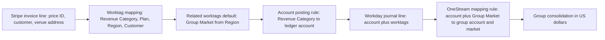
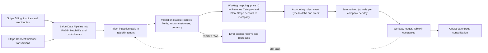
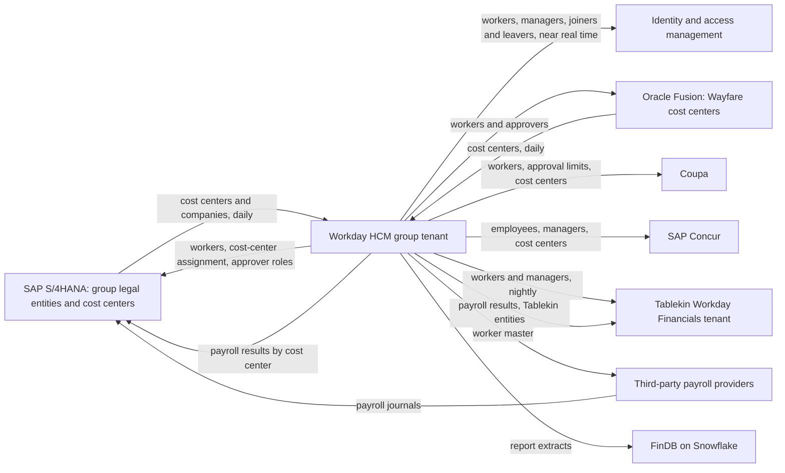

{id: workday}
# 19. Workday: The Org Chart Behind the Ledger

> **IN THIS CHAPTER, YOU WILL:** Learn how Workday is built (one object model, configured business processes, worktags instead of account strings), what its Accounting Center, Adaptive Planning, Prism and Data Cloud, and integration tools can and cannot do as of October 2026, and how to decide whether Workday should be an enterprise's people backbone, a finance core, a second-tier ERP, or all three.

> **WHY FINANCE CARES:** Workday decides who can approve what, which cost center a salary lands in, and, where it runs Financials, how every revenue line is classified. A weak worktag design or a split between the people system and the finance system shows up later as mapping spreadsheets, approval errors and days added to the close.

> **WHY ARCHITECTS SHOULD CARE:** Workday is a single-codeline SaaS that you configure but cannot customize, query directly or hold back from upgrades. Its integration limits, release cadence and data model set hard constraints on every system that consumes worker data or feeds it transactions.

> **KEY POINTS:**
>
> * **Workday HCM is the organizational backbone even where Workday is not the ledger.** Workers, supervisory organizations, positions and approver roles belong in HCM and flow out to SAP, Oracle, Coupa, Concur and identity systems; cost centers and legal entities usually belong to finance and flow in. Name the owner of every object before building a single interface.
> * **Worktags are a design decision with a ten-year half-life.** Workday captures business dimensions as worktags on each transaction and derives the ledger account from spend and revenue categories through posting rules. A Foundation Data Model copied from a legacy account string loses that benefit; one designed against the group chart of accounts makes consolidation a rule instead of a spreadsheet.
> * **Workday Financials is a legitimate second-tier ERP for subscription and services businesses, not a high-volume event ledger.** Accounting Center ingests external transactions in batches through Prism tables and posts summarized journals with drill-back, but publishes no throughput figures. Keep rating, billing and payment detail upstream, and tier Workday Financials explicitly rather than letting an acquired tenant drift into a permanent exception.

> **[FAILURE PATTERNS THIS CHAPTER ADDRESSES](#where-finance-architecture-goes-wrong):**
>
> * **The Doppelgänger Record** — Tablekin's cost centers and workers exist in two Workday tenants and in S/4HANA, with no written rule about which copy wins.
> * **Spreadsheet Glue** — Tablekin's Stripe-to-worktag mapping lives in a spreadsheet, and a missing group-mapping row put $41 million of usage revenue in the wrong line in April 2027.
> * **The Permanent Exception** — Tablekin's Workday Financials was tolerated after the 2023 acquisition and never assigned a tier, a template or an exit condition.

Most enterprises meet **Workday** twice. The first time it is the human capital management (HCM) system: the record of every worker, every manager and every organization the company runs on. The second time it arrives with an acquisition, as the finance system of a company the group bought, and someone has to decide whether it stays. The two meetings are usually handled by different people, and that is where the trouble starts, because Workday's design ties the two together more tightly than any other enterprise suite: **the organization model that routes an HR approval is the same object model that routes a supplier invoice** and assigns a salary to a cost center.

This chapter treats Workday as a platform with a specific data model, a specific way of enforcing controls, an integration surface with published limits, and a release cadence nobody can opt out of. It covers Financials because the convergence decisions in this book depend on it, and HCM because the **HCM-as-master pattern**, Workday as the authoritative source of people and organization data for every other platform, is one of the most consequential and least documented integration patterns in a finance estate. It owns four terms: **worktags**, the **Foundation Data Model**, **Accounting Center** and the HCM-as-master pattern. Ledger design in general belongs to [Never Update, Only Append: Designing Custom Ledgers](#designing-financial-ledgers), master-data governance to [Finance Data Architecture: Who Owns the Truth](#finance-data-architecture), and running several ERPs side by side to [Converge or Coexist: Living with More Than One ERP](#multiple-erps).

{id: workday--setting-the-scene-tablekin-s-ledger-in-2027}
## Setting the Scene: Tablekin's Ledger in 2027

Northmere, the fictional group this book follows, bought **Tablekin** in 2023. Tablekin sells reservations, table-management and embedded-payments software to restaurants and venues, and earns subscriptions, a usage fee per seated cover, and a margin on payments it facilitates through Stripe Connect: about 11% of Northmere's $8.2 billion 2026 revenue. It ran **Workday Financial Management** before the acquisition and still does; **Arjun Rao**, Head of Finance Systems at Tablekin, owns that tenant and the Stripe integration that feeds it.

Northmere also runs **Workday HCM** group-wide: live since 2019, about 24,000 workers, the source of organization structure, workers' cost-center assignments and approvers for the whole group. Payroll runs in Workday Payroll for the United States, the United Kingdom and Canada, and through third-party providers elsewhere.

These are two different Workday **tenants**, each one customer's isolated instance with its own configuration and data. In 2024 Tablekin's roughly 1,900 workers moved into the group HCM tenant. Its Financials stayed in Tablekin's original tenant, which keeps a thin copy of Tablekin workers and managers, refreshed nightly through a MuleSoft flow, because Workday Financials needs workers to route approvals and expenses. Tablekin's four legal entities, Tablekin Inc. (US dollar), Tablekin Canada Ltd. (Canadian dollar), Tablekin UK Ltd. (sterling) and Tablekin Europe B.V. (euro), keep their books there, and their trial balances load into OneStream, mapped to the group chart. Until May 2027 that mapping lived in spreadsheets; in the April close a new Tablekin usage-revenue account had no mapping row, and a catch-all rule put $41 million of usage revenue into group "Other revenue" until working day 7. Since the May close, mappings are governed, effective-dated rules in OneStream, as [OneStream: Consolidating Actuals, Planning the Future](#onestream) describes.

In June 2027, the Keystone design authority, which **Dana Whitlock**, Northmere's Chief Architect, chairs with **Leila Haddad**, the Chief Accounting Officer, takes up the question [Build, Buy or Compose: Choosing What to Own](#build-versus-buy) left open: does Tablekin stay on Workday Financials? The portfolio review has marked it Tolerate, pending this decision. Keystone's Year 3 goal is one group finance core on S/4HANA by 2029, and the choice between SAP Central Finance and an accounting-hub pattern for converging the brand ledgers is due in the fourth quarter of 2027. Arjun argues that Tablekin's subscription business fits Workday better than the group's S/4HANA template. Sven Aalto, the SAP Platform Lead, points out that Tablekin's intercompany charges with the group cannot be matched inside any ledger. Mei Tanaka, Head of Internal Controls, asks which tenant's security roles the auditor should test for Tablekin's approvals.

Dana asks for three things before anyone argues for an answer: a map of which objects are mastered where, a trace of one Tablekin invoice from Stripe to the group consolidation, and an honest list of what Workday documents and what it does not.

{id: workday--what-workday-is-as-of-october-2026}
## What Workday Is, as of October 2026

Workday was founded in 2005 by David Duffield and Aneel Bhusri, former PeopleSoft executives, and launched its first product in 2006. Its [fiscal 2026 annual report](https://www.sec.gov/Archives/edgar/data/1327811/000132781126000014/wday-20260131.htm) (year ended 31 January 2026) reports more than 11,500 customer organizations and more than 65% of the Fortune 500; [fiscal 2026 revenue](https://newsroom.workday.com/2026-02-24-Workday-Announces-Fiscal-2026-Fourth-Quarter-and-Full-Year-Financial-Results) was $9.55 billion. In February 2026 Bhusri [returned as chief executive](https://techcrunch.com/2026/02/09/workday-ceo-eschenbach-departs-with-co-founder-aneel-bhusri-returning-as-ceo/), replacing Carl Eschenbach; older material that names Eschenbach as CEO is out of date.

The licensing boundaries inside the product scope matter more than the scope itself, because each is a separate procurement and architecture decision.

| Product | What it does | Architectural note |
| --- | --- | --- |
| **Workday HCM** | Core HR, compensation, benefits, talent, recruiting, learning, time, absence | Anchor product; owns workers and supervisory organizations |
| **Workday Payroll** | Native payroll for the [United States, Canada, the United Kingdom and Australia](https://www.workday.com/en-us/products/payroll/workday-hcm-strada-global-payroll.html) | Other countries go through partners and Global Payroll Connect; payroll results become journals |
| **Workday Financial Management** | GL, accounts payable and receivable, assets, cash and settlement, billing, contracts, revenue management, close and consolidation, multibook ([datasheet, January 2024](https://www.workday.com/content/dam/web/en-us/documents/datasheets/datasheet-workday-financial-management.pdf)) | Same tenant and object model as HCM when both are licensed |
| **Related finance applications** | Accounting Center, Projects, Expenses, Procurement, Strategic Sourcing, Inventory, Grants Management, Project Billing (same datasheet) | Separately licensed; a Financials subscription does not imply any of them |
| **Workday Adaptive Planning** | Planning across finance, workforce, sales and operations | Acquired as Adaptive Insights in 2018; widely sold standalone |
| **Prism Analytics and Data Cloud** | External data in the tenant; zero-copy sharing with data platforms | In transition through 2027; see below |
| **Extend, Orchestrate, Workday Build** | Custom apps beside delivered functionality, low-code orchestration, developer and agent tooling | Extend apps run on Workday's security model and are update-safe by Workday's description |

Two documented claims shape everything that follows. Workday runs [one technology platform on a single codeline](https://www.workday.com/en-sg/pages/the-power-of-one-source-of-truth.html), so every customer runs the same version. And, per the datasheet, "as transactions are approved, accounting information is automatically generated along with intercompany, eliminating entries and translations": accounting is produced when a business process completes, not by a nightly transfer-to-ledger batch. That is the real difference from older ERPs, and it is why Workday's separate, batch-oriented path for external transactions, Accounting Center, needs careful treatment.

{id: workday--the-object-model-and-the-business-process-framework}
## The Object Model and the Business Process Framework

{id: workday--a-metadata-driven-object-model-you-cannot-touch-directly}
### A metadata-driven object model you cannot touch directly

Workday's most detailed public description of its architecture is still a [2012 engineering blog](https://blog.workday.com/en-us/2012/why-workday-is-different-by-design-and-why-it-matters.html): the object model is defined as metadata, metadata and most application data are held in memory over a relational persistence layer, reports run on the same object structure where transactions execute, and customer data "is accessed only by the application server." The 2024 datasheet still says "in-memory object architecture." Older third-party accounts of the persistence layer are unconfirmed by Workday, and this book does not repeat them.

Three consequences follow, and each one constrains the rest of the estate.

1. **There is no database access.** Every extract goes through an API, a report exposed as a web service, the Workday Query Language, or Prism and Data Cloud. A design that assumes change-data capture from Workday's tables is wrong.
2. **Operational reporting is real time; analytical reporting should move out.** A cost-center manager's spend report reflects an invoice the moment it is approved, but multi-year history and joins with operational data run into extract limits and belong on a data platform.
3. **You configure; you do not customize.** Extend apps sit beside delivered functionality. This removes the class of upgrade risk that [SAP S/4HANA: One Journal, Clean Core](#sap-s4hana) calls the clean-core problem, and also the escape hatch when delivered behavior does not fit.

{id: workday--the-business-process-framework}
### The business process framework

The **business process framework** (BPF) is Workday's configurable workflow engine. Hiring a worker, approving a supplier invoice, changing a cost center and submitting a journal are all business processes, each with a configured definition of steps, approvals, conditions, notifications and integration steps that can vary by organization or location. The datasheet describes "always-on controls" and "always-on audit" that record who took which action and when.

A step that says "approval by cost-center manager" does not name a person; it resolves at run time to whoever holds that role on the cost center the transaction carries. That indirection is the BPF's strength and the reason **organization design in HCM is a finance control**: when a manager moves in HCM, every approval routed through the role moves with them on the effective date. Controls that SAP or Oracle estates often keep in external workflow tools live here in configuration the controls team can read, and the definition is itself audit evidence. Many outbound integrations are also launched as a business-process step, the closest Workday comes to event-driven outbound interfaces without Orchestrate.

{id: workday--organizations-worktags-and-the-foundation-data-model}
## Organizations, Worktags and the Foundation Data Model

{id: workday--organizations}
### Organizations

Practitioner documentation consistently describes several distinct Workday organization types, each with optional hierarchies: **Company** (the legal or balancing entity), **Cost Center**, **Region**, **Location**, **Supervisory Organization** (the HR reporting line that routes most HCM business processes) and custom organizations. For finance, the key point is that **the supervisory hierarchy and the cost-center hierarchy are separate objects**: a worker reports through one and is charged to the other. That lets the HR line differ from financial accountability, common in matrixed groups, and obliges the design to say which hierarchy each approval follows.

{id: workday--worktags}
### Worktags

A **worktag** is a Workday attribute on a transaction or transaction line that records its business purpose, ownership or funding: company, cost center, project, region, customer, product, grant. The datasheet describes capturing "business dimensions at the point of transaction" and keeping them through transactional, management and financial reporting. Meaning that a segment-based ERP encodes in the digits of an account string, Workday carries as typed references on the line.

Four mechanics turn that principle into a design:

- **Required worktags** are configured per transaction type. A university implementation, for example, requires Company, Balancing Unit, Fund and Ledger on every transaction ([University of Washington FDM overview](https://finance.uw.edu/uco/fdm-governance/fdm-definitions-and-standards/overview-uws-foundation-data-model-fdm)).
- **Related worktags** default from a **driver worktag**: choose a project and its cost center, region and program fill in ([RIT FDM guide](https://www.rit.edu/tigercloud/foundation-data-model-fdm)). Drivers reduce entry errors and make the dimensional relationships explicit data rather than tribal knowledge.
- **Balancing worktags** define the levels at which debits must equal credits. Company is the primary one; a second, such as fund or business unit, can be configured ([St. Cloud State guide](https://services.stcloudstate.edu/TDClient/1919/Portal/KB/ArticleDet?ID=152562)).
- **Spend categories and revenue categories** are what users choose instead of ledger accounts. An **account posting rule** derives the ledger account from the category and, where needed, other worktags.

The last mechanic is the most misunderstood. Workday Financials **does have a chart of accounts**: ledger accounts exist and trial balances are produced by them. The account carries only the accounting classification; everything analytical lives in worktags. Workday cites an insurer, CNA, that [reduced its ledger accounts by 59%](https://workday.com/en-us/products/financial-management/accounting-center.html) by moving detail into worktags.

{id: workday--the-foundation-data-model}
### The Foundation Data Model

The **Foundation Data Model** (FDM) is the complete design of companies, ledger accounts, organizations, worktags, hierarchies, required-worktag rules and posting rules: the tenant's financial dimensional model. I treat it as the most lasting design decision in any Workday Financials program, because it is three things at once. It is the **integration contract** for every feeder system, which must produce lines with valid worktags. It is the **target model** for Accounting Center rules. And it is the **source shape** for every mapping to an external consolidation or planning tool: if it cannot be mapped to the group chart by rule, someone will map it by hand every month.

{id: workday--worktags-versus-a-segment-based-chart-of-accounts}
### Worktags versus a segment-based chart of accounts

In a **segment-based chart of accounts**, the Oracle and classic-ERP style, a journal line's coding is a concatenated string of segments such as company, cost center, account and product. SAP sits between the two styles: [SAP S/4HANA: One Journal, Clean Core](#sap-s4hana) shows how the Universal Journal carries account assignments as columns on one line item.

| Question | Segment-based chart of accounts | Workday worktags and FDM |
| --- | --- | --- |
| Where does analytical meaning live? | In segment values of the account string; each segment has a fixed position and length | In typed worktags on the line; the ledger account carries only accounting classification |
| How is a valid combination enforced? | Cross-validation rules on segment combinations | Required-worktag rules per transaction type, related worktags from drivers, posting rules |
| Adding a new dimension | Usually a new segment or an overloaded existing one; often a re-implementation | A new worktag type; still needs governance, reporting and feeder-system changes |
| Mapping to a group chart | Segment-to-segment rules | Combination rules: account plus worktag values to group account plus group dimensions |
| Main failure mode | Combination explosion and "miscellaneous" segment values | Too many required worktags at entry, or worktags that duplicate the legacy string |

**Figure 1:** *A segment-based chart packs meaning into fixed positions in one account string; Workday keeps the ledger account for accounting classification and carries the analytical meaning as typed worktags on the line.*

{id: workday--a-worked-example-worktag-design-for-tablekin}
### A worked example: worktag design for Tablekin

Take the Tablekin invoice that recurs in this book. An Austin venue on the Pro plan pays **$249 a month** plus **$0.25 per seated cover**; in March 2027 it seated 3,120 covers, so usage is **$780**. Stripe Billing bills the subscription in advance and usage in arrears, so the **$1,029** invoice dated 1 April 2027 (before sales tax) carries April's subscription and March's usage. Tablekin's FDM, about 640 ledger accounts plus worktags and designed in 2020 for a single US business, is not bad:

| Worktag | Values (examples) | Required on revenue lines? | Source of value |
| --- | --- | --- | --- |
| Company | Tablekin Inc., Tablekin Canada Ltd., Tablekin UK Ltd., Tablekin Europe B.V. | Yes (balancing) | Stripe account that billed the customer |
| Revenue Category | Subscription – Starter, Subscription – Pro, Subscription – Enterprise, Usage – Covers – Pro, Payments Margin… | Yes | Stripe price ID, mapped |
| Cost Center | Tablekin Sales North America, Tablekin Customer Success EMEA… | Yes | Customer owner in CRM |
| Region | US-South, US-West, Canada, UK, DACH… | Yes | Venue address |
| Customer | The venue | Yes for receivables | Stripe customer ID, mapped to Workday customer |
| Sales Channel (custom) | Direct, Partner, Self-serve | No | CRM |

It has two design problems. **The plan tier is encoded in the revenue category**, so every new plan creates a category and a posting-rule row: the account-string habit returning through the back door. And **nothing on the line says which group dimension it maps to**. Northmere's group chart records revenue by stream (subscription, usage, payments services) and reports brand, business model and market as group dimensions, so the OneStream rules must read Tablekin's account, revenue category and region together, and every new plan or account needs a new approved rule before the load will run. The April incident was exactly this: a new account, no rule. Dana's team proposes a redesign that keeps the mechanics and changes what the worktags mean:

- **Revenue Category** carries only the revenue stream, matching the group's streams: Subscription, Usage, Payments Margin: three values, instead of one per plan and stream.
- A new **Plan** worktag carries Starter, Pro, Enterprise and future tiers. Adding a plan adds a worktag value, not a posting rule.
- A new **Group Market** worktag, related to Region through a driver relationship, carries the group's market code. It is defaulted, not typed.

With that design, the venue's March revenue, $249 of March subscription (billed on 1 March) plus $780 of usage accrued at month-end, posts in Tablekin Inc. like this (account numbers illustrative; sales tax omitted, see [Around the Core: Where Specialist Platforms Earn Their Place](#satellite-platforms)):

| Account | Debit | Credit | Note |
| --- | --- | --- | --- |
| 2400 Contract Liability | $249.00 | | March subscription released; billed in advance on 1 March |
| 4000 Subscription Revenue | | $249.00 | Revenue Category = Subscription; Plan = Pro; Region = US-South; Group Market = US |
| 1250 Unbilled Receivables | $780.00 | | March usage accrued; cleared by the 1 April invoice |
| 4100 Usage Revenue | | $780.00 | Revenue Category = Usage; Plan = Pro; Region = US-South; Group Market = US |

The 1 April invoice then debits receivables $1,029, credits unbilled receivables $780 and credits contract liability $249 for April; [Accounting for Architects: Ledgers, Journals and Revenue](#accounting-for-architects) owns these mechanics.

Revenue posting rules shrink to one per stream, and the OneStream mapping becomes a rule: *Tablekin account 4000 maps to group Subscription Revenue, with the market taken from the Group Market worktag*. A new pricing plan is a worktag value, not a new mapping rule that someone must remember to approve.

The lesson generalizes: **a good FDM is designed from both ends**, from the attributes feeder systems can supply reliably and from the group chart consolidation needs. Designed only from the first, it is a tidy tenant nobody can consolidate; only from the second, an account string with extra steps.

**Figure 2:** *In Workday the ledger account is derived from categories and worktags, so the mapping to a group chart can be a rule on account plus worktag rather than a spreadsheet of account strings, provided the FDM was designed with the group dimensions in mind.*

{id: workday--multibook-multi-currency-and-intercompany}
## Multibook, Multi-Currency and Intercompany

{id: workday--multibook}
### Multibook

Workday describes multibook and multicurrency as [built into the core](https://www.workday.com/content/dam/web/en-us/documents/datasheets/datasheet-workday-financial-management.pdf). **Multibook** is reporting under more than one accounting basis, such as US GAAP for the group and local GAAP for a statutory filing. Workday's training material describes **book codes** as the mechanism: book-specific entries carry a code and reports select the book. That differs structurally from S/4HANA's parallel ledgers or Oracle's secondary ledgers, so I recommend comparing the functional outcome, multi-GAAP reporting from one set of transactions, not claiming equivalence, and testing the specific adjustments (leases, capitalization thresholds, revenue timing) in a prototype before relying on them. Tablekin's need is modest: its UK and Dutch entities prepare statutory accounts from the US GAAP books plus a few book-coded adjustments.

{id: workday--multi-currency}
### Multi-currency

Each Workday company has a base currency, and the datasheet states that translation and intercompany entries are generated as transactions are approved. Tablekin's four companies have four functional currencies; group translation to US dollars happens in OneStream, which holds the group rate tables for all three ERPs. [Global by Design: Entities, Currencies, Jurisdictions and Brands](#global-scale) covers currency concepts in general.

{id: workday--intercompany}
### Intercompany

Workday's **intercompany profiles** define which companies may transact with each other and how due-to and due-from entries are generated; eliminations occur when both the company and its affiliate fall within the hierarchy a report is run for ([consolidations and multicurrency guide](https://community-content.workday.com/en-us/public/products/financial-management/consolidations-and-multicurrency-guide.html)). Workday also calculates non-controlling interest (NCI), the share of a subsidiary owned by outside shareholders.

This works when both sides live in one tenant: Tablekin Inc. charging Tablekin Europe B.V. for platform services is generated and eliminated inside Workday. But Northmere's corporate shared-services entity, booked in S/4HANA, recharges Tablekin for group HR, legal and the Workday HCM subscription itself. **Those transactions have one side in SAP and the other in Workday**, so no ledger can match them; OneStream matches them at consolidation, and differences surface on working day 4 or 5, when they are expensive to chase. That is Sven's point, and it is a property of the estate, not of Workday; [Converge or Coexist: Living with More Than One ERP](#multiple-erps) treats cross-ERP intercompany as a convergence criterion.

{id: workday--security-effective-dating-and-audit}
## Security, Effective Dating and Audit

{id: workday--domain-and-business-process-security}
### Domain and business process security

Workday's configurable security framework, as Workday's [security course material](https://doc.workday.com/workday-education/en-us/course-manuals/security-for-administrators/configurable-security-framework.html) describes it, has two policy types acting on **security groups**:

- **Domain security policies** grant View and Modify (for the user interface) or Get and Put (for web services) on a **domain**, a collection of related tasks, reports, data sources and web-service operations. Workday delivers domains grouped into functional areas such as Financial Accounting, and their membership cannot be changed by the customer.
- **Business process security policies** decide which security groups can initiate, view, approve, rescind, cancel or correct each business-process type.

For finance, the important group types are **role-based groups**, whose membership follows organization role assignments such as cost-center manager, and **user-based groups** of named people, typically administrators; intersection and segment-based groups narrow access further, for example to certain companies.

The consequence I find most underestimated: **in a combined HCM and Financials tenant, organization design in HCM is financial access design**. Making someone a cost-center manager in HCM grants approval authority over that cost center's spend on the same effective date. HCM role assignment therefore falls within internal control over financial reporting (ICFR), and segregation of duties (SoD) must be analyzed at domain and business-process level, not only in the finance team's role catalog; [Controls by Design, Not by Audit Season](#controls-and-auditability) owns both concepts. Integrations run as **integration system users** (ISUs) secured through the same domain model; an ISU with broad access is privileged access and belongs in the same review as a human administrator.

**Figure 3:** *In a combined HCM and Financials tenant, making someone a cost-center manager grants approval authority over that cost center's spend on the same effective date, so organization design is financial access design.*

At Northmere the split tenants make Mei's question hard. A Tablekin cost-center manager is assigned in the group HCM tenant and copied nightly to Tablekin's tenant, where a role-based group grants approval rights. The tested control, "only the cost-center manager approves supplier invoices above $10,000," depends on the copy being complete and timely: a manager who leaves on Friday keeps approval rights until the next successful feed. The 2027 control matrix records this gap, mitigated by a weekly comparison of active approvers across the two tenants.

{id: workday--effective-dating-and-the-audit-trail}
### Effective dating and the audit trail

Workday records worker and organization changes with an **effective date**, the business date from which a change applies, separately from when it was entered. Practitioner documentation consistently describes this as the basis of future-dated reorganizations and as-of reporting; I have not found a public Workday architecture statement of the mechanism, so treat it as practitioner knowledge. Two finance implications follow: a reassignment dated the first of next month routes approvals and salary costs correctly from that date, and **a back-dated change can alter the organization history a past period's report used**, so period-end reports that depend on organization data should be kept as evidence at the time, not re-run later and assumed identical.

The BPF's audit and Accounting Center's audit-tracked rule changes give the auditor a strong base inside the tenant. Nothing outside it is covered: the MuleSoft flow that still builds Tablekin's daily journal file has no Workday audit trail.

{id: workday--accounting-center-external-transactions-into-workday}
## Accounting Center: External Transactions Into Workday

{id: workday--what-workday-documents}
### What Workday documents

**Workday Accounting Center** turns large volumes of business events from other systems into accounting in Workday. Its [product page](https://workday.com/en-us/products/financial-management/accounting-center.html) says it ingests and enriches external revenue and operational data, converts it into rules-based entries that finance maintains "with clicks, not code," keeps operational attributes for multidimensional reporting, and supports drill from a summarized report to the source. Customer examples include a hotel group consolidating 18 property-management and point-of-sale sources. **The page gives no throughput figures.**

Workday's [administrator documentation](https://doc.workday.com/admin-guide/en-us/financial-management/accounting-center/accounting-generation/iue1611339888720.html) describes the mechanism:

- An **accounting source** is a configurable object that defines the steps, the ingestion source and the rules for processing input rows. It brings in external transactions in incremental batches, enriches them with worktag mapping and custom validations, transforms them into accounting journals, and posts **summarized journals** to the ledger.
- The prerequisite is a **Prism table** of external transactions prepared for enrichment and accounting generation; Workday recommends an ingestion table as the source.
- Finance creates and maintains **custom accounting rules** and custom account posting rules to generate detailed and summarized accounting.
- The pipeline runs ingest, enrich (validation stages and worktag mapping), generate accounting, post; errors can be viewed, resolved and reprocessed.
- The same data source cannot be used for more than one accounting source.

{id: workday--the-architectural-reading}
### The architectural reading

Accounting Center is an **accounting hub** in the sense [Never Update, Only Append: Designing Custom Ledgers](#designing-financial-ledgers) uses: it applies posting rules to events produced elsewhere and posts the result to a general ledger, keeping detail below the ledger and summary in it. It is comparable in purpose to Oracle's Accounting Hub ([Oracle Fusion: An Accounting Hub for High-Volume Events](#oracle-fusion)); it is distinctive in staging on a Prism table and targeting the FDM's worktags. It is not a billing engine, a rating engine or an operational subledger with open items and balances: it does not decide that 3,120 covers at $0.25 is $780. And the documentation does not answer the questions a design for millions of events a month needs answered.

| Question an architect will ask | Publicly documented answer (October 2026) |
| --- | --- |
| Batch or event-at-a-time? | Incremental batches |
| Where does detail live? | Prism ingestion table; summarized journals post to the ledger; drill-back from summary to source |
| Who maintains the rules? | Finance, through configuration; changes audit-tracked |
| Maximum rows per load, latency, throughput | Not published |
| Retention of ingested detail | Not published |
| Handling of corrections to rows already accounted | Not published in the sources reviewed |
| Licensing prerequisites (Prism or Data Cloud Professional) | Not published in the sources reviewed; confirm with Workday |

Where the documentation is silent, the responsible approach is a proof of concept on your own volumes and correction scenarios before the design depends on it: what [Build, Buy or Compose: Choosing What to Own](#build-versus-buy) calls testing the hardest scenario.

{id: workday--tablekin-s-stripe-flows-today-and-with-accounting-center}
### Tablekin's Stripe flows: today and with Accounting Center

Tablekin's Stripe inputs come from two products that [Stripe: Every Movement Is a Balance Transaction](#stripe) covers in depth. **Stripe Billing** produces about 41,000 venue invoices a month like the $1,029 one. **Stripe Connect** facilitates diners' payments and pays venues out, generating about 5.5 million **balance transactions** a month (charges, refunds, Stripe fees, Tablekin's application fees, transfers and payouts), the unit [Stripe: Every Movement Is a Balance Transaction](#stripe) treats as the basis of reconciliation.

Until the cutover, a MuleSoft flow pulls Stripe's reports nightly, aggregates them by company, revenue category and region using a mapping spreadsheet, and writes a file that an **EIB** (Enterprise Interface Builder, Workday's no-code file loader) posts as one summarized journal per company per day. It mostly works. But the mapping sits outside any audit trail, a re-run after failure can double-post, and the trail from a ledger balance to its balance transactions runs through a spreadsheet and a file nobody keeps: **Lost in Aggregation** in miniature. The March 2027 Stripe design review, described in [Stripe: Every Movement Is a Balance Transaction](#stripe), approved the replacement: Stripe Data Pipeline delivers all Northmere Stripe data into FinDB, and Tablekin's accounting moves to Accounting Center as daily summarized journals per reporting category, with drill-back to balance transactions. Dana makes the cutover conditional on proof:

**Figure 4:** *With Accounting Center the mapping and the accounting rules move inside the tenant, under audit, and detail stays in a Prism table that the ledger can drill back to; the extraction from Stripe, the control totals and the rating of usage still happen outside Workday.*

The design moves the mapping and the accounting rules into the tenant, as audited configuration instead of spreadsheet and MuleSoft logic. It deliberately leaves three things outside: usage rating stays in Stripe Billing; the extraction carries a batch identifier and control totals per company and currency, so BlackLine can prove the Prism table received what Stripe reported (the completeness control [Files, Events and APIs: How Finance Systems Talk](#integration-architecture) describes); and payout-to-bank matching stays in BlackLine Transaction Matching.

The proof of concept has three tests: load March 2027's 5.5 million balance transactions in daily batches and time each stage; reprocess a day after a forced failure and prove nothing is duplicated; and push April refunds of March charges through and show how the reversal is accounted and drilled back. Until those pass, Accounting Center fits Tablekin's volumes on paper only.

{id: workday--adaptive-planning-and-onestream}
## Adaptive Planning and OneStream

Workday **Adaptive Planning** came from the 2018 acquisition of Adaptive Insights; the annual report describes it as "active planning across finance, workforce, sales, and operational data." It is widely sold standalone and integrates with Workday HCM and Financials through delivered integrations. Practitioners describe it as a separate application, and I have found no Workday statement that it shares the tenant's data model, so I do not assume it does.

At Northmere, group budgeting and forecasting run in **OneStream** ([OneStream: Consolidating Actuals, Planning the Future](#onestream)). Tablekin's FP&A team, however, kept the Adaptive Planning license that came with the acquisition, uses it for driver-based plans of annual recurring revenue (ARR), churn and expansion by cohort, and submits the result to OneStream as a top-down plan. The renewal is due in the second quarter of 2028.

This is **Capability Creep** in its most forgivable form, and its costs are still concrete: the driver logic behind Tablekin's plan is invisible to group FP&A, and Tablekin headcount is planned in Adaptive while the rest of the group plans it in OneStream from the same HCM data. At renewal I would decide by capability, not tool: if OneStream can host the cohort-based ARR model at acceptable effort, retire Adaptive; if not, keep it explicitly as Tablekin's operational planning tool, with OneStream as the single plan of record, and write that boundary down.

{id: workday--prism-analytics-and-data-cloud}
## Prism Analytics and Data Cloud

**Prism Analytics** has since 2017 let customers bring external data into the Workday tenant, transform it and report on it alongside Workday data under Workday's security model. **Workday Data Cloud**, announced in September 2025, adds zero-copy, bidirectional data sharing with platforms including Snowflake, Databricks and Salesforce, with AWS and Google Cloud to follow.

The relationship between the two is easy to get wrong, and the common claim that "Prism was renamed Data Cloud" is incorrect. Workday's [Prism-to-Data-Cloud guide](https://www.workday.com/en-us/topics/it/guide-prism-to-data-cloud.html) describes two packages: **Data Cloud Professional**, which "keeps everything Prism Analytics does" and adds zero-copy, and **Data Cloud Core**, a lighter single-source package without Prism pipelines. It states that Prism and zero-copy access are complementary. On timing, the same guide gives general availability for HR and talent data at the 2026R2 release and for finance data at 2027R1. Trade press reported Data Cloud as generally available in mid-October 2026; for finance data, the correct statement as of this writing is **targeted for 2027R1**, and it should be rechecked before any design depends on it.

For Northmere, **Accounting Center's staging layer is a Prism table**, so the repackaging is not only an analytics question; Arjun's proof of concept must confirm which package Tablekin needs. And worker data reaches FinDB, Northmere's Snowflake finance data platform ([One Number, Many Views: Finance Data from Operations to Analytics](#finance-data-flows)), through scheduled report extracts; zero-copy sharing is the obvious replacement once generally available for that data, and would remove one of the larger consumers of the extract quota.

{id: workday--the-integration-toolset-and-its-limits}
## The Integration Toolset and Its Limits

[Files, Events and APIs: How Finance Systems Talk](#integration-architecture) introduces Workday's integration surface at a glance; this is the detail.

| Tool | What it is | Use it for |
| --- | --- | --- |
| **Workday Web Services (WWS)** | Versioned SOAP API by functional area; a new version is introduced only for breaking changes ([versioning rules](https://community-content.workday.com/en-us/public/products/platform-and-product-extensions/workday-web-services-versioning.html)) | Full-fidelity create and update, bulk loads from middleware |
| **REST APIs** | OAuth-secured REST resources, growing coverage | Modern applications, Extend apps, agents |
| **RaaS (Reports-as-a-Service)** | A custom report exposed as a web service returning XML, JSON or CSV | Outbound extracts; the most common read pattern |
| **WQL** | Workday Query Language, SQL-like queries over Workday data sources through the API | Programmatic extracts with filters |
| **EIB** | Enterprise Interface Builder: no-code inbound loads (file to web service) and outbound extracts (report to file) | Data loads, simple scheduled feeds such as Tablekin's daily journal |
| **Core Connectors and Cloud Connect** | Delivered, configurable integration templates for common endpoints (benefits, payroll, Salesforce) | Standard third-party endpoints |
| **Workday Studio** | Eclipse-based, pro-code integration development, running in Workday's integration cloud | Complex, multi-step integrations close to Workday |
| **Orchestrate for Integrations** | Low-code visual orchestration for event-driven, API-centric flows ([course material](https://doc.workday.com/workday-education/en-us/course-manuals/creating-integrations-using-workday-orchestrate/introduction-to-workday-orchestrate-for-integratio.html)) | Event-driven flows that would otherwise need Studio |
| **Business-process integration steps** | Integrations launched at a step of a business process | Near-real-time propagation of hires, moves, terminations |
| **Data Cloud zero-copy** | Sharing with Snowflake, Databricks and others | Warehouse and analytics feeds |

Workday publishes [integration and web-service limits](https://doc.workday.com/admin-guide/en-us/manage-workday/tenant-configuration/it-administrator-resources/limitations-and-availability/dan1370797408285.html) that every design should be sized against. As read in October 2026:

- **Extract quotas** are counted in requests, in total across all API extract interfaces, and depend on customer size. A tenant with fewer than 100,000 workers, which includes Northmere's group HCM tenant at about 24,000, may make **250,000 requests in 24 hours and 75,000 in any 60 minutes**.
- Under load Workday may reject requests with HTTP 429 (REST and RaaS) or HTTP 500 (SOAP and RaaS), and may throttle or suspend access; it recommends exponential back-off and caching.
- **Up to five EIBs run concurrently**, if resources are available; Workday recommends starting them at staggered times such as 9:10 rather than on the hour.
- HTTP request processing for EIB, Studio and Cloud Connect integrations is limited to six hours; datetimes are returned in Pacific time.

Four rules follow, and I apply them to every Workday integration I review. **Serve reads from a copy**: publish worker data once into the integration layer or data platform rather than letting each consumer call RaaS. **Send finance volume in batches with control totals**, never one API call per event. **Treat the quota as a shared budget** with an owner, because one team's careless extract can throttle another team's payroll feed. And **normalize time zones at the boundary**: a Pacific-time timestamp can move a European termination into the previous day and payroll period.

At Northmere, the group HCM tenant serves about 60 outbound integrations, and Lucía Romero, the lead integration architect, found in early 2027 that seven of them poll the same worker report independently. Consolidating them behind one published worker feed is a Keystone Year 1 action.

{id: workday--release-cadence-and-what-it-means-for-testing}
## Release Cadence and What It Means for Testing

Workday's annual report states that it "delivers weekly product updates in addition to major feature releases throughout the year." In practice there are two feature releases a year, named R1 and R2: university IT notices record **2026R1 in production on 14 March 2026** ([Ohio State](https://it.osu.edu/news/2026/03/05/workday-release-2026r1-coming-march-14)) and **2026R2 on 19 September 2026** ([Howard University](https://technology.howard.edu/workday-release-adoption)), each after a preview period of about five weeks in a sandbox preview tenant. Weekly service updates deliver fixes and smaller changes in between. Some features are enabled automatically in preview and production; many are opt-in. No customer can defer a release.

The architectural meaning is that **regression testing of Workday integrations is a standing operational process, not a project**. Every six months, every report, EIB, Studio integration, Accounting Center rule set and business process with an integration step runs on a new release whether or not anyone changed it. WWS versioning protects existing API contracts, and Workday's support terms are reported to promise at least 18 months' notice before an API version is retired, but report outputs, process behavior and auto-enabled features can still change what a consumer sees.

At Northmere this lands twice, once per tenant, each with its own preview window and administration team. I recommend a standing release team per tenant, a regression suite that runs each outbound integration on known inputs against a baseline, and a calendar that keeps closes away from release weekends. Compared with the seven-month S/4HANA upgrades in [SAP S/4HANA: One Journal, Clean Core](#sap-s4hana), Workday removes the upgrade project and replaces it with a permanent obligation to test.

{id: workday--hcm-as-the-organizational-backbone}
## HCM as the Organizational Backbone

{id: workday--the-hcm-as-master-pattern}
### The HCM-as-master pattern

The **HCM-as-master pattern** makes the HCM system the authoritative source of people and organization data for every other platform: worker identity and employment status, position, supervisory hierarchy, manager and approver roles, and each worker's cost-center assignment. Downstream systems consume that data and never create it. The pattern is common wherever Workday HCM runs beside another ERP and rarely written down, which is why it so often degrades into **The Doppelgänger Record**.

Its subtlety: **HCM masters the people and their assignments; finance masters the financial structures they are assigned to.** In a combined Workday tenant, Company and Cost Center are shared objects and the question disappears. In a split estate, the common and in my view correct choice is that the ERP owns legal entities and cost centers, which flow into Workday keyed by reference IDs, and Workday owns which worker sits on which. [Finance Data Architecture: Who Owns the Truth](#finance-data-architecture) covers mastering financial reference data in general; [Systems of Record: Ending the Doppelgänger Record](#systems-of-record) covers the estate-wide ownership matrix.

{id: workday--northmere-s-flows}
### Northmere's flows

**Figure 5:** *Finance owns legal entities and cost centers and sends them into HCM; HCM owns workers, managers and approver roles and sends them everywhere else. Tablekin's separate Financials tenant is one more consumer, which is the point: the shared-object benefit of Workday is lost when HCM and Financials sit in different tenants.*

The ownership matrix behind the diagram, in short:

| Object | System of record | Consumers | Notes |
| --- | --- | --- | --- |
| Legal entity | S/4HANA (group master) | Workday HCM, Fusion, Tablekin tenant, OneStream | Tablekin's companies also exist in its own tenant, checked monthly |
| Cost center | The brand's ERP: S/4HANA, Fusion, or Tablekin's tenant | Workday HCM, Coupa, Concur | Tablekin cost centers are re-keyed into group HCM by hand: the weakest link |
| Worker, employment status | Workday HCM | Everyone | Joiners, movers and leavers drive identity provisioning and removal |
| Supervisory hierarchy | Workday HCM | Coupa, Concur, ERPs for approval routing | Distinct from the cost-center hierarchy |
| Approver roles and limits | Workday HCM role assignments; limits from the delegation-of-authority policy | Coupa, S/4HANA, Fusion, Tablekin tenant | Copies make the timeliness of the feed a control |
| Payroll results | Workday Payroll (US, UK, Canada) and providers | S/4HANA, Tablekin tenant | Summarized journals by company, cost center and account |

Three design points carry most of the weight. **Leavers must propagate fastest**: a terminated worker's ability to approve, buy or expense should end the same day, through an outbound step on the termination business process, not a nightly batch. **Approval limits belong to policy**: Coupa and S/4HANA should read a worker's approval tier from one published source rather than each keep a table. And **payroll journals should carry the same cost-center and company keys as everything else**, so payroll cost reconciles to HCM headcount by cost center.

{id: workday--boundaries-and-overlaps-with-the-rest-of-the-estate}
## Boundaries and Overlaps With the Rest of the Estate

Workday overlaps with almost every platform in this book. The question is not which tool is better but which owns the capability; the boundaries below are my defaults for a mixed estate.

| Platform | Overlap | Boundary I recommend in a mixed estate |
| --- | --- | --- |
| **SAP S/4HANA** | GL, payables, receivables, assets, projects, procurement, revenue accounting, consolidation; SAP SuccessFactors against Workday HCM | Product- and process-heavy businesses on S/4HANA; Workday HCM as the people master for the whole group; Workday Financials only where a business is people-, project- or subscription-centric and tiered as such |
| **Oracle Fusion Cloud** | The closest like-for-like SaaS competitor across HCM and finance; Oracle Accounting Hub against Accounting Center; Oracle EPM against Adaptive | Where both exist after acquisitions, the coexistence question in [Converge or Coexist: Living with More Than One ERP](#multiple-erps) applies; do not run two SaaS HCMs |
| **BlackLine** | Reconciliation, matching and close task management against Workday close tooling and announced close agents | BlackLine owns reconciliation and close governance across all ledgers; Workday's own tools are fine inside a Workday-only group, not across three ERPs |
| **OneStream** | Consolidation, planning and reporting against Workday consolidation and Adaptive Planning | OneStream owns group consolidation and the plan of record when several ERPs feed it; Workday consolidation serves entity-level and sub-group views only |
| **Stripe** | Billing, revenue recognition and reporting against Workday billing and revenue management | Stripe owns rating and invoicing of usage-priced products; Workday owns the ledger and the receivable of record; one system, not both, recognizes revenue |
| **Snowflake** | Prism and Data Cloud analytics | Enterprise finance analytics on the data platform; Prism only where data must be secured by Workday roles or feed Accounting Center |
| **Group iPaaS** | Studio, Orchestrate and EIB against SAP Integration Suite and MuleSoft | Workday-specific transformation inside Workday's integration cloud; cross-estate routing, API management and monitoring in the group iPaaS |

The Stripe row matters most for Tablekin: if Stripe's revenue recognition reports and Workday's revenue management both run, the same invoice gets two revenue numbers. At Tablekin, Stripe Revenue Recognition is not adopted, Workday holds the revenue record, and enterprise venue-group contracts with implementation fees are invoiced in Workday rather than Stripe; the boundary is written down.

{id: workday--workday-s-ai-agents-status-as-of-october-2026}
## Workday's AI Agents: Status as of October 2026

Workday's AI names have changed several times, so every statement here carries a date and an availability status.

- **February 2025:** Workday announced the **Agent System of Record**, to help organizations "manage their entire fleet of AI agents – from Workday and third-parties alike – in one place" ([press release](https://newsroom.workday.com/2025-02-11-The-Next-Generation-of-Workforce-Management-is-Here-Workday-Unveils-New-Agent-System-of-Record)), under its AI umbrella name, **Workday Illuminate**.
- **September 2025:** Workday [announced finance agents](https://newsroom.workday.com/2025-09-16-Workday-Illuminate-TM-Expands-with-New-AI-Agents-for-HR,-Finance,-and-Industry) for 2026, including Financial Close and Financial Test agents, and introduced **Flex Credits**, a consumption allotment included in subscriptions with top-ups.
- **October 2026:** Workday [launched "autopilot" agents](https://newsroom.workday.com/2026-10-13-Workday-Launches-Autopilot-Agents-That-Get-Real-Work-Done-Across-HR,-Finance,-and-IT). The **Accounting Agent**, which drafts entries from new customer contracts, suggests revenue-recognition and billing schedules and tests transactions in the background, is planned for early adopters in early calendar 2027; Workday states that "accounting teams stay responsible for review, judgment, and decisions." Sana, from a 2025 acquisition, became the [new conversational home](https://blog.workday.com/en-us/rising-product-announcements.html), reachable from other assistants through MCP.

The questions are the ones [Automate the Work, Not the Accountability](#ai-in-finance) develops. Workday's agents act through the same security model and business-process approvals as people, which is the right foundation: an agent that drafts a journal still needs an approver, and the audit records both. The architect must settle agent identity and access review, cost (trade coverage reports no published Flex Credit pricing as of Rising 2026), and whether outside agents reach Workday through governed MCP tools rather than broad integration users. Until the Accounting Agent is generally available and tested on Northmere's transactions, it is a roadmap item, not an input to the Tablekin decision.

{id: workday--strengths-and-limitations-as-fit-for-purpose}
## Strengths and Limitations, as Fit for Purpose

The judgments below describe where Workday's design fits a workload; each is my reasoning, not an analyst's ranking.

| Workload | Fit | Why |
| --- | --- | --- |
| People and organization master for a large group | Strong | One object model for workers, organizations and roles; effective dating; business processes that route by role |
| Finance for services, professional, subscription and project businesses | Strong | Worktags, revenue management with billing decoupled from recognition, projects and expenses on the same model |
| Finance for a group with several other ERPs | Adequate | Entity-level consolidation inside Workday; group consolidation usually belongs in a CPM tool |
| High-volume event accounting from external systems | Unproven without testing | Accounting Center is designed for it but publishes no throughput; batch and summary only |
| Usage rating, telecom-style or marketplace billing | Weak | Not positioned for it; keep rating upstream |
| Manufacturing and complex supply chain | Weak | Workday does not offer manufacturing execution and planning modules comparable to SAP or Oracle; Inventory is aimed at supply-room use |

The limitations that bite most often are not functional: no database access, extract quotas, twice-yearly regression testing, dependence on a well-designed FDM, and separate subscriptions for each related application. None is a reason to avoid Workday; each is a reason to design for it.

{id: workday--the-decision-where-tablekin-s-ledger-goes}
## The Decision: Where Tablekin's Ledger Goes

Dana frames three options for the design authority.

**Option A — Stay as is.** Tablekin keeps Workday Financials in its own tenant, federated into the group only at consolidation, with the FDM redesign, Accounting Center and rule-based mapping added.

**Option B — Move onto the group S/4HANA core.** Tablekin's four companies become S/4HANA company codes on the group chart in the 2029 convergence; Stripe flows are accounted through whichever pattern the 2027 Q4 decision selects; the Tablekin tenant is retired.

**Option C — Workday Financials as a sanctioned second-tier ERP.** A **second-tier ERP** (two-tier ERP, owned by [Converge or Coexist: Living with More Than One ERP](#multiple-erps)) runs subsidiaries with simpler or different needs and connects to the group core by a defined template. Tablekin's Financials move into the group Workday tenant beside HCM, recovering shared companies, cost centers and approvers; the FDM is redesigned against the group chart; group-facing intercompany posts through a defined interface into S/4HANA; and Workday Financials becomes the documented template for future subscription and services acquisitions.

| Criterion | A: Stay as is | B: Move to S/4HANA | C: Workday as second tier |
| --- | --- | --- | --- |
| Fit to Tablekin's subscription and usage business | Good | Adequate; depends on billing design | Good |
| Chart of accounts convergence by 2029 | No; mapped at consolidation | Yes; one group chart | Partly; FDM designed to the group chart, mapping by rule |
| Cross-ERP intercompany | Matched at consolidation, late | Inside one ledger | Via a defined interface to S/4HANA; matched daily |
| HCM and finance in one tenant | No; nightly copy of workers and approvers | No; S/4HANA consumes HCM like other entities | Yes; approvals and cost centers native |
| Controls scope for the auditor | Two Workday tenants plus a copy feed | One SAP control set for Tablekin | One Workday tenant, tested once |
| One-time cost and risk | Low | High: migration of open items, revenue schedules, contracts | Medium: tenant merge, FDM redesign, data conversion |
| Release and testing burden | Two Workday tenants plus S/4HANA | S/4HANA only (plus group HCM) | One Workday tenant plus S/4HANA |
| Keystone Year 3 aim of one finance core | Contradicts it | Meets it | Modifies it: one core plus a governed second tier |
| Template for future acquisitions | None; precedent for exceptions | S/4HANA template only | Two templates, with explicit criteria for each |
| Main risk | Exceptions harden into **The Permanent Exception** | Migration consumes Tablekin finance for 18 months with little product benefit | Second tier grows without criteria, and the one-core aim erodes |

Option A is not wrong today; it is wrong as a destination, because it leaves two Workday tenants to test, a copied approver set to audit, intercompany matched late, and no rule for the next acquisition. Its improvements, the FDM redesign and the Accounting Center proof of concept, are worth doing anyway: Option C needs them and they make Option B's migration cleaner.

Between B and C, **Dana's recommendation is Option C, under three conditions, with Option B as the fallback if any condition fails**:

1. **The FDM maps to the group chart entirely by rule.** If any part of the mapping still needs monthly manual judgment, the second tier is not governable and B wins.
2. **Accounting Center passes the proof of concept** on real volumes, reprocessing and cross-period refunds, at a license cost that survives the Data Cloud repackaging. If it fails, Tablekin's Stripe accounting needs a custom or SAP-side subledger, and once that exists B is simpler.
3. **The 2027 Q4 convergence decision can accommodate a governed second tier.** If the group chooses Central Finance, the cost of building and running a Workday replication path into it should be compared directly with migrating Tablekin. If it chooses an accounting hub fed by canonical financial events, Tablekin's `SubscriptionInvoiced` and `UsageRated` events feed the hub regardless, and C costs little extra.

The reasoning is that **Tablekin's business looks like the business Workday Financials was designed for, and nothing else at Northmere does**: subscription and usage revenue, a mostly people cost base, approvals that are mostly people approving people's spend. Moving it to S/4HANA buys chart-of-accounts uniformity with eighteen months of migration that neither Tablekin's customers nor its controllers would notice. But the preference holds only if the second tier is real architecture, with a template, criteria and an interface, not a polite name for an exception. The entry criteria belong in the decision record now: subscription or services revenue, a people-centric cost base, no inventory or manufacturing, a capped number of legal entities, and the ability to feed canonical events.

Leila accepts it for the design authority's agenda with one amendment: the decision is recorded as conditional, with a review in the first quarter of 2028, when the proof of concept and the Q4 convergence decision are both known.

{id: workday--failure-modes}
## Failure Modes

These are the mistakes I see most often on Workday programs and in estates that run Workday beside other platforms.

1. **An FDM copied from the legacy account string.** Old segment values become worktags one-for-one and the account count stays where it was. The opposite mistake, eight required worktags on every requisition, makes every requester a coder.
2. **Worktags that cannot be mapped to the group by rule.** The tenant is clean; the consolidation mapping is a spreadsheet. Spreadsheet Glue, designed in.
3. **Split HCM and Financials without a written master-data owner.** Cost centers created in two places, approvers copied nightly, leavers who keep approval rights until the next feed.
4. **Accounting Center treated as a billing engine or an unlimited subledger.** It accounts for events others rate; designs that expect it to compute charges, hold open items or absorb per-event traffic will fail on contact with volume.
5. **Every consumer polling RaaS.** The quota is shared, and one month-end the payroll extract is throttled.
6. **No standing regression suite.** The first sign of a changed report output is a failed load on the first business day after R2.
7. **Security design left until after configuration.** SoD analysis done in the last month before go-live finds conflicts nobody has time to fix.
8. **Payroll journals without the HCM keys.** Payroll cost cannot be reconciled to headcount by cost center.
9. **Two revenue engines for one invoice.** Stripe and Workday both recognize revenue, and finance explains the difference monthly.

{id: workday--the-chief-architect-s-view}
## The Chief Architect's View

**What to decide.** Whether Workday HCM is the group's people and organization master, with a written ownership matrix every new system consumes. Whether Workday Financials has a defined place: a second-tier ERP with entry criteria, a time-boxed tolerance with an exit date, or none; any is defensible, undecided is not. And which platform owns each overlapping capability: consolidation, planning, reconciliation, revenue recognition, integration.

**Who decides.** The design authority decides tiering and overlaps, because they bind brands. The CAO owns the group chart and so holds a veto on any FDM that cannot map to it by rule. The HR systems owner co-owns the HCM-as-master matrix with finance, because organization design is both an HR and a control question. The Head of Internal Controls decides whether copied approver data is an acceptable control design or a deficiency waiting to be found.

**What to watch.** The Prism-to-Data Cloud packaging and its effect on Accounting Center licensing through 2027. Extract-quota usage per consumer, and the number of integrations polling Workday directly, which should fall every quarter. The share of the Tablekin-to-group mapping done by rule. The availability, pricing and control model of Workday's finance agents, judged on Northmere's own data. And at every acquisition, whether the second-tier criteria were applied or quietly waived, which is how **The Borrowed Roadmap** and The Permanent Exception both start.

**The long view.** Workday makes some things permanently easier (upgrades, auditable workflow, real-time operational reporting) and some permanently harder (low-latency integration, deep customization, direct data access). Place it where the first list matters and the second does not: for most groups, HCM everywhere and Financials where the business is shaped like the product.

{id: workday--questions-to-ask}
## Questions to Ask

1. Which system is the system of record for legal entities, cost centers, workers, supervisory hierarchy and approver roles, and is that written down and enforced?
2. If HCM and Financials are in different tenants or from different vendors, how quickly does a leaver lose approval rights in every finance system, and how is that evidenced?
3. Can every Workday ledger account and worktag combination be mapped to the group chart and dimensions by rule, without a spreadsheet?
4. Which worktags are required at entry, which are derived, and how many would a requester need to understand to raise a purchase?
5. Has Accounting Center been proven on real volumes, reprocessing and cross-period corrections, and which license does its Prism staging layer require after the Data Cloud repackaging?
6. How many systems call Workday's extract APIs directly, and who owns the extract quota?
7. What regression suite runs during each R1 and R2 preview window, and who signs off before production?
8. For every capability that Workday and another platform both offer, which one is the owner, and where is that recorded?
9. What criteria would a newly acquired company have to meet to run on Workday Financials rather than the group core?

{id: workday--from-workday-to-oracle-fusion}
## From Workday to Oracle Fusion

Workday sits at Northmere's organizational center, and at one brand's ledger. The next chapter, [Oracle Fusion: An Accounting Hub for High-Volume Events](#oracle-fusion), looks at the third ledger in the estate, Wayfare's Oracle Fusion Cloud ERP, whose segment-based chart, Subledger Accounting rules and Accounting Hub make an instructive contrast with worktags and Accounting Center, and whose own coexistence question will be decided by the same design authority in the same quarter.

{id: workday--sources-and-evidence}
## Sources and Evidence

*Vendor documentation*

- [Workday Financial Management datasheet](https://www.workday.com/content/dam/web/en-us/documents/datasheets/datasheet-workday-financial-management.pdf), Workday, January 2024 — product scope, related applications, continuous accounting, BPF controls and audit, multibook, country coverage.
- [Workday Accounting Center product page](https://workday.com/en-us/products/financial-management/accounting-center.html), Workday, accessed October 2026 — purpose, rules maintained by finance, audit-tracked changes, drill to source, customer examples, the CNA 59% figure.
- [Accounting sources in Accounting Center](https://doc.workday.com/admin-guide/en-us/financial-management/accounting-center/accounting-generation/iue1611339888720.html), Workday administrator guide — accounting sources, Prism ingestion tables, rules, summarized posting, one-source constraint.
- [From Prism to Data Cloud](https://www.workday.com/en-us/topics/it/guide-prism-to-data-cloud.html), Workday, 2026 — Data Cloud Professional and Core, relationship to Prism, phased availability.
- [Integration and Web Service Limits](https://doc.workday.com/admin-guide/en-us/manage-workday/tenant-configuration/it-administrator-resources/limitations-and-availability/dan1370797408285.html), Workday administrator guide, read October 2026 — extract quotas in requests, throttling responses, size limits, EIB concurrency, Pacific time.
- [Workday Web Services versioning](https://community-content.workday.com/en-us/public/products/platform-and-product-extensions/workday-web-services-versioning.html), Workday — versioning rules for the SOAP API.
- [Consolidations and multicurrency guide](https://community-content.workday.com/en-us/public/products/financial-management/consolidations-and-multicurrency-guide.html), Workday — intercompany profiles and eliminations.
- [Configurable security framework](https://doc.workday.com/workday-education/en-us/course-manuals/security-for-administrators/configurable-security-framework.html), Workday Education — domain and business-process security policies.
- [Introduction to Workday Orchestrate for Integrations](https://doc.workday.com/workday-education/en-us/course-manuals/creating-integrations-using-workday-orchestrate/introduction-to-workday-orchestrate-for-integratio.html), Workday Education — Orchestrate for Integrations components.
- [The power of one source of truth](https://www.workday.com/en-sg/pages/the-power-of-one-source-of-truth.html), Workday — single codeline and single security model.
- [Why Workday is different by design](https://blog.workday.com/en-us/2012/why-workday-is-different-by-design-and-why-it-matters.html), Workday blog, 2012 — metadata-driven object model, in-memory, data accessed only by the application server.
- [Workday Payroll and Strada global payroll](https://www.workday.com/en-us/products/payroll/workday-hcm-strada-global-payroll.html), Workday — native payroll countries and partner coverage.
- [Agent System of Record press release](https://newsroom.workday.com/2025-02-11-The-Next-Generation-of-Workforce-Management-is-Here-Workday-Unveils-New-Agent-System-of-Record), Workday, February 2025 — agent management and role-based agents.
- [Workday Illuminate expands with new AI agents](https://newsroom.workday.com/2025-09-16-Workday-Illuminate-TM-Expands-with-New-AI-Agents-for-HR,-Finance,-and-Industry), Workday, September 2025 — finance agents and Flex Credits.
- [Workday launches autopilot agents](https://newsroom.workday.com/2026-10-13-Workday-Launches-Autopilot-Agents-That-Get-Real-Work-Done-Across-HR,-Finance,-and-IT), Workday, 13 October 2026 — Accounting Agent scope and availability.
- [Rising 2026 product announcements](https://blog.workday.com/en-us/rising-product-announcements.html), Workday, October 2026 — Sana as Workday home, Extend AI, MCP access.

*Company filings and results*

- [Workday Form 10-K for fiscal 2026](https://www.sec.gov/Archives/edgar/data/1327811/000132781126000014/wday-20260131.htm), SEC, 2026 — customer count, product descriptions, release cadence statement.
- [Fiscal 2026 fourth-quarter and full-year results](https://newsroom.workday.com/2026-02-24-Workday-Announces-Fiscal-2026-Fourth-Quarter-and-Full-Year-Financial-Results), Workday, February 2026 — revenue figures.

*Practitioner and research sources*

- [Overview of UW's Foundation Data Model](https://finance.uw.edu/uco/fdm-governance/fdm-definitions-and-standards/overview-uws-foundation-data-model-fdm), University of Washington — required worktags in a live FDM.
- [Foundation Data Model](https://www.rit.edu/tigercloud/foundation-data-model-fdm), Rochester Institute of Technology — driver and related worktags.
- [Balancing worktags](https://services.stcloudstate.edu/TDClient/1919/Portal/KB/ArticleDet?ID=152562), St. Cloud State University — primary and secondary balancing worktags.
- [Workday release 2026R1](https://it.osu.edu/news/2026/03/05/workday-release-2026r1-coming-march-14), Ohio State University, March 2026 — 2026R1 production date.
- [Workday release adoption](https://technology.howard.edu/workday-release-adoption), Howard University, 2026 — 2026R2 production date.
- [Workday CEO Eschenbach departs](https://techcrunch.com/2026/02/09/workday-ceo-eschenbach-departs-with-co-founder-aneel-bhusri-returning-as-ceo/), TechCrunch, February 2026 — leadership change.
- [Workday Web Services API support clause](https://www.lawinsider.com/clause/workday-web-services-api-support), Law Insider — reported 18-month end-of-life notice.
- [Workday Rising 2026 recap](https://www.beri.net/article/workday-rising-2026-recap-ga-vs-early-adopter-autopilots-sana-agent-harness-flex-credits), BERI, October 2026 — availability status of autopilots, no published Flex Credit pricing.

Northmere is fictional; the architectural recommendations in this chapter are the author's judgment.
